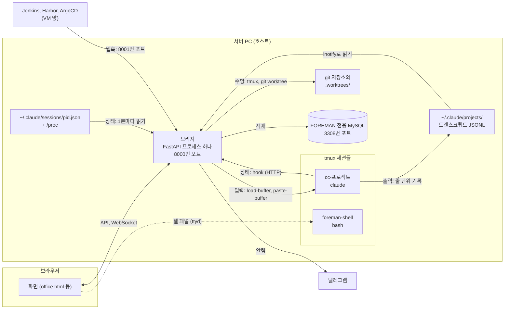

<!--
다루는 곳: bridge/main.py, bridge/__main__.py, bridge/config.py
읽은 커밋: 5e0f7c5
-->

# 01 전체 구조

FOREMAN의 몸통은 **브리지**라고 부르는 파이썬 프로세스 하나다. FastAPI(파이썬 웹 서버 틀)로 만든 이 프로세스가 서버 PC에서 돌면서, 여러 Claude Code(이하 CC) 세션에 글을 넣고, 세션이 남기는 기록을 읽어 DB에 쌓고, 세션이 살아 있는지 멈췄는지를 재고, 위험한 명령에 승인을 묻고, 세션과 작업 폴더를 만들고 치우고, 텔레그램으로 알리고, CI/CD 쪽에서 오는 웹훅을 받는다. 브라우저 화면은 이 브리지가 내주는 정적 파일이고, 화면이 보는 데이터도 모두 브리지의 API와 WebSocket에서 온다.

이 편은 그 전체 그림을 한 번에 보여 주는 개요다. 브리지가 어떤 일을 어떤 길로 맡는지, 왜 입력과 출력의 길이 다른지, 브리지가 뜰 때 함께 붙는 뒤 작업들이 무엇이고 각각 어느 편에서 깊게 다뤄지는지, 파이썬 모듈과 화면 주소가 어느 편으로 이어지는지를 지도로 정리한다. 브리지와 DB를 왜 이 자리(클러스터 밖, 호스트)에 두었는지는 → 어디에 두었나에서, 설정을 읽고 뒤 작업을 켜는 자세한 차례는 → 브리지가 뜨는 차례에서 다룬다.

## 한 프로세스가 맡는 여덟 갈래

브리지가 맡는 일은 크게 여덟 갈래다. 아래 그림은 브리지 하나를 가운데 두고, 그것이 무엇과 어떤 길로 이어지는지를 그린 것이다 [code:bridge/main.py].

여덟 갈래를 하나씩 말로 풀면 이렇다.

**입력**은 사람이 화면에서 쓴 글을 CC 세션에 넣는 일이다. 브리지는 세션이 떠 있는 tmux 창에 글을 붙여 넣고 Enter를 보낸다. 사람이 CC 터미널 앞에 앉아 직접 친 것과 똑같이 들어가므로, 세션은 그 글이 화면에서 왔는지 키보드에서 왔는지 모른다 [code:bridge/inject.py]. 이 길은 → 03 세션 지켜보기와 글 넣기에서 다룬다.

**출력**은 CC가 무엇을 했는지를 읽는 일이다. CC는 대화 한 줄 한 줄을 `~/.claude/projects/` 아래 JSONL 파일(한 줄에 JSON 하나씩 쌓이는 파일)에 남긴다. 이것을 트랜스크립트라고 부른다. 브리지는 이 파일이 늘어날 때마다 새 줄만 이어 읽어 턴(사람 요청 하나와 그에 대한 CC의 응답 묶음)으로 조립한다 [code:bridge/transcript/] [code:bridge/assembler.py]. → 02 기록 모으기.

**상태**는 지금 이 세션이 일하는 중인지, 멈췄는지, 사라졌는지를 아는 일이다. 두 가지 재료를 쓴다. 하나는 CC hook이다. hook은 CC가 정해진 순간(사람 요청이 들어올 때, 도구를 쓰기 전과 후, 응답을 마칠 때 등)에 바깥 스크립트를 부르는 장치인데, FOREMAN의 hook 스크립트는 그 사건을 HTTP로 브리지에 보낸다. 다른 하나는 CC가 프로세스마다 적어 두는 `~/.claude/sessions/<pid>.json`과 리눅스의 `/proc/<pid>/stat`이다. CC는 따로 심장박동을 보내지 않기 때문에, 프로세스가 살아 있는지, Ctrl+Z로 멈췄는지, 일하는 중인지 쉬는 중인지는 브리지가 주기적으로 들여다봐야 안다 [code:bridge/api/hooks.py] [code:bridge/liveness.py] [code:bridge/session_state.py]. → 02 기록 모으기(hook), → 03 세션 지켜보기와 글 넣기(살아 있나, 멈췄나).

**승인**은 되돌릴 수 없는 명령을 사람에게 묻는 일이다. CC가 도구를 쓰기 직전(PreToolUse hook)에 브리지가 규칙으로 판정해 통과시키거나 묻는다. 묻는 경우 화면, 텔레그램, 터미널 가운데 먼저 온 결정이 이긴다 [code:bridge/approvals.py]. → 04 승인.

**수명**은 세션과 작업 자리를 만들고 치우는 일이다. 새 세션은 tmux 세션(`cc-<프로젝트>`)을 만들고 그 안에서 `claude`를 띄우는 것으로 시작한다. 같은 프로젝트에 이미 세션이 돌고 있으면 git worktree(화면 이름은 작업방, `.worktrees/<이름>` 폴더와 `cc/<이름>` 브랜치)를 따로 만들어 그 안에서 띄운다. 일이 끝나면 합치고, 세션을 끝내고, 작업방을 치운다 [code:bridge/handoff.py] [code:bridge/worktree.py]. → 06 세션 띄우기와 따로 작업, → 07 합치기.

**적재**는 모은 것을 DB에 쌓는 일이다. FOREMAN 전용 MySQL 인스턴스(호스트 도커, 3308번 포트)에 턴, 메시지, 서브에이전트 실행, 이벤트를 쌓는다 [code:bridge/config.py]. 화면에 보내는 것은 언제나 DB에 넣은 다음이다. 그래서 화면에서 본 것은 DB에도 있다. → 02 기록 모으기, → 15 DB.

**알림**은 사람이 봐야 할 것을 텔레그램으로 보내는 일이다. 턴이 끝났을 때, 승인을 기다릴 때, 적재가 막혔을 때, 세션이 오래 멈췄을 때처럼 정해 둔 순간에 브리지가 기계적으로 보낸다. 세션(모델)이 판단해서 보내는 것이 아니다 [code:bridge/notify.py]. → 11 알림.

**웹훅**은 바깥(Jenkins, Harbor, ArgoCD)에서 오는 사건을 받는 일이다. 커밋 하나가 빌드, 이미지, 배포로 이어지는 흐름을 잇는 재료가 된다. 웹훅은 클러스터(VM) 쪽에서 오기 때문에 브리지는 웹훅만 받는 두 번째 문을 따로 연다(아래 「한 앱, 두 문」) [code:bridge/api/webhooks.py]. → 12 CI/CD 인과 체인.

이 여덟 갈래 말고도 브리지가 직접 들고 있는 것이 몇 가지 더 있다. 브라우저에서 서버 셸을 쓰는 셸 패널(ttyd를 브리지 뒤에 숨긴 것, → 14 화면의 셸 패널과 세션 화면), 계정 사용량을 주기적으로 읽는 일(→ 13 사용량과 모델), 노션 게시(→ 10 서기와 문서), 계획 세우기와 자동 기상(코드 이름은 디스패처, → 09 교장과 관리자)이다 [code:bridge/main.py].

## 입력과 출력의 길이 다르다

FOREMAN을 처음 보면 가장 이상해 보이는 점이 이것이다. 글은 tmux 화면으로 넣는데, 결과는 tmux 화면에서 읽지 않고 디스크의 트랜스크립트 파일에서 읽는다. 같은 창으로 넣고 같은 창에서 읽으면 간단할 텐데 왜 그러지 않는가.

까닭은 CC가 TUI(터미널 화면 전체를 그림처럼 다시 그리는 프로그램)라서다. CC 화면에는 글자만 있는 것이 아니라 색과 커서를 옮기는 ANSI 이스케이프 코드, 입력 칸 테두리, 진행 표시, 접힌 붙여넣기, 스크롤 때마다 다시 그려지는 줄이 섞여 있다. 이것을 `tmux capture-pane`으로 긁어 오면 같은 응답이 다시 그려질 때마다 겹치고, 긴 응답은 화면 밖으로 밀려 잘리고, 어디까지가 모델 응답이고 어디부터가 화면 장식인지 가를 수 없다 [code:README.md]. 반대로 트랜스크립트는 CC가 스스로 남기는 구조화된 기록이라 메시지 하나, 도구 호출 하나, 토큰 사용량 하나가 각각 깨끗한 JSON 줄로 남는다. 서브에이전트 기록도 같은 폴더 아래 따로 남는다. 그래서 읽기는 트랜스크립트로 정했다.

넣기는 반대다. 트랜스크립트는 CC가 쓰는 파일이지 CC가 읽는 입력이 아니다. 실행 중인 CC에 글을 전하는 길은 그 터미널에 키를 넣는 것뿐이다. 그래서 넣기는 tmux로 정했다. 다만 `tmux send-keys`로 한 글자씩 치면 여러 줄 글의 줄바꿈에서 CC가 중간에 제출해 버린다. 그래서 글을 tmux 버퍼에 먼저 담고(`load-buffer`), 괄호 붙여넣기(앱에 「지금부터 붙여넣기다」라고 알리는 터미널 약속)로 붙인 뒤(`paste-buffer -p -r`), 잠깐 쉬고 Enter를 따로 보낸다 [code:bridge/inject.py]. 이 방식을 고른 실측과 까닭은 → 03 세션 지켜보기와 글 넣기.

이 길에는 숨은 전제가 하나 있다. **같은 세션에 넣는다.** 별도의 headless 세션(화면 없이 `claude -p`로 한 번 묻고 끝나는 세션)을 띄워 일을 시키지 않는다. 사람이 CC 터미널에서 보는 세션과 FOREMAN 화면이 보여 주는 세션이 같은 것이어야, 맥락이 이어지고 「내가 보는 것과 실제가 같다」가 지켜진다 [code:README.md] [docs:01_kickoff.md]. headless 실행은 계획 세우기, 인계 요약, 압축 손실 재기처럼 한 번 묻고 답만 받는 보조 일에만 쓴다.

화면을 긁는 일이 아주 없는 것은 아니다. 글을 넣기 직전에 CC 창에 확인 창(권한 묻기, 끝내기 확인, 자동 압축 권유 등)이 떠 있는지 보려고 `capture-pane`으로 화면을 한 번 읽는다 [code:bridge/inject.py]. 하지만 이것은 「지금 붙여 넣어도 되나」를 가르는 판정일 뿐, 내용을 읽는 길은 아니다. 셸(bash만 돌고 트랜스크립트가 없는 tmux 세션)은 아예 긁지도 않고 ttyd로 터미널 화면을 그대로 브라우저에 띄운다.

## 왜 한 프로세스인가

브리지는 처음부터 지금까지 프로세스 하나다. 수집하는 쪽과 화면을 내주는 쪽을 나누는 설계도 검토했지만 버렸다. 떼어낼 수 있는 화면이 사실상 없기 때문이다. 실시간 상태는 브리지 안의 메모리 대기열과 WebSocket에 있고, 승인 대기는 PreToolUse hook이 브리지의 응답을 기다리며 연결을 붙들고 있는 상태이고, 셸 패널은 브리지만 닿을 수 있는 UNIX 소켓 뒤에 있다. 화면 쪽으로 떼어낼 수 있는 것은 정적 HTML과 JS뿐이라, 따로 띄워도 그것은 브리지 앞에 선 프록시에 지나지 않는다. 배포 단위가 둘이 되면 둘 사이 약속과 한쪽만 죽은 상태를 따로 다뤄야 하는데, 물리 서버가 하나라 얻는 가용성도 없다 [code:README.md]. 이 판단과 브리지를 파드로 띄울 수 없는 까닭은 → 어디에 두었나에서 깊게 다룬다.

프로세스 하나로 두면서 생긴 약속이 있다. 한 기능이 고장 나도 브리지 전체가 죽지 않아야 하고, 그렇다고 고장이 조용히 묻혀서도 안 된다. 셸 패널, 파이프라인, 노션 게시, 합치기 준비, 사용량 읽기 같은 기능은 각자 켜다가 실패하면 로그를 남기고 그 기능만 꺼진 채로 브리지는 뜬다. 그 가운데 사람이 모르면 안 되는 것(합치기 준비, 조사 세션 스스로 끝내기, 역할 권한, 사용량 읽기, `claude` 실행 파일을 못 찾음 등)은 텔레그램으로도 한 번 알린다 [code:bridge/main.py]. 이 「뜨되 조용하지 않게」는 FOREMAN이 존재하는 이유(조용한 고장을 잡는다)를 브리지 자신에게 적용한 것이다. 실제로 `claude`가 systemd의 PATH에 없어 계획 세우기가 이틀 동안 실패만 하고 아무도 몰랐던 일이 있었고, 그 뒤 뜰 때 `shutil.which("claude")`로 한 번 찾아 보고 없으면 알리게 했다 [log:stage14_dispatcher_note_wake_result.md] [c:8907665].

## 한 앱, 두 문

브리지는 같은 앱을 두 포트에서 듣는다 [code:bridge/main.py] [code:bridge/config.py].

| 문 | 주소 | 받는 것 | 인증 |
|---|---|---|---|
| 주 문 | 127.0.0.1:8000 | 화면, API, WebSocket, hook, 셸 패널 | API 토큰(화면, API), hook 토큰(hook) |
| 웹훅 문 | VM 망 쪽 주소(virbr0):8001 | `/webhooks/*`만 | 웹훅 토큰 + 보낸 곳이 VM 망이어야 함 |

주 문은 루프백 주소에만 묶여 있어 서버 PC 밖에서는 닿지 않는다. 집 PC에서는 ssh 포트 포워딩으로 붙는다. 밖으로 터널을 열지 않기로 한 결정은 → 어디에 두었나.

웹훅 문이 따로 있는 까닭은 Jenkins, Harbor, ArgoCD가 쿠버네티스 노드(libvirt VM) 안에서 돌기 때문이다. VM 안에서 보면 호스트의 127.0.0.1은 자기 자신이라 닿지 않는다. 그래서 VM 망을 향한 호스트 쪽 주소에 두 번째 리스너를 연다 [code:bridge/config.py]. 이 문으로 들어온 요청은 미들웨어가 경로를 보고 `/webhooks/`로 시작하지 않으면 모두 404로 돌려보낸다. 웹훅 문이 뚫려도 대시보드, API, 셸에는 닿지 않게 하려는 것이다.

두 번째 리스너는 같은 프로세스 안에서 uvicorn 서버를 하나 더 돌리는 방식이다. 여기에는 두 가지 함정이 있었다. 첫째, uvicorn은 포트 묶기에 실패하면 프로세스를 통째로 끝낸다(sys.exit). 웹훅 포트 하나 때문에 브리지 전체가 죽으면 안 되므로, 소켓을 브리지가 먼저 직접 묶어 보고 실패하면 경고만 남긴 채 웹훅 문 없이 뜬다. 둘째, 두 번째 서버도 Ctrl-C 같은 신호를 가로채려 해서, 신호는 주 서버만 받도록 신호 처리를 비운 작은 서버 클래스(`_QuietServer`)를 쓴다 [code:bridge/main.py] [c:8c61421]. 웹훅 토큰이 설정에 없으면 웹훅 문은 아예 열지 않고 그 사실을 로그에 남긴다.

## 설정은 한 곳에서

브리지 설정은 `bridge/config.py`의 `Settings` 하나에 모여 있다 [code:bridge/config.py]. pydantic-settings라는 도구로 만든 것인데, 읽는 차례는 단순하다. 비밀값(DB 비밀번호, API 토큰, hook 토큰, 웹훅 토큰)은 저장소 맨 위의 `.env.db`와 `.env.bridge` 파일에서 읽는다. 비밀이 아닌 값(포트, 주기, 시간 상한, 기능 켜고 끄기, 규칙 파일 경로)은 코드에 기본값이 있고, 같은 이름의 환경 변수가 있으면 그것으로 덮는다. 비밀값은 `SecretStr`이라는 형으로 감싸 있어 로그나 오류 메시지에 찍혀도 값 대신 별표가 나온다. 토큰은 32자보다 짧으면 브리지가 아예 뜨지 않는다.

여기서 눈여겨볼 약속이 둘 있다. 하나는 **모든 바깥 호출에 시간 상한이 있다**는 것이다. DB 연결 5초, 쿼리 5초, 재시도 최대 10초, WebSocket 인증 5초 같은 값이 설정에 있다 [code:bridge/config.py]. 시간 상한이 없는 클라이언트는 상대가 답하지 않을 때 끝없이 멈추고, 그 멈춤은 겉으로 드러나지 않는다. 다른 하나는 **토큰을 쓰임새마다 가른다**는 것이다. hook 토큰은 hook 스크립트가 쓰고, API 토큰은 화면과 API가 쓴다. hook 토큰은 세션이 도는 셸 환경에 있으므로 새기 쉬운데, 새도 그것으로는 세션에 글을 넣거나 승인을 누를 수 없다 [log:stage1_bridge_db_result.md]. 토큰을 더 잘게 가른 지금 모습은 → 05 역할과 권한의 열쇠와 비밀.

규칙처럼 자주 바뀌고 사람이 직접 고치는 값은 `Settings`에 넣지 않고 `config/*.toml` 파일로 뺐다. 알림 규칙(`notify.toml`), 승인 규칙(`approval.toml`), 파이프라인(`pipeline.toml`), 사용량(`usage.toml`), 작업방(`worktree.toml`), 인계와 합치기(`handoff.toml`), 자동 기상(`wake.toml`), 역할(`roles.toml`), 노션(`notion.toml`) 등이다. `Settings`는 그 파일들이 어디 있는지만 안다. 이 파일을 고치면 브리지를 다시 띄워야 반영되는 것이 대부분이다(노션 저장소 설정처럼 주기마다 다시 읽는 것은 예외).

진입점 `bridge/__main__.py`는 짧다. 로그 형식을 정하고, 설정을 읽고, 앱을 만들어 uvicorn으로 띄운다 [code:bridge/__main__.py]. 여기서 한 가지 일부러 한 것이 httpx와 httpcore 로거를 WARNING으로 낮춘 것이다. httpx는 INFO 수준에서 요청 주소를 통째로 찍는데, 텔레그램 API 주소에는 봇 토큰이 들어 있다. 알림을 처음 붙인 뒤로 한동안 브리지 로그에 봇 토큰이 그대로 쌓였고, 셸 패널을 만들다 로그를 보면서 발견했다. 로그의 토큰을 지우고 토큰을 다시 발급했다 [log:stage7_terminal_result.md] [c:9776d03].

## 뜰 때 붙는 뒤 작업 지도

브리지는 뜰 때 FastAPI의 lifespan(앱이 요청을 받기 전에 한 번 돌고, 끝날 때 뒷정리하는 자리) 안에서 뒤 작업을 스무 개 남짓 켠다 [code:bridge/main.py]. 대부분은 asyncio 작업(한 프로세스 안에서 번갈아 도는 가벼운 일)으로 끝없이 돌며 주기마다 무엇인가를 재거나, 다른 작업이 부를 때 움직인다. 아래 표가 그 지도다. 켜는 차례 자체와 실패를 다루는 방식은 → 브리지가 뜨는 차례에서 다룬다.

| 뒤 작업 | 하는 일 | 언제 도나 | 설명하는 편 |
|---|---|---|---|
| 적재 대기열(`bus.Pipeline`) | 모든 생산자가 넣은 이벤트를 하나씩 DB에 쓰고 화면에 내보낸다 | 늘 | → 02 기록 모으기의 적재와 내보내기 |
| 셸 패널(`TerminalManager`) | ttyd를 UNIX 소켓에 띄우고 tmux `foreman-shell`을 잇는다 | 켜져 있으면 | → 14 화면의 셸 패널과 세션 화면 |
| 트랜스크립트 와처와 조립기 | 파일 변화를 inotify로 받아 줄을 읽고 턴으로 조립한다 | 늘 | → 02 기록 모으기의 트랜스크립트 읽기, 턴 조립 |
| 세션 제목 채우기 | 옛 세션의 빈 제목을 한 번 채운다 | 뜰 때 한 번 | → 02 기록 모으기의 턴 조립 |
| 알림기(`Notifier`) | 턴 끝, 서브에이전트 끝 등을 텔레그램으로 | 늘 | → 11 알림 |
| 압축과 맥락 알림(`CompactWatch`) | 압축 직후, 맥락이 커졌을 때 알린다 | 턴이 닫히거나 압축될 때 | → 08 인계와 압축 손실 |
| 겹침 알림(`OverlapWatch`) | 사람 요청이 다른 세션 일과 겹치면 알린다 | 사람 요청이 들어올 때 | → 09 교장과 관리자의 겹침 알림 |
| `!` 명령 감시(`BangWatch`) | 셸 명령이 실행되지 않고 글로 들어간 것을 알린다 | 사람 요청이 들어올 때 | → 03 세션 지켜보기와 글 넣기 |
| 승인(`ApprovalManager`) | PreToolUse 판정, 승인 대기, 끊긴 대기 정리 | 늘 | → 04 승인 |
| 적재 건강(`IngestMonitor`) | 적재가 한 자리에서 막히거나 와처가 멈추면 알린다 | 주기 | → 02 기록 모으기의 적재와 내보내기 |
| 세션 상태(`SessionStateWatcher`) | 프로세스 정지, 사라짐, 바쁨과 쉼을 읽어 바뀐 것만 내보낸다 | 주기 | → 03 세션 지켜보기와 글 넣기 |
| 권한 거부 감시(`DeniedWatch`) | CC 자체 권한 거부가 오래 안 풀리면 알린다 | 주기 | → 03 세션 지켜보기와 글 넣기 |
| 멈춤 감시(`StallWatch`) | 작업 중 끊김, 응답 없음, 맴돎, 끝내기 확인 창 | 1분마다 | → 03 세션 지켜보기와 글 넣기 |
| 끝난 뒤 맞추기(`Reconciler`) | 남은 작업방, 남은 합치기 기다림을 훑어 알린다 | 뜰 때, 세션이 끝날 때 | → 07 합치기의 끝난 뒤 맞추기 |
| 파이프라인(`PipelineManager`)과 웹훅 문 | 로컬 git 폴링, 인프라 생존 확인, 웹훅 받기 | 주기, 웹훅이 올 때 | → 12 CI/CD 인과 체인 |
| 세션 조작(`HandoffManager`) | 세션 띄우기, 끝내기, 인계 | 부를 때 | → 06 세션 띄우기와 따로 작업, → 08 인계와 압축 손실 |
| 압축 손실 재기 정리(`LossChecker`) | 브리지가 내려가며 끊긴 재기를 실패로 바꾼다 | 뜰 때 한 번 | → 08 인계와 압축 손실의 압축 손실 재기 |
| 노션 게시와 맞추기(`DocSync`) | 프로젝트마다 게시기, 5분마다 맞추기 | 주기 | → 10 서기와 문서의 노션 게시 |
| 스키마 잠금(`SchemaLock`) | DB 스키마는 한 세션만 바꾸게, 끝난 잠금은 일찍 푼다 | 1분마다 | → 05 역할과 권한의 글이 아니라 권한으로, → 15 DB의 마이그레이션 |
| 미리보기 정리(`Previews`) | 주인 없는 미리보기 브리지를 끈다 | 뜰 때 한 번 | → 06 세션 띄우기와 따로 작업 |
| 합치기 준비(`MergePrep`) | 일을 마친 작업방 세션을 찾아 합치기 카드를 만든다 | 턴이 닫힐 때 + 주기 | → 07 합치기의 합치기 카드 |
| 조사 세션 스스로 끝내기(`InspectorClose`) | 조사 세션이 할 일을 마치면 끝낸다 | 턴이 닫힐 때 + 주기 | → 05 역할과 권한의 역할 다섯 |
| 다른 저장소 막기(`RepoScope`), 역할 권한(`RoleGuard`) | PreToolUse에서 역할과 저장소 범위를 본다 | 승인 판정 때 | → 05 역할과 권한의 글이 아니라 권한으로 |
| 계획 세우기(`ForemanDispatcher`)와 노트 | 계획 세우기, 진행 중인 일 노트 줄 내리기 | 부를 때, 30분마다 | → 09 교장과 관리자 |
| 포스트잇 | 대화 그물 훑기, 조사 결과 받기 | 2분마다 | → 10 서기와 문서의 포스트잇 |
| 관리자와 넘기기(`Managers`, `Handover`) | 프로젝트별 관리자, 넘긴 계획이 시작되지 않으면 알림 | 부를 때 + 주기 | → 09 교장과 관리자의 관리자에게 넘기기와 보고 |
| 자동 기상(`Waker`) | 실패 사건에서 계획을 세워 사람에게 제안 | 실패 사건이 올 때 | → 09 교장과 관리자의 진행 중인 일과 자동 기상 |
| 사용량(`UsageMonitor`) | `claude -p "/usage"`로 계정 사용량을 읽는다 | 주기 | → 13 사용량과 모델 |

표에서 보듯 뒤 작업은 두 부류다. 하나는 스스로 시계를 들고 주기마다 도는 것(멈춤 감시, 적재 건강, 포스트잇, 사용량 등)이고, 다른 하나는 다른 작업이 사건을 넘겨줄 때 움직이는 것(알림기, 압축 알림, 합치기 준비 등)이다. 많은 작업이 둘을 겸한다. 사건으로 바로 움직이되, 사건을 놓쳤을 때를 위해 느린 주기로 한 번 더 훑는다. 코드 주석은 이 느린 훑기를 「그물」이라고 부른다 [code:bridge/main.py].

### 턴이 닫히면 여러 곳이 듣는다

사건을 넘겨주는 가장 큰 줄기는 조립기다. 조립기는 턴이 닫힐 때, 사람 요청이 들어올 때, 압축이 일어날 때, 도구 결과가 올 때 각각 콜백(미리 걸어 둔 함수)을 부른다 [code:bridge/assembler.py]. 그런데 「턴이 닫혔다」를 듣고 싶은 곳이 많다. 알림기는 끝남 알림을 보내고, 셸 패널은 세션이 부탁한 명령이 있는지 보고, 압축 알림은 맥락 크기를 재고, 합치기 준비는 그 세션이 일을 마쳤는지 보고, 조사 세션 끝내기는 조사가 끝났는지 본다.

lifespan은 이것을 사슬로 엮는다. 앞에서 건 콜백을 기억해 두고, 새 콜백이 먼저 그것을 부른 뒤 자기 일을 하게 감싼다 [code:bridge/main.py]. 이때 지키는 약속이 하나 있다. 사슬의 고리 하나가 예외를 내도 적재는 막히지 않는다. 압축 알림, 합치기 준비, 조사 세션 끝내기의 고리는 각자 예외를 잡아 경고만 남긴다. 놓친 것은 그 작업의 느린 주기 훑기가 줍는다. 알림 하나 보내다 실패했다고 기록 쌓기가 멈추면, 고장 하나가 다른 고장을 숨기게 된다.

사람 요청이 들어올 때도 같은 식으로 겹침 알림과 `!` 명령 감시가 함께 듣는다. 세션이 사라지는 사건은 세션 상태 감시가 내고, 끝난 뒤 맞추기와 진행 중인 일 노트가 함께 듣는다.

### 끌 때

브리지가 내려갈 때는 거꾸로 거둔다. 웹훅 문을 먼저 닫고(5초 기다린 뒤 안 닫히면 끊는다), 파이프라인, 자동 기상, 알림기, 셸 패널을 멈추고, 돌던 asyncio 작업을 모두 취소한 뒤, 적재 대기열을 비우고 DB 연결을 닫는다 [code:bridge/main.py]. 셸 패널을 멈출 때 ttyd만 내리고 tmux 셸은 남긴다. 사람이 셸에서 돌리던 것이 브리지 재시작으로 끊기지 않게 하려는 것이다. CC 세션들도 tmux 안에서 따로 돌기 때문에 브리지가 내려가도 세션은 그대로 일한다. 브리지가 없는 동안 hook은 닿지 않지만, hook 스크립트는 실패해도 CC를 막지 않게 되어 있고, 트랜스크립트는 다시 뜬 브리지가 이어 읽는다. 다만 승인 대기만은 다르다. 승인을 기다리던 hook 연결은 브리지와 함께 끊기므로, 브리지를 다시 띄우기 전에는 승인 대기가 없는지 본다.

## 페이지와 API 지도

화면 파일은 비밀값이 없으므로 인증 없이 준다. 토큰은 사람이 페이지에 넣고, 데이터를 가져오는 API와 WebSocket이 그 토큰을 확인한다 [code:bridge/main.py]. FastAPI가 기본으로 여는 API 설명 화면(`/docs`, `/openapi.json`)은 닫았다. 토큰 없이 API 지도를 내보이지 않기 위해서다 [c:5804947].

| 주소 | 내주는 것 | 설명하는 편 |
|---|---|---|
| `/` | 픽셀 오피스 화면(`office.html`). 승인, 대화, 입력, 셸이 모두 여기서 된다 | → 14 화면 |
| `/office` | `/`와 같다. 예전 북마크용 | → 14 화면 |
| `/usage` | 사용량과 한도 화면(`usage.html`) | → 13 사용량과 모델 |
| `/classic` | 처음 만든 카드 대시보드(`dashboard.html`) | → 14 화면 |
| `/debug` | 초기 단계 확인 페이지(로그, 디버그 이벤트) | → 02 기록 모으기의 적재와 내보내기 |
| `/static/*` | 화면의 js, css, 테마 그림 | → 14 화면 |
| `/healthz` | DB와 적재 상태 한 줄. 데이터 경로 가운데 유일하게 인증이 없다 | → 브리지가 뜨는 차례 |

화면 파일(`/`, `/office`, `/classic`, `/debug`, `/static/*`)에는 늘 `Cache-Control: no-cache`를 붙인다. 브라우저가 옛 `store.js`를 캐시에서 꺼내 쓰다 새 `terminal.js`와 어긋났고, 그 오류로 대시보드 연결 자체가 시작되지 않은 일이 있었기 때문이다 [c:9776d03]. no-cache는 「쓰기 전에 매번 서버에 바뀌었는지 물어보라」는 뜻이라, 바뀌지 않았으면 304로 짧게 끝난다. 그래도 이미 열려 있는 탭은 처음 받은 코드로 계속 돌기 때문에, 화면 코드 지문을 따로 실어 보내 탭에 새로 고침 띠를 띄운다(→ 14 화면의 데이터 계층).

API는 기능별 라우터(주소 묶음)로 나뉘어 있고, `main.py`는 그것을 차례로 붙이기만 한다. 주소 앞부분으로 묶으면 이렇다.

| 주소 묶음 | 라우터 파일 | 인증 | 설명하는 편 |
|---|---|---|---|
| `/ws` | `bridge/api/ws.py` | API 토큰(첫 메시지) | → 02 기록 모으기의 적재와 내보내기 |
| `/hooks`, `/hooks/pre`, `/hooks/permission` | `bridge/api/hooks.py` | hook 토큰 | → 02 기록 모으기의 CC hook 받기, → 04 승인 |
| `/hooks/shell`, `/terminal/*`, `/ccscreen/*`, `/api/terminal/*` | `bridge/api/terminal.py` | 쿠키, API 토큰 | → 14 화면의 셸 패널과 세션 화면 |
| `/api/sessions`(목록, 입력, 모델) | `bridge/api/sessions.py` | API 토큰 | → 03 세션 지켜보기와 글 넣기 |
| `/api/dashboard`, `/api/sessions/{id}/conversation` 등, `/api/sessions/{id}/escalate` | `bridge/api/dashboard.py` | API 토큰 | → 14 화면의 데이터 계층 |
| `/api/sessions/{id}/spawn`, `/worktree`, `/handoff`, `/merge-prep`, `/schema-lock` 등 | `bridge/api/handoff.py` | API 토큰 | → 06 세션 띄우기와 따로 작업, → 07 합치기, → 08 인계와 압축 손실 |
| `/api/approvals` | `bridge/api/approvals.py` | API 토큰 | → 04 승인의 기다리는 길 |
| `/api/foreman` | `bridge/api/foreman.py` | API 토큰 | → 09 교장과 관리자의 계획 한 번 |
| `/api/managers` | `bridge/api/managers.py` | API 토큰 | → 09 교장과 관리자의 관리자에게 넘기기와 보고 |
| `/api/coder` | `bridge/api/coder.py` | API 토큰 | → 07 합치기의 합치기 카드 |
| `/api/scribe` | `bridge/api/scribe.py` | API 토큰 | → 10 서기와 문서의 서기실과 일감 |
| `/api/postit`, `/api/todo` | `bridge/api/postit.py`, `bridge/api/todo.py` | API 토큰 | → 10 서기와 문서의 포스트잇 |
| `/api/publish` | `bridge/api/publish.py` | API 토큰 | → 10 서기와 문서의 노션 게시 |
| `/api/usage` | `bridge/api/usage.py` | API 토큰 | → 13 사용량과 모델 |
| `/api/pipeline`, `/api/ingest` | `bridge/main.py`에 직접 | API 토큰 | → 12 CI/CD 인과 체인, → 02 기록 모으기 |
| `/api/debug` | `bridge/api/debug.py` | API 토큰, 설정에서 켤 때만 | → 02 기록 모으기의 적재와 내보내기 |
| `/webhooks/jenkins`, `/harbor`, `/argocd` | `bridge/api/webhooks.py` | 웹훅 토큰 | → 12 CI/CD 인과 체인 |
| `/healthz` | `bridge/api/health.py` | 없음 | → 브리지가 뜨는 차례 |

토큰을 확인하는 공통 부품은 `bridge/api/auth.py`에 있다 [code:bridge/api/auth.py]. API 토큰 하나 말고 프로젝트마다 범위를 좁힌 토큰도 받는데, 그 구분은 → 05 역할과 권한의 열쇠와 비밀.

## 모듈 지도

`bridge/` 아래 파이썬 모듈이 어느 편에서 설명되는지를 묶어 둔다. 한 모듈이 여러 편에 걸치면 가장 깊게 다루는 편을 먼저 적었다.

| 무리 | 모듈 | 설명하는 편 |
|---|---|---|
| 뼈대 | `main.py`, `__main__.py`, `config.py` | 이 편, → 브리지가 뜨는 차례 |
| 화면 지문 | `uiver.py` | → 14 화면의 데이터 계층, → 브리지가 뜨는 차례 |
| 기록 모으기 | `transcript/`(`watcher.py`, `reader.py`, `lookup.py`), `ingest.py` | → 02 기록 모으기의 트랜스크립트 읽기 |
| | `assembler.py`, `store.py`, `models.py` | → 02 기록 모으기의 턴 조립 |
| | `bus.py`, `mask.py`, `ingest_health.py` | → 02 기록 모으기의 적재와 내보내기 |
| 세션 지켜보기와 넣기 | `liveness.py`, `session_state.py`, `stallwatch.py`, `human_wait.py`, `api_error.py`, `bang_watch.py`, `xmsg.py`, `inject.py` | → 03 세션 지켜보기와 글 넣기 |
| 승인 | `approval.py` | → 04 승인의 규칙: 실행과 글자 |
| | `approvals.py` | → 04 승인의 기다리는 길: hook 두 개 |
| | `approval_summary.py` | → 04 승인의 승인 요약 |
| | `hookmiss.py`(판정 없이 통과한 도구 호출을 한 줄씩 남기는 기록) | → 04 승인의 기다리는 길: hook 두 개, → 02 기록 모으기의 CC hook 받기 |
| 역할과 권한 | `roles.py`, `inspector_close.py` | → 05 역할과 권한의 역할 다섯 |
| | `roleguard.py`, `reposcope.py`, `schemalock.py`, `pgrep_guard.py` | → 05 역할과 권한의 글이 아니라 권한으로 |
| | `scopetoken.py` | → 05 역할과 권한의 열쇠와 비밀 |
| 세션 띄우기와 작업방 | `handoff.py`(띄우기, 세션 조작), `worktree.py`, `preview.py`, `previews.py` | → 06 세션 띄우기와 따로 작업 |
| 합치기 | `mergeprep.py`, `coder_room.py` | → 07 합치기의 합치기 카드 |
| | `reconcile.py` | → 07 합치기의 끝난 뒤 맞추기 |
| 인계와 압축 손실 | `losscheck.py`, `compactwatch.py` | → 08 인계와 압축 손실의 압축 손실 재기 |
| | `pointers.py`, `handoff_state.py` | → 08 인계와 압축 손실의 인계 요약과 읽을 곳 |
| | `promote.py` | → 08 인계와 압축 손실의 문서로 옮기기 |
| | `switchwatch.py` | → 08 인계와 압축 손실의 새 세션으로 옮기기 |
| 교장과 관리자 | `foreman.py` | → 09 교장과 관리자의 계획 한 번 |
| | `foreman_note.py`, `wake.py` | → 09 교장과 관리자의 진행 중인 일과 자동 기상 |
| | `overlap.py` | → 09 교장과 관리자의 겹침 알림 |
| | `handover.py`, `managers.py` | → 09 교장과 관리자의 관리자에게 넘기기와 보고 |
| 서기와 문서 | `scribe_room.py`, `scribe.py` | → 10 서기와 문서의 서기실과 일감 |
| | `postit.py` | → 10 서기와 문서의 포스트잇 |
| | `evidence.py`, `scribe_ask.py` | → 10 서기와 문서의 근거 확인과 물어보기 |
| | `doctext/`(근거 표시, 머리 주석, 편 제목과 참조를 읽는 문법 묶음, 저장소 읽기와 저장소마다 다른 문서 설정도 여기) | → 10 서기와 문서의 근거 확인과 물어보기 |
| | `notion.py`, `docsync.py`, `notioncfg.py`, `manuscript.py` | → 10 서기와 문서의 노션 게시 |
| 알림 | `notify.py`, `telegram.py` | → 11 알림 |
| CI/CD | `pipeline.py` | → 12 CI/CD 인과 체인 |
| 사용량과 모델 | `usage.py`, `model_choice.py` | → 13 사용량과 모델 |
| 셸 | `terminal.py` | → 14 화면의 셸 패널과 세션 화면 |
| DB | `db/engine.py` | → 15 DB |
| | `db/migrate.py` | → 15 DB의 마이그레이션 |

이름이 헷갈리기 쉬운 것 둘을 짚어 둔다. `bus.py`의 `Pipeline`은 적재 대기열(이벤트를 DB에 쓰는 줄)이고, `pipeline.py`의 `PipelineManager`는 CI/CD 인과 체인이다. 둘은 아무 관계가 없다. 또 `handoff.py`는 이름과 달리 인계만 하는 모듈이 아니라 세션 띄우기, 끝내기, tmux 조작을 모두 맡는 세션 조작의 중심이다. 인계 기능이 먼저 생기고 세션 조작이 그 위에 쌓이면서 이름이 남았다.

## 그림에는 있지만 아직 없는 것

README의 처음 설계 그림은 브리지가 맡을 일로 지금보다 몇 가지를 더 적었다. 코드에서 확인한 지금 상태는 이렇다 [code:bridge/main.py] [code:bridge/pipeline.py] [code:bridge/api/webhooks.py].

웹훅은 Jenkins, Harbor, ArgoCD 셋만 받는다. 설계 그림에 있던 GitLab 웹훅 받는 곳은 없다. 폴링 쪽에서는 로컬 git 폴링과 인프라(Jenkins, ArgoCD 등) 생존 확인이 파이프라인 안에 있고, 사용량 읽기가 따로 있다. 설계 그림에 적힌 LLM 지표 수집, 프로메테우스 쿼리, systemd 유닛과 docker 컨테이너의 재시작 추세 폴링은 아직 브리지에 없다. FOREMAN을 만든 계기가 바로 systemd 유닛 하나(`milvus-port-forward`)가 한 달 넘게 567,740번 재시작한 것을 몰랐던 일이라, 재시작 추세 폴링은 이 프로젝트의 목적과 가장 가까운 빈자리다 [code:README.md].

## 이어지는 편

이 편 아래에는 두 편이 있다. **어디에 두었나**는 브리지와 DB를 왜 쿠버네티스 클러스터 밖 호스트에 두었는지(감시하는 쪽과 감시받는 쪽의 장애 범위를 나눈다), 기존 MySQL에 얹지 않고 전용 인스턴스를 둔 까닭, systemd 사용자 유닛으로 돌리는 방식, 밖으로 터널을 열지 않은 결정을 다룬다. **브리지가 뜨는 차례**는 설정을 읽는 차례, 위 지도의 뒤 작업을 켜고 거두는 차례, 한 기능이 실패해도 나머지가 뜨게 한 방식, 다시 띄우기 전에 승인 대기를 보는 까닭, 화면 파일과 화면 코드 지문을 다룬다.

그 밖의 갈래는 위 표의 편으로 이어진다. 흐름을 따라 읽으려면 02 기록 모으기(무엇을 읽어 쌓는가), 03 세션 지켜보기와 글 넣기(살아 있나, 어떻게 넣나), 04 승인(무엇을 묻나), 06과 07(세션을 어떻게 띄우고 합치나) 차례가 자연스럽다.
