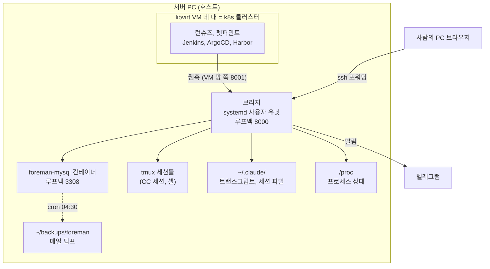

<!--
다루는 곳: deploy/systemd/foreman-bridge.service, deploy/systemd/foreman-bridge-alert.service, scripts/foreman-bridge-alert.sh, deploy/mysql/, docs/02_cloudflare_tunnel.md
읽은 커밋: 5e0f7c5
-->
# 어디에 두었나

FOREMAN은 두 덩어리로 돈다. 하나는 브리지다. 브리지는 파이썬(FastAPI) 프로세스 하나로, CC 세션의 기록을 읽고, 세션에 글을 넣고, 승인을 받고, 알림을 보내고, 화면을 내준다. 다른 하나는 DB다. 브리지가 모은 기록이 쌓이는 MySQL이다. 이 편은 이 둘을 어느 기계의 어디에 두었는지, 어떻게 켜 두고 지키는지, 그리고 왜 밖에서 볼 수 있게 열지 않았는지를 다룬다.

결론부터 말하면 둘 다 쿠버네티스 클러스터 밖, 서버 PC 자체(호스트)에 있다. 브리지는 systemd 사용자 유닛으로 돌고, DB는 호스트 도커의 FOREMAN 전용 MySQL 컨테이너다. 브리지는 그 서버 안에서만 닿는 주소(루프백, 127.0.0.1)에만 귀를 연다. 밖에서 보려고 Cloudflare 터널로 여는 계획을 끝까지 써 두었지만 열지 않았다. 아래에서 하나씩 왜 그렇게 정했는지, 무엇을 버렸는지, 아직 남은 빈틈은 무엇인지 적는다 [code:README.md][code:bridge/config.py].

## 한눈에 보기

이 서버 하나에 여러 층이 겹쳐 있다. 맨 아래가 물리 서버(호스트)이고, 그 위에 libvirt로 띄운 가상 머신(VM) 네 대가 쿠버네티스 클러스터를 이룬다. 런슈즈와 펫퍼민트의 운영 서비스, Jenkins, ArgoCD, Harbor 같은 CI/CD 도구는 그 클러스터 안에 있다. FOREMAN은 클러스터 안이 아니라 맨 아래 호스트에 붙어 있다.



| 무엇 | 어디에 | 어떻게 켜 두나 | 누가 붙을 수 있나 |
|---|---|---|---|
| 브리지(화면, API, 수집) | 호스트 프로세스 | systemd 사용자 유닛 `foreman-bridge` | 루프백 8000만. 사람은 ssh 포워딩으로 [code:bridge/config.py] |
| 웹훅 받는 귀 | 같은 브리지 프로세스 | 브리지가 뜰 때 함께 연다 | VM 망 쪽 가상 브리지 주소의 8001, `/webhooks/*`만, VM 망에서 온 것만, 웹훅 토큰이 있을 때만 [code:bridge/main.py] |
| 셸 패널, 세션 화면 | 브리지가 자식으로 띄운 ttyd | 브리지와 함께 | TCP 포트 없이 유닉스 소켓만(폴더 권한 0700) [code:bridge/config.py] |
| DB | 호스트 도커 `foreman-mysql` | `restart: unless-stopped` | 루프백 3308만 [code:deploy/mysql/compose.yml] |
| 백업 | `~/backups/foreman` | 사용자 crontab, 매일 04:30 | 파일 권한 077 마스크 [code:deploy/mysql/backup.sh] |

위 표에서 밖을 향한 귀는 사실상 하나도 없다. 웹훅 귀는 VM 망 쪽에만 열려 있어 클러스터 안에서만 닿고, 나머지는 모두 서버 안에서만 닿는다 [code:bridge/config.py]. 웹훅이 어떻게 오고 어떻게 이어 붙는지는 → 12 CI/CD 인과 체인에서 다룬다.

## 감시하는 쪽과 감시받는 쪽을 떼어 놓는다

브리지와 DB를 클러스터 밖에 둔 결정적인 까닭은 하나다. 감시하는 장비가 감시받는 대상과 같이 죽으면 안 된다.

FOREMAN은 「조용한 고장」을 잡으려고 만들었다. 이 서버에서 실제로 있었던 일이 출발점이다. 호스트의 `milvus-port-forward.service`라는 systemd 유닛이 호스트에 없는 kubectl을 부르다 매번 실패했고, `Restart=always` 설정 때문에 3초마다 다시 떴다. 그렇게 한 달 넘게 567,740번 재시작했는데 아무도 몰랐다 [log:infra_20261102_milvus-port-forward.md]. 같은 날 milvus 컨테이너도 재시작 때마다 내부 etcd가 무너져 17분 동안 크래시 루프를 돌았다 [log:infra_20261102_host-changes.md]. 둘 다 클러스터와 호스트 서비스가 흔들리는 순간이었다.

FOREMAN이 기록해야 하는 것은 바로 그런 순간이다. 그런데 DB가 클러스터 안에 있으면, 클러스터가 흔들리는 바로 그 순간에 적재가 멈추고 화면도 꺼진다. 가장 필요한 때에 장부가 비는 셈이다. 그래서 감시하는 쪽(FOREMAN)과 감시받는 쪽(클러스터의 서비스)이 고장 나는 범위를 서로 겹치지 않게 갈랐다 [code:README.md]. 클러스터가 통째로 죽어도 호스트의 브리지와 DB는 살아서 그 사실을 기록하고 텔레그램으로 알린다.

물론 호스트 자체가 꺼지면 둘 다 꺼진다. 이 범위는 갈 수 없다. 물리 서버가 한 대뿐이라 FOREMAN을 다른 기계로 옮길 곳이 없다. 다만 호스트가 꺼지는 일은 사람이 바로 알아채는 큰 고장이다. FOREMAN이 잡으려는 것은 겉으로는 멀쩡해 보이는 채로 속에서 새는 고장이고, 그런 고장은 대개 호스트 위의 한 층(클러스터, 컨테이너, 유닛)에서 난다.

이 결정을 받치는 까닭이 몇 가지 더 있다. 첫째, 브리지가 다루는 것이 전부 호스트에 있다. tmux, `~/.claude/projects/`의 트랜스크립트, CC hook, `/proc` 폴링, systemd와 도커의 재시작 횟수가 모두 호스트의 것이다. 수집하는 프로세스가 그 옆에 있어야 자연스럽고, DB도 같은 곳에 두면 수집과 적재 사이에 네트워크 경계가 하나도 없다. 둘째, 재부팅 때 빨리 뜬다. 호스트 도커는 docker 데몬과 함께 바로 올라온다. 클러스터 안이었다면 VM 네 대가 켜지고, 쿠버네티스가 올라오고, 파드가 자리 잡기를 기다려야 한다. 고장 직후 몇 분이 가장 중요한데 그동안 FOREMAN이 장님이 되면 안 된다.

## 기존 MySQL에 얹지 않은 까닭

이 서버에는 이미 MySQL이 넷 있었다. 클러스터 안 파드 둘과 호스트 도커 컨테이너 둘이다. 새로 하나를 띄우는 것보다 있는 것에 데이터베이스 하나를 더 만드는 게 쉬워 보였다. 하나씩 따져 보면 어느 것도 맞지 않았다 [log:01_kickoff_result.md].

| 후보 | 무엇이었나 | 얹지 않은 까닭 |
|---|---|---|
| 클러스터의 펫퍼민트 MySQL | 운영 DB, 클러스터 안 파드 | 운영 DB에 감시 기록을 섞을 수 없다. headless 서비스라 호스트에서 바로 붙을 길도 없다. 무엇보다 클러스터 안이라 위의 장애 범위 문제가 그대로다 |
| 클러스터의 런슈즈 MySQL | 운영 DB, 클러스터 안 파드 | 위와 같다 |
| 호스트 3306의 `mysql` 컨테이너 | 펫퍼민트 로컬 개발과 측정용 | 펫퍼민트 쪽 스크립트가 관리한다. 그쪽이 데이터 폴더를 비우고 초기화하면 FOREMAN 기록이 같이 사라진다. 거꾸로 FOREMAN이 쉬지 않고 쓰면 펫퍼민트의 성능 측정값이 오염된다 |
| 호스트 3307의 `runshoes-mysql-dev` 컨테이너 | 런슈즈 로컬 개발용 | 이 컨테이너를 따로 따진 까닭은 기록에 없다. 다만 3306처럼 다른 프로젝트가 관리하는 개발용 그릇이고, 재부팅 때 저절로 다시 뜨지 않는 설정(compose 기본값)이었다 [log:infra_20261102_host-changes.md] |

3306 줄이 특히 중요했다. 같은 그릇을 쓰면 남의 일정에 내 데이터가 휘말리고, 내 부하가 남의 실험을 망친다. 서로 소유자가 다른 데이터는 그릇도 나누는 게 맞다고 봤다 [code:README.md].

클러스터 DB에 붙는 길도 두 가지 검토했다. 하나는 클러스터 관리 VM에서 `kubectl port-forward`로 포트를 끌어오는 것이다. 이건 파드가 재시작되면 끊기고, 끊긴 것을 다시 이을 감독 프로세스가 따로 필요하다. 그 감독 프로세스가 바로 이 프로젝트를 시작하게 만든 `milvus-port-forward`와 같은 모양이다. 같은 함정을 다시 팔 이유가 없었다. 다른 하나는 NodePort나 MetalLB로 클러스터 밖에 포트를 새로 여는 것이다. 연결은 되지만 장애 범위 문제는 그대로이고, 데이터가 노드 한 대의 로컬 디스크(`local-path`)에 묶인다 [code:README.md].

그래서 FOREMAN 전용 MySQL을 호스트 도커에 새로 띄웠다. 포트는 기존 3306(펫퍼민트 개발용), 3307(런슈즈 개발용)과 겹치지 않는 3308이다 [log:01_kickoff_result.md].

## 브리지를 파드로 띄울 수 없는 까닭

「DB는 그렇다 치고, 브리지는 파드로 올려 쿠버네티스가 살려 두게 하면 되지 않나」라는 물음이 자연스럽다. 이 서버에서는 구조적으로 안 된다 [code:README.md].

쿠버네티스에서 파드가 호스트를 들여다보는 표준 방법은 `hostPID`(호스트의 프로세스 목록을 본다)와 `hostPath`(호스트의 폴더를 붙인다)다. 그런데 여기서 쿠버네티스 노드는 libvirt로 띄운 VM이다. 파드 입장의 「호스트」는 서버 PC가 아니라 그 VM이다. 그래서 `hostPID`를 켜도 보이는 것은 VM 안의 프로세스이고, 서버 PC에서 도는 claude 프로세스(`/proc`)는 보이지 않는다. `hostPath`로 붙이는 `~/.claude/`도 VM의 것이지 서버 PC의 것이 아니다 [code:README.md].

tmux는 더 단단히 막혀 있다. 브리지는 tmux 서버와 유닉스 소켓으로 이야기한다. 유닉스 소켓은 같은 커널 안에서만 통하는 통로라 VM 경계를 넘지 못한다. 세션에 글을 넣는 일(→ 03 세션 지켜보기와 글 넣기)도, 세션을 띄우고 끝내는 일도 전부 이 소켓을 거친다 [code:README.md].

우회로가 둘 있었다. 첫째는 파드에서 서버 PC로 ssh를 걸어 명령을 대신 치게 하는 것이다. 그러려면 사용자 계정의 ssh 키를 클러스터 Secret에 넣어야 한다. 그러면 파드 하나가 털리는 순간 서버 PC의 셸이 털린다. 보안 경계를 오히려 거꾸로 세우는 셈이다. 둘째는 트랜스크립트 폴더를 NFS로 VM에 내보내는 것이다. 이 경우 NFS 클라이언트 쪽에서는 inotify(파일이 바뀌면 커널이 바로 알려 주는 기능)가 오지 않는다. 결국 주기적으로 파일 크기를 비교하는 폴링으로 돌아가야 하고, 실시간으로 보는 FOREMAN의 장점이 사라진다 [code:README.md].

## 수집부와 화면을 나누지 않은 까닭

한 가지 타협안이 더 있었다. 호스트에 꼭 붙어야 하는 수집부만 호스트에 두고, API와 화면은 파드로 떼어 클러스터의 CI/CD(이미지 빌드, Harbor, ArgoCD)에 태우는 것이다. 런슈즈 화면이 그렇게 배포되니 맞춰 두면 깔끔해 보인다. 처음에는 CI/CD 단계에서 다시 보기로 미뤘는데, 막상 다시 보니 나눌 이유가 오히려 줄었다 [code:README.md].

먼저 떼어 낼 화면이 사실상 없다. 화면이 보여 주는 것은 실시간 상태(WebSocket으로 흐르는 조립된 턴), 승인 대기(PreToolUse hook이 브리지 프로세스 안에서 사람의 답을 기다린다), 셸 패널과 세션 화면(호스트의 ttyd 유닉스 소켓)이다. 셋 다 브리지 프로세스 안이나 호스트에 묶여 있다. 파드로 옮길 수 있는 것은 정적 HTML과 JS 파일뿐이고, 그 파드는 결국 호스트 브리지 앞에 선 프록시 하나가 된다.

다음으로 화면은 빌드할 것이 없다. 번들러 없는 순수 JS라 저장소의 파일을 그대로 낸다. 빌드, 이미지, Harbor, ArgoCD를 거치게 하면 단계만 늘고 얻는 것이 없다. 그래서 FOREMAN은 GitLab이나 Jenkins에도 태우지 않는다. 그쪽은 이미지를 만들어 Harbor로 보내는 서비스용인데 FOREMAN에는 이미지가 없다 [code:README.md].

런슈즈 화면과 닮은 점은 「브라우저로 본다」 하나뿐이다. 런슈즈는 밖의 사용자에게 여는 서비스이고, FOREMAN 화면은 호스트 셸과 승인 권한을 쥔 관제실이다. 클러스터 쪽으로 옮기면 노출되는 면만 넓어진다 [code:README.md].

마지막으로, 배포 단위가 둘이 되면 그 사이의 약속(프로토콜)을 새로 만들고 한쪽만 죽은 상태를 따로 다뤄야 한다. 클러스터가 죽으면 정작 그때 화면이 꺼진다. 물리 서버가 한 대라 둘로 나눠도 가용성은 늘지 않는다. 얻는 것 없이 고장 날 곳만 늘어난다.

그래서 배포는 「systemd로 돌리고, 시험은 따로 자동으로 돌린다」로 정했다. 시험 자동 실행(GitHub Actions)은 정해 두고 아직 만들지 않았다. 지금은 관리자가 합친 뒤 손으로 pytest와 node 시험을 돌린다 [code:README.md]. → 16 시험과 배포

## 브리지를 돌리는 법: systemd 사용자 유닛

처음 몇 단계 동안 브리지는 tmux 세션 하나에 손으로 띄웠다 [log:infra_20261102_host-changes.md]. 서버가 정전으로 세 시간쯤 꺼졌다가 다시 켜졌을 때 이 방식의 약점이 그대로 드러났다. 도커의 MySQL 컨테이너는 재시작 정책 덕에 스스로 올라왔지만 브리지는 뜨지 않았다. 부팅 뒤 8000 포트에 아무도 없었다. 꺼지기 직전 쓰인 트랜스크립트 7개 파일, 12줄이 적재되지 못한 채 밀려 있었다 [log:infra_20261106_systemd-bridge.md]. 다행히 트랜스크립트는 파일로 남아 있어서 브리지를 띄우자 백필(밀린 것 다시 읽기)이 0.3초 만에 따라잡았다 [log:infra_20261106_systemd-bridge.md]. 그날 브리지를 systemd 유닛으로 옮겼다 [c:7ae7a49].

유닛 파일은 저장소의 `deploy/systemd/foreman-bridge.service`이고, `systemctl --user link`로 사용자 설정 폴더에서 이 파일을 가리키게 했다. 저장소 파일이 곧 설치된 파일이라 둘이 어긋날 틈이 없다 [log:infra_20261106_systemd-bridge.md].

| 설정 | 값 | 뜻 |
|---|---|---|
| `Type` | `simple` | 프로세스가 곧 서비스다 |
| `WorkingDirectory` | 저장소 맨 위(원본 폴더) | 작업 폴더가 곧 실행 폴더다 |
| `ExecStart` | `.venv/bin/python -m bridge` | 저장소의 가상환경 파이썬으로 띄운다 |
| `Restart` | `on-failure` | 비정상으로 끝나면 다시 띄운다 |
| `RestartSec` | `5` | 다시 띄우기 전 5초 쉰다 |
| `StartLimitIntervalSec`, `StartLimitBurst` | `300`, `10` | 300초 안에 10번까지 다시 시도한다 |
| `OnFailure` | `foreman-bridge-alert.service` | 다시 띄우기를 포기하면 브리지 밖 알림 유닛을 부른다 |
| `Environment=PATH` | 사용자 npm 폴더, `~/.local/bin`, 시스템 폴더 | tmux와 claude 실행 파일을 찾게 한다 |
| `KillMode` | `mixed` | 끌 때 본 프로세스에 먼저 신호를 보내고, 남은 자식은 나중에 거둔다 |
| `TimeoutStopSec` | `20` | 20초 안에 안 꺼지면 강제로 끈다 |
| `WantedBy` | `default.target` | 사용자 매니저가 뜰 때 함께 뜬다 |

[code:deploy/systemd/foreman-bridge.service]

### 왜 사용자 유닛인가

시스템 유닛(`/etc/systemd/system`)으로 두면 설치할 때마다 sudo가 필요하다. 이 프로젝트는 sudo 명령을 세션이 직접 치지 않고 사람에게 한 줄로 부탁하는 규칙이라, 유닛을 고칠 때마다 사람을 불러야 한다. 그리고 브리지가 다루는 것(tmux 서버, `~/.claude/`)은 전부 한 사용자 계정의 것이다. 그 계정으로 도는 사용자 유닛이 맞다 [log:infra_20261106_systemd-bridge.md].

사용자 유닛에는 함정이 하나 있다. 기본값으로 사용자 매니저는 그 사용자가 로그인해야 뜬다. 아무도 로그인하지 않은 채 서버가 재부팅되면 유닛도 안 뜬다. 그래서 `loginctl enable-linger`로 linger를 켰다. 로그인하지 않아도 부팅 때 사용자 매니저가 뜨게 하는 설정이다. 다행히 sudo 없이 됐다 [log:infra_20261106_systemd-bridge.md].

### PATH가 빠져 이틀 동안 몰랐던 일

systemd로 옮기고 나서 숨은 고장이 하나 생겼다. 손으로 띄울 때는 로그인 셸의 PATH를 그대로 물려받았지만, systemd 유닛은 최소한의 PATH로 뜬다. claude 실행 파일이 사용자 npm 폴더에 있었는데 그 폴더가 PATH에 없었다. 그 결과 사람이 일을 맡기면 계획을 짜 주는 기능(화면 이름 「계획 세우기」)이 이틀 동안 「claude를 띄우지 못했습니다」로 실패했다. 새 세션으로 옮길 때 쓰는 요약도 같은 길이었는데, 그 사이 부른 사람이 없어 드러나지 않았다 [code:deploy/systemd/foreman-bridge.service].

고친 방법은 둘이다. 유닛에 PATH를 명시적으로 적었고, 브리지가 뜰 때 `shutil.which("claude")`로 실행 파일을 찾아보게 했다. 못 찾으면 로그에 남기고 텔레그램으로 한 번 알린다. 부를 때까지 아무도 모르는 고장을 뜨는 순간에 드러나는 고장으로 바꾼 것이다 [code:bridge/main.py]. 이 프로젝트가 늘 묻는 「막히면 스스로 알리는가」에 대한 답이다.

### 도커를 기다리지 않는다

사용자 매니저는 도커 데몬(시스템 쪽)이 다 떴는지 기다려 주지 않는다. 그래서 부팅 때 브리지가 DB보다 먼저 뜰 수 있다. 브리지는 뜨는 길에 DB를 읽으니(기존 세션과 턴을 불러온다) DB가 없으면 기동이 실패하고 프로세스가 끝난다. 그러면 `Restart=on-failure`가 5초 뒤 다시 띄운다. 이 되풀이로 DB를 기다린다 [code:deploy/systemd/foreman-bridge.service]. 정전 뒤 실제 부팅에서는 도커 컨테이너가 먼저 올라왔고 브리지는 그 몇 분 뒤에 떴다 [log:infra_20261106_systemd-bridge.md].

`After=docker.service` 같은 순서 지정은 쓸 수 없다. 사용자 매니저는 시스템 유닛과 순서를 맞추지 못한다. 그래서 순서 대신 재시도로 풀었다.

### 포기하면 브리지 밖에서 알린다

다시 띄우기에도 끝이 있다. 300초 안에 10번을 넘게 실패하면 systemd는 더 띄우지 않고 유닛을 실패(failed) 상태로 둔다. 이때는 브리지가 꺼져 있으니 브리지가 보내는 텔레그램 알림도 나가지 않는다. 감시하는 쪽이 조용히 죽는 셈이다. 그래서 브리지 유닛에 `OnFailure=foreman-bridge-alert.service`를 걸었다. `OnFailure`는 유닛이 실패했을 때 systemd가 대신 띄워 줄 다른 유닛을 적는 설정이다 [code:deploy/systemd/foreman-bridge.service][c:cd14ed6].

알림 유닛은 한 번 돌고 끝나는(`Type=oneshot`) 유닛으로, `scripts/foreman-bridge-alert.sh`를 부른다 [code:deploy/systemd/foreman-bridge-alert.service]. 이 스크립트는 브리지 코드도, 파이썬 가상환경도, 알림 설정 파일(`config/notify.toml`)도 읽지 않고 curl과 텔레그램 토큰 파일만 쓴다. 브리지가 죽은 까닭이 코드나 설정이 깨진 것이라면, 같은 것을 읽는 알림도 함께 죽기 때문이다. 백업 스크립트가 실패를 알릴 때 브리지에 기대지 않는 것과 같은 생각인데, 한 걸음 더 나가 파이썬에도 기대지 않는다. 그래서 알림 글 맨 앞의 프로젝트 표시도 설정 파일에서 읽지 않고 스크립트에 적어 두었다 [code:scripts/foreman-bridge-alert.sh]. 알림 유닛도 브리지 유닛처럼 `systemctl --user link`로 저장소 파일을 가리키게 설치했다 [log:foreman-6_bridge_alert_20261115.md].

만들면서 예상과 다른 점이 하나 나왔다. systemd는 포기할 때만이 아니라 `Restart`로 다시 띄우기 전의 실패마다 OnFailure 유닛을 불렀다. 그대로 두면 브리지가 한 번 죽었다 바로 다시 떠도 「포기했다」는 알림이 간다. 그래서 스크립트가 먼저 유닛 상태를 읽고, 정말 실패 상태에 머물러 있을 때만 보낸다. 상태를 읽지 못하면 보내는 쪽을 고른다. 조용히 지나가는 것보다 한 번 더 울리는 편이 낫다고 보았다 [code:scripts/foreman-bridge-alert.sh][log:foreman-6_bridge_alert_20261115.md].

알림 글에는 유닛 이름, 상태, 다시 띄운 횟수, 끝난 결과, 그리고 journal 마지막 50줄에 나온 오류 종류(예외 이름과 그 횟수)만 싣는다. journal 줄을 그대로 싣지 않는 것은 그 안에 비밀값이 섞일 수 있어서다. 토큰은 명령줄에 싣지 않고, 텔레그램 보내기가 실패하면 까닭을 journal에 남기고 실패 코드로 끝난다 [code:scripts/foreman-bridge-alert.sh]. 이 알림이 잡지 못하는 경우는 아래 「남은 빈틈」에 적는다.

### 배포는 곧 다시 띄우기

FOREMAN에는 「배포」라는 단계가 따로 없다. 작업 폴더가 곧 실행 폴더이고, 커밋하는 CC 세션도 같은 호스트에 있다. 받아올(pull) 코드가 없으니 새 코드를 반영하는 일은 `systemctl --user restart foreman-bridge` 한 줄이다 [code:README.md].

push마다 자동으로 다시 띄우지 않는다. 다시 띄우면 기다리고 있던 승인이 끊기고, 화면의 연결이 끊기고, 경우에 따라 방금 커밋한 그 세션의 hook도 끊긴다. 그래서 다시 띄우기 전에 승인 대기가 0인지 본다 [code:README.md]. 이 차례와 까닭은 → 01-2 브리지가 뜨는 차례에서 자세히 다룬다.

로그는 journal로 간다. `journalctl --user -u foreman-bridge`로 본다. 손으로 띄우던 때의 `/tmp` 로그 파일 방식은 버렸다 [log:infra_20261106_systemd-bridge.md].

## FOREMAN 전용 MySQL

DB는 `deploy/mysql/compose.yml` 하나로 띄운다. `docker compose -f deploy/mysql/compose.yml up -d`가 전부다 [code:deploy/mysql/compose.yml][c:e7a543f].

| 설정 | 값 | 까닭 |
|---|---|---|
| 이미지 | `mysql:8.0.46` | 버전을 정확히 고정한다. 태그만 쓰면 다시 받을 때 다른 판이 올 수 있다 |
| 컨테이너 이름 | `foreman-mysql` | 백업 스크립트와 운영 명령이 이 이름으로 찾는다 |
| 재시작 | `unless-stopped` | 도커 데몬과 함께 스스로 올라온다. 사람이 일부러 멈춘 것만 그대로 둔다 |
| 포트 | `127.0.0.1:3308` → 컨테이너 3306 | 서버 안에서만 닿는다 |
| 비밀값 | 저장소 맨 위 `.env.db`(권한 600, 커밋 안 함) | 견본은 `.env.db.example` |
| 데이터 | `~/volumes/foreman-mysql` bind mount | 도커 볼륨이 아니라 호스트 폴더라 `docker volume prune`에 지워지지 않는다 |
| 설정 | `my.cnf`를 읽기 전용으로 붙임 | 아래 표 |
| 메모리 | `mem_limit: 1g` | 같은 서버의 다른 일(GPU 추론, 클러스터 VM)을 누르지 않게 |
| 건강 확인 | `mysqladmin ping`, 10초마다, 6번 | 서버가 살아 있는지만 본다 |

[code:deploy/mysql/compose.yml]

데이터 폴더를 도커 볼륨 대신 호스트 폴더로 둔 것은 실수로 지워질 길을 하나 줄이려는 것이다. 도커 정리 명령은 쓰지 않는 볼륨을 지우는데, 이 서버에서는 여러 프로젝트가 도커를 같이 쓴다. 누가 정리하다가 FOREMAN 기록을 날리면 안 된다. 다만 이 폴더는 compose가 처음 만들 때 소유자가 컨테이너 쪽 사용자로 잡혀, 호스트 계정으로는 안을 들여다볼 수 없다 [log:stage1_bridge_db_result.md].

`my.cnf`의 설정은 다음과 같다 [code:deploy/mysql/my.cnf].

| 설정 | 값 | 까닭 |
|---|---|---|
| 문자셋 | `utf8mb4`, `utf8mb4_0900_ai_ci` | 한글과 이모지가 모두 들어간다 |
| 시간대 | `+00:00` | 모든 시각을 UTC로 저장하고, 보여 줄 때만 바꾼다 |
| InnoDB 버퍼 풀 | `512M` | 컨테이너 메모리 1G 안에서 넉넉하게 |
| binlog | 끔(`disable-log-bin`) | 쉬지 않고 적재하는 DB라 binlog가 디스크를 먹는다. 서버 디스크가 이미 80%였다 |
| 이름 풀이 | 끔(`skip-name-resolve`) | 접속마다 DNS를 묻지 않는다 |

binlog를 끈 것은 따져 보고 고른 것이다. binlog는 어느 시점으로든 되돌릴 수 있게 해 주지만, FOREMAN 데이터 대부분은 다시 만들 수 있다. CC 트랜스크립트가 120일 동안 남도록 설정을 바꿔 두었고 [log:infra_20261102_host-changes.md], 적재는 같은 줄을 두 번 읽어도 행이 늘지 않게 만들었다(파일 offset과 uuid의 UNIQUE). 그래서 DB가 망가져도 매일 덤프로 되돌린 뒤 트랜스크립트를 다시 읽으면 대부분 복원된다. 다시 만들 수 없는 것은 hook과 폴링으로만 들어온 이벤트뿐이다 [log:stage1_bridge_db_result.md]. 그 작은 손실을 감수하고 디스크를 지켰다.

### DB를 다시 띄우면 브리지가 영영 못 붙던 일

DB를 처음 세우고 재시작 시험을 했을 때 이상한 고장이 나왔다. DB 컨테이너를 다시 띄우자 브리지가 다시는 붙지 못했다. MySQL 8의 기본 인증 방식은 서버가 인증 캐시를 들고 있을 때는 간단히 넘어가지만, 재시작으로 캐시가 비면 암호화되지 않은 연결에서 RSA로 전체 인증을 한다. 그때 파이썬 MySQL 드라이버(PyMySQL)는 `cryptography` 패키지를 요구하는데 그게 빠져 있었다. 처음 띄울 때는 마이그레이션과 CLI 로그인으로 캐시가 이미 차 있어서 드러나지 않았다. DB 연결이 포함된 시험도 다 통과했다. 의존성에 `cryptography`를 더해 풀었다 [log:stage1_bridge_db_result.md][c:1ec1bfd]. 다시 띄워 보는 시험이 아니면 못 잡는 종류의 고장이었다.

DB를 띄운 뒤 표를 만드는 마이그레이션과 표의 구조는 → 15 DB에서 다룬다 [code:migrations/].

## 백업

백업은 `deploy/mysql/backup.sh`가 맡는다. 사용자 crontab에 한 줄로 걸려 있고 매일 04:30에 돈다 [code:deploy/mysql/backup.sh].

```
30 4 * * * <저장소>/deploy/mysql/backup.sh >> ~/backups/foreman/backup.log 2>&1
```

스크립트가 하는 일을 차례대로 풀면 이렇다. 먼저 백업 폴더가 있고 쓸 수 있는지 본다. 그다음 컨테이너 안에서 앱 계정으로 `mysqldump`를 돌려 gzip으로 압축한다. 비밀번호는 컨테이너에 이미 들어 있는 환경변수에서 컨테이너 안의 셸이 읽어 쓰므로, 스크립트 본문에도 로그에도 비밀번호가 나오지 않는다. `--single-transaction`으로 덤프하는 동안에도 적재를 멈추지 않는다. 덤프는 10분 안에 끝나지 않으면 끊는다 [code:deploy/mysql/backup.sh].

덤프 파일은 바로 이름을 붙이지 않고 `.part`로 먼저 쓴다. 그 뒤 세 가지를 확인한다. gzip이 깨지지 않았는지(`gzip -t`), 덤프 마지막 줄에 `Dump completed`가 있는지(중간에 끊기면 이 줄이 없다), 그리고 둘 다 통과해야 진짜 이름으로 옮긴다. 반쯤 쓰인 파일이 정상 백업처럼 남는 일을 막으려는 것이다. 마지막으로 가장 최근 14개만 남기고 오래된 것을 지운다 [code:deploy/mysql/backup.sh].

덤프에는 프롬프트와 명령 원문이 그대로 들어간다(DB에 넣기 전에 비밀값은 가려 두지만, 대화 내용은 남는다). 그래서 스크립트 맨 앞에서 `umask 077`로 백업 파일을 그 계정만 읽게 만든다 [code:deploy/mysql/backup.sh].

### 실패는 브리지 없이도 알린다

어느 단계에서든 실패하면 텔레그램으로 「DB 백업 실패」를 보낸다. 이때 브리지에 부탁하지 않고 `python -m bridge.telegram`을 직접 부른다. 브리지가 꺼져 있을 때도 백업 실패는 알려야 하기 때문이다. 텔레그램 보내기 자체가 실패해도 30초 안에 포기하고, 보내기 실패가 백업 결과를 덮지 않게 `|| true`로 감쌌다 [code:deploy/mysql/backup.sh]. 스크립트 주석에도 「실패는 조용히 지나가면 안 된다(milvus-port-forward 교훈)」라고 적혀 있다.

처음 만들 때 cron과 같은 최소 환경(`env -i`)으로 한 번 돌려, cron에서 PATH나 HOME이 달라 실패하는 일이 없는지 확인했다 [log:stage1_bridge_db_result.md]. 나중에 systemd에서 PATH 때문에 겪은 고장을 생각하면 이 확인이 왜 필요했는지 알 수 있다.

### systemd 타이머가 아니라 cron인 까닭

스크립트 주석은 「linger가 꺼져 있어 systemd user timer를 못 쓴다」고 적고 있다 [code:deploy/mysql/backup.sh]. 백업을 처음 만들 때는 그랬다. 그 뒤 브리지를 사용자 유닛으로 옮기면서 linger를 켰으므로 [log:infra_20261106_systemd-bridge.md], 지금은 사용자 타이머도 쓸 수 있다. 다만 cron이 잘 돌고 있고 바꿀 까닭이 생기지 않아 그대로 두었다. 주석의 까닭은 지금 상태와 맞지 않는다.

### 백업이 지켜 주는 것과 못 지켜 주는 것

백업은 하루에 한 번이므로 최대 하루치를 잃을 수 있다. 위에서 말했듯 그 대부분은 트랜스크립트를 다시 읽어 되살릴 수 있다. 처음 백업을 만들 때 복원 연습도 한 번 했다 [log:stage1_bridge_db_result.md].

## 밖에 열지 않았다

브리지는 루프백 8000에만 귀를 연다 [code:bridge/config.py]. 사람이 자기 PC 브라우저로 보려면 ssh 포트 포워딩(`ssh -L`)으로 서버에 터널을 하나 뚫고 그 안으로 들어온다 [log:stage1_bridge_db_result.md]. 인터넷 어디에서도 브리지에 바로 닿는 길은 없다.

처음 설계는 달랐다. 대시보드가 다 만들어지면 Cloudflare 터널과 Cloudflare Access를 붙여 밖에서도 보게 할 생각이었다. 열지 않기로 했다 [c:0e348e1]. 까닭은 셋이다 [code:README.md].

첫째, FOREMAN은 뚫리면 서버 셸이 열리는 물건이다. 화면에는 셸 패널(호스트 셸이 그대로 나온다)이 있고, 실행 중인 CC 세션에 글을 넣는 칸이 있고, 승인과 거부 버튼이 있다. 승인은 되돌릴 수 없는 명령을 통과시키는 버튼이다. 앞단 인증 하나가 깨지면 보는 화면 하나를 내주는 게 아니라 서버를 내주는 셈이다. 일반적인 대시보드와 가장 크게 다른 점이 이것이다.

둘째, 공유 서버다. 이 서버는 여러 사용자 계정이 같이 쓴다. 여기서 셸이 열리면 피해가 이 프로젝트에서 끝나지 않고 다른 사람의 계정과 일까지 번진다. 내가 감수하겠다고 정할 수 있는 위험이 아니다.

셋째, 밖에서 필요한 것은 이미 텔레그램으로 온다. 턴이 끝났다는 알림, 승인 대기와 그 요약, 파이프라인 실패와 빠진 알림, 웹훅 끊김, 적재 막힘이 모두 텔레그램으로 온다(→ 11 알림) [code:README.md][code:config/notify.toml]. 밖에서 「무슨 일이 있나」를 알고 싶을 뿐이라면 이걸로 충분하다. 그거 하나 보려고 터널을 유지하며 위의 위험을 질 값어치가 없다고 판단했다.

이건 못 해서 안 한 것이 아니다. 같은 서버의 런슈즈와 펫퍼민트는 이미 클러스터의 Cloudflare 터널로 밖에 공개되어 있고, Jenkins, ArgoCD, Harbor도 Access 뒤에 열어 두었다 [code:README.md]. 열 줄도 알고 열 길도 있다. FOREMAN은 열었을 때 잃을 것과 얻을 것을 따져 보고 열지 않은 것이다.

## 포기한 것: Cloudflare 터널 공개

열지 않기로 하기 전에 터널을 여는 작업 지시서를 끝까지 써 두었다 [docs:02_cloudflare_tunnel.md]. 지금은 맨 위에 「보류, 필요해지면」 표시를 달고 지우지 않고 남겨 두었다. 무엇을 하려 했는지 보면 왜 그만두었는지도 더 잘 보인다.

계획은 이 서버의 기존 터널 두 개와 같은 방식으로 세 번째 터널을 더하는 것이었다. 설정 폴더를 따로 두고, systemd 유닛도 기존 것과 같은 꼴로 만들 생각이었다. 지시서에서 가장 힘을 준 것은 차례였다 [docs:02_cloudflare_tunnel.md].

```
터널 생성 → DNS 라우트 → Access Application 생성과 정책 적용
→ 정책이 실제로 막는지 확인 → 그 다음에 터널 실행 → systemd 등록
```

이 차례를 강하게 지키라고 한 까닭이 있다. 같은 서버의 다른 터널을 세울 때는 터널을 먼저 띄우고 인증을 나중에 걸었다. 그 사이 몇 분 동안 엔드포인트가 인증 없이 열려 있었다. 그쪽은 모델 목록을 조회하는 정도라 감수할 만했다. FOREMAN은 서버에 명령을 넣고 셸에 닿는 엔드포인트라 인증 없는 구간이 1초라도 있으면 안 된다고 적었다 [docs:02_cloudflare_tunnel.md].

인증 정책도 좁게 잡았다. 앱이 부르는 서비스 토큰 방식이 아니라 사람이 브라우저로 로그인하는 방식이고, 허용 대상은 사용자 본인 이메일 하나뿐이다. 도메인 전체를 허용하거나, 우회(Bypass) 정책을 두거나, 시험 삼아 잠깐 여는 것도 금지했다. 펫퍼민트는 시연용이라 「로그인한 누구나」로 열었는데, 같은 정책을 FOREMAN에 쓰면 서버 전체가 넘어간다고 적었다 [docs:02_cloudflare_tunnel.md].

WebSocket도 따로 확인하게 했다. FOREMAN 화면은 WebSocket이 핵심이라 HTTP가 되어도 WS가 안 되면 쓸 수 없다. Access 쿠키가 WS 연결에도 실리는지, HTTPS 페이지에서 `wss://`로 붙는지, 끊었다 다시 붙을 때 이어지는지를 확인 목록에 넣었다 [docs:02_cloudflare_tunnel.md].

마지막 단계는 브리지 자체 인증이었다. Cloudflare Access는 앞단에서만 막는다. 서버 안이나 같은 망에서 브리지 포트로 바로 붙는 길은 막지 못한다. 그래서 브리지가 모든 API와 WS 연결에서 자기 토큰을 따로 검사하게 하라고 했다 [docs:02_cloudflare_tunnel.md].

터널은 열지 않았지만 이 마지막 단계만은 실제로 들어갔다. 지금 브리지는 화면과 API용 토큰, hook용 토큰, 웹훅용 토큰을 따로 두고, 데이터를 내는 경로 가운데 인증 없이 열린 것은 상태만 알려 주는 `/healthz` 하나뿐이다 [code:bridge/config.py][code:bridge/api/health.py]. 셋은 브리지 설정 파일에 칸이 있는 토큰이다. 한 프로젝트의 세션과 방 API만 여는 프로젝트 토큰은 따로 켜는 것이고(11-11부터 켜져 있다) [code:config/tokens.toml], 화면 파일(HTML, 그림, 스크립트)은 토큰 없이 나가고 그 화면이 부르는 데이터에 토큰이 걸린다 [code:bridge/main.py]. 토큰을 셋으로 가른 까닭(하나가 새도 나머지 권한은 못 쓴다)은 → 05-3 열쇠와 비밀에서 다룬다. 루프백에만 열어 두었어도 같은 서버의 다른 계정은 그 포트에 닿을 수 있으니, 이 토큰은 터널과 상관없이 필요했다.

## 다시 열 때의 조건

다시 열 가능성은 남겨 두었다. 열게 된다면 지시서를 그대로 따르지 않고 더 강한 조건으로 고쳐 쓴 뒤 연다 [code:README.md][docs:02_cloudflare_tunnel.md].

첫째, 지금 화면을 그대로 열지 않는다. 셸 패널, 세션에 글 넣기, 승인 버튼을 뺀 읽기 전용 화면을 따로 두고 그것만 연다. 밖에서는 세션 상태와 파이프라인만 본다. 뚫려도 볼 수만 있고 아무것도 실행할 수 없게 하는 것이다.

둘째, 사람 인증을 이메일 로그인보다 강하게 한다. 패스키나 mTLS(클라이언트 인증서. 미리 인증서를 넣어 둔 기기에서만 붙을 수 있다)를 쓴다. 비밀번호나 이메일 링크는 빼앗길 수 있지만, 기기에 묶인 키는 그 기기를 손에 넣어야 쓸 수 있다.

셋째, 승인은 그때도 밖에서 하지 않는다. 승인은 텔레그램이나 서버 앞에서만 한다.

그 전에 끄고 열어야 할 것도 하나 있다. 브리지에는 내부 상태를 들여다보는 디버그 경로(`/api/debug/*`)가 있고, 설정 주석은 「터널로 내보내기 전에 끈다」고 적고 있다 [code:bridge/config.py]. 다시 볼 조건은 VNC 원격 화면 없이 밖에서 FOREMAN을 봐야 할 때다 [code:README.md]. 그때도 답은 파드가 아니라 호스트 브리지에 바로 붙이는 것이다.

## 남은 빈틈

지금 배치로 막지 못하거나 아직 확인하지 못한 것을 적어 둔다.

호스트가 죽으면 모든 것이 같이 죽는다. 위에서 말했듯 물리 서버가 한 대라 피할 수 없고, 백업도 같은 디스크에 있다.
