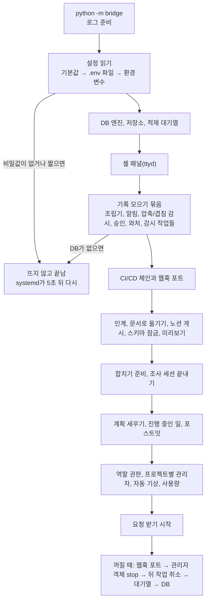

<!--
다루는 곳: bridge/main.py, bridge/__main__.py, bridge/config.py, bridge/api/health.py, bridge/uiver.py
읽은 커밋: e5d584b
-->
# 브리지가 뜨는 차례

브리지는 FOREMAN의 몸통이다. 파이썬 프로세스 하나가 트랜스크립트를 읽고, hook을 받고, 승인을 기다리고, 텔레그램을 보내고, 화면에 데이터를 내준다. 이 프로세스가 무엇을 맡는지는 「→ 01 전체 구조」가 그린다. 이 편은 그 프로세스가 **어떤 차례로 깨어나고, 무엇이 잘못됐을 때 어떻게 버티고, 어떻게 잠드는가**를 다룬다.

차례가 왜 중요한가. FOREMAN이 있는 까닭이 조용한 고장을 잡는 것이기 때문이다. 브리지 자신이 뜨다가 한 기능을 조용히 빠뜨리면, 그 기능이 지키던 것이 아무 알림 없이 망가진다. 실제로 그런 일이 있었다. 브리지를 systemd로 옮긴 뒤 이틀 동안 계획 세우기(코드 이름 디스패처)가 실행 파일을 찾지 못해 죽어 있었는데, 누군가 부를 때까지 아무도 몰랐다 [log:stage14_dispatcher_note_wake_result.md]. 이 편의 대부분은 그런 일을 겪고 나서 생긴 규칙이다.

## 한눈에 보는 차례

그림의 굵은 줄기는 하나다. **뼈대(설정, DB, 기록 모으기)는 실패하면 브리지가 뜨지 않는다. 그 위에 얹은 기능은 실패해도 브리지는 뜬다. 다만 조용히 넘어가지 않는다.** 아래 절들은 이 줄기를 하나씩 풀어 쓴 것이다.

## 1. 설정을 읽는다

### 세 겹의 값

브리지의 설정은 `Settings` 클래스 하나에 모여 있다 [code:bridge/config.py]. pydantic-settings라는 라이브러리를 쓰는데, 이것은 클래스에 적은 칸마다 「어디서 값을 찾을지」를 정해진 순서로 뒤져 채워 준다. 순서는 세 겹이다.

맨 아래는 코드에 적힌 기본값이다. DB 주소는 이 서버 안(`127.0.0.1`)의 3308번 포트, 브리지가 듣는 곳은 8000번 포트, DB 질의 시간 제한 5초 같은 값이 여기 있다 [code:bridge/config.py]. 그 위에 저장소 맨 위의 비밀값 파일 두 개, `.env.db`와 `.env.bridge`가 얹힌다. 맨 위에는 같은 이름의 환경 변수가 얹힌다. 위 겹에 값이 있으면 아래 겹을 덮는다. 그래서 운영 중에 포트 하나를 바꿔 보고 싶으면 코드도 파일도 건드리지 않고 `BIND_PORT=8010` 같은 환경 변수를 붙여 띄우면 된다. 시험이 브리지를 띄울 때도 이 길을 쓴다. 적재, 알림, 셸 패널처럼 바깥과 닿는 기능은 `watch_enabled`, `notify_enabled`, `terminal_enabled` 같은 칸으로 끌 수 있게 해 두었다.

비밀값 파일에서 브리지가 읽는 키 이름은 다음과 같다. 값은 이 글 어디에도 적지 않는다.

| 파일 | 브리지가 읽는 키 | 쓰는 곳 |
|---|---|---|
| `.env.db` | `MYSQL_DATABASE`, `MYSQL_USER`, `MYSQL_PASSWORD` | DB 접속. 같은 파일을 DB 컨테이너(compose)도 읽는다 |
| `.env.bridge` | `FOREMAN_API_TOKEN`, `FOREMAN_HOOK_TOKEN`, `FOREMAN_WEBHOOK_TOKEN`, `DEBUG_ENDPOINTS` | 화면과 API 인증, hook 인증, 웹훅 인증, 디버그 경로 켜기 |

`.env.db`에는 DB 관리자 비밀번호(`MYSQL_ROOT_PASSWORD`)도 들어 있다. 컨테이너가 처음 만들어질 때 쓰는 값이라 같은 파일에 있을 뿐, 브리지에는 필요 없다. 그래서 설정에 `extra="ignore"`를 걸어 모르는 키는 버리게 했다 [code:bridge/config.py]. 브리지가 가진 권한은 앱 계정의 권한까지다. 무엇을 보여 주는지는 견본 파일 `.env.db.example`, `.env.bridge.example`에 키 이름만 남겨 두었다.

### 비밀값을 다루는 약속

비밀값 칸은 모두 `SecretStr`이라는 형으로 받는다. 이 형은 출력하거나 로그에 찍을 때 값 대신 별표를 내놓는다. 설정 객체 전체를 실수로 로그에 남겨도 토큰은 새지 않는다. 값을 실제로 꺼내 쓰는 곳은 DB 엔진을 만드는 자리와 토큰을 비교하는 자리처럼 몇 군데뿐이다.

토큰 세 개는 길이가 32자 이상이어야 한다 [code:bridge/config.py]. 짧은 토큰이 들어 있으면 설정을 읽는 단계에서 오류가 나고 브리지는 뜨지 않는다. API 토큰과 hook 토큰은 아예 기본값이 없어서, 파일이 없거나 키가 빠져도 같은 자리에서 멈춘다. 일부러 이렇게 했다. 인증 없이 뜬 브리지는 서버의 셸을 남에게 열어 주는 것과 다르지 않기 때문이다(셸 패널이 브리지 안에 있다). 웹훅 토큰만은 없어도 된다. 없으면 브리지는 뜨고, 웹훅 포트만 열지 않으며 그 사실을 로그에 남긴다.

토큰을 셋으로 가른 까닭은 「→ 열쇠와 비밀」이 다룬다. 여기서 알아 둘 것은, 셋 다 같은 파일에서 같은 차례로 읽힌다는 점과 하나라도 형식이 틀리면 브리지 전체가 뜨지 않는다는 점이다.

### 여기서 읽지 않는 비밀값

비밀값 파일은 두 개가 더 있다. 노션 토큰이 든 `.env.notion`과 텔레그램 봇 토큰이 든 `.env.telegram`이다. 이 둘은 `Settings`가 읽지 않고, 그 기능이 켜질 때 그 기능의 코드가 직접 읽는다. 노션 게시기는 `NOTION_TOKEN` 한 줄만 찾고 [code:bridge/notion.py], 알림기는 `TELEGRAM_BOT_TOKEN`과 `TELEGRAM_CHAT_ID`를 찾는다 [code:bridge/notify.py].

이렇게 나눈 데는 까닭이 있다. `Settings`에 들어간 필수 값은 없으면 브리지가 뜨지 않는다. 노션 토큰이 없다고 승인과 적재까지 멈추면 안 된다. 그래서 노션 토큰이 없으면 브리지는 뜨고, 게시만 꺼 둔 채 서기 화면에 「Notion 토큰이 없습니다. .env.notion에 NOTION_TOKEN을 넣고 브리지를 다시 띄워 주세요」라는 사유를 보인다 [code:bridge/main.py]. 꺼진 것은 보이게 꺼진다.

### 시험 DB를 가르는 장치

설정에는 작은 장치가 하나 더 있다. DB 이름이 정확히 `foreman_test`이고 환경 변수 `FOREMAN_TEST_DB`가 있으면, 그 값으로 DB 이름을 바꾼다. 바꿀 값은 반드시 `foreman_test_`로 시작해야 하고 64자를 넘으면 안 된다 [code:bridge/config.py]. 여러 작업방(코드 이름 worktree) 세션이 동시에 시험을 돌리면서 한 시험 DB를 같이 쓰다 서로의 행을 지우던 일을 막으려고 넣었다 [log:test_db_per_session_20261111.md]. 운영 DB 이름(`foreman`)에는 절대 손대지 않게 「정확히 그 이름일 때만」으로 좁혔다.

### 설정보다 먼저: 로그 준비

`python -m bridge`로 띄우면 진입점 `bridge/__main__.py`가 가장 먼저 로그 형식을 정하고, 그다음 설정을 읽고, 그 설정으로 앱을 만들어 uvicorn(파이썬 웹 서버)에 넘긴다 [code:bridge/__main__.py]. 로그 준비에 한 줄이 끼어 있다. HTTP 라이브러리 httpx와 httpcore의 로그를 WARNING 이상만 남기게 낮추는 줄이다.

이 줄은 사고에서 나왔다. 처음에는 모든 로그를 INFO로 켰는데, httpx는 INFO에서 요청 주소를 통째로 찍는다. 텔레그램 API 주소에는 봇 토큰이 들어 있다. 알림을 붙인 뒤로 브리지 로그에 봇 토큰이 계속 찍히고 있었고, 셸 패널을 만들면서 로그를 들여다보다 화면에까지 한 번 찍혔다. 로그 파일의 토큰을 가리고, 로거 수준을 낮추고, 토큰은 새로 받았다 [log:stage7_terminal_result.md] [c:8f53b18]. 그래서 이 줄은 지우면 안 되는 줄이다.

## 2. 뼈대를 세운다

설정이 읽히면 앱을 만들고, uvicorn이 앱의 lifespan이라는 함수를 부른다. lifespan은 서버가 요청을 받기 시작하기 전에 한 번 돌고, 서버가 꺼질 때 마지막 부분이 한 번 도는 함수다. 브리지가 뜨면서 하는 일은 모두 여기 들어 있다 [code:bridge/main.py].

맨 처음 세우는 것은 세 가지다. DB 엔진, 그 엔진을 쓰는 저장소(`Store`), 그리고 적재 대기열(`Pipeline`)이다. DB 엔진은 만들기만 하고 아직 접속하지 않는다. 엔진에는 연결을 빌릴 때 5초, 접속할 때 5초의 시간 제한을 걸고, 쓰기 전에 연결이 살아 있는지 먼저 확인하게(`pool_pre_ping`) 했다 [code:bridge/db/engine.py]. DB 컨테이너가 다시 뜨면 붙들고 있던 연결이 모두 죽은 연결이 되는데, 이 확인이 그런 연결을 버리고 새로 맺는다. 적재 대기열은 들어온 기록을 DB에 하나씩 쓰고 화면에 내보내는 유일한 통로다. 여기서 바로 돌기 시작한다. 이 대기열의 설계는 「→ 적재와 내보내기」가 다룬다.

그다음 `app.state`라는 공용 칸에 이 셋을 걸고, 뒤에 켤 기능들이 들어갈 칸을 모두 `None`으로 먼저 채운다. 사소해 보이지만 중요한 줄이다. 어떤 기능이 켜지지 못해도 그 칸은 `None`으로 남아 있으니, 그 칸을 읽는 다른 코드(화면 API, 꺼질 때 거두는 코드)는 「없음」을 확인하고 지나갈 수 있다. 칸이 아예 없으면 거기서 오류가 난다.

## 3. 뒤 작업을 켜는 차례

뼈대 다음에는 기능들을 하나씩 켠다. 기능마다 하는 일은 각 편에 있으니, 여기서는 **왜 이 차례인가**만 본다.

| 차례 | 켜는 것 | 앞에 있어야 하는 것 | 실패하면 |
|---|---|---|---|
| 1 | 셸 패널(ttyd와 tmux) | 대기열 | 경고 로그, 브리지는 뜬다 |
| 2 | 조립기 → 알림기 → 압축, 맥락 크기, 겹침, `!` 명령 감시 → 승인 → 와처와 감시 작업들 | DB | **브리지가 뜨지 않는다** |
| 3 | CI/CD 체인과 웹훅 포트 | 알림기 | 경고 로그, 포트는 열지 않는다 |
| 4 | 인계 관리자, 문서로 옮기기, 압축 손실 재기, 노션 게시, 스키마 잠금, 미리보기 | 조립기, 알림기 | 기능마다 다르다(아래) |
| 5 | 합치기 준비 → 조사 세션 스스로 끝내기 | 인계 관리자, 조립기 | 오류 로그와 텔레그램 |
| 6 | 계획 세우기, 진행 중인 일, 포스트잇 | 인계 관리자, 파이프라인 | 실행 파일이 없으면 오류 로그와 텔레그램 |
| 7 | 역할 권한, 프로젝트별 관리자, 계획 넘기기 | 승인, 계획 세우기 | 오류 로그와 텔레그램 |
| 8 | 자동 기상 | 계획 세우기, 파이프라인, 적재 감시 | 경고 로그 |
| 9 | 사용량 읽기 | 알림기 | 오류 로그와 텔레그램 |

차례를 가르는 규칙은 단순하다. **남을 부르는 것은 불릴 것보다 뒤에 켠다.** 알림기는 거의 모든 기능이 「문제가 생기면 이것으로 알린다」며 받아 가는 물건이라 기록 모으기 묶음 안에서 가장 먼저 만든다. 승인 관리자는 도구 결과가 들어올 때 조립기의 손잡이(`on_tool_result`)에 매달리므로 조립기 뒤에 온다. 자동 기상은 파이프라인과 적재 감시가 실패를 알릴 때 깨어나는 장치라, 그 둘이 이미 있어야 「실패하면 나를 불러라」를 걸 수 있다. 역할 권한은 승인 관리자 안에 끼워 넣는 장치라 승인 뒤에 온다.

### 턴이 닫힐 때 줄 세우기

차례가 가장 눈에 띄게 중요한 곳은 「턴이 닫힐 때」다. 조립기는 턴 하나가 끝날 때마다 `on_turn_closed`라는 손잡이를 한 번 부른다. 그런데 이 순간을 기다리는 기능이 여럿이다. 턴 끝 알림, 셸 패널의 명령 부탁 감지, 맥락 크기 알림, 합치기 준비, 조사 세션 스스로 끝내기가 모두 여기에 매달린다.

손잡이는 하나뿐이라 기능마다 앞사람의 손잡이를 쥔 채 자기 것을 덧붙인다. 새 함수가 먼저 앞의 함수를 부르고, 그다음 자기 일을 한다 [code:bridge/main.py]. 그래서 턴이 닫히면 알림이 가장 먼저 나가고, 합치기 준비와 조사 세션 끝내기는 맨 뒤에 돈다. 조사 세션 끝내기는 합치기 준비 다음에 띄우게 일부러 정했다. 합치기 준비가 만든 것을 이어받아 쓰기 때문이다.

뒤에 덧붙인 기능에는 모두 같은 보호막을 씌웠다. 자기 몫을 하다 예외가 나면 경고 로그만 남기고 삼킨다. 손잡이를 부르는 쪽은 적재다. 덧붙인 기능 하나의 오류가 위로 번지면 적재가 멈추고, 적재가 멈추면 모든 화면과 알림이 멈춘다. 합치기 준비나 조사 세션 끝내기는 턴 끝에서 놓쳐도 1분마다 도는 훑기가 다시 줍는다. 그러니 놓치는 쪽이 적재를 막는 쪽보다 훨씬 싸다.

## 4. 실패를 다루는 법

### 두 부류: 뜨지 않는 것과 뜨되 알리는 것

브리지의 기능은 실패를 대하는 방식에 따라 두 부류로 나뉜다.

첫째 부류는 **실패하면 브리지가 뜨지 않는** 뼈대다. 설정 읽기, 그리고 DB를 읽어야 시작할 수 있는 기록 모으기 묶음이 여기 든다. 조립기는 시작하자마자 DB에서 프로젝트 목록을 읽고 [code:bridge/assembler.py], 알림기는 이미 끝난 서브에이전트를 「알린 것」으로 표시하고, 승인 관리자는 끊긴 대기를 정리한다. 이 셋은 모두 DB에 쓰거나 읽는다. 이 자리에 보호막을 씌우지 않았다. 일부러다. DB가 없는 브리지는 기록을 모을 수도 승인을 기다릴 수도 없다. 그런 상태로 반쯤 떠 있으면 화면은 열리는데 아무것도 들어오지 않는, 가장 알아채기 어려운 고장이 된다. 차라리 뜨지 않는 편이 낫다.

뜨지 않은 브리지를 다시 띄우는 것은 systemd 몫이다. 유닛 파일에 `Restart=on-failure`, `RestartSec=5`를 걸어 5초 뒤에 다시 시도하게 했고, 300초 안에 10번까지 다시 시도한다 [code:deploy/systemd/foreman-bridge.service]. 서버를 켜면 DB 컨테이너는 docker가, 브리지는 사용자 단위 systemd가 띄우는데, 둘 사이의 순서는 보장되지 않는다. 브리지가 먼저 깨어나 DB를 못 찾으면 실패하고, 5초 뒤 다시 깨어나기를 되풀이하다 DB가 올라오면 붙는다. 정전 뒤 복구 때는 docker 컨테이너가 먼저 올라와 있었고, 브리지는 그 뒤 손으로 띄우면서 지금의 유닛을 만들었다. 서버를 다시 켰을 때 이 유닛이 정말 저절로 뜨는지는 재부팅 검증을 아직 하지 않아 확인하지 못했다 [log:infra_20261106_systemd-bridge.md]. 이 방식은 「DB를 기다리는 코드」를 따로 쓰지 않아도 된다는 장점이 있다. 다시 시도하는 일은 systemd가 이미 잘한다. 10번을 넘기면 systemd가 포기하는데, 그때는 사람이 봐야 하는 일이 맞다.

둘째 부류는 **실패해도 브리지는 뜨는** 기능이다. 셸 패널, CI/CD 체인, 노션 게시, 미리보기, 합치기 준비, 조사 세션 끝내기, 역할 권한, 프로젝트별 관리자, 자동 기상, 사용량 읽기가 여기 든다. 이 기능들은 저마다 `try`로 감싸 두었다. 하나가 깨져도 다른 기능, 무엇보다 기록 모으기와 승인은 그대로 돈다.

### 「조용히 넘어가지 않는다」

둘째 부류에는 처음에 함정이 있었다. `try`로 감싸고 경고 로그만 남기면, 브리지는 멀쩡히 떠 있고 한 기능만 빠진 채 며칠이 갈 수 있다. 로그는 아무도 읽지 않는다. 브리지가 뜨는 길을 막지 않으려고 넣은 보호막이 그대로 조용한 고장을 만드는 셈이다.

그래서 사람이 정한 설정 파일을 읽어 켜는 기능, 곧 설정이 깨지면 사람이 고쳐야 하는 기능에는 한 단계를 더 붙였다. 실패하면 로그를 ERROR로 남기고, 알림기가 있으면 텔레그램으로 「⚠ 합치기 준비를 켜지 못했다(config/handoff.toml): 오류 종류: 내용」 같은 글을 바로 보낸다 [code:bridge/main.py]. 합치기 준비, 조사 세션 끝내기, 역할 권한, 프로젝트별 관리자, 계획 넘기기, 사용량 읽기가 이렇게 한다. 코드 주석에도 같은 말이 반복된다. 「안 떠도 브리지는 뜬다. 다만 조용히 넘어가지 않는다.」

이 알림은 기능 하나가 아니라 「설정 파일을 고치면 된다」는 처방까지 함께 보낸다. 어느 파일이 문제인지 글 안에 적기 때문에, 텔레그램만 보고도 어디를 열지 안다.

### 실행 파일을 미리 찾아 본다

계획 세우기, 새 세션으로 옮기기의 요약, 자동 기상은 모두 `claude` 실행 파일을 불러 일한다. 이 실행 파일은 사람의 셸에서는 늘 찾아지는데, systemd가 띄운 브리지에서는 찾아지지 않았다. systemd가 넘겨주는 PATH에 그 실행 파일이 든 폴더가 빠져 있었기 때문이다. 브리지를 systemd로 옮긴 날부터 이틀 동안 계획 세우기는 부를 때마다 「claude를 띄우지 못했습니다」로 실패했고, 새 세션으로 옮기기 요약도 같은 길이었지만 그 사이 요청이 없어 드러나지 않았다 [log:stage14_dispatcher_note_wake_result.md].

고친 것은 둘이다. 유닛 파일의 PATH에 그 폴더를 넣었고 [code:deploy/systemd/foreman-bridge.service], 브리지가 뜰 때 `shutil.which("claude")`로 실행 파일을 한 번 찾아 보게 했다. 못 찾으면 그 순간 「브리지가 claude 실행 파일을 PATH에서 찾지 못합니다 — 계획 세우기 · 새 세션으로 옮기기 요약 · 자동 기상이 안 됩니다」라는 글과 지금 PATH를 로그와 텔레그램으로 보낸다 [code:bridge/main.py]. 요점은 「쓸 때 실패를 알리는 것」에서 「뜰 때 미리 알아보는 것」으로 옮긴 데 있다. 쓸 때까지 기다리면 쓰는 사람이 없는 동안 고장은 조용하다.

자동 기상의 알림 링크도 같은 방식으로 뜰 때 한 번 확인한다. 링크에 적힌 주소의 이름이 실제로 풀리는지 10초 안에 확인하고, 안 풀리면 텔레그램으로 알린다 [code:bridge/wake.py]. 밖에 열지 않기로 한 주소가 몇 주 동안 알림 링크로 나가고 있었는데 아무도 몰랐던 일에서 나온 확인이다 [c:10e1e5b]. 이 확인은 뒤에서 따로 돌게 해 뜨는 길을 늦추지 않는다.

### 웹훅 포트는 소켓을 먼저 직접 묶는다

CI/CD 체인을 켜면 브리지는 두 번째 포트(8001)를 하나 더 연다 [code:bridge/config.py]. 클러스터의 빌드 서버가 보내는 웹훅을 받는 포트다. 이 포트는 같은 프로세스 안에서 같은 앱을 한 번 더 띄워 여는데, 여기에 함정이 있었다. uvicorn은 포트를 묶지 못하면 프로세스 전체를 끝내 버린다. 가상 머신 망 쪽 네트워크 장치가 아직 없을 때 브리지를 띄우면, 웹훅 포트 하나 때문에 브리지 전체가 죽는다.

그래서 소켓을 먼저 직접 만들어 묶어 본다. 묶기에 실패하면 경고 로그를 남기고 웹훅 포트만 포기한다. 성공했을 때만 그 소켓을 uvicorn에 넘겨 듣게 한다 [code:bridge/main.py]. 두 번째 서버는 Ctrl-C 같은 신호를 가로채지 않게 따로 만든 작은 클래스(`_QuietServer`)를 쓴다. 신호는 주 서버가 받아야 둘이 함께 꺼진다.

이 포트로는 `/webhooks/`로 시작하는 경로만 열린다. 앱 앞에 끼운 미들웨어(요청이 들어올 때마다 먼저 거치는 함수)가, 웹훅 포트로 들어온 요청 가운데 다른 경로는 모두 404로 돌려보낸다 [code:bridge/main.py]. 화면, API, 셸은 이 서버 안(`127.0.0.1`)에서만 닿는다. 웹훅 토큰이 없으면 포트를 아예 열지 않는다.

## 5. 다시 떴을 때 맞추는 것

브리지는 수시로 다시 뜬다. 파이썬 코드를 바꿀 때마다 다시 띄우기 때문이다. 그러니 「방금 다시 떴다」는 특별한 일이 아니라 늘 있는 일이고, 뜰 때마다 앞 프로세스가 남긴 어긋남을 맞추는 일이 여럿 있다.

| 무엇을 | 어떻게 | 까닭 |
|---|---|---|
| 기다리던 승인 | `pending`을 모두 `abandoned`(정리됨)로 바꾸고 몇 건인지 로그 | 기다리던 연결은 앞 프로세스와 함께 끊겼다(아래 6절) |
| 이미 끝난 서브에이전트 | 「알린 것」으로 표시 | 알림을 켜자마자 지난 것이 한꺼번에 쏟아지지 않게 |
| 돌던 압축 손실 재기 | 「실패」로 바꾸고 몇 건인지 경고 | 그 일을 하던 프로세스가 사라졌다 |
| 주인 없는 미리보기 | 작업방 폴더가 사라진 미리보기를 끔 | 앞 프로세스가 띄운 미리보기 브리지가 남는다 |
| 끝난 뒤 어긋난 것 | 「브리지 뜸」 사유로 한 번 훑기 | 꺼져 있던 사이 끝난 세션을 놓쳤을 수 있다 |
| 진행 중인 일 노트 | 「브리지 뜸」 사유로 한 번 정리 | 같은 까닭 |
| 세션 제목 | 빈 제목만 채움 | 제목 칸이 생기기 전에 적재한 세션 |

압축 손실 재기의 뒷정리에는 끄는 손잡이(`losscheck_recover`)가 있다 [code:bridge/config.py]. 시험이 앱을 띄울 때 이 정리가 돌면 안 되기 때문이다. 시험 DB를 가르기 전에, 시험이 운영 DB에 붙은 앱을 띄우면서 운영 브리지에서 한창 돌던 점검을 「브리지가 다시 떠서 멈췄습니다」로 바꿔 버린 일이 있었다. 운영 브리지는 멀쩡히 돌고 있었다. 그래서 시험은 이 손잡이를 끄고 띄운다.

## 6. 꺼질 때 거두기

lifespan은 `yield`라는 한 줄에서 멈춰 서버가 꺼지기를 기다린다. 서버가 꺼지면 그 아래 `finally` 부분이 돈다 [code:bridge/main.py]. 차례는 뜰 때의 거꾸로에 가깝다.

먼저 웹훅 포트 서버에 그만하라고 알리고 5초까지 기다린다. 그 안에 끝나지 않으면 취소한다. 그다음 자기 정리 함수(`stop`)를 가진 관리자들, 곧 CI/CD 체인, 자동 기상, 알림기, 셸 패널을 차례로 멈춘다. 셸 패널은 ttyd만 내리고 tmux 셸은 남겨 둔다. 사람이 셸에서 하던 일은 브리지를 다시 띄워도 이어져야 하기 때문이다. 그다음 뒤에서 돌던 작업 열네다섯 개(와처, 세션 상태, 적재 감시, 사용량, 노션 맞추기, 권한 거부 감시, 스키마 잠금 풀기, 멈춤 감시, 끝난 뒤 맞추기, 합치기 준비, 조사 세션 끝내기, 계획 넘기기, 진행 중인 일, 포스트잇)를 하나씩 취소하고 끝날 때까지 기다린다. 마지막으로 적재 대기열을 멈추고, DB 엔진의 연결을 모두 닫는다.

대기열과 DB가 맨 끝인 까닭은 앞의 작업들이 꺼지면서도 마지막 기록을 대기열에 넣을 수 있기 때문이다. 쓰는 통로를 먼저 닫으면 그 기록이 갈 곳이 없다.

systemd 유닛에는 `TimeoutStopSec=20`을 걸었다 [code:deploy/systemd/foreman-bridge.service]. 20초 안에 거두기가 끝나지 않으면 systemd가 강제로 끝낸다. 거두기가 어딘가에 걸려 다시 띄우기가 영영 끝나지 않는 일을 막는다.

## 7. 다시 띄우기 전에 승인 대기 0을 본다

운영 규칙에 「브리지를 다시 띄우기 전에 승인 대기가 없는지 본다」가 있다 [docs:operations.md]. 관리자는 다시 띄울 때마다 화면 데이터(`/api/dashboard`)의 승인 대기 수가 0인지 보고 나서 `systemctl --user restart foreman-bridge`를 친다. 다시 띄우는 동안 10초 남짓 끊긴다 [docs:operations.md]. 그 10초가 왜 문제인가.

승인을 기다리는 길을 보면 안다. 세션이 위험한 도구를 쓰려 하면 CC는 PermissionRequest hook으로 작은 스크립트(`foreman-decide.sh`)를 부르고, 그 스크립트는 브리지에 HTTP 요청을 하나 보내 놓고 사람이 텔레그램이나 화면에서 결정할 때까지 그 요청을 붙들고 기다린다. 한 시간까지 기다린다 [code:scripts/foreman-decide.sh]. 사람의 결정은 브리지 프로세스의 메모리 안에서 그 요청에 전달된다. 이 길의 자세한 설계는 「→ 기다리는 길: hook 두 개」에 있다.

브리지가 다시 뜨면 이 연결이 끊긴다. 스크립트는 연결이 끊기면 CC에는 아무것도 내지 않고 끝나도록 만들어져 있다. 브리지가 꺼져 있을 때 CC가 허용 쪽으로 새지 않게 하려는 약속이다. 다만 11-15부터는 판정 없이 지났다는 사실을 저장소의 `.run/hook_miss.log`에 한 줄 남겨, 끊긴 일 자체가 흔적 없이 사라지지는 않는다 [code:scripts/foreman-decide.sh] [c:cd14ed6]. 그러면 CC는 원래대로 자기 대화창(터미널)의 승인 창에서 답을 기다린다. 새로 뜬 브리지는 그 대기를 이어받을 방법이 없어서, 남은 대기를 모두 「정리됨」으로 바꾼다 [code:bridge/approvals.py]. 화면에는 「브리지가 다시 떠서 정리했습니다」가 뜬다.

사람 쪽에서 보면 이렇게 된다. 텔레그램으로 「승인 대기」를 받고 화면을 열었는데 카드가 「정리됨」이다. 버튼은 더 이상 듣지 않고, 세션은 대화창의 승인 창에서 멈춰 있다. 세션이 묻는 질문(AskUserQuestion)이라면 패널의 선택지 버튼도 함께 사라져 「터미널에서 답합니다」로 바뀐다. 무엇이 일어났는지 아는 사람에게는 사소하지만, 밖에서 텔레그램만 보던 사람에게는 「승인했는데 세션이 안 움직인다」는 조용한 고장이다.

그래서 다시 띄우는 시점을 고른다. 승인 대기가 0일 때 다시 띄우면 끊길 대기가 없다. 처음 설계 때부터 「push할 때마다 자동으로 다시 띄우지 않는다」고 정한 까닭도 같다. 다시 띄우기는 승인 대기와 화면 연결을 끊고, 커밋한 그 세션의 hook까지 끊을 수 있다 [code:README.md]. 그래서 사람(또는 관리자)이 대기를 보고 고르는 일로 남겼다. 「시험, import 확인, 대기 0일 때만 다시 띄우기」를 한 스크립트로 묶는 안도 있었지만 아직 만들지 않았고, 지금은 사람이 확인한다 [log:infra_20261106_systemd-bridge.md].

끊기는 10초 동안 생기는 일이 하나 더 있다. 그 사이 다른 hook(도구 사용 전 판정, 상태 알림)도 브리지에 닿지 못한다. hook 스크립트는 모두 「브리지가 없으면 아무것도 하지 않고 끝난다」는 약속을 지키므로 세션은 멈추지 않는다. 그 사이 CC는 자기 판단으로 움직인다. 트랜스크립트는 파일이라 다시 뜬 브리지가 끊긴 자리부터 이어 읽지만, hook으로만 오는 사건은 그 10초 동안 잃는다. 다시 띄우기를 아무 때나 하지 않는 또 하나의 까닭이다.

## 8. 화면 파일은 매번 다시 확인하게 했다

### 옛 store.js 때문에 연결이 시작되지 않았다

셸 패널을 처음 붙이고 써 본 날, 화면이 「연결 전」에서 넘어가지 않았다. 브리지 로그를 보니 새로 고침 뒤에 `GET /`과 `terminal.js` 요청만 있고, `store.js`, `/api/dashboard`, `/ws` 요청이 없었다. 브라우저가 `store.js`를 캐시에서 꺼내 썼던 것이다. 캐시의 옛 `store.js`에는 셸 패널 상태가 없었고, 새 `terminal.js`가 그 상태를 찾다 오류를 냈다. 그 오류 때문에 그 뒤에 있던 연결 시작 코드가 아예 돌지 않았다 [log:stage7_terminal_result.md].

고친 것은 셋이다. 화면 파일에 `Cache-Control: no-cache`를 붙였고, 연결을 먼저 시작하고 패널은 `try`로 감쌌고, 패널은 상태가 없으면 아무것도 그리지 않게 했다 [c:8f53b18]. 이 편이 다루는 것은 첫째, 브리지 쪽이다.

`no-cache`는 「캐시하지 말라」가 아니라 「쓰기 전에 매번 서버에 바뀌었는지 물어보라」는 뜻이다. 브라우저는 파일과 함께 받은 ETag(파일 지문 같은 값)를 들고 와서 묻고, 바뀌지 않았으면 서버는 본문 없이 304만 돌려준다. 그래서 대역폭은 거의 들지 않으면서 옛 파일을 쓰는 일은 없어진다. 브리지는 응답을 내보내기 직전 미들웨어에서 경로를 보고, 화면 주소(`/`, `/office`, `/classic`, `/debug`)와 `/static/` 아래 모든 파일에 이 머리말을 붙인다 [code:bridge/main.py]. 여러 파일이 서로 맞물리는 화면에서는 한 파일만 옛것이어도 화면 전체가 멈출 수 있다. 「한 번에 같은 판을 받게」 하는 가장 싼 방법이 이것이었다.

이 덕분에 얻은 것이 하나 더 있다. 화면 파일(js, css, html)은 브리지를 다시 띄우지 않아도 바로 나간다. 브리지는 작업 폴더의 파일을 그대로 내주고 브라우저는 매번 물어보니, 파일을 고치고 새로 고침만 하면 된다 [docs:operations.md]. 다시 띄우기는 앞 절에서 본 대로 비싸니, 다시 띄워야 하는 경우를 파이썬 변경 하나로 줄인 것은 크다.

### 열린 탭은 옛 코드로 돈다: 화면 코드 지문

`no-cache`가 막는 것은 「새로 고칠 때 옛 파일을 쓰는 것」이다. 새로 고치지 않은 탭은 막지 못한다. 열어 둔 탭은 처음 받은 코드를 계속 쓴다. 질문 카드에 선택지 버튼을 만들어 내보냈는데 사용자의 탭은 옛 코드라 버튼이 안 나왔고, 아무도 몰랐다 [log:pixel_bigger_question_card_20261109.md]. 고친 사람은 고쳤다고 믿고, 본 사람은 안 고쳐졌다고 믿는 조용한 고장이다.

그래서 화면 코드 지문을 만들었다 [code:bridge/uiver.py] [c:650f0a0]. `static` 아래 js, css, html 파일마다 이름, 크기, 수정 시각을 한 줄로 이어 SHA-1 지문을 만들고, 앞 12자리만 쓴다. 파일 내용 전체를 읽지 않고 크기와 수정 시각만 보니 싸다. 그래도 5초 동안은 앞서 만든 값을 그대로 돌려줘서, 요청이 몰려도 폴더를 매번 훑지 않게 했다.

이 지문은 실시간 연결(WS)의 첫 인사(`hello`)와 화면 데이터(`/api/dashboard`)에 실려 나간다. 탭은 처음 받은 지문을 기억해 두었다가, 나중에 받은 지문이 다르면 맨 위에 노란 띠 「화면 코드가 바뀌었습니다. 새로 고쳐야 바뀐 기능이 보입니다.」와 [새로 고침] 버튼을 띄운다. 저절로 새로 고치지 않는 것은 일부러다. 사람이 입력 칸에 쓰던 글이 날아가기 때문이다. 탭 쪽에서 이 지문을 어떻게 받고 비교하는지는 「→ 데이터 계층」이 다룬다.

지문을 수정 시각으로 만든 탓에 생기는 일도 적어 둔다. 내용이 같아도 파일을 다시 쓰면(예를 들어 git으로 브랜치를 바꿨다 돌아오면) 지문이 바뀌어 띠가 뜬다. 반대로 내용이 바뀌었는데 크기와 수정 시각이 모두 그대로인 경우는 사실상 없다. 띠가 한 번 더 뜨는 쪽으로 틀리는 것은 견딜 만하고, 바뀐 것을 놓치는 쪽으로 틀리는 것은 견디기 어렵다. 그래서 이 쪽을 골랐다.

## 9. 살아 있는지 묻는 곳: /healthz

`/healthz`는 브리지가 살아 있는지 묻는 경로다 [code:bridge/api/health.py]. 데이터를 내는 경로 가운데 토큰 없이 열린 것은 이것 하나다. 그래서 상태 말고는 아무것도 내보내지 않는다.

| 칸 | 값 | 뜻 |
|---|---|---|
| `status` | `ok` / `degraded` | DB가 답하면 ok |
| `db` | `ok` / `down` | `SELECT 1`이 5초 안에 돌아오는가 |
| `queue` | 숫자 | 적재 대기열에 쌓인 기록 수 |
| `ingest` | `live` / `backfill` / `off` | 트랜스크립트 읽기 상태. 따라잡는 중이면 backfill |

DB가 답하지 않으면 HTTP 503을 돌려준다. 바깥에서 상태 코드만 보고도 판단할 수 있게 하려는 것이다. DB 확인에는 시간 제한(5초)이 걸려 있어서, DB가 멈춰 답하지 않는 상황에서도 `/healthz`가 같이 멈추지 않는다. 처음 만들 때 DB 컨테이너를 멈춰 보니 정확히 5.0초에 503이 돌아왔고, 다시 풀자 4초 안에 200으로 돌아왔다. DB 컨테이너를 다시 띄웠을 때는 503이 5초쯤 이어지다 저절로 200이 됐다 [log:stage1_bridge_db_result.md].

응답에는 원인을 싣지 않는다. 토큰 없이 열린 경로가 오류 글을 내보내면, 그 글에 DB 주소나 계정 이름 같은 것이 섞여 나갈 수 있다. 대신 원인은 브리지 로그에 남긴다. 여기에도 한 번 막혔던 이야기가 있다. 처음에는 응답이 `down`뿐이고 로그에도 아무것도 없어서, DB를 다시 띄운 뒤 브리지가 영영 붙지 못하던 고장(DB 인증에 필요한 라이브러리가 빠져 있었다)의 원인을 바로 찾지 못했다 [log:stage1_bridge_db_result.md] [c:1ec1bfd]. 지금은 상태가 바뀔 때, 곧 ok에서 down으로 넘어갈 때 원인을 한 번 경고 로그로 남기고, down에서 ok로 돌아올 때 「DB 복구」를 남긴다. 매 요청마다 남기지 않는 것은, 누가 1초마다 물어보면 같은 줄이 로그를 덮어 버리기 때문이다.

지금 이 경로를 부르는 것은 시험과 디버그 화면 정도다. 브리지가 살아 있는지 바깥에서 지켜보는 일은 이 경로보다, 브리지 안의 감시 작업들이 스스로 텔레그램을 보내는 쪽이 맡고 있다. 브리지가 아예 죽은 경우는 systemd가 다시 띄운다.

### 함께 닫아 둔 문

브리지를 만드는 자리에서 FastAPI가 기본으로 여는 API 문서 화면(`/docs`)과 API 지도(`/openapi.json`)를 닫았다 [code:bridge/main.py]. 토큰 없이 「이 브리지에 어떤 경로가 있고 무엇을 받는가」를 내보이지 않으려는 것이다. 디버그 경로(`/api/debug/*`)는 `DEBUG_ENDPOINTS`가 켜져 있을 때만 붙는다. 화면 파일은 비밀값이 없으므로 토큰 없이 내주고, 사람이 화면에 토큰을 넣으면 그 토큰으로 데이터 API와 실시간 연결을 연다. 어떤 길을 열고 닫았는지는 「→ 열쇠와 비밀」이 이어서 다룬다.
