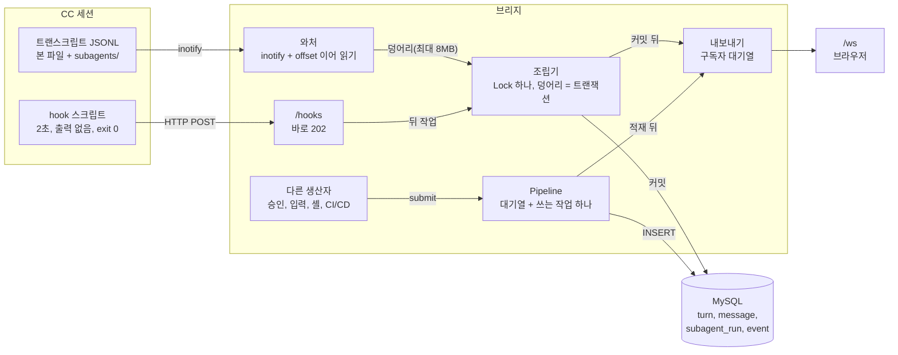

<!--
다루는 곳: bridge/transcript/, bridge/assembler.py, bridge/bus.py, bridge/store.py, bridge/api/hooks.py
읽은 커밋: 9a7c22d
-->
# 02 기록 모으기

FOREMAN이 하는 일의 거의 전부는 「CC 세션에서 지금 무슨 일이 일어나고 있나」를 아는 데서 시작한다. 누가 일하는 중인지, 어느 턴이 끝났는지, 어떤 명령을 실행했는지, 토큰을 얼마나 썼는지, 서브에이전트가 몇 개 떠 있는지. 화면의 캐릭터가 움직이는 것도, 텔레그램 알림이 가는 것도, 승인 카드가 뜨는 것도 모두 이 앎 위에 서 있다. 이 편은 그 앎이 어디서 와서 어떻게 데이터베이스의 한 줄이 되는지, 그 전체 길을 그린다.

CC(Claude Code)는 FOREMAN에게 아무것도 보고하지 않는다. CC는 자기 일을 할 뿐이고, 그러면서 흔적 두 가지를 남긴다. 하나는 디스크에 쌓이는 대화 기록 파일(트랜스크립트), 다른 하나는 정해진 순간마다 불리는 짧은 알림(hook)이다. FOREMAN의 기록 모으기는 이 두 흔적을 주워 하나의 이야기로 꿰는 일이다. 아래 하위 네 편이 각 단계를 깊게 다루고, 이 편은 그 단계들이 어떻게 이어지는지와, 단계마다 따로 설명하기 어려운 공통의 까닭을 다룬다.

## 흔적 둘: 트랜스크립트와 hook

**트랜스크립트**는 CC가 대화를 저장하는 파일이다. 경로는 `~/.claude/projects/<작업 폴더 경로를 바꾼 이름>/<세션 id>.jsonl`이고, 한 줄이 JSON 객체 하나다(JSONL). 사람의 프롬프트, 모델의 답, 도구 호출과 그 결과, 턴이 끝났다는 표시(`turn_duration`), 압축 경계까지 대화에서 일어난 거의 모든 것이 줄 단위로 덧붙는다. 파일은 뒤에 붙기만 하고(append-only) 중간이 고쳐지지 않는다. 서브에이전트(CC가 `Agent` 도구로 띄우는 작은 보조 세션)는 같은 폴더 아래 `<세션 id>/subagents/agent-<id>.jsonl`에 자기 파일을 따로 갖는다 [code:bridge/transcript/reader.py].

**hook**은 CC 설정에 걸어 두면 특정 순간마다 CC가 실행해 주는 명령이다. 사람이 프롬프트를 냈을 때(UserPromptSubmit), 턴이 끝났을 때(Stop), API 오류로 멈췄을 때(StopFailure), 세션이 끝났을 때(SessionEnd), 서브에이전트가 뜨고 질 때(SubagentStart, SubagentStop) 같은 순간이다. FOREMAN은 이 여섯 종류를 기록 모으기에 쓰고, 도구를 쓰기 직전(PreToolUse)과 권한 창이 뜰 때(PermissionRequest) 두 종류는 승인에 쓴다 [code:bridge/assembler.py] [code:bridge/api/hooks.py]. hook이 실행하는 스크립트는 CC가 넘겨준 JSON을 그대로 브리지의 `/hooks` 주소로 보낸다.

두 흔적은 성격이 정반대다. 트랜스크립트는 **자세하지만 느리고 말이 없다.** 모든 내용이 있지만, 어떤 일은 아예 줄로 남지 않는다. hook은 **빠르고 분명하지만 내용이 얇다.** 「지금 끝났다」는 신호는 정확한 순간에 오지만, 그 턴에서 무엇을 했는지는 담겨 있지 않다.

## 흔적 하나만으로는 모자란 까닭

처음부터 둘 다 쓰기로 한 것은 아니다. 킥오프 조사 때 FOREMAN은 「턴 경계는 Stop hook으로 판정한다」는 가정에서 출발했다. 트랜스크립트 전체(1.32GB)를 통계로 훑어 보니 그 가정이 틀렸다 [log:01_kickoff_result.md]. 어느 한쪽 신호도 모든 종료를 잡지 못했다.

| 끝나는 상황 | 트랜스크립트의 `turn_duration` | hook |
|---|---|---|
| 정상 종료 | 625건 중 625건 | Stop |
| 사람이 Esc로 끊음 | 29건 중 15건만 | Stop이 불리지 않음 |
| API 오류 | 2건 중 2건 | StopFailure |
| 창을 닫거나 exit | 5건 중 0건 | SessionEnd |

이 표의 수치는 README 3.2와 킥오프 결과의 실측이다 [log:01_kickoff_result.md]. 세션이 끝날 때는 트랜스크립트에 아무 표시도 남지 않고, Esc로 끊을 때는 hook이 오지 않는다. 그래서 둘을 겹쳐야 빈칸이 줄어든다.

**트랜스크립트만 쓰면 모자란 것**은 셋이다. 첫째, 세션 종료처럼 파일에 줄이 남지 않는 사건을 모른다. 둘째, 느리다. assistant 줄은 응답을 다 받은 뒤에야 쓰이므로, 실시간으로 받아 보니 도구 호출 줄이 화면에 오기까지 0.5~0.8초가 걸렸다 [log:stage2_transcript_result.md]. 반면 UserPromptSubmit hook은 턴을 7ms 만에 열었고, Stop hook은 마지막 응답 줄보다 먼저 도착해 턴을 닫았다 [log:stage2_transcript_result.md]. 셋째, 프롬프트 줄 없이 들어오는 입력이 있다. 서브에이전트 결과가 부모에게 전달될 때 트랜스크립트에는 프롬프트 줄이 없고 hook으로만 오는 경우가 실측됐다 [code:bridge/assembler.py].

**hook만 쓰면 모자란 것**은 더 크다. 우선 내용이 없다. 어떤 명령을 실행했는지, 무엇을 읽었는지, 토큰을 얼마나 썼는지는 트랜스크립트에만 있다. 다음으로 hook은 한 번 놓치면 끝이다. 브리지가 꺼져 있던 동안의 hook은 다시 오지 않는다. 트랜스크립트는 파일이 남아 있는 한 언제든 처음부터 다시 읽을 수 있다. 마지막으로, hook은 설치한 뒤부터만 온다. FOREMAN을 만들기 전 20일치 대화(파일 222개)는 hook 없이 트랜스크립트만으로 채웠다 [log:stage2_transcript_result.md].

그래서 FOREMAN은 **트랜스크립트를 뼈대로, hook을 빠른 신호로** 쓴다. 턴이라는 그릇을 만들고 그 안의 내용을 채우는 것은 트랜스크립트이고, 그 그릇을 남보다 먼저 열고 닫는 것은 대개 hook이다. 두 신호가 같은 턴을 두고 다투면 **먼저 온 쪽이 닫는다**. 누가 닫았는지는 턴의 `closed_by` 칸에 transcript, hook, sweep(주기적 정리) 가운데 하나로 남는다 [code:bridge/assembler.py]. 이 판정의 자세한 규칙은 → 턴 조립.

이 선택에는 대가가 하나 있다. hook에서 온 사건은 트랜스크립트로 다시 만들 수 없다. 2단계에서 DB를 비우고 트랜스크립트만으로 다시 만들어 보았더니, hook이 닫았던 턴이 정리 작업의 `session_end`로 바뀌어 있었다 [log:stage2_transcript_result.md]. 그래서 hook을 설치한 뒤에는 DB 전체를 다시 만들지 않는다. DB는 hook 사건의 유일한 원본이고, 매일 덤프로 백업한다 [log:stage1_bridge_db_result.md].

## 흐름 한눈에

그림에서 보듯 DB로 가는 길은 둘이다. 트랜스크립트와 hook은 **조립기**를 지나고, 승인 판정, 패널에서 넣은 입력, 셸 실행 결과, CI/CD 사건처럼 CC 바깥에서 생기는 이벤트는 **Pipeline**(`bridge/bus.py`)을 지난다 [code:bridge/bus.py]. 두 길 모두 끝에서 같은 내보내기 함수를 불러 브라우저로 흘려보낸다.

### 1. 생산자: 와처와 hook 수신

와처는 `~/.claude/projects` 아래 폴더들에 inotify(리눅스 커널이 파일 변경을 알려 주는 기능)를 건다. 파일이 아니라 폴더에 거는 까닭은 새 세션 파일이 생기는 순간도 잡기 위해서다. 바뀐 파일은 DB에 저장해 둔 읽은 자리(offset)부터 이어 읽고, 한 번에 최대 8MB씩 「덩어리」로 잘라 조립기에 넘긴다 [code:bridge/transcript/watcher.py] [code:bridge/config.py]. 쓰는 중이라 개행으로 끝나지 않은 마지막 줄은 다음 차례로 미루고, 트랜스크립트 용량의 76%를 차지하는 `api-request` 줄은 JSON을 풀기 전에 바이트 비교로 버린다 [code:bridge/transcript/reader.py]. 파일 읽기는 스레드에서 돌려 브리지 전체를 붙잡지 않는다. 경로 규칙, 이어 읽기, 순서를 잡는 법은 → 트랜스크립트 읽기.

hook 쪽은 더 단순하다. CC가 hook 스크립트(`scripts/foreman-hook.sh`)를 부르면, 스크립트는 받은 JSON을 그대로 브리지에 POST한다. 브리지는 토큰을 확인하고 형식이 맞으면 **본문을 처리하기 전에 202를 돌려준다**. 실제 적재는 뒤 작업으로 돌린다 [code:bridge/api/hooks.py]. hook이 기다리는 동안 CC도 기다리기 때문이다. 스크립트도 같은 약속을 지킨다. 2초가 지나면 포기하고, 아무것도 출력하지 않고(UserPromptSubmit의 출력은 모델 맥락에 들어간다), 브리지가 꺼져 있어도 늘 정상 종료한다 [code:scripts/foreman-hook.sh]. 이 약속들의 까닭과 hook 토큰을 따로 둔 까닭은 → CC hook 받기.

### 2. 대기열

「대기열」은 길마다 모양이 다르다. 와처 쪽에서는 읽어야 할 파일 목록(`dirty`)이 대기열 노릇을 한다. 파일이 바뀌면 이 목록에 오르고, 와처는 목록을 하나씩 비우며 덩어리를 조립기에 넘긴다. 같은 파일에서 적재가 실패하면 그 파일만 다음 시도 시각까지 미뤄 두고 다른 파일은 계속 적재한다 [code:bridge/transcript/watcher.py]. hook 쪽은 요청마다 뒤 작업이 하나씩 생기고, 그 작업들이 조립기의 잠금 앞에 줄을 선다.

Pipeline에는 진짜 대기열이 있다. 상한 10,000개의 asyncio 대기열이고 [code:bridge/config.py], 생산자는 `submit`으로 넣고 적재가 끝나면 이벤트 id를 받는다. 대기열이 꽉 차면 생산자에게 바로 오류가 돌아간다. 붙잡고 기다리지 않는다 [code:bridge/bus.py].

### 3. 적재: 쓰는 쪽을 하나로

이 흐름의 가장 중요한 결정은 **쓰는 작업을 하나로 둔 것**이다. 조립기는 asyncio 잠금(Lock) 하나 아래에서만 DB를 쓰고, Pipeline은 쓰는 작업(task) 하나가 대기열을 순서대로 비운다 [code:bridge/assembler.py] [code:bridge/bus.py]. 여러 작업이 동시에 쓰면 더 빠를 수 있지만, 그러면 두 가지를 잃는다. 하나는 순서다. 쓰는 쪽이 하나면 이벤트 번호가 들어온 순서대로 붙는다. 다른 하나는 판단의 일관성이다. 턴을 열고 닫는 판단은 「지금 이 세션에 열린 턴이 있나」를 메모리에 들고 있어야 하는데, 트랜스크립트 줄과 hook이 동시에 그 상태를 고치면 같은 턴을 두 번 열거나, 이미 닫힌 턴에 줄을 붙이게 된다. 잠금 하나가 이런 경쟁을 원천적으로 없앤다.

조립기는 덩어리 하나를 **DB 트랜잭션 하나**로 적재하고, 파일의 읽은 자리(`transcript_file.read_offset`)도 같은 트랜잭션에서 옮긴다 [code:bridge/assembler.py]. 그래서 중간에 실패하면 행도 offset도 함께 되돌아가고, 다음에 같은 덩어리를 다시 읽는다. 다시 읽어도 행이 늘지 않게 테이블마다 겹치지 않는 열쇠를 둔다. 이벤트는 줄의 uuid, 메시지는 API 응답의 `message.id`, 턴은 CC가 붙이는 `promptId`가 각각 유일하다. 2단계에서 20일치를 처음부터 다시 읽어도 uuid 중복 0, promptId 하나에 턴 하나였고, 5분 넘은 턴 1,071개의 종료 이유와 종료 시각까지 전후가 같았다 [log:stage2_transcript_result.md].

DB가 잠깐 죽으면 어떻게 되나. Pipeline은 그 이벤트를 붙든 채 0.5초부터 두 배씩 늘려 최대 10초 간격으로 다시 시도하고, 중복 uuid나 잘못된 값처럼 다시 해도 같은 결과일 오류만 버린다 [code:bridge/bus.py] [code:bridge/config.py]. 조립기 쪽은 실패한 덩어리를 와처가 미뤄 두었다가 다시 시도한다. 이 재시도와 포기의 단계는 → 적재와 내보내기.

트랜스크립트와 hook이 DB에 들어가기 전에는 비밀값 가리기를 한 번 거친다. 프롬프트, 명령, 모델의 글에 섞인 토큰이나 비밀번호를 정확한 값, 알려진 형식, `키=값` 모양 셋으로 찾아 가린다. 도구 결과의 본문은 처음부터 저장하지 않는다. 형식을 모르는 비밀이 섞일 수 있어서다 [code:bridge/mask.py] [code:bridge/assembler.py].

### 4. 내보내기: 적재한 뒤에만

브라우저로 보내는 것은 **DB에 커밋된 뒤**다. Pipeline은 적재가 끝나 id를 받은 이벤트만 내보내고, 조립기는 트랜잭션이 커밋된 뒤에 그 덩어리에서 생긴 턴 열기와 닫기, 이벤트를 내보낸다 [code:bridge/bus.py] [code:bridge/assembler.py]. 그래서 화면에 보인 것은 언제나 DB에도 있다. 화면을 새로 고쳐도 사라지지 않고, 화면에서 본 이벤트를 눌러 자세히 보려 할 때 DB에 없는 일이 없다.

구독자(브라우저 연결 하나)마다 상한 256개의 작은 대기열이 있다. 브라우저가 느려 이 대기열이 넘치면, 쌓인 것을 버리고 「다시 맞춰라」(`resync`) 신호 하나만 남긴다. 브라우저는 그 신호를 받으면 빠진 것을 DB에서 다시 읽는다 [code:bridge/bus.py]. 느린 브라우저 하나 때문에 적재가 멈추는 일은 없다. `/ws`는 50ms 동안 모인 메시지를 한 묶음으로 보내고, 15초 동안 보낼 것이 없으면 연결이 살아 있는지 알리는 핑을 보낸다 [code:bridge/api/ws.py] [code:bridge/config.py].

## DB에 남는 네 가지

조립기가 두 흔적을 엮어 만드는 행은 네 종류다 [code:bridge/assembler.py].

| 테이블 | 한 행이 뜻하는 것 | 겹치지 않는 열쇠 | 주로 만드는 흔적 |
|---|---|---|---|
| `turn` | 입력 하나에서 응답이 끝나기까지 한 번의 주고받기 | `promptId` | 트랜스크립트가 열고 채움, hook이 먼저 열거나 닫음 |
| `message` | 모델 API 응답 하나와 그 토큰 수 | `message.id` | 트랜스크립트 |
| `subagent_run` | 서브에이전트 하나의 실행 | `agentId` | 부모의 `Agent` 도구 결과, 자식 파일, Subagent hook |
| `event` | 화면과 알림이 쓰는 사건 한 줄(프롬프트, 도구 호출, 턴 시작과 끝 …) | `uuid` | 둘 다, 그리고 Pipeline의 다른 생산자 |

이 넷의 관계에는 몇 가지 눈여겨볼 점이 있다. CC는 API 응답 하나를 내용 블록마다 한 줄씩 쪼개 쓰고, 쪼개진 줄들은 같은 토큰 수를 똑같이 들고 있다. 그래서 토큰은 줄이 아니라 `message.id` 단위로 한 번만 센다 [code:bridge/assembler.py]. 서브에이전트는 결과가 나중에 다른 턴으로 돌아오지만, 토큰과 이벤트는 **띄운 턴**에 귀속한다. 자식 파일이 부모보다 먼저 읽혀 띄운 턴을 아직 모를 때는 30초마다 도는 연결 작업이 나중에 채운다 [code:bridge/assembler.py] [code:bridge/config.py]. 이벤트 테이블에는 외래 키를 두지 않았다. hook 이벤트가 그 사건의 트랜스크립트 줄보다 먼저 오는 일이 흔하고, 가장 자주 쓰는 테이블에서 행마다 부모를 조회하는 비용을 없애기 위해서다. 대신 이벤트를 쓰는 곳을 정해 두고 그 코드가 참조를 지킨다 [log:stage1_bridge_db_result.md] [code:bridge/store.py]. 턴의 열기와 닫기, 끝난 이유의 종류, 서브에이전트를 잇는 법은 → 턴 조립.

## 흐름이 스스로 멈춘 것을 알린다

기록 모으기가 조용히 멈추면 FOREMAN은 아무것도 모르게 된다. 화면은 마지막으로 본 상태에 멈춰 있고, 알림은 오지 않는데, 그것이 「일이 없어서」인지 「못 봐서」인지 구별할 길이 없다. FOREMAN이 잡으려는 바로 그 조용한 고장이 FOREMAN 자신에게 일어나는 것이다.

실제로 한 번 일어났다. 앞 세션의 기록을 복사해서 시작한 세션의 트랜스크립트가, 이미 다른 턴이 가진 uuid 하나 때문에 같은 덩어리에서 몇 시간 동안 실패를 되풀이했다. 그동안 와처는 그 자리에서 최대 60초씩 잠들어 다른 모든 파일의 적재도 밀렸고, 실패할 때마다 파일을 처음부터 다시 읽었으며, 알림은 하나도 없었다. 로그에만 남았다 [log:stage2_transcript_result.md].

그 뒤로 세 겹의 안전장치를 두었다. 실패한 파일만 미루고 나머지는 계속 적재한다. 같은 자리에서 3번 실패하면 줄마다 따로 저장해 실패한 줄만 버리는 너그러운 방식으로 바꾸고, 그래도 6번째까지 같은 오류가 되풀이되면 그 덩어리를 건너뛴다. 단 DB 연결 끊김이나 시간 초과처럼 기다리면 풀릴 오류로는 건너뛰지 않는다 [code:bridge/transcript/watcher.py]. 그리고 적재 감시가 30초마다 와처를 보고, 한 파일이 5분 넘게 막혀 있거나 감시 루프가 2분 넘게 돌지 않으면 텔레그램과 대시보드 머리 띠로 알린다 [code:bridge/ingest_health.py] [code:bridge/config.py]. 자세한 단계는 → 적재와 내보내기.

## 시작하는 차례

브리지가 뜨면 와처는 먼저 inotify를 걸고, 그다음 전체 트랜스크립트를 한 번 읽는다(백필). 순서를 이렇게 둔 것은 백필하는 동안 새로 쓰인 줄을 놓치지 않기 위해서다 [code:bridge/transcript/watcher.py]. 백필은 본 세션 파일을 먼저, 서브에이전트 파일을 나중에 읽는다. 서브에이전트 행은 부모의 `Agent` 도구 결과에서 먼저 생기므로, 이 차례면 띄운 턴이 바로 붙는다 [code:bridge/transcript/reader.py].

백필하는 동안에는 브라우저로 아무것도 내보내지 않는다. 수만 개의 옛 이벤트를 화면에 쏟을 까닭이 없기 때문이다. 턴이 닫혔다는 알림도 보내지 않는다. 지난 20일치 턴마다 텔레그램이 울리면 안 된다 [code:bridge/assembler.py]. 백필이 끝나면 한 번 정리 작업을 돌려 이미 사라진 프로세스의 열린 턴을 닫고, 그때부터 실시간 모드로 들어간다. 2단계 때 1.4GB, 파일 222개를 백필하는 데 17~18초가 걸렸고, 결과 DB는 약 90MB였다 [log:stage2_transcript_result.md].

실시간 모드에서는 inotify 신호를 기다리되 5초마다 한 번은 깨어난다. 그 밖에 inotify가 놓친 것을 대비해 60초마다 파일 크기를 다시 비교하고, 30초마다 프로세스가 사라진 세션의 열린 턴을 닫고, 30초마다 서브에이전트를 띄운 턴에 잇는다 [code:bridge/transcript/watcher.py] [code:bridge/config.py].

## 하위 편 길잡이

네 편은 흐름의 순서대로 놓여 있다.

| 편 | 다루는 단계 | 이런 물음에 답한다 |
|---|---|---|
| → 트랜스크립트 읽기 | 생산자(파일 쪽) | 파일을 어떻게 찾고, 어디까지 읽었는지 어떻게 기억하나. 파일이 바뀌거나 잘리면. 줄 순서를 왜 시각으로 정하지 않나. 도구 결과 본문은 어디서 다시 찾나 |
| → CC hook 받기 | 생산자(hook 쪽) | hook 여덟 종류가 각각 무엇을 싣고 오나. hook이 CC를 절대 막지 않게 한 약속. 왜 바로 202인가. 토큰을 왜 따로 두었나 |
| → 턴 조립 | 적재(조립기 안) | 턴의 경계를 무엇으로 정하나. 끝 신호가 여럿일 때 누가 닫나. Esc를 첫 응답 전에 누르면. 서브에이전트를 어느 턴에 붙이나 |
| → 적재와 내보내기 | 적재(Pipeline), 내보내기 | 쓰는 쪽 하나가 무엇을 보장하나. DB가 죽으면. 비밀은 어떻게 가리나. 적재가 막히면 누가 알리나. 화면 확인용 디버그 길 |

턴이 닫힌 뒤 그 소식이 텔레그램으로 가는 길은 → 11 알림, 세션이 살아 있는지 멈췄는지 따로 재는 길은 → 03 세션 지켜보기와 글 넣기, PreToolUse와 PermissionRequest hook이 승인 판정에 쓰이는 길은 → 04 승인, 네 테이블의 칸 하나하나는 → 15 DB에서 다룬다.
