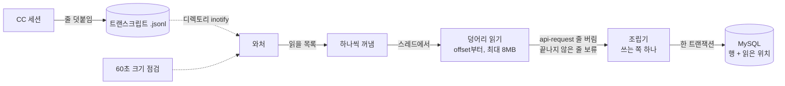

<!--
다루는 곳: bridge/transcript/, bridge/ingest.py
읽은 커밋: e5d584b
-->

# 트랜스크립트 읽기

FOREMAN이 CC(Claude Code) 세션에서 무슨 일이 일어났는지 아는 길은 둘이다. 하나는 CC가 사건마다 불러 주는 hook이고, 다른 하나는 CC가 디스크에 남기는 대화 기록 파일, 곧 트랜스크립트다. hook은 빠르지만 얇다. 언제 턴이 시작되고 끝났는지는 알려 주지만 모델이 무슨 말을 했고 어떤 도구를 어떤 입력으로 불렀는지는 담지 않는다. 그 내용은 전부 트랜스크립트에 있다. 이 편은 브리지가 그 파일을 어떻게 찾고, 어떻게 놓치지 않고 이어 읽고, 무엇을 버리고, 무엇을 DB에 넣지 않고 남겨 두는지를 다룬다.

읽은 줄을 턴과 메시지로 묶는 일은 → 「턴 조립」, 묶은 행을 DB에 쓰고 화면으로 내보내는 일과 적재가 막혔을 때의 알림은 → 「적재와 내보내기」, hook 쪽은 → 「CC hook 받기」에서 다룬다. 이 편은 그 앞, 파일에서 줄을 꺼내는 데까지다.

## 왜 화면이 아니라 파일인가

CC는 터미널 화면 전체를 그리는 프로그램(TUI)이다. tmux 화면을 긁어 오면 색을 바꾸는 제어 글자와 화면을 고쳐 그리는 조각이 섞여 깨끗한 글이 나오지 않는다. 그래서 FOREMAN은 입력과 출력의 길을 갈랐다. 글을 넣을 때는 tmux로 세션에 직접 넣고, 무슨 일이 일어났는지는 트랜스크립트에서 읽는다. 두 길이 같은 세션에 꽂혀 있으므로 사람이 터미널에서 보는 것과 FOREMAN이 보는 것이 같다. 별도의 머리 없는(headless) 세션을 띄워 결과만 받는 방법도 있었지만 쓰지 않았다. "내가 보는 것과 실제가 같아야 한다"가 이 프로젝트의 전제이기 때문이다 [docs:history/01_kickoff.md] [code:bridge/inject.py].

트랜스크립트는 생각보다 크다. 처음 조사했을 때 서버의 트랜스크립트 전체가 20.6일 동안 1.32GB였고 하루에 약 64MB씩 늘었다. 한 프로젝트의 파일 하나가 561MB, 49,454줄이었다 [log:01_kickoff_result.md]. 이 크기 때문에 "그냥 JSONL을 읽으면 된다"는 처음 설계의 가정이 그대로는 맞지 않았고, 이 편의 거의 모든 결정이 이 크기에서 나왔다.

## 파일이 어디에 있나: 경로 규칙

CC는 세션 하나마다 JSONL 파일 하나를 쓴다. JSONL은 한 줄에 JSON 객체 하나씩 적은 글 파일이다. 위치는 정해져 있다.

| 파일 | 경로 |
|---|---|
| 본 세션 | `~/.claude/projects/<프로젝트 디렉토리>/<sessionId>.jsonl` |
| 서브에이전트 | `~/.claude/projects/<프로젝트 디렉토리>/<sessionId>/subagents/agent-<agentId>.jsonl` |
| 서브에이전트 설명 | 위와 같은 자리의 `agent-<agentId>.meta.json` |

`<프로젝트 디렉토리>`는 CC를 띄운 작업 폴더(cwd) 경로에서 `/`, `_`, `.`을 모두 `-`로 바꾼 이름이다. 예를 들어 `/home/me/work/my_app`에서 띄운 세션은 `-home-me-work-my-app` 아래에 쌓인다. 작업방(worktree) 폴더 `.worktrees/이름`처럼 점으로 시작하는 폴더가 끼면 `/`와 `.`이 연달아 바뀌어 `--worktrees`처럼 줄표가 둘 겹친다. 이 바꾸기는 되돌릴 수 없다. `-`가 원래 줄표였는지 `/`였는지 `_`였는지 알 수 없기 때문이다. 그래서 브리지는 줄 안에 적힌 `cwd` 값을 먼저 보고 어느 프로젝트의 세션인지 정하고, `cwd`가 없는 덩어리일 때만 등록된 프로젝트 경로를 같은 규칙으로 바꿔 디렉토리 이름과 맞대 본다 [code:bridge/assembler.py]. 처음 조사와 README에는 `/`와 `_`만 바뀐다고 적혀 있었는데, 지금 코드는 `.`까지 바꾼다 [log:01_kickoff_result.md].

브리지가 트랜스크립트로 인정하는 파일은 이름 모양이 정확히 맞는 것뿐이다. 본 세션 파일은 프로젝트 디렉토리 바로 아래에 있고 이름이 UUID(8-4-4-4-12자리 16진수) 하나에 `.jsonl`이어야 한다. 서브에이전트 파일은 UUID 이름의 세션 폴더 아래 `subagents/` 안에 있고 이름이 `agent-`로 시작해야 한다. 그 밖의 파일은 같은 폴더에 있어도 보지 않는다 [code:bridge/transcript/reader.py]. 이 판정을 한 함수(`classify`)에 모아 두었기 때문에, 감시가 새 파일을 발견했을 때도, 전체를 훑을 때도, 백필할 때도 같은 기준이 쓰인다.

파일 하나는 "덧붙이기만 하는(append-only)" 기록이다. 대화가 길어져 CC가 앞부분을 압축(compact)해도 새 파일을 만들지 않고 같은 파일에 `compact_boundary` 줄을 남긴 뒤 이어 쓴다. `--resume`으로 세션을 다시 열어도 같은 sessionId로 같은 파일에 이어 쓴다. 파일을 돌려 쓰거나(회전) 앞을 잘라내는 일은 없다 [log:01_kickoff_result.md]. 이 성질이 뒤에 나올 "offset부터 이어 읽기"가 성립하는 바탕이다.

다만 지우는 일은 있다. CC는 `cleanupPeriodDays`(기본 30일)가 지난 트랜스크립트를 지운다. 처음 설계는 트랜스크립트가 영원히 남는다고 은근히 가정했는데, 조사에서 이 설정을 찾았다. 그래서 두 가지를 정했다. 하나는 이 서버의 CC 설정에 `cleanupPeriodDays = 120`을 넣은 것이다. 처음에는 365를 제안했지만 하루 64MB로 치면 약 23GB이고 당시 디스크가 84% 차 있어서, 서버를 쓸 기간에 맞춰 120(약 7.7GB)으로 줄였다. 이 값은 양의 정수만 받아서 "무기한"으로 둘 수 없다 [log:01_kickoff_result.md]. 다른 하나는 DB가 원본을 보존하는 수단이 된다는 점이다. 파일이 지워져도 FOREMAN DB에 적재한 턴, 메시지, 이벤트는 남는다. 반대로 DB에 넣지 않은 것(뒤의 도구 결과 본문)은 파일과 함께 사라진다.

## 서브에이전트 파일

CC 세션 하나는 `Agent` 도구로 서브에이전트를 여러 개 띄울 수 있다(이 버전에서는 도구 이름이 `Task`가 아니라 `Agent`다). 처음 조사에서 한 프로젝트는 132번 띄웠고 동시에 최대 10개가 돌았으며, 다른 프로젝트는 47번에 최대 6개였다. 파일로는 132쌍에 160.7MB, 47쌍에 48.4MB였다 [log:01_kickoff_result.md]. 서브에이전트는 FOREMAN에서 캐릭터가 아니라 부모 세션에 딸린 `subagent_run` 행으로 다룬다. 그 까닭과 부모 턴에 토큰을 귀속하는 규칙은 → 「턴 조립」에서 다루고, 여기서는 파일을 읽는 쪽에서 알아야 할 점만 적는다.

서브에이전트 파일은 본 세션 파일과 기록 종류도 필드도 같다. 그래서 같은 읽기 함수를 그대로 쓴다. 다른 점이 몇 가지 있다. 모든 줄에 `agentId`와 `isSidechain: true`가 붙는다. 그런데 `sessionId`는 부모와 같다. 그래서 줄 안의 `sessionId`만 보고는 부모 것인지 자식 것인지 가를 수 없고, 파일 경로와 `agentId`로 가른다. 브리지가 파일을 처음 발견할 때 경로에서 세션 ID와 에이전트 ID를 함께 뽑아 두는 까닭이 이것이다 [code:bridge/transcript/reader.py]. 또 서브에이전트의 첫 줄은 `parentUuid`가 비어 있어 부모의 줄 사슬과 이어지지 않고, 턴이 끝났음을 알리는 system 기록(`turn_duration`)이 없다 [log:01_kickoff_result.md].

파일 옆의 `meta.json`에는 서브에이전트의 종류(`agentType`), 설명, 부모가 부른 도구 호출 ID(`toolUseId`), 띄운 깊이, 백그라운드 여부, 끝났는지 같은 값이 있다. 읽기 쪽은 이 파일을 열어 사전으로 돌려줄 뿐이고, 없거나 깨져 있으면 빈 사전을 준다. 쓰고 있는 도중에 열어 반쯤 쓴 JSON을 만나도 예외로 멈추지 않게 한 것이다 [code:bridge/transcript/reader.py].

## 감시: inotify를 파일이 아니라 디렉토리에 건다

새 줄이 언제 생기는지 알아야 한다. 파일을 몇 초마다 열어 크기를 재는 폴링(polling)은 늦고, 파일 수백 개를 계속 재는 일은 헛수고다. 리눅스에는 inotify라는 기능이 있어서, 파일이나 폴더에 감시를 걸어 두면 바뀔 때 커널이 알려 준다. 처음 설계는 "JSONL 폴링은 늦다"를 걱정했는데, 조사해 보니 이 서버에서 inotify를 쓸 수 있었다(ext4, 감시 최대 65,536개, 인스턴스 128개). 그래서 그 걱정은 문제가 아니게 되었다 [log:01_kickoff_result.md].

감시를 파일마다 걸지 않고 디렉토리에 건 까닭은 셋이다.

첫째, 새 파일을 잡아야 한다. 파일에 건 감시는 그 파일이 이미 있어야 걸 수 있다. 사람이 새 CC 세션을 띄우면 새 `.jsonl`이 생기고, 서브에이전트를 띄우면 새 `subagents/` 폴더와 그 안의 파일이 생긴다. 디렉토리에 감시를 걸면 그 안에 무엇이 생겼는지(`CREATE`), 다른 이름으로 옮겨 들어왔는지(`MOVED_TO`)를 알려 주므로 새 세션을 놓치지 않는다.

둘째, 디렉토리 감시 하나로 그 안의 모든 파일 쓰기를 함께 받는다. 디렉토리에 건 inotify는 안에 있는 파일이 바뀌어도(`MODIFY`, `CLOSE_WRITE`) 그 파일 이름을 실어 알려 준다. 그래서 파일 수만큼 감시를 걸 필요가 없다. 세션 파일은 수백 개로 늘지만 디렉토리는 그보다 훨씬 적다.

셋째, 감시를 걸고 풀고 다시 거는 관리가 줄어든다. 파일 단위로 걸면 지워진 파일, 새로 만들어진 같은 이름의 파일마다 감시를 다시 맞춰야 한다. 디렉토리는 거의 바뀌지 않으니 한 번 걸어 두면 된다.

감시는 정해진 네 층에만 건다. 루트(`~/.claude/projects`)에 걸어 새 프로젝트 디렉토리를 잡고, 프로젝트 디렉토리에 걸어 새 세션 파일과 세션 폴더를 잡고, 세션 폴더에 걸어 `subagents/`가 생기는 것을 잡고, `subagents/`에 걸어 새 서브에이전트 파일을 잡는다. 이보다 깊은 폴더나 세션 폴더 안의 다른 폴더는 보지 않는다 [code:bridge/transcript/watcher.py]. 감시하는 디렉토리가 지워지면(`DELETE_SELF`, `IGNORED`) 그 감시 번호를 목록에서 뺀다.

### 감시를 걸기 전에 생긴 것을 놓치지 않기

inotify에는 빈틈이 있다. 디렉토리가 생긴 순간과 브리지가 그 디렉토리에 감시를 건 순간 사이에 파일이 먼저 생기면, 그 파일의 `CREATE`는 아무도 받지 못한다. 서브에이전트가 뜰 때 세션 폴더, `subagents/`, 첫 파일이 거의 동시에 생기기 때문에 실제로 일어날 수 있는 일이다. 그래서 새 디렉토리에 감시를 건 바로 뒤에 그 안을 한 번 훑어, 이미 있는 파일은 읽을 목록에 넣고 이미 있는 하위 폴더에는 다시 감시를 건다 [code:bridge/transcript/watcher.py]. 감시를 먼저 걸고 그다음에 훑는 순서가 중요하다. 반대로 하면 훑은 뒤와 감시를 건 앞 사이에 생긴 파일이 또 빠진다.

브리지가 처음 뜰 때도 같은 원리다. 먼저 루트부터 감시를 모두 건 뒤에 전체를 읽는 백필을 시작한다. 백필은 큰 파일이 많으면 십몇 초가 걸리는데, 그동안 세션들이 새 줄을 쓴다. 감시가 이미 걸려 있으므로 그 줄도 읽을 목록에 들어가고, 백필이 끝나면 바로 이어 읽힌다.

### 그래도 놓쳤을 때

inotify는 커널 대기열에 사건을 쌓아 두는데, 대기열이 넘치면(`Q_OVERFLOW`) 사건을 버리고 넘쳤다는 표시만 남긴다. 이 표시를 받으면 와처는 전체를 다시 훑는다. 또 그와 별개로 60초마다 모든 트랜스크립트 파일의 크기를 DB에 적힌 읽은 위치와 맞대어, 크기가 다르면 읽을 목록에 넣는다 [code:bridge/config.py] [code:bridge/transcript/watcher.py]. 이 주기 점검은 보험이다. inotify가 정상이면 할 일이 없고, 무언가를 놓쳤다면 늦어도 1분 안에 따라잡는다.

실시간 루프는 inotify 사건이 오면 깨어나고, 사건이 없어도 5초마다 한 번 돈다. 이렇게 늘 도는 것은 미뤄 둔 파일을 다시 시도하고, 주기 점검과 정리 작업을 하고, 루프가 살아 있다는 시각(`last_tick`)을 남기기 위해서다. 그 시각이 2분 넘게 멈추면 [code:bridge/config.py] → 「적재와 내보내기」에서 다루는 감시가 와처가 멈췄다고 알린다.



## 이어 읽기: offset과 inode

파일이 덧붙이기만 한다면, 어디까지 읽었는지(offset, 파일 맨 앞에서부터 센 바이트 위치)만 기억하면 다음에는 거기서부터 읽으면 된다. 브리지는 파일마다 `transcript_file` 행을 두고 경로, 세션 ID, 에이전트 ID, inode, 읽은 위치(`read_offset`), 마지막으로 읽은 줄의 uuid를 적는다 [code:migrations/0001_init.sql]. 처음 설계는 이 위치를 세션 단위로 두려 했는데, `--resume`이 같은 파일에 이어 쓰기 때문에 파일 하나가 여러 세션 행에 걸칠 수 있고, 와처는 어느 캐릭터 것인지 알기 전에 파일부터 발견한다. 그래서 읽기 위치를 파일 단위 표로 따로 뺐다.

inode는 리눅스가 파일마다 붙이는 고유 번호다. 이름이 같아도 지웠다가 새로 만든 파일은 inode가 다르다. 읽을 때마다 파일의 inode와 크기를 먼저 본다. inode가 기억한 값과 다르거나 크기가 기억한 offset보다 작으면 같은 파일이 아니다. 지워지고 새로 생겼거나 누가 잘라 냈다는 뜻이다. 이때는 offset을 0으로 돌리고 처음부터 다시 읽으며, 이 일을 `reset`으로 표시해 로그에 남긴다 [code:bridge/transcript/reader.py]. inode가 같고 크기가 offset 이상이면 그 자리에서 이어 읽는다. 브리지를 다시 띄워도 DB에 적힌 위치에서 이어 가므로 그동안 쌓인 줄만 읽는다.

처음부터 다시 읽으면 같은 줄을 두 번 넣게 되지 않을까. 그래서 행마다 유일한 열쇠를 둔다. 이벤트는 줄의 `uuid`, 메시지는 API 메시지 ID, 턴은 CC의 `promptId`가 유일하다. 같은 줄을 다시 넣으려 하면 DB가 막고 조립기는 그것을 넘긴다. uuid가 없는 줄이나 한 줄 안의 두 번째 블록은 파일 경로와 offset, 블록 번호로 만든 UUID를 쓰는데, 같은 파일을 다시 읽으면 같은 값이 나오므로 역시 한 번만 들어간다 [code:bridge/assembler.py]. 이 설계는 실제로 시험했다. 읽은 위치를 모두 0으로 돌리고 처음부터 다시 읽었을 때 행 수는 그사이 진행 중인 세션이 새로 쓴 몫만 늘었고, uuid 중복은 0이었다. 행 수만 보면 놓치는 것이 있어 턴 1,071개의 종료 이유, 출처, 종료 시각, 소요 시간까지 다시 읽기 앞뒤로 맞대었고 모두 같았다 [log:stage2_transcript_result.md]. 행 수만 비교한 첫 시험은 통과했지만, 상태까지 비교하자 다시 읽기가 지금 열려 있는 턴을 옛 줄로 닫아 버리는 잘못이 드러났다. 그 잘못을 고친 내용은 → 「턴 조립」에서 다룬다.

### 덩어리 하나가 트랜잭션 하나

한 번에 파일 끝까지 읽지 않는다. 기본 8MB(`ingest_chunk_bytes`)씩 덩어리로 읽고, 덩어리 하나를 DB 트랜잭션 하나로 적재한다 [code:bridge/config.py]. 그 트랜잭션 안에서 행을 넣는 것과 `transcript_file`의 읽은 위치를 옮기는 것을 함께 한다. 그래서 적재가 중간에 실패하면 행도 위치도 함께 되돌아가고, 다음에는 그 덩어리 앞에서 다시 읽는다. 커밋된 줄은 위치가 그 뒤로 옮겨져 있고, 커밋되지 않은 줄은 다시 읽힌다. 둘 사이에 어긋날 틈이 없다 [code:bridge/assembler.py].

덩어리를 나눈 까닭은 두 가지다. 수백 MB 파일을 한 트랜잭션에 넣으면 DB 잠금이 길어지고 실패하면 처음부터 다시 해야 한다. 또 와처는 큰 파일 하나를 읽는 동안 다른 일을 못 한다. 덩어리 하나를 적재한 뒤 파일이 아직 남았으면 그 파일을 읽을 목록 끝에 다시 넣고, 잠깐 차례를 양보한다. 그 사이에 hook 수신 같은 다른 작업이 돈다 [code:bridge/transcript/watcher.py]. 파일 읽기 자체는 스레드에서 하고(`asyncio.to_thread`), DB에 쓰는 일은 조립기 하나가 잠금을 잡고 차례로 한다. 쓰는 쪽을 하나로 둔 까닭은 → 「적재와 내보내기」에서 다룬다.

덩어리 크기보다 긴 줄도 있을 수 있다. 처음 조사에서 가장 긴 줄은 0.94MB였다 [log:01_kickoff_result.md]. 8MB 안에 줄바꿈이 하나도 없는데 파일은 더 남아 있다면, 한 줄이 덩어리보다 긴 것이다. 이때는 읽을 크기를 두 배로 늘려 다시 읽는다. 줄바꿈이 나올 때까지 늘리므로 아무리 긴 줄도 잘리지 않는다 [code:bridge/transcript/reader.py].

## api-request 줄 미리 거르기

트랜스크립트에는 대화가 아닌 기록이 많다. 모드 바뀜, 권한 모드, 첨부, 파일 기록 스냅샷, 제목, 대기열 조작, 그리고 `api-request`와 `api-request-blob`이 있다 [log:01_kickoff_result.md]. 이 중 `api-request` 계열 줄은 CC가 모델 API에 보낸 요청을 통째로 적은 것으로 보인다. 요청마다 그때까지의 맥락이 실리니 한 줄이 크고, 그래서 파일이 빨리 커진다. 처음 조사한 561MB 파일에서 바이트의 76%가 이 줄이었다 [log:01_kickoff_result.md]. FOREMAN은 이 줄에서 얻을 것이 없다. 대화 내용은 user, assistant 줄에 이미 있다.

이 줄을 JSON으로 풀어 본 뒤에 `type`을 보고 버리면, 파일의 4분의 3을 쓸데없이 풀게 된다. 그래서 JSON을 풀기 전에 바이트 비교로 먼저 거른다. 줄 안에 `"type":"api-request`라는 바이트가 있으면 풀지 않고 센 다음 넘긴다. 이 글자 하나로 `api-request`와 `api-request-blob`이 함께 걸린다 [code:bridge/transcript/reader.py].

이 거름이 대화 내용을 잘못 버리지 않는 까닭이 있다. 사람이나 모델이 대화 중에 `"type":"api-request`라는 글을 그대로 썼다고 해 보자. 그 글은 JSON 문자열 값 안에 들어가고, JSON 문자열 안의 따옴표는 `\"`로 바뀌어 저장된다. 그래서 파일에는 `\"type\":\"api-request`처럼 적히고, 걸러내는 바이트 `"type":"api-request`와는 맞지 않는다. 줄의 맨 바깥 `type` 필드만 따옴표가 그대로 남는다 [code:bridge/transcript/reader.py].

이 방식은 CC가 줄을 띄어쓰기 없이(`"type":"…"`) 쓴다는 사실에 기대고 있다. 처음 시험에서 이것이 드러났다. 시험 데이터를 파이썬 `json.dumps`로 만들었는데, 이 함수는 기본으로 콜론 뒤에 빈칸을 넣는다(`"type": "…"`). 그래서 시험 데이터의 api-request 줄이 거름을 통과해 버렸다. 고친 것은 거름이 아니라 시험 데이터였다. 실제 파일 모양에 맞추는 것이 맞기 때문이다 [log:stage2_transcript_result.md]. 만약 CC가 언젠가 띄어쓰기를 바꾸면 이 거름은 아무것도 거르지 못하게 된다. 그때도 결과가 틀리지는 않는다. 걸러지지 않은 api-request 줄은 JSON으로 풀린 뒤 조립기가 모르는 종류로 넘길 뿐이고, 느려지기만 한다. 적재 통계의 `skipped_api` 수가 0으로 떨어지면 그것이 신호다.

실제 효과는 전체 적재 시험에 남아 있다. 트랜스크립트 1.4GB, 파일 222개를 브리지 없이 한 번에 적재했을 때 17.3~17.9초가 걸렸고 메모리는 최대 146MB였다. 적재한 줄이 124,659개, 미리 거른 api-request 줄이 29,963개, JSON이 아닌 줄은 0이었다 [log:stage2_transcript_result.md]. 줄 수로는 거른 줄이 5분의 1이 안 되지만 바이트로는 대부분이다. 큰 줄을 풀지 않은 것이 이 시간을 만들었다.

## 끝나지 않은 마지막 줄은 보류한다

CC는 줄을 한 번에 다 쓰지 않을 수 있다. 큰 줄을 쓰는 도중에 inotify가 "바뀌었다"를 알리면, 와처가 읽을 때 파일 끝에 반쯤 쓴 줄이 걸린다. 이 줄을 JSON으로 풀면 실패하고, 실패했다고 버리면 그 줄은 영영 잃는다. 다음에 읽을 때 offset은 이미 그 뒤에 있기 때문이다 [code:bridge/transcript/reader.py].

그래서 읽은 바이트에서 마지막 줄바꿈 문자를 찾아, 그 앞까지만 처리한다. 줄바꿈 뒤에 남은 조각은 아직 쓰는 중인 줄로 보고 손대지 않는다. offset도 마지막으로 끝난 줄 바로 뒤까지만 옮긴다 [code:bridge/transcript/reader.py]. CC가 그 줄을 다 쓰고 줄바꿈을 붙이면 다시 사건이 오고, 그때 그 줄의 처음부터 읽힌다. 파일 끝까지 읽었는데 줄바꿈이 하나도 없으면(쓰는 중인 줄 하나뿐이면) 읽을 것이 없다고 보고 아무것도 하지 않는다. `transcript_file.read_offset` 칸의 설명에도 "끝나지 않은 마지막 줄 앞"이라고 적어 두었다 [code:migrations/0001_init.sql].

이 동작은 시험으로 지킨다. 줄바꿈 없이 끝난 줄이 있는 파일을 적재하고, 그 줄의 메시지가 아직 없음을 본 뒤, 줄바꿈 하나를 덧붙이고 다시 적재해 그 메시지가 정확히 한 번 들어갔는지 본다 [code:tests/test_stage2_db.py].

## 순서: timestamp가 아니라 파일 순서

트랜스크립트의 줄마다 `timestamp`가 있다. 이 시각으로 줄을 줄 세우고 싶어지지만, 그렇게 하지 않는다. 처음 조사에서 49,454줄짜리 파일을 훑었더니 4,975줄이 바로 앞줄보다 이른 시각을 가지고 있었다. 거꾸로 간 폭은 중앙값이 0.05초로 대개 짧았지만, 가장 큰 것은 521초였다 [log:01_kickoff_result.md]. 10줄에 1줄꼴로 시각이 거꾸로 가는 셈이다.

시각이 왜 거꾸로 가는지 전부 밝히지는 않았다. 확인한 것 하나는 assistant 줄이 응답을 다 받은 뒤에 쓰인다는 점이다. 실시간 시험에서 줄에 적힌 시각부터 브리지가 화면으로 내보내기까지 도구 결과 줄은 0.13~0.17초, 도구 호출 줄은 0.5~0.8초가 걸렸다 [log:stage2_transcript_result.md]. 줄에 적힌 시각이 "그 일이 시작된 때"이고 줄이 파일에 적히는 때는 그보다 늦을 수 있다는 뜻이다. 그 사이에 다른 줄이 먼저 적히면 파일 안에서 시각이 거꾸로 보인다. 521초 같은 큰 역전이 어떤 줄에서 생겼는지는 따로 확인하지 않았다. 원인을 다 몰라도 결론은 같다. 시각은 줄 세우는 기준으로 믿을 수 없다.

그래서 순서는 CC가 파일에 쓴 차례를 믿는다. 와처는 파일을 앞에서 뒤로 읽고 조립기는 읽은 차례대로 행을 만든다. 이벤트 행의 자동 증가 번호(`event.id`)가 곧 파일 차례이고, 화면과 API는 대부분 이 번호로 줄 세운다 [code:bridge/api/dashboard.py]. 줄마다 있는 `parentUuid`(이 줄이 어느 줄에 이어지는지)는 `event.parent_uuid`에 그대로 남겨, 대화의 갈래를 따라가야 할 때 사슬을 되짚을 수 있게 했다 [code:bridge/assembler.py]. 지금 코드는 이 사슬로 순서를 다시 매기지는 않는다. 한 파일 안에서는 파일 차례가 곧 CC가 사건을 처리한 차례이고, 사슬이 필요한 것은 서브에이전트처럼 사슬이 부모와 끊겨 있는 곳을 이을 때인데, 그것은 `parentUuid`가 아니라 도구 호출 ID와 에이전트 ID로 잇는다(→ 「턴 조립」).

timestamp는 버리지 않는다. 턴이 시작하고 끝난 시각, 걸린 시간, 화면의 시계는 timestamp를 쓴다. 다만 "무엇이 먼저였나"를 판단하는 데는 쓰지 않는다. 시각이 없는 줄은 바로 앞 줄의 시각을 빌려 쓴다 [code:bridge/assembler.py].

## 브리지가 뜰 때: 백필

브리지를 띄우면 그동안 쌓인 트랜스크립트를 모두 따라잡아야 한다. 이것을 백필이라 부른다. 백필은 실시간 읽기와 같은 함수를 쓴다. 읽을 목록에 모든 파일을 넣고 하나씩 꺼내 읽을 뿐이다. 다른 점은 읽는 차례다. 본 세션 파일을 먼저(수정 시각 순으로), 서브에이전트 파일을 나중에 읽는다 [code:bridge/transcript/reader.py]. 서브에이전트 행은 부모 파일 안의 `Agent` 도구 결과에서 먼저 만들어지기 때문이다. 부모를 먼저 읽어 두면 자식 파일을 읽을 때 붙을 행이 이미 있어서 서브에이전트를 띄운 턴이 바로 이어진다. 실시간에서는 자식 파일이 먼저 올 수도 있는데, 그때는 `meta.json`으로 행을 먼저 만들고 30초마다 도는 연결 작업이 나중에 채운다 [code:bridge/config.py].

백필 중에는 화면으로 내보내지 않는다. 수만 개의 옛 이벤트를 브라우저에 쏟아 봐야 쓸모가 없다. 백필이 끝나고 프로세스가 사라진 세션의 열린 턴을 정리한 뒤에야 실시간 모드로 바뀌고, 그때부터 새 줄이 화면으로 나간다 [code:bridge/transcript/watcher.py] [log:stage2_transcript_result.md].

### 백필 측정 도구: bridge.ingest

백필이 얼마나 걸리는지, 다시 읽어도 행이 늘지 않는지는 브리지를 띄우지 않고 따로 잴 수 있다. 그 도구가 `bridge/ingest.py`다.

```
.venv/bin/python -m bridge.ingest             # 저장된 offset부터 끝까지
.venv/bin/python -m bridge.ingest --reread    # 모든 offset을 0으로 돌리고 처음부터
```

이 도구는 브리지와 똑같은 조립기와 와처를 만들어 백필 한 번과 정리 한 번만 하고 끝난다. 앞뒤로 세션, 파일, 턴, 열린 턴, 메시지, 서브에이전트, 이벤트 행 수를 세고, 걸린 초, 정리로 닫은 턴 수, 조립기 통계(읽은 줄, 거른 api-request 줄, JSON 아닌 줄, 처음부터 다시 읽은 파일 수 등)를 JSON으로 찍는다 [code:bridge/ingest.py]. `--reread`는 다시 읽기 시험이다. 결과의 `after`가 `before`와 같아야(그사이 돌고 있던 세션이 새로 쓴 몫만 빼고) 중복 방지가 맞게 된 것이다. 앞에 적은 17.3~17.9초 적재와 16.7~16.8초 다시 읽기가 이 도구로 잰 값이다 [log:stage2_transcript_result.md].

주의할 것이 하나 있다. 브리지가 같은 DB에 쓰고 있을 때 이 도구를 돌리면 안 된다. 조립기는 "쓰는 쪽은 하나"를 전제로 세션 상태를 메모리에 들고 있어서, 쓰는 쪽이 둘이면 서로의 메모리가 어긋난다 [code:bridge/ingest.py]. 또 hook을 설치한 뒤로는 파생 데이터를 지우고 트랜스크립트에서 통째로 다시 만들지 않는다. hook으로만 들어온 사건은 트랜스크립트에 없어서 다시 만들면 사라진다 [log:stage2_transcript_result.md].

## 막혔을 때: 한 파일이 다른 파일을 붙잡지 않게

적재가 실패하는 일이 있다. 한 번은 한 세션의 트랜스크립트가 같은 덩어리에서 몇 시간 동안 104번 실패를 되풀이했는데, 아무도 몰랐다. 3.38MB 파일 중 661바이트까지만 적재되어 그 세션이 한 일이 화면에도 알림 판정에도 없었다. 브리지 로그를 보다가 우연히 찾았다 [log:stage2_transcript_result.md]. 원인은 앞 세션의 기록을 복사해서 시작한 세션이 같은 프롬프트 uuid를 다시 가져온 것이었고(→ 「턴 조립」), 더 큰 문제는 실패를 다루는 방식이었다. 실패하면 와처가 그 자리에서 최대 60초씩 잠들어 다른 모든 파일의 적재가 함께 밀렸고, 재시도할 때마다 그 파일을 처음부터 다시 읽었으며, 몇 번을 실패해도 알림이 없었다. 이 프로젝트가 잡으려는 "조용한 고장" 그대로였다.

지금 와처는 실패한 파일을 다음 시도 시각까지 옆으로 미뤄 두고 다른 파일을 계속 읽는다. 다음 시도까지 기다리는 시간은 실패 횟수 n에 대해 2의 n제곱 초이고 60초를 넘지 않는다. 재시도는 실패한 덩어리부터 한다. 트랜잭션이 되돌려졌으니 DB의 읽은 위치도 그 덩어리 앞이다. 같은 자리에서 3번 실패하면 너그러운 모드로 바꿔 줄마다 따로 저장 지점(SAVEPOINT)을 두고, 실패한 줄만 버리고 나머지를 적재한다. 그래도 6번째까지 실패하고 오류가 결정적이면 그 덩어리를 건너뛴다. DB 연결이 끊겼거나 시간이 초과된 것처럼 기다리면 풀리는 오류일 때는 건너뛰지 않는다. 기다리면 돌아오고 줄을 잃지 않기 때문이다 [code:bridge/transcript/watcher.py] [c:d9e6c88]. 덩어리 하나의 적재는 120초를 넘으면 시간 초과로 끊는다 [code:bridge/config.py].

버린 줄과 건너뛴 덩어리는 경로, 범위, 까닭과 함께 최근 50개까지 기억해 두고, 실패 중인 파일과 함께 와처의 상태 보고(`health`)로 내보낸다 [code:bridge/transcript/watcher.py]. 이 보고를 받아 5분 넘게 막히면 텔레그램으로 알리고 화면 머리에 띠를 띄우는 일은 → 「적재와 내보내기」에서 다룬다.

## 도구 결과 본문은 DB에 넣지 않는다

트랜스크립트에서 가장 큰 덩어리 가운데 하나가 도구 결과다. 파일을 읽은 내용, 명령을 돌린 출력, 검색 결과가 그대로 들어 있다. FOREMAN은 이 본문을 DB에 넣지 않는다. 도구 결과 이벤트에는 길이와 오류 여부만 남기고, 오류일 때만 앞 300자를 남긴다. 도구 호출 입력은 문자열 하나에 2,000자까지만 남긴다 [code:bridge/assembler.py].

까닭은 둘이다. 하나는 크기다. 도구 결과 본문까지 넣으면 DB가 트랜스크립트만큼 커진다. 실제로 20일치 트랜스크립트 1.4GB가 DB에서는 약 90MB가 되었다 [log:stage2_transcript_result.md]. 다른 하나는 비밀이다. 도구 결과에는 모양을 미리 알 수 없는 비밀이 섞일 수 있다. 처음 조사 때 세션 간 통신 토큰 파일(`~/.claude/sessions/*.key`)의 내용이 도구 출력에 한 번 찍혔다. 알려진 토큰 모양은 가림(마스킹)으로 잡지만, 처음 보는 모양은 가림이 잡지 못한다 [log:stage2_transcript_result.md]. DB에 넣지 않으면 그런 값이 DB 백업이나 화면 응답에 퍼지지 않는다. 가림이 무엇을 어떻게 가리는지는 → 「열쇠와 비밀」에서 다룬다.

그런데 사람은 본문을 보고 싶어 한다. 옆 패널의 [활동] 탭에서 도구 호출 한 줄을 누르면, 터미널처럼 "무엇을 넣었고 무엇이 나왔나"를 보여 줘야 한다. 그래서 본문은 누를 때만 트랜스크립트 파일에서 그때그때 찾아 읽는다 [code:bridge/transcript/lookup.py] [c:366b341].

### 파일 끝에서 거꾸로 찾기

찾는 열쇠는 도구 호출 ID(`tool_use_id`)다. 도구 호출 줄(assistant 줄 안의 `tool_use` 블록)과 그 결과 줄(user 줄 안의 `tool_result` 블록)이 같은 ID를 가진다. 문제는 파일이 크다는 것이다. 한 프로젝트의 오래 산 세션 파일은 730MB였다 [log:stage11_handoff_result.md]. 처음부터 끝까지 줄마다 JSON을 풀어 가며 찾으면 느리다.

사람이 누르는 것은 대개 최근 호출이고, 최근 것은 파일 끝에 있다. 그래서 파일 끝에서 앞으로 8MB씩 조각을 읽으며 거꾸로 찾는다. 조각 안에서는 JSON을 풀지 않고 ID 바이트가 있는 자리만 찾고, 찾은 자리가 든 줄 하나만 잘라 JSON으로 푼다. 그 줄이 정말 그 ID의 `tool_use`나 `tool_result`를 담고 있으면 입력과 도구 이름, 또는 결과 본문과 오류 여부를 꺼낸다. 둘 다 찾으면 바로 멈춘다 [code:bridge/transcript/lookup.py].

조각을 거꾸로 읽을 때 조심할 곳이 조각의 경계다. 8MB로 자르면 조각 맨 앞의 줄은 대개 중간에서 잘려 있다. 그 잘린 앞부분을 버리지 않고 들고 있다가, 다음(파일에서는 더 앞쪽) 조각을 읽을 때 그 끝에 이어 붙인다. 이렇게 하면 경계에 걸친 줄도 온전한 한 줄로 검사된다. 시험은 조각 크기를 37바이트처럼 줄 하나보다 작게까지 바꿔 가며, 어떤 크기에서도 호출과 결과를 모두 찾는지 본다 [code:tests/test_lookup.py].

결과에는 본문 말고도 쓸모 있는 것이 붙는다. 명령 실행 결과면 표준 오류, 끊겼는지, 반환 코드 해석, 백그라운드 작업 ID, 걸린 시간을 함께 꺼내고, 파일 읽기 결과면 경로와 읽은 줄 범위를 꺼낸다. 글이 아닌 블록(이미지 등)은 종류 이름만 알려 준다 [code:bridge/transcript/lookup.py].

화면으로 보내기 전에 크기를 자른다. 결과 본문은 6만 자를 넘으면 앞 3분의 2와 뒤 3분의 1을 남기고 가운데를 줄였다고 적는다. 입력의 문자열 하나는 2만 자까지, 목록은 200개까지만 보인다 [code:bridge/transcript/lookup.py]. 그리고 화면으로 내보내기 전에 가림과 URL 안의 자격 증명 가림을 거친다. 이 요청을 받는 API(`/api/events/{id}/detail`)는 이벤트 행에서 세션이나 서브에이전트의 트랜스크립트 경로를 찾고, 파일이 지워졌으면(앞의 `cleanupPeriodDays`) 410으로 "파일이 없다"고 답한다. 찾는 일은 스레드에서 돌려 다른 요청을 막지 않는다 [code:bridge/api/dashboard.py].

730MB 파일에서 잰 값은, 가장 오래된 호출(파일 맨 앞쪽, 곧 파일 전체를 거의 다 훑는 경우)이 0.5초, 최근 호출이 10ms 안팎이었다 [log:stage11_handoff_result.md]. 매번 줄을 다 풀었다면 처음 조사에서 561MB 파일 전체 파싱에 3.2초가 걸렸으니 [log:01_kickoff_result.md], 바이트로 먼저 찾고 맞는 줄만 푸는 방식이 몇 배 빠르다.

이 길에서 포기한 것도 있다. 파일이 `cleanupPeriodDays`로 지워지면 본문도 함께 사라진다. 120일이 지난 도구 호출은 줄은 남아도 본문을 볼 수 없다 [code:bridge/transcript/lookup.py] [log:01_kickoff_result.md].

## 숫자 한눈에

| 값 | 크기 | 정한 곳 |
|---|---|---|
| 한 번에 읽는 양(덩어리, 트랜잭션 하나) | 8MB, 줄이 더 길면 두 배씩 | `ingest_chunk_bytes` [code:bridge/config.py] |
| 덩어리 하나 적재 상한 | 120초 | `ingest_timeout_s` [code:bridge/config.py] |
| 놓친 것 찾는 크기 점검 | 60초마다 | `rescan_s` [code:bridge/config.py] |
| 실시간 루프 | 사건이 오거나 5초마다 | [code:bridge/transcript/watcher.py] |
| 실패 뒤 다음 시도 | 2의 n제곱 초, 최대 60초 | [code:bridge/transcript/watcher.py] |
| 너그러운 모드 / 덩어리 건너뛰기 | 같은 자리 3번 / 6번(결정적 오류만) | `TOLERANT_AFTER`, `SKIP_AFTER` [code:bridge/transcript/watcher.py] |
| 도구 본문 찾기 조각 | 8MB씩 거꾸로 | [code:bridge/transcript/lookup.py] |
| 화면에 보이는 결과 본문 / 입력 문자열 | 6만 자 / 2만 자 | [code:bridge/transcript/lookup.py] |
| CC가 트랜스크립트를 지우는 날 수 | 120일(이 서버 설정) | [log:01_kickoff_result.md] |

## 남은 것

api-request 거름이 CC가 줄을 쓰는 모양에 기대는 것은 바깥 도구의 조건이라 → 「17 알려진 한계」에 모았다.
