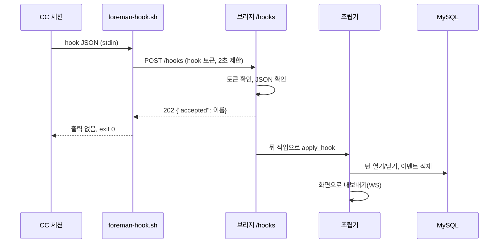

<!--
다루는 곳: scripts/foreman-hook.sh, deploy/hooks/foreman-hooks.json, bridge/api/hooks.py, scripts/foreman-decide.sh, bridge/hookmiss.py
읽은 커밋: 5e0f7c5
-->

# CC hook 받기

FOREMAN이 CC(Claude Code) 세션에서 무슨 일이 벌어지는지 아는 길은 둘이다. 하나는 CC가 디스크에 남기는 대화 기록 파일(트랜스크립트)을 뒤에서 읽는 길이고(→ 트랜스크립트 읽기), 다른 하나가 이 편에서 다루는 hook이다. 트랜스크립트가 "무슨 말이 오갔나"를 빠짐없이 남기는 장부라면, hook은 "지금 막 이 일이 일어났다"를 그 순간에 알려 주는 초인종이다. 둘은 서로 모자란 곳을 메운다. 이 편은 초인종 쪽, 곧 CC가 hook을 부르는 순간부터 브리지가 그 소식을 받아 조립기에 넘기기까지를 다룬다. 넘겨받은 소식이 턴을 열고 닫는 자세한 규칙은 → 턴 조립에서 다룬다.

## hook이란 무엇인가

hook은 CC가 정해진 순간마다 "이 명령을 실행해 달라"고 미리 적어 둔 약속이다. CC 설정 파일(`settings.json`)의 `hooks` 칸에 "사람이 프롬프트를 보냈을 때 이 스크립트를 돌려라", "응답이 끝났을 때 이 스크립트를 돌려라" 하고 적어 두면, CC는 그 순간이 올 때마다 스크립트를 실행하고 그 순간의 정보를 JSON 한 덩어리로 스크립트의 표준 입력(stdin, 프로그램이 읽어 들이는 입구)에 흘려 넣는다. 그 JSON에는 어느 세션인지(`session_id`), 어느 폴더에서 일하는지(`cwd`), 트랜스크립트 파일이 어디 있는지(`transcript_path`), 어떤 hook인지(`hook_event_name`)가 늘 들어 있고, hook 종류에 따라 프롬프트 글이나 마지막 응답 글, 오류 내용 같은 것이 더 붙는다.

중요한 성질이 하나 있다. CC는 hook 명령이 끝날 때까지 기다린다. 사람이 엔터를 친 뒤 UserPromptSubmit hook이 3초 걸리면, 모델은 그 3초 동안 프롬프트를 받지 못한다. 그리고 어떤 hook은 스크립트가 표준 출력(stdout, 프로그램이 내보내는 출구)에 쓴 글을 CC가 다시 읽어 들인다. 이 두 성질 때문에 hook 스크립트는 아주 조심스럽게 짜야 한다. 아래 「CC를 절대 막지 않는다」 절이 그 이야기다.

FOREMAN의 hook은 사용자 전체 설정(`~/.claude/settings.json`)에 걸려 있다. 그래서 FOREMAN이 띄운 세션만이 아니라 이 PC에서 도는 모든 CC 세션, 곧 런슈즈와 펫퍼민트 세션까지 같은 스크립트를 부른다 [log:infra_20261102_host-changes.md]. 설치할 때 원래 파일은 따로 백업해 두었고, 되돌리려면 그 백업으로 덮으면 된다. 설치하면서 하나 확인한 것이 있다. 이미 떠 있는 CC도 다시 띄우지 않고 다음 프롬프트부터 바뀐 설정을 읽어 hook을 보낸다. 시험용 CC를 먼저 띄워 두고 사용자 설정에 표시용 hook을 17초 동안 더했다가 되돌렸는데, 그사이 넣은 입력에서 hook이 불렸다 [log:stage3_inject_result.md]. 이 덕분에 다른 프로젝트의 실행 중인 세션을 멈추지 않고도 FOREMAN을 붙일 수 있었다. 다만 Ctrl+Z로 멈춰 둔 세션은 프로세스가 멈춰 있으니 hook을 보낼 수 없고, 다시 깨어나야 다음 턴부터 보낸다.

## 받는 hook 여덟 가지

CC가 부를 수 있는 hook은 여럿이지만 FOREMAN은 여덟 가지만 받는다. 저장소에는 그 설정의 원본이 `deploy/hooks/foreman-hooks.json`으로 들어 있다 [code:deploy/hooks/foreman-hooks.json]. 여덟 가운데 여섯은 "알리기만 하는" hook으로 `scripts/foreman-hook.sh`를 부르고, 나머지 둘은 "답을 받아 와야 하는" hook으로 `scripts/foreman-decide.sh`를 부른다. 앞의 여섯이 이 편의 몸통이고, 뒤의 둘은 맨 끝 절에서 짧게 짚는다.

| hook | 언제 불리나 | 부르는 스크립트 | 브리지가 얻는 것 | 이벤트 이름 |
|---|---|---|---|---|
| UserPromptSubmit | 프롬프트가 모델에 들어가기 직전 | foreman-hook.sh | 턴의 시작, 프롬프트 글 | `start` (대기열 입력이면 `queued`) |
| Stop | 모델이 응답을 마쳤을 때 | foreman-hook.sh | 턴의 정상 끝, 마지막 응답 글 | `stop` |
| StopFailure | API 오류로 턴이 끝났을 때 | foreman-hook.sh | 턴의 실패 끝, 오류 내용 | `error` |
| SessionEnd | 세션이 끝났을 때(창 닫힘, exit) | foreman-hook.sh | 세션의 끝과 그 까닭 | `session_end` |
| SubagentStart | 서브에이전트가 시작될 때 | foreman-hook.sh | 서브에이전트 시작과 종류 | `subagent_start` |
| SubagentStop | 서브에이전트가 끝났을 때 | foreman-hook.sh | 서브에이전트 끝 | `subagent_stop` |
| PreToolUse | 도구를 쓰기 직전 | foreman-decide.sh pre | 승인 판정, 역할 막기 | (→ 04 승인) |
| PermissionRequest | CC가 승인 창을 띄울 때 | foreman-decide.sh permission | 브라우저에서 내린 결정 | (→ 04 승인) |

이벤트 이름은 브리지가 DB의 `event` 표에 남길 때 쓰는 이름이다. 조립기 안에 hook 이름과 이벤트 이름을 짝지은 표가 있고, 이 표에 없는 hook은 받아도 아무것도 하지 않고 지나간다 [code:bridge/assembler.py].

### 왜 이 여섯인가

FOREMAN의 첫째 일은 턴(사람이 한 번 시키고 모델이 한 번 답하기까지의 한 덩어리)이 언제 시작하고 언제 끝났는지 아는 것이다. 턴이 끝난 순간에 텔레그램 알림이 나가고 화면의 캐릭터가 일하는 모습에서 쉬는 모습으로 바뀌기 때문이다. 그런데 트랜스크립트만 읽어서는 끝을 다 잡지 못한다. 킥오프 때 실제 트랜스크립트 전체를 세어 보니, 정상으로 끝난 턴은 트랜스크립트의 소요 시간 줄(`turn_duration`)이 625개 모두 남았지만, 창을 닫거나 exit로 끝난 세션 다섯은 그 줄이 하나도 없었다 [code:README.md]. 끝났다는 흔적이 파일에 아예 없으니 아무리 잘 읽어도 알 수 없다. hook은 이 빈자리를 메운다. Stop, StopFailure, SessionEnd는 각각 정상 끝, 오류 끝, 세션 끝을 그 순간에 알려 주고, UserPromptSubmit은 턴의 시작을 알린다.

그래서 FOREMAN은 턴의 끝을 신호 하나로 정하지 않는다. 트랜스크립트, hook, 프로세스가 살아 있는지 보는 순회(sweep) 셋 가운데 먼저 도착한 신호가 턴을 닫고, 누가 닫았는지를 턴 행의 `closed_by` 칸에 남긴다 [code:bridge/assembler.py]. 실제로 처음 시험해 보니 UserPromptSubmit hook이 트랜스크립트보다 먼저 와서 턴을 열었고, Stop hook이 마지막 응답 줄보다 먼저 와서 턴을 닫았다 [log:stage2_transcript_result.md]. hook이 초인종 노릇을 제대로 한다는 뜻이다. 이렇게 신호를 겹쳐 받는 설계의 전체 그림과 "먼저 온 쪽이 이긴다"의 세부는 → 턴 조립에서 다룬다.

반대로 받지 않기로 한 hook도 있다. PostToolUse(도구를 쓴 뒤)는 받지 않는다. 어떤 도구를 무슨 입력으로 썼고 결과가 어땠는지는 트랜스크립트에 이미 같은 정보가 다 있기 때문이다 [log:stage2_transcript_result.md]. 같은 것을 두 길로 받으면 hook을 부를 때마다 CC가 그만큼 기다리고, 적재도 두 번 하고, 둘이 어긋날 때 무엇을 믿을지 정해야 한다. 얻는 것이 없으니 받지 않았다. PreToolUse도 처음에는 같은 까닭으로 받지 않았는데, 나중에 승인을 만들면서 "적어 두기"가 아니라 "막거나 묻기" 위해 따로 받게 되었다. 그 길은 이 편의 스크립트가 아니라 다른 스크립트를 탄다(맨 끝 절).

### 각 hook에서 무엇을 하나

**UserPromptSubmit.** 턴을 연다. 이미 열린 턴이 없으면 새 턴을 만들고, 그 턴의 출처(사람이 친 것인지, 다른 세션이 보낸 메시지인지, 인계받은 글인지)를 프롬프트 내용으로 가린다 [code:bridge/assembler.py]. 프롬프트 글은 DB에 넣기 전에 비밀값 가리기(마스킹)를 거친다. 열린 턴이 이미 있으면 새 턴을 열지 않는다. 이 경우는 둘 중 하나다. 트랜스크립트가 같은 프롬프트를 먼저 읽어 턴을 열어 둔 경우이거나, 모델이 바쁜 동안 사람이 입력을 더 넣은 경우(대기열 입력)다. CC는 대기열 입력도 새 턴으로 만들지 않고 진행 중인 턴 안에 끼워 넣는데, 그때도 UserPromptSubmit hook을 부른다 [log:stage3_inject_result.md]. 처음에는 이 둘을 "트랜스크립트가 15초 안에 연 프롬프트인가"라는 시간 창으로 갈랐는데, 그러면 15초가 넘게 돌던 턴에 대기열 입력이 들어올 때 일하던 턴을 닫고 새 턴을 열어 버렸다. 그래서 "열린 턴이 있으면 열지 않는다"로 바꾸고, 15초가 넘은 턴에 온 것은 이벤트 이름을 `queued`로 바꿔 남긴다 [c:2b26867]. 마지막으로, 사람이 직접 넣은 프롬프트라면 그 글을 겹침 알림(이미 같은 일을 하는 세션이 있는지 살피는 일)에 넘긴다. 겹침 알림이 무엇을 보는지는 → 겹침 알림.

**Stop.** 턴을 정상 끝(`stop`)으로 닫는다. CC가 넘겨주는 마지막 응답 글(`last_assistant_message`)을 함께 받아 턴의 끝맺음 글로 붙인다. 하나 알아 둘 것은 Esc로 중단한 턴에서는 Stop hook이 불리지 않는다는 점이다. CC의 동작이라 FOREMAN이 바꿀 수 없고, 이 경우는 트랜스크립트의 중단 표시 줄이나 한 시간 뒤의 정리 작업이 맡는다 [log:stage3_inject_result.md]. 이것도 → 턴 조립에서 자세히 다룬다.

**StopFailure.** API 오류로 끝난 턴을 실패 끝(`stop_failure`)으로 닫는다. 오류 내용은 이벤트에 남는다. 알림 쪽은 이 끝 까닭을 보고 실패 알림을 따로 낸다.

**SessionEnd.** 열린 턴이 있으면 `session_end`로 닫고, 세션 행에 떨어진 시각(`detached_at`)을 적는다. 그 세션이 나중에 `--resume`으로 다시 살아나 트랜스크립트에 새 줄이 생기면 이 표시는 지워진다 [code:bridge/assembler.py].

**SubagentStart, SubagentStop.** 서브에이전트(세션이 일을 나눠 맡기려고 띄우는 작은 에이전트)의 시작과 끝을 적는다. 여기에는 실측에서 나온 예외가 하나 있다. CC 내부의 보조 에이전트는 종류(`agent_type`)가 빈 SubagentStop만 보내고, 짝이 되는 SubagentStart도 트랜스크립트 파일도 남기지 않는다 [code:bridge/assembler.py]. 이것까지 행으로 만들면 화면에 정체 모를 서브에이전트가 쌓인다. 그래서 hook만으로는 새 행을 만들지 않기로 했다. SubagentStop은 이미 아는 서브에이전트만 끝남으로 바꾸고, SubagentStart는 종류가 적혀 있을 때만 행을 만든다.

여섯 가지 모두 공통으로 하는 일이 둘 더 있다. 첫째, hook을 한 번이라도 받은 세션에는 "hook을 받는 세션"이라는 표시를 해 둔다. 나중에 프로세스가 아무 신호 없이 사라졌을 때, hook을 받던 세션이면 이상하게 사라진 것(`process_lost`)으로, hook을 한 번도 못 받은 세션이면 그냥 끝난 것(`session_end`)으로 가른다 [code:bridge/assembler.py]. hook을 받던 세션이 SessionEnd 없이 사라졌다면 그것은 정말 이상한 일이고, 알림도 경고로 나간다 [code:bridge/notify.py]. 둘째, 이벤트를 남길 때 hook JSON을 통째로 저장하지 않고 뜻이 있는 몇 칸(hook 이름, 까닭, 오류, 서브에이전트 종류, 권한 모드 등)만 골라 남긴다. 프롬프트나 응답 글 같은 큰 덩어리는 턴과 메시지 쪽에 이미 들어간다.

### hook 기록은 다시 만들 수 없다

DB의 기록 대부분은 트랜스크립트에서 다시 만들 수 있다. 트랜스크립트가 120일 동안 남아 있고, 같은 파일을 다시 읽어도 같은 결과가 나오게 짰기 때문이다 [log:stage2_transcript_result.md]. hook 기록은 다르다. 그 순간에 한 번 오고 어디에도 다시 남지 않는다. 2단계 시험에서 파생 데이터를 지우고 트랜스크립트에서 다시 만들어 봤더니, hook으로 닫혔던 시험 세션의 턴이 이번에는 순회(`session_end`)로 닫혔다 [log:stage2_transcript_result.md]. 그래서 hook을 설치한 뒤로는 DB 전체를 트랜스크립트에서 다시 만드는 일을 하지 않는다는 원칙을 세웠다. DB 백업을 매일 받는 까닭 가운데 하나도 이것이다 [log:stage1_bridge_db_result.md].

## CC를 절대 막지 않는다 — 스크립트의 약속

`scripts/foreman-hook.sh`는 열 줄 남짓한 짧은 셸 스크립트다 [code:scripts/foreman-hook.sh]. 짧지만 맨 위 주석에 적힌 약속 하나를 지키려고 한 줄 한 줄이 그렇게 짜여 있다. "CC를 절대 막지 않는다." FOREMAN은 지켜보는 쪽이지 일하는 쪽이 아니다. 지켜보는 도구가 고장 났다고 해서 일하는 세션이 멈추거나 이상해지면 안 된다. 이 hook은 런슈즈와 펫퍼민트까지 이 PC의 모든 CC 세션에 걸려 있으니 더욱 그렇다. 약속은 넷으로 나뉜다.

| 약속 | 스크립트에서 | 지키는 까닭 |
|---|---|---|
| 2초 안에 끝난다 | `curl -m 2` | CC는 hook이 끝날 때까지 기다린다 |
| 아무것도 출력하지 않는다 | `-o /dev/null`, `>/dev/null 2>&1` | UserPromptSubmit의 출력은 모델 맥락에 들어간다 |
| 늘 exit 0으로 끝난다 | 마지막 줄 `exit 0`, 토큰이 없어도 `exit 0` | 0이 아닌 끝 코드는 CC가 오류로 다룬다 |
| 토큰을 명령줄에 싣지 않는다 | 헤더를 프로세스 치환 `@<(printf …)`으로 넘김 | 명령줄은 `ps`로 누구나 본다 |

**2초.** CC는 hook 명령이 끝나기를 기다린다. 브리지가 바쁘거나, 꺼져 있거나, 응답 없이 멈춰 있다면 그동안 사람이 친 프롬프트가 모델에 가지 못한다. 그래서 `curl`에 2초 제한을 걸었다. 2초 안에 브리지가 받지 못하면 그 hook 하나는 버린다. hook 하나를 잃어도 턴은 트랜스크립트나 순회가 결국 닫으니, 일하는 세션을 붙잡는 것보다 소식 하나를 잃는 쪽이 낫다고 보았다. 설정 파일 쪽에도 hook 제한 시간을 5초로 걸어 두었다 [code:deploy/hooks/foreman-hooks.json]. 스크립트가 어떤 까닭으로 2초 안에 못 끝나도 CC가 5초에는 끊는다. 이중 잠금이다.

**출력 없음.** 이 약속이 가장 덜 눈에 띄고 가장 위험하다. CC는 UserPromptSubmit hook이 표준 출력에 쓴 글을 사람의 프롬프트 옆에 덧붙여 모델에게 보여 준다. 원래는 프롬프트에 맥락을 보태라고 만든 기능이다. 그런데 FOREMAN의 hook이 브리지의 응답(예: `{"accepted":"UserPromptSubmit"}`)이나 `curl`의 오류 글(예: "연결이 거부되었다")을 그대로 표준 출력에 흘리면, 그 글이 모든 세션의 모든 프롬프트에 끼어 모델이 읽게 된다. 모델이 그것을 사람의 말로 오해할 수도 있고, 적어도 맥락을 쓸데없이 차지한다. 그래서 `curl`의 응답 본문은 `-o /dev/null`로, 나머지 출력과 오류 글은 `>/dev/null 2>&1`로 모두 버린다. 브리지가 어떤 답을 하든 CC 쪽에는 한 글자도 돌아가지 않는다.

**늘 exit 0.** hook 스크립트가 0이 아닌 코드로 끝나면 CC는 그것을 hook 오류로 다룬다. 끝 코드에 따라서는 사람 화면에 오류가 뜨거나 프롬프트 처리를 막을 수도 있다. 그래서 스크립트는 어떤 길로 가든 `exit 0`으로 끝난다. `.env.bridge`가 없거나 토큰 줄이 비어 있으면 아예 보내지 않고 조용히 `exit 0`, 보내다 실패해도 `exit 0`이다. 브리지가 꺼져 있어도 CC는 아무 일 없다는 듯 그대로 일한다 [log:stage2_transcript_result.md].

**명령줄에 토큰을 싣지 않는다.** 브리지에 보낼 때는 hook 토큰을 `Authorization: Bearer …` 헤더에 넣어야 한다. 가장 쉬운 방법은 `curl -H "Authorization: Bearer $TOKEN"`이지만, 그러면 토큰이 `curl`의 명령줄 인자가 되고, 명령줄 인자는 그 순간 이 PC에서 `ps`를 치는 누구에게나 보인다. 그래서 `printf`로 헤더 한 줄을 만들어 프로세스 치환(`<( … )`, 명령의 출력을 임시 파일처럼 넘기는 셸 기능)으로 건네고, `curl`은 `-H @파일` 꼴로 그 "파일"에서 헤더를 읽는다. 명령줄에는 파일 이름만 남고 값은 남지 않는다. 토큰은 저장소의 `.env.bridge`에서 `FOREMAN_HOOK_TOKEN` 줄을 `sed`로 읽어 온다. 스크립트는 자기 위치에서 저장소 맨 위를 찾아 그 파일을 열므로, 어느 폴더에서 CC가 돌든 같은 파일을 본다.

hook JSON 자체는 `--data-binary @-`로 표준 입력을 그대로 흘려보낸다. 스크립트는 JSON을 읽거나 고치지 않는다. 받을 칸을 고르는 일, 이상한 JSON을 거르는 일은 모두 브리지가 한다. 셸에서 JSON을 다루면 실수할 곳이 늘고, 스크립트가 길어질수록 "절대 막지 않는다"를 지키기 어려워진다. 보낼 곳은 기본으로 같은 PC 안 브리지의 8000 포트 `/hooks`이고, 시험할 때는 `FOREMAN_HOOK_URL` 환경 변수로 바꿀 수 있다.

## 바로 202, 적재는 뒤에서

브리지 쪽 받는 곳은 `bridge/api/hooks.py`의 `POST /hooks`다 [code:bridge/api/hooks.py]. 이곳의 핵심은 hook을 받자마자 202(Accepted, "받았다, 처리는 나중에 한다"는 뜻의 HTTP 응답)를 돌려주고, DB에 적는 일은 응답과 따로 뒤에서 한다는 점이다.

왜 기다리지 않는가. 적재는 생각보다 오래 걸릴 수 있다. 조립기는 트랜스크립트 읽기와 hook 적재가 같은 세션 상태를 동시에 건드리지 않도록 잠금(lock) 하나를 쥐고 차례로 일한다. 트랜스크립트 쪽이 큰 덩어리를 적재하는 중이면 hook은 그 잠금이 풀릴 때까지 기다려야 하고, DB가 느리면 더 걸린다. 이 시간을 hook 응답 안에 넣으면 그만큼 CC가 기다리고, 2초를 넘기면 `curl`이 끊어 hook을 잃는다. 그래서 받는 곳은 "인증이 맞는지, JSON 모양이 맞는지"만 바로 보고 답하며, 실제 적재는 비동기 작업(asyncio task)으로 떼어 낸다. 적재가 실패하면 CC에 알릴 길이 없으니(이미 답을 보냈다) 브리지 로그에 hook 이름과 오류 종류를 남긴다. 적재 쪽에도 DB 질의 제한 시간의 두 배(기본 10초) 제한이 걸려 있어, 한 hook의 적재가 무한정 잠금을 쥐고 있지 못한다 [code:bridge/config.py].

한 가지 작은 장치가 더 있다. 파이썬의 비동기 작업은 아무도 참조하지 않으면 끝나기 전에 메모리 정리기에 치워질 수 있다. 받는 곳은 떼어 낸 작업을 모듈의 집합(`_tasks`)에 넣어 붙잡아 두고, 작업이 끝나면 스스로 빠지게 해 두었다 [code:bridge/api/hooks.py]. 응답을 먼저 보내고 일을 뒤로 미루는 구조에서 가장 흔한 "조용히 사라지는 일"을 막는 장치다.

받는 곳이 바로 거절하는 경우는 넷이다.

| 응답 | 언제 | 로그에 남는 까닭 |
|---|---|---|
| 401 | 헤더가 없거나, Bearer가 아니거나, 토큰이 다를 때 | "Authorization 없음", "Bearer 아님", "토큰 불일치(받은 길이 N)" |
| 400 | 본문이 JSON이 아니거나, JSON 객체가 아닐 때 | "JSON이 아님" |
| 400 | `hook_event_name`이나 `session_id`가 없을 때 | 빠진 칸 |
| 503 | 조립기(와처)가 꺼져 있을 때 | 와처 꺼짐과 hook 이름 |

어떤 거절이든 브리지 로그에 까닭을 남기되 토큰 값은 남기지 않는다. 토큰이 다를 때도 받은 값의 길이만 남긴다. 이 규칙은 1단계에서 치른 값으로 생겼다. 그때 브라우저의 웹소켓 연결이 인증 실패로 계속 끊겼는데, 서버가 실패 까닭을 아무 데도 남기지 않아 원인을 찾는 데 한참 걸렸고, 끝내 처음 어긋남이 무엇이었는지는 확정하지 못했다 [log:stage1_bridge_db_result.md]. 그 뒤로 새로 만드는 거절 길은 처음부터 까닭을 남긴다. hook 받는 곳이 그 첫 사례다. hook 스크립트가 출력을 모두 버리니 CC 쪽에서는 실패를 볼 수 없고, 브리지 로그만이 "hook이 오다가 막혔다"를 알려 주는 곳이라는 점에서도 이 로그는 꼭 필요하다.

503을 따로 둔 것도 같은 생각이다. 조립기가 꺼진 채 202를 돌려주면 hook은 받은 척 버려지고 아무도 모른다. 꺼져 있으면 꺼져 있다고 답하고 로그에 남긴다. 다만 스크립트는 이 응답도 버리고 `exit 0`으로 끝나므로 CC에는 아무 영향이 없다.

## hook 토큰을 API 토큰과 가른 까닭

브리지에는 열쇠가 여럿 있다. 사람이 화면과 API를 쓸 때 내는 API 토큰(`FOREMAN_API_TOKEN`)과, hook이 낼 때 쓰는 hook 토큰(`FOREMAN_HOOK_TOKEN`)이 그 가운데 처음 둘이다. 둘은 처음부터 다른 값으로 나뉘어 있고, 브리지 설정도 둘을 따로 읽는다 [code:bridge/config.py].

가른 까닭은 새는 곳이 다르고 새었을 때 잃는 것이 달라서다. hook 토큰은 셸 스크립트가 파일에서 읽어 `curl`에 넘기는 값이고, 이 PC의 모든 CC 세션이 그 스크립트를 쉴 새 없이 부른다. 도구를 쓰기 직전에 부르는 hook(PreToolUse) 하나만 세어도, 11-15에 브리지 로그로 센 11-08~11-15 하루 호출 수가 1,336번에서 9,373번 사이였다. 그 수에는 다른 일곱 hook이 빠져 있으니 실제 부르는 수는 더 많다 [log:manager410_overhead_20261115.md]. 그만큼 노출되는 자리가 많다. 반면 API 토큰은 세션에 글을 넣고(입력 주입), 세션을 끝내고, 합치기를 부르는 등 브리지의 거의 모든 일을 할 수 있다. 만약 둘이 같은 값이라면 hook 길에서 한 번 새는 것만으로 남이 아무 세션에나 명령을 쳐 넣을 수 있게 된다. 둘을 가르면 hook 토큰이 새도 그 값으로 할 수 있는 일은 `/hooks` 아래에 가짜 소식을 보내는 것뿐이다. 주입도 API도 쓸 수 없다 [log:stage1_bridge_db_result.md]. 가짜 hook이 할 수 있는 최악은 턴 표시를 어지럽히는 정도이고, 그것도 트랜스크립트가 바로잡는다.

토큰을 확인하는 방법도 정해 두었다. 두 값을 비교할 때 보통의 문자열 비교(`==`)를 쓰지 않고 `hmac.compare_digest`를 쓴다 [code:bridge/api/auth.py]. 보통 비교는 처음 다른 글자에서 바로 멈추기 때문에, 응답 시간을 재면 앞에서부터 몇 글자가 맞았는지를 짐작할 수 있다. `compare_digest`는 어디서 달라지든 같은 시간이 걸린다. 또 브리지는 뜰 때 두 토큰이 모두 32자 이상인지 보고, 짧으면 아예 뜨지 않는다 [code:bridge/config.py]. 값은 `.env.bridge`(권한 600, 커밋하지 않음)에만 있고, 저장소에는 키 이름만 적힌 견본 파일 `.env.bridge.example`이 들어 있다.

토큰을 어떻게 나누고 관리하는지의 전체 그림, 곧 관리 토큰과 프로젝트 토큰과 웹훅 토큰까지 넷으로 나뉜 지금 모습과 그렇게 된 까닭은 → 열쇠와 비밀에서 다룬다.

## 같은 길을 타는 PreToolUse와 PermissionRequest

여덟 hook 가운데 PreToolUse와 PermissionRequest는 성격이 다르다. 앞의 여섯은 "이런 일이 있었다"고 알리기만 하면 되지만, 이 둘은 브리지의 답을 받아 CC에 돌려줘야 한다. 그래서 출력을 모두 버리는 `foreman-hook.sh` 대신 `scripts/foreman-decide.sh`를 부르고, 브리지의 `/hooks/pre`와 `/hooks/permission`으로 간다. 받는 곳은 같은 파일(`bridge/api/hooks.py`)에 있고, 같은 hook 토큰과 같은 거절 로그 규칙(`_authed_body`)을 쓴다 [code:bridge/api/hooks.py]. 다른 점은 바로 202를 돌리지 않고 판정을 기다려 돌려준다는 것이다. PreToolUse는 메모리 안에서 곧바로 판정해 허용, 묻기, 거부 가운데 하나를 JSON으로 돌려주고, 판정하지 않을 때는 본문 없는 204로 "CC가 스스로 정하라"고 답한다. 이 판정 안에서 역할 막기도 함께 일어난다. 브리지는 세션의 역할(코더, 조사 등)을 읽어 그 역할이 해서는 안 되는 도구 사용이면 `deny`로 막고, 스키마 잠금, 다른 저장소 쓰기, `pgrep -f` 자기 걸림 같은 막기도 같은 자리에서 한다 [code:bridge/approvals.py]. PermissionRequest는 CC가 승인 창을 띄운 순간 불려, 사람이 화면에서 결정을 내릴 때까지 기다린다. 이 둘도 "CC를 막지 않는다"는 바탕은 같아서, 브리지가 꺼져 있거나 오류면 아무것도 출력하지 않고 `exit 0`으로 끝나 CC가 평소처럼 스스로 정한다(허용 쪽으로 새지 않는다) [code:scripts/foreman-decide.sh]. 다만 일부러 기다리는 hook이라 제한 시간이 훨씬 길다.

판정 없이 통과하는 것은 그대로 두되, 통과했다는 사실은 남긴다. 판정을 받아야 할 PreToolUse가 브리지가 꺼졌거나, 답이 늦었거나, 판정 도중 오류가 나서 판정 없이 지나가면 그 일이 아무 데도 남지 않았다. 막기가 꺼진 채 돌아도 아무도 모르는 조용한 고장이다. 그래서 스크립트와 브리지가 같은 기록 파일(저장소 안 `.run/hook_miss.log`, 저장소에 올리지 않는 폴더)에 한 줄씩 쓴다. 한 줄에는 시각, 어느 쪽이 썼는지, 어떤 갈래로 통과했는지와 그 까닭(오류 종류 이름, 걸린 시간처럼 코드가 만든 값), 세션 id, 도구 이름만 들어간다. 명령 글이나 입력 값은 비밀값이 섞일 수 있어 쓰지 않는다. 판정이 정상으로 오간 호출에서는 아무것도 쓰지 않고, 파일이 1MB를 넘으면 한 벌만 옮겨 두고 새로 시작해 끝없이 커지지 않는다. 기록 쓰기가 실패해도 판정은 막지 않는다 [code:scripts/foreman-decide.sh][code:bridge/hookmiss.py][code:bridge/api/hooks.py][c:cd14ed6]. 브리지 쪽에서는 판정을 내는 데 스크립트가 기다리는 4초보다 오래 걸린 경우도 「늦은 응답」으로 남긴다. 스크립트가 이미 끊었으니 그 판정은 버려진 것이다 [code:bridge/api/hooks.py].

이 기록을 더하면서 한 번 사고가 났다. 처음 판은 스크립트가 세션 id와 도구 이름을 뽑으려고 hook 입력 전체를 셸 변수에 담았는데, 실행 환경에 따라 그 입력을 제대로 읽지 못해 빈 본문이 브리지로 갔다. 브리지는 그 호출을 판정하지 못했고, 그 호출들은 판정 없이 지나갔다. 통과를 기록하려던 장치가 통과를 만든 셈이다. 바로 스크립트 한 파일을 되돌린 뒤 다시 고쳤다 [c:1d303b9][c:58f9f03]. 지금 스크립트는 입력을 변수에 담지 않는다. `tee`가 표준 입력을 한 바이트도 바꾸지 않고 그대로 `curl`에 흘리고, 곁가지로 앞 4KB만 떼어 세션 id와 도구 이름만 뽑는다. 입력 꼴 여러 가지를 두 가지 실행 환경으로 보내 브리지가 받은 바이트가 원래와 같은지 보는 시험이 이 약속을 지킨다 [code:scripts/foreman-decide.sh][log:foreman-4_hook_bytes_20261115.md].

판정 시간, 승인 창 기다리기, 먼저 온 결정이 이기는 규칙은 → 04 승인에서, 역할마다 무엇을 막는지는 → 05 역할과 권한에서 다룬다.

## 알아 둘 것

hook 설정의 원본은 저장소의 `deploy/hooks/foreman-hooks.json`이지만, CC가 실제로 읽는 것은 사용자 설정 파일이다. 저장소 파일을 고친다고 바로 반영되지 않고, 사용자 설정에 손으로 옮겨야 한다. 그래서 둘이 어긋날 수 있고, 실제로 한 번 어긋났다. PermissionRequest의 제한 시간이 저장소 파일에는 900초로, 실제 사용자 설정에는 3660초로 적혀 있었다. 그대로 새 PC에 설치했다면 승인 창이 15분 만에 CC 쪽에서 끊겼을 것이다. 지금은 저장소 파일도 3660초다 [code:deploy/hooks/foreman-hooks.json][c:883c4c9]. 이 값은 혼자 정해지지 않는다. 브리지가 사람의 결정을 기다리는 시간이 3600초, 스크립트의 `curl`이 브리지 답을 기다리는 시간이 3630초, CC가 hook을 끊는 시간이 3660초로, 안쪽부터 30초씩 길게 겹쳐 있다. 안쪽이 먼저 끝나야 바깥이 그 답을 받을 수 있기 때문이다. 이 세 값의 순서가 어긋나면 시험이 깨진다 [code:scripts/foreman-decide.sh][code:tests/test_hook_timeouts.py]. 다만 시험은 저장소 안의 값끼리만 맞대고, 각 PC의 사용자 설정 값은 보지 않는다 [log:foreman-7_hook_timeout_20261115.md].

hook이 잘 오고 있는지는 DB의 `event` 표에서 `source='hook'`인 행으로 본다. 세션마다 hook 이벤트가 프롬프트 수만큼 쌓이고 있으면 길이 열려 있는 것이다.
