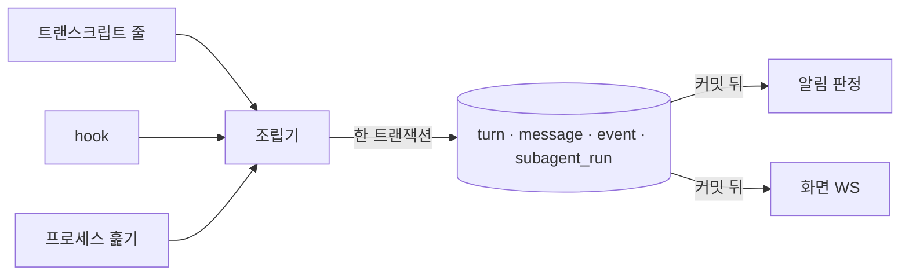

<!--
다루는 곳: bridge/assembler.py, bridge/store.py, bridge/models.py, tests/test_stage2_db.py
읽은 커밋: e5d584b
-->
# 턴 조립

트랜스크립트 줄과 hook은 그대로는 흩어진 기록이다. 한 줄은 사람 입력이고, 다음 줄은 모델 응답의 한 조각이고, 그다음은 도구 결과이고, 그 사이에 hook이 따로 날아온다. 이 편은 그 조각들을 「턴」이라는 단위로 묶어 DB의 `turn`, `message`, `subagent_run`, `event` 행으로 만드는 조립기(`bridge/assembler.py`)를 다룬다. 줄을 파일에서 읽어 오는 일은 → 트랜스크립트 읽기, hook을 받는 입구는 → CC hook 받기, 적재가 막혔을 때 알리고 화면으로 내보내는 일은 → 적재와 내보내기에서 다룬다. 여기서는 받은 줄을 어떻게 해석하고 어디에 붙이는지만 깊게 본다.

## 1. 턴이란 무엇인가

턴은 「무언가가 CC에게 말을 걸고, CC가 그 일을 끝낼 때까지」다. 보통은 사람이 프롬프트를 하나 보내고 CC가 생각하고 도구를 여러 번 부르고 답을 다 쓰고 멈추는 데까지가 한 턴이다. 그 안에 API 응답(message)이 여러 개, 도구 호출과 결과(event)가 수십 개 들어갈 수 있다 [code:bridge/assembler.py].

FOREMAN에서 턴이 중요한 까닭은 거의 모든 판단이 턴이 닫히는 순간에 걸려 있어서다. 텔레그램 알림은 턴이 닫히는 순간 나가고, 캐릭터가 일하는 모습에서 쉬는 모습으로 바뀌는 것도 그 순간이고, 사용량을 턴 단위로 묶어 보는 것도 턴이 있어야 한다. 그래서 브리지는 턴이 닫히는 한 지점에서 이 일들을 한 번에 처리한다 [docs:00_design.md].

DB의 네 표는 이렇게 나뉜다. `turn`은 한 턴에 한 행이고, 누가 열었는지(`origin`), 왜 닫혔는지(`end_reason`), 무엇이 닫았는지(`closed_by`), 걸린 시간(`duration_ms`), 도중에 압축이 있었는지(`compacted`)를 갖는다. `message`는 API 응답 하나에 한 행이고 토큰 수를 갖는다. `event`는 도구 호출, 도구 결과, 모델 글, 중단, 압축 같은 낱낱의 일이다. `subagent_run`은 서브에이전트(CC가 일을 나눠 맡기려고 띄운 작은 CC) 하나에 한 행이다 [code:bridge/assembler.py]. 표 전체 지도는 → 15 DB에 있다.

## 2. 턴 끝을 신호 하나로 판정하지 않는 까닭

처음 설계는 단순했다. 턴은 프롬프트에서 시작해 Stop hook(CC가 응답을 마치면 부르는 훅)에서 끝난다. 그런데 킥오프 때 전체 트랜스크립트를 통계로 훑어 보니, 어느 신호도 혼자서는 모든 종료를 잡지 못했다 [log:01_kickoff_result.md].

| 끝나는 상황 | 트랜스크립트의 `turn_duration` 줄 | hook | 대신 잡는 것 |
|---|---|---|---|
| 정상 종료 | 625건 중 625건 | Stop | 없음 |
| 사람이 Esc로 중단 | 29건 중 15건만 | Stop이 불리지 않는다 | 트랜스크립트의 `[Request interrupted by user…]` 줄 |
| API 오류 | 2건 중 2건 | StopFailure | 없음 |
| 세션 종료(창 닫힘, exit) | 5건 중 0건 | SessionEnd | 프로세스가 사라졌는지 훑기 |
| 턴 도중 자동 압축 | 턴이 압축 경계를 넘어 이어진다 | 없음 | 없음 |

이 표의 숫자는 킥오프 실측이다 [log:01_kickoff_result.md]. Esc 때 Stop hook이 불리지 않는다는 것은 처음에는 공식 문서에서 읽은 것이었고, 알림 단계에서 실제 세션에 Esc를 눌러 hook 없이 중단 표시 줄만 남는 것을 보고 확인했다 [log:stage4_notify_result.md].

표를 읽으면 왜 하나로 안 되는지 보인다. `turn_duration`은 정상 종료에는 빠짐없이 있지만 Esc 중단의 절반, 세션 종료에는 하나도 없다. Stop hook은 실시간으로 오지만 Esc에는 오지 않는다. hook은 사용자 설정에 설치해야만 오니 설치 전의 옛 기록에는 아예 없다. 세션 창이 그냥 닫히면 트랜스크립트도 hook도 아무 말 없이 끊긴다. 그래서 FOREMAN은 이 신호들을 모두 듣고, 각 상황을 잡는 신호를 따로 두었다.

## 3. 먼저 온 신호가 닫는다

여러 신호를 다 들으면 같은 턴에 대해 둘 이상이 올 수 있다. 정상 종료면 Stop hook과 `turn_duration` 줄이 거의 같이 온다. 이때 규칙은 하나다. 먼저 도착한 신호가 턴을 닫고, 그 출처를 `closed_by`에 적는다. 뒤에 온 신호는 아무것도 바꾸지 않는다 [code:bridge/assembler.py].

이것을 코드로 지키는 방법은 닫는 SQL 한 줄이다. 턴을 닫을 때 `UPDATE turn SET ended_at = …, end_reason = …, closed_by = … WHERE id = … AND ended_at IS NULL`을 부른다. 이미 닫힌 턴이면 조건에 걸려 바뀌는 행이 0개라 두 번째 신호는 그냥 지나간다. 다만 뒤에 온 신호가 `turn_duration`이면 소요 시간(`durationMs`)만은 비어 있을 때 채운다. Stop hook이 먼저 닫았어도 걸린 시간은 트랜스크립트만 알기 때문이다. 끝난 시각은 `GREATEST(끝 시각, started_at)`로 넣어, 시계가 어긋나도 끝이 시작보다 앞서지 않게 했다 [code:bridge/assembler.py].

`closed_by`가 가질 수 있는 값은 셋이다. `transcript`(트랜스크립트 줄이 닫았다), `hook`(hook이 닫았다), `sweep`(브리지가 주기적으로 프로세스를 훑다가 닫았다) [code:bridge/assembler.py]. 이 값은 나중에 「어느 신호가 실제로 일했나」를 세는 근거가 된다. 정상 턴 대부분이 hook으로 닫히는데 어느 날부터 transcript로만 닫힌다면 hook 설치가 풀린 것이다.

닫는 이유(`end_reason`)는 아래와 같다. 화면 이름은 대화 패널이 쓰는 말이다 [code:bridge/static/js/render.js].

| `end_reason` | 화면 이름 | 무엇이 닫나 | `closed_by` |
|---|---|---|---|
| `stop` | 끝남 | Stop hook, 또는 `system/turn_duration` 줄 | hook / transcript |
| `interrupted` | 중단 | `[Request interrupted by user` 로 시작하는 user 줄 | transcript |
| `stop_failure` | API 오류 | StopFailure hook, 또는 `isApiErrorMessage`가 붙은 assistant 줄 | hook / transcript |
| `session_end` | 세션 종료 | SessionEnd hook, 또는 hook을 한 번도 못 받은 세션의 프로세스가 사라짐 | hook / sweep |
| `process_lost` | 프로세스 사라짐 | hook을 받던 세션의 프로세스가 사라짐 | sweep |
| `merged` | 다음 입력에 합쳐짐 | 모델 활동 없이 열려 있던 턴 뒤에 새 턴이 열림 | transcript / hook |
| `no_signal` | 신호 없음 | 모델 활동이 있었는데 끝 신호 없이 새 턴이 열림 | transcript / hook |
| `abandoned` | 끝 신호 없이 버려짐 | 응답 없는 턴이 1시간 넘게 조용함 | sweep / transcript |

`session_end`와 `process_lost`를 나눈 까닭이 있다. hook을 한 번이라도 받은 세션이면, 정상으로 끝났을 때 SessionEnd hook이 왔을 것이다. 그런데 hook 없이 프로세스만 사라졌다면 무언가 비정상으로 죽은 것이니 `process_lost`로 따로 알린다. hook을 한 번도 받지 못한 세션(hook 설치 전 세션 등)은 정상 종료와 비정상 종료를 가를 근거가 없어 `session_end`로 둔다 [log:stage2_transcript_result.md]. 이 판정은 30초마다 도는 훑기(`sweep`)가 하고, 프로세스가 없고 60초 넘게 조용할 때만 닫는다 [code:bridge/config.py]. 정지(Ctrl+Z로 멈춘 `T` 상태)된 프로세스는 살아 있는 것으로 본다. 사용자가 일부러 세워 둔 세션을 끝난 것으로 치면 안 되기 때문이다 [code:bridge/assembler.py].

닫힌 뒤의 알림은 커밋이 끝난 다음에 부른다. 트랜잭션 안에서 알림 함수를 부르면 알림 쪽이 DB를 읽을 때 아직 닫히기 전 상태를 보기 때문이다. 그래서 조립 중에는 닫힌 턴을 묶음(`Batch.closed`)에 모아 두고, 커밋 뒤 `_after_commit`이 한꺼번에 알림 쪽으로 넘긴다 [code:bridge/assembler.py]. 어떤 턴을 알리고 어떤 턴을 묵히는지는 → 11 알림.

### hook이 트랜스크립트보다 먼저 올 때

시험 중에 한 가지 어긋남을 찾았다. headless CC(화면 없이 돌리는 CC)에서 Stop hook이 마지막 assistant 줄이 파일에 쓰이기보다 먼저 도착했다. hook이 턴을 닫은 뒤에 응답 줄이 오니 그 줄이 갈 턴이 없어 턴 없이 적재됐다 [log:stage2_transcript_result.md]. 지금은 열린 턴이 없을 때 온 assistant 줄은 직전에 닫힌 턴(`last_turn_id`)에 붙인다. 응답 줄은 그 자체로 새 턴을 열 수 없으니, 바로 앞 턴의 늦은 꼬리라고 보는 것이 맞다 [code:bridge/assembler.py]. 같은 까닭으로 알림은 hook이 온 뒤 2초 기다리고, 응답 첫 줄은 Stop hook이 실어 온 `last_assistant_message`를 먼저 쓴다 [log:stage4_notify_result.md].

## 4. 턴의 경계는 promptId다

설계 때는 「턴 = 사람 프롬프트부터 종료 신호까지」였다. 실제 트랜스크립트를 조사해 보니 더 좋은 열쇠가 CC 안에 이미 있었다. CC는 모든 user 줄에 `promptId`라는 값을 적는데, 한 턴에 속한 user 줄(사람 프롬프트, 도구 결과, 중단 표시, 압축 요약, 메타 줄)이 모두 같은 `promptId`를 갖는다. 빠진 줄은 0개였다. assistant 줄과 system 줄에는 없다 [log:stage2_transcript_result.md].

그래서 조립기의 규칙은 이렇다. 처음 보는 `promptId`를 가진 user 줄이 오면 새 턴을 연다. 이미 아는 `promptId`면 그 턴의 줄이다. 턴 표의 `prompt_id` 칼럼은 UNIQUE 키라 같은 `promptId`로 턴이 둘 생길 수 없다 [code:migrations/0003_turn_prompt_id.sql]. assistant 줄과 system 줄은 `promptId`가 없으니, 지금 열려 있는 턴(메모리의 `open_turn`)에 붙는다. 줄의 순서는 파일에 쓰인 순서를 그대로 따르고 timestamp로 다시 정렬하지 않는다. timestamp가 거꾸로 쓰인 줄이 실제로 많아서다(→ 트랜스크립트 읽기) [code:bridge/assembler.py].

`promptId`로 바꾼 덕에 설계에서 못 보던 것이 드러났다. 턴을 여는 것이 사람 프롬프트만이 아니었다. 백그라운드 작업이 끝났다는 알림(task-notification)도, 다른 CC 세션이 보낸 메시지도 새 `promptId`로 새 턴을 연다. 이것은 6절의 `origin`으로 가른다 [log:stage2_transcript_result.md].

### hook이 먼저 연 턴과 합치기

UserPromptSubmit hook(사람이 프롬프트를 보낼 때 부르는 훅)은 트랜스크립트의 프롬프트 줄보다 먼저 온다. 시험에서는 hook이 턴을 연 뒤 7ms 만에 트랜스크립트 줄이 같은 턴에 합류했다 [log:stage2_transcript_result.md]. hook 입력에는 `promptId`가 없으므로, hook이 연 턴은 잠깐 `prompt_id`가 비어 있다. 뒤이어 트랜스크립트 프롬프트 줄이 오면 조립기는 「열린 턴이 hook이 연 것이고 `prompt_id`가 비어 있다」를 보고 새 턴을 여는 대신 그 턴에 `promptId`, 프롬프트 uuid, 출처를 채운다 [code:bridge/assembler.py].

### 바쁠 때 넣은 입력은 턴이 아니다

CC가 일하는 중에 사람이 또 입력하면 그 글은 새 턴이 되지 않는다. 트랜스크립트에는 `queue-operation`(대기열에 넣음)과 `attachment/queued_command`(진행 중인 턴에 전달함)로 남고, 진행 중인 턴 안에서 처리된다 [log:stage2_transcript_result.md]. 조립기는 이것을 `queued` 이벤트로 남기고 턴은 세지 않는다. 대화 패널은 이 이벤트를 사람이 쓴 글로 보여 준다 [code:bridge/assembler.py].

문제는 이때도 UserPromptSubmit hook이 불린다는 점이었다 [log:stage3_inject_result.md]. 처음에는 「트랜스크립트가 15초 안에 연 같은 프롬프트면 hook을 무시한다」는 시간 창으로 걸렀는데, 턴이 시작된 지 15초가 넘은 뒤 대기열 입력이 오면 hook이 진행 중인 턴을 닫고 새 턴을 열 뻔했다. 지금은 시간 창을 버렸다. 턴이 열려 있으면 UserPromptSubmit은 절대 새 턴을 열지 않고, 열린 지 15초가 넘었으면 그 hook 이벤트의 종류를 `queued`로 남긴다 [code:bridge/assembler.py] [c:2b26867].

## 5. 열린 채 남는 턴

끝 신호가 하나도 오지 않은 채 다음 턴이 열리는 일이 있다. 이때 앞 턴을 어떻게 닫을지가 이 절의 주제다.

### merged와 no_signal

처음 전체 적재를 돌리자 끝 신호 없이 다음 턴에 밀린 턴이 54건 나왔다. 처음에는 이것을 모두 `no_signal`(신호를 놓쳤다)로 닫았다. 놓친 신호가 54개라면 판정에 구멍이 있다는 뜻이라 하나씩 들여다봤다. 54건 모두 모델 활동(assistant 줄, 도구 호출)이 0개였다. task-notification 46건, 다른 세션 메시지 5건, 사람 입력 3건이 CC가 응답하기 전에 다음 입력이 와서 함께 처리된 것이었다 [log:stage2_transcript_result.md]. 신호가 빠진 것이 아니라 애초에 따로 끝날 턴이 아니었던 것이다.

그래서 둘을 나눴다. 조립기는 열린 턴마다 「이 턴에 모델 활동이 있었나」(`TurnRef.active`)를 들고 있다. assistant 줄이 붙으면 참이 된다. 새 턴이 열리는데 앞 턴이 안 닫혔으면, 활동이 있었으면 `no_signal`(정말로 끝 신호가 기록되지 않았다), 없었으면 `merged`(응답 없이 다음 입력과 함께 처리됐다)로 닫는다 [code:bridge/assembler.py]. 나눈 뒤 실데이터의 `no_signal`은 0건이었다 [log:stage2_transcript_result.md]. `merged` 턴은 사람에게 알리지 않는다. 알릴 응답이 없기 때문이다.

### Esc를 첫 응답 전에 누르면 흔적이 없다

Esc 중단은 보통 트랜스크립트에 `[Request interrupted by user]` 줄을 남기고, 조립기는 그 줄을 보자마자 턴을 `interrupted`로 닫는다. 그런데 프롬프트를 보내자마자, 첫 응답이 오기도 전에 Esc를 누르면 그 줄조차 남지 않는다. 파일에는 프롬프트 줄과 API 요청 줄뿐이다. Stop hook도 오지 않는다 [log:stage6_dashboard_result.md].

실제로 이 일이 있었다. 펫퍼민트 창에 글을 잘못 붙여넣고 바로 Esc를 눌렀다. 그 턴은 아무 신호 없이 10시간 동안 열려 있었고, 대시보드는 그 세션을 내내 작업 중으로 보였다 [log:stage6_dashboard_result.md]. CC의 동작이라 FOREMAN이 Esc 때 신호를 만들 수는 없다. 그래서 남은 흔적으로 판단하는 길을 셋 두었다.

첫째, 화면은 열린 턴이 있다는 것만으로 작업 중이라고 하지 않는다. CC가 `~/.claude/sessions/<pid>.json`에 직접 적는 상태(busy, idle)를 먼저 보고, 열린 턴은 그 상태를 모를 때만 본다. 열린 턴이 있는데 CC가 일하지 않으면 캐릭터 머리 위에 끝났는지 모른다는 빨간 표시를 따로 띄운다 [code:bridge/api/dashboard.py] [code:bridge/static/js/office.js].

둘째, 훑기가 정리한다. 프로세스는 살아 있고, 정지 상태도 아니고, CC가 일하지 않는데(busy가 아님), 열린 턴의 마지막 활동이 1시간 넘게 지났으면 그 턴을 `abandoned`로 닫는다. 끝난 시각은 지금이 아니라 그 턴의 마지막 활동 시각이다 [code:bridge/assembler.py].

셋째, 다음 입력이 오면 시간을 본다. 응답 없이 열려 있던 앞 턴과 다음 입력 사이가 1시간 안이면 `merged`, 1시간 넘으면 `abandoned`로 닫는다 [code:bridge/assembler.py].

1시간이라는 기준(`turn_abandon_s = 3600`)은 실측에서 나왔다 [code:bridge/config.py]. 그때까지 `merged`로 닫힌 66개 턴의 다음 입력까지 간격은 최대 56분이었고 1시간 넘는 것은 0개였다 [log:stage6_dashboard_result.md]. 1시간이면 진짜로 합쳐진 턴을 버려진 것으로 잘못 닫지 않는다. 이 규칙을 넣고 브리지를 다시 띄우자 훑기가 그 펫퍼민트 턴을 곧바로 `abandoned`로 닫았다. 과거 `merged` 가운데 1시간을 넘는 것이 없어 이미 있던 행은 고치지 않았다 [log:stage6_dashboard_result.md] [c:91f4c79].

훑기는 시간만 보지 않는다. 열린 턴이 1시간 넘게 조용해도 CC가 스스로 busy라고 적고 있거나 프로세스가 정지 상태면 닫지 않는다. 시간만으로 닫으면 첫 응답이 늦게 오는 긴 작업이나 사람이 일부러 세워 둔 세션을 버려진 것으로 잘못 닫을 수 있어서다 [code:bridge/assembler.py].

### 압축 도중

자동 압축(대화가 길어져 CC가 앞부분을 요약해 줄이는 일)이 턴 도중에 일어나면 턴은 끝나지 않고 압축 경계를 넘어 이어진다 [log:01_kickoff_result.md]. 그래서 `system/compact_boundary` 줄은 턴을 닫지 않고, 지금 열린 턴에 `compacted = TRUE`만 표시하고 `compact` 이벤트를 남긴다. 압축 요약 user 줄(`isCompactSummary`)도 새 턴을 열지 않고 같은 표시만 한다 [code:bridge/assembler.py]. 압축이 있었다는 사실은 커밋 뒤 압축 알림과 압축 손실 재기로 넘어간다(→ 08 인계와 압축 손실).

## 6. 누가 턴을 열었나 — origin

턴을 연 것이 사람인지 아닌지에 따라 알림과 화면이 달라야 한다. 백그라운드 서브에이전트가 일곱 개 끝날 때마다 사람에게 「끝남」 알림이 일곱 번 가면 정작 사람 턴의 알림이 묻힌다. 그래서 `turn.origin`에 턴을 연 것을 적는다 [code:bridge/assembler.py].

| `origin` | 무엇이 열었나 | 가르는 법 |
|---|---|---|
| `human` | 사람 입력 | 아래 어디에도 걸리지 않은 user 줄 |
| `task_notification` | 백그라운드 작업 끝 알림 | `<task-notification`으로 시작, 또는 `turnOrigin`, `origin.kind` |
| `subagent_message` | 이 세션의 서브에이전트가 돌려준 결과 | `<agent-message from="X">`의 X가 이 세션의 서브에이전트 |
| `agent_message` | 다른 CC 세션이 보낸 메시지 | X가 이 세션의 서브에이전트가 아님, 또는 `isMeta`에 `Another Claude session sent a message` |
| `meta` | 그 밖의 메타 줄(이미지 설명, 사용량 한도 안내 등) | `isMeta` |
| `handoff`, `handoff_in` | 브리지가 넣은 인계 요청, 인계 글 | 머리에 `[FOREMAN 인계 요청 r=`, `[FOREMAN 인계 r=` |
| `manager_ask` | 프로젝트 관리자끼리의 부탁 | 머리에 `[관리자 부탁 — ` (사람 관리자가 보낸 것은 제외) |
| `relay` | 작업 세션의 보고, 사람에게 올릴 물음을 관리자에게 넣은 것 | 머리에 `[작업 보고 — `, `[사람에게 올릴 물음 — ` |
| `merge_card` | 브리지가 관리자 입력 칸에 넣은 합치기 카드 | 머리에 `[FOREMAN 합치기` |

이 표는 한 번에 만들어지지 않았다. 처음 값은 넷(`human`, `task_notification`, `agent_message`, `meta`)이었다 [code:migrations/0003_turn_prompt_id.sql]. 그러다 서브에이전트의 결과 전달이 세 가지 모양으로 들어온다는 것을 차례로 겪었다. 처음에는 `isMeta`가 붙어 `meta`로 분류됐고, 다음에는 `isMeta` 없이 사람 입력처럼 와서 `human`이 됐고, 세 번째는 트랜스크립트에 프롬프트 줄 없이 UserPromptSubmit hook으로만 와서 hook이 연 턴이 `human`으로 남았다. 세 번 모두 서브에이전트마다 개별 알림이 나갔다 [code:migrations/0006_subagent_message_origin.sql] [code:migrations/0007_subagent_message_origin_human.sql] [code:migrations/0008_subagent_message_hook_opened.sql]. 결론은 겉모양(`isMeta` 같은 깃발)이 아니라 내용으로 가른다는 것이었다. 지금은 hook으로 연 턴도 프롬프트 글을 같은 함수(`_resolve_origin`)에 넣어 출처를 정한다 [code:bridge/assembler.py].

`subagent_message`와 `agent_message`를 가르는 것도 문장 모양으로는 안 된다. 같은 결과 전달이 트랜스크립트에는 `Another Claude session sent a message: <agent-message …`로, hook에는 `<agent-message …`로 왔다. 그래서 `from="X"`의 X를 꺼내 이 세션의 `subagent_run`에 그 agent_id가 있는지 DB에서 확인한다. 있으면 자기 서브에이전트, 없으면 다른 세션이다 [code:bridge/assembler.py].

뒤쪽 다섯 값은 FOREMAN이 커지면서 브리지 스스로 세션 입력 칸에 글을 넣게 되자 생겼다. 브리지가 넣은 글은 tmux 입력 칸으로 들어가니 CC가 보기에는 사람 입력과 똑같다. 이것을 `human`으로 두면 사람의 마지막 말, 겹침 알림, 포스트잇 그물 같은 「사람이 무엇을 말했나」를 보는 기능에 브리지 글이 섞인다. 실제로 합치기 카드 글이 그렇게 섞였다 [code:bridge/assembler.py] [code:migrations/0033_postit.sql]. 그래서 브리지가 넣는 글마다 고정된 머리말을 붙이고, 조립기가 그 머리말로 출처를 가른다. 알림 쪽은 `relay`와 `merge_card`를 브리지가 만든 출처로 묶어 따로 다룬다 [code:bridge/notify.py].

이미 있는 턴의 출처가 바뀌는 경우도 하나 있다. 한 턴에 메타 줄이 먼저 오고 사람 글이 뒤에 오면, 처음에 `meta`로 열린 턴을 `human`으로 고치고 프롬프트 글도 사람 글로 바꾼다 [code:bridge/assembler.py].

## 7. 복사해 온 줄은 건너뛴다

CC의 `--resume`이나 fork로 만든 세션은 앞 세션의 기록을 새 파일 앞머리에 복사해 넣고 시작한다. 그 줄들은 원래 세션에 이미 적재돼 있으니, 새 세션에서 다시 턴으로 열면 같은 대화가 두 번 세어진다. 더 나쁘게는 턴 표의 `prompt_uuid`가 UNIQUE라 적재가 아예 막힌다.

실제로 막혔다. 백그라운드 fork로 만든 펫퍼민트 세션 하나가 같은 덩어리에서 UNIQUE 충돌로 실패를 되풀이했고, 3.38MB 파일 가운데 661바이트만 적재된 채 몇 시간이 갔다. 그 세션의 대화와 도구 호출이 대시보드에도 알림 판정에도 없었다 [log:stage2_transcript_result.md]. 이때 복사 줄은 `promptId`가 빠져 있었다. 그래서 「`promptId` 없는 사람 줄의 uuid가 다른 세션 턴에 있으면 복사 줄」로 막았다.

그런데 `claude --fork-session`은 모양이 달랐다. 앞 세션 줄을 uuid와 시각째 복사하면서 사람 줄의 `promptId`를 새 프롬프트의 `promptId`로 바꿔 썼다. `promptId`가 있으니 앞의 방어를 그대로 지나갔고, 첫 복사 줄이 새 턴에 붙고 진짜 새 프롬프트는 「이미 있는 턴」으로 흘러가 시작 이벤트도 남지 않았다 [log:stage0_tmux_result.md]. 겉모양(promptId가 있나 없나)으로 막은 방어가 다른 겉모양에 뚫린 것이다.

지금은 `promptId`가 아니라 줄의 uuid로 가린다. 사람 줄의 uuid가 다른 세션의 이벤트나 턴에 이미 있으면 복사 구간이 시작된 것으로 보고(`copying`), 그 뒤의 응답, 도구 결과, `turn_duration`, 중단 표시까지 첫 새 프롬프트가 나올 때까지 건너뛴다. 복사 줄의 `turn_duration`이 새 세션의 열린 턴을 옛 시각으로 닫거나, 옛 응답이 새 턴에 붙는 것을 막기 위해서다. 복사 줄은 원래 시각을 그대로 갖고 있으니, 복사 구간 직전 이 세션 줄의 시각(`copy_floor`)보다 이른 사람 줄도 복사 줄로 본다 [code:bridge/assembler.py]. 또 `prompt_uuid`를 쓰는 세 곳(턴 만들기, hook이 연 턴 채우기, meta를 human으로 바꾸기)은 다른 턴이 이미 가진 값이면 비워(`NULL`) 넣는다(`_free_uuid`). 값 하나 때문에 덩어리 전체가 막히는 일을 다시 만들지 않으려는 것이다 [code:bridge/assembler.py]. 막힌 덩어리를 어떻게 알리고 건너뛰는지는 → 적재와 내보내기.

## 8. 토큰은 message.id로 한 번만 센다

트랜스크립트에서 API 응답 하나는 한 줄이 아니다. 응답의 content 블록(글, 생각, 도구 호출) 하나마다 한 줄씩 쪼개져 쓰인다. 그런데 쪼개진 줄 모두에 그 응답 전체의 usage(토큰 수)가 똑같이 붙어 있다. 킥오프 실측에서 API 메시지 3,801개 가운데 2,970개가 여러 줄로 쪼개져 있었고, 그 2,970개 모두 같은 `message.id`의 줄끼리 usage가 같았다 [log:01_kickoff_result.md]. 줄 단위로 더하면 토큰이 블록 수만큼 부풀려진다.

그래서 `message` 표를 따로 두고 `message.id`를 기본 키로 삼았다. 조립기는 한 덩어리 안에서 같은 `message.id`의 줄을 사전 하나에 모아 한 행으로 만들고, 뒤 줄에서는 더 큰 output 토큰과 비어 있지 않은 `stop_reason`만 반영한다. DB에 넣을 때도 `ON DUPLICATE KEY UPDATE token_output = GREATEST(…)`라 같은 응답이 다음 덩어리에 걸쳐 와도, 파일을 다시 읽어도 한 행이다 [code:bridge/assembler.py]. 덩어리 경계에서 응답이 잘려도 마찬가지다. 시험은 쓰다 만 줄 뒤에 나머지를 붙였을 때 그 메시지가 한 행인지를 본다 [code:tests/test_stage2_db.py].

서브에이전트 줄의 output 토큰은 믿을 수 없다. 서브에이전트 줄의 usage는 응답을 받기 시작한 시점 값으로 보인다. `stop_reason`이 비어 있고, 글자당 output 토큰이 0.002로 부모(0.77)와 크게 다르다 [log:01_kickoff_result.md]. 그래서 서브에이전트 행은 `output_tokens_reliable = false`로 만들고, task-notification에 실려 오는 `subagent_tokens` 등은 `reported_*` 칸에 보조 검증용으로만 남긴다 [code:bridge/assembler.py]. 토큰을 어떻게 화면에 보이는지는 → 13 사용량과 모델.

## 9. 덩어리 하나가 트랜잭션 하나다

조립기의 가장 중요한 약속은 「같은 줄을 몇 번 다시 읽어도 행이 늘지 않는다」다. 브리지는 다시 뜨고, DB는 잠깐 끊기고, 파일은 잘리거나 inode가 바뀐다. 그때마다 어디까지 적재했는지 정확히 맞추려 애쓰는 대신, 다시 읽어도 결과가 같게 만들었다 [code:bridge/assembler.py].

먼저 조립기 안의 쓰기는 한 줄로 선다. 조립기는 `asyncio.Lock` 하나를 갖고, 트랜스크립트 덩어리 적용, hook 적용, 훑기, 서브에이전트 연결 모두 이 자물쇠 안에서 돈다 [code:bridge/assembler.py]. 트랜스크립트와 hook은 `bridge/bus.py`의 대기열을 거치지 않고 조립기가 직접 DB에 쓴다. 대기열은 승인, 입력 넣기, 셸, 웹훅처럼 조립기 밖에서 생긴 이벤트의 길이다(12절, → 적재와 내보내기).

덩어리(파일에서 한 번에 읽는 양, 최대 8MB) 하나가 DB 트랜잭션 하나다 [code:bridge/config.py]. 그 덩어리의 모든 턴, 메시지, 이벤트를 넣고, 같은 트랜잭션에서 `transcript_file.read_offset`을 덩어리 끝으로 옮긴다. 중간에 무엇이 실패하면 전부 롤백되고 offset도 덩어리 앞에 그대로 남는다. 커밋되지 않은 줄은 다음에 다시 읽힐 뿐이다. 실패하면 그 세션의 메모리 상태(열린 턴, 아는 promptId 등)도 버리고 다음에 DB에서 다시 읽는다 [code:bridge/assembler.py].

다시 읽어도 행이 늘지 않는 것은 표마다 유일한 열쇠가 있어서다.

| 표 | 유일한 열쇠 | 다시 읽을 때 |
|---|---|---|
| `event` | `uuid` UNIQUE | `ON DUPLICATE KEY UPDATE id = id`로 지나간다 |
| `message` | `message.id` 기본 키 | 같은 행에 큰 값만 반영 |
| `turn` | `prompt_id` UNIQUE | 이미 있는 턴을 문맥으로 삼는다 |
| `subagent_run` | `agent_id` | 찾고 없을 때만 만든다 |

uuid가 없는 줄(대기열 조작 등)과 한 줄에 블록이 여럿일 때의 두 번째 블록부터는 파일 경로와 offset, 블록 번호로 만든 uuid5(같은 입력이면 늘 같은 값이 나오는 uuid)를 쓴다. 같은 파일의 같은 자리를 다시 읽으면 같은 uuid가 나오니 중복이 생기지 않는다 [code:bridge/assembler.py]. 반대로 hook 이벤트는 매번 무작위 uuid4를 쓴다. hook은 다시 오지 않기 때문이다. 그래서 파생 데이터를 지우고 트랜스크립트에서 다시 만들면 hook 이벤트는 사라진다. 실제로 그렇게 다시 만들자 hook 시험 세션의 턴이 hook이 아니라 훑기로 닫혔다. hook을 설치한 뒤로는 전체를 다시 만들지 않는다 [log:stage2_transcript_result.md].

결과는 실측으로 확인했다. 1.4GB 트랜스크립트 전체를 적재하는 데 17초대가 걸렸고, offset을 0으로 돌려 처음부터 다시 읽어도 늘어난 행은 그사이 진행 중인 세션이 새로 쓴 몫뿐이었다. uuid 중복 0, promptId당 턴 1개였다 [log:stage2_transcript_result.md].

### 이 약속에 붙은 작은 대가 둘

중복으로 무시된 INSERT도 AUTO_INCREMENT 번호를 쓴다. 그래서 다시 읽을 때마다 `event.id`에 빈 번호가 생긴다. 순서는 그대로 늘어나고 칼럼이 BIGINT라 문제 삼지 않았다 [log:stage2_transcript_result.md].

한 덩어리의 묶음 INSERT 안에 같은 uuid가 둘 들어가면 MySQL이 1869 오류(Auto-increment 충돌)로 묶음 전체를 거부한다. 백그라운드 작업 끝 알림이 대기열, 첨부, 사람 줄 세 곳 어디로든 올 수 있어 한 덩어리에 같은 알림이 두 번 실리는 일이 실제로 생긴다. 그래서 백그라운드 작업 끝 이벤트(`bg_end`)는 작업 id로 uuid를 정하고, 묶음 안에 같은 uuid가 이미 있으면 넣지 않는다 [log:stage10_background_waiting_result.md] [code:bridge/assembler.py].

## 10. 서브에이전트를 턴에 붙이기

서브에이전트는 부모와 다른 파일(`subagents/` 아래)에 기록을 남긴다. 그 기록이 어느 턴의 일인지 알아야 사용량과 화면이 맞는다. 처음에는 서브에이전트 행을 자식 파일에서 만든다고 생각했는데, 실제로는 부모 파일의 Agent 도구 결과(`toolUseResult.agentId`)에서 만든다. 그 결과가 붙은 턴이 곧 서브에이전트를 띄운 턴(`spawn_turn_id`)이다 [log:stage2_transcript_result.md]. 자식 파일의 메시지와 이벤트는 모두 그 턴에 귀속된다 [code:bridge/assembler.py].

자식 파일이 부모보다 먼저 읽히면(실시간에서 생긴다) 띄운 턴을 아직 모른다. 그때는 턴 없이 넣어 두고, 30초마다 도는 연결 작업(`link`)이 부모의 Agent 도구 호출 이벤트로 띄운 턴을 찾아 메시지와 이벤트에 채우고 서브에이전트별 토큰 합계를 다시 낸다 [code:bridge/assembler.py] [code:bridge/config.py]. SubagentStart hook이 트랜스크립트보다 먼저 행을 만들면 설명과 종류가 비어 있는데, 뒤에 온 정보로 빈칸만 채운다. 종류가 빈 SubagentStop은 CC 내부 보조 에이전트라 시작 hook도 파일도 없어서 행을 만들지 않는다 [code:bridge/assembler.py]. 기록도 끝 신호도 없이 30분 넘게 running인 서브에이전트는 `stale`로 바꾼다. 실측에서 며칠 전 서브에이전트 7개가 running으로 남아 묶음 알림이 영원히 기다렸기 때문이다 [code:bridge/assembler.py] [code:bridge/config.py].

## 11. 무엇을 남기고 무엇을 버리나

조립기는 줄의 모든 것을 저장하지 않는다. 도구 결과 본문은 저장하지 않고 길이와 오류 여부만, 오류면 앞 300자만 남긴다. 도구 결과에는 형식을 모르는 비밀이 섞일 수 있고, 그런 비밀은 비밀 가리기(마스킹)로 못 잡는다. 원문은 트랜스크립트에 남아 있으니 화면에서 누르면 그때 파일에서 찾아 읽는다(→ 트랜스크립트 읽기) [code:bridge/assembler.py]. 모델 글은 모두, 생각(thinking)은 길이만, 도구 입력은 문자열 하나에 2,000자까지 남기고, 모두 DB에 넣기 전에 비밀을 가린다 [code:bridge/assembler.py]. 비밀 가리기의 규칙은 → 적재와 내보내기.

`event.target`(무엇을 대상으로 한 일인가, 예를 들면 Bash 명령이나 파일 경로)은 칼럼이 1,024자다. 실측에서 Bash 명령 9,979개 가운데 25.2%가 1,024자를 넘었고 가장 긴 것은 24,528자였다 [code:bridge/models.py]. 그래서 `clip_target`이 칼럼에는 1,023자와 말줄임표를 넣고, 원문은 `payload.target_full`로 옮긴다. 말줄임표를 붙인 것은 화면에서도 잘린 것이 보이게 하려는 것이다 [code:bridge/models.py].

CC가 붙이는 세션 제목(`ai-title` 줄)은 같은 제목이 수천 번 되풀이되므로 바뀔 때만 세션에 쓴다 [code:bridge/assembler.py].

## 12. 모델과 저장소: models.py와 store.py

`bridge/models.py`는 DB의 VARCHAR 칼럼에 들어갈 수 있는 값의 목록이다. DB는 ENUM을 쓰지 않고 파이썬 쪽에서 검사한다. 값을 늘릴 때마다 마이그레이션을 하지 않으려는 것이다 [code:bridge/models.py]. 이벤트 출처(`EventSource`: hook, transcript, poll, debug, bridge, shell, webhook), 이벤트 종류(`EventType`), 상태(`EventStatus`), 역할(`Role`)이 여기 있다. 역할 값 가운데 세션이 고를 수 있는 것은 `bridge/roles.py` 한 곳에서 정하고, 시험이 그 값이 모두 여기에도 있는지 본다(→ 05 역할과 권한) [code:bridge/models.py].

`EventIn`은 hook, 와처, 폴링, 디버그처럼 조립기 밖의 생산자가 이벤트를 넣을 때 쓰는 모양이다. 시간대가 없는 시각은 UTC로 본다. 트랜스크립트 timestamp는 UTC(`Z`)인데 서버 로컬 시각은 KST라, 섞이면 9시간 어긋나기 때문이다 [code:bridge/models.py]. DB에는 모두 시간대 없는 UTC로 들어간다 [code:bridge/store.py].

`bridge/store.py`의 `Store.insert_event`는 조립기를 거치지 않는 이벤트를 한 건씩 넣는다. 부르는 쪽은 `bridge/bus.py`의 대기열(`Pipeline`)이고, 그 대기열에 이벤트를 넣는 것은 승인 기다리기, 세션에 글 넣기, 셸 패널, CI/CD 웹훅, 디버그 확인 같은 브리지 쪽 생산자다 [code:bridge/bus.py]. `event` 표에는 외래 키가 없어 참조가 맞는지는 쓰는 코드가 지켜야 한다. 이 모듈 머리 주석은 「event에 쓰는 곳은 여기 하나」라고 하지만 지금 코드와 다르다. 조립기의 `_flush`도 `event`에 직접 묶음 INSERT를 하므로, 실제로 `event`에 쓰는 곳은 대기열의 쓰는 작업과 조립기 둘이다 [code:bridge/store.py] [code:bridge/assembler.py]. 둘은 서로 다른 자물쇠 아래서 돌고, 겹치지 않는 것은 uuid가 서로 다른 이벤트를 쓰기 때문이다. `insert_event`는 중복 uuid면 1062 오류를 그대로 올린다. 조립기처럼 조용히 넘기지 않는 것은 이 길의 이벤트가 다시 읽기를 하지 않는 일회성이라 중복이 곧 버그이기 때문이다 [code:bridge/store.py].

## 13. 막혔던 것: 시험은 통과했는데 행 수만 비교했다

조립기를 처음 만들고 「다시 읽어도 중복 없음」 시험을 썼다. 파일을 한 번 적재하고, offset을 0으로 돌려 처음부터 다시 적재한 뒤, 이벤트, 메시지, 턴의 행 수가 같은지 비교했다. 시험은 통과했다 [log:stage2_transcript_result.md].

그런데 실데이터에서 이상한 턴이 보였다. 이 세션의 진행 중인 턴이 닫혀 있었고, 끝난 시각이 시작 시각보다 33분 앞서 있었다 [log:stage2_transcript_result.md]. 원인은 다시 읽기의 문맥이었다. 처음부터 다시 읽으면 오래전 턴의 줄들이 지나간다. 그 줄 가운데 `promptId`가 없는 assistant 줄과 system 줄은 메모리의 「지금 열린 턴」에 붙는데, 그 열린 턴은 지금 진행 중인 최신 턴이었다. 옛 턴의 `turn_duration` 줄이 지나가며 최신 턴을 옛 시각으로 닫아 버린 것이다.

행 수 비교는 이것을 잡을 수 없었다. 턴은 새로 생기지 않았고 이벤트도 uuid로 걸러져 늘지 않았다. 행의 개수는 같은데 행의 내용이 틀렸다. 시험을 「턴마다 promptId, 닫힌 이유, 닫은 신호, 끝난 시각, 소요 시간, 압축 여부가 다시 읽기 전후로 같은가」로 바꾸자 바로 재현됐다 [code:tests/test_stage2_db.py].

고친 방법은 이렇다. 다시 읽는 중에 이미 DB에 있는 `promptId`의 user 줄을 만나면, 그 턴이 닫혀 있어도 지금부터의 줄은 그 턴의 것으로 본다. 메모리의 열린 턴을 그 옛 턴으로 바꿔 두면 뒤따르는 옛 `turn_duration`은 이미 닫힌 옛 턴을 다시 닫으려다 `ended_at IS NULL` 조건에 걸려 아무것도 바꾸지 않는다. 최신 턴은 그 줄들이 지나간 뒤 자기 프롬프트 줄이 다시 나올 때 문맥으로 돌아온다 [code:bridge/assembler.py]. 고친 뒤 실데이터 5분 넘은 턴 1,071개의 상태가 다시 읽기 전후로 같았다 [log:stage2_transcript_result.md] [c:47a55ad].

여기서 얻은 것은 「같은 개수」가 「같은 결과」가 아니라는 것이다. 다시 읽어도 같다는 약속은 행이 늘지 않는 것만이 아니라 이미 있는 행이 바뀌지 않는 것까지다. 지금 시험은 개수와 상태를 둘 다 보고, 마지막 턴이 여전히 열려 있는지까지 확인한다 [code:tests/test_stage2_db.py]. 복사 세션 시험도 같은 방식으로 원래 세션 턴의 내용이 전후로 같은지를 본다 [code:tests/test_stage2_db.py].
