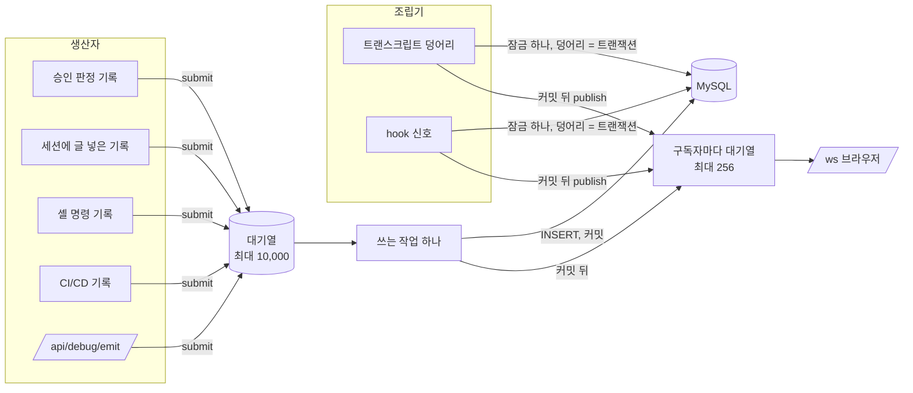

<!--
다루는 곳: bridge/bus.py, bridge/mask.py, bridge/ingest_health.py, bridge/api/ws.py, bridge/api/debug.py, bridge/static/debug.html, tests/test_secret_files.py
읽은 커밋: 8593516
-->

# 적재와 내보내기

FOREMAN이 모은 기록은 두 군데로 간다. 하나는 MySQL(적재), 하나는 브라우저 화면(내보내기)이다. 이 편은 그 둘 사이의 약속을 다룬다. 어떤 차례로 DB에 쓰는지, DB가 죽었을 때 무엇을 붙들고 무엇을 버리는지, DB에 넣기 전에 비밀값을 어떻게 가리는지, 적재가 막혔을 때 그것을 누가 어떻게 알리는지, 그리고 화면이 브리지에 어떻게 붙어 기록을 받는지다.

트랜스크립트를 어떻게 읽는지는 「→ 트랜스크립트 읽기」, hook을 어떻게 받는지는 「→ CC hook 받기」, 줄들이 턴과 메시지로 묶이는 규칙은 「→ 턴 조립」이 다룬다. 이 편은 그 결과물이 DB와 화면으로 나가는 마지막 구간이다 [code:bridge/bus.py].

## 한눈에 보기

길이 둘이다. 브리지가 스스로 만드는 기록(승인 판정, 세션에 넣은 글, 셸 명령, CI/CD 사건, 디버그 이벤트)은 `bridge/bus.py`의 `Pipeline` 대기열을 지나 쓰는 작업 하나가 DB에 넣는다 [code:bridge/bus.py]. 트랜스크립트와 hook에서 온 기록은 조립기(`bridge/assembler.py`)가 자기 잠금 하나 아래에서 덩어리 단위 트랜잭션으로 직접 넣고, 커밋이 끝난 뒤 같은 `Pipeline`의 내보내기 쪽(`publish`)으로 화면에 낸다. 두 길이 지키는 약속은 같다. 쓰는 쪽은 하나씩이고, 커밋한 뒤에만 내보낸다.

## 쓰는 쪽을 하나로 둔 까닭

`Pipeline`의 쓰는 작업은 `asyncio` 작업(브리지 안에서 도는 가벼운 작업 단위) 하나다. 생산자들은 `submit()`으로 대기열에 넣기만 하고, DB에 직접 쓰지 않는다. 대기열에서 하나를 꺼내 DB에 넣고, 끝나면 다음 것을 꺼낸다 [code:bridge/bus.py].

이렇게 한 까닭은 순서다. `event` 표의 `id`는 MySQL이 자동으로 1씩 올려 붙이는 번호다. 여러 작업이 동시에 INSERT하면 먼저 들어온 이벤트가 나중 번호를 받을 수 있다. 쓰는 쪽이 하나면 대기열에 들어온 차례가 그대로 `id` 차례가 된다. 그래서 화면이나 다른 기능이 "이 id 다음부터"라고 물을 때 빠진 것도 뒤바뀐 것도 없다. 1단계 설계에서 "단일 writer + 적재 후 전송"으로 정한 판단이다 [log:stage1_bridge_db_result.md].

포기한 것은 처리량이다. 쓰는 작업 하나가 이벤트 하나씩 커밋하므로 초당 수천 건을 넣는 데는 맞지 않는다. 하지만 이 길을 지나는 것은 사람과 세션이 만드는 사건(판정, 입력, 명령)이라 많아야 초당 몇 건이다. 양이 많은 트랜스크립트는 조립기가 덩어리(최대 8MB 읽기, 줄 수백~수천 개)를 트랜잭션 하나로 넣으므로 이 대기열을 지나지 않는다 [code:bridge/config.py].

조립기 쪽도 같은 생각을 따른다. 조립기에는 `asyncio.Lock` 하나가 있고, 트랜스크립트 덩어리를 넣는 일과 hook 신호를 반영하는 일이 모두 이 잠금 아래에서 차례로 돈다 [code:bridge/assembler.py]. 덩어리 하나가 트랜잭션 하나이고, 그 파일을 어디까지 읽었는지(offset)도 같은 트랜잭션에 함께 들어간다 [log:stage2_transcript_result.md]. 그래서 쓰는 쪽은 길마다 하나다. 다만 두 길 사이의 `id` 차례까지 맞추지는 않는다. 승인 판정 기록과 그 판정을 부른 도구 호출(트랜스크립트에서 온 것)의 `id`는 서로 다른 작업이 붙인다. 둘을 잇는 것은 `id` 차례가 아니라 `tool_use_id`와 시각(`ts`)이다.

## 적재가 끝난 뒤에 내보낸다

쓰는 작업은 DB 커밋이 끝나고 `id`를 받은 다음에야 그 이벤트를 구독자(지금은 WS로 붙은 브라우저들)에게 낸다. 순서를 거꾸로 하면 화면에는 떴는데 DB에는 없는 기록이 생긴다. DB가 잠깐 죽은 사이에 화면이 먼저 이벤트를 보여 주고, 브리지가 그 이벤트를 결국 넣지 못하면, 사람은 본 것을 나중에 찾을 수 없다. 이 순서 덕에 "화면에 보인 것은 DB에도 있다"가 늘 참이다 [code:bridge/bus.py].

조립기도 커밋 뒤에 낸다. 덩어리를 커밋하고 나서 그 덩어리의 이벤트 uuid로 `id`를 한 번 조회해 붙여 보낸다. 이 조회는 화면용이라 실패해도 적재를 되돌리지 않고 `id` 없이 보낸다 [code:bridge/assembler.py]. 턴 열림과 닫힘 같은 소식(`{"type": "turn", ...}`)도 커밋 뒤에 낸다.

`Pipeline.publish()`는 DB를 거치지 않고 구독자에게만 낸다. 조립기의 이벤트처럼 이미 다른 곳에서 커밋한 것, 또는 "승인 대기 목록이 바뀌었다", "포스트잇이 바뀌었다" 같은 신호처럼 DB 행이 아닌 것이 이 길을 쓴다. 화면은 신호를 받으면 해당 목록을 API로 다시 읽는다 [code:bridge/approvals.py] [code:bridge/main.py]. 데이터 계층이 신호를 어떻게 받아 다시 그리는지는 「→ 데이터 계층」이 다룬다.

## DB가 죽으면 붙들고 재시도한다

DB에 넣다 실패하면 쓰는 작업은 오류의 종류를 가른다. 다시 해도 같은 결과일 오류(영구 오류)와, 기다리면 풀릴 오류(일시 오류)다.

| 갈래 | 무엇이 들어가나 | 하는 일 |
|---|---|---|
| 영구 | `IntegrityError`(중복 uuid 등), DB에 닿기 전 값 변환 실패, MySQL 오류 1054(칼럼 없음), 1064(문법), 1264(범위 밖), 1366(잘못된 값), 1406(너무 김), 3140(JSON 아님) | 그 이벤트를 버리고 기록만 남긴다. 중복 uuid(1062)는 이미 들어간 것이므로 디버그 로그로만 |
| 일시 | 연결 끊김, 시간 초과, 그 밖의 모든 것 | 그 이벤트를 붙든 채 0.5초 쉬고 다시. 실패할 때마다 두 배로 늘려 최대 10초(`db_retry_max_s`) |

[code:bridge/bus.py] [code:bridge/config.py]

영구 오류를 버리는 까닭은 대기열을 막지 않기 위해서다. 잘못된 값 하나를 영원히 다시 시도하면 그 뒤의 모든 이벤트가 같이 멈춘다. 일시 오류를 버리지 않는 까닭은 기다리면 돌아오고, 버리면 그 기록은 다시 만들 수 없기 때문이다(트랜스크립트에서 온 것이 아니라 브리지가 그 순간에 본 것이다). 분류가 애매한 것은 일시 쪽으로 둔다. 잘못 버리는 것보다 잘못 기다리는 것이 낫다.

실패 로그는 상태가 바뀔 때 한 번만 남긴다. 처음 실패할 때 "DB 적재 실패, 재시도", 다시 성공할 때 "DB 적재 복구"다. 재시도마다 로그를 쓰면 10초에 한 줄씩 끝없이 쌓인다. 마지막 시도 결과는 `db_ok`에 남고, 대기열에 쌓인 개수는 `/healthz` 응답의 `queue`로 보인다 [code:bridge/api/health.py].

1단계에서 실제로 시험했다. `docker pause`로 DB가 답하지 않게 한 채 디버그 이벤트를 두 번 보냈더니 둘 다 202(대기열에 있음)로 돌아왔고, 버려지지 않았다. 다시 풀자 `id` 5와 6이 순서대로 DB와 WS에 도착했다 [log:stage1_bridge_db_result.md].

그 시험에서 다른 것도 드러났다. MySQL 8의 기본 인증 방식은 DB가 재시작해 서버 쪽 인증 캐시가 비면 암호화 연결 없이 RSA 인증을 하는데, 그때 파이썬 DB 드라이버가 `cryptography` 묶음을 요구한다. 처음 띄울 때는 캐시가 차 있어 드러나지 않았고, 시험 코드도 통과했다. DB를 재시작해 보지 않았으면 "DB가 한 번 재시작하면 브리지가 영영 돌아오지 않는다"는 고장이 숨어 있었다. 이것으로 의존성을 더했다 [log:stage1_bridge_db_result.md] [c:1ec1bfd].

브리지가 꺼질 때는 남은 것을 최대 5초 동안 넣어 보고 멈춘다. 그래도 남은 것은 "종료 시 적재하지 못한 이벤트 N개를 버림"으로 기록하고 버린다 [code:bridge/bus.py]. 이 기록들은 트랜스크립트에 없어 다시 만들 수 없다. 그래서 MySQL 백업이 hook과 브리지 이벤트를 지키는 마지막 그물이다(「→ 15 DB」).

## 대기열이 차면

대기열 크기는 10,000(`ingest_queue_max`)이다 [code:bridge/config.py]. DB가 오래 죽어 있으면 이 대기열이 찬다. 꽉 차면 `submit()`이 `asyncio.QueueFull`을 내고, 그것을 어떻게 받을지는 생산자가 정한다.

트랜스크립트는 처음부터 이 걱정이 적다. 1단계 설계에서는 와처가 이 대기열에 넣고, 꽉 차면 파일을 읽는 자리(offset)를 앞으로 옮기지 않는 것으로 대응하기로 했다 [log:stage1_bridge_db_result.md]. 2단계에서 트랜스크립트는 조립기가 덩어리 트랜잭션으로 직접 넣게 되었고, offset이 그 트랜잭션 안에 함께 있다. DB에 못 넣으면 offset도 커밋되지 않으니, 같은 효과가 다른 방식으로 이루어진다. 줄은 파일에 그대로 있고, DB가 돌아오면 그 자리부터 다시 읽는다. 대기열이 찰 일도 없다 [log:stage2_transcript_result.md].

`Pipeline` 대기열을 쓰는 생산자들은 모두 같은 원칙으로 받는다. 기록을 남기지 못해도 본래 하던 일은 막지 않는다. 승인 판정은 기록이 실패해도 판정 결과를 그대로 CC에 돌려주고, 세션에 글을 넣는 일은 기록이 실패해도 글을 넣는다. 셸과 CI/CD 기록도 같다. 실패하면 경고 로그("판정 기록 실패", "주입 기록 실패" 등)만 남는다 [code:bridge/approvals.py] [code:bridge/api/sessions.py] [code:bridge/terminal.py] [code:bridge/pipeline.py]. 디버그 이벤트만 사람이 보낸 것이라 503("적재 대기열이 꽉 찼다")으로 바로 알린다 [code:bridge/api/debug.py].

이 원칙에는 대가가 있다. DB가 아주 오래 죽어 대기열이 차면, 그 뒤의 판정 기록과 입력 기록은 로그 한 줄씩만 남기고 사라진다 [code:bridge/bus.py].

## 느린 화면은 다시 읽게 한다

구독자(브라우저 연결 하나)마다 대기열이 따로 있고, 크기는 256이다. 한 화면이 느려 이것이 차면, 쓰는 작업은 그 화면의 대기열을 비우고 `{"type": "resync"}` 하나를 넣는다 [code:bridge/bus.py]. 그 화면을 기다리느라 다른 화면이나 쓰는 작업이 멈추지 않게 하려는 것이다. 화면은 `resync`를 받으면 전체 상태(`/api/dashboard`)를 바로 다시 읽는다. 빠진 이벤트는 DB에 있으니 다시 읽으면 된다. 적재 뒤에 내보낸다는 약속이 여기서 쓸모를 보인다.

## DB에 넣기 전에 비밀을 가린다

CC 세션의 기록에는 비밀값이 섞일 수 있다. 사람이 프롬프트에 토큰을 붙여넣기도 하고, 모델이 `.env` 파일을 읽거나 비밀번호가 든 명령을 치기도 한다. 이것이 DB에 그대로 들어가면 DB 백업, 화면, 텔레그램 알림, 노션 원고까지 번진다. 그래서 `bridge/mask.py`의 `Masker`가 DB에 넣기 전에 문자열을 훑어 가린다 [code:bridge/mask.py].

가리는 대상은 적재되는 글 거의 전부다. 사람의 프롬프트, assistant의 글, 도구 호출의 입력(가린 뒤 문자열마다 2,000자로 자른다), 작업 중에 보낸 입력(가린 뒤 20,000자까지), 도구 오류(가린 뒤 앞 300자), 세션 제목, 서브에이전트 설명, 승인 판정의 대상, 세션에 넣은 글이 모두 지난다 [code:bridge/assembler.py] [code:bridge/approvals.py] [code:bridge/api/sessions.py]. 가리기는 세 겹이고, 이 차례로 돈다.

### 1. 정확한 값

브리지가 뜰 때 저장소의 비밀값 파일을 골라 읽는다. 고르는 대상은 저장소 맨 위에서 이름이 `.env`로 시작하는 파일 가운데 예시 꼬리(`.example`, `.sample`, `.template`, `.dist`, 값 없이 키 이름만 적어 저장소에 올리는 견본 파일)가 붙은 것을 뺀 전부, 그리고 설정 파일이 경로를 가리키는 토큰 파일(`config/notify.toml`의 텔레그램 파일, `config/tokens.toml`의 프로젝트 토큰 파일)이다. 설정에서 경로를 바꾸면 그 경로를 따라간다. 지금 고르는 파일은 `.env.db`, `.env.bridge`, `.env.telegram`, `.env.notion`, `.env.project_tokens` 다섯이다 [code:bridge/mask.py] [code:config/tokens.toml] [code:config/notify.toml]. 그 파일들에서 키 이름에 `PASSWORD`, `PASSWD`, `TOKEN`, `SECRET`, `KEY` 가운데 하나가 든 줄의 값을 모은다. 그 값이 글 어디에든 나오면 `«masked:키이름»`으로 바꾼다. 예를 들어 `.env`에 `DB_PASSWORD=예시값가짜123`이 있었다면, 어떤 글에 `예시값가짜123`이 나와도 `«masked:DB_PASSWORD»`가 된다. 키 이름을 남기는 까닭은 나중에 기록을 읽는 사람이 무엇이 있었는지는 알 수 있게 하려는 것이다 [code:bridge/mask.py].

값을 고르는 조건이 몇 있다. 8자보다 짧은 값, 숫자만 있는 값(포트 번호 같은 것), `true`와 `false`는 뺀다. 짧거나 흔한 값까지 가리면 평범한 글이 망가진다. 긴 값부터 바꾼다. 한 값이 다른 값 안에 들어 있을 때 짧은 것이 먼저 바뀌어 긴 것의 나머지가 드러나는 것을 막는다 [code:bridge/mask.py].

처음에는 키 이름을 보지 않고 비밀 파일의 값을 모두 가렸다. 그랬더니 DB 사용자 이름처럼 비밀이 아닌 값까지 가려져, 평범한 설정 이야기가 `«masked»` 투성이가 되었다. 그래서 키 이름이 비밀인 줄만 고르도록 좁혔다 [log:stage2_transcript_result.md] [c:5650cca].

읽을 파일도 처음에는 DB, 브리지, 텔레그램용 셋을 손으로 적어 두었다. 그 사이 노션 토큰 파일과 프로젝트 토큰 파일이 새로 생겼는데 목록에 들지 않아, 그 두 파일의 값은 정확한 값 가리기에서 빠져 있었다. 손 목록은 새 파일이 생길 때마다 또 빠지므로 위처럼 이름의 꼴로 고르는 방식으로 바꿨다. 파일을 넓게 골라도 비밀이 아닌 키는 키 이름 판정에서 걸러진다. 비밀값 파일이 가리기 대상에서 빠지면 깨지는 시험이 이 약속을 지킨다 [c:5e3a51d] [code:tests/test_secret_files.py] [log:foreman-4_mask_env_files_20261117.md].

### 2. 알려진 형식

비밀 파일에 없는 비밀도 있다. 다른 서비스의 키, 다른 저장소의 토큰 같은 것이다. 이런 것은 모양으로 잡는다.

| 무엇 | 모양(설명) | 바꾼 글 |
|---|---|---|
| 개인키 블록 | `-----BEGIN … PRIVATE KEY-----`부터 `END`까지 여러 줄 통째 | `«masked:private-key»` |
| 텔레그램 봇 토큰 | 숫자 8~10자, 쌍점, 영숫자 35자 | `«masked:telegram-bot-token»` |
| Anthropic 키 | `sk-ant-`로 시작하고 20자 넘게 이어짐 | `«masked:anthropic-key»` |
| GitHub 토큰 | `ghp_`, `gho_`, `ghs_`, `ghu_` 뒤 30자 넘게, 또는 `github_pat_` 뒤 40자 넘게 | `«masked:github-token»` |
| AWS 접근 키 | `AKIA` 뒤 대문자와 숫자 16자 | `«masked:aws-key»` |
| Notion 통합 토큰 | 지금 꼴 `ntn_`, 옛 꼴 `secret_` 뒤 영숫자 40자 넘게(40자 넘게라서 `secret_key` 같은 낱말에는 걸리지 않는다). 노션 토큰 파일을 가리기에 넣을 때 함께 더했다 [c:5e3a51d] | `«masked:notion-token»` |
| Bearer 헤더 | `Bearer` 뒤 16자 넘는 토큰 | `Bearer «masked»` |

[code:bridge/mask.py]

### 3. 키=값

마지막으로 대입 모양을 잡는다. 이름에 `PASSWORD`, `PASSWD`, `SECRET`, `TOKEN`, `API_KEY`(또는 `APIKEY`), `_PWD`가 들어간 이름 뒤에 `=`나 `:`가 오고 6자 넘는 값이 오면 값만 `«masked»`로 바꾼다. 따옴표로 감싼 값도 잡는다. 예를 들어 가짜 값으로 `MY_API_KEY="가짜값가짜값"`은 `MY_API_KEY="«masked»"`가 된다. 이름은 남기고 값만 가리므로 기록을 읽는 사람은 어떤 설정을 다뤘는지 안다 [code:bridge/mask.py].

값 자리에 `$`가 들어가면 잡지 않는다. `TOKEN=$FOREMAN_API_TOKEN`처럼 셸 변수를 가리키는 글은 비밀이 아니고, 가리면 명령이 무엇을 했는지 읽을 수 없게 된다 [code:bridge/mask.py].

### 그래도 남는 위험

세 겹 어디에도 걸리지 않는 비밀이 있다. 모양을 모르는 비밀이다. 킥오프 조사 때 CC 세션 사이 통신 토큰 파일(`~/.claude/sessions/*.key`)의 내용이 도구 출력에 한 번 찍힌 일이 있었는데, 이 값은 정해진 모양도 없고 비밀 파일에도 없다. 그래서 FOREMAN은 도구 결과(tool_result)의 본문을 처음부터 DB에 넣지 않는다. 길이와 오류 여부만 넣고, 오류일 때만 앞 300자를 가린 뒤 넣는다. 원문이 필요하면 트랜스크립트 파일에 120일 동안 있다 [log:stage2_transcript_result.md]. 가리기가 놓칠 것을 알기에 가장 위험한 곳은 아예 저장하지 않는 쪽을 골랐다.

2단계를 마칠 때 실제 적재 데이터를 훑었다. 비밀 파일에 든 비밀값 다섯 개(텔레그램 토큰, API 토큰과 hook 토큰, DB 비밀번호 둘)가 든 행은 0개, 텔레그램 토큰 모양도 0개였다. `sk-ant-` 한 건이 걸렸는데 `mask.py`의 정규식 원문을 읽은 기록이었다(키가 아니다). 가리기가 실제로 적용된 이벤트는 151개였다 [log:stage2_transcript_result.md].

### 몇 가지 알아둘 것

같은 `Masker`가 적재 밖에서도 쓰인다. 텔레그램 알림, 셸 기록, 승인 요약, 서기에게 묻는 글 등이 내보내기 전에 이것을 거친다. 셸 명령에는 `--password`, `mysql -p`, `docker login -p`처럼 명령줄에서 비밀이 오는 자리를 더 가리는 규칙이 붙는다(「→ 셸 패널과 세션 화면」) [code:bridge/terminal.py] [code:bridge/telegram.py] [code:bridge/scribe_ask.py]. 토큰을 어떻게 나누고 어디에 두는지는 「→ 열쇠와 비밀」이 다룬다.

## 적재가 스스로 막힌 것을 알린다

FOREMAN은 조용한 고장을 잡으려고 만들었다. 그런데 FOREMAN 자신의 적재가 조용히 막힌 일이 있었다.

### 무슨 일이 있었나

한 펫퍼민트 세션의 트랜스크립트가 아침부터 같은 덩어리에서 실패를 되풀이했다. 오류는 턴의 프롬프트 uuid가 겹친다는 `IntegrityError (1062)`였고, 로그에 104번 찍혔다. 3.38MB짜리 파일 가운데 661바이트까지만 적재되어, 그 세션의 대화와 도구 호출이 화면에도 알림 판정에도 없었다. 다른 일로 브리지 로그를 보다가 우연히 찾을 때까지 몇 시간 아무도 몰랐다 [log:stage2_transcript_result.md].

원인은 그 세션이 앞 세션의 기록을 복사해서 시작한(resume, fork) 세션이었다는 데 있었다. CC는 앞 세션 줄을 uuid 그대로 새 파일 앞에 붙인다. 조립기가 그 줄로 새 턴을 열려다 원래 세션의 턴과 uuid가 겹쳤다. 원인을 고친 이야기는 「→ 턴 조립」과 「→ 트랜스크립트 읽기」가 다룬다 [log:stage2_transcript_result.md].

이 편에서 중요한 것은 안전장치가 없었다는 점이다. 실패하면 그 자리에서 잠들었다가 같은 덩어리를 영원히 다시 시도했고, 와처가 하나라 잠든 동안 다른 모든 파일의 적재도 밀렸고, 몇 번을 실패해도 알림이 없었다 [log:stage2_transcript_result.md]. 서버의 포트 포워드 서비스가 56만 번 넘게 재시작하는 것을 한 달 넘게 몰랐던 것과 같은 모양이다 [code:bridge/ingest_health.py]. FOREMAN이 남의 조용한 고장을 잡겠다면서 자기 고장은 로그에만 남기고 있었다.

### 와처 쪽에서 바뀐 것(요약)

와처는 실패한 파일을 다음 시도 시각까지 미뤄 두고 다른 파일을 먼저 읽는다. 같은 자리에서 3번 실패하면 줄마다 따로 넣어 실패한 줄만 버리는 너그러운 모드로, 6번(약 2분 반)이면 오류가 결정적일 때만 그 덩어리를 건너뛴다. DB 끊김과 시간 초과는 기다리면 돌아오므로 줄을 버리지 않는다 [code:bridge/transcript/watcher.py]. 이 단계들의 자세한 동작은 「→ 트랜스크립트 읽기」에 있다. 이 편이 다루는 것은 그 상태를 사람에게 올리는 쪽, `bridge/ingest_health.py`의 `IngestMonitor`다.

### 30초마다 보고, 바뀔 때만 알린다

`IngestMonitor`는 30초마다 와처의 `health()`를 읽는다 [code:bridge/ingest_health.py]. 와처는 파일마다 연달아 실패한 횟수, 실패가 시작된 시각, 마지막 오류, 그 오류가 일시적인지를 들고 있고, 버린 줄과 건너뛴 덩어리를 최근 50개까지 기억한다 [code:bridge/transcript/watcher.py]. 모니터는 이것을 보고 세 가지를 판정한다.

| 판정 | 조건 | 알림 글(앞부분) | 풀릴 때 |
|---|---|---|---|
| 적재 막힘 | 한 파일이 5분(`ingest_alert_s = 300`) 넘게 같은 자리에서 실패 중 | `⚠ 적재 막힘 — 세션 abcd1234 7분째 같은 자리에서 실패(9번). 이 세션의 기록이 쌓이지 않는다` + 오류 앞 200자 + 까닭 + 파일 경로 | `✅ 적재 회복` |
| 와처 멈춤 | 실시간 감시 루프가 2분(`ingest_tick_alert_s = 120`) 넘게 돌지 않음 | `⚠ 와처 멈춤 — 트랜스크립트 감시 루프가 N초째 돌지 않는다. 브리지 확인` | `✅ 와처 다시 돈다` |
| 버린 줄 | 너그러운 모드에서 줄을 버렸거나, 덩어리를 건너뜀 | `⚠ 적재 중 줄 N개를 버리고 나머지를 적재했다` 또는 `덩어리 하나(…)를 건너뛰었다 — 그 줄들은 DB에 없다` | 일마다 한 번 |

[code:bridge/ingest_health.py] [code:bridge/config.py]

막힘 알림에는 그 오류가 어느 쪽인지 한 줄을 붙인다. 일시 오류면 "DB 연결, 시간 초과로 기다리는 중", 결정적 오류면 "같은 줄에서 되풀이되어 곧 너그러운 모드와 건너뛰기로 간다"는 뜻의 줄이다. 받는 사람이 손을 대야 하는지 기다려도 되는지 바로 알게 하려는 것이다 [code:bridge/ingest_health.py].

알림은 상태가 바뀔 때 한 번만 간다. 막힘은 파일과 실패 시작 시각의 쌍으로 기억해, 같은 막힘이 이어지는 동안 30초마다 다시 보내지 않는다. 막혔다가 풀리면 회복 알림을 보내고 기억을 지운다. 버린 줄은 일련번호로 기억해 새 것만 보낸다. 와처 멈춤은 조립기가 실시간 모드일 때만 판정한다. 브리지가 막 떠서 지난 기록을 따라잡는(백필) 동안에는 루프가 오래 걸리는 것이 정상이기 때문이다 [code:bridge/ingest_health.py].

5분과 2분은 짧은 깜빡임으로 사람을 깨우지 않을 만큼, 그리고 고장을 몇 시간 놓치지 않을 만큼으로 잡은 값이다. DB가 몇 초 재시작하는 정도로는 알림이 가지 않는다 [code:bridge/config.py] [log:stage2_transcript_result.md].

### 알림이 가는 곳

같은 상태가 세 곳에 나간다.

첫째, 텔레그램이다. FOREMAN 프로젝트의 알림 머리말을 붙여 바로 보낸다. 묶음 알림이나 턴 종료 판정을 거치지 않는 직접 보내기다 [code:bridge/ingest_health.py]. 알림이 어떻게 걸러지고 보내지는지는 「→ 11 알림」이 다룬다.

둘째, 화면 머리의 띠다. 모니터의 상태(`snapshot()`)가 `/api/dashboard`의 `ingest` 칸으로 나가고, 상태가 바뀌면 그 캐시를 비워 화면이 바로 새 값을 받게 한다 [code:bridge/api/dashboard.py]. 픽셀 오피스 화면 머리에는 빨간 `⚠ 기록 못 읽는 세션 N`이나 `⚠ 화면 갱신 멈춤`이 뜨고, 마우스를 올리면 어느 세션이 몇 분째 몇 번 실패했는지와 오류가 보인다 [code:bridge/static/js/office.js]. 클래식 화면 머리에는 `⚠ 적재 막힘 N개 세션 · M분`(M은 가장 오래 막힌 세션의 분), `⚠ 와처 멈춤`, 또는 노란 `적재 중 버린 줄 있음(24시간)`이 맨 앞에 뜬다 [code:bridge/static/js/render.js]. 맨 앞에 두는 까닭은 이 화면이 보여 주는 기록 자체가 멈췄다는 뜻이라, 화면의 다른 모든 숫자를 믿을 수 없게 되기 때문이다. 버린 줄 표시는 최근 24시간 것 가운데 5개까지만 들고 간다.

셋째, 자동 기상이다. 결정적 오류로 막힌 경우만 교장에게 "계획할 거리"로 넘긴다. DB 끊김과 시간 초과는 기다리면 돌아오므로 넘기지 않는다 [code:bridge/ingest_health.py] [code:bridge/main.py]. 넘긴 뒤의 일은 「→ 진행 중인 일과 자동 기상」이 다룬다.

사람이 직접 볼 길도 있다. `/api/ingest`(토큰 필요)는 와처가 실시간인지 백필 중인지, 감시 중인 폴더 수, 읽을 차례를 기다리는 파일 수, 조립 통계와 함께 같은 `health`를 돌려준다. `/healthz`에도 적재 상태가 들어간다 [code:bridge/main.py] [code:bridge/api/health.py].

## 화면이 붙는 길, /ws

화면은 웹소켓(WS, 브라우저와 서버가 연결 하나를 열어 두고 양쪽에서 메시지를 주고받는 방식) 하나로 브리지에 붙는다. 주소는 `/ws`다 [code:bridge/api/ws.py].

### 인증은 첫 메시지로

연결이 열리면 브라우저는 5초(`ws_auth_timeout_s`) 안에 첫 메시지로 `{"type": "auth", "token": "…"}`를 보내야 한다. 토큰을 주소 뒤에 붙이지(`/ws?token=…`) 않은 까닭은 주소가 프록시와 서버 접근 로그에 그대로 남기 때문이다 [log:stage1_bridge_db_result.md]. 시간 안에 오지 않거나, JSON이 아니거나, `type`이 다르거나, 토큰이 틀리면 서버는 1008(정책 위반) 코드로 닫는다. 토큰 비교는 글자마다 걸리는 시간이 같도록 `hmac.compare_digest`로 한다 [code:bridge/api/auth.py]. 토큰을 나누고 바꾸는 일은 「→ 열쇠와 비밀」이 다룬다.

닫을 때는 이유를 붙인다. 이 부분은 실제로 막혔던 데서 나왔다. 1단계 때 집 PC 브라우저가 계속 1008로 끊겼는데, 서버는 인증 실패를 로그 없이 닫고 있었다. 서버 로그에는 "연결 열림" 세 줄뿐이었고 브라우저도 코드 1008만 받았다. 형식은 맞았고, 설정 파일 값과 브리지가 읽은 값도 같았다(길이와 해시 앞자리로 비교했다). 실행 중인 브리지에 여러 모양으로 보내 보니 정확한 토큰과 앞뒤 공백은 통과하고, `FOREMAN_API_TOKEN=…` 줄째 붙여넣은 것, 따옴표가 붙은 것, 한 글자 빠진 것, `Bearer …`를 붙인 것은 1008이었다. 그래서 브라우저로 넘어간 값이 다르다고 보았다 [log:stage1_bridge_db_result.md].

고친 것은 세 가지다. 서버 로그에 실패 이유와 받은 길이, 기대 길이를 남긴다(값은 남기지 않는다). 브라우저에도 닫는 이유를 보낸다. 다만 기대 길이는 서버 로그에만 둔다. 확인 페이지는 입력한 토큰의 길이를 보여 주고, `FOREMAN_API_TOKEN=`과 따옴표를 떼고 보낸다 [c:39656f3]. 고친 뒤 첫 시도에 붙었다. 처음 불일치의 정확한 원인은 당시 기록이 없어 끝내 확정하지 못했다. 이것 자체가 그 빈틈의 대가였고, 그 뒤로 hook 토큰이나 승인 정책 같은 거절 길은 처음부터 이유를 로그에 남기도록 만들었다 [log:stage1_bridge_db_result.md].

### 붙은 뒤 오가는 메시지

| 방향 | 메시지 | 뜻 |
|---|---|---|
| 서버 → | `{"type": "hello", "heartbeat_s": 15, "ui": "…"}` | 인증 통과. `ui`는 화면 코드의 지문으로, 페이지가 처음 받은 것과 다르면 화면이 새로 고침 띠를 띄운다 |
| 서버 → | `{"type": "event", "event": {...}}` | 적재가 끝난 이벤트(`id` 포함) |
| 서버 → | `{"type": "turn", ...}`, `{"type": "approval", ...}` 등 | 턴 열림과 닫힘, 승인 대기와 결정, 바뀜 신호 |
| 서버 → | `{"type": "batch", "items": [...]}` | 50ms 안에 쌓인 메시지 묶음(최대 500개) |
| 서버 → | `{"type": "ping", "ts": "…"}` | 15초 동안 보낼 것이 없을 때 |
| 서버 → | `{"type": "resync"}` | 밀려서 버렸다. 전체를 다시 읽어라 |

[code:bridge/api/ws.py] [code:bridge/config.py]

묶음을 보내는 까닭은 이벤트가 몰릴 때(초당 수십 개) 프레임마다 화면을 다시 그리지 않게 하려는 것이다. 첫 메시지를 받으면 50ms 기다려 그사이 쌓인 것을 한 프레임에 담는다. 하나뿐이면 묶지 않고 그대로 보낸다. 화면은 받은 대로 바로 그리지 않고 자기 주기로 그린다 [code:bridge/api/ws.py].

`ping`은 끊김을 알아채기 위한 것이다. 서버 프로세스가 멈췄는데 연결은 닫히지 않는 경우가 있다. 화면은 하트비트 두 번(30초) 남짓 아무것도 받지 못하면 끊긴 것으로 보고 연결을 닫는다. 한 번 붙었던 연결이 끊기면 화면 전체를 덮고 언제부터 끊겼는지와 다음 시도까지 남은 초를 보이며 1, 2, 4, 8, 15초 간격으로 다시 붙는다. 1008로 끊긴 것은 다시 해도 같으므로 덮지 않고 멈춘다. 토큰을 고쳐야 한다 [code:bridge/static/debug.html] [code:bridge/static/js/store.js]. 서버가 죽으면 알림을 보낼 브리지도 함께 죽으므로, 브라우저가 침묵으로 아는 길을 둔 것이다.

브라우저가 인증 뒤에 보내는 메시지는 지금 읽기만 하고 버린다. 연결이 끊겼는지 알기 위해 읽을 뿐이다. 세션에 글을 넣는 일은 WS가 아니라 HTTP API로 한다(「→ 03 세션 지켜보기와 글 넣기」) [code:bridge/api/ws.py] [code:bridge/api/sessions.py].

## /debug 확인 화면

`/debug`는 1단계에서 "이벤트 하나가 대기열, 적재, WS까지 가는지"를 보려고 만든 화면이다 [c:62fb391]. 지금 사람이 쓰는 화면은 `/`의 픽셀 오피스이고, `/debug`는 바닥에서 무엇이 흐르는지 날것으로 볼 때 쓴다 [code:bridge/main.py].

화면 파일 자체에는 비밀이 없으므로 인증 없이 준다. 데이터는 모두 토큰이 필요하다. 토큰은 비밀번호 칸에 넣고, 그 탭에만(`sessionStorage`) 둔다. 칸 옆에는 값 대신 길이만 보인다. 1008 사고에서 배운 대로 `FOREMAN_API_TOKEN=`과 따옴표는 떼고 쓴다 [code:bridge/static/debug.html].

이 화면에서 하는 일은 이렇다. WS에 붙어 흐르는 모든 메시지를 한 줄 요약으로 쌓는다(턴 열림과 닫힘, 승인 대기, 이벤트, 세션에 넣은 글). "JSON 그대로"를 켜면 원문이 보인다. `/healthz`와 `/api/ingest`(수집 상태) 결과를 볼 수 있다. 세션 목록을 불러와 한 세션에 글을 넣어 볼 수 있다(첫 글자가 `!`이면 늘 막힌다). 승인 대기 카드를 보고 승인하거나 거부할 수 있다. 끊기면 화면을 덮고 다시 붙는 동작도 이 화면에 처음 붙였다 [code:bridge/static/debug.html].

### 디버그 이벤트 보내기

"이벤트 보내기" 버튼은 `POST /api/debug/emit`을 부른다. 이 길은 설정 `DEBUG_ENDPOINTS=true`일 때만 브리지에 붙고, 기본값과 예시 파일 값은 꺼짐이다 [code:bridge/config.py] [code:bridge/main.py]. 외부로 내보내기 전에 끄도록 정해 둔 길이다. 토큰이 필요하다 [code:bridge/api/debug.py].

보낸 이벤트는 `source = 'debug'`로 표시되어 일반 생산자와 똑같이 `Pipeline` 대기열을 지난다. 그래서 이 버튼 하나로 대기열, 쓰는 작업, DB, WS로 이어지는 `Pipeline` 길 전체를 시험할 수 있다. 트랜스크립트와 hook이 지나는 조립기 길은 이 버튼으로 시험되지 않는다. 응답은 2초 기다린 결과에 따라 갈린다 [code:bridge/api/debug.py].

| 응답 | 뜻 |
|---|---|
| 201 `{"id": N}` | 적재됐다. WS로도 나갔다 |
| 202 `{"queued": true, "queue": N}` | 2초 안에 못 넣었다(DB가 느리거나 죽음). 버리지 않았다. DB가 돌아오면 적재되고 WS로도 나간다 |
| 409 `{"dropped": true}` | 중복 uuid이거나 적재할 수 없는 값이라 버렸다 |
| 503 | 대기열이 꽉 찼거나, 캐릭터를 확인할 DB가 답하지 않는다 |
| 422 | 없는 캐릭터 번호 |

[code:bridge/api/debug.py]

캐릭터 번호를 미리 확인하는 까닭은 `event` 표에 외래 키(다른 표를 가리키는 값이 실제로 있는지 DB가 검사하는 약속)가 없기 때문이다. hook 이벤트가 그 사건을 만든 트랜스크립트 줄보다 먼저 오는 일이 흔하고, 가장 자주 쓰는 표에서 행마다 부모 표를 다섯 번 조회하는 비용도 없애려고 뺐다. 대신 무결성은 이벤트를 넣는 애플리케이션이 맡는다 [log:stage1_bridge_db_result.md]. 표 설계는 「→ 15 DB」가 다룬다.

시험이 끝나면 `DELETE /api/debug/events`로 `source = 'debug'`인 이벤트만 지운다 [code:bridge/api/debug.py]. 디버그 소스를 따로 둔 것도 이렇게 시험 흔적만 골라 지우려는 것이다.

## 정리: 이 구간이 지키는 약속

| 약속 | 어떻게 |
|---|---|
| 들어온 차례가 `id` 차례다 | 길마다 쓰는 쪽이 하나(대기열 + 작업 하나, 조립기는 잠금 하나) |
| 화면에 보인 것은 DB에도 있다 | 커밋 뒤에만 내보낸다 |
| DB가 잠깐 죽어도 잃지 않는다 | 일시 오류는 붙들고 최대 10초 간격으로 재시도, 트랜스크립트는 offset이 커밋과 함께 움직인다 |
| 한 건이 전체를 막지 않는다 | 영구 오류는 버리고 기록, 느린 화면은 비우고 다시 읽게 |
| 비밀은 DB에 들어가지 않는다 | 정확한 값, 형식, 키=값 세 겹, 모양 모를 위험이 큰 도구 결과 본문은 저장하지 않음 |
| 막히면 스스로 말한다 | 5분 막힘, 2분 멈춤, 버린 줄을 텔레그램, 화면 머리 띠, 자동 기상으로 |
