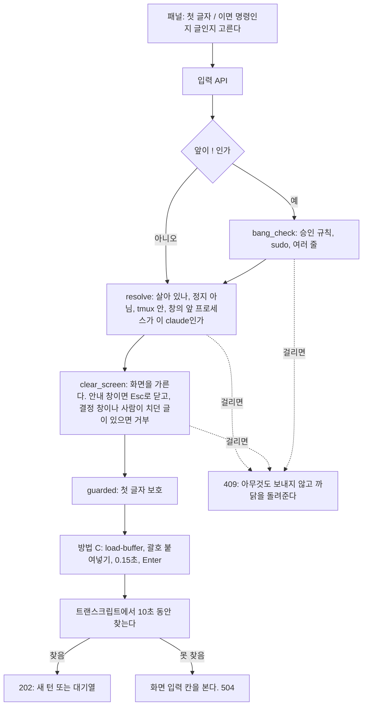

<!--
다루는 곳: bridge/liveness.py, bridge/session_state.py, bridge/stallwatch.py, bridge/human_wait.py, bridge/api_error.py, bridge/bang_watch.py, bridge/xmsg.py, bridge/inject.py, bridge/api/sessions.py, bridge/static/js/slash.js, tests/js/slash.test.mjs, tests/js/xmsg.test.mjs, tests/test_api_error.py, tests/test_bang_watch.py, tests/test_human_wait.py, tests/test_inject.py, tests/test_inject_screen.py, tests/test_stallwatch.py, tests/test_stallwatch_bg.py, tests/test_xmsg.py
읽은 커밋: 3f3dd05
-->

# 03 세션 지켜보기와 글 넣기

FOREMAN이 다루는 Claude Code(아래 CC) 세션은 브리지가 만든 물건이 아니다. 각 세션은 tmux 창 안에서 도는 보통의 `claude` 프로세스이고, 사람이 터미널에서 직접 쓰는 것과 똑같다. 브리지는 그 프로세스를 밖에서 본다. 이 편은 그 「밖에서 보기」의 두 방향을 다룬다. 하나는 세션이 지금 어떤 상태인지 알아내는 쪽(지켜보기)이고, 다른 하나는 사람이 패널에 친 글을 그 세션 입력 칸에 넣는 쪽(글 넣기)이다.

두 방향은 같은 재료를 쓴다. 세션이 살아 있는지는 CC가 남기는 작은 상태 파일과 리눅스의 `/proc`으로 알고, 세션 화면에 무엇이 떠 있는지는 tmux 화면을 읽어 안다. 글을 넣기 전에 「지금 넣어도 되는 상태인가」를 묻는 일과, 쉬는 세션에 「사람 답을 기다리는 창이 떠 있는가」를 재는 일이 같은 화면 판정을 함께 쓴다. 그래서 한 편으로 묶었다.

이 프로젝트가 있는 까닭은 조용한 고장을 잡는 것이다(→ 「00 FOREMAN이란」). 세션 쪽에서 조용한 고장은 대개 이렇게 생긴다. 화면에서는 그냥 쉬는 세션처럼 보이는데 실제로는 무언가에 막혀 사람을 기다리고 있다. 이 편의 절반은 그런 「쉬는 것처럼 보이는 멈춤」을 하나씩 찾아 이름을 붙인 기록이다.

기록(트랜스크립트와 hook)을 DB에 넣는 길은 → 「02 기록 모으기」, 승인 카드와 승인 규칙은 → 「04 승인」, 텔레그램을 보내는 쪽의 규칙은 → 「11 알림」, 패널과 세션 화면의 생김새는 → 「14 화면」에서 다룬다.

## 1. 밖에서 세션을 보는 재료

브리지가 세션을 볼 때 쓰는 재료는 다섯 가지다. 각각 알려 주는 것과 알려 주지 않는 것이 다르고, 그 빈틈을 서로 메우도록 짜여 있다.

| 재료 | 어디에 있나 | 알려 주는 것 | 알려 주지 않는 것 |
|---|---|---|---|
| 세션 상태 파일 | `~/.claude/sessions/<pid>.json` | 세션 ID, PID, 작업 폴더, CC가 적은 상태(busy, idle, waiting, shell), 프로세스 시작 값 | 일이 진행되는지(상태가 바뀔 때만 고쳐 쓴다) |
| 프로세스 정보 | `/proc/<pid>/stat`, `/proc/<pid>/environ` | 살아 있나, 정지(T)인가, 같은 PID를 다른 프로세스가 쓰는가, 어느 tmux 창인가 | CC 안에서 무엇을 하는지 |
| 트랜스크립트 | `~/.claude/projects/…/*.jsonl` | 무엇을 말하고 어떤 도구를 불렀는지, 대기열 줄 | 프로세스가 멈췄는지(멈춘 프로세스는 아무것도 쓰지 못한다) |
| hook | CC가 브리지로 보내는 HTTP | 턴 시작과 끝, 권한 묻기 | CC가 보내지 않는 일(창이 떠 있음 등) |
| tmux 화면 | `tmux capture-pane` | 입력 칸이 보이는지, 어떤 창이 떠 있는지, 입력 칸에 글이 있는지 | 깨끗한 글(화면 갱신과 색 제어 글이 섞인다) |

이 표가 이 편 전체의 뼈대다. 예를 들어 정지된 세션은 트랜스크립트로는 「그냥 쉬는 중」과 구별되지 않고 `/proc` 상태 문자로만 갈린다. 반대로 세션이 일을 하는지 멈췄는지는 상태 파일로 알 수 없고 트랜스크립트의 마지막 줄 시각으로 잰다. 창이 떠 있는지는 어느 기록에도 남지 않아 화면을 읽을 수밖에 없다.

## 2. 살아 있나

### 2-1. 상태 파일만 읽는다, 열쇠 파일은 열지 않는다

CC는 실행 중인 세션마다 `~/.claude/sessions/` 아래에 PID를 이름으로 한 JSON 파일을 둔다. 안에 세션 ID(`sessionId`), PID, 작업 폴더(`cwd`), 프로세스 시작 값(`procStart`), 상태(`status`)가 있다. 브리지는 이 폴더에서 `*.json`만 훑는다 [code:bridge/liveness.py].

같은 폴더에 `.key` 파일도 있다. 세션끼리 메시지를 주고받을 때 쓰는 통신 토큰이다. 브리지는 이 파일을 열지 않는다. 처음 이 폴더를 조사할 때 그 값이 한 번 출력에 찍힌 일이 있었고, 그 뒤로 세션 상태를 보는 코드는 이름이 `.json`으로 끝나는 파일만 고르도록 짰다. 필요 없는 비밀값은 아예 읽지 않는 것이 가장 확실한 가리기다.

### 2-2. PID 재사용 거르기

PID는 프로세스가 끝나면 다른 프로세스에게 다시 주어질 수 있다. CC가 비정상으로 끝나 상태 파일이 남았는데 그 번호를 우연히 다른 프로그램이 쓰고 있으면, 「파일이 있고 `/proc/<pid>`도 있다」만으로는 살아 있다고 잘못 볼 수 있다.

그래서 시작 시각을 맞대 본다. `/proc/<pid>/stat`의 22번째 칸(starttime)은 그 프로세스가 컴퓨터가 켜진 뒤 몇 틱째에 시작했는지를 적는다. CC가 상태 파일에 적어 둔 `procStart`가 이 값과 같아야 같은 프로세스다. 다르면 그 PID를 다른 프로세스가 쓰는 것이라 목록에서 뺀다. `/proc/<pid>/stat`을 읽을 때는 괄호 안 프로그램 이름에 공백이나 괄호가 들어갈 수 있어서, 마지막 `") "` 뒤부터 칸을 센다 [code:bridge/liveness.py].

이렇게 걸러 낸 결과가 `live_sessions()`이고, 세션 ID마다 PID, 작업 폴더, 프로세스 상태 문자를 돌려준다. 이 편의 거의 모든 감시와 글 넣기가 이 함수 하나에서 출발한다.

### 2-3. 정지(T)는 멈춤이 아니다

사용자는 프로젝트마다 일부러 Ctrl+Z로 멈춰 둔 CC 프로세스를 남겨 둔다. 그런 프로세스는 `/proc/<pid>/stat`의 상태 문자가 `T`다. 화면 설계에서는 이것을 SUSPENDED라 부르고, 캐릭터가 회색으로 얼어붙은 모습으로 그린다.

정지는 트랜스크립트로 알아낼 수 없다. 멈춘 프로세스는 아무것도 쓰지 못하니 정지된 시간이 「그냥 쉬는 중」과 똑같이 보인다. 처음 조사 때 트랜스크립트에서 1시간 넘게 빈 곳 53곳을 찾았는데 어느 곳에도 정지와 복귀의 흔적이 없었다 [docs:00_design.md]. 그래서 상태 문자만을 근거로 쓴다.

FOREMAN은 정지된 세션을 깨우지 않는다(SIGCONT를 보내지 않는다). 사람이 남겨 둔 것이기 때문이다. 아래 멈춤 감시와 사람 기다림 감시는 모두 `T`인 세션을 아예 보지 않는다. 그 세션은 끊긴 것도 막힌 것도 아니다. 글 넣기는 `T`인 세션을 거부한다. 까닭은 7절에서 다룬다 [code:bridge/stallwatch.py] [code:bridge/human_wait.py].

### 2-4. 2초마다, 바뀐 것만

세션 상태 감시(`SessionStateWatcher`)는 2초마다 살아 있는 세션 목록을 다시 만들고 세션마다 (PID, 프로세스 상태 문자, CC 상태) 세 값을 지난번과 비교한다. 바뀐 세션만 화면 쪽 WebSocket으로 `session_state` 메시지를 보낸다. 지난번에 있었는데 이번에 없는 세션은 PID가 비어 있는 메시지로 사라졌음을 알린다 [code:bridge/session_state.py].

처음 한 번은 보내지 않고 기준으로만 삼는다. 화면이 처음 열릴 때 받는 스냅샷이 이미 같은 값을 갖고 있기 때문이다. 하나라도 바뀌면 대시보드 스냅샷 캐시를 비우게 해서, 다음에 화면이 스냅샷을 받을 때 옛 값을 보지 않게 한다. 세션 프로세스가 사라지면 「끝난 뒤 어긋난 것 훑기」를 예약한다(→ 「끝난 뒤 맞추기」) [code:bridge/session_state.py].

이 감시는 이벤트로 오지 않는 것을 채우는 몫이다. CC의 상태 변화(busy에서 idle로 등)는 hook으로도 트랜스크립트로도 오지 않는다. 정지와 사라짐도 마찬가지다. 그래서 폴링으로 본다.

### 2-5. CC가 적는 상태 값

상태 파일의 `status`는 이 편에서 여러 번 쓰인다. 지금까지 본 값은 넷이다.

| 값 | 뜻 | 쓰이는 곳 |
|---|---|---|
| `busy` | 응답을 만드는 중이다 | 글을 넣으면 대기열로 간다고 알림, 멈춤 감시에서 응답 없음 재기, 작업 중에는 Esc를 보내지 않음 |
| `idle` | 입력을 기다린다 | 쉬는 세션 |
| `waiting` | 사람의 답을 기다린다(권한 창 등이 떠 있다) | 쉬는 세션에 뜬 창 알림 |
| `shell` | 뜻을 다 확인하지 못했다 | 처음엔 셸 명령 실행 중으로 봤지만, 턴이 끝난 뒤 아무 일 없이 이 값인 세션이 있어 틀린 짐작이었다 [log:stage3_inject_result.md] |

처음에는 「작업 중 = 열린 턴이 있음」으로 판정했다. 실제로 재 보니 CC가 직접 적는 `busy`가 더 정확했다. 턴 판정은 끝 신호가 늦거나 빠질 수 있지만 `busy`는 CC가 그 순간에 적는다 [log:stage3_inject_result.md]. 다만 권한 창이 떠 있을 때는 `busy`가 아니라 `waiting`이라는 것을 나중에 알았다 [log:prompt_vs_dialog_20261113.md]. 이 차이가 9절에서 중요해진다.

## 3. 멈췄나: 브리지가 1분마다 재는 심장박동

### 3-1. CC는 심장박동을 보내지 않는다

어떤 서버 프로그램은 「나 살아 있다」는 신호를 주기적으로 보낸다. 이것을 심장박동이라 한다. CC에는 그런 신호가 없다. 상태 파일의 `updatedAt`은 상태가 바뀔 때만 고쳐진다. 실제로 한 세션이 작업을 시작한 지 11분이 지나도 그 값은 그대로였다 [log:coder_screen_state_20261111.md]. 그래서 「작업 중인데 오래 아무 일이 없다」를 CC가 알려 주지 않는다.

브리지가 대신 잰다. 멈춤 감시(`StallWatch`)는 1분마다 살아 있는 세션과 최근 24시간 안에 열린 턴이 남은 세션을 모아, 세션마다 한 번 잰 값(`Sample`)을 만든다 [code:bridge/stallwatch.py]. 잰 값에는 프로세스가 살아 있는지, CC 상태, 열린 턴이 시작된 때, 마지막 이벤트 시각, 마지막 도구와 대상, 30분 안에 가장 많이 되풀이한 도구, 실패 수, 쉬는 세션이면 tmux 화면, 끝 알림이 없는 뒤에서 도는 일, 브리지가 기다리는 승인 수가 들어간다. 판정(`judge`)은 이 값만 보고 DB나 tmux를 직접 부르지 않는다. 판정을 시험하기 쉽게 하려고 재는 일과 가르는 일을 떼어 놓았다.

판정 결과는 두 곳으로 간다. 대시보드(`/api/dashboard`의 `stall`)가 그것을 읽어 패널 머리줄에 「⏸ 응답 없음」 같은 칩을 띄우고, 알릴 것은 텔레그램으로 한 번 보낸다. 화면과 알림이 같은 판정을 쓰므로 둘이 다른 말을 하지 않는다. 알림기가 없어도 재기는 계속한다 [code:bridge/main.py].

### 3-2. 멈춤의 종류

| 종류 | 화면 이름 | 언제 | 알림 |
|---|---|---|---|
| `died` | 작업 중에 끊김 | 열린 턴이 있는데 프로세스가 사라졌다 | 바로 |
| `silent` | 응답 없음 | `busy`인데 30분 동안 트랜스크립트에 한 줄도 없다 | 바로 |
| `loop` | 같은 자리에서 맴돎 | 한 턴 안 30분 동안 같은 도구, 같은 대상을 6번 이상, 또는 실패가 8번 이상 | 바로 |
| `exit_confirm` | 끝내기 확인 창에서 멈춤 | 쉬는 세션에 CC 끝내기 확인 창이 떠 있다 | 2분 뒤 |
| `dialog` | 창에서 답을 기다림 | 쉬는 세션에 결정 창이 떠 있는데 패널에 답할 승인 카드가 없다 | 2분 뒤 |
| `notice` | 안내 창이 떠 있음 | 쉬는 세션에 안내 창(자동 압축 권유, `/model` 등)이 떠 있다 | 2분 뒤 |
| `bg_long` | 뒤에서 도는 일이 오래 걸림 | 백그라운드 명령이 30분 넘게 끝 알림 없이 돈다 | 바로(조건 있음) |
| `long` | 긴 작업 | 한 턴이 2시간을 넘었다 | 화면에만 |

숫자는 모두 `bridge/stallwatch.py` 맨 위의 값이다(`SILENT` 30분, `LOOP_SAME` 6, `LOOP_ERRORS` 8, `LONG` 2시간, `BG_LONG` 30분, `BG_QUIET` 15분, 창 알림 2분) [code:bridge/stallwatch.py]. 설정 파일로 빼지 않은 것은 헛경보가 나면 판정 코드와 함께 고쳐야 하는 값이라서다.

### 3-3. 작업 중에 끊김

열린 턴이 있는데 프로세스가 사라졌다는 것은 「일이 끝났다」는 신호 없이 끊겼다는 뜻이다. 터미널이 닫혔거나 프로세스가 죽었거나 컴퓨터 자원이 모자랐을 수 있다. 정상으로 끝난 세션은 턴을 닫고 끝나므로 이 판정은 헛경보가 적다. 실제로 감시를 만들 때 지난 기록을 보니, 정상으로 끝난 세션에 열린 턴이 남은 경우는 없었다 [log:coder_screen_state_20261111.md]. 알림에는 「다시 띄우거나 새로 띄우기로 이어 갑니다」를 붙인다.

### 3-4. 응답 없음

`busy`인데 30분 동안 트랜스크립트에 줄이 하나도 없으면 한 도구가 끝나지 않는 것이다. 이 판정을 만든 사건은 이렇다. 한 세션이 「어떤 프로세스가 끝날 때까지 기다린다」는 셸 반복을 `pgrep -f`로 짰는데, `pgrep -f`는 명령 줄 전체에서 글자를 찾으므로 그 반복을 돌리는 자기 셸에 걸렸다. 찾는 프로세스가 끝나도 반복은 영원히 돌았다. 세션 화면의 스피너는 계속 돌고 있어서 화면만 봐서는 일하는 것과 구별되지 않았다 [code:bridge/stallwatch.py]. (이 함정 자체는 지금 PreToolUse에서 막는다. → 「글이 아니라 권한으로」)

알림에는 마지막 도구와 그 대상(명령 앞 80자)을 실어 무엇이 걸렸는지 바로 보이게 한다 [code:bridge/stallwatch.py].

### 3-5. 같은 자리에서 맴돎

맴돎은 모델이 같은 일을 고치지 않고 되풀이하는 「삽질」을 잡으려는 판정이다. 처음 판정은 도구 이름과 대상 앞 160자로 묶어 셌는데, 지난 기록 전체(도구를 쓴 턴 1,751개)에 대어 보니 맴돎으로 잡힌 27턴이 하나하나 보니 모두 거짓이었다 [log:stallwatch_loop_fix_20261111.md]. 거짓은 세 꼴이었다.

첫째, Bash 명령 앞머리가 같았을 뿐이다. 한 디자이너 세션은 모든 Bash 명령 앞에 `S=<스크래치 경로>;`를 붙였고, 이 긴 경로가 앞 160자를 거의 채워 전혀 다른 명령 여덟 개가 하나로 묶였다. 둘째, 병렬 서브에이전트였다. 서브에이전트 일고여덟이 저마다 같은 도구 찾기를 한두 번씩 했는데 한 턴 안이라 합쳐 셌다. 셋째, 문서 고치기였다. 노션 페이지 여럿을 고치며 같은 쓰기 도구를 6번 부른 것은 진행이지 맴돎이 아니다 [log:stallwatch_loop_fix_20261111.md].

그래서 「같은 일」을 가르는 기준을 다시 짰다 [code:bridge/stallwatch.py]. Bash는 맨 바깥의 `;`, `&&`, 줄바꿈으로 이어진 앞 조각 가운데 자리만 잡는 것(변수 지정, `cd`, `export`, `set -e`, 가상환경 켜기, 주석)을 떼고, 한 명령 안의 앞머리(`env`, `timeout 60`, `nice`, `time` 등)도 뗀 뒤 남은 명령 전체로 비교한다. 쪼개기는 승인 판정과 같은 함수를 써서 따옴표나 `$( )` 안의 구분자는 무시한다. 명령이 1,024자를 넘어 잘렸으면 원문을 가져와 비교한다. 서브에이전트마다 따로 세고, 그 서브에이전트가 파일을 고치면(Edit, Write, 노션 쓰기 같은 MCP 쓰기 도구) 그때까지 센 것을 0으로 돌린다. 고치고 다시 시험하기는 정상 진행이기 때문이다. Read, Grep, Edit 같은 도구는 같은 파일을 여러 번 다뤄도 보통 코딩이라 아예 세지 않는다. 실패 수도 서브에이전트마다 따로 센 것 가운데 가장 많은 값을 쓴다.

고친 기준으로 다시 대 보니 지난 기록에서 진짜 맴돈 사례는 없었다. 문턱(30분, 6번, 8번)은 그대로 두었다 [log:stallwatch_loop_fix_20261111.md].

### 3-6. 쉬는 세션에 뜬 창: 끝내기 확인, 결정 창, 안내 창

쉬는 세션의 화면에 CC 창이 떠 있으면 그 세션은 사람이 답할 때까지 움직이지 않는다. 그런데 창은 어느 기록에도 남지 않는다. 멈춤 감시는 `busy`가 아닌 세션의 tmux 화면을 읽어(`capture-pane -p -J`) 9절의 화면 판정(`screen_state`)으로 가른다. 글 넣기 전에 화면을 가르는 것과 같은 함수다.

처음 잡은 것은 끝내기 확인 창이다. 옛 메인 세션 하나가 끝나지 않고 남아 있었는데, 들여다보니 「Background work is running … 1. Exit and stop tasks / 2. Move to background and exit / 3. Stay」 창이 떠 있었다. 뒤에서 도는 셸 반복이 있어 CC가 끝내기 전에 묻고 기다린 것이다. FOREMAN 화면에는 「뒤에서 도는 일 1」만 보이고 이 창은 보이지 않았다 [log:old_session_exit_bg_20261109.md]. 이 창을 보면 `exit_confirm`으로 잡는다.

다음은 결정 창이다. 계획 승인 창이나 권한 묻기 창이 쉬는 세션에 떠 있는데 브리지가 기다리는 승인 카드가 없으면, 패널에는 답할 곳이 없고 대화창에서만 풀린다. 이런 세션은 화면에서 쉬는 세션과 똑같이 보였다. 조사해 보니 CC는 그때 상태 파일에 `waiting`을 쓰고 있었지만 대시보드는 `waiting`을 쉼으로 보였다 [log:silent_finish_20261114.md]. 그래서 판정은 이렇다. 결정 창이 떠 있고 기다리는 승인이 없으면 `dialog`. 화면 판정이 모르는 창이면 CC가 `waiting`을 적었을 때만 `dialog`(화면을 잘못 가른 것일 수 있어서). tmux 밖이라 화면을 못 읽는 세션은 `waiting`만으로 판정한다. 승인 대기 시간이 지나 브리지가 이미 「이제 대화창에서만 답할 수 있습니다」를 보낸 창은 30분 동안 화면에만 띄우고 다시 알리지 않는다.

안내 창(`notice`)은 마지막에 더했다. 서기 세션 하나가 자동 압축 권유 창에 걸려 합치기가 멈춘 일이 있었다. 안내 창은 Esc로 닫아도 되는 창이지만, 닫지 않으면 그 세션은 입력을 받지 못한다. 사람이 일부러 연 `/model` 창도 2분이면 걸리게 했다 [code:bridge/stallwatch.py].

세 창 모두 2분 기다렸다 알린다. 사람이 막 창을 띄우고 답하는 중일 수 있기 때문이다. 「처음 본 때」는 브리지 메모리에 둔다. 창 종류나 이름이 바뀌면 다시 잰다 [code:bridge/stallwatch.py].

### 3-7. 뒤에서 도는 일이 오래 걸림

CC는 오래 걸리는 Bash 명령을 백그라운드로 옮긴다. 한 세션의 pytest가 이렇게 옮겨진 뒤 진행 45% 언저리에서 2시간 10분 동안 멈춰 있었다. 끝나지 않았으니 CC의 완료 알림도 없었고, 세션은 턴을 닫고 쉬고 있어서 「응답 없음」이나 「긴 작업」에도 걸리지 않았다 [log:silent_finish_20261114.md]. 멈춤 감시는 열린 턴이나 `busy`에만 걸려 있었던 것이다.

이제 끝 알림 없는 백그라운드 일(`bg_start`에 짝인 `bg_end`가 없는 것)을 세션이 쉬어도 잰다. 30분이 넘은 일만 출력 파일(`/tmp/claude-<uid>/…/tasks/<task>.output`)의 크기와 마지막으로 바뀐 때를 본다 [code:bridge/stallwatch.py]. 출력이 나온 적이 있고 15분 안에 바뀌었으면 계속 일하는 중이라 정상이다. 나오다가 15분 넘게 그대로면 「멈췄을 수 있음」이다. 출력 크기가 0이면 판단을 바꾼다. `pytest | tail`처럼 끝에서만 출력하는 명령은 처음부터 끝까지 비어 있고, 빈 파일의 마지막 변경 시각은 파일이 만들어진 때일 뿐이다. 처음에는 이것을 「출력이 멈춘 때」로 읽어 헛경보를 냈고, 지금은 「아직 출력이 한 번도 없습니다(끝에서만 출력하는 명령일 수 있습니다)」로 오래 돈다는 것만 말한다. Monitor 도구는 일부러 오래 도는 것이라 뺀다. 지금 프로세스가 뜨기 전에 시작한 일은 이미 죽은 것이라 뺀다.

### 3-8. 알림은 한 번

모든 멈춤 알림은 DB `notification` 표의 `rule` 칸을 열쇠로 한 번만 보낸다. 열쇠는 `stall:<종류>:<세션>:<그 상태가 시작된 때>`이고, 뒤에서 도는 일은 `stall:bg_long:<세션>:<task>`이다 [code:bridge/stallwatch.py]. 열쇠가 DB에 있으니 브리지를 다시 띄워도 같은 알림이 다시 가지 않는다. 다만 창 세 가지의 시작 시각은 브리지 메모리라, 다시 띄우면 한 번 더 갈 수 있다.

알림 글은 세 줄이다. 머리(프로젝트 접두, ⏸, 화면 이름, 세션 제목과 번호), ▶ 뒤의 자세한 까닭, 할 일. 할 일은 종류마다 정해 두었다. 예를 들어 끝내기 확인 창이면 「대화창에서 고릅니다. 뒤에서 도는 일이 끝나도 되면 1, 남기려면 3」이다 [code:bridge/stallwatch.py].

## 4. 사람이 필요한데 조용한 때

멈춤 감시가 「세션이 이상하게 멈췄다」를 잡는다면, 이 절의 넷은 「세션은 정상인데 사람이 손대야 이어지는데 아무도 모르는」 경우다. 넷 모두 실제로 놓친 일에서 나왔다.

### 4-1. 권한 거부가 30분 안 풀림

CC에는 자동 모드(auto mode)가 있어 위험해 보이는 도구 호출을 CC 스스로 막는다. 이렇게 막힌 호출은 도구 결과에 「Permission for this action was denied」로 남고, FOREMAN 승인 카드로는 오지 않는다(FOREMAN 승인 규칙이 아니라 CC 자체 검사이기 때문이다. → 「04 승인」). 화면에는 「권한 거부」 칩과 방 배너가 뜨지만, 화면을 보지 않으면 그 세션은 사람이 다시 입력할 때까지 멈춰 있다.

권한 거부 감시(`DeniedWatch`)는 1분마다 화면과 같은 판정(`human_needs`)을 써서, 마지막 사람 입력 뒤에 남은 거부를 찾는다 [code:bridge/human_wait.py]. 거부 뒤 30분이 지났고, 그 세션이 살아 있고, 정지가 아니고, 지금 `busy`가 아니면 텔레그램을 한 번 보낸다. `busy`를 빼는 까닭은 거부 뒤 CC가 다른 방법으로 이어 가는 일이 많아서다. 그건 막힌 것이 아니다. 화면 쪽 판정도 같은 생각을 따른다. 거부 뒤에 도구 결과가 하나라도 더 있거나 새 턴이 시작됐으면 풀린 것으로 본다 [code:bridge/api/dashboard.py].

글로 묻고 끝난 응답(답 기다림)은 이 감시가 알리지 않는다. 턴 끝 알림이 이미 가고, 그 글이 곧 물음이기 때문이다. 같은 거부는 `denied:<세션>:<거부 시각>` 열쇠로 한 번만 보낸다. 알림 글은 막힌 도구와 CC가 단 까닭(예: External System Writes)을 싣고, 「FOREMAN 승인 카드로 오지 않습니다. 그 세션에 허용하거나 다른 방법을 지시해 주세요」로 끝난다 [log:alerts_denied_xmsg_bang_20261109.md].

### 4-2. API 오류: 「API 오류」 한 마디로는 모른다

CC는 API 호출이 실패하면 응답 대신 오류 줄을 트랜스크립트에 남긴다(`isApiErrorMessage`, `error` 값, 「API Error: …」 글). 한 서기 세션의 응답이 모델 안전 분류기에 두 번 막혔는데, 패널에는 턴이 끝난 까닭으로 「API 오류」만 보였고 브리지 로그에도 남지 않았다. 관리자가 tmux 화면과 대화 기록을 직접 열어 보고서야 분류기에 막혔다는 것을 알았다 [code:bridge/api_error.py].

그래서 오류 글을 종류로 가른다. 가르는 일은 `classify()` 하나가 하고, 적재기가 오류 이벤트를 넣을 때와 대화 API가 턴을 보일 때와 알림을 만들 때 모두 이것을 쓴다. 읽을 때 가르므로 이 기능을 만들기 전에 난 옛 오류에도 종류가 나온다.

| 종류 | 화면 이름 | 알아보는 글(일부) | 할 일 |
|---|---|---|---|
| `safeguard` | 안전 분류기 거부 | safeguards flagged, usage policy | `/model`로 다른 모델로 바꾸거나 요청 글을 바꿔 다시 보낸다 |
| `rate_limit` | 사용량 한도 | rate limit, usage limit, limit resets | 풀리는 시각까지 기다리거나 한도를 올린다 |
| `overloaded` | 과부하 | overloaded, 529 | 잠시 뒤 다시 보낸다 |
| `context` | 맥락 초과 | prompt is too long, context window | `/compact`로 줄이거나 새 세션으로 옮긴다 |
| `auth` | 인증 | authenticat, 401, please run /login | `/login`으로 다시 로그인한다 |
| `server` | 서버 오류 | 5xx, internal server error, timeout | 잠시 뒤 다시 보낸다 |
| `unknown` | API 오류 | 위에 안 걸림 | 대화창에서 오류 글을 보고 다시 보낸다 |

글로 못 가르면 CC가 남긴 `error` 값(rate_limit, overloaded, authentication_failed, server_error)으로 한 번 더 본다. 종류와 함께 요청 번호(`req_…`), 분류기가 단 Details 꼬리표(예: `reasoning_extraction`, 화면에는 대괄호로 감싸 보인다), 사용량 한도면 풀리는 시각을 뽑는다 [code:bridge/api_error.py]. 요청 번호는 Anthropic에 문의할 때 쓰는 번호라 비밀값이 아니다. 글은 이미 적재기의 비밀 가리기를 거친 것이고, 여기서 URL을 다시 지운다. 패널과 텔레그램에는 종류 이름, 꼬리표, 요청 번호, 할 일이 한 줄로 실린다.

종류를 보이는 것만으로는 부족했다. 마지막 턴이 API 오류로 끝나고 새 입력이 없는 세션은 화면에서 쉬는 세션과 똑같이 보였다. 한 코더 세션은 첫 턴 17초 만에 API 오류로 멈췄는데, 첫 알림을 놓치면 남는 길이 없었다 [code:bridge/human_wait.py]. 그래서 대시보드가 이런 세션을 「API 오류로 멈춤」(빨강)으로 따로 보이고, 권한 거부 감시와 같은 1분 고리에서 30분이 지나도 새 턴이 없으면 텔레그램을 한 번 더 보낸다(열쇠 `apistop:<세션>:<턴>`) [log:screen_api_error_bar_20261113.md]. 30분은 사람이 첫 알림을 보고 손댈 틈이고, 권한 거부와 같은 값이라 알림 리듬이 하나가 된다. 다음 턴이 시작되면 저절로 풀린다.

### 4-3. `!` 명령이 글로 들어감

CC 입력 칸에서 맨 앞에 `!`를 치면 그 줄은 모델에게 가지 않고 셸 명령으로 실행된다(bash 모드). 그런데 맨 앞에 공백이 하나라도 있으면 실행되지 않고 모델에게 글로 간다. 사람이 패널에서 보낸 `!bash …/dump.sh`, `!scripts/load-prod.sh --apply` 같은 명령 7건이 이렇게 실행되지 않고 글로 갔고, 아무도 몰랐다 [log:petmint_docs_move_20261109.md]. 원인은 패널이 일부러 앞에 공백을 붙인 것이었다(8절). 보내는 쪽은 고쳤지만, 사람이 터미널에서 앞에 공백을 친 경우처럼 다른 길로 같은 일이 생길 수 있다.

`!` 감시(`BangWatch`)는 사람 글이 들어올 때마다(UserPromptSubmit hook, 대기열 입력 포함) 앞 공백과 줄바꿈을 건너뛴 첫 글자가 `!`이고 바로 뒤에 글자가 있는지 본다 [code:bridge/bang_watch.py]. 걸리면 막지 않고(이미 들어갔다) 텔레그램을 한 번 보낸다. 「셸에서 돌지 않았고 모델이 글로 받았습니다. 돌리려면 터미널에서 맨 앞에 '!'를 치거나(앞에 공백 없이), 그 세션에 '… 실행해 줘'로 맡깁니다」.

헛알림이 나지 않는 까닭도 확인했다. 제대로 실행된 `!` 명령에는 UserPromptSubmit hook이 오지 않는다. 트랜스크립트에는 `<bash-input>명령</bash-input>` 줄로만 남는다 [log:alerts_denied_xmsg_bang_20261109.md]. 그러니 hook으로 들어온 사람 글이 `!`로 시작한다면 그것은 실행되지 않은 것이다. 열쇠는 `bang:<세션>:<시각>`이고, 지난 7건은 다시 알리지 않았다.

### 4-4. 세션 간 메시지를 받는 쪽이 읽었나

CC 세션은 `SendMessage` 도구로 다른 세션에 메시지를 보낼 수 있다. 보낸 쪽은 받는 쪽이 읽었는지 모른다. 받는 세션이 꺼졌거나 FOREMAN이 보지 않는 세션이면 메시지는 그냥 사라진다.

받는 쪽 트랜스크립트를 실제로 보니 흔적이 남아 있었다 [code:bridge/xmsg.py]. 메시지가 도착하면 대기열 줄(`queue-operation enqueue`)에 `<cross-session-message from-name="보낸 세션" …>` 머리와 본문이 들어간다. 쉬던 세션이 그것을 프롬프트로 가져가면 `dequeue`가, 일하던 세션이 작업 중에 끼워 읽으면 `delivered`나 `remove`(까닭 `absorbed_mid_turn`)가 남는다. 적재기는 이미 이 줄들을 `queued` 이벤트로 넣고 있어서 새로 모을 것은 없었다.

짝짓기는 받는 쪽 이름이나 소켓 주소를 풀지 않고 본문으로 한다. 보낸 본문의 앞 60자(공백을 하나로 정리)와 받는 쪽 도착 줄 본문의 앞 60자가 같고, 보낸 때 5초 앞부터 10분 뒤 사이에 도착했으면 같은 메시지다 [log:alerts_denied_xmsg_bang_20261109.md]. 메시지 번호가 아니라 본문 앞 60자로 짝짓는 까닭은 기록에 없다. 그래서 같은 본문을 10분 안에 두 세션에 보내면 짝이 섞일 수 있다. 도착 뒤 그 세션에 `dequeue`가 있거나 본문이 같은 `delivered`, `remove`가 있으면 읽은 것이다 [code:bridge/xmsg.py].

결과는 패널 활동 탭의 `SendMessage` 줄 끝에 붙는다. 「✓ 읽음 (받는 프로젝트, 세션)」, 「작업 중에」, 「도착, 아직 안 읽음」, 「도착 기록 없음(받는 세션이 꺼졌거나 FOREMAN이 보지 않는 세션)」. 받는 쪽이 원본 폴더의 관리자 세션이면 「<프로젝트> 관리자」로 보인다. `SendMessage`는 서브에이전트를 이어 부를 때도 쓰이는데(받는 이가 에이전트 ID), 이건 세션 간 메시지가 아니라 표시하지 않는다. 이 기능을 켤 때 운영 기록의 24건을 대어 보니 모두 도착하고 읽혔다(가져감 18, 작업 중에 6) [log:alerts_denied_xmsg_bang_20261109.md].

## 5. 글 넣기: 큰 그림

패널의 입력 칸에 글을 쓰고 보내면 `POST /api/sessions/{id}/input`이 불린다 [code:bridge/api/sessions.py]. 같은 길을 새 세션으로 옮기기의 넣기, 모델 바꾸기, 세션 끝내기도 쓴다. 한 번 보내는 데 거치는 차례는 이렇다.



어느 단계에서 거부되든 아무것도 보내지 않고 까닭을 돌려준다. 거부도 성공도 모두 이벤트(`source=bridge`, `type=input`)로 남기고, 거부 까닭은 응답, 브리지 로그, 이벤트 세 곳에 남는다 [code:bridge/api/sessions.py]. 이벤트에 남기는 글은 비밀 가리기를 거친다. 들어간 글이 새 턴을 열었으면 그 턴에, 대기열로 갔으면 열린 턴에 이 이벤트를 잇는다.

## 6. 방법 C를 고른 까닭

### 6-1. 출력과 입력의 길이 다르다

CC는 TUI(터미널 화면을 통째로 그리는 프로그램)라서 tmux 화면을 긁으면 색 제어 글과 화면 갱신이 섞여 깨끗한 글이 나오지 않는다. 그래서 출력은 트랜스크립트 파일에서 읽는다. 입력은 반대로 파일이나 API로 넣을 길이 없다. 같은 세션의 같은 맥락에 넣으려면 사람이 키보드로 치는 것처럼 그 tmux 창에 키를 보내야 한다 [docs:00_design.md].

별도 세션(headless 모드)으로 돌리는 길도 있었지만 버렸다. 「내가 보는 것과 실제가 같아야 한다」가 이 프로젝트의 전제이고, headless 세션은 사람이 터미널에서 이어 볼 수 없다.

### 6-2. 넣는 방법 비교

tmux로 글을 넣는 방법은 여럿이다. 방법 C로 정하기까지 견준 것은 이렇다 [docs:00_design.md] [log:stage3_inject_result.md].

| 방법 | 어떻게 | 문제 |
|---|---|---|
| `send-keys -l` | 글을 키 입력으로 그대로 친다 | 글 안의 줄바꿈(LF)이 Enter로 들어가 CC가 중간에서 제출할 수 있다 |
| 줄마다 `send-keys`와 Shift+Enter | 줄을 나눠 치고 줄 사이를 다른 키로 | 키 조합이 터미널 설정에 따라 다르고, 긴 글은 키 수만큼 느리다 |
| `paste-buffer`(옵션 없이) | 버퍼를 붙여넣기 | 괄호 붙여넣기 표시가 없어 키 입력과 같아지고, `-r`이 없으면 LF가 CR로 바뀐다 |
| headless 세션 | `claude -p` 같은 별도 실행 | 같은 맥락이 아니다. 사람이 보는 세션과 다르다 |
| 방법 C | `load-buffer`, `paste-buffer -p -r -d`, 잠깐 쉼, `send-keys Enter` | 여러 줄이 「붙여넣은 글」로 감싸여 간다(아래) |

방법 C의 핵심은 괄호 붙여넣기(bracketed paste)다. 터미널은 붙여넣은 글의 앞뒤에 `ESC[200~`와 `ESC[201~` 표시를 붙여 앱에 「이건 붙여넣기다」라고 알려 줄 수 있다. 앱이 이 표시를 알아들으면 그 사이의 줄바꿈을 제출로 보지 않는다. `paste-buffer -p`는 앱이 괄호 붙여넣기를 켰을 때만 표시를 씌우고, `-r`은 LF를 CR로 바꾸지 않게 하고, `-d`는 붙여넣은 뒤 버퍼를 지운다. CC 바이너리를 보니 이 표시를 붙여넣기 시작과 끝으로 해석했고, CC 자신도 pty에 같은 표시로 글을 쓴 뒤 10ms 뒤에 CR을 보내는 똑같은 꼴을 쓰고 있었다 [docs:00_design.md]. 그러니 이것이 CC가 기대하는 입력 꼴이다.

```
tmux load-buffer -b foreman-<임의 12자> -          # 글을 표준 입력으로 버퍼에
tmux paste-buffer -p -r -d -b foreman-<…> -t <창>   # 괄호 붙여넣기, LF 그대로, 버퍼 지움
(0.15초)
tmux send-keys -t <창> Enter                         # 제출
```

### 6-3. 실측으로 정한 세부

버리는 시험용 CC를 따로 띄운 tmux 서버에서 하나씩 넣어 보고, 보낸 원문과 트랜스크립트에 남은 글을 바이트 단위로 맞댔다 [log:stage3_inject_result.md]. 사용자 세션에는 tmux 명령을 하나도 보내지 않았다.

따옴표, `$HOME`, 백틱, 백슬래시, 한글, 들여쓰기는 그대로 들어갔다. 60줄 3,036자 붙여넣기도 원문 그대로 기록됐다. 다만 두 가지가 설계와 달랐다. 여러 줄 글은 `<pasted_content id="…">`로 감싸여 모델에 「붙여넣은 글」로 간다. 한 줄은 감싸이지 않는다. 그리고 탭은 공백 4칸이 된다. 붙여넣기와 Enter 사이를 0초, 0.02초, 0.15초로 해 봤더니 모두 제대로 제출됐다. tmux가 명령을 차례로 처리하기 때문이다. 넉넉하게 0.15초를 두었다 [code:bridge/inject.py].

tmux는 셸 문자열이 아니라 인자 목록으로 부른다(`create_subprocess_exec`). 그래서 글 안의 따옴표나 `$`가 셸에서 풀리지 않는다. 글은 명령 줄이 아니라 표준 입력으로 버퍼에 들어간다. tmux 명령은 3초 안에 답하지 않으면 끊고 거부로 돌린다. 같은 tmux 창에 두 입력이 동시에 오면 글이 섞일 수 있어 창마다 잠금을 둔다. 버퍼 이름은 매번 임의로 만들어 다른 넣기와 부딪히지 않게 하고, 붙여넣기가 실패하면 버퍼를 지운다 [code:bridge/inject.py].

## 7. 넣기 전에 대상을 확인한다

글을 보내기 전에 `resolve()`가 다섯 가지를 차례로 본다 [code:bridge/inject.py]. 하나라도 걸리면 아무것도 보내지 않는다.

| 확인 | 어떻게 | 걸리면 |
|---|---|---|
| 살아 있는 CC인가 | `live_sessions()`(2절, PID 재사용 거름) | 세션이 끝났습니다 |
| 정지(T)가 아닌가 | `/proc` 상태 문자 | 멈춘 세션입니다. 지금 보내면 셸 명령으로 실행되므로 보내지 않았습니다 |
| tmux 안인가 | 그 프로세스 환경 변수의 `TMUX`, `TMUX_PANE` 두 값만 읽는다 | tmux 밖에서 도는 세션이라 보낼 수 없습니다 |
| 그 창의 앞 프로세스가 claude인가 | `#{pane_current_command}`, 창이 닫혔는지 | 그 tmux 창에서 지금 claude가 아니라 ○○이 돌고 있어 보내지 않았습니다 |
| 그 claude가 이 세션인가 | 창의 프로세스(`pane_pid`)가 이 PID이거나 그 조상인가 | 그 tmux 창의 claude가 이 세션이 아닙니다 |

가장 무서운 것이 둘째와 넷째다. tmux의 `send-keys`나 붙여넣기는 그 창의 앞(포그라운드) 프로세스로 간다. CC를 Ctrl+Z로 멈추면 앞 프로세스는 그 밑의 bash가 된다. 이때 글을 넣고 Enter를 보내면 사람이 모델에게 하려던 말이 셸 명령으로 실행된다. 여러 줄 지시문이 셸에서 한 줄씩 실행되는 것을 생각하면 얼마나 위험한지 알 수 있다. 그래서 정지 상태를 `/proc`에서 한 번, 창의 앞 프로세스 이름을 tmux에 물어 한 번, 두 번 본다. 정지 시험에서 실제로 Ctrl+Z 뒤 `pane_current_command`가 bash로 바뀌는 것을 확인했다 [log:stage3_inject_result.md].

같은 까닭으로 한 창에는 claude 하나만 띄운다는 약속이 있다. bash 하나 위에 claude 여럿이 job control로 얹히면 키가 어디로 갈지 모호해진다.

환경 변수는 `/proc/<pid>/environ`에서 `TMUX=`와 `TMUX_PANE=`로 시작하는 두 항목만 골라 읽고 나머지는 보지 않는다. 환경 변수에는 비밀값이 있을 수 있다.

세션 목록 API(`GET /api/sessions`)도 세션마다 「넣을 수 있음」(`injectable`)을 보이지만 미리보기일 뿐이다. 실제로 보낼 때 매번 tmux에 다시 묻는다. 목록을 받은 때와 보내는 때 사이에 누군가 Ctrl+Z를 누를 수 있기 때문이다 [log:stage3_inject_result.md].

`busy`인 세션에도 보낼 수는 있다. 그 글은 새 턴이 아니라 대기열로 들어가 지금 작업이 끝난 뒤나 작업 중간에 전달된다. 응답에 `queued`를 실어 패널이 「작업이 끝나면 이어서 전달됩니다」로 알린다. 이때도 UserPromptSubmit hook이 불리는데, 처음에는 그것이 진행 중인 턴을 닫고 새 턴을 열 수 있었다. 열린 턴이 있으면 새 턴을 열지 않게 고쳤다 [log:stage3_inject_result.md] (턴 판정은 → 「턴 조립」).

## 8. 첫 글자 `/`, `!`, `@`

CC 입력 칸은 첫 글자에 따라 다르게 군다. 실측 결과는 이렇다 [log:stage3_inject_result.md].

| 첫 글자 | CC가 하는 일 | FOREMAN이 하는 일 |
|---|---|---|
| `/` | 슬래시 명령으로 실행한다. 모델에 가지 않는다 | 명령으로 보낼 때만 그대로, 아니면 앞에 공백 한 칸 |
| `!` | bash 모드로 셸 명령을 실행한다 | 입력 API가 `bang_check`를 거쳐 그대로 보낸다 |
| `@` | 파일 자동완성. 글 끝에 와도 Enter를 먹지 않았다 | 그대로 |

### 8-1. `/`: 명령인지 글인지 패널이 고른다

보호 방법은 두 후보를 시험했다. 앞에 공백 한 칸을 붙이면 `/`와 `!` 모두 모델에 글로 갔다. 폭 없는 공백(U+200B)은 Enter가 제출되지 않고 입력 칸에 남아, 다음 넣기가 그 뒤에 이어 붙었다. 보호가 아니라 함정이었다. 그래서 공백 한 칸으로 정했다. 모델이 보는 글 앞에 공백 하나가 붙는 대가는 작다 [code:bridge/inject.py].

`/compact`처럼 일부러 명령을 보낼 일도 있다. 처음에는 패널에 「/ 명령」 체크박스가 있었는데, 사람이 매번 켜고 끄기를 잊었다. 지금은 패널이 글을 보고 고른다 [code:bridge/static/js/slash.js].

| 글 | 판정 | 패널이 하는 일 |
|---|---|---|
| `/`로 시작하지 않음, 여러 줄, `/api/foo`처럼 경로, `/ 뭐`처럼 기호 | 글 | 공백을 붙여 글로 보낸다 |
| 아는 CC 명령(`compact`, `model`, `context`, `usage` 등 40여 개), `plugin:skill` 꼴 | 명령 | 그대로 명령으로 |
| 맥락을 날리거나 세션을 끝내는 명령(`clear`, `exit`, `quit`, `logout`, `login`) | 확인 | 「이 세션의 대화 맥락이 사라지거나 세션이 끝날 수 있습니다」를 묻고 예면 명령으로 |
| 모르는 `/낱말` | 묻기 | 「모르는 명령입니다. [확인]은 명령으로, [취소]는 글자 그대로」 |

서버(`guarded`)는 그대로다. 패널이 고른 결과를 `command` 값으로 받아, 거짓이면 공백을 붙이고 참이면 그대로 보낸다. 판정 규칙은 화면 한 곳에만 있다.

### 8-2. `!`: 늘 막다가, 막을 것만 막기로

처음에는 `!`를 언제나 막았다(앞에 공백). 까닭은 이랬다. bash 모드는 CC의 도구 호출이 아니라서 FOREMAN 승인 hook을 거치지 않는다. 패널에서 그 길을 열면 승인 규칙(→ 「04 승인」)을 돌아가는 셸이 생긴다. 셸은 셸 패널이 맡으면 된다고 봤다 [log:stage3_inject_result.md].

그런데 4-3에서 본 것처럼, 사람이 패널에서 실행하려고 보낸 명령 7건이 글로 갔고 아무도 몰랐다 [log:petmint_docs_move_20261109.md]. 사람은 `!`를 쳤으니 실행됐다고 믿었고, 모델은 그 글을 받아 뭔가 답했다. 막는 장치가 조용한 고장을 만든 셈이다.

지금은 이렇게 한다 [code:bridge/inject.py] [code:bridge/api/sessions.py]. 입력 API가 글의 앞뒤 공백을 떼고 `!`로 시작하면 `bang_check`에 넘긴다. 이 함수는 `!` 뒤 명령을 Bash 도구 호출처럼 승인 규칙에 넣어 본다. 승인을 묻는 규칙(ask)에 걸리면 막고 「그 세션에 "… 실행해 줘"처럼 맡기면 승인을 묻고 실행합니다」를 돌려준다. `sudo`는 비밀번호를 물어 그 세션 입력이 멈추므로 막는다. 여러 줄도 막고 「&& 로 잇거나 스크립트 파일로」 보내라고 알린다. 여러 줄을 막는 까닭은 기록에 없다. 빈 명령도 막는다. 그 밖은 앞에 공백 없이 보내 bash 모드로 실행한다. 「명령에 공백은 당연히 들어간다, 막을 것만 막아라」가 이 판정의 원칙이다.

실행된 `!` 명령은 트랜스크립트에 `<bash-input>명령</bash-input>`으로 남는다. 처음에는 제출 확인(10절)이 이 모양을 몰라 「제출 확인 못 함」을 낼 뻔했다. 사람이 패널에서 `!echo HELLO WORLD`를 보내 실측하고 이 모양을 알아보게 고쳤다 [log:petmint_docs_move_20261109.md].

### 8-3. 빈 글은 보내지 않는다

공백이나 줄바꿈만 있는 글은 거부한다. 붙여넣을 것 없이 Enter만 가는 셈인데, 입력 칸에 CC가 회색으로 띄우는 프롬프트 제안이 떠 있으면 Enter가 그 제안을 제출할 수 있다. 사람이 쓰지 않은 글이 실행될 수 있으니 보내지 않는다 [code:bridge/inject.py].

## 9. 창이 떠 있으면

### 9-1. 왜 화면을 먼저 보나

CC는 입력 칸 대신, 또는 입력 칸 위에 여러 창을 띄운다. `/model` 고르기, `/config` 설정, 자동 압축 권유, 권한 묻기, 폴더 신뢰 확인, 계획 승인, 끝내기 확인 같은 것들이다. 이 창들은 붙여넣기와 Enter를 저마다 다르게 받는다. 창에 글을 붙여 넣고 Enter를 보내면 글은 사라지고 Enter는 그 창의 기본 선택을 확정한다.

처음에는 「설정 화면이 떠 있으면 거부」로 시작했다. 사람이 같은 일을 하루에 세 번 겪고 「보내기 전에 입력 줄이 없으면 Esc를 자동으로 보내고 다시 시도, 안 풀리면 그때 알려 달라」고 해서, 입력 줄이 안 보이면 Esc를 최대 3번 보내는 것으로 바꿨다 [log:plan_dialog_escape_retry_20261109.md].

그런데 「입력 줄이 보이나」를 가르는 법이 틀려 있었다. 당시 판정은 `❯`로 시작하는 줄이 하나라도 있으면 입력 줄이 있다고 봤다. 그런데 대화 영역에 남은 지난 사용자 글도 `❯`로 시작한다(`❯ /model`, `❯ say ok only`). 대화가 쌓인 세션에서는 어떤 창이 떠 있어도 늘 「입력 줄 있음」이 됐고, Esc 없이 창에 붙여 넣었다. 실제로 한 서기 세션에 자동 압축 권유 창이 떠 있을 때 끝내기 명령(`/exit`)이 들어갔다. 그 창은 붙여넣기를 따로 받았고 Enter는 창의 「Keep auto」를 확정했다. 끝내기 명령은 창에 먹히고 세션은 끝나지 않았다 [log:prompt_vs_dialog_20261113.md]. 폴더 신뢰 창(기본 선택 「No, exit」)이나 도구 권한 창(기본 선택 「1. Yes」)에서도 같은 일이 날 수 있었다는 것이 더 무서웠다.

### 9-2. 화면을 가르는 규칙

`screen_state()`는 tmux 화면 글(`capture-pane -p -J`)을 넷으로 가른다. 입력 칸, 닫아도 되는 창, 결정 창, 모르는 창 [code:bridge/inject.py]. 규칙은 실제 CC 화면을 찍어 정했다 [log:prompt_vs_dialog_20261113.md].

입력 칸은 0칸에서 시작하는 전폭 가로줄(`────`) 바로 아래(빈 줄은 건너뛴다)에 0칸에서 시작하는 `❯` 줄이 있고, 그 아래에 다음 가로줄이 있는 모양이다. 지난 사용자 글은 위가 가로줄이 아니라 걸리지 않는다. 창 안의 고르기 줄은 들여 쓴 `❯`(`   ❯ 4.  Sonnet …`)라 걸리지 않는다 [code:bridge/inject.py].

창은 셋 가운데 하나로 찾는다. `▔▔▔` 위 테두리가 있으면 그 아래가 창이다(`/model`, `/config`, `/usage`, `/autocompact`). 입력 칸이 없으면 마지막 가로줄 아래가 창이다(신뢰, 도구 권한). 입력 칸이 있어도 그 바로 위 두 줄에 Esc 안내 줄이 있으면 그 위가 창이다. 안내 줄은 「 · 」로 나뉜 짧은 토막 둘 이상 가운데 하나가 Esc로 시작하는 줄이다(「Enter to confirm · Esc to cancel」, 「… · esc not now」). 자동 압축 권유 창처럼 입력 칸을 남긴 채 그 위에 뜨는 창을 위해 둔 규칙이다 [log:prompt_vs_dialog_20261113.md].

창의 종류는 창 안 글로 고른다. 안내 줄의 Esc 뜻으로는 고를 수 없었다. CC 2.1.323 실행 파일에서 Esc가 「취소」로 쓰이는 곳만 48곳이었고(CC 판이 바뀌면 이 수는 달라질 수 있다), 도구 권한 창의 「Esc to cancel」은 실제로는 거부다 [log:prompt_vs_dialog_20261113.md].

| 창 | 알아보는 글 | Esc가 하는 일 | 갈래 |
|---|---|---|---|
| 자동 압축 권유 | We recommend compacting earlier | 지금은 아님(설정 그대로) | 닫음 |
| 모델 고르기(`/model`) | Select model | 모델 그대로 둠 | 닫음 |
| 자동 압축 설정(`/autocompact`) | Auto-compact window | 바꾸지 않음 | 닫음 |
| 설정(`/config`, `/usage`, `/status`) | 탭 줄 Settings Status Config Usage | 첫 Esc는 검색 칸만 비울 수 있고 둘째에 닫힘 | 닫음 |
| 폴더 신뢰 확인 | Quick safety check, trust this folder | 끝내기일 수 있음 | 결정 |
| 도구 권한 묻기 | Do you want to proceed?, … allow, … make this edit, … create | 거부 | 결정 |
| 보류된 세션 메시지 승인 | Held message from another session | 거부 | 결정 |
| 끝내기 확인 | Background work is running | 머묾 또는 끝냄 | 결정 |
| 계획 승인 | Would you like to proceed? | 거부 | 결정 |
| 그 밖 | | 창마다 다름 | 모름 |

둘 다 걸리면 결정 쪽으로 본다.

### 9-3. 갈래마다 하는 일

`clear_screen()`이 이 판정으로 움직인다 [code:bridge/inject.py]. 입력 칸이면 그대로 넘어간다. 닫아도 되는 창이면 Esc를 보내고 0.6초 뒤 화면을 다시 가른다. 입력 칸이 돌아올 때까지 최대 3번이다. 3번은 `/config` 때문이다. 첫 Esc가 검색 칸만 비우고 창은 닫지 않을 때가 있다. 닫고 보냈으면 결과 글에 「떠 있던 ○○ 창을 Esc N번으로 닫고 보냈습니다」를 붙이고, 입력 이벤트에 Esc 수와 창 이름을 남긴다. 같은 창이 자꾸 뜨는지 나중에 알 수 있게 하려는 것이다.

결정 창과 모르는 창이면 Esc도 글도 보내지 않고 거부한다. 「○○ 창이 떠 있어 넣지 못했습니다. Esc가 그 창의 답이 될 수 있어 보내지 않았습니다. 그 세션 대화창에서 확인해 주세요」. Esc로 닫았더니 그 밑에 결정 창이 있으면 거기서 멈춘다. 조용히 실패하지 않게, 거부에는 늘 까닭을 붙인다 [code:bridge/inject.py].

작업 중(`busy`)이면 Esc를 아예 보내지 않는다. CC에서 Esc는 작업을 끊는 키다. 창이 떠 있다고 Esc를 보냈다가 진행 중인 일을 끊을 수 있다. 그래서 작업 중인 세션에 창이 떠 있으면 어떤 창이든 「작업 중이라 Esc를 보내지 않았습니다」로 거부한다. 9-2의 표만으로 결정 창을 거르는 까닭도 여기 있다. 권한 창이 떠 있을 때 CC 상태는 `busy`가 아니라 `waiting`이라, `busy` 거르기로는 권한 창을 막지 못한다 [log:prompt_vs_dialog_20261113.md].

### 9-4. 입력 칸에 사람이 치던 글이 있으면

세션 화면(그 세션의 Claude Code 창을 패널에서 띄워 직접 보고 키를 보내는 창)이 생기면서, 사람이 그 창에서 글을 치다가 패널에서 다른 글을 보내는 일이 생길 수 있게 됐다. 붙여넣기는 입력 칸의 기존 글 뒤에 붙고 함께 제출된다. 그래서 입력 칸이 보이면 그 안에 글이 있는지 한 번 더 본다 [code:bridge/inject.py].

어려운 점은 빈 입력 칸에도 글자가 보인다는 것이다. CC는 빈 칸에 안내 글이나 제안 글을 흐리게 띄우고, 커서 칸은 반전으로 그린다. 그래서 이때는 화면을 색까지 받아(`capture-pane -e`) 흐림(SGR 2), 회색(256색 232~250, 8, 90번 등), 반전(SGR 7)으로 그려진 글을 빼고 남은 글만 친 글로 본다. 남은 글이 있으면 「입력 칸에 사람이 치던 글이 있어 넣지 않았습니다」로 거부한다. 로그에는 글자 수만 남기고 글은 남기지 않는다. 비밀번호를 치던 중일 수도 있다 [code:bridge/inject.py].

## 10. 들어갔는지 확인한다

### 10-1. 트랜스크립트로 확인

Enter를 보냈다고 끝이 아니다. 폭 없는 공백 시험에서 보았듯 Enter가 먹히지 않으면 글이 입력 칸에 남고, 다음 넣기가 그 뒤에 이어 붙는다 [log:stage3_inject_result.md]. 그래서 보내기 전에 트랜스크립트 파일 크기를 재 두고, 보낸 뒤 10초 동안 0.25초마다 그 뒤에 새로 쓰인 줄에서 보낸 글을 찾는다 [code:bridge/inject.py]. 사람 글 줄(`user`, 메타 줄 제외)로 있으면 새 턴, 대기열 줄(`queue-operation enqueue`)로 있으면 대기열이다.

맞댈 때는 CC가 글을 기록하는 모양으로 바꿔 본다. 여러 줄은 `<pasted_content id=…>` 감싸기를 벗긴다. 탭은 공백 4칸으로 바꾼다. 앞뒤 공백과 빈 줄은 CC가 다듬어 기록하므로 양쪽 다 떼고 맞댄다. 끝에 줄바꿈이 붙은 「확인\n」이 「확인」으로 기록되는 것을 실측으로 보고 넣은 규칙이다. `!` 명령은 `<bash-input>…</bash-input>` 모양도 함께 본다 [code:bridge/inject.py].

### 10-2. 못 찾았으면 화면을 본다, 그래도 지우지 않는다

10초 안에 못 찾으면 화면의 입력 칸을 본다(`left_in_box`). 보낸 글의 앞 20자(공백 뺌)가 입력 칸 안에 보이면 제출되지 않고 남은 것이다. 안 보이면 제출은 됐는데 기록 모양이 달라 맞대지 못한 것으로 본다. 끝 공백 때문에 실제로 그런 일이 있었다 [code:bridge/inject.py].

이때도 입력 칸을 자동으로 비우지 않는다. 그 창에 사람이 쓰던 초안이 있을 수 있기 때문이다. 시험에서 입력 칸을 비우는 법(줄 수만큼 `C-u`, `BSpace`)은 찾아 두었지만 쓰지 않는다 [log:stage3_inject_result.md].

응답 코드와 패널 결과 글은 이렇게 짝지어진다 [code:bridge/api/sessions.py].

| 응답 | 경우 | 패널 결과 글 | 패널 입력 칸 |
|---|---|---|---|
| 202 | 트랜스크립트에서 찾음(새 턴) | 보냈습니다. | 비운다 |
| 202 | 대기열로 들어감 | 보냈습니다. 작업이 끝나면 이어서 전달됩니다. | 비운다 |
| 504 | 못 찾음, 입력 칸에 없음 | 보냈습니다. | 비운다 |
| 504 | 못 찾음, 입력 칸에 남음 | 제출되지 않았습니다. 입력 칸에 글이 남아 있으니 대화창에서 Enter를 누르거나 지워 주세요. | 남긴다 |
| 504 | 못 찾음, 화면도 못 읽음 | 제출됐는지 확인하지 못했습니다. 대화창에서 입력 칸을 확인해 주세요. | 남긴다 |
| 409 | 거부 | 보내지 못했습니다. (까닭) | 남긴다 |

잘 갔으면 한 마디만 하고, 잘못됐을 때만 무엇이 왜인지와 할 일을 쓴다. 내부 동작(기록 확인 등)은 화면 글에 쓰지 않는다. 패널의 입력 칸은 보낸 것이 확인됐을 때만 비우므로, 실패하면 사람이 쓴 글이 패널에 그대로 남아 다시 보낼 수 있다.

## 11. 같은 길을 쓰는 것: 모델 바꾸기

패널 머리줄에서 모델을 고르면 그 세션에 `/model <id>`를 보낸다(`POST /api/sessions/{id}/model`). 글 넣기와 같은 길을 쓰되 몇 가지가 더 붙는다 [code:bridge/api/sessions.py]. 모델 고르기 자체는 → 「13 사용량과 모델」에서 다룬다.

id는 `config/models.toml` 목록에 있는 것만 받는다. 셸과 입력에 그대로 들어가기 때문이다. `opus` 같은 별칭이 오면 목록의 id로 바꿔 보내고, 목록에도 별칭에도 없으면 거부한다 [code:bridge/model_choice.py]. 명령은 트랜스크립트에 글과 다른 모양으로 남아 10절의 확인이 맞대지 못한다. 그래서 화면의 「Set model to」 줄 수를 보내기 전에 세어 두고, 그 수가 늘었거나 CC 설정 파일의 모델 값이 바뀌면 바뀐 것으로 본다. 화면에 앞서 바꾼 기록이 남아 있으면 옛 줄을 새 결과로 잘못 읽을 수 있어서 수를 센다. 대화가 쌓인 세션에서 `/model`은 「Switch model?」 확인 창을 띄우는데, 사람이 패널에서 이미 골랐으므로 커서가 「Yes」에 있을 때만 Enter로 고른다 [code:bridge/api/sessions.py].

한 가지 함정이 더 있다. CC의 `/model`은 그 세션만이 아니라 CC 새 세션의 기본값(`~/.claude/settings.json`의 `model`)까지 저장한다. 패널 버튼은 「이 세션만」이라서, 바뀐 것을 본 뒤 그 키만 보내기 전 값으로 되돌린다. 작업 중이라 대기열에 들어갔으면 뒤에서 최대 30분 동안 따라가며 같은 일을 한다. 고른 모델은 세션 행에도 남겨 이어서 띄우기나 새 세션으로 옮기기가 그 값으로 뜨게 한다 [code:bridge/api/sessions.py].

## 12. 남은 한계

이 편의 장치는 대부분 실제로 겪은 일 하나씩에서 나왔다. 그래서 아직 보지 못한 꼴에는 약하다.

- 화면 판정이 CC 화면 모양에 기대는 것, 글 넣기가 tmux 안의 CC에만 되는 것, `!` 명령이 승인 규칙의 묻기(ask)만 막는 것은 여러 편에 걸려 → 「17 알려진 한계」에 모았다
- tmux 밖에서 띄운 세션은 화면을 읽을 길이 없어, 그 세션의 쉬는 창 알림은 CC가 적는 `waiting` 하나에만 기댄다 [code:bridge/stallwatch.py]
