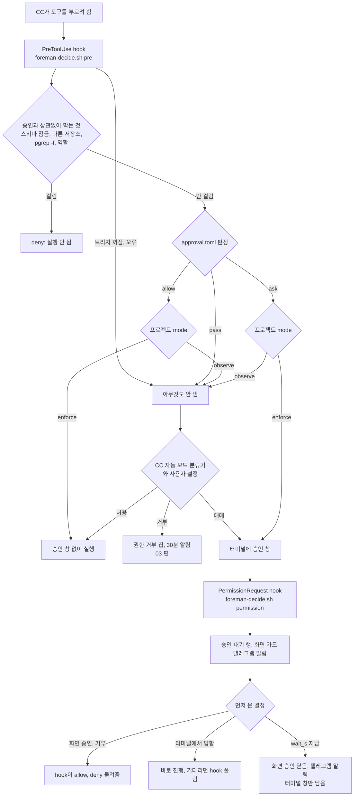

<!--
다루는 곳: bridge/approval.py, bridge/approvals.py, bridge/approval_summary.py, bridge/api/approvals.py, config/approval.toml
읽은 커밋: 9a7c22d
-->
# 04 승인

FOREMAN이 다루는 Claude Code(CC) 세션은 대부분 사람이 지켜보지 않는 동안 일한다. 그 사이에 세션이 운영 DB를 비우거나, 원격 저장소 이력을 강제로 덮어쓰거나, 홈 폴더를 통째로 지우는 명령을 치면 되돌릴 길이 없다. 승인은 이런 명령이 실행되기 직전에 멈춰 세우고 사람에게 묻는 장치다. 이 편은 승인 전체 그림, 무엇을 묻고 무엇을 묻지 않는지의 원칙과 그 까닭, CC 자체 권한 판단과 어떻게 나눠 맡는지, 결정이 어디서 오는지를 다룬다. 규칙을 어떻게 읽는지, hook 두 개로 어떻게 기다리는지, 승인 창에 무엇을 한 줄로 보이는지는 하위 세 편이 깊게 다룬다.

## 한 문장 원칙: 되돌릴 수 없는 것만 묻는다

승인 정책은 한 문장으로 줄일 수 있다. **되돌릴 수 없는 것만 묻고, 되돌릴 수 있는 것은 통과시키고, 그 밖은 정하지 않는다.** 브리지는 CC가 도구를 쓰기 직전(PreToolUse hook — CC가 도구를 부르기 전에 바깥 프로그램에 물어보는 자리)마다 그 호출을 세 갈래 가운데 하나로 판정한다 [code:bridge/approval.py].

| 판정 | 무엇이 들어가나 | CC에서 일어나는 일 |
|---|---|---|
| `ask` | 되돌릴 수 없는 것. 홈, 프로젝트, 데이터 폴더를 통째로 지우기, 운영 DB의 `DROP`, `TRUNCATE`, WHERE 없는 `DELETE`, 재부팅과 종료, VM 파괴, `push --force`, `reset --hard`, `filter-branch` 같은 이력 날리기, 비밀 파일을 밖으로 보내기, 볼륨, PVC, 네임스페이스, helm 릴리스 지우기, CC나 tmux를 한꺼번에 끄기, `curl … \| sh`, `crontab -r` | 승인 창이 뜬다. 자동 모드의 자동 통과보다 앞선다 |
| `allow` | 되돌릴 수 있는 것과 읽기. Read, Grep, Glob, 파일 편집과 쓰기, `git status`, `log`, `diff`, `kubectl apply`, `rollout`, `git push`(강제 아님), `docker restart`, `systemctl restart` | 승인 창 없이 통과 |
| `pass` | 그 밖 전부. `/tmp`나 작업 트리 밖의 평범한 삭제, 비밀 파일 읽기, 로컬 개발 DB, `kubectl delete pod`, `docker rm` 등 | 브리지는 아무것도 돌려주지 않는다. CC가 원래대로 정한다 |

규칙 목록은 `config/approval.toml` 한 파일에 정규식과 경로 목록으로 적혀 있고, 판정 순서는 이렇다. ask 규칙이 하나라도 걸리면 ask, Bash 명령을 `&&`, `||`, `;`, `|`로 나눈 조각이 모두 allow 규칙에 들어맞으면 allow, 나머지는 `unmatched` 값(지금 `pass`)이다 [code:config/approval.toml]. allow는 조각마다 증명해야 해서 리다이렉트, 명령 치환, 환경 변수 앞붙임처럼 무엇을 할지 확실하지 않은 것이 하나라도 섞이면 allow가 되지 못한다. 반대로 ask 정규식은 따옴표 안까지 명령 전체에서 찾는다. 이 서버에서는 `vagrant ssh … -c 'kubectl …'`처럼 다른 명령 안에 넣어 운영 명령을 실행하는 모양이 흔하기 때문이다 [log:stage5_approval_result.md]. 같은 까닭으로 다른 명령 안에서 실행되는 글, 곧 `bash -c` 안쪽, 셸이 받아 실행하는 여러 줄 본문, 실행하는 스크립트 파일의 본문은 바깥 명령과 똑같이 처음부터 다시 판정한다. 홈이나 프로젝트를 통째로 지우는지도 그 안에서 본다 [code:bridge/approval.py] [c:7ccb55f].

판정은 모든 도구 호출 앞에서 불리므로 메모리 안에서 끝낸다. DB 기록은 뒤에서 따로 한다. 판정 왕복은 약 25ms였다 [log:stage5_approval_result.md]. 한 명령이 실제로 지우는 것인지 그 글자를 적어 두기만 하는 것인지 가르는 법(커밋 메시지나 heredoc 속 `rm -rf`)은 → 「규칙: 실행과 글자」.

## 왜 이렇게 좁혔나: 다 물으면 읽지 않고 누른다

이 원칙은 처음부터 이 모양이 아니었다. 방향이 두 번 바뀌었고, 그 경위가 지금 규칙의 까닭이다.

처음 설계의 목적은 귀찮음 없애기였다. 세션이 승인을 매번 물어 흐름이 끊기니, 그 승인을 브라우저와 텔레그램으로 받자는 생각이었다. 그런데 실제 트랜스크립트 20일 치를 세어 보니 세 프로젝트 모두 이미 CC 자동 모드(auto mode — CC 안의 분류기가 도구 호출을 보고 스스로 허용하거나 막는 모드)로 돌고 있었다. 도구 호출 약 9,700건 가운데 사람이 승인을 누른 것은 18건뿐이었다 [log:stage5_approval_result.md]. 귀찮음은 이미 없었다. 대신 분류기가 운영 명령을 그냥 통과시켜 왔다. 런슈즈에서 `git push` 79번, `kubectl` 변경 60번, `docker` 정지와 삭제 67번이 아무 확인 없이 지나갔다 [log:stage5_approval_result.md]. 그래서 방향을 위험 차단으로 틀었다. 「되돌릴 수 없는 것만 묻고, 애매하면 묻는다」였다.

두 번째 전환은 써 보고 나서 왔다. 위험 차단 규칙을 켜자 흐름이 계속 끊겼다. 오탐을 하나씩 고쳐 나갔다(실행과 글자, 따옴표 친 메시지, mktemp로 만든 임시 폴더, 스크래치패드 …). 그래도 끊김은 줄지 않았고, 승인 정책을 고치려고 시험하는 코드가 그 정책에 걸리는 일까지 되풀이됐다. 그때 그동안의 승인 이력 65건을 하나씩 다시 봤다. 거부는 1건이었고, 그것도 승인 창을 시험하려고 일부러 거부한 것이었다. **실제 작업 중 거부는 0건이었다** [log:stage5_approval_result.md].

65번 물어 0번 거부했다면 그 65번은 안전이 아니라 소음이었다. 소음은 그 자체로 해롭다. 같은 창이 수십 번 떠서 매번 Yes를 누르다 보면 사람은 창을 읽지 않고 누르게 되고, 정말 위험한 한 번이 왔을 때도 같은 손놀림으로 Yes를 누른다. 그래서 기준을 「이론적으로 위험한 것」에서 **「사용자가 실제로 거부할 만한 것」**으로 바꿨다. 이 기준으로 다시 짜자 묻는 규칙이 22개에서 12개로 줄었고, 하나씩 고치던 오탐 패치 대부분이 필요 없어졌다 [log:stage5_approval_result.md].

결과는 지난 21일 도구 호출 18,076개에 새 규칙을 다시 돌려 확인했다. 하루 승인 창이 런슈즈 10.7에서 0.1로, 펫퍼민트 6.8에서 0.2로, FOREMAN 26.3에서 1.3으로 줄었다. 남은 9건을 하나씩 봤고 모두 거부할 만한 것이었다. FOREMAN 운영 DB 전체 비우기 4건, 펫퍼민트의 `git filter-branch`와 `reflog expire` 2건, `kubectl delete pvc`와 `delete ns` 3건이다 [log:stage5_approval_result.md].

### 뺀 것과 그 대신 무엇이 맡나

좁히면서 뺀 것은 주로 이런 것이다. `/tmp`나 mktemp로 만든 것을 지우기, 작업 트리 밖의 평범한 삭제, 변수가 든 경로 지우기, 비밀 파일 읽기와 복사, 규칙 파일 고치기, 다시 생기는 `kubectl delete pod`, 로컬 개발 DB 다시 만들기 [code:config/approval.toml]. 하나하나가 이력에서 「같은 성격으로 수없이 걸려 전부 Yes」였던 것들이다. 예를 들어 `/tmp/claude-1000` 아래 지우기가 16번, 토큰 파일 다루기가 13번, 규칙 파일을 Edit 도구로 고치기가 11번, 승인 정책을 시험하는 코드의 문자열이 9번 걸렸다 [log:stage5_approval_result.md].

이론적 위험을 버린 것은 아니다. 승인 창이 아닌 다른 층이 맡는다. 비밀값을 화면에 내지 않는 것은 작업 규칙(CLAUDE.md와 메모리)이 맡고, 안전 규칙 파일(`approval.toml`, `notify.toml`)과 게이트 자신을 끌 수 있는 파일(`~/.claude/settings.json`, hook 스크립트, `~/.claude.json` 등)을 고치는 것은 지금 설정(`protect_mode = "notify"`)에서 묻지 않고 통과시키되 텔레그램으로 🛡 알림을 보낸다(같은 파일은 10분에 한 번) [code:bridge/approval.py] [code:bridge/approvals.py] [code:config/approval.toml]. 작업방(worktree, 같은 저장소를 다른 폴더에 펼쳐 따로 일하는 곳) 안의 규칙 파일 사본을 고칠 때도 같은 알림이 가고, 작업방을 원본에 합칠 때 규칙 파일이 바뀌었으면 합치기 결과와 카드에 그 사실을 표시한다. 표시만 하고 합치기를 막지는 않는다 [log:foreman-7_silent_delete_fix_20261115.md] [c:7ccb55f].

엄격한 규칙의 장치는 코드에서 지우지 않았다. `[sensitive] mode = "read"`, `protect_mode = "ask"`, `[ask] delete_outside_worktree = true`, `scan_interpreter_heredocs = true`로 되돌리면 예전처럼 동작한다 [code:config/approval.toml]. 시험도 두 벌이다. 엄격한 규칙은 `tests/test_approval.py`가, 지금 기준은 `tests/test_approval_now.py`가 맡는다 [code:README.md].

### 「애매하면 묻는다」는 어디까지 남았나

처음 원칙의 셋째 마디 「애매하면 묻는다」는 지금 아주 좁게만 남았다. 위험한 운영 명령의 동사 자리가 변수인 것(`kubectl $VERB`)을 묻던 규칙은 1번 걸려 Yes였고, 지금은 빈 값으로 꺼 두었다(`[ask.ambiguous] verb_re = ""`) [code:config/approval.toml]. 남은 것은 지울 경로가 비면 `/`가 되는 꼴(`rm -rf $X/`)이다. 이 경우 변수가 비었을 때 무엇이 지워지는지 그 명령 안에서 확인할 수 없으므로 묻는다. `${X:?}`로 빈 값을 막았으면 통과한다 [code:config/approval.toml]. 지울 경로가 고정 부분 없이 명령 치환(다른 명령의 출력을 그 자리에 넣는 셸 문법)으로 시작하는 것도 묻는다. 무엇을 지울지 글만으로는 전혀 알 수 없기 때문이다. 다만 작업 폴더나 저장소 뿌리를 내는 명령 치환은 실제 경로로 풀어, 통째로 지우는 경우에만 묻는다 [code:bridge/approval.py] [c:7ccb55f]. 판정 세부는 → 「규칙: 실행과 글자」.

반대로 규칙에 없는 모든 것을 묻게 하지는 않는다(`unmatched = "pass"`). 그렇게 하면 자동 모드가 통과시키던 평범한 작업이 모두 승인 창이 된다. 실측으로 20일에 약 9,700건이다 [code:config/approval.toml]. 값을 `"ask"`로 바꿀 수는 있지만 지금은 어느 프로젝트도 그렇게 쓰지 않는다.

## 평범한 작업은 CC 자동 모드에 맡긴다

FOREMAN 승인은 CC의 권한 체계를 대신하지 않는다. 그 위에 얹혀, 되돌릴 수 없는 몇 가지만 사람에게 끌어올리고 나머지는 CC에 그대로 맡긴다. 두 체계가 어떻게 겹치는지를 아는 것이 이 장치를 이해하는 열쇠다.

설계 전체가 기대는 사실은 하나다. **PreToolUse hook이 `ask`를 돌려주면 자동 모드에서도 승인 창이 뜬다.** CC 공식 문서는 자동 모드에서 hook의 ask가 도구 호출을 승인 창으로 보내고 분류기가 결정하지 않는다고 적는다. 이 세션에서도 트랜스크립트의 `permissionMode`가 모두 `auto`인 상태에서 우리 `ask` 26건이 모두 승인 창으로 떴다 [code:README.md]. 그래서 세 프로젝트를 자동 모드로 두면서도 되돌릴 수 없는 것만은 사람이 본다.

판정별로 CC 쪽에서 무슨 일이 일어나는지 정리하면 이렇다.

| 브리지 판정 | CC가 받는 것 | 그 뒤 |
|---|---|---|
| `ask` | `permissionDecision: ask`와 이유 | 승인 창이 뜬다. 분류기는 결정하지 않는다 |
| `allow` | `permissionDecision: allow` | 승인 창 없이 실행된다. 다만 사용자 설정의 deny나 ask 규칙은 넘지 못한다(문서: hook 결정은 권한 규칙을 건너뛰지 않는다) |
| `pass` | 아무것도 없음(본문 없는 204) | CC가 원래 흐름대로 정한다. 자동 모드 분류기와 사용자 설정이 판단한다 |
| 브리지가 꺼짐, 오류 | 아무것도 없음 | `pass`와 같다. 허용 쪽으로 새지 않는다 |

hook 스크립트 `scripts/foreman-decide.sh`는 브리지가 응답하지 않거나 오류를 내면 아무것도 출력하지 않고 `exit 0`으로 끝난다. 그러면 CC는 hook이 없었던 것처럼 원래대로 정한다 [code:scripts/foreman-decide.sh]. 다만 이렇게 판정 없이 지나간 사실은 조용히 묻히지 않게 기록 파일에 한 줄씩 남는다(명령 글은 빼고 시각, 갈래, 까닭, 세션, 도구 이름만) [code:bridge/hookmiss.py] [log:foreman-6_bridge_alert_20261115.md]. 브리지가 멈췄다고 모든 것이 허용되지도, 모든 것이 막히지도 않는다. 이것이 pass를 지금보다 넓히지 않는 까닭이기도 하다. 브리지가 정하지 않으면 CC의 원래 판단이 그대로 살아 있다.

### CC 자체 권한 거부는 승인 카드로 오지 않는다

두 체계가 어긋나는 자리가 하나 있다. CC 자동 모드 분류기가 스스로 막은 도구 호출(트랜스크립트에 "Permission for this action was denied")은 승인 창을 띄우지 않으므로 FOREMAN 승인 카드로도 오지 않는다 [code:bridge/human_wait.py]. 세션은 거기서 멈춰 사람이 다시 입력하기를 기다리는데, 화면을 보지 않는 사람에게는 조용한 멈춤이다. 그래서 화면에는 「권한 거부」 칩과 방 배너를 띄우고, 거부 뒤 30분이 지나도 그 세션이 일하지 않으면 텔레그램을 한 번 보낸다 [code:bridge/human_wait.py]. 이것은 승인이 아니라 세션 지켜보기의 몫이라 → 「03 세션 지켜보기와 글 넣기」에서 다룬다.

반대로 CC가 스스로 승인 창을 띄운 경우(분류기가 애매하다고 본 것, 사용자 설정의 ask 규칙)는 FOREMAN이 만든 ask가 아니어도 같은 길로 받는다. 승인 창이 뜨면 PermissionRequest hook이 불리고, 브리지는 그것을 규칙 이름 `cc`로 승인 대기에 올린다 [code:bridge/approvals.py]. 사람이 보기에는 어느 쪽이 물었든 같은 카드다.

### 승인 정책과 상관없이 막는 것

PreToolUse는 승인 판정만 하는 자리가 아니다. 같은 hook에서 승인 정책보다 먼저 네 가지를 거부(`deny`)한다. 다른 세션이 스키마를 바꾸는 중일 때(스키마 잠금), 다른 저장소를 고치려 할 때, `pgrep -f`나 `pkill -f`가 자기 셸에 걸릴 때, 그리고 역할 규칙에 어긋날 때다 [code:bridge/approvals.py]. 이 넷은 프로젝트가 observe여도 막는다. 이 검사 자체가 예외로 실패하면 예전에는 브리지가 오류(500)를 냈고 hook 스크립트가 그것을 통과로 받았다. 지금은 브리지가 예외를 잡아 판정 없이 통과시키되, 어느 검사가 무슨 예외로 실패했는지를 위의 기록 파일에 남긴다 [code:bridge/approvals.py] [c:cd14ed6]. 승인이 「물어볼 일」이라면 이쪽은 「묻지 않고 막을 일」이라 성격이 다르다. → 「글이 아니라 권한으로」(05 역할과 권한의 하위 편).

## 프로젝트마다 observe와 enforce

같은 규칙을 모든 프로젝트에 같은 세기로 걸지 않는다. 프로젝트마다 `mode`를 둔다 [code:config/approval.toml].

| mode | 하는 일 |
|---|---|
| `enforce` | 판정(allow, ask)을 CC에 돌려준다. ask면 승인 창이 뜬다 |
| `observe` | 판정을 기록만 하고 CC에는 아무것도 돌려주지 않는다. 판정이 ask였어도 세션은 모르고 지나간다 |

지금 값은 기본과 FOREMAN이 `enforce`, 런슈즈, 펫퍼민트, 인프라가 `observe`다 [code:config/approval.toml].

observe가 있는 까닭은 hook이 실행 중인 세션에 곧바로 걸리기 때문이다. 설정을 바꾸면 다음 도구 호출부터 새 판정이 적용된다. 처음 규칙을 만들 무렵 모의 실험으로는 런슈즈와 펫퍼민트에 하루 11~18건의 승인 창이 갑자기 생길 판이었다 [log:stage5_approval_result.md]. 다른 프로젝트 세션은 그 프로젝트 사람이 돌리는 일이라 FOREMAN이 하루아침에 흐름을 끊을 수 없다. 그래서 observe로 시작해 판정을 쌓고, 쌓인 판정(「걸렸을 것」)을 보고 사람이 enforce로 바꾸게 했다. observe 기록은 실제로 쓸모가 있었다. 펫퍼민트 세션이 파일을 이력에서 지우려고 `git filter-branch`, `reflog expire --expire=now --all`, `gc --prune`을 차례로 실행한 것이 observe 기록에 남았고, 그때는 어느 규칙에도 걸리지 않았다는 것을 알게 되어 `git-이력파괴` 규칙을 새로 만들었다 [code:README.md]. 인프라는 클러스터 작업 묶음 동안 사람이 승인 카드를 풀어 달라고 해서 임시로 observe에 두었다 [code:config/approval.toml].

## 결정은 먼저 온 쪽이 정한다

승인 창이 뜨면 사람이 답할 수 있는 곳이 여럿이다. 이것을 하나로 묶지 않고 **먼저 온 결정이 이기게** 했다.

창이 뜨는 순간 CC는 PermissionRequest hook을 부르고, 브리지는 승인 대기 행을 만든 뒤 세 곳에 알린다. 화면(옆 패널의 승인 카드, 다른 세션 패널에는 「세션 열기」 줄)으로 실시간으로 보내고, 텔레그램으로 `🔐 승인 대기`를 보내고, 그동안 hook은 결정을 기다린다 [code:bridge/approvals.py]. 이때 결정이 들어올 수 있는 길은 셋이다.

| 길 | 어떻게 들어오나 | 결과 |
|---|---|---|
| 화면 | 승인 카드의 [승인], [거부] → `POST /api/approvals/{id}` | hook이 allow, deny를 돌려주고 터미널 창이 닫힌다. 거부 이유는 모델에게 그대로 간다 |
| 터미널 | 그 세션의 대화창에 떠 있는 승인 창에서 사람이 직접 답함 | 도구가 바로 진행된다. 브리지는 트랜스크립트에 그 도구의 결과가 온 것을 보고 기다리던 hook을 풀어 준다 |
| 시간 초과 | `wait_s`(지금 3600초) 동안 아무 답이 없음 | 화면 승인을 닫고 텔레그램 ⏰ 알림. 터미널 창은 그대로 남는다 |

[code:bridge/approvals.py] [code:bridge/api/approvals.py] [code:config/approval.toml]

텔레그램은 결정을 받는 길이 아니라 알리는 길이다. 메시지 안에 [승인] 버튼은 없고, 「확인 페이지에서 승인, 거부, 또는 대화창에서」라는 안내와 함께 무엇을 대상으로 하는지 한 줄이 간다 [code:bridge/approvals.py]. 사람이 화면을 계속 보지 않으므로 텔레그램이 첫 신호가 되고, 결정은 화면이나 터미널에서 한다.

이 설계가 가능한 것은 실측 덕분이다. PermissionRequest hook이 기다리는 동안에도 터미널에는 이미 승인 창이 떠 있고, 거기서 먼저 Yes를 누르면 기다리던 hook과 상관없이 즉시 진행된다 [log:stage5_approval_result.md]. 즉 화면 승인을 붙였다고 터미널이 막히지 않는다. 어느 한 길이 고장 나도(브리지가 다시 떠서 기다리던 연결이 끊겨도) 터미널 창은 남아 있어 세션이 영영 멈추지 않는다. 브리지가 다시 뜨면 기다리던 승인은 `abandoned`로 닫는다 [code:bridge/approvals.py].

먼저 온 쪽만 기록한다는 규칙은 시험에서 찾은 경주 때문에 생겼다. 처음에는 터미널 응답을 본 쪽과 기다리던 쪽이 둘 다 기록하다가, 먼저 쓴 쪽이 터미널 결정 값 없이 행을 닫아 버렸다. 지금은 결정을 기다리던 쪽 한 곳에서만 쓴다 [log:stage5_approval_result.md].

기다리는 시간은 세 값이 겹쳐 있어 함께 움직여야 한다. 브리지 `wait_s` 3600초보다 hook 스크립트의 curl 한도 3630초가 길고, 그보다 CC 설정의 PermissionRequest hook 한도가 길어야 한다 [code:scripts/foreman-decide.sh]. 순서가 어긋나면 CC가 먼저 hook을 끊어 화면에서 누른 결정이 허공에 뜬다. `wait_s`는 처음 600초였는데, 사람이 화면을 계속 보지 않아 10분 안에 답하지 못하는 일이 잦아 3600초로 늘렸다 [code:config/approval.toml].

세션이 사람에게 묻는 질문(AskUserQuestion)과 계획 승인(ExitPlanMode)도 승인 창과 같은 PermissionRequest 길로 들어온다. 질문은 승인이 아니지만 정책에서 빼면 텔레그램과 화면 알림이 없어 세션이 조용히 멈추므로 같은 길로 받고, 카드 모양과 돌려주는 값만 따로 둔다. hook 두 개가 어떻게 이어지는지, 질문과 계획 승인에 무엇을 붙여 돌려주는지는 → 「기다리는 길: hook 두 개」.

## 승인 카드의 [승인]은 눈에 띄게 하지 않는다

FOREMAN 화면에는 「지금 눌러야 하는 버튼은 `primary`(채운 색, 굵게, 테두리 빛)로, 한 줄에 하나만」이라는 약속이 있다. 긴 요약 글 아래 [확인] 버튼이 [멈추기]와 구분되지 않아 묻힌다는 지적에서 나온 약속이다 [log:question_answer_primary_button_20261109.md]. 그런데 승인 카드의 [승인]에는 이 강조를 일부러 붙이지 않았다. [승인]은 꾸밈 없는 기본 버튼이고 [거부]는 `ghost`다 [code:bridge/static/js/render.js].

까닭은 이 편의 원칙과 같다. 다른 화면의 버튼은 「다음에 할 일」을 알려 주는 것이라 한쪽을 미는 것이 도움이 된다. 승인 카드는 판단을 묻는 자리다. 한쪽을 빛나게 하면 사람은 위의 요약 줄을 읽지 않고 빛나는 쪽을 누른다 [docs:style_guide.md]. 승인 창을 줄인 것도, 승인 창에 명령 전체 대신 대상 한 줄을 맨 위에 둔 것도, [승인]을 강조하지 않은 것도 모두 「사람이 실제로 읽고 판단하게」 하려는 같은 목표의 다른 면이다. [거부]를 누르면 이유를 묻는 창이 뜨고, 적은 글은 모델에게 그대로 간다 [code:bridge/static/js/render.js].

## 모든 판정을 남기고, 늘 Yes인 규칙을 찾는다

원칙을 지키려면 규칙이 낡았는지 알아야 한다. 그래서 브리지는 묻지 않은 판정까지 모두 남긴다. allow와 pass를 포함한 모든 PreToolUse 판정은 `event(type=approval_req)`로(규칙, 이유, 강제 여부, 요약), 승인 대기와 결과는 `approval` 표와 `event(approval_res)`로 들어간다 [code:bridge/approvals.py]. ask와 결정은 로그에도 이유와 함께 남는다. 거절이나 보류에는 언제나 이유를 남긴다는 것은 초기 단계부터의 약속이다.

이 기록 위에 승인 이력(`GET /api/approvals/history?days=1|7|30`)이 있다. 규칙별로 몇 번 걸렸고 몇 번 승인, 거부, 모름이었는지, observe 프로젝트에서 「걸렸을 것」이 몇 번인지 센다 [code:bridge/api/approvals.py]. **3번 넘게 걸렸는데 한 번도 거부하지 않은 규칙은 「늘 Yes」로 표시한다** [code:bridge/api/approvals.py]. 묻는 의미가 없으면 규칙을 고칠 후보라는 뜻이다. 시간이 초과되었거나 브리지가 다시 뜬 뒤 터미널에서 답한 것은 승인 행만으로 결과를 알 수 없으므로, 그 도구의 결과(`tool_result`)가 오류 없이 왔는지로 거꾸로 짐작한다 [code:bridge/api/approvals.py].

이 표가 실제로 규칙을 바꿨다. 처음 본 7일에 45건 가운데 승인 44, 거부 1이었고, 늘 Yes로 `보호-설정파일` 10건과 `민감한-경로` 8건이 떴다 [code:README.md]. 보호-설정파일 10건은 모두 Edit 도구로 `approval.toml`을 고친 것이어서, 도구 편집은 통과시키고 알림만 보내도록 바꿨다. 규칙을 바꿀 때 지난 도구 호출 전체에 옛 규칙과 새 규칙을 다시 돌려 하루 ask 수가 어떻게 달라지는지 보는 방법(`scripts/approval-replay.py`)은 → 「규칙: 실행과 글자」.

## 전체 흐름

모든 갈래에서 판정은 `event(approval_req)`로 남고, 승인 대기가 생긴 것은 `approval` 표와 `event(approval_res)`에 결과까지 남는다.

## 하위 편으로 가는 길

| 편 | 무엇을 다루나 |
|---|---|
| 규칙: 실행과 글자 | `approval.toml`의 규칙 하나하나와 판정 순서. 같은 `rm -rf`라도 실제로 지우는 명령과 커밋 메시지나 heredoc에 적어 두기만 한 글자를 어떻게 가르는지. 통째로 지우기와 운영 DB 판정, 공개된 다른 PreToolUse 게이트와 비교해 가져온 것과 버린 것. 규칙을 바꿀 때 지난 호출에 다시 돌려 보는 법 |
| 기다리는 길: hook 두 개 | PreToolUse와 PermissionRequest가 어떻게 이어지는지(PermissionRequest에는 `tool_use_id`가 없어 바로 앞 PreToolUse로 찾는다), 4초 판정 한도, 먼저 온 결정과 경주 처리, 시간 초과, 질문과 계획 승인에 붙여 돌려주는 값 |
| 승인 요약 | 승인 창, 텔레그램, 화면 카드 맨 위에 명령 전체 대신 「무엇을 대상으로」 한 줄을 보이는 법. mktemp로 만든 것인지, 기존 디렉토리의 파일 수, 네임스페이스, 컨테이너 이름 |

이 편 밖에서 승인과 맞닿는 곳은 세 군데다. 승인 hook과 같은 자리에서 묻지 않고 막는 것은 → 「05 역할과 권한」, CC 자체 권한 거부와 창이 떠 있는데 기다리는 승인이 없는 멈춤을 잡는 것은 → 「03 세션 지켜보기와 글 넣기」, 텔레그램을 보내는 방식과 묶음은 → 「11 알림」.
