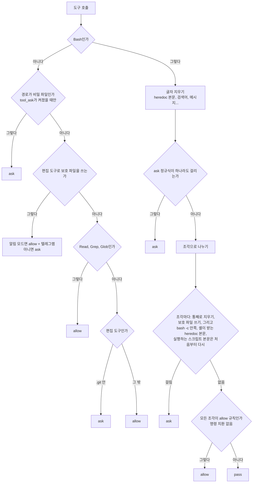

<!--
다루는 곳: bridge/approval.py, config/approval.toml, scripts/approval-replay.py
읽은 커밋: 5e0f7c5
-->

# 규칙: 실행과 글자

FOREMAN의 승인은 Claude Code(CC)가 도구를 부르기 직전마다 브리지가 「이 호출을 사람에게 물을까」를 정하는 일이다. 이 편은 그 판정의 몸통인 규칙 엔진을 다룬다. 명령 한 줄을 어떻게 쪼개 읽는지, 같은 `rm -rf`라도 실제로 지우는 것과 글자로 적는 것을 어떻게 가르는지, 규칙 파일에 지금 무엇이 들어 있는지, 그리고 규칙을 바꿀 때 지난 도구 호출 수만 개에 옛 규칙과 새 규칙을 다시 돌려 하루에 몇 번 묻게 되는지를 미리 세는 방법까지다.

판정이 나온 뒤 승인 창이 뜨고 브라우저, 텔레그램, 터미널 가운데 먼저 온 답으로 풀리는 길은 「→ 기다리는 길: hook 두 개」에서, 승인 창에 「무엇을 대상으로」 한 줄을 붙이는 일은 「→ 승인 요약」에서 다룬다. 역할 규칙, 다른 저장소 막기, `pgrep -f` 막기처럼 이 엔진보다 먼저 도는 거부(deny)는 「→ 글이 아니라 권한으로」에 있다.

## 판정은 셋이다: allow, ask, pass

엔진이 내는 답은 셋뿐이다 [code:bridge/approval.py]. `ask`는 되돌릴 수 없는 것이다. CC에 「사람에게 물어라」를 돌려주면 CC는 자동 모드(auto mode, CC의 분류기가 알아서 통과시키는 모드)에서도 승인 창을 띄운다. `allow`는 되돌릴 수 있거나 읽기만 하는 것이다. 승인 창 없이 통과한다. `pass`는 그 밖의 모든 것이다. 브리지는 아무것도 정하지 않고, CC가 원래 하던 대로(자동 모드 분류기와 사용자 설정으로) 정한다.

이 셋 가운데 가장 중요한 것은 `pass`가 있다는 사실이다. 처음 설계에는 「애매하면 묻는다」가 있었다. 그런데 조사해 보니 세 프로젝트 모두 이미 자동 모드였고, 20일 동안 도구 호출 약 9,700건 가운데 사람이 승인을 누른 것은 18건뿐이었다 [log:stage5_approval_result.md]. 규칙에 없는 것을 모두 `ask`로 하면 그 9,700건이 거의 다 승인 창이 된다. 그래서 규칙에 없는 것은 브리지가 손대지 않고 CC에 넘긴다. 이렇게 하면 브리지가 꺼져 있을 때와 켜져 있을 때 평범한 작업의 흐름이 같다. 브리지가 꺼지면 hook 스크립트가 아무것도 내지 않고, 그러면 CC가 평소처럼 정한다. 허용 쪽으로 새는 길이 생기지 않는다.

`unmatched = "ask"`로 바꾸면 규칙에 없는 것도 묻게 할 수 있다 [code:config/approval.toml]. 프로젝트마다 따로 둘 수 있지만 지금은 어느 프로젝트도 그렇게 쓰지 않는다.

프로젝트마다 `mode`도 있다. `enforce`는 판정을 CC에 돌려주고, `observe`는 기록만 하고 CC에는 아무것도 돌려주지 않는다. 실행 중인 세션에 hook이 다음 도구 호출부터 바로 걸리기 때문에, 새 프로젝트는 관찰로 시작해 쌓인 판정을 보고 바꾼다. 지금 설정은 FOREMAN이 `enforce`, 런슈즈, 펫퍼민트, 인프라가 `observe`다 [code:config/approval.toml]. 관찰 모드에서도 판정은 모두 기록되므로, 화면의 승인 이력에서 「걸렸을 것」으로 볼 수 있다.

## 한 번의 판정이 지나는 차례

판정 함수는 `Policy.decide(도구, 입력, 작업 폴더, 스크래치패드, 프로젝트)`다 [code:bridge/approval.py]. PreToolUse hook이 브리지에 오면 `bridge/approvals.py`가 역할, 다른 저장소, 스키마 잠금 같은 거부 검사를 먼저 하고, 그것에 걸리지 않았을 때 이 함수를 부른다 [code:bridge/approvals.py]. 모든 도구 호출 앞에서 불리므로 빨라야 한다. 그래서 판정은 메모리 안에서 끝낸다. 바깥을 보는 것은 실행하려는 스크립트 파일 내용(256KB까지)을 읽는 것, 경로의 심볼릭 링크를 푸는 것, 저장소 뿌리가 어디인지 git에 묻는 것뿐이다. 5단계에서 잰 hook 왕복은 약 25ms였다 [log:stage5_approval_result.md].



Bash가 아닌 도구는 단순하다. 경로 하나를 보고 정한다. Read, Grep, Glob은 읽기라서 `allow`다. Edit, MultiEdit, NotebookEdit, Write는 작업 트리 안이든 밖이든 `allow`다. 덮어쓴 파일은 되돌릴 수 있다는 판단이다. 예외는 `.git/` 안(저장소 내부 상태가 깨지면 되돌리기 어렵다)과 아래에서 볼 보호 파일이다.

어려운 것은 Bash다. Bash 명령은 셸이 해석하는 글이라 한 줄에 여러 명령이 이어지고, 따옴표와 heredoc(여러 줄 글을 명령의 입력으로 넣는 `<<EOF … EOF` 문법) 속에 무엇이든 들어갈 수 있다. 이 편의 나머지는 거의 다 Bash 이야기다.

## 명령을 어떻게 쪼개 읽나

### 조각으로 나누기

Bash 명령은 먼저 「조각」으로 나눈다. 조각은 `&&`, `||`, `;`, `|`, `&`, 줄바꿈으로 갈린 명령 하나다. 나누는 데는 파이썬 표준 라이브러리 `shlex`를 쓴다 [code:bridge/approval.py]. `shlex`는 셸처럼 따옴표를 풀어 낱말로 자르고, `punctuation_chars=True`를 주면 `&&`, `|` 같은 구분 기호를 따로 떼어 준다. 다만 `shlex`는 줄바꿈을 빈칸으로 보기 때문에, 그대로 두면 여러 줄 명령이 한 조각으로 뭉쳐 둘째 줄부터의 명령이 첫 줄 명령의 인자처럼 읽힌다. 그래서 나누기 전에 줄 사이에 명령 구분을 넣는다. `|`, `&&`, `||`, 줄 끝 `\`로 이어지는 줄은 한 명령으로 잇는다 [code:bridge/approval.py] [c:7ccb55f]. 그 전에 heredoc 본문은 조각에서 빼 둔다. 본문은 그 명령의 입력이지 그 줄의 명령이 아니기 때문이다. 뺀 본문은 버리지 않고 모아 두었다가, 받는 쪽이 셸이면 따로 다시 판정한다(다음 절과 「실행과 글자를 가르는 법」).

나눈 조각마다 몇 가지를 벗겨 낸다. `FOO=bar cmd`처럼 앞에 붙인 환경 변수, `sudo`, `nohup`, `time`, `env`, `command`, `exec` 같은 앞붙이 명령, 그리고 `if`, `then`, `do`, `else`, `while`, `{`, `(` 같은 셸 문법 낱말을 건너뛰어 실제 동사를 찾는다. 셸 문법 낱말을 건너뛰는 것은 스크립트 본문에 흔한 「조건이나 반복 안의 명령」을 제 명령으로 읽기 위해서다 [c:7ccb55f]. `cd 경로` 조각을 만나면 그 뒤 조각의 작업 폴더를 그 경로로 바꾼다. 그래서 `cd ~/AI_programming && rm -rf runshoes`는 `rm -rf ~/AI_programming/runshoes`로 읽힌다. `2>/dev/null` 같은 리다이렉트는 떼어 내되, `>` 뒤에 오는 파일이 보호 파일인지는 따로 본다.

따옴표가 닫히지 않는 등 `shlex`가 나누지 못하면 조각 목록은 「모름」(None)이 된다. 이때 `allow`는 절대 나오지 않는다. 엄격한 설정(`delete_outside_worktree = true`)에서는 「`rm`이 있는데 나눌 수 없다」를 `애매한-삭제`로 묻는다.

### 안쪽 명령까지 들어가기

이 서버의 실제 명령에는 다른 명령 안에 넣어 실행하는 모양이 많다. `bash -c '…'`, `sh -c '…'`, 그리고 클러스터 VM 안에서 돌리는 `vagrant ssh <VM> -c '…'`다. 이런 조각은 따옴표 안의 글을 꺼내 처음부터 다시 판정한다(깊이 3까지). `vagrant ssh` 안쪽은 VM의 파일 시스템이라 작업 폴더를 모르는 것으로 둔다. 그래서 VM 안의 상대 경로는 이 PC의 경로로 풀지 않는다.

heredoc 본문을 셸이 받는 경우도 같은 길로 들어간다. 받는 쪽이 본문을 명령으로 읽어 실행하는 셸(이 PC의 셸이든 원격 셸이든)이면, 본문은 입력이 아니라 실행될 명령이다. 이때 모아 둔 본문을 `bash -c` 안쪽처럼 처음부터 다시 판정한다. 정규식만이 아니라 조각 판정(통째로 지우기, 보호 파일 쓰기)까지 거친다. 원격으로 넘기는 본문은 `vagrant ssh` 안쪽과 같이 작업 폴더를 모르는 것으로 둔다 [code:bridge/approval.py] [c:7ccb55f].

스크립트 파일을 실행하는 조각(`bash x.sh`, `sh x`, `source x`, `. x`, `./x.sh`, `/경로/x.sh`)은 그 파일 내용을 읽어 역시 `bash -c` 안쪽처럼 처음부터 다시 판정한다. 예전에는 파일 내용에 ask 정규식만 돌렸는데, 그러면 정규식이 아니라 조각 판정으로 정하는 `통째로-삭제`가 스크립트 안에서는 닿지 않았다. 같은 명령 안에서 heredoc으로 막 써 놓고 바로 실행하는 스크립트는 판정하는 순간 파일이 아직 없으므로, 같은 명령에서 그 파일에 쓰는 본문을 기억해 두었다가 그것으로 판정한다 [code:bridge/approval.py] [log:foreman-7_silent_delete_fix_20261115.md]. 위험한 명령을 파일에 써 두고 나중에 실행하는 길은 실행하는 순간 잡힌다. `bash -n x.sh`(문법 검사만 하고 실행하지 않는다)는 실행이 아니라 읽지 않는다. 문법 검사한 스크립트 안의 `kubectl delete`가 묻는 오탐이 실제로 있었다 [code:bridge/approval.py].

### ask는 통째로 찾고, allow는 조각마다 증명한다

판정 방향에 따라 읽는 방식이 일부러 다르다.

`ask` 정규식(규칙 파일의 `[ask.bash]`)은 명령 **전체**에서, 따옴표 안까지 찾는다 [code:config/approval.toml]. `vagrant ssh m -c 'kubectl delete ns app'`에서 `kubectl delete ns`는 따옴표 안에 있지만 실제로 실행된다. 이 환경에서 흔한 모양이라 따옴표 안을 믿을 수 없다. 대신 아래에서 볼 「글자 지우기」로 실행되지 않는 따옴표 안 글자만 미리 지운다.

`allow`는 반대로 조각 **하나하나**가 허용 목록에 있어야 한다. `git status && git log -3`은 두 조각이 모두 git 읽기라서 `allow`다. 하나라도 확실하지 않으면 `allow`하지 않고 `pass`로 둔다. 확실하지 않은 것은 명령 치환(`$( )`, 백틱, `<( )`), `/dev/null`이 아닌 리다이렉트, 환경 변수 앞붙임, 백그라운드 실행, 파이프 뒤의 거르개(`head`, `grep` 등)가 아닌 명령, `git -c`(설정 주입)나 `--output`, `--ext-diff`, `--exec` 같은 옵션이다.

이 비대칭에는 까닭이 있다. `ask`를 놓치면 되돌릴 수 없는 일이 생기고, `allow`를 잘못 주면 사람이 볼 기회를 잃는다. 반면 `ask`를 잘못 내면 승인 창 하나, `allow`를 놓치면 CC 판단으로 넘어갈 뿐이다. 그래서 위험 쪽은 넓게 찾고 허용 쪽은 좁게 증명한다.

## 실행과 글자를 가르는 법

### 왜 필요했나

이 시스템을 만드는 도중에 승인 시스템이 자기 자신을 막았다. 처음 규칙은 「명령에 이 글자가 있으면 묻는다」였다. 그러자 규칙 파일에 위험한 명령의 모양을 적어 넣는 것만으로 승인 창이 떴고, 커밋 메시지에 `kubectl apply`라고 쓰는 것도 걸렸다. 세 번 연속 걸린 것이 고친 계기다 [code:README.md] [c:bc4a997]. 문제는 분명했다. 위험한 명령을 **실행하는** 일과 위험한 명령에 대해 **쓰는** 일이 같은 글자를 담는다. 둘을 가르지 못하면 승인 규칙을 만들고 기록하는 일 자체가 막힌다.

### 원리: 그 글자가 어디로 들어가는가

가르는 기준은 하나다. 그 글자를 받는 쪽이 실행하는가, 저장만 하는가. 셸에서 명령어 자리에 있는 낱말은 실행되고, 따옴표 친 인자는 그 명령에 넘겨지는 글자다. `echo 'sudo rm -rf /'`는 아무것도 지우지 않는다. 그러나 `echo '…' | sh`는 받는 쪽인 셸이 그 글자를 실행한다. 같은 글자라도 어디로 흘러가는지가 판정을 바꾼다.

heredoc은 이 차이가 가장 크게 드러나는 곳이다. 엔진은 heredoc을 받는 쪽에 따라 세 가지로 다룬다 [code:bridge/approval.py].

첫째, **파일에 쓰기만 하는 heredoc**이다. `cat > notes.md <<'EOF'`나 `tee 파일 <<'EOF'`의 본문은 파일에 저장될 뿐이라 검사에서 뺀다. 대신 쓰는 파일이 무엇인지는 목록으로 남겨, 그 파일이 보호 파일이나 비밀 파일이면 따로 판정한다. 다만 `.sh`, `.bash`, `.zsh`로 쓰는 것은 본문을 남긴다. 곧바로 실행될 가능성이 크기 때문이다.

둘째, **텍스트로만 저장되는 곳**이다. `git commit -F -`, `git tag -F -`, `git notes`, `git merge -F -`, `gh … --body-file -`처럼 표준 입력을 커밋 메시지나 PR 본문으로 받는 명령이다. 실측에서 `git commit -F -` 본문의 글자로 승인 창이 떴다. 이 본문도 뺀다.

셋째, **실행기로 들어가는 heredoc**이다. `bash <<'EOF'`, `python3 - <<'EOF'`, `mysql <<'EOF'`는 본문이 실행된다. 이것은 검사한다. 셸로 들어가는 본문은 ask 정규식에 더해 앞 절의 「안쪽 명령까지 들어가기」처럼 조각 판정까지 다시 거친다. 다만 해석기(python, node, ruby, perl …)로 들어가는 본문을 셸 규칙으로 읽을지는 설정(`scan_interpreter_heredocs`)으로 정하는데, 지금은 꺼져 있다. 까닭은 아래 「22개에서 12개로」에서 다룬다.

어느 경우든 지키는 조건이 하나 있다. EOF에 따옴표가 없는 heredoc(`<<EOF`)은 셸이 본문의 `$( )`와 백틱을 **먼저 실행한다**. 받는 쪽이 커밋이어도 그렇다. 그래서 따옴표 없는 heredoc 본문에 명령 치환이 있으면 빼지 않고 그대로 검사한다.

이렇게 하면 「파일에 숨겨 두고 나중에 실행하면 빠지지 않나」라는 물음이 남는다. 그 구멍은 앞 절의 「스크립트를 실행할 때 파일 내용을 읽는다」가 막는다. 파일을 쓰는 다른 길인 Write 도구도 원래 내용을 검사하지 않았으니, 셸로 쓴 파일과 도구로 쓴 파일이 같은 자리(실행 순간)에서 잡힌다.

### 검사 전에 글자를 자리표시로 바꾼다

같은 생각을 명령 한 줄 안으로 넓힌 것이 「글자 지우기」(`_neutralize`)다 [code:bridge/approval.py]. 검사하기 전에 「실행되지 않는 글자」와 「값이 새지 않는 것이 명백한 모양」을 무해한 자리표시(`PATTERN`, `"TEXT"`, `"MESSAGE"`, `: keys-only` 같은 글)로 바꾸고, 바꾼 글에 ask 규칙을 돌린다. 조건이 하나라도 어긋나면 바꾸지 않는다. 즉 예전처럼 검사한다.

| 모양 | 바꾸는 조건(하나라도 어긋나면 그대로 검사) |
|---|---|
| 검색어: `grep`, `rg`, `sed`, `awk`의 패턴 인자 | 패턴에 `$( )`가 없고, 같은 파이프 뒤에 셸, 해석기, `xargs`, `eval`이 없고, sed의 `e` 명령이나 `s///e`, awk의 `system()`, `getline`, `print \|`가 없을 때 |
| 메시지와 출력: `echo`, `printf`의 따옴표 인자, `git commit -m`, `git tag -m`, `curl --data` 본문 | 따옴표 안이고 명령 치환이 없고, 출력이 파이프로 어디에도 넘어가지 않고, 명령 치환이나 프로세스 치환 안이 아니고, `.sh`, `.py`로 쓰지 않을 때 |
| 비밀 파일의 키 이름만 보기: 마지막 단계가 `sed 's/=.*//'`, `cut -d= -f1`, `awk -F= '{print $1}'`, `wc`, `sha256sum`, `grep -q`, `grep -c` | 앞 단계가 읽기만 하고(`cat`, `grep`, `sed`(-i 없음), `tr` …), 리다이렉트와 치환이 없을 때 |
| 비밀 값을 curl 요청 헤더로만 넘기기: `-H @<(printf '이름: %s' "$(sed -n 's/^KEY=//p' 파일)")` | `-v`, `--trace`, `--libcurl`이 없고, 보내는 곳이 이 PC나 VM 망이고 변수가 아닐 때 |
| `V=$(mktemp …)` 뒤 `rm -rf "${V:?}"` | 같은 명령 안에서 V가 딱 한 번 정해지고, `for`, `read`, `eval`, `source`, `${V:=…}`, `export`, `unset` 같은 바꿀 길이 없을 때 |
| CC 임시 공간(`/tmp/claude-<uid>`) 안만 지우는 `rm` | 그 폴더가 진짜 디렉토리이고 내 것이고 권한이 700일 때. 대상의 부모를 실제 경로로 풀어 안쪽일 때. 그 폴더 자체는 빼고 |

이 장치에는 중요한 약속이 하나 있다. **글자 지우기는 `allow`를 새로 만들지 않는다.** 바꾼 글은 ask를 찾는 데만 쓰고, `allow` 판정은 바꾸기 전 원문으로 한다. 그래서 `grep "rm -rf" f`는 지운 뒤 ask에 걸리지 않아 `pass`가 될 뿐, 갑자기 승인 없이 통과하는 목록에 들어가지 않는다. 지우는 쪽에 실수가 있어도 결과는 「CC가 정한다」에 머문다. 지우기 도중에 예외가 나면 원문을 그대로 검사한다(덜 지우는 쪽으로 넘어진다).

출력과 메시지 규칙을 다듬을 때 다시 돌려 보기가 한 번 빈틈을 찾았다. 처음 판은 「출력이 셸로 넘어가면 그대로 검사한다」였는데, 지난 기록에서 `echo "DROP DATABASE …" | docker exec -i … mysql`이 빠져나갔다. 셸만 실행기가 아니었다. 그래서 출력이 **파이프로 어디든** 넘어가면 글자로 보지 않도록 넓혔다 [code:bridge/approval.py].

미리 훑어보고 넣지 않은 것도 있다. 변수 대입 글(`MSG="rm -rf …"`)은 넣지 않았다. 뒤에서 `$MSG`로 그대로 실행될 수 있다. 해석기 코드(`python3 -c "print('cat .env')"`)도 넣지 않았다. 그 안에서 무엇이 글자이고 무엇이 실행인지 셸 규칙으로는 가를 수 없다 [code:README.md].

### 지금 설정에서의 예

아래는 지금 `config/approval.toml`로 판정 함수를 직접 돌린 결과다(FOREMAN 프로젝트, 작업 폴더 = 저장소 안).

| 명령 | 판정 | 걸린 규칙 |
|---|---|---|
| `git commit -F - <<'EOF'` … `rm -rf ~/AI_programming 막기` … `EOF` | pass | 커밋 본문은 글자 |
| `git commit -m 'rm -rf ~ 를 막는다'` | pass | 메시지는 글자 |
| `cat > notes.md <<'EOF'` … `git push --force` … `EOF` | pass | 파일에 저장만 |
| `grep -n 'git push --force' log/*.md` | pass | 검색어 |
| `bash <<'EOF'` … `git push --force origin main` … `EOF` | ask | git-강제push |
| `echo 'git reset --hard' \| sh` | ask | git-이력파괴 |
| `echo 'DROP TABLE x' \| docker exec -i foreman-mysql mysql` | ask | DB-파괴 |
| `bash -c 'rm -rf ~/AI_programming/runshoes'` | ask | 통째로-삭제 |
| `bash 스크립트.sh`(안에 `git push --force`) | ask | 스크립트 안: git-강제push |
| `bash -n 스크립트.sh` | pass | 실행하지 않는다 |
| `python3 - <<'EOF'` … `cases = ['git reset --hard']` … `EOF` | pass | 해석기 본문은 셸 규칙으로 읽지 않는다 |
| `git status && git log -3` | allow | git-읽기 |

## 애매하면 묻는다: 동사가 변수거나, 지울 경로에 변수가 있으면

### 처음 규칙

5단계를 처음 만들 때 원칙은 「되돌릴 수 없는 것만 묻고, 애매하면 묻는다」였다 [log:stage5_approval_result.md]. 여기서 「애매하다」는 두 가지였다.

하나는 **위험한 명령의 동사 자리가 변수나 명령 치환**인 경우다. `kubectl $VERB pod x`, `docker $(…)`, `eval …`은 무엇을 할지 명령만 봐서는 확정할 수 없다. 처음에는 「명령 어딘가에 kubectl이나 docker가 있고 어딘가에 `$`가 있으면」으로 잡았다. 그러자 heredoc 스크립트와 `for` 반복이 수백 건 걸렸다. 그래서 **동사 자리**만 보도록 좁혔다 [log:stage5_approval_result.md]. 정규식은 `kubectl`, `helm`, `argocd`, `docker`, `virsh`, `vagrant`, `crontab`, `git` 뒤에 옵션을 건너뛰고 바로 `$`나 백틱이 오는지를 본다.

이 규칙도 한 번 더 다듬었다. `git -C $d status`가 「git 동사 자리가 변수」로 걸렸다. `-C`는 값(경로)을 받는 옵션인데 정규식이 그것을 몰랐다. 그래서 git의 `-C`, `-c`, `--git-dir`, `--work-tree`, `--namespace`는 다음 토큰을 값으로 넘기고 그 뒤를 동사 자리로 보게 했다. 동사가 변수면 그대로 묻고(`git -C "$d" $VERB`), 값만 있고 끝나는 `git -C $x`도 묻는다. 따옴표 없는 `$x`가 「경로 push --force」처럼 여러 낱말로 쪼개질 수 있기 때문이다. 21일치를 다시 돌려 보니 빠진 ask가 7건(모두 `git -C $d <고정 동사>`)이고 새로 생긴 ask는 0이었다 [log:stage8_cicd_result.md] [c:d5a4af2].

다른 하나는 **지울 경로에 변수가 있는** 경우다. `rm -rf $DIR`은 `DIR`이 무엇인지에 따라 아무것도 아닐 수도, 홈 전체일 수도 있다. 엄격한 설정에서는 이것을 `애매한-삭제`로 묻는다.

### 지금은 어떻게 되어 있나

지금 설정에서는 둘 다 그 모양 그대로는 꺼져 있다. `[ask.ambiguous] verb_re = ""`이고, `delete_outside_worktree = false`다 [code:config/approval.toml]. 그래서 `kubectl $VERB pod x`는 지금 `pass`다. 동사가 변수인 운영 명령은 21일에 1번 걸렸고 그것도 Yes였다 [code:config/approval.toml].

대신 「변수가 든 삭제 경로」는 더 정확한 방식으로 남았다. 묻는 대상이 「통째로 지우기」로 좁혀지면서, 변수를 그냥 「모름」으로 두지 않고 **변수가 어떤 값이어도 위험한 경우**만 골라 묻는다 [code:bridge/approval.py].

- **변수 앞의 고정 부분을 본다.** `rm -rf ~/AI_programming/$p`는 `p`가 무엇이든 `~/AI_programming` 바로 아래의 무언가, 곧 프로젝트 하나를 통째로 지운다. 그래서 묻는다
- **변수가 비었을 때를 본다.** `rm -rf $X/`나 `rm -rf $X/*`는 `X`가 비면 `/`를 지운다. 그래서 묻는다. `${X:?}`로 막아 두면(비면 셸이 실행을 멈춘다) 통과한다. `rm -rf $T/cfg`는 `T`가 비어도 `/cfg` 하나라 통째로가 아니다. 그래서 묻지 않는다
- **같은 명령에서 글자 그대로 정한 변수는 값을 풀어 본다.** `T=/tmp/x && rm -rf $T`는 `T`가 같은 명령에서 딱 한 번, 문자 그대로 정해졌으니 `/tmp/x`로 풀어 판정한다. 다시 정하거나 `for`, `read`, `eval`, `source`로 바뀔 길이 있으면 풀지 않는다
- **경로가 아닌 글자는 건너뛴다.** 따옴표가 꼬여 `import json; …` 같은 조각이 경로처럼 보이면 `/`로 풀리는 오탐이 있었다. 공백이 든 조각은 경로로 보지 않는다
- **작업 폴더와 저장소 뿌리를 가리키는 꼴은 실제 경로로 푼다.** 명령 치환(`$( )`나 백틱 안의 명령을 먼저 실행해 그 출력으로 바꿔 넣는 셸 문법) 가운데 「지금 작업 폴더」와 「이 저장소의 뿌리」를 내는 것, `$PWD`, 그리고 같은 명령에서 그것으로 딱 한 번 정한 변수는 무엇이 될지 판정 순간에 안다. 그래서 그 자리를 작업 폴더나 저장소 뿌리로 바꿔 넣고 통째로 지우는지 본다. 저장소 하나를 통째로 지우는 일이 이렇게 걸린다 [code:bridge/approval.py] [c:7ccb55f]
- **고정 부분 없이 명령 치환으로 시작하는 삭제 대상은 묻는다.** 앞에 고정된 경로가 하나도 없으면 최악의 경우를 계산할 근거가 없다. 글만 보고는 무엇을 지울지 전혀 알 수 없으므로 통째로일 수 있다고 보고 묻는다. 규칙 이름은 따로 만들지 않고 `통째로-삭제`로 두고, 이유 글에 「명령 치환으로 정해지는 경로」라고 적는다. 승인 이력이 규칙 이름으로 묶이기 때문이다 [code:bridge/approval.py] [log:foreman-7_silent_delete_fix_20261115.md]

「애매하면 묻는다」에서 「애매하면 최악의 경우를 계산해 본다」로 바뀐 셈이다. 무엇을 지울지 확정할 수 없다는 사실만으로는 묻지 않고, 확정할 수 없는 범위 안에 홈이나 프로젝트 하나가 들어갈 때 묻는다. 예외는 마지막 항목처럼 계산할 고정 부분이 아예 없을 때다.

## 규칙 표: config/approval.toml

규칙은 모두 TOML 파일 하나에 있다 [code:config/approval.toml]. 이름이 곧 승인 창, 텔레그램, 기록에 나가는 이유다. 규칙을 바꾸면 브리지를 다시 띄워야 반영된다(`load_policy`가 뜰 때 한 번 읽는다).

### 묻는 것(ask) 열둘

| 규칙 이름 | 무엇을 묻나 | 어디서 판정 |
|---|---|---|
| 통째로-삭제 | `/`, 시스템 최상위 폴더, 홈과 그 조상, 지정 폴더(`~/AI_programming`, `~/volumes`, `~/backups`, `~/mysql-data`, `~/k8s-cluster`, `~/k8s-cluster/backup`, `~/ronanlab-infra`, `~/.claude`, `~/.claude/projects`, `~/.ssh`, `~/.kube`) 자체와 바로 아래의 **폴더**, `X/*`(안을 전부), 비면 `/`가 되는 변수 경로, 작업 폴더나 저장소 뿌리로 풀리는 경로, 고정 부분 없이 명령 치환으로 시작하는 경로 | 조각 판정(`delete_whole`, `delete_containers`). 셸이 받는 heredoc 본문과 실행하는 스크립트 본문 안에서도 |
| 비밀-외부전송 | 비밀 파일이 밖으로 보내는 명령의 인자이거나 같은 파이프 앞 단계에서 읽혀 넘어갈 때. 밖은 이 PC와 VM 망이 아닌 curl, wget 주소, `scp`, `rsync host:`, `ssh`(vagrant ssh 아님), `nc`, `socat`, `gh` 등 | `[sensitive] mode = "send"` |
| git-이력파괴 | `reset --hard`, `clean -f`, `filter-branch`, `filter-repo`, `reflog expire`, `gc --prune=now` | 정규식 |
| git-강제push | `push --force`, `-f`, `+ref`, `:브랜치`, `--delete`, `--mirror`, `--prune` | 정규식 |
| DB-파괴 | 운영 쪽(`foreman-mysql`, 포트 3308, `kubectl`, `vagrant ssh`, 런슈즈의 `mk` 래퍼)과 **같은 줄**에서 `DROP DATABASE/SCHEMA/TABLE`, `TRUNCATE`, WHERE 없는 `DELETE FROM`, `dropdb`, `FLUSHALL` | 정규식 |
| 재부팅-종료 | `reboot`, `shutdown`, `poweroff`, `halt`, `systemctl reboot`, `init 0/6` | 정규식 |
| 디스크·VM-파괴 | `mkfs`, `dd of=/dev/…`, 디스크 장치로 리다이렉트, `virsh undefine`, `vagrant destroy` | 정규식 |
| 데이터-삭제 | `docker volume rm/prune`, `system prune --volumes`, `compose down -v`(런슈즈 개발 스택 빼고), `kubectl delete ns/pvc/pv`, `delete --all`, `helm uninstall`, `argocd app delete` | 정규식 |
| 프로세스-대량종료 | `kill -1`, CC, tmux, ttyd, sshd, containerd, kubelet, qemu, libvirt, mysqld, vagrant를 겨냥한 `pkill`, `killall`, 사용자 단위 종료, `tmux kill-server` | 정규식 |
| 권한-대량변경 | `chmod -R`, `chown -R`을 `/`나 `~`에 | 정규식 |
| 원격스크립트-실행 | `curl … \| sh`, `wget … \| bash` | 정규식 |
| 크론-삭제 | `crontab -r` | 정규식 |

몇 줄에는 실데이터에서 나온 예외가 박혀 있다. `DB-파괴`는 운영 쪽 표시와 파괴 SQL이 같은 줄에 있을 때만 묻는다. 로컬 개발 DB(`runshoes-mysql-dev`)를 다시 만드는 일이 21일에 29번 있었고 전부 정상 작업이었다 [code:config/approval.toml]. 처음에는 운영 덤프를 받아 개발 DB에 넣는 명령도 걸렸는데, 그 명령은 운영 표시와 `DROP`이 다른 줄에 있어서 「같은 줄」로 좁혔다 [log:stage5_approval_result.md]. `compose down -v`는 명령에 `runshoes`가 들어 있으면 묻지 않는다. 런슈즈 개발 DB(이름 있는 볼륨)를 비우고 다시 띄우는 일상 작업이 21일에 10번 넘게 있었다. 다른 이름 있는 볼륨(Open WebUI, Ollama 데이터)은 묻는다. FOREMAN, 밀버스, MySQL은 bind mount(호스트 폴더를 그대로 붙인 것)라 `-v`로 지워지지 않는다 [log:stage5_approval_result.md]. `통째로-삭제`의 「바로 아래」는 폴더만 센다. 처음에는 홈 바로 아래의 파일 하나(`~/embedEtcd.yaml.bak`)까지 걸렸다.

### 통과시키는 것(allow)

| 무엇 | 설정 |
|---|---|
| Read, Grep, Glob | `[allow] tools` |
| Edit, MultiEdit, NotebookEdit, Write(작업 트리 밖 포함, `.git/` 안은 ask) | `[allow] edit` |
| `git status`, `git log`, `git diff` | `bash_git_readonly` |
| 파이프 뒤의 `head`, `tail`, `wc`, `grep`, `sort`, `uniq`, `cut` | `bash_filters` |
| `cd 경로` | `bash_cd` |
| `kubectl apply/create/patch/scale/rollout …` | `bash_ops` kubectl-적용 |
| `helm install/upgrade/rollback` | helm-적용 |
| `argocd app sync/rollback/set/wait/get/list` | argocd-동기화 |
| 강제 옵션 없는 `git push` | git-push |
| `docker stop/restart/start/kill/up/pause` | docker-재시작 |
| `-v`, `--rmi` 없는 `docker compose down` | docker-compose-down |
| `systemctl [--user] start/stop/restart/reload/enable/status …` | systemctl-변경 |

`bash_ops`는 조각 **전체**에 맞아야 한다(정규식이 `^`로 시작한다). 「되돌릴 수 있는 운영 명령」이라는 판단이다. `kubectl apply`는 다시 적용하면 되고, `git push`는 다음 커밋으로 덮을 수 있고, `docker stop`은 다시 띄우면 된다. CC가 자기 일로 쓰는 계획 파일(`~/.claude/plans/`)과 메모리 폴더, 그리고 세션 스크래치패드는 작업 트리 안으로 친다.

### 민감한 경로

`[sensitive]`에는 두 목록이 있다. `secret`은 비밀이 든 파일이다(`.env*`(견본 접미사 `.example`, `.sample`, `.template`, `.dist`는 뺀다), CC 인증 파일, 세션 간 통신 키, `~/.ssh/`, `*.pem`, `*.key`, `~/.kube/config`, `.netrc`, `.npmrc`, `.pypirc`, `.git-credentials`, `.pgpass`, `.my.cnf`, `.docker/config.json`, `.aws/`, `.gnupg/`, `*.tfstate`, 서비스 계정 JSON). `protect`는 이 안전장치를 끌 수 있는 설정 파일이다(FOREMAN의 `approval.toml`, `notify.toml`, hook 스크립트 둘, `~/.claude.json`, `.mcp.json`, `~/.claude/settings.json`, `.gitconfig`, `.bashrc`, `.zshrc`) [code:config/approval.toml]. FOREMAN의 규칙 파일과 hook 스크립트는 원본 폴더만이 아니라 작업방(worktree, 같은 저장소를 다른 폴더에 따로 펼쳐 다른 브랜치로 일하는 곳) 안의 사본도 보호 파일로 본다. 작업방에서 고친 규칙은 고치는 순간에는 효과가 없지만 합치면 실제 규칙이 되기 때문이다 [c:7ccb55f].

보호 파일은 리다이렉트(`>`)와 heredoc 쓰기만이 아니라 `sed -i`, `perl -i`, `cp`, `mv`, `install`, `tee`, `ln`, `dd of=`, `truncate`, `rsync`로 쓰는 것까지 본다. 처음에는 `>`와 heredoc만 봤는데, 다른 구현의 설정 보호를 읽다가 이 빈틈을 찾았다 [c:f3ee356]. `cp`, `install`, `rsync`, `ln`은 목적지만 본다. `cp ~/.claude/settings.json 백업/`은 보호 파일을 읽어 백업하는 것이지 쓰는 것이 아니다.

지금 설정은 `mode = "send"`, `tool_ask = false`, `protect_mode = "notify"`다. 비밀 파일은 밖으로 보낼 때만 묻고, Read나 Edit 도구로 비밀 파일을 여는 것은 묻지 않는다. 보호 파일 쓰기는 묻지 않고 텔레그램 「🛡 안전 규칙 파일 수정」 알림만 보낸다(같은 파일은 10분에 한 번) [code:bridge/approvals.py]. Bash로 고쳐도 마찬가지로 `pass`와 알림이다. 화면에 비밀을 내지 않는 것은 승인 창이 아니라 작업 규칙(CLAUDE.md, 메모리)이 맡는다.

### 설정 스위치: 엄격한 규칙과 지금 규칙

엄격하게 만든 장치는 코드에서 지우지 않고 스위치로 꺼 두었다. 시험 견본 `tests/fixtures/approval_strict.toml`이 그 전 규칙이다 [code:tests/fixtures/approval_strict.toml].

| 스위치 | 엄격한 규칙 | 지금 | 켜면 |
|---|---|---|---|
| `[ask] delete_outside_worktree` | true | false | 작업 트리 밖 삭제, 변수 경로 삭제, 나눌 수 없는 `rm`을 묻는다 |
| `[ask] delete_whole` | 없음 | true | 통째로 지우기만 묻는다 |
| `[ask] scan_interpreter_heredocs` | true | false | python, node heredoc 본문도 셸 규칙으로 읽는다 |
| `[ask.ambiguous] verb_re` | 정규식 | 빈 값 | 동사가 변수인 운영 명령을 묻는다 |
| `[sensitive] mode` | read | send | read: 비밀 파일을 찍거나 옮기는 것도 묻는다 |
| `[sensitive] tool_ask` | true | false | Read, Edit 도구로 비밀 파일을 열 때 묻는다 |
| `[sensitive] protect_mode` | ask | notify | 보호 파일 쓰기를 묻는다(Edit 도구로 `approval.toml`, `notify.toml`을 고치는 것만 알림으로 통과) |

## 22개에서 12개로: 기준을 다시 정한 까닭

규칙은 처음부터 지금 모양이 아니었다. 방향이 두 번 바뀌었다 [log:stage5_approval_result.md].

처음 설계의 목적은 귀찮음 없애기였다. 승인을 매번 누르는 것을 브라우저와 텔레그램으로 받자는 생각이었다. 그런데 조사해 보니 세 프로젝트가 모두 자동 모드라 20일에 사람이 승인을 누른 것은 18건, 거부를 누른 것은 1건뿐이었다. 귀찮음은 이미 없었고, 대신 분류기가 운영 명령을 그냥 통과시켜 왔다. 런슈즈에서 git push 79건, 런슈즈와 펫퍼민트를 합쳐 kubectl 변경 132건(60건과 72건), `rm -r` 60건(41건과 19건)이 사람 눈을 거치지 않았다 [log:stage5_approval_result.md]. 그래서 위험 차단으로 방향을 틀었고, 묻는 규칙이 22개쯤으로 늘었다(`rm-재귀`, `kubectl-삭제`, `docker-삭제`, `find-삭제`, `환경-덤프`, `애매한-운영명령`, `민감한-경로`, `작업트리-밖-삭제` …).

실제로 써 보니 흐름이 계속 끊겼다. 위의 「글자 지우기」 장치들은 모두 이 시기에 오탐을 하나씩 고치며 생긴 것이다. 그래도 끊김은 줄지 않았고, 승인 정책을 고치려고 시험하는 코드가 그 정책에 걸리는 일까지 되풀이됐다.

그래서 기준을 다시 정했다. 「이론적으로 위험한 것」이 아니라 「**사람이 실제로 거부할 만한 것**」만 묻는다. 근거는 승인 이력 전체였다. 65건 가운데 거부는 1건이었고 그것도 승인 창 시험에서 일부러 거부한 것이었다. 실제 작업 중 거부는 0건이다 [log:stage5_approval_result.md].

| 같은 성격으로 반복된 것(전부 Yes) | 건수 | 걸린 규칙 |
|---|---|---|
| `/tmp/claude-<uid>` 아래 지우기(서브에이전트와 다른 세션의 스크래치패드) | 16 | rm-재귀, 애매한-삭제 |
| 토큰 파일 다루기(교체, 시험) | 13 | 민감한-경로 |
| 규칙 파일을 Edit 도구로 고치기 | 11 | 보호-설정파일 |
| 승인 정책을 시험하는 코드의 문자열(`python - <<EOF` 안의 `"rm -rf …"`) | 9 | rm-재귀, kubectl-변경 |
| 클러스터 조회와 그 밖 heredoc 글자 | 5 | 여럿 |
| mktemp로 만든 것 지우기 | 4 | rm-재귀 |
| 그 밖의 지우기, 그 밖 | 7 | 여럿 |

위 네 줄(49건)이 모두 「무엇을 지우는지, 어디에 쓰는지 보면 위험하지 않은 것」이었다. 65번 물어 0번 거부했다면 그 65번은 안전이 아니라 소음이었다. 소음은 진짜 경고도 읽지 않고 Yes를 누르게 만든다. 기준을 다시 정하자 묻는 규칙이 12개로 줄었고, 오탐 패치 대부분이 필요 없어졌다 [log:stage5_approval_result.md] [c:15e5b1d].

뺀 것 가운데 판단이 들어간 것이 둘 있다.

해석기 heredoc 본문을 셸 규칙으로 읽지 않는 것이 하나다. 승인 규칙을 시험하는 코드의 문자열이 9번 걸려 9번 다 Yes였다. 처음 떠오른 안은 「`tests/` 파일이나 `bridge.approval`을 import하는 스크립트는 본문 검사에서 뺀다」였는데, 이것은 위험하다. `import bridge.approval` 한 줄만 붙이면 아무 heredoc이나 검사를 피하는 우회 문구가 된다. 그래서 받는 쪽으로 갈랐다. 해석기 본문은 빼고, 셸(`bash <<EOF`)과 SQL(`mysql <<EOF`) 본문, 실행하는 `.sh` 파일은 그대로 본다. 파이썬 코드 안의 `os.system("rm -rf …")`을 놓치는 것은 받아들였다. 실데이터에 그런 모양이 없었고, 파일로 쓴 스크립트를 `python x.py`로 돌리는 것은 그 전에도 검사하지 않았다 [log:stage5_approval_result.md].

`/tmp/claude-<uid>` 아래 지우기를 통과시키는 것이 다른 하나다. 그 폴더는 이 계정 소유에 권한이 700이라 다른 계정이 안에 링크를 심을 수 없다. 엔진은 판정할 때마다 그 폴더가 진짜 디렉토리인지, 내 것인지, 그룹과 남의 권한이 0인지 확인하고, 아니면 예외를 쓰지 않는다 [code:bridge/approval.py] [c:0ecb1e7]. 대상의 부모 경로를 실제 경로로 풀고, `link/`처럼 끝이 `/`인 대상은 대상 자체도 푼다(`rm -r link/`는 링크를 따라가기 때문이다).

## 다른 구현과 비교

바퀴를 다시 만들지 않으려고 공개된 PreToolUse 게이트 다섯을 읽었다. 코드는 실행하지 않고 읽기만 했다 [code:README.md] [c:9dd2152]. 통째로 바꾸지는 않았다. 우리 것은 이미 동작했고 실데이터로 검증했다. 오탐 처리 방식과 우리가 놓친 위험 패턴만 가져왔다.

| 저장소 | 매칭 방식 | 우리 오탐 처리(글자 지우기)와 비교 | 가져온 것 |
|---|---|---|---|
| nobuo-miura/PolicyApprovalGate(MIT) | Go, 셸 문법 트리(mvdan.cc/sh). `sudo`, `timeout`, `env`를 벗기고 `sh -c`, `eval`을 다시 파싱한다 | 파일 저장 heredoc, 검색어, git 값, 메시지를 구조로 처리한다. 키 이름, mktemp, 헤더는 우리보다 거칠다(`${V:?}` 삭제는 거부) | 「따옴표 친 인자는 글자」 원칙, 게이트 자기 보호(hook 스크립트 쓰기), 재부팅, 비밀 경로 |
| seelig-ai/claude-code-command-guard(MIT) | JS 정규식. `sh -c`, heredoc, `$( )` 안을 한 번 더 훑는다. 파싱 실패나 100KB 초과는 거부 | 없다. heredoc 본문까지 훑어 파일 저장은 더 막힌다 | WHERE 없는 `DELETE`, `FLUSHALL`, `dropdb`, `filter-branch`, `reflog expire`, `gc --prune`, 디스크 덮어쓰기 |
| karanb192/claude-code-hooks(MIT) | JS 정규식, 세 단계(critical, high, strict) | 없다. grep, echo는 오히려 더 막는다 | `printenv`, `/proc/*/environ`, `chmod 777`, 비밀 파일 목록 |
| disler/claude-code-damage-control(README에만 MIT, LICENSE 파일 없음) | Python 정규식 + 경로 목록 | 없다. `git\s+reset` 꼴이라 `git -C d reset --hard`를 놓친다 | `pkill`, `killall`, 비밀 경로(`.gnupg`, `.aws`, `*.tfstate`). 라이선스가 불분명해 코드는 가져오지 않았다 |
| TribeAI/claude-code-alignment-checks | 저장소가 없었다(404) | — | — |

가져오지 않은 것과 그 까닭이 이 편의 설계를 더 잘 보여 준다.

**셸 문법 트리(AST) 파서를 쓰지 않았다.** PolicyApprovalGate처럼 셸을 문법 트리로 읽으면 따옴표, heredoc, 명령 치환을 정규식보다 정확하게 가를 수 있다. 그러나 파이썬에는 같은 수준의 셸 파서가 마땅치 않았다. 가장 가까운 bashlex는 GPL이다. 그래서 `shlex`로 조각을 나누고, 글자 지우기와 정규식으로 보탰다. 정확도를 일부 포기한 대신 의존성과 라이선스 부담을 피했다.

**파싱에 실패하면 막는(fail-closed) 방식을 쓰지 않았다.** command-guard는 나눌 수 없거나 너무 긴 명령을 거부한다. 우리 실데이터에서는 긴 heredoc과 여러 줄 명령이 흔해서, 이렇게 하면 평범한 작업이 다 막힌다. 우리는 나눌 수 없으면 `allow`만 하지 않고 CC에 넘긴다.

**클라우드 CLI(`aws`, `terraform`, `gcloud`)와 Windows 규칙을 가져오지 않았다.** 이 서버에 없다.

비교에서 얻은 가장 큰 것은 규칙 한 줄보다 사실 하나였다. 다른 구현들은 우리가 고친 오탐 여덟 가지를 대부분 다루지 않는다. 「글자를 지운 뒤 검사한다」는 우리 실데이터에서 나온 방식이다. 그리고 우리가 놓친 위험 가운데 실데이터에 실제로 있던 것이 하나 나왔다. 펫퍼민트 세션이 파일을 이력에서 지우려고 `git filter-branch` → `git reflog expire --expire=now --all` → `git gc --prune`을 실행했는데, 어느 규칙에도 걸리지 않았다(관찰 모드라 기록만 남았다). 지금은 `git-이력파괴`로 묻는다 [code:README.md].

비교하다 찾은 빈틈도 막았다. 원래는 조각의 첫 낱말만 명령으로 봤기 때문에 `git commit -m "$(cat .env)"`의 머리가 `git`이 되어 `cat .env`를 못 봤다. 이제 따옴표 안의 `$( )`, `<( )`, 백틱도 제 명령으로 본다 [code:bridge/approval.py].

## 규칙을 바꿀 때: 지난 도구 호출에 다시 돌려 보기

### 왜 필요한가

승인 규칙은 고칠 때마다 두 방향으로 틀릴 수 있다. 오탐 하나를 고치려다 진짜 위험까지 통과시킬 수 있고, 새 위험을 잡으려다 평범한 작업을 수십 건 막을 수 있다. 시험 몇 개로는 둘 다 잘 보이지 않는다. 시험은 내가 떠올린 명령만 넣기 때문이다. 그래서 FOREMAN은 DB에 쌓인 **실제 도구 호출 전부**에 옛 규칙과 새 규칙을 나란히 돌려, 하루에 몇 번 묻게 되는지와 어떤 명령이 새로 걸리고 빠지는지를 본다.

### 어떻게 도나

```
.venv/bin/python scripts/approval-replay.py [--days 20] [--old REV] [--show N]
```

스크립트는 세 가지를 한다 [code:scripts/approval-replay.py].

첫째, 규칙 두 벌을 메모리에 올린다. 새 규칙은 작업 트리의 `bridge/approval.py`와 `config/approval.toml`이다. 옛 규칙은 `git show REV:…`로 지정한 커밋(기본 `HEAD`)의 같은 두 파일을 임시 폴더에 꺼내, 그 판의 코드를 따로 import해서 그 판의 설정을 읽힌다. 규칙 파일만이 아니라 엔진 코드까지 옛 판을 쓰므로, 코드 변경과 설정 변경을 함께 비교할 수 있다.

둘째, DB에서 최근 N일의 도구 호출을 읽는다. 트랜스크립트에서 온 `event`(type `tool_use`) 가운데 명령 원문(`payload.target_full`, 없으면 `target`), 세션의 작업 폴더, CC 세션 id, 프로젝트 이름이다. 원문은 적재할 때 비밀값을 가린 것이라 비밀 자리만 다르고 판정에는 영향이 없다. 실제 판정과 맞추려고 세션 스크래치패드 경로(`/tmp/claude-<uid>/<작업 폴더를 바꾼 이름>/<세션 id>/scratchpad`)도 만들어 넣는다. DB는 읽기만 한다.

셋째, 호출마다 두 규칙으로 판정해 센다. 프로젝트마다 옛 규칙과 새 규칙의 하루 ask 수(활동한 날로 나눔), 오늘(한국 시간) 옛 → 새, 옛 규칙에서 ask였다가 빠진 것, 새로 생긴 것, 남은 것을 규칙별로 센다. `--show N`을 주면 각각 예시 명령을 N개씩 찍는다. 새로 생긴 ask를 하나씩 읽어 보는 것이 이 도구의 핵심 쓰임이다.

이 도구는 hook을 거치지 않고 판정 함수를 직접 부른다. 그래서 수만 건을 돌려도 승인 창이 뜨지 않는다.

### 실제로 돌려 본 결과

규칙을 크게 바꿀 때마다 돌렸다. 하루 ask 수는 「그 프로젝트가 활동한 날」로 나눈 값이다.

**검색어, 키 이름, 헤더, mktemp 넓히기 때** [log:stage8_cicd_result.md]:

| 프로젝트 | 활동한 날 | 옛 규칙 ask/일 | 새 규칙 ask/일 |
|---|---|---|---|
| 런슈즈 | 10 | 14.5 | 14.4 |
| 펫퍼민트 | 16 | 6.6 | 6.6 |
| 포먼 | 1 | 59 | 49 |
| 미분류 | 2 | 6.0 | 7.0 |

미분류가 늘어난 것은 다시 돌려 보다 찾은 빈틈 때문이다. python heredoc으로 `.env.db`를 쓰는 명령이 어느 규칙에도 걸리지 않았다(옛 규칙은 같은 명령 끝의 `cut -d= -f1 .env.db` 때문에 우연히 물었다). 해석기 heredoc이 비밀 파일을 쓰거나 바로 찍으면 묻도록 막았다 [log:stage8_cicd_result.md]. 이 변경을 만든 세션 자신의 그날 작업(도구 호출 304개)에서는 10 → 3이었다.

**다른 구현과 비교해 규칙을 보탰을 때**(21일, 도구 호출 18,014개) [code:README.md]:

| 프로젝트 | 전 | 후 | 바뀐 것 |
|---|---|---|---|
| 런슈즈 | 13.1 | 13.1 | 없음 |
| 펫퍼민트 | 6.5 | 6.8 | 새로 잡음: `/proc/<pid>/environ` 읽기 4, 이력 재작성 2 |
| 포먼 | 34.5 | 39.5 | 새로 잡음: 시험 DB를 비우는 `DELETE FROM` 7, hook 스크립트 쓰기 2 등 |
| 미분류 | 5.3 | 6.3 | 새로 잡음: environ 3 |

이때는 늘어나는 것이 목적이었다. 새로 생긴 ask 21건을 하나씩 읽었고, 모두 실제로 위험하거나 의도한 자기 보호였다. 읽다가 오탐 셋을 더 찾아 고쳤다. 경로 속 `/tmp/claude-<uid>`의 `claude`가 「CC 대량 종료」로 읽힌 것, 파이썬 코드의 `print(env)`와 마크다운 표의 `| env |`가 환경 덤프로 읽힌 것이다 [code:README.md].

**늘 Yes였던 두 규칙을 좁혔을 때**: 포먼 하루 43.5 → 35.5(보호-설정파일 15건 빠짐), 새로 생긴 ask 0 [code:README.md] [c:f3ee356].

**「실제로 거부할 만한 것만」으로 다시 좁혔을 때**(21일, 도구 호출 18,076개) [log:stage5_approval_result.md]:

| 프로젝트 | 활동한 날 | 전 ask/일 | 후 ask/일 |
|---|---|---|---|
| 런슈즈 | 12 | 10.7 | 0.1 |
| 펫퍼민트 | 16 | 6.8 | 0.2 |
| 포먼 | 3 | 26.3 | 1.3 |
| 미분류 | 2 | 8.5 | 0.0 |

남은 9건을 하나씩 봤고 전부 거부할 만했다. FOREMAN 운영 DB 전체 비우기 4건, 펫퍼민트 `git filter-branch`와 `reflog expire` 2건, 런슈즈와 펫퍼민트의 `kubectl delete pvc`, `delete ns` 3건이다. 목표로 잡았던 하루 2~3건보다 적었지만, 남은 것이 모두 진짜라 더 넣을 까닭이 없었다. 이 판을 다듬는 도중에 다시 돌려 보기가 오탐 넷을 보여 줬다(홈 바로 아래 파일, `$T/cfg`, 다른 줄의 운영 표시와 `DROP`, 따옴표가 꼬인 조각). 위 「애매하면 묻는다」와 규칙 표에 적은 다듬기가 모두 여기서 나왔다.

**셸이 받는 본문과 스크립트 본문까지 조각 판정을 넓혔을 때**(기록이 있는 17일, 도구 호출 51,115개) [log:foreman-7_silent_delete_fix_20261115.md]: 판정이 바뀐 것은 14개였다. 새 승인 창은 1번이었는데, 반복문 안 명령이 전에는 조각 판정을 건너뛰다가 이제 기존 규칙 「변수가 비면 `/`를 통째로」에 걸린 것이다. 줄을 명령 구분으로 보게 되면서 다음 줄의 해석기 코드까지 삭제 대상으로 읽던 오탐 1건은 빠졌다. 나머지 12개는 승인 창이 아니라 🛡 알림이 는 것이다(작업방 안 규칙 파일 편집 11, 여러 줄 명령 안의 규칙 파일 고치기 1). 런슈즈와 펫퍼민트의 하루 ask 수는 그대로였고, 스크립트 실행에서 새로 생긴 ask는 0이었다. 조사가 재현한 통째로 지우기 꼴 16가지 가운데 범위 안 14가지가 이제 묻는다 [code:tests/test_approval_silent_delete.py].

수치를 읽을 때 조심할 점이 하나 있다. 포먼 수치는 활동한 날이 이삼일뿐이고 그 날들이 바로 이 승인 시스템을 만들던 날이라 높게 나온다. 위험한 명령의 글자를 가장 많이 다루는 세션이 승인 규칙을 만드는 세션이기 때문이다.

### 규칙을 시험하는 방법

다시 돌려 보기와 같은 까닭으로, 승인 규칙을 손으로 시험할 때도 판정 함수(`load_policy(...).decide(...)`)를 부르는 코드를 **파일로 쓰고** `.venv/bin/python <파일>`로 돌린다. 위험한 명령 글자가 든 코드를 heredoc으로 넘기면 그 명령 자체가 hook에 걸릴 수 있다(설정에 따라 다르다). 파일로 쓰면 hook에 걸리는 것은 실행하는 한 줄뿐이다.

자동 시험은 셋이다. `tests/test_approval.py`는 엄격한 견본 설정으로 글자 지우기 장치 하나하나를 시험하고, `tests/test_approval_now.py`는 지금 설정으로 「남긴 것은 묻고 뺀 것은 묻지 않는다」를 시험한다 [code:tests/test_approval_now.py]. `tests/test_approval_silent_delete.py`는 묻지 않고 지나던 통째로 지우기 꼴들이 이제 묻는지와, 평소 명령(빌드 폴더 지우기, 파일 쓰기 본문, 커밋 본문, 런슈즈 계약 시험 스크립트 등)이 여전히 묻지 않는지를 함께 본다 [code:tests/test_approval_silent_delete.py].

### 만들면서 막혔던 것

TOML이 두 번 조용히 규칙을 망가뜨렸다 [log:stage5_approval_result.md]. 하나는 작은따옴표 문자열 안의 `'`였다. 정규식 `["']`가 TOML 문자열을 중간에서 끊었다. 그래서 정규식은 모두 따옴표 세 개(`'''…'''`)로 감싼다. 다른 하나는 더 위험했다. TOML에서 표 머리말(`[ask.ambiguous]`) 앞에 둔 키가 의도와 달리 바로 위 표에 들어갔다. `bash_secret_readers`가 엉뚱한 표에 들어가 0개로 읽혔고, 비밀 파일 규칙이 아무 오류 없이 꺼졌다. 시험이 잡았다. 그 뒤 `load_policy`는 `mode`, `unmatched`, `protect_mode` 같은 값이 허용된 값이 아니면 브리지가 뜰 때 오류를 내도록 했다 [code:bridge/approval.py]. 규칙 파일이 틀리면 조용히 꺼지지 않고 시끄럽게 실패해야 한다.

## 지금 남은 빈틈

이 편을 쓰며 지금 설정으로 판정 함수를 직접 돌려 확인한 것이다. 「사람이 실제로 거부할 만한 것만」으로 좁히면서 생긴 틈이다. 이 편을 쓴 뒤 둘은 고쳤고, 나머지는 아직 남아 있다. 고친 것은 무엇이 문제였고 어디서 고쳤는지만, 남은 것은 「미해결」이라고만 적는다(저장소를 공개하기 전에 따라 할 수 있는 꼴을 뺐다).

**통째로-삭제가 일부 명령 꼴에서 판정을 거치지 않았다.** 지금 묻는 규칙 가운데 `통째로-삭제`만 정규식이 아니라 조각마다 경로를 풀어 판정한다. 그래서 정규식이 닿는 범위와 조각 판정이 닿는 범위가 달랐고, 특정 셸 입력 꼴과 실행 때 정해지는 경로가 묻지 않고 지나갔다. 조사가 찾았고 곧바로 고쳤다. 셸이 받는 글과 실행하는 스크립트의 본문도 명령처럼 조각 판정까지 하고, 실행 때 정해지는 경로는 풀 수 있으면 풀어서, 풀 수 없으면 묻는다(위 「안쪽 명령까지 들어가기」, 「지금은 어떻게 되어 있나」) [log:foreman-6_silent_delete_20261115.md] [log:foreman-7_silent_delete_fix_20261115.md] [c:7ccb55f]. 해석기 본문 안의 삭제와 rm이 아닌 일부 삭제 꼴은 **미해결**이다. hook은 명령의 글만 보므로 글 판정으로는 다 막을 수 없는 꼴이 남는 것도 **미해결**이다.

**작업방(worktree) 안의 규칙 파일이 보호 파일로 다뤄지지 않았다.** 보호 경로가 원본 폴더에만 맞아, 작업방에서 규칙 파일을 고치면 평범한 편집으로 지나가고 🛡 알림도 가지 않았다. 그 변경이 실제 규칙이 되는 순간인 합치기도 이 엔진을 지나지 않았다. 이제 작업방 안 규칙 파일 편집에도 🛡 알림이 가고, 합칠 때 규칙 파일이 바뀌면 합치기 결과와 카드에 표시하고 알린다 [log:foreman-7_silent_delete_fix_20261115.md] [c:7ccb55f]. 합칠 때 맞대는 목록은 브랜치의 것이 아니라 지금 도는 원본 폴더 규칙의 보호 목록이라, 브랜치가 그 목록 자체를 줄여도 걸린다. 표시만 하고 합치기를 막지는 않는다 [code:bridge/approval.py]. `config/*.toml`을 바꾼 합치기가 사람 승인 카드로 가는 것은 그대로다(「→ 합치기 카드」).

**보호 파일 일부가 코드 주석이 말하는 것과 다르게 다뤄진다.** 주석과 지금 설정이 어긋나 있다. **미해결.**

## 정리

이 엔진의 생각을 한 문장으로 줄이면 「글자가 아니라 그 글자가 어디로 흘러가는지를 본다」다. 셸이 실행하는 자리의 글자만 위험하고, 파일이나 커밋이나 검색어로 들어가는 글자는 위험하지 않다. 이 구분이 없으면 위험한 명령을 막는 규칙을 적는 일조차 막힌다.

그리고 무엇을 막을지는 이론이 아니라 기록으로 정한다. 65번 물어 0번 거부했다는 기록이 22개 규칙을 12개로 줄였고, 지난 도구 호출 1만 8천여 건에 옛 규칙과 새 규칙을 나란히 돌려 본 수치가 그 결정이 평범한 작업을 막지 않으면서 진짜 위험 9건은 남긴다는 것을 보여 줬다. 규칙을 바꿀 때마다 다시 돌려 보고, 새로 걸린 것을 하나씩 읽는다. 그것이 이 규칙이 조용히 틀어지지 않게 하는 방법이다.
