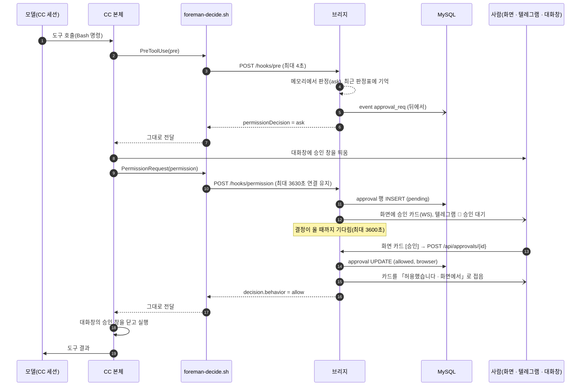

<!--
다루는 곳: bridge/approvals.py, bridge/api/approvals.py, bridge/api/hooks.py, scripts/foreman-decide.sh, deploy/hooks/foreman-hooks.json, migrations/0010_approval.sql, bridge/hookmiss.py, bridge/roleguard.py
읽은 커밋: eea3bd7
-->
# 기다리는 길: hook 두 개

FOREMAN의 승인은 두 단계로 나뉜다. 먼저 「이 도구 호출을 사람이 봐야 하나」를 정하는 단계가 있고, 그다음 「사람이 볼 때까지 기다렸다가 답을 돌려주는」 단계가 있다. 무엇을 묻고 무엇을 통과시키는지, 즉 규칙 자체는 → 「규칙: 실행과 글자」 편이 다룬다. 이 편은 그 규칙이 「물어라」라고 정한 뒤에 일어나는 일, 곧 승인 하나가 어떤 길을 지나 어디서 끝나는지를 다룬다.

그 길에는 Claude Code(아래 CC)가 부르는 hook 두 개가 놓여 있다. hook은 CC가 정해진 순간마다 바깥 프로그램을 불러 「이렇게 해도 되나」를 물어보는 고리다. 첫째는 도구를 쓰기 직전마다 불리는 PreToolUse, 둘째는 승인 창이 뜰 때 불리는 PermissionRequest다. 둘 다 같은 스크립트 `scripts/foreman-decide.sh`가 받아 브리지(FOREMAN의 서버 프로세스)에 넘기고, 브리지가 돌려준 답을 CC에 그대로 전한다 [code:scripts/foreman-decide.sh].

이 편의 핵심은 세 가지다. 하나, PreToolUse는 모든 도구 호출 앞에 서기 때문에 4초 안에 답해야 하고, 그래서 판정은 메모리에서 끝내고 DB 기록은 뒤로 미룬다. 둘, PermissionRequest가 기다리는 동안에도 터미널(화면에서 「대화창」이라 부르는 그 세션의 CC 창)에는 승인 창이 이미 떠 있다. 그래서 「브리지가 결정을 쥐고 있다」가 아니라 「화면, 대화창, 시간 초과 가운데 먼저 온 쪽이 정한다」가 된다. 셋, 기다림은 브리지 메모리 안에만 있어서 브리지를 다시 띄우면 끊긴다.

## 한 번의 승인이 지나는 길

먼저 전체 흐름을 그림으로 본다. 위험한 명령 하나(예를 들어 FOREMAN 운영 DB를 비우는 명령)가 승인 창을 띄우고, 사람이 옆 패널의 승인 카드에서 [승인]을 누르는 경우다.

사람이 화면이 아니라 대화창에서 먼저 답하면 그림의 13~15 대신 다른 길로 풀린다. CC가 바로 실행해 버리고, 그 도구 결과가 트랜스크립트(CC가 남기는 대화 기록 파일)에 적히면 브리지가 그것을 읽고 기다리던 hook을 풀어 준다. 아무도 답하지 않으면 3600초 뒤 시간 초과로 풀린다. 이 세 갈래를 아래에서 하나씩 본다.

## 첫째 hook: PreToolUse, 4초 안에 판정한다

### 왜 4초인가

PreToolUse는 위험한 명령에만 불리는 것이 아니다. 파일 하나 읽기, `git status` 한 번까지 모든 도구 호출 앞에서 불린다. hook 설정의 matcher가 `*`이기 때문이다 [code:deploy/hooks/foreman-hooks.json]. 실측 20일 동안 세 프로젝트의 도구 호출이 약 9,700건이었다 [log:stage5_approval_result.md]. 여기서 판정이 1초씩만 늦어도 세션 전체가 눈에 띄게 느려진다.

그래서 시간 제한을 두 겹으로 걸었다. `foreman-decide.sh pre`는 curl을 `-m 4`, 즉 4초 제한으로 부르고, CC의 hook 설정은 그보다 조금 긴 6초다 [code:scripts/foreman-decide.sh] [code:deploy/hooks/foreman-hooks.json]. 스크립트가 먼저 포기해야 CC가 hook을 강제로 끊는 일 없이, 「판정 없음」이라는 깔끔한 결과로 끝난다. 4초는 판정이 걸리는 시간이 아니라 「브리지가 아무리 늦어도 이 이상은 세션을 붙잡지 않는다」는 상한이다. 실제 판정은 메모리 안에서 끝나 왕복 약 25ms였다 [log:stage5_approval_result.md].

이 제한은 판정에 덧붙는 일에도 걸린다. 승인 창에 「무엇을 대상으로」 한 줄 요약을 붙이는데(→ 「승인 요약」 편), 요약을 만들 때 지울 디렉토리의 파일 수를 세는 일은 0.3초 안에서만 한다. PreToolUse가 4초 안에 답해야 하기 때문이다 [docs:00_design.md].

### 판정은 메모리에서, 기록은 뒤에서

`/hooks/pre`에 요청이 오면 `ApprovalManager.pre_tool_use`가 차례로 본다 [code:bridge/api/hooks.py] [code:bridge/approvals.py]. 먼저 승인 규칙과 상관없이 늘 막는 것들(스키마 잠금, 다른 저장소 쓰기, `pgrep -f` 자기 걸림, 막도록 정한 역할 규칙)을 보고, 걸리면 곧바로 `deny`를 돌려준다. 이것들은 → 「글이 아니라 권한으로」 편이 다룬다. 그다음 승인 정책(`config/approval.toml`)으로 `allow`, `ask`, `pass` 가운데 하나를 정한다.

늘 막는 판정 가운데 하나가 도중에 예외(코드가 예상하지 못한 오류)로 멈추면, 브리지는 그 호출을 판정 없이 통과시키고 「판정 없이 지났다」는 한 줄만 따로 남긴다. 전에는 이 예외가 브리지의 서버 오류(500)로 나갔고, 스크립트가 오류면 통과하는 규칙대로 지나가 어디에도 흔적이 없었다. 통과라는 결과는 같지만 이제 그 사실이 남는다 [code:bridge/approvals.py] [code:bridge/hookmiss.py]. 역할 규칙을 보는 판정이 예외로 멈출 때도 같다. 그 호출은 역할 규칙 없이 다음 검사로 넘어가고, 「역할 판정 중 예외」라는 한 줄이 따로 남는다 [code:bridge/approvals.py] [code:bridge/roleguard.py]. 이 기록은 아래 「브리지가 꺼져 있으면」에서 함께 본다.

이 과정에서 DB를 기다리는 곳은 없다. 판정 결과를 `event` 표에 `approval_req`로 남기는 일은 `_bg()`로 따로 띄운 작업이 하고, 판정 함수는 그 작업이 끝나기를 기다리지 않고 바로 답을 돌려준다. 기록이 실패해도 판정은 바뀌지 않는다. 코드 주석이 이 원칙을 「기록 실패가 판정을 바꾸지 않는다」고 적어 둔다 [code:bridge/approvals.py].

DB를 읽는 곳은 둘 있다. 하나는 역할 권한이 켜져 있을 때 세션 역할을 읽는 일이다. 도구 호출마다 DB를 치지 않도록 세션마다 읽은 역할을 60초 동안 기억해 두고, 그 사이에는 메모리에서 꺼낸다. 못 읽으면 「역할 없음」으로 판정하고, 역할 규칙이 그 호출에서 빠졌다는 한 줄(역할 읽기 실패)을 따로 남긴다 [code:bridge/api/hooks.py] [code:bridge/roleguard.py]. 다른 하나는 `git push`가 보일 때다. 다른 저장소 push는 원본 폴더의 관리자에게만 열려 있어서 그 세션의 역할과 worktree 여부를 DB에서 읽는다. 이것은 push가 보일 때만 읽고, 못 읽으면 예외를 던지지 않고 「역할 없음」(막힘 쪽)으로 간다 [code:bridge/approvals.py].

### 판정이 남기는 기억: 최근 판정표

PreToolUse는 판정하면서 한 가지를 기억해 둔다. 「세션 id, 도구 이름, 입력 전체의 SHA-1」을 열쇠로 삼아 그 호출의 `tool_use_id`, 판정, 요약을 `recent`라는 표에 넣는다. 표는 최대 4,096개까지만 두고 오래된 것부터 버린다 [code:bridge/approvals.py].

이 표가 필요한 까닭은 둘째 hook 때문이다. PermissionRequest 입력에는 `tool_use_id`가 없다. 실측에서 PreToolUse 입력에는 `tool_use_id`, `prompt_id`, `permission_mode`, `scratchpad_dir`가 있었고, PermissionRequest에는 `prompt_id`는 있는데 `tool_use_id`가 빠져 있었다 [log:stage5_approval_result.md]. 그래서 승인 창이 뜨면 「바로 앞 PreToolUse 가운데 같은 세션, 같은 도구, 같은 입력」을 이 표에서 찾아 둘을 잇는다. 이으면 어느 규칙 때문에 창이 떴는지 알고, 나중에 대화창에서 답했을 때 그 도구의 결과를 알아볼 수 있다.

### 돌려주는 답 네 가지

| 판정 | CC에 돌려주는 것 | CC가 하는 일 |
|---|---|---|
| 막음(잠금, 다른 저장소, pgrep, 역할) | `permissionDecision: deny` + 이유 | 실행하지 않고 이유를 모델에게 보낸다 |
| 정책 `allow` | `permissionDecision: allow` | 묻지 않고 실행한다 |
| 정책 `ask` | `permissionDecision: ask` + FOREMAN, 요약, 규칙 이름과 이유를 이은 글 | 대화창에 승인 창을 띄운다 |
| `pass`, 관찰(observe) 프로젝트, 브리지 꺼짐 | 아무것도 없음(본문 없는 204) | CC가 원래 하던 대로 정한다 |

`ask`의 이유 글은 「무엇을 대상으로」가 맨 앞이다. 승인 창에서 사람이 가장 먼저 보아야 할 것이 명령 원문이 아니라 대상이기 때문이다. 규칙 이름과 이유는 대괄호 안에 뒤로 뺐다 [code:bridge/approvals.py].

프로젝트가 관찰 모드면 판정은 똑같이 하고 `event`에 남기지만 CC에는 아무것도 돌려주지 않는다. 이 기록을 쌓아 두었다가 사람이 「이 프로젝트를 강제(enforce)로 올려도 되겠다」고 판단하는 근거로 쓴다. 지금 강제 모드는 FOREMAN과 ronanlab-infra 둘이고, 런슈즈와 펫퍼민트는 관찰 모드다 [code:config/approval.toml].

### 브리지가 꺼져 있으면: 허용 쪽으로 새지 않는다

`foreman-decide.sh`는 토큰이 없거나, 브리지가 꺼져 있거나, 오류가 나거나, 4초가 지나면 아무것도 출력하지 않고 종료 코드 0으로 끝난다 [code:scripts/foreman-decide.sh]. CC 공식 문서는 hook이 판정 없이 끝나면 「도구 호출이 보통 권한 흐름을 그대로 탄다」고 적는다. 즉 브리지가 없을 때 CC는 FOREMAN이 없던 때처럼 스스로 정한다. 브리지가 죽었다고 모든 것이 허용으로 바뀌지도, 모든 것이 막히지도 않는다.

다만 이것을 「안전하다」로만 읽으면 안 된다. 브리지가 꺼진 동안에는 FOREMAN의 `ask` 규칙이 하나도 걸리지 않는다. 네 프로젝트가 모두 자동 모드(auto mode, CC의 분류기가 알아서 허용하는 모드)로 돌기 때문에 [log:foreman-4_notion_judgment_20261117.md], 그 사이 위험한 명령은 분류기 판단만으로 지나갈 수 있다. 브리지가 꺼진 것을 알아채는 일은 이 스크립트가 아니라 브리지를 돌리는 systemd와 브리지 바깥의 감시가 맡는다(→ 「브리지가 뜨는 차례」). systemd가 브리지 다시 띄우기를 끝내 포기하면, 브리지 코드에 기대지 않는 따로 된 스크립트가 텔레그램을 보낸다. 브리지 자체가 망가져 알림을 못 보내는 때에도 소식이 가게 하려는 것이다 [log:foreman-6_bridge_alert_20261115.md].

### 판정 없이 지난 호출은 한 줄씩 남긴다

통과는 설계지만, 통과했다는 사실까지 조용히 사라지면 「브리지가 몇 시간째 판정을 못 하고 있다」를 아무도 모른다. 그래서 판정 없이 지나는 갈래마다 저장소의 `.run/hook_miss.log`에 한 줄을 남긴다. 스크립트 쪽 갈래는 토큰 없음, 연결 거부, 시간 초과, 인증 실패, 서버 오류, 그 밖의 연결 오류, 빈 본문, 쓸 수 없는 본문이고, 브리지 쪽 갈래는 승인 판정기가 꺼져 있거나 아직 준비되지 않음, 세션 역할 읽기 실패, 늘 막는 판정 중 예외, 역할 판정 중 예외, 스크립트가 이미 포기한 뒤에야 끝난 늦은 판정이다 [code:scripts/foreman-decide.sh] [code:bridge/hookmiss.py] [code:bridge/api/hooks.py]. 브리지가 「판정하지 않기로」 정해 본문 없이 답한 204는 정상 길이라 남기지 않는다. 브리지가 받은 본문을 JSON으로 읽지 못하거나 JSON 객체가 아니어서 400으로 거절할 때는 두 곳에 남는다. 브리지 로그에는 거절한 까닭(JSON이 아님, 객체가 아님과 받은 꼴의 이름)이 값 없이 남고, 스크립트는 그 400을 「그 밖의 연결 오류」 갈래로 기록 파일에 한 줄 남긴다 [code:bridge/api/hooks.py] [code:scripts/foreman-decide.sh].

한 줄에는 시각, 출처(스크립트인지 브리지인지), 갈래, 까닭(오류 종류나 걸린 시간처럼 코드가 만든 값), 세션 id, 도구 이름만 들어간다. 명령 글과 입력 값은 쓰지 않는다. 그 안에 비밀값이 섞여 있을 수 있기 때문이다. 세션 id와 도구 이름도 정해진 글자 꼴에 맞을 때만 적고, 아니면 `-`로 둔다. 파일은 1MB를 넘으면 한 벌만 옆으로 돌려 두어, 오래 쌓여도 두 벌을 넘지 않는다. 브리지가 꺼져 있어도 스크립트가 직접 쓰므로 기록은 남는다. 정상으로 판정을 받은 호출에서는 아무것도 쓰지 않아, 평소 길이 느려지지 않는다.

이 기록을 넣는 과정에서 한 번 거꾸로 된 일이 있었다. 세션 id와 도구 이름을 뽑으려고 스크립트가 입력을 먼저 셸 변수에 담아 두었다가 브리지에 넘기게 바꿨는데, 이 판은 실행 환경에 따라 입력을 제대로 읽지 못해 브리지에 빈 본문이 갔다. 브리지는 그 호출을 판정하지 못했고, 스크립트는 규칙대로 통과시켰다. 판정을 빠뜨리지 않으려고 넣은 기록이 오히려 판정을 빠뜨린 셈이다. 새 기록 파일에 같은 꼴의 오류가 줄줄이 찍혀서 금방 드러났고, 스크립트를 먼저 옛 판으로 되돌린 뒤 다시 고쳤다 [c:1d303b9] [log:foreman-4_hook_bytes_20261115.md].

고친 판은 입력을 어디에도 담지 않는다. 받은 입력을 한 바이트도 바꾸지 않고 그대로 브리지로 흘려 보내고, 그 흐름의 앞부분만 곁가지로 떼어 세션 id와 도구 이름을 뽑는다. 임시 파일도 만들지 않는다. 받은 바이트와 보낸 바이트가 하나라도 다르면 실패하는 시험을 여러 입력 꼴과 두 가지 실행 환경에 대해 두었다 [c:58f9f03] [code:scripts/foreman-decide.sh] [log:foreman-4_hook_bytes_20261115.md].

토큰은 `.env.bridge`의 `FOREMAN_HOOK_TOKEN` 하나만 읽는다. 다른 열쇠와 나눈 까닭은 → 「열쇠와 비밀」 편에 있다. 헤더는 `-H @<(printf …)` 프로세스 치환으로 넘긴다. 명령줄 인자로 넘기면 `ps` 목록에 토큰이 보이기 때문이다 [code:scripts/foreman-decide.sh].

## 실측: 자동 모드에서도 ask는 승인 창을 띄운다

이 설계 전체가 기대는 사실이 하나 있다. 네 프로젝트 모두 자동 모드인데, PreToolUse가 `ask`를 돌려주면 분류기가 아니라 사람이 본다는 것이다. 이것이 거짓이면 FOREMAN의 승인 규칙은 자동 모드에서 아무 효과가 없다.

CC 공식 문서(permission-modes)는 「자동 모드에서 PreToolUse hook의 ask는 그 도구 호출을 권한 창으로 보내고, 분류기는 그것을 정하지 않는다」고 적는다 [docs:00_design.md]. 그래도 문서만 믿지 않고 시험용 세션(probe)을 따로 띄워 CC 2.1.316, 자동 모드에서 직접 확인했다 [log:stage5_approval_result.md].

| 시험 | 결과 |
|---|---|
| PreToolUse `ask` + PermissionRequest `allow` | 승인 창이 뜨고, PermissionRequest가 불리고, 승인됨(기록상 결정 출처가 `hook`) |
| PermissionRequest `deny` + 이유 | 거부됨, 이유 글이 모델에게 감 |
| PreToolUse `allow` | 적용됨(`accept / hook`) |
| PermissionRequest가 8초 기다림 | 3초 시점에 대화창에 승인 창이 이미 떠 있다. hook이 빈손으로 끝나면 창은 그대로 남는다 |
| 기다리는 중 대화창에서 Yes | 즉시 진행(`user_temporary`). 20초째 기다리던 hook과 무관하다 |

셋째 줄은 일부러 확인한 것이다. CC 실행 파일 안에 「자동 모드에서는 hook이 승인할 수 없다」는 문구가 있어서 `allow`가 무시될까 걱정했는데, 실제로는 적용됐다. 그 문구는 별칭 맞추기 같은 특정 조건에 걸리는 것으로 보았다. 넷째, 다섯째 줄이 이 편의 나머지 설계를 정했다. 승인 창은 hook이 결정을 돌려주기 전부터 이미 떠 있고, 사람이 그 창에서 먼저 답하면 hook은 결정권을 잃는다.

실제로 쓰면서도 같은 결과가 나왔다. FOREMAN을 만드는 세션 하나(트랜스크립트 461줄 모두 `permissionMode`가 `auto`)에서 FOREMAN의 `ask` 26건이 모두 승인 창으로 떴다 [docs:00_design.md].

문서에 없는 것은 기대지 않기로 했다. bypassPermissions, acceptEdits 모드에서 `ask`가 어떻게 되는지, hook의 `allow`가 자동 모드 분류기를 건너뛰는지, `claude -p`에서 `ask`가 어떻게 되는지는 확인하지 않았다. 또 공식 문서(permissions)에 따르면 hook의 `allow`는 사용자 설정의 deny, ask 규칙을 넘지 못한다. FOREMAN의 허용은 「사람 설정이 막은 것까지 열어 주는」 힘이 없다 [docs:00_design.md].

## 둘째 hook: PermissionRequest, 기다리는 동안 창은 이미 떠 있다

### 승인 창이 뜨면 생기는 일

승인 창이 뜨는 까닭은 둘이다. FOREMAN 정책이 `ask`를 돌려줬거나, CC가 스스로 묻기로 했거나(자동 모드 분류기, 사용자 설정). 어느 쪽이든 CC는 PermissionRequest hook을 부르고, `foreman-decide.sh permission`이 그것을 브리지의 `/hooks/permission`으로 넘긴다 [code:bridge/api/hooks.py].

`permission_request`는 먼저 그 프로젝트가 원격 승인(`remote_approval`)을 켰는지 본다. 꺼져 있으면 바로 아무것도 돌려주지 않고 대화창 창에 맡긴다. 켜져 있으면 최근 판정표에서 짝이 되는 PreToolUse를 찾는다. 찾았고 그 판정이 `ask`였으면 규칙 이름과 이유를 그대로 쓰고, 못 찾았거나 판정이 `ask`가 아니었으면 규칙 이름을 `cc`, 이유를 「CC가 묻는다」로 적는다. CC 자체가 띄운 창에도 요약 한 줄을 붙인다. 규칙이 아니라 명령을 보고 만드는 요약이라 가능하다 [code:bridge/approvals.py].

그다음 일은 순서가 중요하다.

1. `approval` 표에 `pending` 행을 넣고 그 id를 받는다. 이 id가 화면 카드, 텔레그램, 결정 API가 모두 가리키는 승인 번호다.
2. 메모리에 `asyncio.Future`(「나중에 값이 채워질 빈 상자」)를 하나 만들어 `waiting[id]`에 둔다. `tool_use_id`를 알면 `by_tool_use[tool_use_id] = id`도 둔다.
3. 화면으로 `approval pending` 메시지를 보낸다(WS). 그 세션 패널에 승인 카드가 뜬다.
4. 텔레그램으로 「🔐 승인 대기」를 보낸다. 요약, 명령, 규칙, 그리고 「60분이 지나면 대화창으로만」이라는 안내가 들어간다.
5. 빈 상자가 채워질 때까지, 최대 `wait_s`초 기다린다 [code:bridge/approvals.py].

기다리는 동안 `foreman-decide.sh`의 curl은 HTTP 연결을 열어 둔 채 브리지의 답을 기다리고, CC는 그 hook이 끝나기를 기다린다. 그러나 앞의 실측대로 그 사이에도 대화창에는 승인 창이 떠 있고, 사람은 언제든 거기서 답할 수 있다. 브리지가 쥔 것은 결정권이 아니라 「결정할 수 있는 또 하나의 자리」다.

### 왜 기다리는 쪽을 hook에 두었나

처음 설계는 PreToolUse에서 `allow`와 `ask`만 돌려주면 된다고 보았다. 실측해 보니 승인 창이 뜬 뒤의 결정은 PermissionRequest hook의 몫이었다 [log:stage5_approval_result.md]. 화면이나 다른 기기에서 승인을 받으려면 누군가 CC 안의 승인 창에 답을 넣어야 하는데, tmux로 키를 눌러 넣는 길은 창 모양에 기대야 해서 깨지기 쉽다. PermissionRequest hook은 CC가 공식으로 「이 창의 답을 바깥에서 줄 수 있다」고 열어 둔 자리라서, 화면 결정을 넣는 길로 이것을 골랐다.

대가는 연결 하나를 길게 붙잡는 것이다. 승인 하나마다 curl 프로세스 하나와 브리지 쪽 요청 하나가 최대 한 시간 동안 열려 있다. 브리지는 비동기(asyncio)로 돌아 기다리는 요청이 스레드를 잡지 않으므로, 동시에 몇 건이 기다려도 다른 요청을 막지 않는다.

## 세 갈래 가운데 먼저 온 것이 정한다

빈 상자를 채울 수 있는 곳은 셋이다. 화면의 승인 카드, 대화창, 그리고 시간. 상자는 한 번만 채워진다. `Future`는 이미 값이 들어 있으면 `done()`이 참이 되고, 모든 결정 길이 값을 넣기 전에 이것을 먼저 확인한다. 그래서 늦게 온 결정은 아무것도 바꾸지 못하고 조용히 떨어진다 [code:bridge/approvals.py] [code:bridge/api/approvals.py] [code:migrations/0010_approval.sql].

| 갈래 | 상자를 채우는 곳 | hook이 CC에 돌려주는 것 | `status` | `decided_by` |
|---|---|---|---|---|
| 화면 [승인] | `POST /api/approvals/{id}` → `decide()` | `behavior: allow` | `allowed` | `browser` |
| 화면 [거부] | 같은 API, 거부 이유 글 함께 | `behavior: deny` + 이유 | `denied` | `browser` |
| 질문 카드에서 답 | `POST /api/approvals/{id}/answer` → `answer()` | `allow` + 원래 입력과 고른 답 | `allowed` | `browser` |
| 대화창에서 답 | 트랜스크립트의 도구 결과 → `on_tool_result()` | 없음 | `terminal` | `terminal` |
| 시간 초과 | `asyncio.timeout(wait_s)` | 없음 | `timeout` | `timeout` |
| 브리지 다시 뜸 | 다음 시작 때 `start()` | (연결이 이미 끊김) | `abandoned` | `bridge` |

### 화면 카드

승인 카드는 그 세션의 옆 패널에 뜬다. 카드에는 요약 한 줄이 크게, 명령 전체는 접혀서, 규칙의 이유가 작게 나온다. 버튼은 [승인]과 [거부], 그리고 그 세션을 여는 [세션]이다 [code:bridge/static/js/render.js]. 누르면 `POST /api/approvals/{id}`가 `{"decision": "allow"|"deny", "message": …}`를 보낸다. `message`는 거부 이유로, 최대 255자이고 모델에게 그대로 간다. 모델이 왜 막혔는지 알아야 다른 길을 찾기 때문이다 [code:bridge/api/approvals.py].

API는 API 토큰을 요구한다. 이 길은 원격에서 명령 실행을 허락하는 길이라, 화면을 연 사람이 아니면 부를 수 없어야 한다 [code:bridge/api/approvals.py].

### 대화창

사람이 대화창에서 먼저 답하면 CC는 hook을 기다리지 않고 바로 진행한다. 브리지는 이것을 직접 알 방법이 없다. CC가 「사람이 대화창에서 답했다」고 hook으로 알려 주지 않기 때문이다. 그래서 트랜스크립트를 본다. 트랜스크립트를 적재하는 쪽(assembler)이 도구 결과 줄을 DB에 커밋하고 나면, 그 도구의 `tool_use_id`와 CC가 그 줄에 적은 `permissionDecision`을 `on_tool_result()`로 넘긴다 [code:bridge/assembler.py]. 승인 관리자는 `by_tool_use`에서 그 `tool_use_id`가 기다리는 승인을 찾아 상자를 `("terminal", 결정)`으로 채운다 [code:bridge/approvals.py].

이렇게 하면 기다리던 hook이 풀려 아무것도 돌려주지 않고 끝난다. CC는 이미 진행했으므로 그 hook의 답은 쓸 데가 없다. 실측에서 대화창에서 먼저 Yes를 누른 경우 3.2초 만에 `terminal`(CC 기록 `accept`)로 닫혔다 [log:stage5_approval_result.md].

이 길은 `tool_use_id`가 이어져 있어야만 작동한다. 최근 판정표에서 짝을 못 찾은 승인(예를 들어 브리지가 다시 떠서 표가 비었을 때 뜬 CC 자체 창)은 대화창에서 답해도 브리지가 알아채지 못하고, 시간 초과까지 기다린다.

### 텔레그램은 알림이지 결정 자리가 아니다

텔레그램으로 가는 「🔐 승인 대기」에는 누르는 버튼이 없다. 메시지는 「확인 페이지에서 승인, 거부, 또는 대화창에서」라고 안내하고, 실제 결정은 화면 카드나 대화창에서 한다 [code:bridge/approvals.py]. 텔레그램 쪽에 버튼(인라인 키보드)을 받는 코드는 없다. 텔레그램은 「사람이 화면을 보고 있지 않을 때 승인이 기다린다는 것을 알리는 길」이다.

같은 까닭으로 결정이 나도 텔레그램 메시지는 거두지 않는다. 보낸 메시지를 고치거나 지우는 코드는 없다. 결정이 났는지는 화면 카드나 승인 이력에서 본다.

### 나머지를 거두는 방법

먼저 온 결정이 상자를 채우면 `finally` 갈래가 그 승인에 딸린 메모리를 모두 치운다. `waiting`, `questions`, `answers`, `notes`, `by_tool_use`에서 그 id를 뺀다 [code:bridge/approvals.py]. 그 뒤에 늦게 온 결정은 다음처럼 거둬진다.

화면 카드는 결정이 나면 `approval resolved` 메시지를 받아 「허용했습니다 · 화면에서」, 「터미널에서 답했습니다」, 「시간 초과」 같은 한 줄로 접힌다 [code:bridge/static/js/render.js]. 메시지가 오기 전에 누가 [승인]을 눌렀다면 `decide()`가 상자가 없거나 이미 찼다는 뜻의 `gone`을 돌려주고, API는 409와 함께 「이미 결정됐거나(터미널, 시간 초과) 기다리는 요청이 없다」를 돌려준다. 브리지 로그에도 「브라우저 결정 거절」로 남긴다. 카드는 그 거부 사유를 빨간 글로 붙인다 [code:bridge/api/approvals.py] [code:bridge/static/js/store.js].

대화창 승인 창은 화면에서 먼저 정하면 CC가 hook의 `allow`나 `deny`를 받고 스스로 닫는다. 대화창에서 이미 답했다면 hook이 빈손으로 끝나도 CC는 아무것도 하지 않는다. 늦은 hook 답이 이미 끝난 일을 뒤집는 일은 없다.

### 둘이 같이 기록하던 경주

처음 만들 때 시험에서 한 번 걸린 것이 있다. 대화창 답을 알아챈 쪽과 기다리던 쪽이 둘 다 `approval` 행을 닫으려 했고, 먼저 쓴 쪽이 대화창 결정 값(`terminal_decision`) 없이 행을 닫아 버렸다 [log:stage5_approval_result.md]. 그래서 결정을 기록하는 곳을 기다리던 쪽(`permission_request`) 한 곳으로 모았다. `on_tool_result()`는 상자만 채우고 기록하지 않는다. 코드 주석이 「기록은 기다리던 쪽이 한 번만」이라고 적는다. 기록하는 `_finish()`도 `WHERE status = 'pending'`으로만 고쳐 써서, 이미 닫힌 행을 두 번 덮지 않는다 [code:bridge/approvals.py].

## 시간 초과 때 무엇이 되나

### 세 겹의 시간 제한

기다림에는 시간 제한이 세 겹 걸려 있고, 안쪽이 반드시 먼저 끝나도록 길이를 맞췄다 [code:config/approval.toml] [code:scripts/foreman-decide.sh] [c:1724c25].

| 자리 | 값 | 어디에 |
|---|---|---|
| 브리지가 결정을 기다리는 시간 | 3600초 | `config/approval.toml`의 `wait_s` |
| 스크립트 curl이 응답을 기다리는 시간 | 3630초 | `scripts/foreman-decide.sh`의 `max` |
| CC가 hook을 기다리는 시간 | 3660초 | 사용자 설정 `~/.claude/settings.json` PermissionRequest `timeout` |

순서가 바뀌면 일이 꼬인다. CC가 먼저 hook을 끊으면 브리지는 연결이 사라진 줄 모르고 계속 기다리다가 나중에 시간 초과를 기록한다. curl이 브리지보다 먼저 끊으면 브리지가 정한 결정이 CC에 닿지 못한다. 브리지가 가장 먼저 포기해야 「시간 초과」가 한 곳에서 깔끔하게 정해진다. 셋 가운데 CC 쪽 값은 저장소 밖 사용자 설정이라 코드가 맞출 수 없다. 그래서 `approval.toml`의 `wait_s` 주석에 「바꾸면 스크립트와 사용자 설정도 그보다 길게」를 적어 두었다 [code:config/approval.toml].

저장소의 hook 견본 `deploy/hooks/foreman-hooks.json`에는 PermissionRequest `timeout`이 한동안 900초로 남아 있었다. 실제로 쓰는 사용자 설정(3660초)보다 짧아, 견본을 그대로 다시 깔면 CC가 15분에 hook을 끊고 위에서 말한 「브리지만 모르고 기다리는」 꼴이 될 뻔했다. 지금 견본은 3660초로 맞춰져 있고, 시험이 지킨다. 시험은 브리지 기다림 < 스크립트 curl 기다림 < 견본의 CC 한도 순서가 깨지면 실패한다 [code:deploy/hooks/foreman-hooks.json] [code:tests/test_hook_timeouts.py].

### 10분에서 60분으로

처음에는 10분(600초)이었다. 승인 창이 뜬 뒤 10분이면 사람이 볼 것이라고 보았고, 그 뒤엔 대화창 창만 남아도 막히는 것은 없다고 판단했다 [log:stage5_approval_result.md]. 실제로는 사람이 화면을 계속 보고 있지 않아 10분 안에 놓치는 일이 잦았다. 그래서 3600초로 늘렸고, 시간이 지나면 그 사실을 텔레그램으로 한 번 알리게 했다 [c:1724c25].

### 시간이 지나면

`asyncio.timeout`이 터지면 결과는 `timeout`이 된다. 브리지는 텔레그램으로 「⏰ 승인 대기 시간이 지났습니다」를 보낸다. 요약 한 줄과 함께 「60분 동안 답이 없어 화면 승인을 닫았습니다. 이제 그 세션의 대화창에서만 답할 수 있습니다」라고 적는다 [code:bridge/approvals.py]. `approval` 행은 `timeout`, `decided_by = timeout`으로 닫히고, 화면 카드도 접힌다.

hook은 아무것도 돌려주지 않고 끝난다. 이것이 중요하다. 시간 초과는 거부도 허용도 아니다. hook이 빈손으로 끝나면 대화창의 승인 창이 그대로 남는다는 것이 실측이었다 [log:stage5_approval_result.md]. 세션은 그 창 앞에서 계속 멈춰 있고, 사람이 대화창에서 답할 때까지 아무것도 실행되지 않는다. 「답이 없으면 허용」으로 하면 사람이 자는 사이 위험한 명령이 지나간다. 「답이 없으면 거부」로 하면 모델이 다른 우회로를 찾으러 나설 수 있다. 둘 다 버리고 「사람이 올 때까지 멈춤」을 골랐다.

화면 카드에는 이 상태가 「시간 초과(CC가 기본값대로 정했습니다)」라고 나온다 [code:bridge/static/js/render.js]. 여기서 「기본값」은 CC의 보통 권한 흐름, 곧 대화창 창을 뜻한다.

### 멈춘 채로 잊히지 않게

시간 초과 뒤 남은 대화창 창은 브리지 쪽에서 보면 「기다리는 승인이 없는데 세션이 멈춰 있는」 상태다. 이것이 조용히 남지 않도록 멈춤 감시가 쉬는 세션의 화면을 본다. 결정 창이 떠 있는데 브리지가 기다리는 승인이 없으면 2분 뒤 알린다. 다만 마지막 승인이 30분 안의 `timeout`이면 브리지가 이미 「대화창에서만」 알림을 보냈으므로 화면에만 띄운다 [log:plan_approve_mode_20261114.md]. 자세한 것은 → 「03 세션 지켜보기와 글 넣기」.

### 나중에 답한 것은 거꾸로 안다

시간 초과나 재시작 뒤에 사람이 대화창에서 답하면 그 답은 `approval` 행에 들어가지 않는다. 이미 닫힌 행이고, 기다리는 상자도 없기 때문이다. 대신 승인 이력은 그 도구가 실행됐는지를 보고 결과를 거꾸로 짐작한다. `outcome()`이 같은 `tool_use_id`의 `tool_result` 이벤트를 찾아, 오류 없이 왔으면 「승인」, 오류였으면 「거부」, 결과가 없으면 「모름」으로 센다 [code:bridge/api/approvals.py]. 오류는 「거부」와 「실행했는데 실패」를 가르지 못한다는 한계가 코드 주석에 적혀 있다.

## 브리지를 다시 띄우면 기다림이 끊기는 까닭

### 기다림은 메모리 안에만 있다

기다리는 승인에 필요한 것은 거의 다 브리지 프로세스 메모리에 있다. 빈 상자(`waiting`), `tool_use_id`와 승인 번호의 짝(`by_tool_use`), 질문의 선택지(`questions`), 최근 판정표(`recent`). 그리고 무엇보다 `foreman-decide.sh`의 curl이 열어 둔 HTTP 연결 자체가 그 프로세스에 붙어 있다 [code:bridge/approvals.py].

브리지가 내려가면 연결이 끊긴다. curl은 오류로 끝나고, 스크립트는 오류면 아무것도 출력하지 않고 0으로 끝나는 규칙대로 빈손으로 끝난다. 이때 판정 없이 지났다는 한 줄이 기록 파일에 남는다 [code:scripts/foreman-decide.sh]. CC는 hook이 판정 없이 끝났으니 대화창 창을 그대로 둔다. 다시 뜬 브리지는 그 승인에 답을 돌려줄 길이 없다. 돌려줄 연결이 이미 없기 때문이다. DB에 기다림을 적어 두는 것만으로는 이 연결을 되살릴 수 없다. 그래서 기다림을 DB로 옮겨 재시작을 견디게 하는 길은 택하지 않았다.

### 다시 뜰 때 정리

다시 뜬 브리지는 시작하면서 `start()`를 부른다. `status = 'pending'`인 행을 모두 `abandoned`, `decided_by = bridge`로 닫는다 [code:bridge/approvals.py]. 시작 로그에 「승인 정책 켬: … (끊긴 대기 N건 정리)」로 몇 건을 정리했는지 남는다 [code:bridge/main.py]. 화면 카드는 「브리지가 다시 떠서 정리했습니다」로 접힌다 [code:bridge/static/js/render.js]. 대화창 창은 남아 있으니 사람은 거기서 답하면 된다.

끊긴 뒤의 일도 정리해 둔다. 옛 카드를 누르면 상자가 없으므로 409가 돌아온다. 질문 카드는 선택지를 메모리에 두었기 때문에 선택지를 잃고 「대화창에서 답합니다」로 바뀐다 [code:bridge/static/js/render.js]. 최근 판정표도 비었으므로, 재시작 직전의 PreToolUse에 이어 뜬 승인 창은 규칙 이름 대신 `cc`로 기록되고 `tool_use_id`도 이어지지 않는다.

### 그래서 승인 대기 0을 본 뒤 다시 띄운다

이런 까닭으로 운영 규칙은 「브리지를 다시 띄우기 전에 승인 대기가 없는지 본다」다. `/api/dashboard`의 승인 대기 목록이 비어 있는지 확인한 뒤 `systemctl --user restart foreman-bridge`를 한다 [docs:operations.md]. 승인 대기가 있는데 다시 띄우면 그 승인은 화면에서 사라지고 대화창 창만 남는다. 사람이 그 사실을 모르면 세션은 대화창 창 앞에서 조용히 멈춘다. 다시 띄우는 차례와 그때 지키는 것들은 → 「브리지가 뜨는 차례」.

## 허용의 모양이 다른 두 도구

대부분의 도구는 화면 [승인]을 `{"behavior": "allow"}` 하나로 돌려주면 된다. 사람에게 무언가를 입력받는 창을 띄우는 도구 둘은 그것만으로는 끝나지 않는다 [code:bridge/approvals.py].

질문(AskUserQuestion)은 승인이 아니지만 같은 길로 받는다. CC가 질문 창을 띄울 때도 PermissionRequest가 불리기 때문이다. 규칙 이름은 「질문」, 카드는 「❓ 세션이 묻습니다」, 텔레그램은 질문과 선택지를 그대로 보낸다. 패널에서 고르면 `answer()`가 원래 입력 전체에 `answers`(질문 글 → 고른 선택지 이름, 여러 개는 쉼표로 이음)를 붙여 `updatedInput`으로 돌려준다. 답과 함께 쓴 글은 `annotations`의 `notes`로 들어간다. 이 질문을 정책에서 빼지 않은 까닭은, 빼면 질문이 대화창에만 떠서 알림이 없고 턴도 끝나지 않아 세션이 조용히 멈추기 때문이다 [docs:00_design.md].

계획 승인(ExitPlanMode)은 `updatedInput` 없는 `allow`를 CC가 결정으로 받지 않는다. 패널이 허용해도 대화창 계획 승인 창이 그대로 남아, 브리지는 「허용됨」으로 카드를 닫는데 세션은 멈춰 있는 일이 실제로 세 번 있었다 [log:silent_finish_20261114.md] [docs:00_design.md]. 그래서 `allow_decision()`은 이 도구에 원래 입력과 함께 모드를 자동 모드로 되돌리는 `setMode`를 붙인다. 대화창의 기본 선택 「1. Yes, and use auto mode」와 같은 결과다. 그 경위는 승인 흐름보다 세션 지켜보기 쪽 이야기라 → 「03 세션 지켜보기와 글 넣기」가 이어서 다룬다.

## 승인 기록이 DB에 남는 모양

### 무엇을 어디에 남기나

판정과 승인은 세 곳에 남는다 [code:bridge/approvals.py] [code:migrations/0010_approval.sql].

| 어디 | 언제 | 무엇 |
|---|---|---|
| `event` (`type = approval_req`) | 모든 PreToolUse 판정, 자동 통과와 pass까지 | 판정, 규칙, 이유, 모드, 강제 여부, CC 권한 모드, 요약, 역할 규칙 관찰 |
| `approval` | 승인 창이 떠서 PermissionRequest가 온 것만 | 아래 표 |
| `event` (`type = approval_res`) | 승인 하나가 닫힐 때 | 승인 번호, 결과, 규칙, 거부 이유 |

`approval` 표는 「사람이 답해야 했던 것」만 담는다. 자동으로 지나간 수천 건까지 이 표에 넣으면 승인 이력이 소음에 묻힌다. 「무엇이 자동으로 통과됐나」는 `event`의 `approval_req`로 따로 볼 수 있다 [code:config/approval.toml].

### approval 표

`migrations/0010_approval.sql`이 만든 칸과 뜻이다 [code:migrations/0010_approval.sql].

| 칸 | 뜻 |
|---|---|
| `id` | 승인 번호. 화면 카드, 텔레그램, 결정 API가 이것으로 가리킨다 |
| `session_id`, `turn_id` | 어느 세션의 어느 턴에서 떴나 |
| `tool_use_id` | 이어진 PreToolUse의 도구 호출 id. 못 이었으면 빈칸 |
| `tool`, `target` | 도구 이름과 대상(명령, 경로 등). 대상은 비밀값을 가린 뒤 최대 1024자 |
| `rule`, `reason` | 걸린 규칙과 이유. CC 자체가 띄운 창이면 `cc` |
| `status` | `pending`, `allowed`, `denied`, `terminal`, `timeout`, `abandoned` |
| `decided_by` | `browser`, `terminal`, `timeout`, `bridge` |
| `message` | 거부 이유나 질문에 고른 답. 최대 255자 |
| `terminal_decision` | 대화창에서 답했을 때 CC가 트랜스크립트에 적은 결정(`accept`, `reject`) |
| `created_at`, `decided_at` | 뜬 시각과 닫힌 시각(밀리초까지) |

나중에 `summary` 칸(최대 512자)이 `reason` 뒤에 붙었다. 승인 창의 한 줄 요약을 같은 글로 남기는 칸이다 → 「승인 요약」 [code:migrations/0013_approval_summary.sql].

색인은 셋이다. `(status, created_at)`은 「지금 기다리는 것」과 재시작 때 `pending`을 찾는 데, `(session_id, created_at)`은 세션별 승인과 멈춤 감시가 「이 세션에 기다리는 승인이 있나」를 보는 데, `tool_use_id`는 승인 이력이 도구 결과와 맞대는 데 쓴다.

질문 카드에서 고른 답도 `message` 칸에 들어간다. 칸이 255자라 긴 질문 뒤의 답이 잘려 사라질 수 있어서, 질문 글을 80자로 먼저 줄이고 「질문 → 답」 꼴로 적는다 [code:bridge/approvals.py].

### 이 기록으로 하는 일

승인 이력(`/api/approvals/history?days=1|7|30`)이 이 표를 읽는다. 규칙마다 몇 번 걸렸고 몇 번 승인, 거부, 모름이었는지 세고, 3번 이상 걸렸는데 한 번도 거부하지 않은 규칙을 「늘 허락함, 묻지 않게 바꿀 후보」로 표시한다. 관찰 모드 프로젝트에서 「걸렸을 것」(창을 띄우지 않은 ask)도 `event`에서 따로 센다 [code:bridge/api/approvals.py].

이 숫자가 규칙을 다시 정하는 근거가 되었다. 승인 이력 전체 65건 가운데 거부는 1건이었고, 그마저 승인 창을 시험하려고 일부러 거부한 것이었다. 실제 작업 중 거부는 0건이었다 [log:stage5_approval_result.md]. 「65번 물어 0번 거부했다면 그 65번은 안전이 아니라 소음이었다」는 판단으로 묻는 규칙을 크게 좁혔다. 그 이야기는 → 「규칙: 실행과 글자」.

`approval_req`와 `approval_res` 이벤트는 다른 이벤트와 같은 적재 길을 탄다(→ 「적재와 내보내기」). 기록이 실패해도 판정과 결정은 이미 CC에 돌아간 뒤라 바뀌지 않는다. 반대로 `approval` 행을 넣는 INSERT는 기다림을 시작하기 전에 꼭 성공해야 한다. 승인 번호가 없으면 화면도 텔레그램도 그 승인을 가리킬 수 없기 때문이다.

## 남은 빈틈

브리지가 꺼진 동안 FOREMAN의 `ask` 규칙이 하나도 걸리지 않는 것은 여러 편에 걸리는 한계라 → 「17 알려진 한계」에 모았다. 「이것이 막히면 스스로 알리는가」라는 물음에 대한 답은 이 편의 코드가 아니라 브리지 바깥의 감시가 쥐고 있다. 지금은 판정 없이 지난 호출이 기록 파일에 남고, systemd가 다시 띄우기를 포기하면 텔레그램이 간다 [log:foreman-6_bridge_alert_20261115.md].
