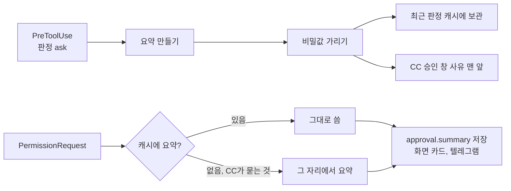

<!--
다루는 곳: bridge/approval_summary.py, migrations/0013_approval_summary.sql
읽은 커밋: e5d584b
-->
# 승인 요약

승인을 물을 때 FOREMAN은 걸린 명령을 통째로 보여 주기 전에 「이 명령이 무엇을 대상으로 하는가」를 한 줄로 먼저 보여 준다. 이 한 줄이 승인 요약이다. 이 편은 그 한 줄을 왜 만들었는지, 명령에서 무엇을 읽고 디스크에서 무엇을 재는지, 못 알아볼 때 무엇을 내는지, 그리고 시간 제한 안에서 어떻게 멈추는지를 다룬다. 어떤 명령이 승인 대상이 되는지(규칙)는 → 「규칙: 실행과 글자」, 물은 뒤 답을 기다리고 돌려주는 길은 → 「기다리는 길: hook 두 개」에서 다룬다.

## 왜 한 줄인가

승인 창에는 원래 명령 원문이 그대로 나왔다. Claude Code(아래 CC) 세션이 치는 Bash 명령은 사람이 치는 명령보다 훨씬 길다. 변수를 정하고, `&&`로 대여섯 단계를 잇고, 중간에 heredoc(`<<'EOF'`로 여는 여러 줄 글)으로 파이썬 스크립트를 통째로 넣는다. 그런 명령이 승인 창에 그대로 뜨면 사람은 끝까지 읽지 않는다. 읽지 않은 채 [승인]을 누르게 되고, 그러면 묻는 의미가 없다 [code:migrations/0013_approval_summary.sql].

사람이 승인할지 말지 정하는 데 실제로 필요한 것은 명령 전체가 아니라 대상이다. `rm -rf`라면 무엇을 지우는지, 그것이 방금 이 명령이 만든 임시 폴더인지 아니면 파일 천 개가 든 기존 폴더인지가 판단의 전부다. `kubectl delete`라면 어느 네임스페이스(쿠버네티스 안에서 자원을 나누는 칸)의 무엇을 지우는지, DB 문이라면 어느 컨테이너의 어느 표인지가 판단의 전부다. 그래서 요약은 명령을 줄이는 것이 아니라 명령에서 대상을 뽑아 그 대상의 상태를 덧붙인다 [code:bridge/approval_summary.py].

요약은 규칙 이름이 아니라 명령 자체를 본다. 이렇게 한 까닭은 승인을 묻는 쪽이 FOREMAN 규칙만이 아니기 때문이다. CC 자체도 auto mode 분류기나 자기 설정에 따라 묻는다. 그런 물음은 FOREMAN 규칙 이름이 없어서 규칙 이름만 보는 요약이라면 아무것도 못 쓴다. 명령을 보기 때문에 CC가 묻는 것(규칙 이름 `cc`)에도 같은 요약이 붙는다 [code:bridge/approvals.py].

## 한 줄이 쓰이는 곳

같은 한 줄을 네 곳에 쓴다. 한 번 만들어 네 곳이 같은 글을 보게 해서, 텔레그램에서 본 것과 화면에서 본 것이 어긋나지 않게 했다 [code:bridge/approvals.py] [c:e002b6e].

| 곳 | 어떻게 보이나 |
|---|---|
| CC 승인 창 | PreToolUse hook 응답의 `permissionDecisionReason` 맨 앞. `FOREMAN <요약>  [규칙: 이유]` 꼴로 규칙 이름과 이유는 뒤로 민다 |
| 텔레그램 알림 | 둘째 줄에 `▶ <요약>`, 그 아래 `명령:`으로 원문을 120자까지 |
| 화면 승인 카드 | `▶ <요약>` 줄이 위에 크게, 원문은 접힌 「명령 전체」 안에 |
| 승인 이력 | DB `approval.summary` 칸. 이력 목록 한 줄이 이 값이다(없으면 원문 앞 160자) |

화면 카드에서 원문을 지우지 않고 접어 둔 것은 일부러다. 요약은 대상을 뽑는 기계 추측이라 틀릴 수 있다. 의심이 들면 펼쳐서 원문을 볼 수 있어야 한다. 텔레그램도 같은 까닭으로 원문을 짧게나마 함께 보낸다. 요약이 없으면(아래 「못 만들 때」) 카드와 알림은 예전처럼 원문만 보인다 [code:bridge/static/js/render.js].

DB 칸은 마이그레이션 하나로 더했다. `approval` 표의 `reason` 뒤에 `summary VARCHAR(512) NULL`을 붙인 것이 전부다 [code:migrations/0013_approval_summary.sql]. 요약 자체는 300자에서 자르고(`MAX = 300`), DB에 넣을 때는 512자에서 한 번 더 자른다 [code:bridge/approval_summary.py]. 비어 있을 수 있게(`NULL`) 둔 것은 요약을 못 만든 승인도 그대로 기록돼야 하기 때문이다.

## 언제 만드나

요약은 판정이 「묻는다(ask)」일 때만 만든다. 통과(allow)나 무관(pass)인 명령에는 만들지 않는다. 사람이 볼 일이 없는 것에 디스크를 뒤지는 비용을 쓰지 않기 위해서다 [code:bridge/approvals.py].

CC는 승인을 두 hook으로 나눠 부른다. 먼저 PreToolUse에서 FOREMAN이 판정을 내리고, 사람에게 물어야 하면 PermissionRequest가 이어서 온다. 요약은 PreToolUse에서 만들어 세션, 도구, 입력을 열쇠로 하는 최근 판정 캐시에 판정과 함께 넣어 둔다. PermissionRequest가 오면 그 캐시에서 꺼내 쓴다. 캐시에 없다는 것은 FOREMAN 규칙은 통과시켰는데 CC가 스스로 묻는 경우라서, 그때는 그 자리에서 규칙 이름 `cc`로 다시 만든다 [code:bridge/approvals.py]. 관찰 모드(묻지 않고 걸렸을 것만 세는 프로젝트)에서도 판정이 ask면 요약을 만들어 이벤트 기록에 남긴다. 나중에 「걸렸다면 무엇이었나」를 이력에서 읽을 수 있게 하기 위해서다.

만든 요약은 바로 비밀값 가리기(마스킹)를 거친다. 요약에는 파일 경로나 명령 조각이 들어가는데, 그 안에 토큰이 섞여 있으면 텔레그램과 DB에 그대로 나가기 때문이다. 요약기 자체는 비밀값을 모르고, 가리는 일은 브리지의 공통 마스크가 한다 [code:bridge/approvals.py] [code:bridge/mask.py].

## 무엇을 재나

요약기는 명령을 몇 가지 종류로 나눠 보고, 앞에서부터 맞는 것이 나오면 그 결과를 쓴다. 차례는 DB 문, rm, kubectl, docker, git이다. DB 문을 먼저 보는 까닭은 `echo 'DROP DATABASE x;' | docker exec … mysql`처럼 DB 문이 docker 명령 안에 들어 있을 때 docker 요약이 먼저 잡으면 정작 중요한 `DROP`이 사라지기 때문이다 [code:bridge/approval_summary.py].

그 전에 두 가지를 먼저 걸러 낸다. 첫째, heredoc 본문은 셸 명령으로 읽지 않는다. 본문을 `<<HEREDOC` 표시로 바꾼 명령 줄만 본다. 둘째, 비밀 파일이나 안전 규칙 파일 규칙(`민감한-경로`, `보호-설정파일`)에 걸렸으면 판정 이유 끝 괄호 안에 적힌 명령과 경로로 바로 요약한다.

### rm: 무엇을 지우나, 그것은 지금 무엇인가

`rm`과 `rmdir`이 가장 깊게 본다. 명령을 `&&`, `||`, `;`, `|`, 줄바꿈으로 조각내고, 조각마다 맨 앞의 `V=값`, `sudo`, `nice`, `nohup`, `command`를 걷어 낸 뒤 첫 낱말이 `rm`이면 그 뒤의 옵션과 대상을 모은다. 대상은 처음 셋만 자세히 보이고 나머지는 「외 N개」로 줄인다 [code:bridge/approval_summary.py].

대상 하나하나는 다음 차례로 판정한다. 같은 명령 안에서 `D=$(mktemp -d)`처럼 정한 변수는 「이 명령에서 mktemp로 만든 것」이라고 적는다. mktemp는 이름이 겹치지 않는 새 임시 파일이나 폴더를 만드는 명령이라, 이것으로 만든 것을 지우는 것은 자기가 어질러 놓은 것을 치우는 일이다. `${D:?}`처럼 비었으면 멈추게 쓴 꼴도 같은 변수로 알아본다. 같은 명령 안에서 글자 그대로 정한 변수(`A=/srv/cache`)는 값을 넣어 실제 경로로 푼다. 이 명령 안에서 정하지 않은 변수나 `$(…)`, 백틱 치환은 값을 알 수 없으니 「이 명령 안에서 값을 모른다」고 솔직하게 적는다.

경로를 얻으면 `~`를 풀고, 상대 경로는 hook이 알려 준 작업 폴더(cwd)를 기준으로 절대 경로로 만든다. 그 다음 디스크를 실제로 본다.

| 상태 | 붙는 말 |
|---|---|
| `*`, `?`, `[`가 든 경로 | 글롭(여러 파일에 한꺼번에 맞는 무늬) |
| 심볼릭 링크 | 심볼릭 링크 |
| 있는 폴더 | 기존 디렉토리, 파일 N개 (세다 멈췄으면 N+개) |
| 있는 폴더인데 세다 오류 | 기존 디렉토리 |
| 있는 파일 | 기존 파일 |
| 없음 | 지금은 없음 |

폴더라면 안에 든 파일 수를 세어 붙인다. 사람이 겁을 먹어야 할지 정하는 데 이 숫자가 가장 크게 작용한다. 「기존 디렉토리, 파일 3개」와 「기존 디렉토리, 파일 5,000+개」는 같은 `rm -rf`여도 무게가 전혀 다르다. 「지금은 없음」도 쓸모가 있다. 판정하는 순간에는 아직 없는, 앞 단계에서 곧 만들어질 빌드 결과물 같은 것이라는 뜻이기 때문이다 [code:bridge/approval_summary.py].

### kubectl: 어느 네임스페이스의 무엇을

`kubectl`의 `delete`, `drain`, `cordon`, `scale`을 본다. 네임스페이스는 동사 앞뒤 어디에 있든 `-n`, `--namespace`, `--namespace=`에서 찾고, 없으면 「기본 네임스페이스」라고 적는다. 네임스페이스를 늘 적는 것은 같은 이름의 pod가 개발과 운영 양쪽에 있을 수 있어서다. `kubectl delete pod web-0 web-1`처럼 종류와 이름을 띄어 쓰면 `pod/web-0, pod/web-1`로 묶어 보인다. `-l`(라벨로 고르기)은 「라벨 app=web」으로, `-f 파일`은 「deploy.yaml에 적힌 것」으로, `--all`은 「전부」로, `-A`는 「모든 네임스페이스」로 덧붙인다. 자원은 넷까지 보인다 [code:bridge/approval_summary.py]. 명령이 `vagrant ssh 노드 -c "kubectl …"`처럼 다른 명령의 따옴표 안에 있어도 찾는다.

### docker: 컨테이너인가 볼륨까지인가

`docker`와 `docker compose`의 `rm`, `rmi`, `prune`, `volume rm`, `volume prune`, `network rm`, `system prune`, `image prune`, `down`을 본다. 이름을 넷까지 보이고, 이름이 없는 prune 계열은 「조건에 맞는 것 전부」라고 적는다. `docker compose down`은 따로 다룬다. `-v`나 `--volumes`가 붙으면 「볼륨까지 지운다」, 아니면 「컨테이너」다. 볼륨은 DB 데이터가 사는 곳이라 이 차이 하나가 승인 판단을 가른다 [code:bridge/approval_summary.py].

### DB 문: 어느 표를, 어느 컨테이너에서

`DROP DATABASE/TABLE/SCHEMA`, `TRUNCATE TABLE`, `DELETE FROM`, Redis의 `FLUSHALL`과 `FLUSHDB`, `dropdb`를 대소문자 가리지 않고 찾는다. `DELETE FROM`에 `WHERE`가 없으면 「WHERE 없음, 전부」를 덧붙인다. 조건 없는 DELETE는 표를 통째로 비우는데 글로는 `TRUNCATE`보다 덜 무서워 보이기 때문이다. 같은 명령에 `docker exec 컨테이너`나 `kubectl exec 이름 --`가 있으면 그 이름을 「컨테이너 …」로 붙여, 개발 DB인지 운영 DB인지 이름으로 가릴 수 있게 한다 [code:bridge/approval_summary.py].

### git: 어떤 동작을, 어느 저장소에서

`push`, `reset`, `clean`, `checkout`, `restore`, `branch`, `stash`, `filter-branch`, `filter-repo`, `reflog`, `gc`를 보고, 동사 뒤 인자를 120자까지 그대로 붙인다. `git -C 경로`로 다른 저장소를 가리켰으면 그 경로를 괄호로 붙인다. 이 프로젝트에서는 한 사람이 여러 저장소를 동시에 돌리기 때문에, 강제 push가 어느 저장소에서 일어나는지가 판단에 필요하다 [code:bridge/approval_summary.py].

### Bash가 아닌 도구와 질문

Write, Edit, MultiEdit, NotebookEdit, Read는 경로가 대상이다. 동사를 「쓰기」, 「고치기」, 「읽기」로 바꾸고, 경로가 비밀 파일 규칙에 걸렸으면 「비밀 파일」, 안전 규칙 파일이면 「안전 규칙 · 설정 파일」, 아니면 지금 있는지 보고 「기존 파일」이나 「새 파일」을 붙인다. 경로가 없는 다른 도구는 `도구: 이유`로 쓴다. CC가 사람에게 묻는 질문(AskUserQuestion)은 승인이 아니라서 대상 대신 첫 질문 글을 「질문: …」으로 보이고, 질문이 여럿이면 「질문 N개: …」로 쓴다 [code:bridge/approval_summary.py] [c:650f0a0].

## 실제 요약 예

아래는 작업 폴더를 `/home/user/app`으로 두고 요약기를 직접 돌린 결과다(경로와 이름은 가짜다). 왼쪽이 세션이 친 명령, 오른쪽이 승인 창 맨 앞에 뜨는 한 줄이다.

| 명령 | 요약 |
|---|---|
| `rm -rf build logs/*.log /home/user/old` | `rm -rf → /home/user/app/build (지금은 없음), /home/user/app/logs/*.log (글롭), /home/user/old (지금은 없음)` |
| `W=$(mktemp -d) && cp a "$W/" && rm -rf "${W:?}"` | `rm -rf → $W (이 명령에서 mktemp로 만든 것)` |
| `rm -rf "$TARGET"` | `rm -rf → $TARGET (변수, 이 명령 안에서 값을 모른다)` |
| `rm a b c d e` | `rm → /home/user/app/a (지금은 없음), /home/user/app/b (지금은 없음), /home/user/app/c (지금은 없음) 외 2개` |
| `rm -rf data` (파일 셋이 든 폴더) | `rm -rf → /home/user/app/data (기존 디렉토리, 파일 3개)` |
| `kubectl delete pod web-0 web-1 -n shop` | `kubectl delete → pod/web-0, pod/web-1 (shop 네임스페이스)` |
| `kubectl -n shop delete -l app=web pods` | `kubectl delete → pods (shop 네임스페이스, 라벨 app=web)` |
| `kubectl delete -f deploy.yaml` | `kubectl delete → deploy.yaml에 적힌 것 (기본 네임스페이스)` |
| `docker compose down -v` | `docker compose down → 볼륨까지 지운다 (-v)` |
| `docker system prune -af` | `docker system prune → 조건에 맞는 것 전부 (-af)` |
| `echo 'DROP DATABASE x;' \| docker exec -i app-mysql-dev mysql` | `DROP DATABASE x (컨테이너 app-mysql-dev)` |
| `mysql -e "DELETE FROM users;"` | `DELETE FROM users (WHERE 없음, 전부)` |
| `git -C ~/r push --force origin main` | `git push --force origin main (~/r)` |
| `cat .env.prod` (비밀 파일 규칙) | `읽기(cat) → /home/user/app/.env.prod (비밀 파일)` |
| Write `config/approval.toml` | `쓰기 → /home/user/app/config/approval.toml (안전 규칙 · 설정 파일)` |
| `sudo reboot` | `재부팅-종료 → sudo reboot` |

마지막 줄처럼 아는 종류가 아니면 규칙 이름과 명령 앞부분이 나온다. 이것이 다음 절의 「못 만들 때」다.

## 요약을 못 만들 때

요약은 승인을 돕는 덧붙임이지 승인의 조건이 아니다. 그래서 어떤 경우에도 요약 때문에 판정이 막히거나 늦어지면 안 된다는 것을 가장 먼저 지켰다. 이것은 세 겹으로 되어 있다 [code:bridge/approval_summary.py] [code:bridge/approvals.py].

첫째, 종류별 요약 함수(DB, rm, kubectl, docker, git)를 하나씩 부를 때마다 예외를 잡는다. 하나가 터지면 그 종류만 건너뛰고 다음 종류를 본다. 둘째, 명령을 낱말로 나누는 `shlex.split`이 따옴표가 짝이 안 맞아 실패하면 공백으로만 나눠서라도 계속한다. 시험이 `rm -rf "unterminated`처럼 깨진 명령에도 무언가를 내는지 본다 [code:tests/test_approval_summary.py]. 셋째, 요약 전체를 감싼 브리지 쪽에서 무슨 예외든 잡아 로그에 「승인 요약 실패」를 남기고 요약 없음(`None`)으로 넘어간다. 그러면 승인 창, 카드, 알림은 요약 줄 없이 원문만 보이는 예전 모양으로 돌아가고, DB 칸은 `NULL`로 남는다.

아무 종류에도 맞지 않으면 다음 차례로 물러선다. heredoc 본문이 있으면 「`<규칙> → python 스크립트 안에서 걸림 (본문 N줄, 대상은 본문을 직접 본다)`」을 낸다. 판정 이유 끝에 괄호로 적힌 조각이 있으면 「`<규칙> → <그 조각>`」을 낸다. 그것도 없으면 `cd `로 시작하지 않는 첫 명령 조각을 「`<규칙> → <조각>`」으로 낸다. `cd`를 건너뛰는 것은 대부분의 명령이 `cd 어디 && 진짜 일`로 시작해서, 첫 조각을 그대로 보이면 아무 정보가 없기 때문이다.

### heredoc 본문을 읽지 않게 된 까닭

처음 요약기는 heredoc 본문까지 셸 명령으로 읽었다. 그러자 세션이 파이썬 스크립트를 heredoc으로 넣고 그 안에 `subprocess.run(f"rm -rf {SP}/shots")`를 쓰자, 요약기가 `f"rm`을 rm 명령으로 읽어 「frm (변수…)」 같은 엉뚱한 요약을 냈다. 사람에게는 무엇을 지운다는 건지 알 수 없는 줄이었다 [code:tests/test_approval_summary.py] [c:0ecb1e7].

길은 둘이었다. 본문의 언어를 알아보고 파이썬이면 파이썬대로 읽는 길, 그리고 본문은 아예 뽑지 않는 길이다. 앞의 길은 해석기마다 따로 짜야 하고 틀릴 여지가 더 많다. 틀린 대상을 자신 있게 보이는 것이 대상을 모른다고 말하는 것보다 위험하다고 보고 뒤의 길을 골랐다. 규칙 검사는 여전히 본문까지 하지만, 요약은 셸 명령 줄만 본다. 걸린 것이 본문 안이면 「스크립트 안에서 걸림」이라고만 적어, 사람이 「명령 전체」를 펼쳐 본문을 직접 보게 한다. heredoc 밖의 셸 명령은 그대로 뽑는다. `rm -rf /tmp/zz && cat > notes.md <<'EOF' … EOF`에서는 앞의 rm 대상이 정상으로 나온다.

## 시간 제한

요약은 PreToolUse 안에서 만든다. PreToolUse는 CC가 도구를 실행하기 직전에 부르는 hook이라, 여기서 오래 걸리면 세션 전체가 그만큼 멈춘다. 이 hook을 부르는 스크립트는 브리지 답을 4초까지만 기다리고(`curl -m 4`), 넘기면 아무것도 내지 않고 CC가 스스로 정하게 둔다. CC 쪽 hook 설정 시간 제한은 6초다 [code:scripts/foreman-decide.sh] [code:deploy/hooks/foreman-hooks.json]. 그러니 요약 하나가 4초를 다 쓰면 FOREMAN의 판정 자체가 사라진다.

디스크를 오래 뒤질 수 있는 곳은 rm 대상 폴더의 파일 세기 하나뿐이다. 다른 판정은 문자열을 보는 일이라 순식간에 끝난다. 그래서 파일 세기에만 상한 셋을 두었다 [code:bridge/approval_summary.py].

| 상한 | 값 |
|---|---|
| 걸린 시간 | 0.3초 |
| 센 파일 | 5,000개 |
| 들어간 폴더 | 2,000개 |

`os.walk`로 내려가며 세다가 셋 가운데 하나에 닿으면 바로 멈추고, 그때까지 센 수 뒤에 `+`를 붙인다. 「파일 5,000+개」는 「적어도 5,000개, 그 이상은 안 셌다」는 뜻이다. 사람이 판단하는 데에는 정확한 수보다 「많다」는 것이 중요해서, 정확도를 버리고 시간을 지켰다. 대상이 셋을 넘으면 넷째부터는 세지 않고 「외 N개」로 줄이니, 파일 세기는 한 요약에서 많아야 세 번이다. 최악이어도 약 1초 안에 끝난다. 세다가 권한 문제 같은 오류가 나면 수 없이 「기존 디렉토리」만 적는다.

## 시험

`tests/test_approval_summary.py`가 위 동작을 지킨다. rm 대상(있는 폴더와 파일 수, 없는 것, mktemp, 모르는 변수, 상대 경로를 cwd로), kubectl, docker, DB, git의 정확한 한 줄, 비밀 파일 읽기와 설정 파일 쓰기, 알아보지 못할 때 명령 앞부분으로 물러서기와 깨진 따옴표에도 무언가 내기, heredoc 본문을 셸로 읽지 않기, 질문 요약을 본다 [code:tests/test_approval_summary.py]. 화면 글에서 em dash를 걷어 낼 때 질문 요약의 꼴도 「질문: …」으로 바뀌어 이 시험이 함께 고쳐졌다 [log:foreman-4_server_emdash_20261115.md].
