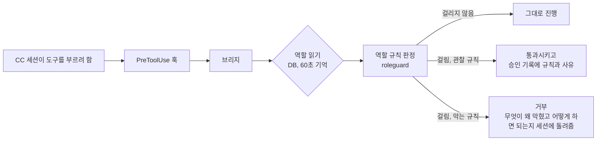
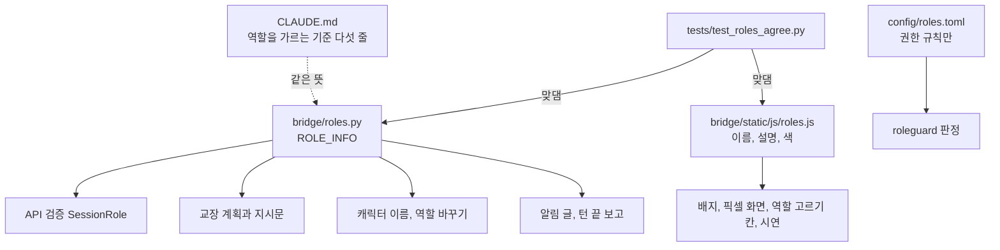

<!--
다루는 곳: bridge/roles.py, config/roles.toml, bridge/static/js/roles.js, docs/roles.md, bridge/roleguard.py, bridge/hookmiss.py
읽은 커밋: a1493f4
-->

# 05 역할과 권한

FOREMAN이 다루는 세션은 모두 같은 Claude Code(CC) 프로그램이다. 같은 모델이 같은 도구를 들고 뜬다. 그런데 사람이 세션에게 맡기는 일은 다르다. 어떤 세션은 코드를 고치고, 어떤 세션은 문서만 맞추고, 어떤 세션은 읽고 알아본 뒤 결과만 남기고, 어떤 세션은 다른 세션이 해 온 일을 거두어 합치고 시험하고 내보낸다. 이 차이를 이름 붙인 것이 역할이다. 이 편은 역할이 무엇이고 왜 다섯으로 나누었는지, 처음에는 글로만 적어 두었던 역할 규칙을 왜 브리지가 직접 보는 권한으로 옮겼는지, 그리고 역할의 이름과 색과 설명을 왜 한 곳에 모았는지를 다룬다. 역할마다 하는 일의 자세한 내용, 권한 검사의 속, 열쇠와 비밀값 다루기는 아래 하위 세 편이 맡는다.

## 역할은 세션에 붙는 꼬리표다

역할은 세션 하나에 붙는 짧은 값이다. DB의 `character_session.role` 칸에 `coder`, `designer`, `manager`, `scribe`, `inspector` 가운데 하나가 들어간다. 이 값 하나로 여러 가지가 갈린다. 화면에서는 세션 머리 위 배지 색과 발밑 원 색, 캐릭터 이름(코더, 관리자 …)이 정해진다. 교장(계획을 세워 주는 창구)이 계획을 낼 때 어떤 역할로 띄울지 고르고, 역할마다 기본 모델이 다르다. 그리고 브리지가 도구 호출을 받을 때마다 이 값을 보고 그 역할이 해서는 안 되는 일인지를 따진다.

역할은 바뀔 수 있다. 세션이 떠 있는 동안 패널 머리줄 배지를 눌러 다른 역할로 옮길 수 있고, 새 세션으로 옮길 때는 역할을 물려준다. 캐릭터와 세션이 다른 것이라는 생각이 바탕이다. 캐릭터는 화면에 서 있는 인물이고, 세션은 그 인물이 지금 맡은 CC 프로세스다. 역할이 바뀌면 세션이 그 역할의 캐릭터로 자리를 옮긴다.

세션으로 고를 수 있는 역할은 다섯이다. 화면에는 세션이 아닌 캐릭터도 있다. 감독실의 감독(`foreman`), 셸 패널의 셸 세션 줄(`helper`, 화면 이름 도우미), 인프라 캐릭터(`infra`)다. 이 셋은 화면에 그리기 위한 값이라 사람이 세션 역할로 고를 수 없다 [code:bridge/roles.py].

## 다섯 역할 한눈에

| 값 | 화면 이름 | 한 줄 설명(역할 고르기 칸과 교장 지시문에 그대로 나간다) | 기본 모델 |
|---|---|---|---|
| `coder` | 코더 | 코드를 고치거나 만듭니다. 그 코드를 가리키는 문서도 함께 고칩니다 | Opus 5.5 |
| `designer` | 디자이너 | 화면을 고칩니다. js, css, 테마, 캐릭터, 호버 글 | Opus 5.5 |
| `manager` | 관리자 | 합치고 시험하고 push하고 기록합니다 | Opus 5.5 |
| `scribe` | 서기 | 문서를 쓰고 맞춥니다 | Opus 5.5 |
| `inspector` | 조사 | 읽고 알아봅니다. 고치지 않고 결과 log만 씁니다. 조사와 제안은 모두 여기입니다 | Sonnet 5.5 |

한 줄 설명은 `bridge/roles.py`의 `ROLE_INFO`에 적힌 글이고 [code:bridge/roles.py], 기본 모델은 `config/models.toml`의 `[defaults]`가 정한다 [code:config/models.toml]. 조사만 Sonnet인 것은 읽고 정리하는 일이 주라서 더 싼 모델로 충분하기 때문이다. 모델을 고르는 근거는 → 「13 사용량과 모델」에서 다룬다.

이 표의 차례도 뜻이 있다. 화면의 역할 고르기 칸이 이 차례로 늘어서고, 첫째인 코더가 기본값이다. 사람이 아무것도 고르지 않고 세션을 띄우면 코더로 뜬다. FOREMAN 밖에서 띄운 CC 세션을 브리지가 처음 알아챌 때도 코더로 붙인다.

## 역할을 가르는 기준

다섯 역할의 기준은 저장소 맨 위 `CLAUDE.md`의 「역할을 가르는 기준」 다섯 줄이다. 코더는 코드를 고치거나 만들고, 그 코드를 가리키는 문서도 함께 고친다. 디자이너는 화면을 고친다. 서기는 문서를 쓰고 맞춘다. 조사는 읽고 알아보며 고치지 않는다. 관리자는 합치고 시험하고 push하고 기록한다 [repo:CLAUDE.md]. 짧지만 이 다섯 줄이 모든 세션이 일을 받을 때 가장 먼저 기대는 선이다.

이 선은 처음부터 다섯이 아니었다. 처음에는 코더 하나와 읽기만 하는 역할 하나가 있었다. 그러다 원본 폴더의 메인 세션이 코드를 직접 고치면서 다른 세션의 일과 엉키는 일이 잦아지자, 남이 해 온 일을 거두는 일만 하는 관리자를 따로 세웠다 [log:manager_role_20261109.md]. 관리자는 코드를 고치지 않는다는 선이 핵심이다. 관리자가 직접 고쳐도 되는 것은 세 가지뿐이다. 합친 뒤 깨진 것을 바로 막는 되돌리기나 몇 줄, 사람이 시킨 설정 값과 기록과 할 일 목록(`docs/TODO.md`)의 줄, 동작이 바뀌지 않는 주석이나 오타다 [repo:CLAUDE.md]. 그 밖은 작아도 작업방(worktree, 원본 폴더와 떨어진 따로 작업 폴더)의 코더에게 맡긴다.

디자이너는 코더에서 갈라져 나왔다. 화면 일(픽셀 화면의 자리와 가구, 패널 모양, 테마 색, 툴팁 글)은 화면 사진을 보고 겹침과 자리를 판단해야 하는 일이라 파이썬과 DB를 다루는 일과 성격이 달랐다 [log:designer_role_20261110.md]. 둘이 걸치는 일(새 API와 그 화면)은 화면이 API에 기대므로 코더를 먼저 띄우고 화면은 다음 디자이너 몫으로 넘긴다.

조사는 이름이 한 번 바뀌었다. 옛 이름은 고치는 일까지 포함하는 것처럼 들려서 읽고 알아보기만 한다는 뜻이 잘 드러나는 조사로 바꿨다 [log:foreman-6_inspector_rename_20261115.md]. 이름과 함께 하는 일도 넓혔다. 전에는 CC의 읽기 전용 모드(plan 모드)로 떠서 결과 log 하나를 쓰려 해도 승인을 한 번 거쳐야 했고, 그래서 관리자가 조사를 피하고 코더로 띄우는 일이 생겼다. 지금은 보통 모드로 뜨고, `log/` 아래 새 파일만 쓸 수 있게 브리지가 막는다. 조사는 결과를 보고하면 스스로 끝난다.

한때 여섯째 역할 `cicd`가 있었다. 빌드와 배포를 맡기려던 역할인데 한 번도 쓰이지 않았다. 운영 DB에서 그 역할로 뜬 세션이 0개였고 [log:cicd_role_removal_20261114.md], 빌드와 배포는 브리지가 기계적으로 하므로 뺐다. 역할은 쓰이는 만큼만 둔다.

역할마다 받는 지시, 관리자의 예외 셋이 실제로 어떻게 걸리는지, 조사가 스스로 끝나는 판정은 → 「역할 다섯」에서 깊게 다룬다.

## 글로만 있던 규칙은 계속 샜다

역할의 선은 처음에 모두 글이었다. `CLAUDE.md`에 "작업방 세션은 커밋만 하고 push하지 않는다", "파일은 Edit와 Write 도구로만 고친다(Bash의 sed나 heredoc으로 고치지 않는다)", "관리자는 코드를 고치지 않는다"고 적어 두고, 세션이 그 글을 읽고 지키기를 바랐다 [repo:CLAUDE.md].

글은 지켜지지 않았다. 작업방 코더에게 push를 하라는 지시서가 간 일이 있었다. 규칙은 "push는 관리자가 합친 뒤에"였지만 지시를 쓴 쪽도 받은 쪽도 그 줄을 떠올리지 못했다. 또 세션이 "Edit와 Write로만" 규칙을 하루에 두 번 어기고 sed와 heredoc(셸에서 여러 줄 글을 파일에 바로 쏟아 넣는 꼴)으로 파일을 고쳤다. 세션이 스스로 밝히기는 했지만 사람이 정리한 결론은 하나였다. 글로만 있는 규칙은 계속 샌다 [c:44d57a4].

Bash로 파일을 고치는 것이 왜 문제인가. Edit나 Write로 고치면 무엇을 어떻게 바꿨는지가 도구 입력에 그대로 남는다. 브리지가 그 입력을 승인 카드에 보여 주고, 기록에 남기고, 필요하면 되돌린다. `sed -i`나 `cat >> 파일 <<EOF`는 셸 명령 한 줄이라 어느 파일의 어디가 바뀌었는지가 명령 글 속에 묻힌다. 사람이 승인 카드를 보고 판단할 수 없고, 나중에 기록을 훑어도 찾기 어렵다. 조용한 고장을 잡으려고 만든 도구에서 바뀐 것이 조용히 지나가는 길이 생기는 셈이다.

그래서 역할 규칙을 브리지가 직접 보는 권한으로 옮겼다. 처음 생각은 세션을 띄울 때 CC에 넘기는 허용 도구 목록(`--allowedTools`, `--disallowedTools`)이었다. 해 보니 맞지 않았다. 막고 싶은 것은 Bash라는 도구 전체가 아니라 Bash 명령 글 속의 특정한 꼴(heredoc, `cd` 뒤의 경로, 작업방 안에서의 `git push`)이었고, CC의 도구 목록 문법으로는 그런 꼴을 쓸 수 없었다 [log:coder_c_wave2_20261111.md]. 그래서 PreToolUse 훅으로 갔다. PreToolUse는 CC가 도구를 실제로 부르기 직전에 브리지에게 "이 호출을 해도 되는가"를 묻는 자리다. 브리지는 이미 이 자리에서 승인 규칙, 다른 저장소 쓰기 막기, 스키마 잠금, `pgrep -f` 함정 막기를 보고 있었다. 역할 규칙도 같은 자리에 두니 끄기와 관찰이 한 설정에 모였다.

지금 규칙은 다섯이다 [code:config/roles.toml]. 작업방 세션의 `git push`(`worktree-push`), Bash로 저장소 파일 고치기(`bash-file-edit`), 관리자가 허용된 곳 밖을 고치기(`manager-code`), 서기가 코드 폴더를 고치기(`scribe-code`), 조사가 `log/` 밖을 쓰기(`inspector-write`)다. 관리자에게 허용된 곳은 설정 파일(`config/*.toml`), 기록(`log/` 아래), 할 일 목록(`docs/TODO.md`) 셋이다(`manager_allow`). `CLAUDE.md`가 관리자에게 허락한 예외 셋 가운데 설정 값, 기록, 할 일 목록의 줄과 같은 범위다. 한때 `README.md`가 이 목록에 있었지만, README는 도구가 만드는 생성물이라 사람이 손으로 고칠 줄이 없어서 빼고 할 일 목록을 넣었다 [code:config/roles.toml] [repo:CLAUDE.md]. 서기가 고치지 않는 코드 폴더는 `bridge/`, `tests/`, `migrations/`, `tools/` 넷이다(`scribe_deny`). 브리지는 세션 역할을 DB에서 읽되 도구 호출마다 DB를 치지 않게 60초 동안 기억한다 [code:bridge/roleguard.py]. 판정 자체가 실패하면 세션을 묶지 않고 통과시킨 뒤 브리지 로그와 시간마다 한 번 텔레그램으로 알린다. 텔레그램은 한 시간에 한 번이라, 실패할 때마다 판정 없는 통과 기록 파일(`.run/hook_miss.log`)에도 한 줄을 남긴다. 줄에는 시각, 오류 종류, 세션 id, 도구 이름만 들어가고 명령 글은 들어가지 않는다. 명령 글에는 비밀값이 섞일 수 있어서다 [code:bridge/roleguard.py] [code:bridge/hookmiss.py] [c:cd14ed6]. 이 파일은 역할 판정만의 것이 아니다. 스키마 잠금, 다른 저장소 막기 같은 다른 막기가 판정 없이 통과할 때와, 브리지가 꺼져 있거나 늦어 훅 스크립트가 답을 못 받을 때도 같은 파일에 한 줄씩 쌓인다. 파일이 1MB를 넘으면 한 벌만 돌려 두고 새로 쓴다 [code:bridge/hookmiss.py]. 훅 스크립트 쪽 갈래는 → 「기다리는 길: hook 두 개」에서 다룬다. 권한 검사가 고장 나서 모든 세션이 멈추는 쪽이 더 나쁘다고 봤다.

### 막지 않고 먼저 지켜보았다

규칙을 만들자마자 막지 않았다. 처음 모드는 관찰(`observe`)이다. 관찰 모드에서는 걸린 호출을 막지 않고 그 호출의 승인 기록(`approval_req` 이벤트)에 걸린 규칙 이름과 사유만 남긴다. 막는 모드(`enforce`)로 올리는 것은 사람이 정한다.

이렇게 한 까닭은 헛걸림이다. 명령 글을 보고 판정하는 규칙은 처음에 반드시 엉뚱한 것을 잡는다. 실제로 지난 7일치 FOREMAN 호출(Bash 6,822, Edit 4,143, Write 455)로 다시 돌려 보니 첫 판은 스크래치 폴더로 `cd`한 뒤 만든 임시 파일, 커밋 글 속의 `>` 글자, `2>/dev/null`의 `2`까지 저장소 파일 고치기로 잡았다 [log:coder_c_wave2_20261111.md]. 이것들을 고친 뒤에야 Bash로 파일 고치기 89건이 모두 규칙이 막으려던 진짜 위반으로 남았다.

관찰을 사흘 넘게 이어 간 뒤 실제 기록을 다시 셌다 [log:inspect_roleguard_20261114.md]. 걸린 것은 31건이었다. Bash 규칙은 10건 모두 진짜 위반이었고(작업방에서 시험 파일을 heredoc이나 `sed -i`로 고친 것), 작업방 push는 0건이었다. 반대로 관리자 규칙은 21건 가운데 20건이 정당한 일이었다. 사람이 직접 `CLAUDE.md`를 고치라고 시킨 것, 사람이 승인한 카드로 docs를 쓴 것, 합친 뒤 깨진 시험 몇 줄을 막은 것이었다. 관리자 규칙을 그대로 막는 모드로 올렸다면 사람이 시킨 일을 브리지가 거부했을 것이다.

이 숫자가 지금 설정의 근거다. 역할 규칙 전체는 관찰 그대로 두었다. 그리고 조사 규칙 하나만 관찰 모드에서도 막게 했다(`enforce = ["inspector-write"]`). 조사가 보통 모드로 뜨게 바꾸면서 조사가 쓸 수 있는 곳을 log로 묶는 것이 전제가 되었기 때문이다. 이 규칙을 빼면 막는 것이 없어지므로, 교장 계획은 조사를 다시 읽기 전용으로 띄운다. 규칙이 막고 있는지를 교장이 직접 묻는 함수(`RoleGuard.enforces`)가 있어 둘이 어긋나지 않는다 [code:bridge/roleguard.py]. 예외가 하나 있다. 사람이 없는 사이에 브리지가 스스로 세우는 자동 기상 계획은 규칙이 막고 있어도 조사를 읽기 전용으로 띄운다. 사람이 자리를 비운 동안 log 커밋이 쌓이지 않게 하려는 것이다 [code:bridge/foreman.py].

규칙마다 어떤 꼴을 어떻게 가려내는지, 다른 저장소 쓰기와 스키마 잠금과 `pgrep -f` 함정과 진행 글 한국어 검사가 승인 모드와 상관없이 늘 도는 까닭, 관찰과 막기의 차이는 → 「글이 아니라 권한으로」에서 다룬다.

### 권한이 못 막는 것

권한으로 옮겼다고 모든 것이 막히지는 않는다. 해석기 안에서 파일을 여는 쓰기(`python -c "open(…,'w')"`)는 보지 않는다. 그렇게 둔 까닭은 → 「17 알려진 한계」에 모았다. 그래서 글 규칙은 그대로 `CLAUDE.md`에 남아 있고, 규칙을 한 번이라도 어겼으면 결과 보고와 log에 반드시 적게 한다. 권한은 글을 대신하는 것이 아니라 글이 새는 가장 흔한 길을 막는 그물이다.

## 역할 값은 한 곳에

역할을 더하거나 이름을 바꿀 때마다 같은 일이 되풀이됐다. 역할의 목록과 화면 이름이 일곱 곳(파이썬 `ROLE_KO` 세 벌, 교장의 `ROLES`, API 검증의 `SessionRole`, 화면 역할 고르기 칸의 `ROLE_PICK`, 화면 이름표의 `ROLE_LABEL`)에, 테마 옷 색이 테마 네 개의 `theme.json`에, 한 줄 설명이 세 곳에 따로 적혀 있었다 [docs:roles.md]. 한 곳을 빠뜨리면 조용히 틀어졌다. 서기 역할이 역할 고르기 칸 목록에서 빠져 있던 때, 교장이 서기 계획을 내도 계획 카드 칸이 첫 값인 코더로 보였고 그대로 시작하면 코더로 떴다 [code:bridge/static/js/modelpick.js]. 오류도 경고도 없었다. 데이터 모델의 역할 목록(`bridge/models.py`의 `Role`)은 서기, 관리자, 디자이너가 빠진 채 오래 있었다 [log:foreman-6_aura_all_roles_20261115.md]. 조사로 이름을 바꿀 때도 네 곳을 고쳐야 했다.

사람의 말이 이 작업의 이유를 요약한다. 적어 두지 않으면 다음에 또 흩어진다. 그래서 역할 값을 두 곳으로 모았다 [log:foreman-6_roles_one_place_20261115.md].

| 쪽 | 한 곳 | 들어 있는 것 | 가져다 쓰는 곳 |
|---|---|---|---|
| 파이썬 | `bridge/roles.py` | `ROLE_INFO`(값, 화면 이름, 한 줄 설명). 여기서 `SESSION_ROLES`, `ROLE_KO`, `ROLE_DESC`, `WORKER_ROLES`, 교장 지시문 첫 줄을 만드는 `role_line()`이 나온다. 코더에게만 붙는 문서 규칙 글(`CODER_DOCS_RULE`, `DOCS_RULE_ROLES`)도 여기 있다 | API 검증, 교장 계획과 지시문, 캐릭터 이름과 역할 바꾸기, 알림 글, 턴 끝 보고, 코더 첫 글 끝의 문서 규칙 |
| 화면 | `bridge/static/js/roles.js` | `SESSION_ROLES`, `ROLE_LABEL`, `ROLE_DESC`, `ROLE_COLOR`(배지, 발밑 원, 이름표 글자), `ROLE_CLOTH`(사원증 끈, 로브, 안전모 색) | 패널 배지, 픽셀 화면, 역할 고르기 칸, 시연 페이지 |

코더 문서 규칙은 코드를 고친 세션이 그 코드를 설명하는 문서도 같은 브랜치에서 함께 고치라는 한 문단이다. 역할이 코더일 때만 브리지가 첫 글 끝에 붙이고, 교장 지시문에도 같은 뜻의 줄이 있다 [code:bridge/roles.py] [code:bridge/docrefs.py]. 디자이너와 조사에는 붙이지 않는다. 어느 문서가 걸리는지 찾는 길은 → 「역할 다섯」에서 다룬다.

한 줄 설명은 이제 한 벌이다. 화면의 역할 고르기 칸 글(`modelpick.js`의 `ROLE_PICK`)은 `roles.js`의 이름과 설명을 줄표로 이어 만들고, 교장 지시문의 역할 줄은 `roles.py`의 `role_line()`이 같은 글로 만든다 [code:bridge/roles.py]. 사람이 고르는 칸에서 보는 설명과 교장이 계획을 세울 때 읽는 설명이 같은 글이다. 둘 다 `CLAUDE.md`의 기준 다섯 줄을 화면 말("~습니다")로 옮긴 것이다.

옷 색은 테마가 다른 값이 필요한 역할만 덮어 쓴다. 공통 표는 `ROLE_CLOTH` 하나이고, 공사 현장 테마처럼 감독에게 흰 안전모를 씌워야 하는 테마만 자기 `theme.json`에 그 역할을 적는다. 표에도 테마에도 없는 역할은 배지 색으로 그린다(`clothColor`) [code:bridge/static/js/roles.js]. 새 역할을 더할 때 테마 네 곳을 고치지 않아도 그 역할이 안전모 없이 그려지는 일이 없다.

### 왜 한 곳이 아니라 두 곳인가

한 곳으로 모은다면서 파이썬과 JS에 한 벌씩 둔 것이 이상해 보일 수 있다. 처음 제안은 파이썬에만 두고 화면은 서버에서 받아 쓰는 것이었다 [log:foreman-6_aura_all_roles_20261115.md]. 그렇게 하지 않은 까닭은 화면이 역할 값을 쓰는 때다. 배지 색 CSS는 화면 모듈이 읽히자마자 `<style>`로 들어간다. 픽셀 화면과 패널은 역할 이름을 그 자리에서 바로 꺼내 쓴다. 브리지 없이 도는 시연 페이지와 node 시험도 모듈을 읽는 즉시 값을 쓴다. 서버에서 받아 오게 바꾸면 이 모든 그리기를 응답이 올 때까지 기다리게 고쳐야 한다. 바뀌는 범위가 너무 컸다 [log:foreman-6_roles_one_place_20261115.md].

대신 두 벌이 어긋나지 않게 시험으로 묶었다. `tests/test_roles_agree.py`가 node로 `roles.js`를 읽어 파이썬 쪽과 맞댄다 [code:tests/test_roles_agree.py]. 역할 목록과 차례, 화면 이름, 한 줄 설명이 같은지 보고, 역할마다 배지 색과 옷 색과 네 테마의 옷 색, 기본 모델, 데이터 모델의 역할 값, 교장 지시문의 줄이 다 있는지 본다. 새 역할이 한 곳만 빠져도 시험이 실패한다. 조용히 틀어지던 것을 시끄럽게 실패하게 바꾼 것이 이 작업의 실제 내용이다.

파이썬 쪽을 설정 파일(`config/roles.toml`)이 아니라 모듈로 둔 것도 정한 일이다. 역할 이름은 운영하면서 바꾸는 설정이 아니라 코드가 읽혀 들어갈 때 API 검증 목록과 지시문을 만드는 값이다. 또 `config/*.toml`은 바꿀 때마다 사람 승인 카드가 뜨는 곳이라, 역할 값을 거기 두면 코드 작업 하나에 사람 손이 매번 걸린다 [log:foreman-6_roles_one_place_20261115.md]. 그래서 `config/roles.toml`에는 권한 규칙(무엇을 관찰하고 무엇을 막을지)만 남고, 역할 값은 `bridge/roles.py`에 있다.

## 새 역할을 더하는 순서

값을 모았어도 역할 하나를 더하는 일은 여전히 여러 파일에 걸친다. 모델 기본값, 데이터 모델 값, 권한 규칙, 픽셀 화면의 고정 자리, 시연 장면은 각자 사정이 있어 한 곳으로 모을 수 없었다. 그래서 남은 곳을 순서 목록으로 `docs/roles.md` 3절에 적었다 [docs:roles.md]. 목록은 빠뜨렸을 때의 결과로 둘을 가른다. 빠뜨리면 시험이 실패하거나 거부와 오류가 나는 곳이 있고, 빠뜨려도 시험은 지나가지만 그 역할만 어색하거나 권한이 조용히 풀리는 곳이 있다.

| 차례 | 고칠 곳 | 빠뜨리면 |
|---|---|---|
| 1 | `bridge/roles.py` `ROLE_INFO`에 한 줄 | 시험 실패. API, 교장, 캐릭터 이름, 알림 글이 이것을 따라온다 |
| 2 | `bridge/static/js/roles.js` 목록, 이름, 설명 | 시험 실패 |
| 3 | 같은 파일 `ROLE_COLOR`, `ROLE_CLOTH`(다른 역할과 겹치지 않는 색) | 시험 실패 |
| 4 | `config/models.toml [defaults]` | 시험 실패. 빠지면 CC 설정 모델로 뜬다 |
| 5 | `bridge/models.py` `Role` | 시험 실패 |
| 6 | `tests/js/role_label.test.mjs` 역할 차례 줄 | 시험 실패 |
| 7 | 교장 지시문에 그 역할을 언제 고를지 | 교장이 그 역할을 잘 고르지 못한다 |
| 8 | 쓰기 범위가 있는 역할이면 `config/roles.toml`과 `bridge/roleguard.py` 규칙 | 아무 제한이 없다. 조용히 풀린다 |
| 9 | 턴 끝을 관리자에게 넘기는 역할이면 `WORKER_ROLES` | 그 역할의 보고가 관리자에게 가지 않는다 |
| 10 | 고정 자리가 필요하면 픽셀 화면 자리와 테마 구역 | 일반 자리에 앉는다 |
| 11 | 시연 장면에 그 역할 세션 | 시연에 나오지 않는다 |
| 12 | `CLAUDE.md` 기준 줄과 `docs/roles.md` 표 | 다음 세션이 기준을 모른다 |

8번이 특히 위험하다. 권한 규칙은 역할마다 코드가 따로 있어서, 새 역할에 쓰기 범위를 주려면 `roleguard.py`에 규칙을 새로 짜야 한다. 잊으면 그 역할은 무엇이든 고칠 수 있는 채로 뜨고, 아무도 알려 주지 않는다. 지금은 역할이 많지 않아 규칙마다 코드를 따로 두었다 [log:foreman-6_aura_all_roles_20261115.md].

이름만 바꿀 때는 더 짧다. 1과 2의 화면 이름을 고치고, `roles.py`의 `ROLE_OLD_KO`에 옛 이름을 적고(DB에 남은 옛 이름 캐릭터를 다음 세션이 뜰 때 새 이름으로 이어 쓰게), 화면 말 시험 목록 `tests/data/screen_words.toml`에 한 줄을 더한다. 조사로 이름을 바꿀 때 이 순서를 그대로 밟았다 [code:bridge/roles.py].

## 포기한 것과 남은 것

이 영역에서 일부러 하지 않은 것이 몇 있다. 첫째, 역할 규칙을 띄울 때의 도구 목록으로 막는 길은 버렸다. 명령 글 속 꼴을 볼 수 없어서다. 둘째, 화면 역할 값을 서버에서 내려주는 길은 버리고 JS에 한 벌을 두되 시험으로 묶었다. 셋째, 권한 규칙을 역할마다 쓰기 범위를 적는 표 하나로 올리지 않고 규칙마다 코드를 따로 둔다. 지금은 역할이 많지 않아서다. 그래서 새 역할에 쓰기 범위를 주면서 규칙을 잊으면 그 역할은 무엇이든 고칠 수 있는 채로 뜬다(위 표 8번).

관리자 규칙을 막지 않고 기록만 하는 것, 해석기 안 쓰기를 막지 않는 것, 권한 규칙을 다른 저장소로 넓히지 않은 것은 여러 편에 걸려 → 「17 알려진 한계」에 모았다.

## 하위 편 길잡이

| 편 | 다루는 것 |
|---|---|
| 역할 다섯 | 역할마다 하는 일, 띄울 때 받는 지시, 기본 모델. 관리자는 원본 폴더에 하나만 서고 코드를 고치지 않는다는 선과 예외 셋. 조사가 결과를 보고하면 스스로 끝나는 판정. 역할이 생기고 바뀌고 빠진 까닭 |
| 글이 아니라 권한으로 | PreToolUse에서 보는 것들. 역할 규칙 다섯, 다른 저장소는 읽기만, 스키마는 한 세션만, `pgrep -f`가 자기 셸에 걸리는 함정, 진행 글 한국어 검사. 승인 모드와 상관없이 늘 막는 것과 관찰부터 켜는 것의 차이 |
| 열쇠와 비밀 | 브리지 API 토큰을 관리, 프로젝트, hook, 웹훅 넷으로 가른 까닭. 웹소켓 인증, 비밀값이 든 파일을 Edit와 Write로 고치지 않는 까닭, 비밀값이 화면에 찍혔던 일 |

역할 세 편은 순서대로 읽으면 된다. 첫 편이 무엇을 맡기는지를, 둘째 편이 그 선을 어떻게 지키는지를, 셋째 편이 역할과 상관없이 모든 세션과 사람이 지나가는 문을 다룬다.

세션을 작업방으로 띄우는 길은 → 「06 세션 띄우기와 따로 작업」, 관리자가 작업방을 합치는 길은 → 「07 합치기」, 교장이 역할을 골라 계획을 내는 길은 → 「09 교장과 관리자」에서 다룬다.
