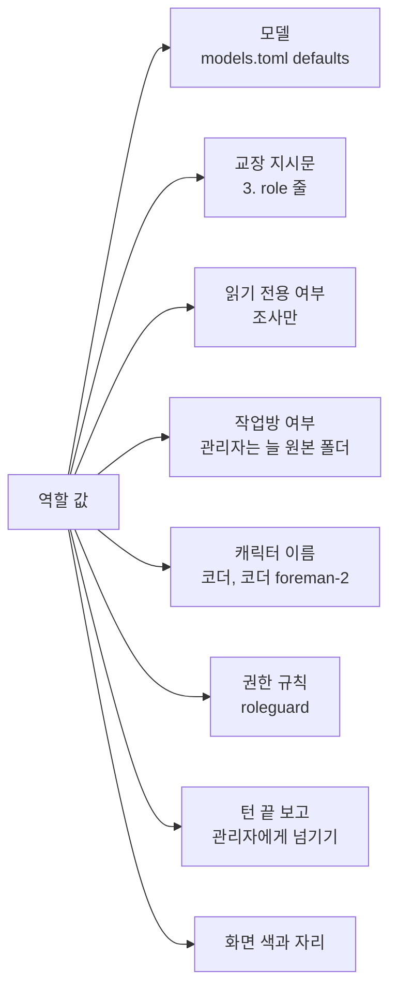

<!--
다루는 곳: bridge/roles.py, config/roles.toml, config/models.toml, bridge/static/js/roles.js, bridge/foreman.py, bridge/inspector_close.py, .claude/agents/Explore.md, bridge/roleguard.py, bridge/hookmiss.py, bridge/docrefs.py, tests/test_inspector_close.py, tests/test_session_role.py
읽은 커밋: fb7121b
-->

# 역할 다섯

FOREMAN이 띄우는 Claude Code(CC) 세션은 모두 같은 프로그램이다. 같은 `claude` 명령으로 뜨고, 같은 저장소를 보고, 같은 도구를 쓴다. 그런데도 세션마다 맡는 일이 다르다. 어떤 세션은 코드를 고치고, 어떤 세션은 문서를 맞추고, 어떤 세션은 읽기만 하고 결과를 적는다. 이 차이를 하나의 값으로 묶은 것이 **역할**이다.

역할은 이름표 하나로 끝나지 않는다. 역할 값 하나가 정해지면 그 세션이 어떤 모델로 뜨는지, 띄울 때 어떤 지시를 받는지, 화면에서 어떤 색 배지와 옷을 입는지, 픽셀 화면의 어느 자리에 서는지, 일을 마친 뒤 누구에게 보고하는지, 그리고 무엇을 할 수 없는지가 줄줄이 따라온다. 이 편은 그 다섯 역할이 각각 무엇을 하는지, 왜 그렇게 나눴는지, 값이 코드 어디에 한 번만 적혀 있는지를 다룬다. 역할마다 무엇을 실제로 막는지(PreToolUse에서 거부하는 규칙)는 → 「글이 아니라 권한으로」 편이 깊게 다룬다.

## 한눈에 보기

세션으로 고를 수 있는 역할은 다섯이다. 표의 순서는 화면 역할 고르기 칸의 순서와 같고, 첫째인 코더가 기본값이다 [code:bridge/roles.py].

| 값 | 화면 이름 | 하는 일(화면과 교장 지시문에 쓰는 한 줄) | 기본 모델 | 배지 색 | 옷 색 |
|---|---|---|---|---|---|
| `coder` | 코더 | 코드를 고치거나 만듭니다. 그 코드를 가리키는 문서도 함께 고칩니다 | Opus 5.5 | `#5b9be6` | `#3f7fd0` |
| `designer` | 디자이너 | 화면을 고칩니다. js, css, 테마, 캐릭터, 호버 글 | Opus 5.5 | `#e8619f` | `#d6408a` |
| `manager` | 관리자 | 합치고 시험하고 push하고 기록합니다 | Opus 5.5 | `#e0604f` | `#c0392b` |
| `scribe` | 서기 | 문서를 쓰고 맞춥니다 | Opus 5.5 | `#d08b4f` | `#b0713a` |
| `inspector` | 조사 | 읽고 알아봅니다. 고치지 않고 결과 log만 씁니다. 조사와 제안은 모두 여기입니다 | Sonnet 5.5 | `#3fbf85` | `#2e9e6a` |

기본 모델은 `config/models.toml`의 `[defaults]`에서 온다 [code:config/models.toml]. 색은 `bridge/static/js/roles.js`의 두 표 `ROLE_COLOR`(배지, 발밑 원, 이름표 글자)와 `ROLE_CLOTH`(로브, 사원증 끈, 안전모 같은 옷)에서 온다 [code:bridge/static/js/roles.js]. 옷 색이 배지 색보다 한 단계 어두운 것은 픽셀 그림 위에서 밝은 배지 색이 떠 보였기 때문이다. 배지와 발밑 원은 같은 색으로 맞췄다. 캐릭터 발밑에 깔리는 원을 보고 역할을 알아보려면 패널의 배지와 같은 색이어야 해서다 [log:role_aura_20261113.md].

세션으로 고를 수 없는 역할 값도 셋 있다. `foreman`은 감독(화면 이름)이다. 감독실에 서 있는 교장, 팀장, 소장 캐릭터이고, 세션이 아니라 계획을 세우는 창구다(→ 09 교장과 관리자). `helper`는 도우미로, 화면 아래 셸 패널에서 연 터미널 셸이 이 역할을 받는다. `infra`는 인프라 캐릭터다. 이 셋은 화면 이름과 색만 있고 역할 고르기 칸에는 나오지 않는다 [code:bridge/static/js/roles.js].

## 역할 하나가 끌고 오는 것

역할이 왜 값 하나로 묶였는지는 세션 하나가 뜰 때 무엇이 역할을 보는지를 따라가면 보인다.

모델은 띄울 때 정해진다. 사람이 [+ 세션] 창이나 교장 계획 카드에서 모델을 직접 고르면 그것을 쓰고, 고르지 않으면 역할 기본값을 쓴다. 기본값도 없으면 `--model` 없이 띄워 CC 설정을 따른다 [code:bridge/handoff.py]. 교장(계획을 세우는 LLM)은 모델을 고르지 않는다. 교장이 낸 계획을 다듬는 단계에서 브리지가 역할 기본값을 채운다 [code:bridge/foreman.py]. 교장에게 모델까지 맡기면 비싼 모델이 필요하다는 판단을 핑계로 역할을 바꾸는 일이 생길 수 있어서, 지시문에 「모델이 더 필요하다고 코더로 고르지 마라(모델은 사람이 카드에서 고른다)」라는 줄을 넣어 두었다 [code:bridge/foreman.py].

캐릭터 이름도 역할에서 온다. 원본 폴더에서 뜬 세션은 그 프로젝트의 역할 캐릭터(코더, 서기, 조사)에 붙고, 작업방(코드 이름 worktree, `.worktrees/<이름>` 폴더와 `cc/<이름>` 브랜치)에서 뜬 세션은 그 자리의 일꾼 캐릭터(예: 코더 foreman-2)에 붙는다. 같은 이름의 캐릭터가 퇴장해 있으면 되살려 쓴다 [code:bridge/handoff.py]. 세션을 띄운 뒤에도 패널 머리줄의 역할 배지를 눌러 역할을 바꿀 수 있는데, 이때 역할만 바꾸면 아래 줄이 코더 캐릭터 이름 옆에 관리자 배지가 붙는 식으로 엇갈린다. 그래서 역할을 바꾸면 그 역할의 캐릭터로 세션을 함께 옮긴다 [log:manager_role_20261109.md]. 세션 제목을 고치는 것으로는 역할이 바뀌지 않는다. 띄운 뒤에 역할을 바꿀 일이 실제로 생겨서 배지로 바꾸는 길은 남겼고, 제목 고치기와는 갈라 두었다 [log:manager_role_20261109.md].

FOREMAN 밖(터미널에서 직접)에서 띄운 CC 세션은 조립기가 늘 코더로 만든다. 밖에서 띄우는 세션 대부분이 코딩 세션이기 때문이다. 아니면 배지로 바꾼다. 그래서 역할이 비어 있는 세션은 실제로 생기지 않고, 화면의 역할 없음 배지(물음표)는 목록에 없는 값을 만났을 때만 보인다 [docs:11_foreman_dispatch.md].

## 코더

코더는 코드를 고치거나 만든다. 새 기능, 버그 고치기, 마이그레이션, 시험 쓰기가 모두 코더 몫이다. 역할을 가르는 기준이 다섯 줄 가운데 가장 짧은 것도 이 때문이다. 다른 넷이 「무엇을 하지 않는가」로 정해지는 데 비해 코더는 저장소 전체를 고칠 수 있는 기본 일꾼이다 [code:CLAUDE.md].

지금 코더는 자기가 고친 코드를 가리키는 문서(docs, 노션 원고, 포트폴리오)도 같은 브랜치에서 함께 고친다. 전에는 코드는 코더가, 그 코드를 설명하는 문서는 뒤에 서기가 따라잡았다. 코더가 고치면 docs가 밀리고, 서기가 docs를 고치면 원고가 밀리고, 그 사이 코드가 또 바뀌어 처음부터 다시 도는 일이 하루에 세 번 있었다. 서기는 코더가 왜 그렇게 고쳤는지 다시 알아내야 했다 [log:foreman-8_docrefs_20261117.md]. 그래서 까닭을 가장 잘 아는 세션이 문서까지 쓰게 했다. 브리지가 코더 세션의 첫 글 끝에 사용자 문장 그대로의 규칙 「네가 고친 코드를 가리키는 문서가 있으면 그 문서도 함께 고친다. 어느 문서가 걸리는지는 거꾸로 찾는 도구로 확인한다. 문서를 고칠 수 없는 이유가 있으면 무엇이 걸리는지 보고한다.」를 붙이고, 어느 문서가 걸리는지 찾는 명령과 문서마다 다른 말투 규칙을 함께 적는다 [code:bridge/roles.py] [code:bridge/docrefs.py] [code:bridge/handoff.py]. 디자이너와 조사에는 붙이지 않는다. 합치기 카드는 안 고친 문서 수를 보여 승인하는 사람이 바로 보게 한다(→ 07 합치기).

자리는 상황에 따라 다르다. 그 프로젝트에 살아 있는 세션이 이미 있으면 작업방에서 뜨고, 없으면 원본 폴더에서 뜬다. 한 계획이 세션 여럿을 띄우면 둘째부터는 첫 세션이 살아 있게 되니 늘 작업방이다 [code:bridge/foreman.py]. 작업방에서 일하는 코더는 커밋만 하고 push하지 않으며, 합치기는 관리자나 사람이 한다(→ 07 합치기).

모델 기본값이 Opus 5.5인 것은 코드를 고치는 일이 판단이 가장 많이 드는 일이어서다. 다만 작은 일이면 사람이 카드에서 Sonnet으로 낮춰 띄운다. 관리자가 코드를 고치지 않게 정할 때 「작으면 sonnet」이라는 말을 같이 붙인 것도 이 길을 가리킨다 [code:CLAUDE.md].

코더는 디자이너, 서기와 함께 **작업 역할**(`WORKER_ROLES`)에 든다. 작업 역할 세션의 턴이 끝나면 그 보고는 사람 화면으로 바로 가지 않고 그 프로젝트의 관리자 세션으로 넘어간다 [code:bridge/roles.py]. 사람에게 올릴 것은 관리자가 골라서 올린다(→ 관리자에게 넘기기와 보고).

## 디자이너

디자이너는 화면을 고친다. js, css, 테마(theme.json의 자리, 가구, 색), 캐릭터, 이름표, 카드, 호버 글이 디자이너 몫이고, 파이썬, 브리지, API, DB는 코더 몫이다 [code:bridge/foreman.py].

디자이너를 코더에서 떼어 낸 까닭은 일의 성질이 달라서다. 화면 일은 사진을 찍어 보고 자리와 겹침을 판단해야 하고, 테마를 고치면 세 테마 모두에서 화면 점검 도구로 문제 0건을 확인해야 한다. 코드 일과 섞어 한 세션에 주면 한쪽이 대충 끝난다. 모델 기본값을 코더와 같은 Opus 5.5로 둔 것도 같은 까닭이다. 사진을 보고 자리와 겹침을 판단해야 하고, 픽셀 화면을 그리는 `office.js`가 커서 작은 모델로는 맥락이 모자란다 [code:config/models.toml].

둘이 걸치는 일(새 API와 그 API를 보이는 화면)은 교장이 나눠서 낸다. 화면이 API에 기대니 코더를 먼저 내고, 코더의 첫 글에 「화면은 다음 디자이너 세션 몫, API 응답 모양을 log에 적고 끝낸다」를 넣는다. 화면 쪽이 몇 줄뿐이면 나누지 않고 코더 하나로 끝낸다 [code:bridge/foreman.py]. 계획은 한 번에 하나라 두 역할을 같은 계획에 차례로 걸어 두지는 못한다. 코더가 끝난 뒤 디자이너 계획을 다시 받는다.

픽셀 화면에서 디자이너는 관리자와 함께 **고정 자리** 역할이다. 일하는 도구에 따라 구역을 옮겨 다니지 않고 테마마다 정해 둔 자리(코더 책상 줄 옆)에 서며, 작업 책상 수에 들지 않는다 [code:bridge/static/js/office.js]. 상주하지 않으므로 디자이너 세션이 있을 때만 보인다.

## 서기

서기는 문서를 쓰고 맞춘다. docs를 코드와 맞추기, CLAUDE.md 정리, 압축 손실 반영, 포트폴리오, 노션 기술문서(이 원고) 쓰기가 서기 일감이다 [docs:12_scribe.md]. 서기실, 일감 종류, 서기가 쓰는 네 문서의 역할은 → 10 서기와 문서 편이 다룬다.

역할로서의 서기에 붙는 약속은 두 가지다. 첫째, 교장은 서기를 작업방으로 띄우고, 합치기가 사람의 검토가 된다 [code:bridge/foreman.py]. 문서는 틀려도 시험이 잡지 못하므로, 브랜치 하나에 모아 두고 합칠 때 사람이 한 번 보게 한 것이다. 둘째, 서기가 뜰 때는 무슨 서기 일인지를 세션 기록에 남긴다(`scribe-task`). 서기를 띄우는 길이 서기실, 교장 계획, 직접 띄우기로 셋인데, 기록을 띄우기 함수 한 곳에서 남겨 서기실이 셋 모두를 센다 [code:bridge/handoff.py].

서기가 고치지 않는 곳은 `bridge/`, `tests/`, `migrations/`, `tools/`이다 [code:config/roles.toml]. 이 규칙(`scribe-code`)은 지금 막지 않고 기록만 한다. 서기가 문서를 고치다 코드가 틀린 것을 찾으면 고치지 않고 보고에 적는다.

## 조사

조사는 읽고 알아본다. 원인 찾기, 살펴보기, 비교, 제안이 모두 조사다. 고치지 않고, 결과는 `log/` 아래 새 파일 하나에 적어 커밋한다 [code:bridge/foreman.py]. 고칠 것이 나오면 그 log에 적고 끝낸다. 고치기는 사람이 결과를 보고 코더에게 맡긴다.

### 기본 모델이 Sonnet인 까닭

다섯 역할 가운데 조사만 기본 모델이 Sonnet 5.5다 [code:config/models.toml]. 조사는 넓게 읽고 찾은 것을 정리하는 일이라 판단의 깊이보다 읽는 양이 많고, 읽는 양은 그대로 비용이 된다. 역할마다 기본 모델을 처음 정할 때 조사(당시 이름은 따로 있었다)와 지금은 없는 CI/CD 역할만 Sonnet으로 정했고, 그 전까지는 모든 세션이 CC 설정의 Opus로 떴다 [log:stage12_model_choice_result.md]. 어려운 조사는 사람이 카드에서 Opus로 올린다. 교장 지시문이 「모델이 더 필요하다고 코더로 고르지 마라」라고 따로 적은 것이 이 경우를 위한 것이다. 모델이 모자라면 역할이 아니라 모델을 바꾼다.

### 읽기 전용 모드에서 log만 쓰는 모드로

조사는 원래 CC의 plan 모드(읽기 전용: 읽기와 조사만 하고, 무언가 고치기 전에 계획 승인을 받는 모드)로 떴다 [log:stage11_roles_result.md]. 고치지 않는 역할이니 아예 쓰기를 못 하게 하는 것이 맞아 보였다. 그런데 이 방식에는 구멍이 있었다. 조사도 결과는 남겨야 하는데, log 파일 하나를 쓰려 해도 계획 승인이 한 번 필요했다. 그래서 관리자가 조사 일을 맡길 때 조사 역할을 피하고 코더로 띄우는 일이 생겼다. 「고치지 않는다」를 지키려고 만든 장치가 오히려 고칠 수 있는 역할로 일을 몰아낸 것이다 [docs:11_foreman_dispatch.md].

지금은 조사가 보통 모드로 뜨고, 브리지가 도구를 부르기 직전(PreToolUse hook)에 log 밖 쓰기를 막는다. `config/roles.toml`의 역할 규칙은 대부분 기록만 하는 관찰 모드인데, 조사 규칙 `inspector-write` 하나만 `enforce` 목록에 넣어 관찰 모드에서도 막는다 [code:config/roles.toml]. 허용되는 것은 `log/` 아래 새 파일 쓰기, 이 세션이 만든 log 고치기, `git add log/<파일>`, 스테이지가 log뿐인 커밋이다. 이 판정이 예외로 실패하면 막지 않고 통과시키되, 브리지 로그와 텔레그램(한 시간에 한 번)으로 알리고 판정 없는 통과 기록 파일(`.run/hook_miss.log`)에 실패할 때마다 한 줄을 남긴다 [code:bridge/roleguard.py] [code:bridge/hookmiss.py] [c:cd14ed6]. 무엇을 어떻게 가려 막는지는 → 「글이 아니라 권한으로」 편.

교장 계획은 이 규칙이 실제로 막고 있는지를 보고 조사의 모드를 정한다 [code:bridge/foreman.py].

| 경우 | 조사가 뜨는 모드 | 까닭 |
|---|---|---|
| 막는 프로젝트(지금 foreman 하나) | 보통 모드, 계획 카드에 「조사 세션은 읽기 전용이 아니어도 log 파일만 쓰고 커밋할 수 있습니다」 | 브리지가 log 밖 쓰기를 막으니 plan 모드가 필요 없다 |
| 막지 않는 프로젝트(런슈즈, 펫퍼민트, 인프라) | 읽기 전용, 경고 「역할이 조사라 읽기 전용으로 시작합니다」 | 막는 것이 없으니 예전처럼 CC가 막게 둔다 |
| 자동 기상 계획(실패 알림이 부른 계획) | 막는 프로젝트여도 읽기 전용 | 사람이 자는 사이에 log 커밋도 쌓이지 않게 한다 |
| 사람이 카드에서 읽기 전용 칸을 바꿈 | 사람이 고른 값 | 사람 판단이 먼저다 |

`roles.toml`에서 `inspector-write`를 `enforce`에서 빼면 교장 계획이 조사를 다시 읽기 전용으로 띄운다. 막는 것이 없어졌으니 안전한 쪽으로 돌아가는 것이다 [code:config/roles.toml]. 이 연결은 브리지가 뜰 때 역할 권한을 켠 뒤 교장에게 「이 프로젝트에서 조사 규칙이 막고 있는가」를 묻는 함수를 넣어 주는 방식으로 되어 있다 [code:bridge/main.py].

[+ 세션] 창으로 바로 띄운 조사도 같은 규칙에 걸린다. 규칙은 DB에 적힌 세션 역할을 읽기 때문에, 어느 길로 띄웠는지와 상관이 없다.

### 조사는 끝나면 스스로 끝난다

조사는 읽고 알려 주는 것이 전부라 일이 끝나면 남아 있을 까닭이 없다. 남아 있으면 화면에 쉬는 세션이 쌓이고, 작업방 조사라면 결과 log 커밋이 그 브랜치에만 있어 누가 합치지 않으면 조용히 남는다. 그래서 조사 세션은 결과를 보고하고 턴을 마치면 브리지가 끝낸다 [code:bridge/inspector_close.py]. 다른 역할(코더, 디자이너, 서기, 관리자)은 그대로 둔다. 코더나 서기는 끝난 뒤에도 사람이 이어서 시킬 일이 있고, 그 판단은 사람이 한다.

브리지는 턴이 끝나고 15초 뒤에 그 세션을 본다. 이 15초는 합치기 준비가 턴 끝에서 카드를 만드는 확인(3초, 10초 뒤)과 턴 끝 알림 판정이 먼저 끝나게 기다리는 시간이다 [code:bridge/inspector_close.py]. 그리고 아래 조건을 차례로 본다. 하나라도 걸리면 끝내지 않는다.

| 걸리는 것 | 판정 | 그 뒤 |
|---|---|---|
| 사람이 멈춰 둔 세션(Ctrl+Z) | 일하는 중 | 다음 턴 끝에서 다시 본다 |
| 작업 중, 턴이 열려 있음, 그 뒤 새 턴이 시작됨 | 일하는 중 | 같음 |
| 승인 대기가 있음 | 일하는 중 | 같음 |
| 응답이 하나도 없음 | 일하는 중 | 같음 |
| 뒤에서 도는 일(백그라운드 셸, 서브에이전트 등) | 일하는 중 | 같음 |
| 권한 거부로 멈춤 | 답을 기다림 | 끝내지 않고 알린다 |
| 마지막 응답이 묻는 말 | 답을 기다림 | 같음 |
| 사람 답을 기다리는 물음을 올림 | 답을 기다림 | 같음 |

일하는 중과 답을 기다림을 나눈 것이 핵심이다. 일하는 중이면 곧 다음 턴 끝이 다시 오니 조용히 둔다. 답을 기다림이면 다음 턴 끝은 사람이 답한 뒤에야 오므로, 스스로 합치려고 만든 카드를 보통 카드(관리자나 사람이 승인)로 돌리고 알린다 [code:bridge/inspector_close.py]. 묻는 말을 남긴 세션을 끝내면 답할 곳이 사라진다. 합치기 준비는 묻는 말이 있어도 카드를 만들지만, 세션 끝내기는 되돌릴 수 없어서 더 좁게 잡았다 [log:foreman-6_inspector_close_20261115.md].

끝내는 방법은 조사가 어디서 일했느냐에 따라 갈린다.

원본 폴더 조사(포스트잇 [갱신] 같은 일)는 커밋이 이미 main에 있다. 브리지는 세션만 끝낸다. push는 관리자 몫이라 하지 않는다. 포스트잇 [갱신] 세션이면 끝내기 전에 결과 블록부터 읽는다. 끝난 세션의 트랜스크립트도 남아 있어 나중에 읽어도 되지만, 차례를 지키는 편이 안전하다.

작업방 조사는 세 갈래다. 커밋 안 한 변경이 있으면 끝내지 않고 알린다. 끝내면 log가 사라질 수 있어서다. 커밋이 없으면 잃을 것이 없으니 세션을 끝내고 작업방을 지운다. 커밋이 있으면 합치기 준비가 그 자리에서 카드를 다시 만들고, 바뀐 파일이 모두 `log/` 아래 새 파일이고 충돌이나 묻는 말이 없으면 승인자를 `auto`로 정한다. 그러면 브리지가 사람이나 관리자의 승인 없이 main에 합치고, 세션을 끝내고, 작업방과 브랜치를 지운다 [code:bridge/inspector_close.py]. log 밖 파일이 섞였거나 충돌이 나면 카드를 보통처럼 남기고 까닭을 알린다.

승인 없이 합쳐도 되는 근거는 조사 브랜치가 담을 수 있는 것이 log 새 파일뿐이라는 데 있다. log 새 파일은 다른 파일을 바꾸지 않고, 시험이나 브리지 동작에 닿지 않으며, 늘 사람이 승인해야 하는 경로에도 들지 않는다. 그래도 규칙만 믿지 않고 합치기 직전에 브랜치의 바뀐 파일을 다시 본다. 규칙이 관찰 모드로 돌았거나 브리지 밖에서 커밋했을 수 있어서다 [log:foreman-6_inspector_close_20261115.md].

어느 경우든 끝낸 뒤에는 그 프로젝트 관리자 세션에 한 번 알린다. 조사는 턴 끝 보고를 관리자에게 넘기는 작업 역할에 들지 않기 때문에, 이 알림이 없으면 조사 세션이 사라진 것을 관리자가 모른다 [log:foreman-6_inspector_close_20261115.md]. 원본 폴더 조사와 커밋 없는 작업방은 「작업 보고」 머리를 단 글에 마지막 응답 끝 800자(비밀 가림을 거친 것)를 붙여 넣고, 합친 작업방은 합치기 준비가 쓴 합친 글이 간다 [code:bridge/inspector_close.py].

이 기능 자체도 조용히 망가지면 안 된다. 끝내기, 합치기, 작업방 치우기가 실패하면 텔레그램 한 번, 관리자 세션에 한 번, 세션 기록(`insp-close`)에 사유를 남긴다. 같은 까닭으로 같은 세션을 여러 번 만나도 텔레그램은 DB에 남긴 열쇠로 한 번만 보낸다. 브리지를 다시 띄운 사이에 턴이 끝나 놓친 세션은 5분마다 도는 그물이 다시 줍는다 [code:bridge/inspector_close.py]. 끄려면 `config/handoff.toml`에 `[inspector_close] enabled = false`를 적는다. 칸이 없으면 켜져 있고, 켜진 프로젝트는 foreman 하나다.

남은 한계도 있다. 원본 폴더 조사가 log를 쓰고 커밋하지 않은 채 끝났는지는 보지 않는다. 원본 폴더에는 다른 세션의 변경도 섞여 있어 누구 것인지 가를 수 없다. 브리지가 꺼진 사이 사람이 끝낸 작업방 조사 가운데 커밋이 없는 것은 작업방이 남는다 [log:foreman-6_inspector_close_20261115.md]. 남은 작업방은 → 끝난 뒤 맞추기 편의 훑기가 알린다.

## 관리자

관리자는 합치고, 시험하고, push하고, 기록한다. 원본 폴더의 메인 세션이 맡던 일 가운데 코드를 고치는 것을 뺀 나머지다. 교장 경로로 세션 띄우기, 작업방 합치기, 합친 뒤 시험(pytest와 node), push, 브리지 다시 띄우기, 화면 점검, `log/` 기록이 관리자 일이다 [docs:11_foreman_dispatch.md].

### 코드를 고치지 않는다는 선

관리자 역할은 원본 폴더 세션이 코드도 고치고 합치기도 하고 기록도 하던 데서 갈라져 나왔다. 그렇게 하다 보니 맥락이 쌓여 압축(대화가 길어지면 CC가 앞부분을 요약해 줄이는 것)이 잦았고, 압축되면 그날의 결정이 빠졌다. 메인 세션에 들어온 지시를 종류별로 세어 보니 코드 일은 하나였고 할 일 넣기, 질문, 운영이 대부분이었다 [log:dispatch_flow_decision_20261109.md]. 그래서 코드는 작업방의 코더에게 넘기고 관리자는 거두는 일만 하게 선을 그었다. 코드를 고치는 세션과 그것을 합치고 시험하는 세션이 다르면 합칠 때 한 번 더 보는 눈이 생기는 효과도 있다.

관리자가 직접 고쳐도 되는 것은 셋뿐이다.

1. **합친 뒤 깨진 것을 바로 막는 일.** `git revert`나 몇 줄 고치기다. 시험이 실패했거나 브리지가 뜨지 않는 것처럼, 기다리면 다른 세션과 사람이 멈추는 경우다. 제대로 고치는 것은 다시 작업방으로 보낸다 [code:CLAUDE.md].
2. **사용자가 시킨 설정 값(`config/*.toml`), 기록(`log/`), README의 나중에 할 일 줄** [code:CLAUDE.md].
3. **주석이나 오타처럼 동작이 바뀌지 않는 한두 줄** [code:CLAUDE.md].

새 기능, 화면, 브리지 동작, 마이그레이션, 여러 파일에 걸친 일, 시험을 새로 써야 하는 일은 작아도 작업방으로 보낸다. 작으면 Sonnet으로 띄운다. 관리자가 직접 짰지만 이 기준으로는 작업방 몫이었던 일이 실제로 있었고, 그 뒤에 이 기준을 글로 적었다.

이 셋은 권한 규칙에도 그대로 옮겨져 있다. `roles.toml`의 `manager_allow`가 `config/*.toml`, `log/*`, `README.md`이고, 그 밖을 Edit나 Write로 고치면 `manager-code` 규칙에 걸린다 [code:config/roles.toml]. 다만 이 규칙은 기록만 하고 막지는 않는다. 1번(깨진 것 막기)과 3번(주석 한두 줄)은 파일 경로로는 가를 수 없어서, 막으면 급할 때 관리자가 손을 못 쓴다. 기록을 남겨 두면 관리자가 선을 넘었을 때 나중에 맞대어 볼 수 있다.

### 원본 폴더에 하나, 상주하지 않는다

관리자는 늘 원본 폴더에서 뜨고, 프로젝트마다 하나다. 작업방으로 띄우려 하면 띄우기 함수가 tmux나 작업방을 만들기 전에 거절하고, 원본 폴더에 관리자가 이미 살아 있으면 둘째를 거절한다 [code:bridge/handoff.py]. 교장 계획도 관리자 세션의 작업방 칸을 기본으로 끈다 [code:bridge/foreman.py]. 이렇게 묶은 것은 관리자가 작업방에 떠서 자기가 합칠 브랜치 안에 들어가 있던 실수가 실제로 있었기 때문이다 [log:merge_misplaced_admin_20261111.md]. 합치기는 원본 폴더(main)에서 해야 하고, 작업 세션의 보고를 받는 곳도 하나여야 보고가 갈라지지 않는다.

교장 지시문에서 관리자는 「상주 세션이 아니다. 사람이 그런 일을 콕 집어 맡길 때만 고른다(코드를 고치는 일이면 coder)」이다 [code:bridge/foreman.py]. 하는 일을 나눠 보면 관리자 세션이 꼭 들고 있어야 하는 것이 없고, 상주시키면 맥락이 쌓여 압축되는 문제를 그대로 남긴다 [log:dispatch_flow_decision_20261109.md]. 기본 모델은 Opus 5.5다. 합치는 순서, 충돌, 시험 실패, 사람에게 올릴지 말지처럼 판단이 많아서다 [code:config/models.toml]. 프로젝트마다 관리자 자리를 두고 작업 세션의 보고를 넘기는 구조는 → 관리자에게 넘기기와 보고 편.

픽셀 화면에서 관리자는 감독실 안 옆자리에 선다. 디자이너처럼 고정 자리 역할이라 일할 때도 그 자리를 지킨다 [code:bridge/static/js/office.js].

## 교장이 역할을 고르는 법

새 일을 교장에게 맡기면 교장(`claude -p`로 한 번 도는 계획 LLM)이 프로젝트, 방식, 그리고 세션마다 역할을 골라 계획 JSON으로 낸다(→ 계획 한 번). 교장 지시문의 「3. role」 첫 줄은 역할 다섯의 값, 화면 이름, 한 줄 설명을 이어 붙인 것이고, 이 줄은 `bridge/roles.py`의 `role_line()`이 만든다 [code:bridge/roles.py]. 화면 역할 고르기 칸에 보이는 설명과 교장이 읽는 설명이 같은 글이다. 사람이 고르는 기준과 교장이 고르는 기준이 어긋나지 않게 한 것이다.

첫 줄 아래에는 역할마다 언제 고를지를 적은 줄이 있다 [code:bridge/foreman.py]. 요지를 옮기면 이렇다. 문서 정리 요청이면 서기, 서기는 작업방으로 띄우고 합치기가 사람의 검토다. 관리자는 상주가 아니고 사람이 콕 집어 맡길 때만. 화면 일은 디자이너, 파이썬과 브리지와 DB는 코더, 둘이 걸치면 코더 먼저. 조사는 고치지 않는 일이고 결과 log 하나는 쓰고 커밋한다, 모델이 더 필요하다고 코더로 고르지 않는다. 코더는 고친 코드를 가리키는 문서도 같은 브랜치에서 함께 고치므로, 코드 고침 뒤에 그 문서만 맞추는 서기 세션을 따로 내지 않는다. 이 규칙은 브리지가 코더 첫 글 끝에 붙이니 교장이 첫 글에 옮겨 적지 않는다. 자동 기상(실패 이벤트가 교장을 부른 경우)에는 지시문 뒤에 「원인을 살펴보는 일이다: role "inspector"(조사)」가 붙는다. 사람이 없는 사이에 고치기까지 가지 않게 하려는 것이다.

교장이 목록에 없는 역할 값을 내면 계획을 다듬는 단계에서 코더로 바꾼다 [code:bridge/foreman.py]. 교장이 쓸 수 있는 역할 목록(`ROLES`)도 `roles.py`의 `SESSION_ROLES`를 그대로 쓴다.

## 역할 이름과 목록이 바뀐 까닭

### 조사의 이름

조사 역할의 코드 값은 처음부터 `inspector`였지만 화면 이름은 지금과 달랐다. 그 이름은 고치는 일도 포함될 것처럼 들렸다. 화면 점검, 문서 점검처럼 같은 낱말이 고치는 일을 끼고 쓰이는 곳이 이 프로젝트에 이미 여럿 있었다. 역할의 뜻은 읽고 알아보고 고치지 않는 것이라, 화면 이름을 조사로 바꿨다 [log:foreman-6_inspector_rename_20261115.md].

바꾼 것은 화면 이름뿐이다. DB의 역할 값, 설정 키, 함수 이름은 `inspector` 그대로 두었다. 코드 값까지 바꾸면 마이그레이션이 필요하고, 그동안 쌓인 세션 기록을 모두 고쳐야 한다. 옛 이름으로 만들어진 캐릭터(DB에 이름이 들어 있다)는 마이그레이션 없이, 그 프로젝트에서 다음 조사 세션이 뜰 때 새 이름으로 바꿔 이어 쓴다. `roles.py`의 `ROLE_OLD_KO`가 옛 이름을 들고 있고, 캐릭터를 찾을 때 새 이름이 없으면 옛 이름으로 한 번 더 찾는다 [code:bridge/handoff.py]. 그래서 조사 세션이 다시 뜨기 전까지는 쉬는 조사 캐릭터가 옛 이름으로 남을 수 있다.

이름을 바꿀 때 막힌 것이 하나 있었다. 화면 말 시험(옛 화면 이름이 코드에 남았는지 찾는 시험)에 옛 이름 낱말 하나를 넣으니 31곳이 걸렸고, 그 가운데 역할 뜻은 1곳뿐이었다 [log:foreman-6_inspector_rename_20261115.md]. 나머지는 화면 점검, 문서 점검처럼 다른 뜻이었다. 예외 30줄을 적어 두면 앞으로 그런 글을 새로 쓸 때마다 시험이 깨진다. 그래서 시험에 「문자열 전체가 그 낱말일 때만」 보는 칸을 더하고, 역할 뜻으로만 쓰이는 꼴(그 이름 뒤에 세션이 붙는 꼴 등)을 따로 적었다(→ 화면 점검과 시연).

### cicd 역할이 빠진 까닭

역할 목록에는 한때 `cicd`(화면 이름 CI/CD)가 있었다. 빌드와 배포를 맡는 세션을 위한 자리였다. 그런데 한 번도 쓰이지 않았다. 운영 DB를 읽기만으로 세어 보니 세션 역할, 캐릭터의 현재 역할, 캐릭터를 띄운 쪽 칸 어디에도 cicd가 0줄이었다. 같은 때 세션 역할 분포는 코더 176, 서기 39, 디자이너 24, 관리자 10, 조사 7, 도우미 1이었다 [log:cicd_role_removal_20261114.md].

쓰이지 않은 까닭은 빌드와 배포를 브리지가 기계적으로 하기 때문이다. Jenkins와 ArgoCD가 보내는 웹훅을 브리지가 받아 커밋, 빌드, 배포를 한 줄로 잇고, 막히면 알린다(→ 12 CI/CD 인과 체인). 판단할 것이 없는 일이라 세션이 할 일이 없다. 앞으로도 쓸 일이 없다고 보고 뺐다 [c:db6a439].

뺀 곳은 역할 목록이 흩어져 있던 모든 곳이었다. 모델 기본값, 교장 지시문, API의 허용 값, 화면 이름 표, 테마 네 개의 옷 색, 시연 장면, 시험이다. 칸은 문자열(VARCHAR)이라 새 마이그레이션은 만들지 않았고, 이미 적용된 마이그레이션의 주석은 기록이라 고치지 않았다. 지난 데이터에 cicd가 있어도 읽기는 깨지지 않는다. 화면과 서버 모두 모르는 역할을 만나면 이름 없이 읽는 꼴이라서다 [log:cicd_role_removal_20261114.md]. 출하 라인의 배송 담당 그림이나 파이프라인 구역은 세션 역할이 아니어서 그대로다.

### 관리자와 디자이너가 더해진 까닭

관리자는 앞의 「코드를 고치지 않는다는 선」에서 본 것처럼 메인 세션의 일을 나누면서 생겼다. 값을 `foreman`과 섞지 않고 `manager`로 새로 만든 것은, `foreman`이 이미 감독실의 교장 캐릭터(세션 없는 계획 창구)를 뜻했기 때문이다 [log:dispatch_flow_decision_20261109.md]. 디자이너는 화면 일이 코더에게 섞여 들어가 한쪽이 대충 끝나는 일을 막으려고 더했다 [c:c5ccc9f].

## 역할 값 한 곳

### 흩어져 있던 값

역할이 하나 더해질 때마다 목록을 고쳐야 하는 곳이 늘었다. 관리자를 더할 때 역할 목록 다섯 곳을 맞췄고, 디자이너를 더할 때는 거기에 화면 쪽 셋이 더해졌다 [log:designer_role_20261110.md]. 모아 보기 직전에는 역할 목록과 이름이 일곱 곳(파이썬의 화면 이름 표 세 벌, 교장 역할 목록, API 허용 값, 화면 역할 고르기 칸, 화면 이름 표), 테마 옷 색이 네 곳, 한 줄 설명이 세 곳에 따로 있었다 [docs:roles.md]. 이렇게 흩어져 있으면 한 곳을 빠뜨렸을 때 아무도 모른다. 실제로 관리자를 더할 때 화면 역할 고르기 칸에 서기가 빠져 있던 것이 드러났다. 교장이 서기 계획을 내도 계획 카드의 역할 칸에 그 값이 없어 첫 값인 코더가 골라지고, [시작]을 누르면 아무 표시 없이 코더로 떴을 것이다 [log:manager_role_20261109.md]. 조용한 고장이다.

### 지금 구조: 파이썬 한 곳, 화면 한 곳

지금은 두 곳이다 [c:a0982c7].

**파이썬 한 곳 `bridge/roles.py`.** `ROLE_INFO`가 값마다 화면 이름과 한 줄 설명을 갖고, 나머지는 모두 여기서 만들어진다 [code:bridge/roles.py].

| 이름 | 무엇 | 가져다 쓰는 곳 |
|---|---|---|
| `SESSION_ROLES` | 세션으로 고를 수 있는 역할(순서 그대로) | API 허용 값, 교장 `ROLES` |
| `ROLE_KO` | 값 → 화면 이름 | 캐릭터 이름, 역할 바꾸기, 알림 글, 교장 계획 경고 |
| `ROLE_DESC` | 값 → 한 줄 설명 | 교장 지시문 |
| `ROLE_OLD_KO` | 바꾸기 전 화면 이름 | 옛 이름 캐릭터 이어 쓰기 |
| `WORKER_ROLES` | 턴 끝 보고를 관리자에게 넘기는 역할(코더, 서기, 디자이너) | 턴 끝 알림, 대시보드 |
| `role_line()` | 교장 지시문 「3. role」 첫 줄 | 교장 |

이 한 곳을 `config/roles.toml` 같은 설정 파일이 아니라 파이썬 모듈로 둔 데도 까닭이 있다. 역할 이름은 운영하면서 바꾸는 설정이 아니라 코드 값이다. API 허용 값과 교장 지시문이 모듈을 읽어 들이는 순간 만들어진다. 그리고 `config/*.toml`은 늘 사람이 승인해야 하는 파일이라, 설정으로 두면 역할 하나 손볼 때마다 합치기 카드가 사람에게 간다 [log:foreman-6_roles_one_place_20261115.md].

**화면 한 곳 `bridge/static/js/roles.js`.** 같은 목록, 이름, 설명을 JS로 한 벌 더 들고, 여기에 색 두 표를 더 갖는다 [code:bridge/static/js/roles.js].

| 이름 | 무엇 |
|---|---|
| `SESSION_ROLES` | 역할 고르기 칸 순서(첫째가 기본값) |
| `ROLE_LABEL` | 화면 이름(감독, 도우미, 인프라 포함) |
| `ROLE_DESC` | 한 줄 설명 |
| `ROLE_COLOR` | 배지, 발밑 원, 이름표 글자 색 |
| `ROLE_CLOTH` | 테마 옷 색. 키 순서는 시연 화면이 세션에 역할을 돌려 주는 순서다 |
| `themeCloth(theme)` | 공통 옷 색 위에 테마가 적은 값을 덮은 표 |
| `clothColor(cloth, role)` | 옷 색 하나. 테마 표에 없으면 배지 색 |

테마는 다른 값이 필요한 역할만 `theme.json`의 `roles.colors`에 적는다. 지금은 현장 테마의 감독(흰 안전모 `#f4f4f4`)과 코더(`#2f6fb0`)뿐이다 [code:bridge/static/js/roles.js]. 옷 표에도 테마에도 없는 역할은 배지 색으로 그린다. 새 역할을 더하면서 옷 색을 빠뜨려도 캐릭터가 색 없이 그려지지는 않는다.

배지 CSS는 따로 적지 않고, `render.js`가 `ROLE_COLOR`에서 역할마다 `.rolebadge.role-<값>` 규칙을 만들어 문서에 넣는다 [code:bridge/static/js/render.js]. 화면 역할 고르기 칸의 「이름 — 설명」 글도 `ROLE_LABEL`과 `ROLE_DESC`로 만든다.

### 왜 서버가 내려주지 않고 JS에 한 벌 더 두는가

한 곳으로 모으려면 서버가 `/api`로 역할 표를 내려주고 화면이 그것을 받아 쓰는 길도 있었다. 그렇게 하지 않은 것은, 역할 값을 쓰는 화면 코드가 모두 모듈을 읽자마자 값을 쓰기 때문이다. 배지 색 CSS는 모듈을 읽는 순간 문서에 들어가고, 픽셀 화면과 패널은 역할 이름을 동기 함수로 부르고, 미리보기와 시연 페이지는 브리지 없이 돌고, node 시험은 서버 없이 모듈을 읽는다. 서버에서 받으면 받기 전의 모든 그리기를 기다리게 고쳐야 한다 [log:foreman-6_roles_one_place_20261115.md].

그래서 두 벌을 두되 어긋나면 시험이 깨지게 했다. `tests/test_roles_agree.py`가 node로 `roles.js`를 읽어 파이썬 쪽과 맞댄다. 목록, 순서, 이름, 설명이 같은지, 역할마다 배지 색과 옷 색이 있는지, 네 테마의 옷 색이 있는지, `config/models.toml`의 `[defaults]`에 기본 모델이 있는지, DB 모델의 역할 값이 있는지, 교장 지시문에 그 역할 줄이 있는지를 본다 [code:tests/test_roles_agree.py]. 새 역할이 한 곳만 빠져도 실패한다. 다른 역할과 색이 겹치는지는 JS 시험이 따로 본다.

### 새 역할을 더할 때

한 곳으로 모은 뒤에도 역할을 더할 때 손대야 하는 곳은 남는다. 값이 아니라 동작이 역할마다 다른 곳들이다. `docs/roles.md` 3절이 그 체크리스트이고, 빠뜨리면 시험이 깨지거나 거부되는 곳 여섯과, 빠뜨리면 그 역할만 어색하거나 조용히 풀리는 곳 여섯으로 나눠 두었다 [docs:roles.md].

| 빠뜨리면 | 곳 |
|---|---|
| 시험 실패, 거부, 오류 | `roles.py` `ROLE_INFO` 한 줄, `roles.js`의 목록, 이름, 설명, 색 두 표, `config/models.toml [defaults]`, `bridge/models.py` `Role`, JS 역할 순서 시험 |
| 어색하거나 조용히 풀림 | 교장 지시문의 언제 고를지 줄, 권한 규칙(`roles.toml`, `roleguard.py`), `WORKER_ROLES`, 픽셀 화면 고정 자리와 테마 자리, 시연 장면, 문서(CLAUDE.md 역할 기준, `docs/roles.md`)와 화면 말 시험 |

이 가운데 권한이 가장 조용하게 풀린다. 쓰기 범위가 있는 역할인데 규칙을 더하지 않으면 그 역할에는 아무 제한이 없다. 지금은 규칙마다 `roleguard.py`에 코드가 따로 있어서, 역할이 더 늘면 `[roles.<이름>] write = [...]` 같은 표로 올리자는 제안이 남아 있다 [docs:roles.md].

역할 이름만 바꿀 때는 `roles.py`와 `roles.js`의 화면 이름, `ROLE_OLD_KO`, 화면 말 시험의 바꾼 이름 줄 셋이면 된다.

## Explore 서브에이전트를 덮어쓴 까닭

역할과 나란히 정한 것이 하나 더 있다. CC에는 기본으로 들어 있는 서브에이전트(세션이 일을 나눠 맡기는 작은 에이전트) Explore가 있다. 파일과 폴더를 넓게 훑어 위치와 결론만 돌려주는 찾기 담당이다. 이 기본 Explore는 부모 세션의 모델을 따라 Opus로 돈다. 찾기는 판단보다 읽는 양이 많은 일이라 조사 역할의 기본 모델을 Sonnet으로 둔 것과 같은 까닭으로 Opus는 낭비다.

그래서 저장소의 `.claude/agents/Explore.md`에 같은 이름의 에이전트 정의를 두어 기본 Explore를 덮었다. 모델은 Sonnet이고, Agent, Edit, Write, NotebookEdit 같은 쓰기 도구를 막은 읽기 전용이다 [code:.claude/agents/Explore.md]. 본문은 아무것도 고치지 않고, Bash는 grep, find, ls, cat, git log 같은 읽기에만 쓰고, 판단이나 리뷰는 하지 않고 찾은 것만 보고하며, 답은 한국어로 하라는 지시다. 런슈즈 저장소에서 먼저 쓴 방식을 그대로 가져왔다 [c:4986d17].

덮어쓰기가 실제로 먹는지는 같은 찾기 일을 두 곳에서 돌려 확인했다. 저장소 안의 새 세션에서는 덮어쓴 정의가 잡혀 응답 모델이 Sonnet이었고, 저장소 밖의 임시 폴더에서는 기본 Explore가 Opus로 응답했다. 답한 줄 번호는 둘 다 같았다 [log:explore_sonnet_20261109.md]. 에이전트 정의는 세션이 시작할 때 읽으므로 이미 떠 있던 세션에는 다음에 새로 뜰 때부터 먹는다.

다른 서브에이전트(general-purpose 등)는 건드리지 않았다. 모든 서브에이전트의 모델을 한꺼번에 바꾸는 환경 변수(`CLAUDE_CODE_SUBAGENT_MODEL`)도 FOREMAN은 쓰지 않는다. 일을 나눠 맡기는 서브에이전트는 부모와 같은 판단력이 필요한 경우가 많아서, 읽기만 하는 찾기 담당 하나만 낮췄다.

## 남은 것

역할 규칙 가운데 실제로 막는 것은 조사 하나다. 관리자, 서기, 작업방 push, Bash로 파일 고치기 규칙은 기록만 한다. 사람이 아직 켜지 말라고 정했고, 켤지 말지는 기록이 쌓인 뒤 다시 본다(→ 「글이 아니라 권한으로」). 그래서 관리자가 코드를 고치지 않는다는 선은 지금도 CLAUDE.md의 글과 기록으로 지켜진다. 선을 넘으면 그 세션이 보고와 log에 스스로 적고, 관리자가 역할 권한 기록과 맞대어 본다.

조사 스스로 끝내기는 foreman 프로젝트에서만 켜져 있다. 런슈즈, 펫퍼민트, 인프라는 조사 쓰기 규칙도 막지 않아 조사가 읽기 전용으로 뜨고, 일이 끝나도 세션이 남는다.
