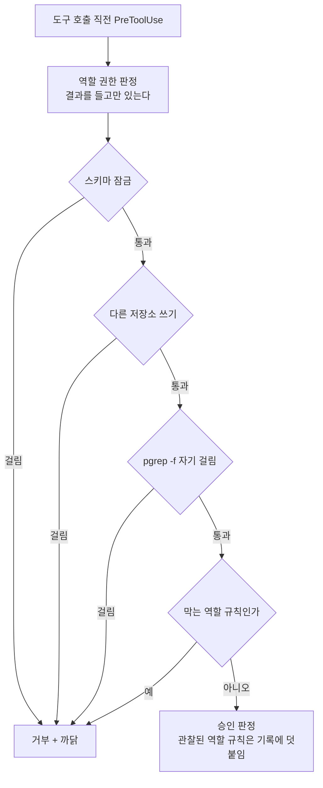

<!--
다루는 곳: bridge/roleguard.py, bridge/reposcope.py, bridge/schemalock.py, bridge/pgrep_guard.py, scripts/korean-check.py, .claude/settings.json, config/roles.toml, tests/test_roleguard.py, tests/test_roleguard_inspector.py, tests/test_pgrep_guard.py, tests/test_reposcope.py, tests/test_korean_check.py
읽은 커밋: 6cc0e36
-->

# 글이 아니라 권한으로

FOREMAN에서 일하는 세션(Claude Code, 줄여 CC)은 처음 뜰 때 저장소의 `CLAUDE.md`를 읽는다. 거기에는 "worktree 세션은 커밋만 하고 push하지 않는다", "파일은 Bash의 sed가 아니라 Edit, Write로 고친다", "다른 저장소는 사용자가 시킬 때만 고친다" 같은 규칙이 적혀 있다. 문제는 이것이 글이라는 점이다. 세션은 처음에 한 번 읽고, 일이 길어지거나 대화가 압축되면 그 규칙을 잊는다. 규칙을 어겨도 아무 일도 일어나지 않으니 어긴 줄도 모른다. 이 프로젝트가 처음부터 잡으려던 "조용한 고장"이 규칙 쪽에서 그대로 생긴 셈이다 [code:CLAUDE.md].

그래서 꼭 지켜야 하는 규칙 몇 개를 글에서 꺼내 권한으로 옮겼다. 세션이 도구(Bash, Edit, Write 등)를 부르기 직전에 브리지가 그 호출을 받아 보고, 규칙에 어긋나면 거부하고 까닭을 돌려준다. 이 편은 그렇게 옮긴 장치 다섯을 다룬다. 넷은 도구를 부르기 직전에 막고, 하나는 도구가 끝난 뒤 알린다.

| 장치 | 무엇을 | 언제 보나 | 어디에 걸리나 |
|---|---|---|---|
| 역할 권한(`roleguard`) | 역할마다 하지 말아야 할 일(관리자의 코드 고치기, worktree의 push, Bash로 파일 고치기 등) | 도구 직전 | FOREMAN 세션만 |
| 다른 저장소는 읽기만(`reposcope`) | 자기 저장소 밖의 git 저장소에 쓰기 | 도구 직전 | FOREMAN, 인프라 세션 |
| 스키마는 한 세션만(`schemalock`) | 둘째 세션이 DB 마이그레이션을 건드리기 | 도구 직전 | FOREMAN, 런슈즈 |
| `pgrep -f` 함정(`pgrep_guard`) | 자기 셸에 걸리는 `pgrep -f`, `pkill -f` | 도구 직전 | 모든 세션 |
| 한국어 확인(`korean-check`) | 직전 진행 글이 영어였음 | 도구 직후 | FOREMAN 저장소에서 뜬 세션 |

역할 자체(코더, 디자이너, 서기, 조사, 관리자가 각각 무엇을 하는가)는 → 역할 다섯 편에서, 승인 판정 전체의 흐름은 → 04 승인 편에서 다룬다. 이 편은 무엇을 어떻게 막는가에만 집중한다 [docs:roles.md].

## 1. 왜 글로는 안 되었나

규칙이 글로만 있을 때 실제로 샌 일들이 이 장치들의 출발점이다.

worktree(화면 이름은 작업방. 원본 폴더와 갈라진 작업용 폴더와 브랜치)에서 일하는 코더는 push하지 않는다는 규칙이 있었는데, 관리자가 쓴 지시서에 오히려 push하라는 줄이 들어간 적이 있다 [code:bridge/roleguard.py]. 파일은 Edit, Write로 고친다는 규칙도 마찬가지였다. 시험 파일 끝에 몇 줄을 붙일 때 세션은 `cat >> tests/test_x.py <<'EOF'` 같은 heredoc(명령 안에 여러 줄 글을 넣는 셸 문법)이나 `sed -i`를 습관처럼 썼다. 역할 권한을 관찰로만 켜 두고 지켜본 사흘 동안 이런 Bash 파일 고치기가 10건 기록됐고, 10건 모두 진짜 위반이었다 [log:inspect_roleguard_20261114.md]. 세션 하나는 그렇게 고친 것을 보고에도 밝히지 않았다 [log:approval_hell_plan_20261112.md].

왜 Edit, Write로만 고치게 하는가. Edit, Write로 고치면 무엇을 바꿨는지가 트랜스크립트에 그대로 남고, 승인 판정이 그 경로를 보고, 사람이 화면에서 바뀐 줄을 읽을 수 있다. `sed -i`나 heredoc은 그 모든 것을 지나친다. 바뀐 것은 셸 명령 한 줄 속에 숨어 있고, 그 명령이 정확히 무엇을 바꿨는지는 실행해 봐야 안다.

다른 저장소 쓰기도 실제로 있었다. 일주일치 FOREMAN 세션 호출을 다시 돌려 보니 다른 저장소에 쓴 것이 20건 나왔다. Jenkinsfile, 인프라 저장소의 values.yaml, 런슈즈의 settings.json과 CLAUDE.md를 고쳤고, 펫퍼민트 저장소에서 fetch를 했다 [log:repo_scope_readonly_20261109.md]. 한 저장소의 세션이 다른 저장소를 고치면, 그 저장소에서 일하던 세션은 자기도 모르는 변경을 만난다.

이 다섯 장치는 모두 같은 결론에서 나왔다. **세션이 기억하기를 바라지 않고, 어기려는 순간 브리지가 막고 까닭을 말해 준다.** 막힌 세션은 거부 글을 읽고 바른 길로 다시 한다. 글로 된 규칙은 그대로 둔다. 거부당하기 전에 알면 왕복 하나가 준다.

## 2. 어디서 막나: PreToolUse 한 자리

CC는 도구를 부르기 직전에 PreToolUse라는 hook(정해진 때에 바깥 스크립트를 부르는 CC 기능)을 부른다. FOREMAN은 이 hook을 `scripts/foreman-decide.sh pre`에 걸어 두었고, 이 스크립트가 도구 이름과 입력, 세션 id, 작업 폴더를 브리지 `/hooks/pre`로 보낸다 [code:deploy/hooks/foreman-hooks.json]. 브리지는 4초 안에 "허용", "묻기", "거부" 가운데 하나를 돌려주거나 아무것도 돌려주지 않는다 [code:scripts/foreman-decide.sh].

승인 판정(되돌릴 수 없는 일을 사람에게 묻는 것)도 같은 자리에서 돈다. 다만 이 편의 장치들은 승인 판정보다 먼저 돈다. 차례는 이렇다 [code:bridge/approvals.py].



역할 권한은 맨 처음에 판정하지만 거부는 맨 나중에 한다. 스키마 잠금이나 다른 저장소 쓰기에 걸리는 호출이면 그 까닭이 먼저 세션에 가야 하기 때문이다. 역할 규칙이 관찰 모드라 막지 않을 때는 판정 결과를 그 호출의 승인 기록(`approval_req` 이벤트)에 `role_rule`, `role_reason`으로 덧붙인다. 나중에 이 기록을 세어 "막았다면 무엇이 걸렸을지"를 본다 [code:bridge/approvals.py].

거부할 때 브리지가 CC에 돌려주는 것은 `permissionDecision: "deny"`와 `permissionDecisionReason: "FOREMAN <까닭>"`이다. CC는 도구를 실행하지 않고 이 까닭을 세션(모델)에게 그대로 보여 준다. 세션은 그 글을 읽고 다른 길을 찾는다. 거부는 승인 기록에도 남고 브리지 로그에 경고로 찍힌다 [code:bridge/approvals.py].

### 승인 모드와 상관없이 도는 것

승인 판정에는 프로젝트마다 모드가 있다. `enforce`는 판정을 CC에 돌려주고, `observe`는 기록만 하고 CC에는 아무것도 돌려주지 않는다. 지금 FOREMAN과 인프라는 enforce, 런슈즈와 펫퍼민트는 observe다 [code:config/approval.toml] [c:12c07f6]. observe는 "새 프로젝트를 붙일 때 먼저 지켜보기만 한다"는 뜻이다.

스키마 잠금, 다른 저장소 막기, `pgrep -f` 막기는 이 승인 모드를 보지 않는다. 런슈즈가 observe여도 두 세션이 동시에 런슈즈 마이그레이션을 만들려 하면 둘째를 막는다. 까닭은 이 셋이 "사람에게 물을 일"이 아니라 "어느 쪽으로 가도 망가지는 일"이기 때문이다. 스키마 충돌은 한쪽 코드를 깨뜨리고, 다른 저장소 쓰기는 그 저장소 세션의 일을 흐트러뜨리고, `pgrep -f`의 자기 걸림은 셸을 영원히 돌게 하거나 자기 자신을 죽인다. 지켜보기만 해서 얻을 것이 없다 [code:bridge/approvals.py] [docs:11_worktree.md].

### observe부터 켜는 것

역할 권한은 다르다. 이것은 자기 모드를 따로 갖고(`config/roles.toml [roles] mode`), 처음에 observe로 켰다 [code:config/roles.toml]. 역할 규칙은 "이 세션이 이 일을 해도 되는가"라는 판단을 글자로 하는 것이라 헛걸림(정당한 일을 막는 것)이 생길 수 있다. 실제로 관리자 규칙은 관찰해 보니 21건 가운데 20건이 정당한 일이었다(아래 3절). 처음부터 막았다면 사용자가 직접 시킨 일이 줄줄이 막혔을 것이다.

| 모드 | 하는 일 |
|---|---|
| `off` | 보지 않는다 |
| `observe` | 막지 않고 그 호출의 승인 기록에 걸린 규칙과 까닭을 남긴다 |
| `enforce` | 거부하고 무엇이 왜 막혔는지, 어떻게 하면 되는지를 세션에 돌려준다 |

그리고 규칙 하나만 골라 막는 길이 있다. `[roles] enforce`에 적은 규칙은 mode가 observe여도 막는다. 지금 여기에는 조사 규칙(`inspector-write`) 하나만 있다. 다른 네 규칙은 사용자가 관찰 그대로 두기로 했다 [log:foreman-6_inspector_rename_20261115.md].

```toml
[roles]
mode = "observe"
projects = ["foreman"]
manager_allow = ["config/*.toml", "log/*", "README.md"]
scribe_deny = ["bridge/*", "tests/*", "migrations/*", "tools/*"]
inspector_allow = ["log/*"]
enforce = ["inspector-write"]

[roles.rules]
worktree-push = true
bash-file-edit = true
manager-code = true
scribe-code = true
inspector-write = true
```

규칙 하나를 끄려면 `[roles.rules]`의 그 줄을 `false`로, 전체를 끄려면 `mode = "off"`로 바꾸고 브리지를 다시 띄운다. 설정 파일이 깨졌거나 `enforce`에 모르는 규칙 이름이 있으면 역할 권한은 꺼진 채로 뜨고, 꺼졌다는 것을 로그 error와 텔레그램으로 알린다 [code:bridge/roleguard.py]. 조용히 꺼지지 않게 한 것이다.

## 3. 역할 권한(roleguard)

세션의 역할은 DB `character_session.role`에서 읽는다. 도구 호출마다 DB를 치지 않게 세션마다 60초 동안 기억한다. 역할 권한이 켜져 있을 때만 읽는다 [code:bridge/api/hooks.py].

### 규칙 다섯

| 규칙 | 누구에게 | 무엇을 보나 | 지금 |
|---|---|---|---|
| `worktree-push` | 작업방(worktree)에서 뜬 모든 세션 | Bash의 `git push` | 관찰 |
| `bash-file-edit` | 모든 역할 | Bash로 저장소 파일 쓰기: `sed -i`, `perl -i`, `>`와 `>>` 리디렉션(heredoc 포함), `tee` | 관찰 |
| `manager-code` | 원본 폴더의 관리자 | `config/*.toml`, `log/`, `README.md` 밖을 Edit, Write | 관찰 |
| `scribe-code` | 서기 | `bridge/`, `tests/`, `migrations/`, `tools/`를 Edit, Write | 관찰 |
| `inspector-write` | 조사 | `log/` 밖 쓰기와 저장소를 바꾸는 git 전부 | **막음** |

역할마다 무엇이 걸리는지 표로 모으면 이렇다. "관찰"은 기록만 하고 막지 않는다는 뜻이다.

| 역할 | 걸리는 것 |
|---|---|
| 코더 | 작업방에서 push(관찰), Bash로 저장소 파일 고치기(관찰) |
| 디자이너 | 코더와 같다 |
| 서기 | 코드 폴더 Edit, Write(관찰), Bash로 파일 고치기(관찰), 작업방에서 push(관찰) |
| 관리자 | 원본 폴더에서 설정, log, README 밖 Edit, Write(관찰), Bash로 파일 고치기(관찰) |
| 조사 | log 밖 쓰기, 남이 커밋한 log 고치기, push, 저장소를 바꾸는 git(막음) |

### Bash로 파일 고치기를 어떻게 알아보나

이 규칙이 가장 까다롭다. 셸 명령은 글이고, 글 속의 `>`가 모두 파일 쓰기는 아니다. 처음 만든 판으로 일주일치 호출을 다시 돌리자 헛걸림이 다섯 갈래 나왔다 [log:coder_c_wave2_20261111.md].

첫째, `cd /tmp/…/scratchpad && cat > x.sh`처럼 앞에서 스크래치(세션 전용 임시 폴더)로 옮긴 뒤 쓴 것을 저장소 파일로 봤다. 그래서 명령을 `&&`, `;`, `|`로 조각낸 뒤 앞 조각의 `cd`를 따라간다. 둘째, 여러 줄 따옴표(커밋 글, `python -c '…'`)를 줄마다 잘라 그 안의 `>`를 리디렉션으로 봤다. 그래서 명령 전체를 한 번에 토큰으로 나누고 따옴표 안의 줄바꿈은 글자로 둔다. 셋째, `sed -i … 2>/dev/null`의 `2`를 파일 이름으로 봤다. 리디렉션 기호와 그 앞의 숫자, 뒤의 대상을 인자에서 뺀다. 넷째, 한 줄에 heredoc이 둘 있는 명령(`<<'EOF' || … <<'EOF2'`)에서 본문을 잘못 셌다. heredoc 표지를 차례로 따라가게 했다. 다섯째, `python -c`나 `python - <<EOF` 안의 `open(…, 'w')`를 잡았는데, 대부분 화면 시험용 JSON을 만드는 일이었다 [log:coder_c_wave2_20261111.md].

다섯째는 고치지 않고 포기했다. 해석기(python, node) 안의 쓰기는 보지 않는다. 데이터를 만드는 스크립트와 소스를 고치는 스크립트를 글로 가를 수 없기 때문이다. 이 구멍으로 실제로 소스가 한 번 바뀌었고, 검사에 걸리지 않았다 [log:approval_hell_plan_20261112.md]. 이 한계는 → 「17 알려진 한계」에 모았다.

막지 않는 곳도 정해 두었다. `/tmp`, `/dev`, `/proc`, 세션 스크래치, git 저장소가 아닌 곳(`~/.claude` 등)은 마음대로 써도 된다. 실행해 봐야 대상을 아는 명령과 나눌 수 없는 명령은 판정할 수 없으니 막지 않는다. "모르면 막는다"로 바꾸면 스크래치에 쓰는 정상 명령이 대부분 걸린다 [log:inspect_roleguard_20261114.md].

고친 뒤 다시 돌린 결과는 Bash로 파일 고치기 89건이었고, 모두 규칙이 막으려던 것이었다 [log:coder_c_wave2_20261111.md]. 관찰로 켠 뒤 실제 사흘 기록에서도 10건 모두 진짜 위반이었다 [log:inspect_roleguard_20261114.md].

### 관리자 규칙은 왜 막지 않나

관리자는 코드를 고치지 않고 worktree 코더에게 맡긴다는 것이 이 프로젝트의 선이다. 관리자가 직접 고쳐도 되는 것은 설정 값, 기록, README뿐이다. 그래서 `manager-code`는 그 밖을 Edit, Write하면 걸린다.

그런데 관찰 기록 21건을 하나씩 갈라 보니 진짜 위반은 1건뿐이었다 [log:inspect_roleguard_20261114.md]. 나머지 20건은 사용자가 관리자에게 직접 "CLAUDE.md 이 줄을 고쳐라"고 시킨 것(10건), 사람이 패널에서 승인한 인계 카드로 docs에 쓴 것(7건), 합친 뒤 깨진 시험을 몇 줄 고친 것(3건, 원래 허용된 예외)이었다. 관리자가 원본 폴더에서 설정, 기록, README 밖을 고치는 일은 대부분 사람이 시킨 일이다.

그래서 이 규칙을 그대로 막기로 바꾸면 안 된다. 지금 거부 글은 "몇 줄이면 사람에게 허락을 받습니다"라고 말하지만, 막기 모드에는 허락받을 길이 없다(바로 거부된다). 조사 결과는 관리자 규칙을 거부가 아니라 사람에게 묻기로 돌리자고 제안했다 [log:inspect_roleguard_20261114.md]. 사용자는 이 결과를 보고 관리자 규칙을 관찰로 두고 그 제안도 하지 않기로 정했다 [c:2a45269].

### 조사 규칙: 읽기 전용에서 log만 쓰기로

조사 역할은 읽고 알아보는 일이다. 처음에는 조사 세션을 CC의 plan 모드(읽기 전용, 파일을 쓰려면 계획 승인이 필요하다)로 띄웠다. 그러자 결과 log 하나를 쓰는 데에도 계획 승인이 한 번씩 필요했고, 관리자가 조사를 피해 코더로 띄우는 일이 생겼다 [code:bridge/roleguard.py]. 읽기 전용이 너무 넓게 막은 것이다.

그래서 조사를 보통 모드로 띄우고, 이 규칙이 log 밖을 막게 했다. 이 규칙만은 처음부터 막기로 켰다. 조사가 log 말고 무언가를 고치면 그 자체가 역할을 벗어난 것이라, 헛걸림이 생길 여지가 거의 없다.

조사가 할 수 있는 것과 없는 것은 이렇다 [log:foreman-6_inspector_rename_20261115.md].

| 된다 | 안 된다 |
|---|---|
| `log/` 아래 새 파일을 Write | `log/` 밖 Edit, Write |
| 이 세션이 만든 log를 이어서 Edit | 다른 세션이 커밋한 log 고치기 |
| `git add log/<파일>` | `git add -A`, `git add .`, `git add -u`, log 밖 add |
| 스테이지가 log뿐인 `git commit` | `git commit -a`, 스테이지에 log 밖 파일이 섞인 커밋 |
| `git restore --staged`(스테이지에서 내리기만) | `git push`, checkout, reset, rebase, merge, stash, 브랜치와 태그 만들기 |
| 스크래치, `/tmp` 안에서는 무엇이든 | Bash로 저장소 파일 쓰기(리디렉션, `sed -i`, `rm`, `mv`, `cp`, `touch` 등) |

"이 세션이 만든 파일"은 브리지가 메모리에 기억한다. 브리지가 다시 떠서 기억을 잃었으면 git이 아직 모르는 파일(커밋 전)을 이 세션이 쓰던 것으로 본다. 그래서 브리지를 다시 띄워도 조사가 쓰던 log를 이어 쓸 수 있다 [code:bridge/roleguard.py].

교장(계획 세우기를 맡는 디스패처)은 계획을 만들 때 이 규칙이 그 프로젝트에서 실제로 막는지를 묻는다(`enforces`). 막으면 조사를 보통 모드로, 막지 않는 프로젝트(런슈즈, 펫퍼민트, 인프라)면 예전처럼 읽기 전용으로 띄운다 [code:bridge/main.py]. `[roles] enforce`에서 이 규칙을 빼면 조사는 다시 읽기 전용으로 뜬다. 막는 장치가 없으면 읽기 전용이라도 있어야 하기 때문이다. log만 바뀐 조사 작업방을 승인 없이 합치는 길도 이 규칙을 믿고 만든 것이다(→ 합치기 카드).

### 판정이 실패하면

판정 코드에서 예외가 나면 막지 않고 통과시킨다. 판정 실패로 모든 세션이 묶이는 것이 더 나쁘다. 대신 로그 error와 텔레그램을 보낸다. 같은 오류로 텔레그램이 쏟아지지 않게 한 시간에 한 번만 보낸다 [code:bridge/roleguard.py]. 텔레그램은 한 시간에 한 번이라 그 사이 몇 번이나 판정 없이 지났는지는 알 수 없었다. 그래서 예외가 날 때마다 「판정 없이 지났다」는 한 줄을 판정 없는 통과 기록 파일에 따로 남긴다. 줄에는 오류 종류, 세션 id, 도구 이름만 들어가고 명령 글은 들어가지 않는다 [code:bridge/roleguard.py] [code:bridge/hookmiss.py].

스키마 잠금, 다른 저장소 막기, `pgrep -f` 막기도 같다. 판정 중 예외가 나면 통과시키고 어느 장치에서 났는지를 같은 파일에 남긴다. 전에는 이 예외가 브리지의 서버 오류로 나가 스크립트가 아무 흔적 없이 통과시켰다 [code:bridge/approvals.py]. 이 기록 파일의 갈래와 꼴은 → 기다리는 길: hook 두 개 편이 다룬다.

### 역할 권한을 hook으로 한 까닭

CC에는 띄울 때 쓸 도구를 정하는 `--allowedTools`, `--disallowedTools` 옵션이 있다. 이것으로는 이 규칙들을 쓸 수 없었다. "heredoc으로 쓰는가", "`cd` 뒤 경로가 저장소 안인가", "이 세션이 worktree인가"는 명령 글과 작업 폴더를 봐야 가릴 수 있는데, 도구 목록 문법은 그런 것을 모른다 [log:coder_c_wave2_20261111.md]. 그리고 이미 다른 저장소 막기와 `pgrep -f` 막기가 PreToolUse에 있어서, 같은 자리에 두면 끄기와 관찰이 한곳에 모인다.

## 4. 다른 저장소는 읽기만(reposcope)

FOREMAN 세션은 런슈즈, 펫퍼민트, 인프라 저장소를 읽을 수는 있어도 쓸 수 없다. 대상은 `config/approval.toml [repo_scope] read_only_elsewhere`에 적은 프로젝트(지금 FOREMAN과 인프라)의 세션이다 [code:config/approval.toml]. 막히는 쪽 저장소의 경로는 DB `project.repo_path`에서 읽는다. 프로젝트로 등록되지 않은 저장소도 git 저장소이기만 하면 "자기 저장소 밖"이라 막힌다.

막는 것은 둘이다. 첫째, Edit, Write, MultiEdit, NotebookEdit의 대상이 자기 저장소(와 그 작업방들) 밖의 git 저장소 안일 때. 둘째, Bash의 git이 `-C`, `cd`, `--git-dir`, `--work-tree`, `GIT_DIR=`로 다른 저장소를 가리키면서 읽기가 아닌 일을 할 때. `cd`는 줄을 넘어 따라간다 [code:bridge/reposcope.py].

"읽기"는 목록으로 정했다. `status`, `log`, `show`, `diff`, `ls-remote`, `rev-parse`, `blame` 같은 것들이다. 그 밖에 인자에 따라 읽기인 것도 있다. `git branch`는 목록 보기면 읽기고 `-d`가 붙으면 쓰기다. `git fetch`는 그 저장소의 `.git`에 쓰므로 막지만 `--dry-run`이면 읽기다. 이 갈래는 처음 만든 판을 일주일치 호출로 다시 돌렸을 때 나온 헛거부 4건(`git reflog show`, `$(…)` 안의 `git remote get-url origin`, `git apply --check`, `git fetch --dry-run`)을 보고 더한 것이다. 고친 뒤 남은 20건은 모두 막으려던 일이었다 [log:repo_scope_readonly_20261109.md].

`/tmp`와 스크래치 아래는 막지 않는다. 다른 저장소를 손대 보고 싶으면 그곳에 복제해서 하면 된다. 커밋 글 안에 "git push"라는 낱말이 들어 있는 경우를 헛걸림으로 치지 않으려고 명령 안의 여러 줄 글을 통째로 보지 않는데, 그 때문에 놓치는 꼴도 있다(**미해결**) [code:bridge/reposcope.py].

### 예외 둘

인프라 세션이 런슈즈와 펫퍼민트의 운영 문서를 맡게 되면서 예외가 생겼다. `[repo_scope.writable]`에 적은 경로(지금은 런슈즈와 펫퍼민트의 `docs/`) 아래는 인프라 세션이 Edit, Write로 고칠 수 있다. 그 프로젝트의 원본 저장소에서만이고, 작업방은 아니다. git은 그 경로 안의 `add`와 `commit`만 된다. `add`는 경로를 적은 것만(`-A`, `.`은 막는다), `commit`은 `-a`, `--amend`를 막고, 경로를 적지 않았으면 그 저장소 스테이지가 그 경로 밖을 담고 있을 때 막는다. 다른 세션이 올려 둔 변경이 내 커밋에 섞이지 않게 하려는 것이다 [code:bridge/reposcope.py].

그렇게 쌓인 docs 커밋을 올리는 것은 FOREMAN 관리자 몫이다(`[repo_scope.manager_push]`). 관리자 세션(원본 폴더의 role manager)만 그 저장소에서 `git push [origin] [main]`을 할 수 있고, 조건이 까다롭다. origin/main보다 앞선 커밋이 전부 그 경로 안만 건드렸어야 하고, 머지 커밋이 없어야 하고, 원격보다 뒤처지거나 갈라지지 않았어야 한다. 브리지는 `git ls-remote`로 원격 머리를 직접 읽어 확인한다. 원격을 10초 안에 읽지 못하면 확인할 수 없으니 막는다. 강제 push, 태그, 다른 원격, 다른 브랜치, 미러 설정도 막는다. 이 판정에만 세션 역할이 필요해서, 명령에 push가 보일 때만 DB에서 역할을 읽는다 [code:bridge/approvals.py].

관리자도 그 밖의 다른 저장소 쓰기는 할 수 없다. 다른 저장소에 남은 작업방을 치울 때는 FOREMAN의 버리기 API를 쓴다 [docs:11_worktree.md].

### 한계

reposcope는 Bash의 git만 본다. git 밖의 명령으로 다른 저장소 파일을 고치는 것은 보지 않고, 역할 권한의 Bash 파일 고치기 규칙이 일부 맡지만 그 규칙은 자기 저장소 안만 본다. 샌드박스를 미룬 까닭은 → 「17 알려진 한계」에 모았다. 변수로 가리킨 git 쓰기는 어디인지 알 수 없어 거꾸로 막는다.

## 5. 스키마는 한 세션만(schemalock)

작업방 덕분에 세션마다 파일은 갈라졌지만 DB는 하나를 같이 쓴다. 두 세션이 각자 마이그레이션(DB 표 구조를 바꾸는 SQL 파일)을 만들면 번호가 겹치고, 한쪽이 먼저 DB에 적용하면 다른 쪽 코드가 깨진다. 그래서 한 프로젝트의 스키마는 한 세션만 바꾼다 [code:bridge/schemalock.py].

"스키마를 바꾸는 시도"는 프로젝트마다 `config/worktree.toml [schema_lock.<프로젝트>]`에 정한다. 마이그레이션 폴더 아래 파일을 Edit, Write로 쓰거나, 마이그레이션을 돌리는 명령(정규식)을 Bash로 치면 시도다 [code:config/worktree.toml].

| 프로젝트 | 경로 | 명령 |
|---|---|---|
| FOREMAN | `migrations/` | `-m bridge.db.migrate`, `python …bridge/db/migrate.py`(둘 다 `--status`는 뺀다) |
| 런슈즈 | `backend/src/main/resources/db/migration/` | flyway 실행 작업(`flywayMigrate`, `flyway migrate` 등) |

처음 시도한 세션이 그 프로젝트의 잠금을 갖는다. 다른 세션이 같은 시도를 하면 거부된다. 잠금 상태는 `~/.foreman/schema_lock.json`에 있어서 브리지를 다시 띄워도 남는다.

명령 패턴은 한 번 좁혔다. 처음에는 `bridge\.db\.migrate`라는 글자가 들어가기만 하면 잡았는데, `from bridge.db.migrate import connect`(DB에 붙으려고 가져오기만 하는 코드)에도 맞았다. 그래서 관리자가 DB를 읽기만 하고 잠금을 쥐었고, 거꾸로 그 읽기 조회가 코더의 잠금에 막힌 일도 있었다. 런슈즈의 `flyway\w*`도 `SELECT … FROM flyway_schema_history`(적용 기록 읽기)를 잡았다. 그래서 마이그레이션을 실제로 돌리는 명령만 잡게 고쳤다 [docs:11_worktree.md].

### 잠금이 풀리는 때

| 잠금을 쥔 세션 | 풀리는 때 |
|---|---|
| 작업방 세션 | 그 작업방을 합치거나 버렸을 때. 세션이 끝나도 합치기 전에는 그 스키마가 main에 없으니 계속 쥔다 |
| 원본 폴더 세션 | 그 세션이 끝났을 때. 또는 마이그레이션이 다 적용되고 커밋됐을 때(FOREMAN만, 아래) |
| 어느 쪽이든 | 사람이 화면 방 배너의 [풀기]를 눌렀을 때 |

원본 폴더 세션의 "일찍 풀기"는 브리지가 1분마다 본다. 그 작업 트리의 `migrations/NNNN_*.sql`이 모두 DB `schema_migrations`에 적용돼 있고, `git status -- migrations/`가 비어 있으면(커밋 안 한 변경이 없으면) 잠금을 푼다 [code:bridge/main.py]. 스키마 일을 끝낸 관리자가 세션을 끝낼 때까지 다른 코더를 막는 것을 줄이려고 더했다. FOREMAN 저장소만 된다. 런슈즈의 적용 기록은 다른 DB에 있어 브리지가 모른다. 이 확인이 실패하면 잠금을 그대로 둔다. 풀지 않는 쪽이 안전하다.

마이그레이션 자체(번호 매기기, 적용 순서, 시험 DB)는 → 마이그레이션 편에서 다룬다.

### 막힌 것이 보이게

처음 만든 잠금은 거부만 하고 화면이 없었다. 원본 폴더 세션이 쥔 잠금 때문에 작업방 코더가 막혔는데, 설계는 "사람이 푼다"였지만 누를 곳이 없었고, 막힌 것도 그 코더가 메시지를 보내서야 알았다 [docs:11_worktree.md]. 그래서 막힌 세션을 잠금 상태에 남기고, 화면 방 배너에 "멈춤: 세션 M이 스키마 잠금에 막혔습니다(쥔 세션 N)"을 띄우고, 막힌 세션마다 텔레그램을 한 번 보낸다 [code:bridge/approvals.py]. 배너를 누르면 확인 창 뒤 잠금이 풀린다. 합치기나 버리기로 잠금이 풀리면 결과 글에 "스키마 잠금도 풀었습니다"가 붙는다.

막힌 세션은 이 글을 받는다.

> FOREMAN 스키마 잠금 — 이 프로젝트의 DB 스키마는 다른 세션(1a2b3c4d, 작업방 foreman-2)이 바꾸는 중입니다(migrations/0034_x.sql). 그 세션이 끝나 합쳐진 뒤에 하거나, 그 세션에 맡기거나, 화면에서 잠금을 풀어 달라고 사용자에게 요청하세요.

세션의 방침도 정해 두었다. 잠금을 쥔 세션이 살아 있으면 스키마 없이 할 수 있는 일부터 하고, 스키마가 필요한 단계에서 다시 본다. 쥔 세션이 이미 끝났으면(파일에 이름이 남아 있어도) 가져가 써도 된다. 실제 판정도 그렇다. 원본 폴더 세션은 살아 있는 동안만 쥔 것으로 친다 [code:bridge/schemalock.py].

## 6. pgrep -f가 자기 셸에 걸리는 함정(pgrep_guard)

이것은 규칙이라기보다 함정이다. 어기면 혼나는 것이 아니라 세션이 스스로 망가진다.

### 왜 걸리나

`pgrep -f 무엇`은 "명령 줄 전체에 '무엇'이 들어 있는 프로세스를 찾아라"다. 예를 들어 화면 확인 도구(`tools/screen.py`)가 끝나기를 기다리려고 세션이 이렇게 친다고 하자 [log:coder_resident_20261109.md].

```bash
until ! pgrep -f "tools/screen.py"; do sleep 3; done
```

사람이 터미널에 치면 잘 돈다. 그런데 CC는 Bash 명령을 그냥 돌리지 않는다. 명령 글 전체를 `bash -c '…'`에 넣어 새 셸로 돌린다. 그러면 그 셸의 명령 줄은 `bash -c 'until ! pgrep -f "tools/screen.py"; do sleep 3; done'`이 된다. 이 줄에도 "tools/screen.py"라는 글자가 들어 있다. `pgrep`은 이 셸, 곧 자기를 부른 셸을 찾아낸다. 화면 확인 도구가 끝나도 이 셸은 늘 살아 있으니 기다림은 영원히 끝나지 않는다 [code:bridge/pgrep_guard.py].

실제로 그렇게 15분 동안 끝나지 않은 셸이 있었다. 세션은 "뒤에서 도는 일은 없다"고 보고했고, 관리자가 찾아 멈췄다. 그대로 세션을 끝냈으면 CC의 끝내기 확인 창에 걸렸을 것이다 [log:merge_coder_resident_20261109.md]. 관리자도 같은 함정에 빠졌다. 시험 전에 "다른 pytest가 도는가"를 `pgrep -f 'python -m pytest'`로 보다가 자기 셸에 걸려 "다른 pytest 있음"을 세 번 헛봤다. `pkill -f`면 더 나쁘다. 자기 셸을 죽인다.

흔히 알려진 해법은 대괄호다. `pgrep -f '[p]ython -m pytest'`로 쓰면 정규식 `[p]`는 글자 p 하나에 맞지만, 명령 줄에는 `[p]`라는 글자가 들어 있으니 "python"이라는 이어진 글자와는 다르다. 패턴 글자 자체에는 걸리지 않는다. 그런데 이것도 깨졌다. 관리자가 `pgrep -af '[p]ython -m pytest'; .venv/bin/python -m pytest …`를 한 명령으로 쳤더니, 명령 뒤쪽의 실제 실행 글(`python -m pytest`)이 같은 셸의 명령 줄에 있어서 또 걸렸다 [log:merge_237_242_20261110.md]. 확인과 실행을 따로 쳐야 한다.

### 판정 하나

그래서 판정은 하나로 정했다. **`pgrep -f`, `pkill -f`의 패턴을 정규식으로 이 명령 글 전체에 대 보고, 걸리면 거부한다** [code:bridge/pgrep_guard.py]. 대괄호를 썼어도 같은 명령 뒤쪽에 걸리면 이 판정이 그대로 잡는다. 자기 걸림을 직접 흉내 내 보는 셈이라 "이런 꼴은 위험하다"는 목록을 따로 둘 필요가 없다.

명령 자리에 있는 호출만 본다. `echo "pgrep -f를 쓰지 마라"`나 커밋 글, heredoc 본문 안의 낱말은 실제로 돌지 않으니 빼고, 맨 앞이나 `;`, `&&`, `|`, `$(`, `until`, `while`, `timeout 10` 같은 것 뒤에 온 것만 호출로 친다. `-f`가 없는 `pgrep`(프로그램 이름만 본다)은 걸리지 않으니 보지 않는다. 패턴이 변수(`$P`)면 글로 가릴 수 없어 막지 않는다. Bash 말고 Monitor 도구(명령을 셸로 돌리며 기다리는 도구)도 본다. 막을 꼴 여섯과 허용할 꼴 일곱을 시험으로 고정했다 [c:a89b835].

세션은 이 글을 받는다.

> FOREMAN pgrep-자기걸림: `pgrep -f tools/screen.py`가 이 명령 자신에 걸립니다 — CC는 Bash 명령 전체를 `bash -c '…'`로 돌려 그 셸의 명령 줄에 이 글이 그대로 있습니다. 고친 예: 패턴을 `[t]ools/screen.py`처럼 대괄호로 감싸고, 확인과 실행을 따로 칩니다(같은 명령 안에서 그 프로그램을 돌리면 대괄호도 다시 걸립니다). 기다릴 때는 pgrep -f로 찾지 말고 그 작업의 PID나 결과 파일을 봅니다

거부당하기 전에 알게 하려고 같은 내용을 CLAUDE.md 작업 규칙, 작업방 세션 지시문 머리, 서기 일감의 공통 규칙에도 넣었다 [code:bridge/handoff.py]. 이 장치는 프로젝트를 가리지 않는다. 런슈즈 세션이든 펫퍼민트 세션이든 CC가 `bash -c`로 도는 것은 같기 때문이다.

## 7. 진행 글이 영어면 알리기(korean-check)

이 프로젝트는 세션이 쓰는 모든 글을 한국어로 한다. 최종 답만이 아니라 도구 호출 사이의 짧은 진행 글까지다. 그런데 이 규칙도 글이라, 영어 도구 결과를 읽은 직후의 짧은 진행 글이 영어로 흐르는 것을 막지 못했다 [code:scripts/korean-check.py].

이것은 막을 수가 없다. 진행 글은 이미 쓰인 뒤에야 보인다. 그래서 도구가 끝난 직후(PostToolUse)에 알린다. hook은 트랜스크립트(세션 대화 기록 파일) 끝 400KB에서 가장 최근 assistant 글 한 덩어리를 찾고, 코드 블록, 인라인 코드, 경로, URL을 뺀 나머지 글자를 센다. 라틴 글자가 25자 이상이고 한글이 라틴 글자의 15%보다 적으면 영어로 본다. 그러면 모델이 다음에 읽을 맥락(`additionalContext`)에 이 글을 넣는다 [code:scripts/korean-check.py].

```text
[한국어 규칙] 직전 진행 글이 영어였습니다. CLAUDE.md 작업 규칙: 도구 호출 사이의 짧은 진행 글까지 전부 한국어로 씁니다. 다음 글부터 한국어로 쓰세요(도구 결과가 영어여도).
```

같은 글로는 한 번만 알린다. 세션마다 마지막으로 알린 글의 uuid를 `~/.cache/foreman-kocheck/`에 적어 둔다. 무엇이 실패하든 아무것도 내지 않고 조용히 지나간다. 이 hook이 세션을 묶으면 안 되기 때문이다. 첫 진행 글은 그다음 도구가 끝난 뒤에야 잡힐 수 있다 [log:korean_hook_sonnet_check_20261110.md].

### 인용을 뺀 까닭

처음 판은 알림에 모델이 쓴 영어 글을 따옴표로 되돌려 넣어 "이 글이 영어였다"를 보여 줬다. 그런데 sonnet으로 돈 서기 세션 하나가 이 알림을 받은 직후 안전 분류기에 막혔다. 모델 자신의 글을 되돌려 보여 주는 것이 원인으로 짐작되어 인용을 뺐다 [log:korean_hook_no_quote_20261110.md]. 그 뒤 sonnet 시험 세션에 일부러 영어 진행 글을 네 번 쓰게 했더니 알림은 세 번 들어왔고 분류기 거부는 없었다. 원인이었다고 확정하지는 못했다. 분류기는 늘 막는 것이 아니었다 [log:korean_hook_sonnet_check_20261110.md].

### 브리지 밖에서 도는 하나

이 hook만 브리지를 거치지 않는다. 저장소의 `.claude/settings.json`에 PostToolUse hook으로 바로 걸려 있다. 이 파일에는 이 hook 하나만 들어 있고, 어떤 도구든 하나가 끝날 때마다 5초 안에 한국어 점검 스크립트를 부르라고 적혀 있다 [code:.claude/settings.json].

```json
{"hooks": {"PostToolUse": [{"matcher": "*", "hooks": [{"type": "command",
  "command": "python3 <원본 저장소>/scripts/korean-check.py 2>/dev/null || true",
  "timeout": 5}]}]}}
```

이 설정은 FOREMAN 저장소(와 그 작업방)에서 뜬 세션에만 걸린다. 다른 저장소 세션은 자기 저장소의 설정을 따른다. 스크립트는 원본 폴더 경로로 부르므로 작업방 세션도 원본의 스크립트를 쓴다. 고친 스크립트가 main에 합쳐지는 순간 모든 FOREMAN 세션에 적용되고, 브리지를 다시 띄울 필요가 없다. 브리지가 꺼져 있어도 돈다.

## 8. 막혔을 때 세션이 받는 글

거부 글은 세션이 읽는 글이다. 그래서 세 가지를 꼭 담았다. 무엇이 막혔는가, 왜 막혔는가, 그러면 어떻게 하면 되는가. 마지막이 빠지면 세션은 같은 일을 다른 꼴로 다시 시도하거나 멈춘다.

| 규칙 이름 | 세션이 받는 글(요지) |
|---|---|
| `역할-worktree push` | 작업방 세션은 커밋만 하고 push하지 않습니다. 합치기는 관리자가 하고 push는 합친 뒤 원본 폴더에서 관리자가 합니다. 커밋을 마치고 보고하면 합치기 카드가 생깁니다 |
| `역할-Bash파일고침` | 파일은 Edit, Write로 고칩니다. Bash로 저장소 파일(경로)을 고치려 했습니다. Edit, Write로 고치면 기록, 승인, 되돌리기가 그대로 돕니다. 임시 파일은 /tmp나 세션 스크래치에 씁니다 |
| `역할-관리자코드` | 관리자는 코드를 고치지 않습니다. 직접 고쳐도 되는 것은 설정, log, README입니다. 코드는 작업방 코더에게 맡깁니다 |
| `역할-서기코드` | 서기는 코드를 고치지 않습니다. 문서만 고칩니다. 코드 고칠 것은 포스트잇이나 관리자에게 보냅니다 |
| `역할-조사쓰기` | 조사 세션은 log 파일만 쓸 수 있습니다. 결과는 log/ 아래 새 파일에 Write로 쓰고 `git add log/<파일>` 뒤 커밋합니다. 고칠 것은 log와 보고에 적어 관리자에게 올립니다 |
| `다른저장소-쓰기` | 이 세션은 다른 저장소를 읽기만 합니다. 고칠 것은 그 저장소 세션에 맡기거나(세션 간 메시지) 사용자에게 요청하세요. 상태는 `git ls-remote`로, 손볼 시험은 /tmp나 스크래치 복제본에서 합니다 |
| `스키마-잠금` | 다른 세션이 스키마를 바꾸는 중입니다. 그 세션이 합쳐진 뒤에 하거나, 그 세션에 맡기거나, 잠금을 풀어 달라고 사용자에게 요청하세요 |
| `pgrep-자기걸림` | 패턴이 이 명령 자신에 걸립니다. 대괄호로 감싸고 확인과 실행을 따로 치거나, PID나 결과 파일을 봅니다 |

[code:bridge/roleguard.py] [code:bridge/reposcope.py] [code:bridge/schemalock.py] [code:bridge/pgrep_guard.py]

`역할-` 규칙이 관찰 모드면 세션은 아무 글도 받지 않는다. 그 대신 승인 기록에 남아 나중에 셀 수 있다.

## 9. 남은 구멍

이 장치들은 글을 보고 판정한다. 그래서 글로 가릴 수 없는 것은 지나간다. 알고 남겨 둔 구멍을 적어 둔다.

「미해결」은 아직 고치지 않은 것이다.

브리지가 답하지 못하면 네 장치가 함께 꺼지는 것, 해석기 안의 쓰기, 관리자 규칙이 보지 않는 자리와 막힌 뒤 돌아가는 길, 다른 프로젝트로 넓히지 않은 것, 샌드박스를 시험 뒤로 미룬 것은 여러 편에 걸려 → 「17 알려진 한계」에 모았다. 판정 없이 지난 호출은 갈래마다 기록에 한 줄씩 남는다 [log:foreman-6_bridge_alert_20261115.md] [log:foreman-4_hook_bytes_20261115.md]. 이 편에만 걸리는 구멍은 아래 하나다.

**그 밖의 쓰기 명령.** 역할 권한의 Bash 규칙은 몇 가지 쓰기 꼴만 본다. 그 밖의 쓰기 명령은 보지 않는다(**미해결**). 가장 흔한 것은 그림을 넣는 쓰기라 넣으면 헛걸림이 크다. 그림(png, gif)은 Edit, Write로 쓸 수 없어 셸 명령으로 넣는 것이 유일한 길이기 때문이다 [log:inspect_roleguard_20261114.md]. 조사 규칙만 예외로 Bash로 저장소 파일을 쓰는 명령을 모두 막는다. 조사가 그림을 넣을 일은 없다.

지금의 장치들은 "자주, 실제로 새던 꼴"을 정확하게 막는 데 맞춰져 있다. 실제 기록에서 Bash 파일 고치기 10건과 다른 저장소 쓰기 20건을 모두 잡았고, 헛걸림은 관찰 단계에서 걸러 냈다 [log:inspect_roleguard_20261114.md] [log:repo_scope_readonly_20261109.md].
