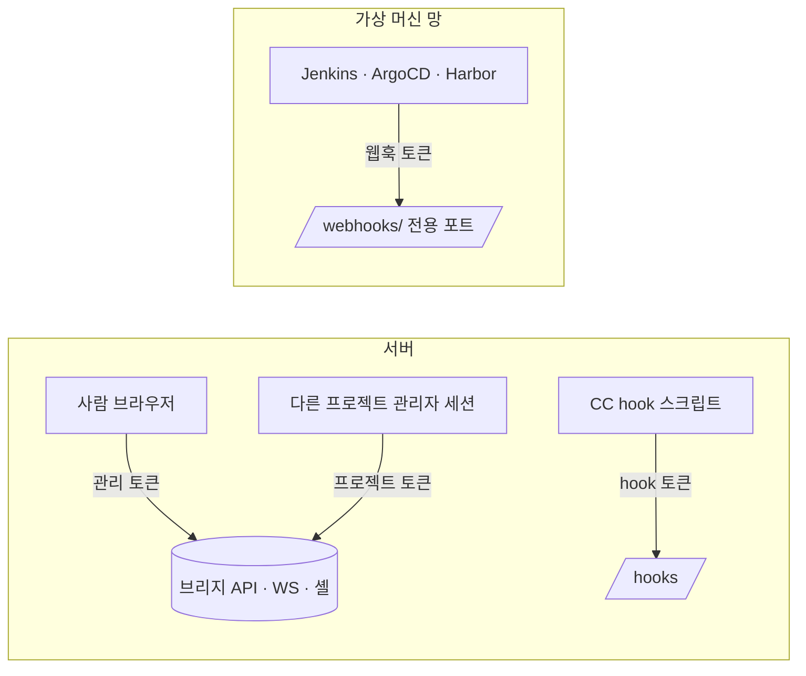

<!--
다루는 곳: bridge/api/auth.py, bridge/scopetoken.py, config/tokens.toml, bridge/mask.py, .env.bridge.example, .env.db.example
읽은 커밋: e5d584b
-->
# 열쇠와 비밀

FOREMAN 브리지는 이 서버에서 도는 Claude Code(CC) 세션을 모두 지켜보고, 세션에 글을 넣고, 세션을 띄우고 끝낸다. 이런 일을 하는 프로그램에 아무나 말을 걸 수 있으면 곤란하다. 그래서 브리지의 문마다 열쇠(토큰)가 있다. 토큰은 길고 무작위인 글자열로, 이것을 아는 쪽만 그 문을 열 수 있다는 약속이다.

이 편은 세 가지를 다룬다. 첫째, 열쇠가 왜 하나가 아니라 넷인지, 각 열쇠로 무엇을 열 수 있는지. 둘째, 열쇠와 비밀번호가 든 파일을 어떻게 다루는지, 특히 그 값이 화면이나 기록에 새지 않게 하려고 무엇을 정했는지. 셋째, 그래도 새어 버린 일들과 그 뒤에 무엇을 바꿨는지, 그리고 마지막 안전망인 가리기(mask)가 무엇을 가리는지.

역할(코더, 관리자, 조사 …)이 할 수 있는 일을 도구 단계에서 막는 장치는 → 글이 아니라 권한으로 편이 다룬다. 이 편은 그보다 바깥, 브리지라는 문 자체의 열쇠 이야기다.

## 열쇠가 넷이 된 까닭

브리지는 처음부터 열쇠를 하나로 두지 않았다. 처음 만들 때 이미 둘로 나눴다. 하나는 사람이 보는 화면과 API를 여는 관리 토큰(`FOREMAN_API_TOKEN`), 다른 하나는 CC의 hook이 브리지로 신호를 보낼 때 쓰는 hook 토큰(`FOREMAN_HOOK_TOKEN`)이다 [code:bridge/config.py]. hook은 CC가 도구를 쓰기 전, 쓴 뒤, 턴이 끝날 때 등에 자동으로 부르는 작은 스크립트다. 이 스크립트는 모든 CC 세션 안에서 돌고, 설정 파일에 경로가 적혀 있고, 수없이 불린다. 새어 나갈 기회가 가장 많은 열쇠라는 뜻이다. 그래서 hook 토큰이 새더라도 그것으로는 세션에 글을 넣거나 API를 부를 수 없게 처음부터 갈랐다 [log:stage1_bridge_db_result.md].

세 번째 열쇠는 CI/CD를 붙이면서 생겼다. Jenkins, Harbor, ArgoCD가 빌드와 배포 소식을 브리지로 보내는데(웹훅), 이들은 이 서버 안이 아니라 가상 머신 위의 쿠버네티스 클러스터에서 돈다. 그쪽에 열쇠를 맡겨야 하는데, 관리 토큰이나 hook 토큰을 클러스터의 비밀 저장소에 넣으면 클러스터가 털렸을 때 FOREMAN 전체가 열린다. 그래서 웹훅 전용 열쇠(`FOREMAN_WEBHOOK_TOKEN`)를 따로 두었다 [code:.env.bridge.example] [log:stage8_cicd_result.md].

네 번째 열쇠인 프로젝트 토큰이 이 편의 가장 큰 이야기다. FOREMAN은 자기 저장소만이 아니라 다른 프로젝트(러닝화 서비스, 챗봇, 인프라 저장소)의 세션도 함께 지켜본다. 각 프로젝트에 관리자 세션을 하나씩 두고, 그 관리자가 FOREMAN API를 불러 자기 프로젝트의 코더를 띄우고 합치고 보고하게 하려 했다. 문제는 그때 열쇠가 관리 토큰 하나뿐이었다는 것이다. 다른 프로젝트 관리자에게 관리 토큰을 쥐여 주면, 그 관리자는 FOREMAN 방의 세션을 띄우는 것은 물론 끝내 버릴 수도 있었다. 실수로 세션 번호 하나를 잘못 적기만 해도 남의 방 세션이 닫힌다. 그래서 프로젝트별 관리자를 켜기 전에 먼저 열쇠의 범위를 묶었다. 순서를 「토큰 범위 묶기 → 관리자 역할 → 그 저장소 규칙」으로 정한 까닭이 이것이다 [log:enable_c_wave2_20261111.md] [c:799bc74].



## 네 열쇠 한눈에

| 열쇠 | 환경 키 이름 | 들어 있는 파일 | 누가 쓰나 | 받는 문 | 새면 열리는 것 |
|---|---|---|---|---|---|
| 관리 토큰 | `FOREMAN_API_TOKEN` | `.env.bridge` | 사람 브라우저, FOREMAN 관리자 세션, 화면 점검 도구 | 모든 `/api/*`, `/ws`, 셸 | FOREMAN 전부 |
| 프로젝트 토큰 | `FOREMAN_TOKEN_<프로젝트>` | `.env.project_tokens` | 그 프로젝트 관리자 세션 | `/api/*` 가운데 그 프로젝트 몫만 | 그 프로젝트 세션과 방 |
| hook 토큰 | `FOREMAN_HOOK_TOKEN` | `.env.bridge` | CC hook 스크립트 | `/hooks/*` | 가짜 hook 신호 넣기 |
| 웹훅 토큰 | `FOREMAN_WEBHOOK_TOKEN` | `.env.bridge`와 클러스터 Secret | Jenkins, ArgoCD, Harbor | 웹훅 전용 포트의 `/webhooks/*` | 가짜 빌드, 배포 소식 넣기(그것도 가상 머신 망 안에서만) |

[code:bridge/api/auth.py] [code:bridge/scopetoken.py] [code:.env.bridge.example]

이 표의 마지막 칸이 열쇠를 가르는 기준이다. 열쇠마다 「이것이 새면 무엇이 열리나」를 먼저 묻고, 그 답이 작아지도록 자리를 나눴다. 관리 토큰만 답이 「전부」이고, 그래서 관리 토큰은 사람과 FOREMAN 관리자만 쓴다 [log:stage8_cicd_result.md].

네 열쇠 모두 32자보다 짧으면 받지 않는다. 관리, hook, 웹훅 토큰은 브리지가 뜰 때 설정 검사에서 막혀 아예 뜨지 않고 [code:bridge/config.py], 프로젝트 토큰은 그 줄만 버리고 「32자보다 짧아 버린 토큰」에 키 이름을 남긴다 [code:bridge/scopetoken.py]. 견본 파일은 만드는 명령으로 `secrets.token_urlsafe(32)`를 권하고, 그 결과를 화면에 남기지 말고 파일로 바로 보내라고 적어 둔다 [code:.env.bridge.example].

## 관리 토큰

관리 토큰은 브리지의 정문 열쇠다. 사람은 픽셀 오피스나 대시보드 화면의 열쇠 단추를 눌러 이 값을 한 번 넣고, 브라우저는 그것을 그 브라우저 저장소(localStorage)에 두었다가 API를 부를 때마다 `Authorization: Bearer` 머리글에 싣는다 [code:bridge/static/js/store.js]. 입력 칸은 비밀번호 칸이라 화면에 글자가 보이지 않는다.

이 값은 `.env.bridge` 한 파일에만 있다. 따로 작업용 폴더(worktree)의 `.env.bridge`도 원본 파일을 가리키는 링크라 사본이 생기지 않는다. 브리지는 뜰 때 한 번 읽고, 세션이나 화면 점검 도구는 쓸 때마다 그 파일에서 셸 변수로 읽어 쓴다 [log:merge_bar_discard_tab_20261111.md]. 브리지 안에서는 이 값을 pydantic의 `SecretStr`로 들고 있어, 설정 객체를 통째로 로그에 찍어도 값 대신 별표가 나온다 [code:bridge/config.py].

관리 토큰으로 들어온 요청은 범위 검사를 하지 않는다. 브리지는 그 요청에 「범위 없음」(`token_scope = None`) 표시를 붙여 뒤 단계로 넘긴다 [code:bridge/api/auth.py].

## 프로젝트 토큰 — 벽이 아니라 칸막이

### 만들고 켜는 법

프로젝트 토큰은 프로젝트마다 하나씩, `.env.project_tokens` 파일에 한 줄씩 들어간다. 줄의 꼴은 `FOREMAN_TOKEN_<프로젝트 이름 대문자>=<값>`이고, 프로젝트 이름의 영문자, 숫자가 아닌 글자는 밑줄로 바뀐다. 예를 들어 `petmint-rag-chatbot`의 키 이름은 `FOREMAN_TOKEN_PETMINT_RAG_CHATBOT`이다 [code:bridge/scopetoken.py].

토큰은 손으로 만들지 않고 명령으로 만든다.

```
.venv/bin/python -m bridge.scopetoken new <프로젝트>   # 새 값을 만들어 파일에만 쓴다
.venv/bin/python -m bridge.scopetoken list             # 켜짐 여부와 키 이름만 보인다
```

`new`는 값을 돌려주지도 화면에 찍지도 않는다. 「어느 파일에 어느 키를 썼다」만 알린다. 같은 키가 이미 있으면 그 줄을 지우고 새 줄을 쓰니, 같은 명령이 곧 바꾸기다. 파일은 처음부터 권한 600(주인만 읽고 쓰기)으로 열고 다 쓴 뒤에도 600으로 한 번 더 맞춘다 [code:bridge/scopetoken.py]. `list`도 키 이름만 늘어놓고 값은 보이지 않는다.

받을지 말지는 `config/tokens.toml`의 `[project_tokens] enabled`가 정한다. 꺼져 있으면 프로젝트 토큰은 아예 모르는 열쇠로 취급해 401(인증 필요)이 되고 관리 토큰은 그대로다. 이 값을 바꾸면 브리지를 다시 띄워야 읽는다 [code:config/tokens.toml]. 처음 만들 때는 꺼 둔 채로 합치고, 켜는 일은 따로 했다. 첫 토큰은 인프라 저장소 것이었다 — 관리자를 실제로 띄울 첫 프로젝트가 그곳이었기 때문이다 [log:enable_c_wave2_20261111.md].

토큰 파일은 브리지를 다시 띄우지 않아도 다시 읽는다. 파일의 수정 시각이 바뀌었을 때만 다시 읽어, 토큰을 새로 만들거나 바꾸면 다음 요청부터 바로 쓰인다 [code:bridge/scopetoken.py].

프로젝트 세션은 그 값을 셸 변수로만 쓴다. `config/tokens.toml` 머리 주석과 각 저장소 관리자 규칙에 적힌 방식은 `T=$(sed -n 's/^FOREMAN_TOKEN_<키>=//p' …/.env.project_tokens)`로 읽고 `Authorization: Bearer $T`로 넘기는 것이다. 값이 명령줄에 글자로 드러나지 않으니 도구 입력에도 화면에도 남지 않는다 [code:config/tokens.toml] [log:coder_c_wave2_20261111.md].

### 프로젝트 토큰이 닿는 곳

관리 토큰이 아닌 값이 들어오면 브리지는 그 값이 어느 프로젝트의 토큰인지 찾고, 찾았으면 그 요청이 그 프로젝트 몫인지 본다. 판정은 `why_out_of_scope` 한 함수가 한다. 범위 안이면 아무것도 돌려주지 않고, 밖이면 「무엇이 왜 막혔는지」 한 문장을 돌려준다 [code:bridge/scopetoken.py].

| 주소 | 열리는 조건 |
|---|---|
| `/api/sessions/{세션 번호}/…` 전부 | 그 세션이 이 프로젝트 세션일 때. 방, 패널, 글 넣기, 끝내기, 합치기 카드 승인까지 |
| `POST /api/spawn` | 띄울 폴더(cwd)가 이 프로젝트 저장소나 그 아래 worktree 안일 때. 링크를 풀어 실제 경로로 본다 |
| `GET /api/spawn/options` | 늘(띄우기 창의 재료 읽기) |
| `POST /api/foreman/plan`, `start`, `handover` | 본문의 프로젝트가 이 프로젝트일 때. 저장된 계획으로 시작하면 그 계획의 프로젝트를 DB에서 찾아 본다 |
| `GET /api/foreman/state`, `notes`, `context`, `merge-order`, `GET /api/merge-prep` | `?project=`가 이 프로젝트일 때 |
| `/api/managers/…` | 읽기는 모두. 부탁 보내기는 보낸 쪽 이름이 이 프로젝트일 때(남의 이름으로 부탁할 수 없다) |
| `GET /api/publish` | `?project=`가 이 프로젝트일 때 |
| `POST /api/publish` | 본문의 프로젝트가 이 프로젝트이고, 덮어쓰기(force)나 한꺼번에 맞추기, 한꺼번에 내리기가 아닐 때 |
| `POST /api/publish/pair` | 본문의 프로젝트가 이 프로젝트일 때 |
| `GET`, `POST /api/postit` | 이 프로젝트 포스트잇일 때 |
| 그 밖의 모든 주소 | 막힘. 대시보드, 승인, 사용량, `/ws`, 셸 모두 관리 토큰만 |

[code:bridge/scopetoken.py] [code:bridge/api/managers.py]

맨 아래 줄이 이 설계의 기본값이다. 목록에 없는 주소는 모두 막는다. 새 API를 만들면 처음에는 관리 토큰만 열리고, 다른 프로젝트 관리자에게 열어 줄 까닭이 생겼을 때 이 표에 한 줄을 더한다. Notion 게시와 포스트잇이 그렇게 나중에 더해졌다 [log:enable_c_wave2_20261111.md] [c:5cde445]. 거꾸로 했다면(다 열고 위험한 것만 막기) 새 API가 생길 때마다 막는 것을 잊을 수 있다.

게시에서 덮어쓰기와 한꺼번에 하는 일을 관리 토큰에만 남긴 까닭은, 그것이 사람에게 먼저 물어야 하는 일이라서다. 프로젝트 관리자는 자기 문서를 평소대로 올릴 수는 있지만 사람이 Notion에서 고친 것을 덮거나 여러 문서를 한꺼번에 바꾸려면 FOREMAN 관리자를 거친다. 덮어쓰기 칸은 `"true"`나 `1` 같은 값도 참으로 읽힐 수 있어, 거짓이 분명한 값(없음, `false`, `0`, 빈 글자)일 때만 통과시킨다. 게시 라우터도 한 번 더 본다 [code:bridge/scopetoken.py].

### 막힐 때 무엇을 말하나

막힌 요청은 403(권한 없음)과 함께 사유를 받는다. 예를 들면 「프로젝트 토큰(ronanlab-infra)은 이 API(GET /api/dashboard)에 닿지 않습니다 — 관리 토큰(FOREMAN_API_TOKEN)이 필요합니다」 같은 문장이다 [log:enable_c_wave2_20261111.md]. 같은 문장이 브리지 로그에 「프로젝트 토큰 거절」 경고로 남는다. 값은 남기지 않고 메서드, 주소, 사유만 남긴다 [code:bridge/api/auth.py].

이렇게 사유를 길게 쓰는 까닭은 FOREMAN의 첫 원칙과 같다. 조용히 막히는 것은 조용히 고장 나는 것과 같다. 받는 쪽이 CC 세션이라, 「403」 숫자만 받으면 토큰이 틀렸는지 주소가 틀렸는지 몰라 엉뚱한 것을 고치려 든다. 「다른 프로젝트(foreman)의 세션 N을 다룰 수 없습니다 — 그 프로젝트 토큰이나 관리 토큰이 필요합니다」처럼 무엇을 하면 되는지까지 말해 주면 그 세션은 FOREMAN 관리자에게 부탁하는 길로 간다.

판정 도중 탈이 나면 막는 쪽으로 기운다. 범위를 확인하다 DB를 못 읽으면 「범위를 확인하지 못했습니다」로 403을 준다. 프로젝트 이름 목록을 못 읽으면 프로젝트 토큰만 401이 되고 관리 토큰은 그대로 열린다. `config/tokens.toml`을 못 읽으면 로그에 오류를 남기고 프로젝트 토큰을 받지 않는다 [code:bridge/api/auth.py]. 어느 경우든 사람이 FOREMAN을 쓰는 길은 끊기지 않고, 프로젝트 관리자만 잠시 막힌다.

켤 때 확인한 결과는 이렇다. 관리 토큰으로 대시보드 200, 인프라 토큰으로 대시보드 403, 관리자 주소 200, 인프라 세션 200, FOREMAN 세션 403, 틀린 토큰 401. 거절 로그 두 줄에 두 토큰 값은 한 번도 들어 있지 않았다(값을 화면에 내지 않고 개수만 센 결과) [log:enable_c_wave2_20261111.md].

### 칸막이라는 말의 뜻

프로젝트 토큰은 벽이 아니다. 모든 CC 세션은 같은 유닉스 사용자로 돌고, 그 사용자는 `.env.bridge`도 읽을 수 있다. 마음먹고 관리 토큰을 꺼내 쓰는 세션을 이 장치로 막을 수는 없다. 이 장치가 막는 것은 잘못 부르는 일이다. 세션 번호를 잘못 적었거나, 다른 프로젝트 이야기를 듣고 그쪽 세션을 건드리려 하거나, 지시를 넓게 해석했을 때 그 호출이 403과 사유로 돌아온다 [code:bridge/scopetoken.py]. 다른 프로젝트 관리자의 규칙에 「FOREMAN API는 이 프로젝트 토큰으로만 부른다」를 적어 둔 것과 이 칸막이가 짝을 이룬다 [log:coder_c_wave2_20261111.md]. 관리 토큰 파일을 읽는 것 자체를 막는 일은 → 글이 아니라 권한으로 편의 장치들이 맡는다.

벽을 세우려면 세션마다 다른 유닉스 사용자로 돌려야 하는데, 그러면 worktree 링크, 공용 가상환경, CC 메모리 공유가 모두 깨진다. 그 값을 치르기보다 칸막이와 규칙으로 실수를 막는 쪽을 골랐다.

## hook 토큰

CC hook 스크립트(`scripts/foreman-hook.sh`, `scripts/foreman-decide.sh`)는 `.env.bridge`에서 `FOREMAN_HOOK_TOKEN` 줄을 읽어 브리지의 `/hooks/*`로 보낸다. 값이 없으면 아무것도 보내지 않고 조용히 끝나 CC를 붙잡지 않는다. 토큰을 curl의 명령줄 인자로 넘기지 않고 프로세스 치환(`-H @<(printf …)`)으로 넘기는 것이 눈여겨볼 곳이다. 명령줄 인자는 프로세스 목록(`ps`)에 그대로 보이므로, 같은 서버의 누구든 그 순간 목록을 보면 토큰을 읽을 수 있다. 프로세스 치환은 값을 파일 서술자로 넘겨 목록에 나타나지 않는다 [code:scripts/foreman-hook.sh].

hook을 받는 쪽은 토큰을 비교하고, 틀리면 401과 함께 로그에 사유를 남긴다. 사유는 「Authorization 없음」, 「Bearer 아님」, 「토큰 불일치(받은 길이 N)」 셋 가운데 하나다 [code:bridge/api/hooks.py]. hook 신호가 어떻게 적재되는지는 → CC hook 받기 편이 다룬다.

## 웹훅 토큰 — 새도 되는 비밀의 무게

웹훅은 클러스터에서 온다. 브리지 본체는 127.0.0.1(이 서버 안에서만 닿는 주소)에 묶여 있어 가상 머신에서는 닿지 않는다. 그래서 같은 프로세스 안에 웹훅 전용 문을 하나 더 연다. 가상 머신 망 쪽 주소의 8001 포트로, 이 문은 `/webhooks/*` 말고는 받지 않고, 보낸 곳의 IP가 가상 머신 망이 아니면 거절하고, 웹훅 토큰이 맞아야 연다 [code:bridge/config.py] [code:bridge/api/webhooks.py]. 웹훅 토큰이 설정되지 않았으면 이 포트 자체를 열지 않는다 [code:bridge/main.py].

웹훅 토큰을 고를 때 쓴 기준이 이 편 전체에 걸린다. Jenkins를 처음 붙일 때는 FOREMAN이 Jenkins API를 직접 조회하는 길도 있었다. 그러려면 Jenkins API 토큰을 이 서버에 두어야 하는데, 그 토큰은 Jenkins 관리자 권한, 곧 배포 경로 전체의 열쇠다. 반대로 Jenkins가 FOREMAN에게 알려 주는 길이면 FOREMAN이 쥐는 것은 웹훅 토큰뿐이고, 이것이 새도 할 수 있는 일은 FOREMAN에 가짜 빌드 소식을 넣는 것뿐이다. 그것도 가상 머신 망 안에서만 [log:stage8_cicd_result.md]. 같은 일을 하는 두 길 가운데 「새면 무엇이 열리나」가 작은 쪽을 골랐다. 이 판단이 실제로 쓸모를 보인 일이 아래 「비밀값이 찍힌 일들」에 있다.

웹훅 토큰은 두 곳에 있다. 받는 쪽인 `.env.bridge`와, 보내는 쪽인 클러스터의 Secret이다. 그래서 바꿀 때는 차례가 중요하다. 이것도 아래에서 다룬다.

## 열쇠를 받는 문의 공통 규칙

네 문은 모두 같은 몇 가지 규칙을 따른다.

첫째, 값의 비교는 `hmac.compare_digest`로 한다 [code:bridge/api/auth.py]. 보통의 문자열 비교는 첫 글자부터 견주다 다른 글자를 만나면 바로 멈춘다. 그러면 맞는 글자가 많을수록 답이 조금 늦게 오고, 그 시간 차를 재면 한 글자씩 알아낼 수 있다. `compare_digest`는 어디서 달라도 같은 시간이 걸린다. 프로젝트 토큰을 찾을 때도 처음 맞는 것에서 멈추지 않고 모든 후보와 끝까지 견준다. 어느 프로젝트에서 맞았는지가 시간으로 새지 않게 하려는 것이다 [code:bridge/scopetoken.py].

둘째, 거절은 언제나 이유와 함께 로그에 남기되, 값은 남기지 않는다. 남기는 것은 받은 값의 길이뿐이다. 길이만 보아도 흔한 실수를 가늠할 수 있다. 키 이름까지 함께 붙여넣었으면 길어지고, 따옴표가 붙었으면 두 글자 늘고, 잘렸으면 짧아진다 [code:bridge/api/ws.py]. 이 규칙은 브리지를 처음 만들 때 웹소켓이 이유 없이 1008(정책 위반)로 끊기던 일에서 왔다. 끊긴 까닭이 어디에도 남지 않아 무엇이 틀렸는지 알 수 없었고, 그 뒤로 「거절에는 이유를」이 모든 문의 규칙이 됐다 [code:bridge/api/hooks.py].

셋째, 열쇠는 머리글로만 받는다. HTTP는 `Authorization: Bearer` 머리글, 웹소켓은 아래처럼 첫 메시지다. 주소(URL)에는 절대 싣지 않는다.

## 웹소켓은 첫 메시지로 연다

화면은 웹소켓(`/ws`)으로 이벤트를 실시간으로 받는다. 브라우저의 웹소켓은 HTTP와 달리 연결할 때 `Authorization` 머리글을 붙일 수 없다. 흔한 해결책은 토큰을 주소 뒤에 `?token=…`처럼 붙이는 것인데, FOREMAN은 이 길을 쓰지 않는다. 주소는 웹 서버 접근 로그, 프록시 로그, 브라우저 기록에 그대로 남기 때문이다. 로그에 한 번 남은 토큰은 그 로그를 읽을 수 있는 모든 것에 열린다 [log:stage1_bridge_db_result.md].

대신 연결을 먼저 받아들이고, 정해진 시간 안에 첫 메시지로 열쇠를 받는다 [code:bridge/api/ws.py].

```
브라우저 → {"type": "auth", "token": "<관리 토큰>"}     연결 뒤 5초 안에
브리지   → {"type": "hello", "heartbeat_s": 15, "ui": "<화면 코드 지문>"}   통과하면
브리지   → 연결 닫기(1008, 사유)                         틀리면
```

5초와 15초는 설정의 `ws_auth_timeout_s`, `ws_heartbeat_s` 기본값이다 [code:bridge/config.py]. 틀렸을 때 닫는 사유는 「5초 안에 인증 메시지가 없음」, 「첫 메시지가 JSON이 아님」, 「type이 "auth"가 아님」, 「token이 없음」, 「토큰 불일치(받은 길이 N)」 가운데 하나이고, 브라우저에도 그대로 간다. 다만 기대하는 길이는 서버 로그에만 남긴다. 그것까지 밖에 알려 주면 맞는 길이를 알려 주는 셈이기 때문이다 [code:bridge/api/ws.py].

웹소켓은 관리 토큰만 받는다. 프로젝트 토큰으로는 열 수 없다. 이벤트 흐름에는 모든 프로젝트의 소식이 섞여 있어, 프로젝트별로 거를 장치가 없는 한 화면 전체를 보는 일은 관리용이다 [code:bridge/scopetoken.py]. 셸 패널도 같다. 셸은 처음에 관리 토큰으로 쿠키를 받아 그 쿠키로 연결한다 [code:bridge/api/terminal.py]. 그 자세한 길은 → 셸 패널과 세션 화면 편이 다룬다.

## 비밀 파일 다루기

### 파일과 그 견본

비밀이 든 파일은 모두 저장소 맨 위에 `.env.`로 시작하는 이름으로 있고, 권한은 600이며, `.gitignore`의 `.env*`에 걸려 git에 올라가지 않는다. 대신 무엇을 채워야 하는지 알 수 있게 값이 빈 견본을 둔다 [code:bridge/config.py] [code:.env.db.example].

| 파일 | 든 것 | 견본 |
|---|---|---|
| `.env.bridge` | 관리, hook, 웹훅 토큰과 디버그 주소 켜기 | `.env.bridge.example` |
| `.env.db` | MySQL 사용자, 비밀번호, DB 이름 | `.env.db.example` |
| `.env.project_tokens` | 프로젝트 토큰 | 없음(명령이 만든다) |
| `.env.telegram` | 알림 봇 토큰 | 없음(→ 11 알림) |

`.env.db`는 MySQL 컨테이너를 띄우는 compose와 브리지가 같은 파일을 읽는다. 그 안의 `MYSQL_ROOT_PASSWORD`는 컨테이너가 처음 뜰 때만 쓰고 브리지는 읽지 않는다. 설정이 모르는 키를 버리게 해 두었기 때문이다 [code:.env.db.example] [code:bridge/config.py]. 브리지가 DB 관리자 비밀번호를 손에 쥘 까닭이 없으니 아예 받지 않는다.

`.env.bridge.example`의 `DEBUG_ENDPOINTS=false`는 비밀은 아니지만 같은 파일에 있다. 디버그 주소는 바깥에 열기 전에 꺼 두기로 한 것이라 견본의 기본값을 꺼짐으로 두었다 [code:.env.bridge.example] [log:stage1_bridge_db_result.md].

### Edit, Write로 고치지 않는 까닭

이 프로젝트의 규칙은 「파일은 Edit, Write 도구로 고친다(Bash의 sed나 python으로 고치지 않는다)」이다. 고친 내용이 도구 입력에 그대로 남아 사람이 보고, 승인 장치가 읽고, 기록이 되기 때문이다. 그런데 비밀 파일만은 정반대다. Edit 도구로 `.env.bridge`의 토큰 줄을 바꾸면, 바꿀 옛 값과 새 값이 도구 입력으로 그대로 화면에 나오고, CC 대화 파일에 영원히 남는다 [log:merge_token_docs_20261111.md]. 바꾼 순간 새 값이 이미 새어 버리는 셈이다. 같은 까닭으로 Write도 안 된다.

그래서 비밀 파일만은 규칙을 뒤집었다. 값을 셸 변수나 스크립트 안에서만 다루고 화면에 내지 않는 방식으로 고친다. 관리 토큰을 실제로 바꿀 때 쓴 차례는 이랬다 [log:merge_token_docs_20261111.md].

1. 승인 대기가 하나도 없는지 본다(브리지를 다시 띄우면 기다리던 승인이 사라진다) [log:merge_token_docs_20261111.md]
2. 작업용 임시 폴더의 짧은 파이썬 스크립트가 새 값을 `secrets.token_urlsafe(32)`로 만들어 그 줄만 바꾼다. 값은 출력하지 않고, 권한 600을 지키고, 백업 파일을 남기지 않는다 [log:merge_token_docs_20261111.md]
3. 바로 브리지를 다시 띄운다
4. 옛 값으로는 401, 새 값으로는 200이 나는지 본다. 새 값이 200이 아니면 옛 줄로 되돌리는 길도 스크립트에 넣어 두었다 [log:merge_token_docs_20261111.md]
5. 파일에 그 키 줄이 하나인지, 옛 값이 남은 곳이 0인지 개수로만 센다 [log:merge_token_docs_20261111.md]
6. 브라우저 열쇠는 사람이 다시 넣는다 [log:merge_token_docs_20261111.md]

다섯째의 「개수로만 센다」가 중요하다. 값이 들어갔는지 남았는지 확인할 때는 `grep -cF -- "$V"`처럼 몇 줄에 있는지만 묻고, 값 자체나 `Bearer` 뒤 글자를 뽑아 보는 명령은 쓰지 않는다. 한 번 그렇게 했다가 값이 찍혔다(아래 표의 다섯째) [log:merge_bar_discard_tab_20261111.md].

이 일을 하던 때는 「Edit, Write로만」 규칙과 이 방식이 서로 부딪혔다. 그 세션은 값을 화면에 내지 않는 쪽을 앞세우고 어긋난 점을 사람에게 알렸고 [log:merge_token_docs_20261111.md], 그 뒤 프로젝트 규칙에 「비밀값이 든 파일은 Edit, Write로 고치지 않는다」는 예외가 들어갔다.

승인 장치도 이 판단과 맞춰 두었다. 비밀 파일을 Read, Edit 도구로 여는 것은 묻지 않고(`tool_ask = false`), 비밀 파일이 curl, scp, ssh 같은 것과 한 명령에 함께 있어 밖으로 나갈 수 있을 때만 묻는다(`mode = "send"`) [code:config/approval.toml]. 화면에 내지 않는 일은 승인 창이 아니라 작업 규칙이 지킨다. 승인 창을 너무 자주 띄우면 사람이 내용을 보지 않고 누르게 되기 때문이다. 이 선을 정한 자세한 이야기는 → 규칙: 실행과 글자 편에 있다.

## 비밀값이 찍힌 일들

규칙을 세워도 값은 새었다. 대부분 비밀 파일을 직접 열어서가 아니라, 어떤 도구가 생각지 못한 곳에서 값을 펼쳐 보여서였다. 이 표는 그 일들과 그 뒤 바꾼 것이다.

| 무엇이 | 어떻게 찍혔나 | 그 뒤 바꾼 것 |
|---|---|---|
| CC 세션 간 통신 열쇠(`~/.claude/sessions/*.key`) | 처음 서버를 조사하다 그 파일 내용이 조사 출력에 나왔다 [log:01_kickoff_result.md] | 기록에 옮기지 않았다. 형식을 모르는 비밀은 가리기로 잡을 수 없다는 것을 알게 돼, 도구 결과 본문을 아예 DB에 저장하지 않기로 했다 [log:stage2_transcript_result.md] |
| 텔레그램 봇 토큰 | 브리지 로그 설정이 httpx의 요청 로그까지 켜, 봇 토큰이 든 요청 주소가 통째로 로그에 찍혔다. 로그를 보다 세션 화면에도 한 번 나왔다 [log:stage7_terminal_result.md] | httpx, httpcore 로그를 경고 이상만 남기게 했다 [code:bridge/__main__.py]. 로그 파일의 토큰을 지우고, 사람이 봇 토큰을 새로 받아 옛것을 버렸다 |
| 웹훅 토큰 | ArgoCD 알림 시험 전송 명령이 디버그 출력으로 보내는 요청을 머리글째 찍었고, 그것이 도구 결과로 세션에 들어왔다 [log:stage8_cicd_result.md] | 시험 전송 명령은 출력을 버리고 받는 쪽 로그로만 확인한다. 토큰은 받는 쪽을 맨 끝에 두는 차례로 바꿨다 |
| 관리 토큰과 hook 토큰 | 시험이 실패하면 pytest가 호출 인자를 풀어 보여 주는데, 그 안의 `Authorization` 머리글 값이 그대로 출력됐다 [log:test_db_per_session_20261111.md] | 시험의 머리글을 값 대신 `'***'`를 보이는 사전으로 만든다(`_bearer()`) [c:702bd42] [c:a5cb3dd] |
| 관리 토큰 | 위 고침이 다른 꼴의 실패도 막는지 확인하던 관리자가 `Bearer` 뒤 글자를 뽑아 보는 명령을 써 값이 그 세션 출력에 나왔다 [log:merge_bar_discard_tab_20261111.md] | 사람에게 바로 알리고 관리 토큰을 바꿨다(위 차례). 「Bearer 뒤 글자를 뽑는 명령은 쓰지 않는다, 개수로만 센다」가 규칙이 됐다 |

### 피해를 어떻게 쟀나

새었다고 해서 늘 같은 무게는 아니다. 찍힐 때마다 세 가지를 따졌다. 값이 어디에 남았나, 그것을 누가 읽을 수 있나, 그 값으로 무엇을 할 수 있나.

웹훅 토큰이 찍혔을 때를 예로 들면, 값이 남은 곳은 그 세션의 대화 파일(권한 600, 주인만 읽음)과 대화 맥락뿐이었다. 같은 서버를 쓰는 다른 계정은 읽을 수 없다. FOREMAN DB에는 도구 결과의 길이와 오류 여부만 들어가니 값이 들어가지 않았다. 그리고 그 토큰으로 할 수 있는 일은 가상 머신 망 안에서 가짜 빌드 소식을 넣는 것뿐이었다 [log:stage8_cicd_result.md]. 「새도 되는 비밀의 무게」로 골랐던 열쇠가 정확히 그런 때를 위한 것이었다. 같은 실수로 Jenkins API 토큰이 찍혔다면 자격 증명과 인프라 쓰기 키까지 열려, 계정 정리와 감사가 따랐을 것이다. 덕분에 「급하지 않다」고 판단할 수 있었다.

그래도 바꿨다. 노출된 비밀은 바꾸는 것이 원칙이고, 그때가 비용이 가장 적었다. ArgoCD는 구독을 켜기 전이라 보낼 것이 없었고 Jenkins는 빌드가 없는 때를 고르면 됐다.

관리 토큰이 찍혔을 때는 값이 남은 곳을 끝까지 셌다. 남은 곳은 그 세션의 CC 대화 파일 하나였고, 브리지 로그, 시스템 저널, `log/` 기록, FOREMAN DB에는 0이었다. DB에 들어간 사본은 가리기가 정확한 값으로 바꿔 두었다 [log:merge_bar_discard_tab_20261111.md].

### 바꾸는 차례 — 받는 쪽을 맨 끝에

열쇠가 두 곳에 있을 때는 바꾸는 차례가 틈을 만든다. 웹훅 토큰을 처음 바꾸려 할 때 `.env.bridge`부터 바꾸려다 사람이 멈췄다. 받는 쪽을 먼저 바꾸면 그 순간부터 보내는 쪽(ArgoCD, Jenkins)이 가진 값은 옛것이 되고, 그 사이 오는 소식은 모두 401로 버려진다 [log:stage8_cicd_result.md]. 그래서 이렇게 바꿨다.

1. Jenkins에 도는 빌드가 없는지 본다(돌고 있으면 끝나길 기다린다) [log:stage8_cicd_result.md]
2. 새 값을 화면에 내지 않고 `.env.bridge`에 쓴다. 브리지는 아직 옛 값으로 받고 있다 [log:stage8_cicd_result.md]
3. ArgoCD Secret을 바꾼다. 값은 표준 입력과 셸 내장 `printf`로 넘겨 프로세스 목록에도 보이지 않게 한다 [log:stage8_cicd_result.md]
4. Jenkins Secret을 바꾸고 Jenkins를 다시 띄운다(자격 증명은 뜰 때 읽는다) [log:stage8_cicd_result.md]
5. 마지막으로 브리지를 다시 띄워 새 값을 받게 한다 [log:stage8_cicd_result.md]
6. 세 곳에 든 값의 해시 앞 12자리가 같은지 본다(값끼리 견주지 않는다). 토큰 없이 401, 새 값으로 202, 옛 값으로 401 [log:stage8_cicd_result.md]

여섯째의 해시 비교도 「값을 화면에 내지 않고 같은지 확인하는」 방법이다 [log:stage8_cicd_result.md]. 해시 앞 몇 자리로는 원래 값을 되살릴 수 없지만, 세 곳이 같은 값을 가졌는지는 알 수 있다.

## 가리기(mask)가 가리는 것

위의 규칙들이 모두 실패했을 때를 위한 마지막 안전망이 `bridge/mask.py`의 `Masker`다. 브리지는 세션의 대화를 DB에 옮겨 적고, 화면과 알림으로 내보낸다. 세션이 실수로 비밀을 명령에 적었거나 글에 붙여넣었다면, 그것이 DB와 화면과 텔레그램으로 퍼지기 전에 이 장치가 가린다 [code:bridge/mask.py].

가리는 방식은 세 겹이다.

첫째, 정확한 값. 브리지가 뜰 때 `.env.db`, `.env.bridge`, `.env.telegram`을 읽어, 키 이름에 PASSWORD, PASSWD, TOKEN, SECRET, KEY가 들어간 줄의 값(8자 이상)을 기억한다. 글 속에서 그 값을 만나면 `«masked:키 이름»`으로 바꾼다. 긴 값부터 바꿔, 한 값이 다른 값을 품고 있어도 꼬이지 않는다. 키 이름에 비밀을 뜻하는 낱말이 없는 값은 가리지 않는다. 처음에는 파일의 모든 값을 가렸더니 DB 사용자 이름(`foreman_app`)까지 가려져 글이 읽히지 않았다 [code:bridge/mask.py]. 숫자만 있거나 `true`, `false`인 값도 건너뛴다.

둘째, 알려진 모양. 개인키 블록, 텔레그램 봇 토큰, Anthropic 키, GitHub 토큰, AWS 키, `Bearer` 뒤의 값처럼 생김새로 알아볼 수 있는 것들을 정규식으로 찾아 바꾼다.

셋째, 키=값 꼴. 이름에 PASSWORD, SECRET, TOKEN, API_KEY, PWD가 든 대입(`X_TOKEN=…`, `password: …`)의 값(6자 이상)을 가린다 [code:bridge/mask.py].

이 장치는 한 곳이 아니라 비밀이 밖으로 나갈 수 있는 거의 모든 길에 걸려 있다. 대화를 DB에 적재할 때(프롬프트, 명령, assistant 글, 대기열 내용) [code:bridge/ingest.py], 승인 카드의 대상과 요약을 만들 때 [code:bridge/approvals.py], 텔레그램으로 보낼 때 [code:bridge/telegram.py], 셸 패널의 명령과 출력을 세션에 넘길 때 [code:bridge/terminal.py], 그리고 서기 물어보기, 압축 손실 재기, 포스트잇 근거 확인처럼 세션 글을 다른 모델에 넘기는 곳들이다. 셸 쪽은 여기에 더해 `--password` 같은 옵션, `docker login -p`, `mysql -p`, 주소 안의 `사용자:비밀번호@`처럼 명령줄에서 비밀이 오는 자리를 한 번 더 가린다 [code:bridge/terminal.py]. 적재 쪽에서 언제, 어떤 칸에 가리기가 걸리는지는 → 적재와 내보내기 편이 다룬다.

### 가리기가 못 잡는 것

가리기는 마지막 그물이지 벽이 아니다. 형식을 모르는 비밀, 예컨대 CC 세션 간 통신 열쇠 파일의 내용은 세 겹 어디에도 걸리지 않을 수 있다. 처음 서버를 조사할 때 바로 그 값이 찍혔다. 그래서 FOREMAN은 도구 결과의 본문을 처음부터 저장하지 않는다. 길이와 오류 여부만, 오류일 때는 앞 300자만(그것도 가린 뒤) 남긴다 [code:bridge/assembler.py]. 명령의 결과에 무엇이 들었는지 알 수 없으니, 모르는 것은 담지 않는 쪽을 골랐다. 대신 원문이 필요하면 CC 대화 파일(기본 보존 120일)에서 다시 읽는다 [log:stage2_transcript_result.md].

가리기가 원본을 고치지 않는다는 것도 기억해야 한다. 가리기는 FOREMAN이 만드는 사본(DB, 화면, 알림)에만 걸린다. CC가 쓰는 대화 파일과 세션 화면에 이미 찍힌 값은 그대로 남는다. 위 표의 일들에서 「값이 남은 곳」이 늘 그 세션의 대화 파일이었던 까닭이다 [log:merge_bar_discard_tab_20261111.md]. 그래서 찍힌 뒤에 할 수 있는 일은 결국 바꾸기뿐이고, 바꾸기를 싸게 만드는 것(새도 되는 열쇠 고르기, 바꾸는 차례 정해 두기)이 가리기만큼 중요하다.

정확한 값 목록은 `.env.db`, `.env.bridge`, `.env.telegram` 세 파일에서만 읽는다 [code:bridge/mask.py]. 그래서 지금 프로젝트 토큰 파일(`.env.project_tokens`)과 Notion 연동 토큰 파일의 값은 정확한 값으로는 가려지지 않고, `Bearer` 뒤에 오거나 키=값 꼴로 적혔을 때만 둘째, 셋째 겹에 걸린다. 프로젝트 토큰은 늘 `Bearer $T`처럼 변수로 쓰니 평소에는 값이 글자로 나타나지 않지만, 값이 맨몸으로 찍히면 이 그물을 빠져나간다. 또 정확한 값 목록은 대개 `Masker`를 만들 때 한 번 읽으니, 토큰을 바꾼 뒤에는 브리지를 다시 띄워야 새 값도 가린다. 열쇠를 바꾸는 차례에 「브리지 다시 띄우기」가 늘 들어 있어 지금까지는 저절로 맞았다 [log:merge_token_docs_20261111.md].

## 정리 — 이 편의 원칙들

열쇠를 나눌 때는 「새면 무엇이 열리나」를 먼저 묻는다. 그 답이 작아지는 쪽으로 열쇠를 가르고, 같은 일을 하는 두 길이면 쥐는 비밀이 가벼운 쪽을 고른다. 프로젝트 토큰은 목록에 있는 주소만 열고 나머지는 모두 막으며, 막을 때는 무엇을 하면 되는지까지 말한다. 열쇠는 주소에 싣지 않고 머리글과 첫 메시지로만 받는다. 비밀 파일은 값이 도구 입력에 남지 않는 방식으로 고치고, 확인은 개수와 해시로만 한다. 그리고 그래도 샐 것을 전제로 가리기와 「모르는 것은 담지 않기」를 겹쳐 두고, 새었을 때 바꾸는 차례를 미리 정해 둔다.
