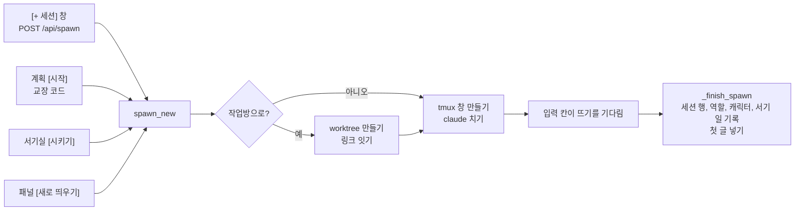

<!--
다루는 곳: bridge/handoff.py, bridge/worktree.py, bridge/preview.py, bridge/previews.py, bridge/api/handoff.py, config/worktree.toml, bridge/static/js/newsession.js, bridge/docrefs.py, tests/test_handoff.py, tests/test_manager_seat.py, tests/test_preview.py, tests/test_worktree.py, tests/test_wt_end.py, tests/test_wt_truth.py
읽은 커밋: fb7121b
-->

# 06 세션 띄우기와 따로 작업

FOREMAN에서 일하는 단위는 세션이다. 세션 하나는 Claude Code(이하 CC) 프로그램 하나가 tmux 창 하나 안에서 도는 것이다. 이 편은 그 세션이 어떻게 생겨나는지, 그리고 한 저장소에 세션이 둘 이상 붙을 때 서로의 파일을 덮어쓰지 않도록 어떻게 자리를 나눠 주는지를 다룬다. 자리를 나누는 장치를 코드에서는 worktree라 부르고, 화면에서는 작업방이라 부른다. 작업방에서 고친 화면을 합치기 전에 미리 보는 미리보기 브리지도 여기서 다룬다.

다루지 않는 것도 먼저 적어 둔다. 세션을 띄울 때 어떤 모델을 고르는지는 「→ 13 사용량과 모델」, 작업방의 일을 원본에 합치는 차례는 「→ 07 합치기」, 맥락이 꽉 찬 세션을 새 세션으로 옮기는 인계는 「→ 08 인계와 압축 손실」에서 다룬다. 역할 다섯(코더, 디자이너, 서기, 조사, 관리자)과 권한은 「→ 05 역할과 권한」에 있다.

## 1. 띄우는 길은 셋, 들어가는 문은 하나

사람이나 다른 세션이 새 세션을 띄우는 길은 셋이다.

| 길 | 어디서 누르나 | 무엇을 넘기나 |
|---|---|---|
| 직접 띄우기 | 화면의 [+ 세션] 창(`newsession.js`), 세션 패널의 [새로 띄우기] | 폴더, 이름, 역할, 모델, 맡을 파일, 옮기기용 요약 |
| 계획 [시작] | 교장(감독, 팀장, 소장 등 테마마다 이름이 다르다)이 세운 계획 카드 | 세션마다 역할, 모델, 첫 글, 작업방 여부, 읽기 전용, 서기 일 종류 |
| 서기실 [시키기] | 서기실 화면 | 서기 일 종류와 그 일의 첫 글 |

여기에 포스트잇 갱신처럼 브리지가 스스로 조사 세션을 띄우는 길이 하나 더 있지만, 그것도 같은 문을 쓴다 [code:bridge/postit.py].

세 길은 생김새가 다르지만 모두 `HandoffManager.spawn_new` 한 함수로 들어간다 [code:bridge/handoff.py]. [+ 세션] 창은 `POST /api/spawn`을 부르고 [code:bridge/api/handoff.py], 계획 [시작]은 교장 코드가 계획의 세션 칸을 하나씩 돌며 같은 함수를 부르며 [code:bridge/foreman.py], 서기실은 `worktree=True`와 서기 일 종류를 넣어 부른다 [code:bridge/scribe_room.py]. 세션 패널의 [새로 띄우기]는 지금 세션과 같은 폴더, 같은 역할, 같은 모델로 `spawn`을 부르고, 그것도 결국 `spawn_new`로 넘긴다.



### 왜 한 곳으로 모았나

처음부터 한 곳이었던 것은 아니다. tmux 창을 만들고 CC를 띄우는 부분은 처음부터 `spawn_new` 하나였지만, 띄운 뒤에 남기는 기록은 길마다 따로 있었다. 특히 서기 세션이 무슨 일을 맡았는지 적는 기록(`session_action`의 `scribe-task`)은 서기실 [시키기]만 스스로 남겼다. 계획 [시작]으로 띄운 서기는 이 기록이 없었다.

그 결과 서기실은 계획 길로 뜬 서기를 몰랐다. 서기실은 같은 일, 같은 파일을 두 서기가 동시에 고치지 않도록 「열려 있는 일」을 세어 막는데, 계획 길 서기는 그 셈에 들어가지 않았다. 운영 DB를 세어 보니 서기실이 모르는 계획 길 서기가 FOREMAN 저장소에 15개, 펫퍼민트 저장소에 1개였다 [log:foreman-4_scribe_two_paths_20261115.md]. 같은 날 반대 방향의 조용한 고장도 보였다. 펫퍼민트 저장소의 문서 점검 서기 하나는 작업방 폴더가 이미 없는데 합치기 기록이 없다는 까닭으로 닷새 동안 「열려 있음」으로 남아 같은 종류의 일을 막고 있었다 [log:foreman-4_scribe_two_paths_20261115.md].

그래서 서기 일 종류를 남기는 일을 `spawn_new`의 인자(`scribe_task`)로 받고, 실제 기록은 세션 행이 생기는 `_finish_spawn` 한 곳에서 하게 했다 [code:bridge/handoff.py] [c:9fce185]. 자리를 `_finish_spawn`으로 고른 데는 까닭이 있다. CC가 처음 쓰는 폴더라 폴더 신뢰 창이 뜨면 `spawn_new`는 세션 행을 만들지 못한 채 먼저 돌아오고, 사람이 답한 뒤의 일은 뒤에서 도는 `_finish_spawn`이 이어 한다. 세션 번호가 생기는 곳이 이 하나뿐이라, 세 길과 신뢰 창 길이 모두 반드시 지난다. 서기 일 종류를 받지 못하면 옮기기로 띄운 세션은 옛 세션의 일 종류를 잇고, 그것도 없으면 `plan`(계획 길)으로 적는다.

맡을 파일 기록(누가 어떤 파일을 고치려는지)은 반대로 `spawn_new` 안에 넣지 않았다. 계획 [시작]은 계획 하나에 세션 여럿을 한 줄씩 적고, [+ 세션]은 띄우기에 실패한 것까지 적는 등 길마다 적는 모양이 달라서, 한 곳에 넣으면 계획 길이 두 번 적게 된다. 대신 빠져 있던 서기실 길에도 같은 기록을 채워 세 길이 같은 표를 보게 했다 [log:foreman-4_scribe_two_paths_20261115.md]. 그 기록으로 겹침을 알리는 일은 「→ 09 교장과 관리자」에서 다룬다.

정리하면, 띄우는 몸통(tmux, CC, 작업방, 세션 행, 역할, 캐릭터, 서기 일)은 한 함수에 있고, 길마다 다른 것은 들어오기 전에 무엇을 넘기느냐뿐이다. 새 길을 하나 더 만들어도 `spawn_new`만 부르면 기록이 저절로 따라온다.

## 2. tmux 창과 CC를 띄우는 차례

`spawn_new`가 실제로 하는 일을 차례대로 적는다 [code:bridge/handoff.py].

**폴더와 모델을 먼저 본다.** 넘겨받은 폴더를 실제 경로로 풀고 없으면 거부한다. 모델 이름이 고를 수 있는 목록에 없으면 거부하고, 비어 있으면 역할 기본값을 쓴다(상세는 「→ 13 사용량과 모델」) [code:bridge/model_choice.py]. 옮기기용 요약을 넣기로 했으면 그 요약이 넣을 수 있는 상태인지 먼저 확인한다. 안 되는 요약이면 tmux 창도 만들지 않고 멈춘다. 무언가를 만들어 놓은 뒤에 실패하면 치울 것이 생기기 때문에, 거부할 수 있는 것은 모두 만들기 전에 거부한다 [code:bridge/handoff.py].

**관리자는 따로 다룬다.** 역할이 관리자면 작업방을 켜라고 했거나 폴더가 이미 작업방 안일 때 거부한다. 관리자는 합치고 시험하고 push하는 자리라 원본 폴더에서만 뜬다. 원본 폴더에 관리자 세션이 이미 살아 있어도 거부한다(관리자는 원본 폴더에 하나). 전에는 살아 있는 세션 수만 보고 관리자도 작업방으로 보내 관리자가 `.worktrees/` 안에 뜬 일이 있어, 이 검사를 작업방을 만들기 전에 두었다.

**tmux 창 이름을 정한다.** 이름은 `cc-<프로젝트 이름>`이다. 프로젝트 이름에서 영소문자와 숫자 밖의 글자는 `-`로 바꾼다. 프로젝트에 속하지 않은 폴더(떠돌이)는 폴더 이름을 쓴다. 같은 이름의 tmux 세션이 이미 있으면 `-2`, `-3`을 붙인다. 그래서 FOREMAN 저장소에 세션이 넷 떠 있으면 `cc-foreman`, `cc-foreman-2`, `cc-foreman-3`, `cc-foreman-4`가 된다. 이 이름이 뒤에서 작업방 이름이 된다 [code:bridge/handoff.py].

**작업방으로 띄울지 정한다.** 3절에서 자세히 본다.

**CC를 띄운다.** 그 폴더에서 빈 tmux 세션을 만들고(`tmux new-session -d -s <이름> -c <폴더>`), 그 창에 `claude --model <모델>`을 글자 그대로 친 뒤 Enter를 보낸다. 계획에서 읽기 전용으로 정한 세션은 `--permission-mode plan`을 붙여 CC의 계획 모드로 띄운다. 계획 모드에서 CC는 읽고 조사만 하고, 고치기 전에 사람 승인을 받는다. 사람이 터미널에서 `claude`를 치는 것과 똑같은 길을 쓴 까닭은, FOREMAN이 나중에 그 세션에 글을 넣고(입력), 끝내고, 멈추는 일을 모두 그 tmux 창에 키를 보내는 방식으로 하기 때문이다. 사람이 직접 띄운 세션과 FOREMAN이 띄운 세션이 같은 모양이라 다루는 코드가 한 벌이다.

**CC가 뜨기를 기다린다.** 최대 45초 동안 1초마다 창 화면을 긁어 본다 [code:bridge/handoff.py]. 기다리는 동안 두 가지를 찾는다. 하나는 이 창에서 뜬 CC 프로세스다. CC는 세션마다 `~/.claude/sessions/`에 세션 파일을 남기는데, 그 파일의 프로세스가 어느 tmux 창 안에서 도는지(프로세스 환경 변수의 tmux 창 번호)를 맞대어 이 창의 CC 세션 id를 찾는다. 다른 하나는 입력 칸 기호(`❯`)다. 세션 id를 찾았고 입력 칸이 보이고 CC가 일하는 중이 아니면 준비가 된 것이다.

**신뢰 창이 뜨면 뒤로 넘긴다.** CC는 처음 쓰는 폴더에서 「이 폴더의 파일을 믿느냐」를 묻는다. 이 물음은 FOREMAN이 대신 답하지 않는다. 화면에 「터미널(tmux 이름)에서 답하면 이어서 첫 글을 넣습니다」를 돌려주고, 사람이 답할 때까지 최대 5분을 뒤에서 기다리는 일을 따로 띄운다. 5분 안에 답이 없으면 그만두고 기록에 남긴다 [code:bridge/handoff.py].

**세션 행과 캐릭터를 만든다(`_finish_spawn`).** CC가 첫 줄을 기록하기 전에 DB에 세션 행을 먼저 만든다. 그래야 첫 입력 전에도 화면에 캐릭터가 선다. 이름을 넘겼으면 그 이름을, 옮기기로 띄웠으면 옛 세션에 사람이 붙인 이름을 물려받는다. 역할, 작업방 경로, 모델을 행에 적고, 역할에 맞는 캐릭터에 붙인다. 원본 폴더 세션은 그 프로젝트의 「코더」, 「서기」 같은 역할 캐릭터에 붙고, 작업방 세션은 「코더 foreman-2」처럼 작업방 이름을 단 캐릭터를 새로 받는다. 이 캐릭터는 그 작업방을 합치거나 버리면 퇴장한다. 띄운 사실은 `session_action`에 `spawn`으로 남긴다. 이 기록에 tmux 이름이 들어가는 것이 중요하다. 세션을 끝낼 때 FOREMAN은 이 기록에 이름이 있는 tmux 창만 닫는다. 사람이 손으로 만든 tmux 창은 건드리지 않기 위해서다 [code:bridge/handoff.py].

**첫 글을 넣는다.** 계획이나 서기실에서 첫 글을 넘겼으면 1초 쉬고 그 글을 입력 칸에 넣는다. 옮기기용 요약을 같이 골랐으면 요약을 첫 글 뒤에 붙인다. 넣은 뒤 15초 안에 실제로 제출됐는지 트랜스크립트로 확인하고, 확인하지 못하면 「입력 칸을 확인해 주세요」를 돌려준다. 보냈다고 끝내지 않고 받았는지까지 보는 것이다 [code:bridge/handoff.py].

코더 세션에는 브리지가 넣는 글에 한 절을 더 붙인다. 제목은 「고친 코드의 문서도 함께」이고, 고친 코드를 가리키는 문서(docs, 노션 원고, 포트폴리오)가 있으면 같은 브랜치에서 그 문서도 고치라는 규칙, 어느 문서가 걸리는지 찾는 명령(`tools/docs.py refs --range main...HEAD --unfixed`), 저장소마다 다른 규칙을 보는 곳, 그리고 모든 저장소가 같이 쓰는 「원고 쓰는 기준」 절이 들어 있다 [code:bridge/docrefs.py] [code:bridge/roles.py] [code:bridge/manuscript_rules.py]. 첫 글이 있으면 첫 글 끝에, 옮기기용 요약만 넣을 때는 요약 뒤에, 사람이 덧붙인 말 앞에 붙는다 [code:bridge/handoff.py]. 붙이는 것은 코더뿐이다. 디자이너와 조사에는 붙이지 않는다. 다른 저장소(런슈즈, 펫퍼민트)의 코더에게는 FOREMAN의 찾기 도구를 그 저장소에 대고 읽기만 하는 명령, 그 저장소만 다른 것(문서 자리, 근거 표시, 차례, 금지값)은 그 저장소 CLAUDE.md와 style_guide를 따르라는 줄, FOREMAN 쪽 기준 문서의 경로가 대신 들어간다. 원고 쓰는 기준 줄 자체는 FOREMAN 코더와 같다. 이 절을 사람이나 교장이 쓰는 첫 글에 맡기지 않고 브리지가 붙이는 까닭은, 코드를 고친 뒤 문서를 서기가 나중에 따라잡는 사이 문서가 계속 밀렸기 때문이다(→ 05 역할과 권한, → 07 합치기의 합치기 카드) [log:foreman-8_docrefs_20261117.md]. 빈틈이 하나 있다. 첫 글도 요약도 없이 사람이 [+ 세션]으로 띄운 빈 코더 세션에는 넣는 글 자체가 없어 이 절도 붙지 않는다. FOREMAN 저장소의 코더는 CLAUDE.md에서 같은 규칙을 읽는다.

### [+ 세션] 창

[+ 세션] 창은 위 차례의 앞문이다 [code:bridge/static/js/newsession.js]. 어디서(등록된 프로젝트 또는 집 폴더와 `/tmp` 아래 폴더 고르기), 이름, 맡을 파일, 역할, 모델, 시작 방법(새로 시작 또는 옮기기용 요약 넣고 시작)을 고른다. 작업방 칸은 이 창에 없다. 창은 `worktree`를 보내지 않고, 그래서 다음 절의 기본 규칙(살아 있는 세션이 있으면 작업방)이 그대로 적용된다. 작업방을 켜고 끄는 칸은 계획 카드의 [자세히] 안에 있다.

요약 고르기 칸은 사람이 직접 골라야 한다. 전에는 가장 최근 요약이 저절로 골라져, 시험하느라 만든 요약이 그대로 새 세션에 들어간 일이 있었다. 지금은 고른 프로젝트의 요약만 세션별로 묶어 보이고, 각 줄에 시각, 종류, 글자 수, 본문 첫 줄을 붙인다. 세션 제목만으로는 무슨 요약인지 헷갈렸기 때문이다. 숨긴 세션(5절)의 요약은 이 칸에 아예 나오지 않는다 [code:bridge/api/handoff.py].

## 3. 작업방(worktree): 한 저장소에 책상을 여러 개

### worktree가 무엇인가

git 저장소는 보통 폴더 하나에 브랜치 하나가 펼쳐져 있다. 한 폴더에서 두 사람이 동시에 일하면 같은 파일을 번갈아 덮어쓰고, 한쪽이 커밋할 때 다른 쪽이 고치던 파일까지 딸려 들어간다. git worktree는 같은 저장소(같은 커밋 기록)를 공유하면서 작업 폴더만 여러 개 펼치는 git 기능이다. 폴더마다 다른 브랜치가 펼쳐지므로, 한 폴더에서 고친 파일은 다른 폴더에 보이지 않고 커밋도 각자의 브랜치에 쌓인다. 나중에 브랜치를 합치면 된다. 비유하면, 서류철(저장소)은 하나인데 책상(작업 폴더)을 사람마다 하나씩 따로 주는 것이다.

FOREMAN이 이 장치를 들인 계기는 실제 사고였다. 한 저장소 폴더에서 두 세션이 같은 파일을 고치다가, 한쪽이 화면 스타일 파일(`panel.css`)에 쓰지 못하고 다른 파일에 우회해 넣는 일이 생겼다 [docs:11_worktree.md]. 둘 다 잘못한 것은 없었다. 같은 책상을 쓰게 한 것이 문제였다.

### 언제 작업방으로 띄우나

`spawn_new`의 `worktree` 인자는 세 값을 받는다. `True`면 무조건 작업방, `False`면 무조건 원본 폴더, `None`(기본)이면 규칙으로 정한다. 규칙은 하나다. **그 프로젝트에 지금 살아 있는 세션이 하나라도 있으면 작업방으로 띄운다** [code:bridge/handoff.py]. 첫 세션은 원본 폴더에서 뜨고, 둘째부터 작업방에서 뜬다. 살아 있는지는 CC 세션 파일과 프로세스로 본다(DB 기록이 아니다). 사람이 Ctrl+Z로 멈춰 둔 세션도 살아 있는 세션으로 센다 [code:bridge/handoff.py]. 이 규칙이 막으려는 것은 원본 폴더 작업 트리에 쓰는 세션이 둘이 되는 일인데, 멈춘 세션은 사람이 언제든 다시 살릴 수 있어 원본 폴더를 아직 쥐고 있는 셈이다. 교장이 글을 보낼 세션을 고르거나 계획에서 파일 겹침을 볼 때는 멈춘 세션을 빼는데, 그쪽은 「지금 받을 수 있는 세션인가」를 묻는 것이라 기준이 다르다 [code:bridge/foreman.py].

예외가 몇 있다. 관리자는 늘 원본 폴더다(2절). 새 세션으로 옮기기로 띄울 때는 곧 끝날 옛 세션을 세지 않는다. 그렇지 않으면 옛 세션 하나 때문에 새 세션이 작업방으로 가고, 옛 세션이 끝난 뒤에는 원본 폴더가 비어 있는데 일은 작업방에서 하게 된다 [code:bridge/handoff.py]. 작업방 세션의 패널에서 [새로 띄우기]를 누르면 그 작업방이 아니라 원본 저장소 기준으로 다시 판단한다. 같은 작업방에 세션 둘이 붙으면 작업방을 둔 뜻이 사라지기 때문이다. 서기실은 늘 작업방으로 띄우고(`worktree=True`), 포스트잇 갱신 조사는 늘 원본 폴더로 띄운다(`worktree=False`, 읽기만 하는 일이다). 계획 [시작]은 계획 카드의 작업방 칸 값을 그대로 넘기는데, 이 칸은 둘째 세션부터 켜진 채로 나온다 [code:bridge/static/js/foremanchat.js].

작업방은 저장소 맨 위 폴더에서만 만들 수 있다. 하위 폴더나 이미 작업방인 폴더에서 작업방을 켜면 「작업방은 저장소 맨 위 폴더에서만 띄울 수 있습니다」로 거부한다 [code:bridge/handoff.py].

### 이름과 자리

작업방은 `<저장소>/.worktrees/<이름>`에 만들고, 브랜치 이름은 `cc/<이름>`이다 [code:bridge/worktree.py]. 이름은 tmux 창 이름에서 `cc-`를 뗀 것이다. tmux가 `cc-foreman-4`면 작업방은 `.worktrees/foreman-4`, 브랜치는 `cc/foreman-4`다. 화면, 로그, 보고에서 「foreman-4」라고 하면 tmux 창과 폴더와 브랜치를 모두 가리키게 하려는 것이다. 이미 같은 이름의 브랜치나 폴더가 있으면 `-2`, `-3`을 붙인다. 브랜치는 원본 폴더가 지금 서 있는 브랜치(보통 `main`)의 지금 커밋에서 갈라진다. 원본이 브랜치 위에 있지 않으면(detached HEAD) 무엇에서 갈라질지 몰라 거부한다.

폴더를 저장소 밖(예를 들어 `~/worktrees/`)이 아니라 **저장소 안**에 둔 데는 두 까닭이 있다. 첫째, FOREMAN의 조립기는 세션이 어느 프로젝트 것인지를 작업 폴더 경로의 앞부분으로 정한다. 저장소 안에 두면 작업방 세션이 아무 설정 없이 같은 프로젝트의 캐릭터가 된다. 둘째, CC의 폴더 신뢰도 상위 폴더를 따른다. 원본 저장소를 이미 믿었으면 작업방에서 신뢰 창이 뜨지 않는다. 처음 실제로 시험했을 때도 신뢰 창 없이 바로 떴다 [log:stage11_worktree_result.md].

저장소 안에 두면 git이 `.worktrees/`를 새 파일로 볼 수 있다. 이를 막으려고 `.gitignore`가 아니라 `.git/info/exclude`에 `/.worktrees/`를 적는다 [code:bridge/worktree.py]. `.git/info/exclude`는 `.gitignore`와 같은 일을 하지만 저장소 파일이 아니라 그 컴퓨터에만 있는 설정이다. 다른 저장소(런슈즈, 펫퍼민트)에도 작업방을 쓰는데, 그 저장소의 `.gitignore`를 FOREMAN이 고치면 남의 저장소에 커밋할 거리를 만드는 셈이라 로컬 설정에만 적었다.

### 링크로 잇는 것과 그 까닭

새로 펼친 작업 폴더에는 git이 추적하는 파일만 있다. 커밋하지 않는 것들은 비어 있다. 그런데 일을 하려면 그것들이 있어야 한다. FOREMAN은 이것들을 복사하지 않고 원본 폴더를 가리키는 심볼릭 링크(바로 가기 같은 파일)로 둔다 [code:bridge/worktree.py].

| 무엇 | 어디 | 왜 필요한가 |
|---|---|---|
| `.venv` | 저장소 맨 위 | 파이썬 가상 환경. 없으면 pytest도 브리지 코드도 못 돌린다. 작업방마다 새로 깔면 몇 분과 수백 MB가 든다 |
| `.tools` | 저장소 맨 위 | ttyd 같은 외부 도구. 없으면 셸 시험이 건너뛰어진다 |
| `.env*` | 저장소 맨 위 | 비밀값 파일. 커밋하지 않는 것이라 작업방에 없다. 복사하면 비밀값이 한 벌 더 생긴다 |
| `node_modules` | 한 단계 아래(`frontend/node_modules` 등) | 런슈즈 화면처럼 노드 패키지가 있는 저장소. 새로 깔면 오래 걸린다 |
| CC 메모리 | `~/.claude/projects/<작업방 경로>/memory` | CC의 자동 메모리. 아래에 따로 적는다 |

`.tools`는 처음 목록에 없었다. 작업방에서 전체 시험을 돌리면 ttyd가 없어 셸 시험 하나가 조용히 건너뛰어졌고, 통과 수만 보면 알아챌 수 없었다. 그래서 `.tools`를 링크 목록에 더하고, 시험 요약에 건너뛴 까닭이 찍히게 pytest 설정도 바꿨다 [log:worktree_tools_link_20261114.md] [c:1b286ca]. 「조용히 건너뛴 시험」도 조용한 고장이다.

링크는 원본에 그것이 있을 때만 만든다. 원본에 `.tools`가 없으면 작업방에도 링크를 만들지 않는다. 작업방에 같은 이름이 이미 있으면(예를 들어 그 저장소는 그 파일을 git으로 추적한다) 건드리지 않는다. 링크 이름들도 `.git/info/exclude`에 적는다. `.gitignore`의 `.venv/` 같은 패턴은 폴더에만 걸리는데, 링크는 git이 보기에 파일이라 그 패턴을 빠져나간다. 그래서 끝의 `/` 없이 `/.venv`, `/.tools`, `/.env*`, `node_modules`를 따로 적는다.

**CC 메모리.** CC는 작업 폴더 경로마다 `~/.claude/projects/` 아래에 따로 폴더를 만들고, 그 안의 `memory`에 사용자가 쌓은 규칙과 피드백을 둔다. 작업방은 경로가 다르니 CC가 보기에는 처음 보는 폴더고, 메모리가 텅 비어 있다. 그러면 원본 폴더 세션에서 사용자가 몇 번이고 가르친 것(한국어로 쓰기, `pgrep -f`를 쓰지 말기 같은 것)을 작업방 세션은 모른다. 그래서 작업방 쪽 `memory`를 원본 저장소 메모리 폴더를 가리키는 링크로 만든다. 처음 시험할 때 작업방 세션이 원본 MEMORY.md의 첫 줄을 그대로 말했다 [log:stage11_worktree_result.md]. 원본에 메모리 폴더가 없으면 아무것도 만들지 않는다.

링크가 실수로 커밋되면 다른 컴퓨터에서 깨진 링크가 된다. 그래서 세션을 쉬게 할 때 브리지가 대신 커밋하는 길에서는 이 링크들과 작업방 밖을 가리키는 링크를 커밋 후보에서 빼고, 뺀 것을 결과에 적는다 [code:bridge/worktree.py]. 쉬게 하기와 이어서는 「→ 07 합치기」에서 다룬다.

### 작업방 세션이 지키는 약속

작업방 세션은 원본 폴더 세션과 다르게 움직여야 하는 것이 몇 있다. 이 약속은 저장소의 CLAUDE.md에 적혀 있고, 옮기기로 작업방에 띄운 세션에는 넣는 글 맨 앞에 브리지가 한 절(`wt_block`)을 붙여 다시 알린다 [code:bridge/handoff.py].

**커밋은 자기 브랜치에, push는 하지 않는다.** 작업방의 일은 관리자(또는 사람)가 원본에 합친 뒤 한 번에 push한다. 작업방 세션이 브랜치를 push하면 원격에 합치지 않은 브랜치가 쌓이고, 런슈즈처럼 push가 곧 배포인 저장소에서는 합치기 전의 코드가 올라갈 수 있다. 끝내기 전에 커밋을 마친다. 커밋 안 된 변경이 있으면 합칠 수 없기 때문이다.

**브리지를 다시 띄우지 않는다.** 지금 도는 브리지는 원본 폴더의 코드다. 작업방에서 브리지 코드를 고치고 브리지를 다시 띄워도 고친 코드는 돌지 않고, 도는 다른 세션들의 승인 대기만 끊긴다. 브리지(파이썬) 변경은 합친 뒤 관리자가 원본에서 다시 띄운다. 화면 변경은 다음 절의 미리보기로 본다.

**인계에 적힌 자리보다 브리지가 정한 자리가 맞다.** 인계를 쓴 옛 세션은 새 세션이 어디서 뜰지 모른다. 그래서 인계 요약의 「지금 상태」에 「브랜치 main」이라고 적혀 있는데 실제로는 작업방에서 뜬 일이 두 번 있었다. 띄운 브리지는 안다. 그래서 `wt_block`이 「이 세션은 원본 폴더가 아니라 `.worktrees/<이름>`, 브랜치 `cc/<이름>`에서 떴다. 아래 인계에 main이라 적혀 있어도 이것이 맞다」를 맨 앞에 붙인다. 이 절은 런슈즈, 펫퍼민트 세션에도 들어가므로 FOREMAN만의 규칙(설계 문서의 로드맵 표, `log/` 기록)은 넣지 않고 모든 저장소에 맞는 사실만 넣었다. 나머지는 그 저장소의 CLAUDE.md를 따르게 했다 [code:bridge/handoff.py].

이 셋 가운데 일부는 글로만 두지 않고 권한으로도 막는다. 스키마(DB 마이그레이션)는 한 세션만 바꾸게 하는 스키마 잠금이 `config/worktree.toml`의 `[schema_lock.<프로젝트>]` 설정을 읽어 PreToolUse에서 거부하고, `pgrep -f`도 브리지가 거부한다 [code:config/worktree.toml]. 이런 권한 장치는 「→ 05 역할과 권한」에서 다룬다.

작업방 안에서 승인 규칙 파일(승인 안전장치를 정하거나 끌 수 있는 설정 파일과 게이트 스크립트)을 고칠 때도 원본 폴더에서 고칠 때처럼 텔레그램 🛡 알림이 간다. 그런데 작업방의 변경이 실제로 효과를 내는 때는 고칠 때가 아니라 원본에 합칠 때다. 합치기는 git이 하는 일이라 도구 편집에 붙은 알림을 거치지 않는다. 그래서 합칠 때 원본과 작업방 브랜치 사이에 바뀐 파일을 지금 도는 규칙의 보호 목록과 맞대어 본다 [code:bridge/worktree.py]. 걸리는 파일이 있으면 합치기 결과 글에 「규칙 파일이 바뀝니다」와 파일 이름을 붙이고, 합친 뒤 「브리지를 다시 띄우면 반영됩니다」라는 🛡 알림을 보낸다 [code:bridge/handoff.py]. 합치기 카드와 그 알림, 관리자에게 가는 카드 글에도 같은 한 줄이 붙는다 [code:bridge/mergeprep.py] [code:bridge/static/js/handoff.js]. 합치기는 막지 않는다. 승인자를 바꾸지도 않고, 무엇이 바뀌는지만 보이게 한 것이다. 맞대는 목록은 작업방 쪽이 아니라 지금 도는 원본 쪽 규칙이라, 브랜치가 보호 목록 자체를 줄였어도 합치기 전 목록으로 걸린다. 확인 자체가 실패하면 「없음」으로 두지 않고 확인하지 못했다는 까닭을 결과와 카드에 적는다 [log:foreman-7_silent_delete_fix_20261115.md]. 합치기의 나머지 차례는 「→ 07 합치기」에서 다룬다.

### 원본과 작업방의 관계를 화면에서

세션 패널 「세션 정리」 탭의 「브랜치 이름」 칸이 작업방 상태를 보인다 [code:bridge/handoff.py]. 원본에서 갈라진 뒤 쌓인 커밋 수, 그 사이 원본이 앞서 간 커밋 수, 커밋 안 된 변경, 바뀐 파일 목록, 스키마 잠금을 쥐었는지, 미리보기가 도는지다. 이 정보는 `git rev-list --count`, `git status --porcelain`, `git diff --stat`으로 그때그때 git에서 읽는다(DB에 따로 적지 않는다). 버튼을 누를 때도 다시 확인한다. 화면이 보여 준 값을 믿고 조작하지 않는다.

## 4. 미리보기 브리지

### 무엇이 문제였나

FOREMAN의 화면(HTML, JS, CSS, 테마)은 브리지가 원본 폴더의 `bridge/static`에서 읽어 준다. 디자이너 세션이 작업방에서 화면 파일을 고치면, 그 변경은 합치기 전까지 지금 도는 화면 어디에도 보이지 않는다. 합치고 나서야 보면 늦다. 합치기 전에 그 작업방의 화면을 볼 자리가 필요했다.

### 두 안과 고른 안

두 길을 견줬다 [docs:11_worktree.md].

| | A. 화면만 작업방 것 | B. 작업방의 브리지를 통째로 |
|---|---|---|
| 보이는 것 | 작업방의 HTML, JS, CSS, 테마 | 위에 더해 작업방의 API 변경까지 |
| 데이터 | 지금 브리지 것 그대로(실시간) | 같은 DB를 읽기만. 적재, 알림, 승인, 웹훅, hook을 모두 끄는 모드를 따로 만들어야 하고 실시간 이벤트가 없다 |
| 위험 | 거의 없다 | 끄기를 하나라도 빠뜨리면 DB에 두 번 적재하거나 알림이 두 번 간다. 작업방의 스키마가 다르면 깨진다 |
| 만드는 양 | 파일 하나 | 브리지 곳곳에 미리보기 모드 분기 |

A로 정했다. 화면 작업이 대부분이었고, B는 끄기를 빠뜨리는 순간 조용한 고장(두 벌 적재, 두 번 알림)이 되는 구조였다. 함께 정한 것이 둘 더 있다. 미리보기는 버튼을 누를 때만 띄운다(작업방을 만들 때마다 띄우면 대부분 쓰지 않는 서버가 쌓인다). 런슈즈의 화면 미리보기(vite 개발 서버)는 FOREMAN에서 써 본 뒤에 하기로 하고 미뤘다. 그래서 `config/worktree.toml`에는 지금 `[preview.foreman]` 하나만 있다 [code:config/worktree.toml].

### 미리보기 서버가 하는 일

미리보기 서버(`bridge/preview.py`)는 작은 웹 서버 하나다 [code:bridge/preview.py]. 받은 요청을 둘로 가른다.

화면 파일 요청(`/`, `/office`, `/classic`, `/static/*`)은 작업방 폴더의 `bridge/static`에서 읽어 준다. 그 밖의 모든 요청(`/api/*`, 셸 등)과 웹소켓(`/ws`, 셸 웹소켓)은 지금 브리지에 그대로 넘기고, 받은 답을 그대로 돌려준다. 그래서 미리보기 탭은 「작업방의 화면 + 지금 브리지의 데이터」가 된다. 세션 목록, 실시간 턴, 승인 카드가 모두 진짜 데이터다. 데이터를 쌓고 알림을 보내는 것은 여전히 지금 브리지 한 벌뿐이다 [code:bridge/preview.py].

이 설계의 결과로 **미리보기 화면의 버튼은 진짜로 동작한다.** 미리보기 탭에서 [승인]을 누르면 실제 승인이 되고, 글을 넣으면 실제 세션에 들어간다. 이것을 사람이 잊지 않게 미리보기 페이지 맨 위에 주황 띠를 끼운다. 띠의 글은 「미리보기 · cc/<이름>: 화면만 이 브랜치, 데이터 · 버튼은 실제 브리지입니다」다 [code:bridge/preview.py].

웹소켓은 지금 브리지와 같은 규칙으로, 요청을 보낸 페이지의 출처(Origin)가 미리보기 서버 자신일 때만 넘긴다. 다른 사이트가 사용자 브라우저의 쿠키를 빌려 셸 웹소켓을 여는 것을 막기 위해서다. 넘길 때는 출처를 지금 브리지의 것으로 바꿔 지금 브리지의 출처 검사를 통과하게 한다.

미리보기 서버의 코드는 **원본 저장소의 것**을 쓰고, 화면 파일만 작업방에서 읽는다 [code:bridge/previews.py]. 미리보기 기능이 생기기 전에 갈라진 작업방에는 `bridge/preview.py`가 없을 수 있기 때문이다. 띄우는 명령은 `config/worktree.toml`에 있다.

```toml
[preview.foreman]
cmd = "{py} -m bridge.preview --port {port} --static {wt}/bridge/static --upstream {upstream} --label {label}"
```

`{py}`는 원본 저장소 `.venv`의 파이썬, `{wt}`는 작업방 폴더, `{port}`는 빈 포트, `{upstream}`은 지금 브리지 주소, `{label}`은 브랜치 이름(`cc/<이름>`)으로 채운다.

### 포트, tmux, 상태

포트는 8200부터 8299까지 차례로 소켓을 열어 보고 처음 비어 있는 것을 쓴다 [code:bridge/previews.py]. 100개가 다 차면 「미리보기에 쓸 빈 포트(8200~8299)가 없습니다」로 거부한다. 지금 브리지와 같은 컴퓨터 안에서만 열리는 주소에 묶는다. 8100번대는 이미 다른 서비스가 써서 피했다 [docs:11_worktree.md].

미리보기 서버는 브리지의 자식 프로세스가 아니라 tmux 세션 `fm-pv-<작업방 이름>` 안에서 돈다. 그래서 브리지를 다시 띄워도 미리보기는 꺼지지 않는다. 어느 작업방의 미리보기가 어느 포트, 어느 tmux에서 도는지는 DB 표가 아니라 `~/.foreman/previews.json` 파일에 둔다. 설계 때는 새 표를 만들 생각이었지만, 스키마 잠금 상태 파일과 같은 방식으로 파일 하나에 두는 쪽이 마이그레이션 없이 끝났다.

### 「있음」은 미리보기가 답할 때만

처음에는 기록 파일에 줄이 있고 tmux가 살아 있으면 「미리보기가 돌고 있습니다」로 보였다. 그런데 tmux는 살아 있고 그 안의 서버만 죽은 경우가 있었다. 기록은 남아 있으니 화면은 「있음」이라 하고, [미리보기 열기]를 누르면 죽은 포트로 탭이 열렸다. 기록만 보고 「있음」이라 답한 조용한 고장이었다 [log:preview_alive_20261113.md].

그래서 미리보기 서버에 확인 주소 `/__foreman_preview`를 두었다 [code:bridge/preview.py]. 이 주소는 응답 머리에 `X-Foreman-Preview: 1`을, 본문에 `{"foreman_preview": true}`를 준다. 이 주소는 지금 브리지로 넘기는 경로보다 먼저 등록해, 지금 브리지가 대신 답하는 일이 없게 했다. 이제 「있음」은 기록이 있고, tmux가 살아 있고, 그 포트가 확인 주소에 미리보기로 답할 때만이다 [code:bridge/previews.py]. 포트만 열려 있는 것은 믿지 않는다. 다른 서비스가 같은 포트를 잡고 있을 수 있기 때문이다.

셋 중 하나라도 아니면 기록을 지우고, 남은 tmux가 있으면 끄고, 까닭(「tmux 세션이 없습니다」 또는 「포트가 미리보기로 답하지 않습니다」)을 따로 남긴다. 그 뒤 [미리보기 열기]를 누르면 새로 띄우고 결과에 「죽어 있어서 다시 띄웠다」를 적는다. 다시 띄우기도 실패하면 「미리보기가 죽어 있습니다(까닭). 다시 띄우지 못했습니다: …」로 거부해 그 자리에 바로 보인다. 띄운 뒤에도 포트가 열렸는지가 아니라 확인 주소가 답하는지를 0.25초마다 40번, 곧 10초 동안 본다 [code:bridge/previews.py]. 10초 안에 답이 없으면 tmux 화면 끝 몇 줄을 까닭으로 붙여 거부한다. 텔레그램으로는 알리지 않는다. 사람이 버튼을 눌러 연 것이고, 거부 사유가 그 버튼 옆에 바로 뜨기 때문이다.

### 열기와 토큰

패널 「세션 정리」 탭 「브랜치 이름」 칸의 [미리보기 열기]를 누르면 `POST /api/sessions/{id}/preview`가 미리보기를 띄우거나(이미 돌면 그것을 쓰고) 포트를 돌려준다. 화면은 그 포트로 새 탭을 연다 [code:bridge/static/js/handoff.js].

여기서 한 가지가 걸린다. FOREMAN 화면은 API 토큰을 브라우저 저장소(localStorage)에 두는데, 브라우저 저장소는 출처(주소+포트)마다 따로다. 포트가 다른 미리보기 탭은 토큰이 없어 아무 데이터도 못 받는다. 그래서 여는 주소 끝에 `#t=<토큰>`을 붙인다. `#` 뒤(조각)는 브라우저가 서버로 보내지 않는 부분이라 서버 로그에 남지 않는다. 미리보기 페이지는 뜨자마자 이 토큰을 자기 저장소에 넣고 주소에서 지운다. 팝업 차단을 피하려고 버튼을 누른 순간 빈 탭을 먼저 열고, 포트를 받은 뒤 주소를 채운다.

### 끄기

미리보기는 세 때에 끈다 [code:bridge/handoff.py]. 세션을 끝내면 끈다. 작업방을 합치거나 버리면 끈다. 브리지가 뜰 때 기록을 훑어(`sweep`) 작업방 폴더가 없어진 미리보기는 끄고, 나머지는 위의 「있음」 확인을 한 번씩 거친다. 세션을 끝낸 뒤에도 작업방이 남아 있으면 [미리보기 열기]로 다시 띄울 수 있다. 합치기 전에 화면을 보고 싶을 때다.

미리보기 탭 안에서 [미리보기 닫기]를 누르면, 그 탭을 띄워 준 서버가 꺼지면서 탭이 끊긴 채 남았다. 원본 브리지는 멀쩡한데 화면은 끊김으로 보이니 헷갈렸다. 그래서 미리보기 탭은 5초마다 자기 서버를 두드려 두 번 연달아 답이 없으면 화면을 덮고 「미리보기 서버가 꺼져 이 탭은 끊겼습니다. 메인 브리지는 그대로 돕니다」와 원본 화면으로 가는 링크를 보인다 [code:bridge/preview.py]. 미리보기 탭에서 닫기를 누를 때는 먼저 확인 창으로 이 탭이 끊긴다고 알린다.

## 5. 시험 세션은 지우지 않고 숨긴다

FOREMAN을 고치다 보면 세션을 띄우는 기능 자체를 시험하느라 진짜 세션을 띄운다. 이 세션들은 끝난 뒤에도 DB에 세션 행, 턴, 요약으로 남는다. 그대로 두면 화면의 세션 목록, 토큰 집계, [+ 세션] 창의 요약 고르기, 교장이 읽는 상황 묶음에 시험 세션이 섞인다. 실제로 시험으로 만든 「푸른 고래 인계 시험」 요약이 요약 고르기 칸에 떠서 진짜 요약과 헷갈린 일이 있었다 [code:bridge/api/handoff.py].

그렇다고 지우지는 않는다. 세션 행을 지우면 그 세션의 턴, 승인 기록, 인계 요약이 걸린 다른 표가 끊기고, 나중에 「그때 무엇이 있었나」를 되짚을 수 없다. 그래서 `character_session`에 `hidden_at`(숨긴 시각)과 `hidden_reason`(짧은 사유) 두 칸을 더했다 [code:migrations/0018_session_hidden.sql]. 시험 세션은 `hidden_reason = 'test'`로 숨긴다. 숨긴 세션은 화면 카드, 최근 폴더, 요약 고르기, 토큰 집계, 교장의 상황 묶음에서 빠지고 행은 그대로 남는다. 되돌리기도 한 줄이다.

```sql
UPDATE character_session SET hidden_at = NULL, hidden_reason = NULL WHERE hidden_reason = 'test';
```

숨기는 버튼이나 API는 따로 없다. 시험을 한 세션이 끝낸 뒤 이 두 칸을 직접 채운다. 이것은 CLAUDE.md의 약속이다. 숨긴 세션도 한 세션을 콕 집어 다룰 때는 같은 길을 가게 했다. 예를 들어 조사 세션 끝내기가 한 세션의 합치기 상태를 볼 때는 숨긴 시험 세션도 본다 [code:bridge/mergeprep.py]. 숨김은 목록과 집계에서 빼는 것이지, 기능이 그 세션을 모른 척하게 하는 것이 아니다.

## 6. 정리: 이 편의 장치가 조용히 망가지지 않게

이 프로젝트는 무엇을 만들든 「이것이 막히거나 틀어지면 스스로 알리는가」를 먼저 묻는다 [code:CLAUDE.md]. 이 편의 장치에서 그 물음에 답한 곳을 모으면 다음과 같다.

| 조용히 망가질 수 있던 것 | 지금 어떻게 알리나 |
|---|---|
| 계획 길로 뜬 서기를 서기실이 모름 | 서기 일 기록을 `_finish_spawn` 한 곳에서 남겨 모든 길이 지난다 |
| 신뢰 창에 막혀 세션이 안 뜸 | 「터미널에서 답하라」를 돌려주고 5분 기다린 뒤 실패를 기록한다 |
| 첫 글이 입력 칸에 들어갔는지 모름 | 15초 동안 제출을 확인하고, 못 했으면 그렇다고 돌려준다 |
| 45초 안에 CC를 못 찾음 | 「대화창에서 확인해 주세요」를 돌려주고 실패를 기록한다 |
| 작업방에 `.tools`가 없어 시험이 건너뜀 | 링크를 잇고, 시험 요약에 건너뛴 까닭이 찍힌다 |
| 인계에 적힌 브랜치가 실제와 다름 | 브리지가 띄운 자리를 넣는 글 맨 앞에 붙인다 |
| 미리보기 서버만 죽고 기록이 「있음」 | 확인 주소에 답할 때만 「있음」, 아니면 치우고 다시 띄우거나 까닭과 함께 거부한다 |
| 미리보기 탭이 끊긴 채 남음 | 탭이 자기 서버를 두드려 끊기면 화면을 덮고 원본 화면 링크를 준다 |
| 시험 세션이 목록과 집계에 섞임 | `hidden_reason='test'`로 숨기고 행은 남긴다 |
| 작업방의 승인 규칙 파일 변경이 합치기로 조용히 원본에 들어감 | 합칠 때 보호 목록과 맞대어 결과, 카드, 🛡 알림에 「규칙 파일이 바뀝니다」를 붙이고, 확인을 못 하면 그 까닭을 적는다 |

작업방에서 한 일을 원본에 합치는 차례, 합치기 카드, 합친 뒤 남은 작업방을 훑는 일은 「→ 07 합치기」로 이어진다.
