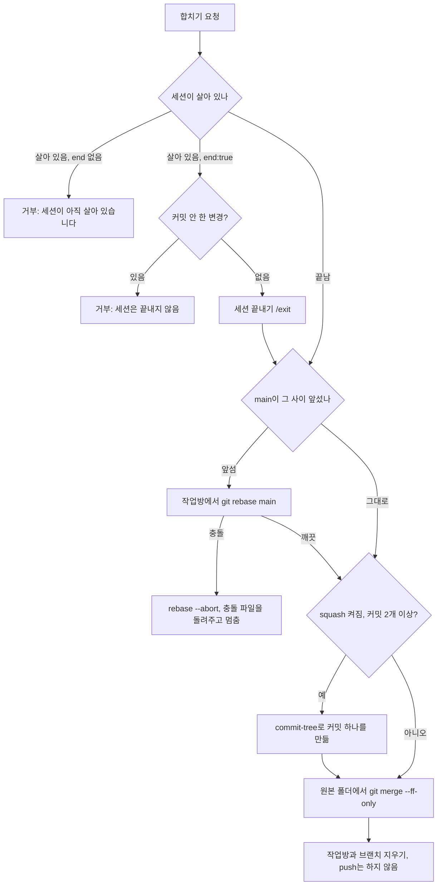

<!--
다루는 곳: bridge/worktree.py, bridge/mergeprep.py, bridge/handoff.py, bridge/api/handoff.py
읽은 커밋: 450c5f2
-->
# 07 합치기

FOREMAN은 한 프로젝트에 세션이 이미 살아 있을 때 새 세션을 띄우면, 그 세션을 저장소 안의 따로 떨어진 작업 폴더(git worktree, 화면에서는 「작업방」이라 부른다)와 자기 브랜치 `cc/<이름>`에서 일하게 한다. 두 세션이 같은 파일을 덮어쓰지 않게 하려는 장치다. 작업방을 만드는 쪽 이야기는 → 「06 세션 띄우기와 따로 작업」에 있다. 이 편은 그 반대쪽 끝, 작업방에서 쌓인 커밋을 원본 브랜치(대개 `main`)로 돌려보내는 일을 다룬다.

합치기는 git 명령 몇 줄이면 끝나는 일처럼 보이지만, FOREMAN에서는 조심할 것이 많다. 원본 폴더에서는 관리자 세션이 늘 돌고 있고, 작업방은 여럿이 동시에 열려 있으며, 합칠 커밋을 만든 세션은 이미 끝났을 수도 있고 아직 살아 있을 수도 있다. 이 편은 합치기의 전체 그림, 즉 어떤 방법으로 합치는지, 왜 그 방법을 골랐는지, 누가 합치는지, 무엇을 하지 말아야 하는지, 여러 작업방을 어떤 차례로 합치는지, 합친 뒤에 무엇이 남는지를 설명한다. 하위 편 둘은 이 그림의 두 부분을 깊게 다룬다.

| 하위 편 | 다루는 것 |
|---|---|
| 합치기 카드 | 세션이 일을 마치면 브리지가 미리 충돌과 걸리는 문서를 재서 승인 카드를 만들고, 승인 한 번으로 합치는 길 |
| 끝난 뒤 맞추기 | 합치고 끝낸 뒤 실제와 기록이 어긋난 것(남은 작업방, 남은 브랜치)을 훑어 알리는 일 |

## 합치기 한눈에

## 합치는 방법: rebase한 뒤 fast-forward

합치기의 몸은 `bridge/worktree.py`의 `merge` 함수 하나다 [code:bridge/worktree.py]. 사람이 패널에서 누르든, 관리자가 API로 부르든, 합치기 카드를 승인하든 모든 길이 끝내 이 함수로 온다. 하는 일을 차례대로 풀면 이렇다.

먼저 작업방의 상태를 잰다. 원본 브랜치에서 갈라진 뒤 작업방에 쌓인 커밋 수(ahead), 그 사이 원본이 앞서간 커밋 수(behind), 커밋하지 않은 변경을 본다. 커밋하지 않은 변경이 하나라도 있으면 아무것도 하지 않고 거부한다. 합치기는 커밋만 옮기므로, 커밋하지 않은 고침은 작업방을 지우는 순간 사라지기 때문이다. 합칠 커밋이 하나도 없으면(ahead가 0이면) 작업방만 지우고 끝낸다.

원본이 그 사이 앞서갔으면, 작업방 안에서 `git rebase <원본 브랜치>`를 돌린다. rebase는 작업방의 커밋들을 원본의 새 끝 위로 하나씩 다시 얹는 일이다. 다시 얹다가 같은 줄을 양쪽이 고쳐 충돌이 나면 `git rebase --abort`로 바로 되돌리고, 충돌한 파일 목록과 「rebase 중 충돌이 나서 되돌렸습니다」라는 글을 돌려준 채 멈춘다. 작업방은 rebase 전 모습 그대로 남는다. 반쯤 풀린 상태로 두지 않는다는 것이 이 단계의 약속이다.

rebase가 깨끗이 끝나면 작업방 브랜치는 원본 끝에서 곧게 이어진 모양이 된다. 그다음 원본 폴더에서 `git merge --ff-only`를 부른다. fast-forward는 새 커밋을 만들지 않고 원본 브랜치의 끝 표시만 작업방 브랜치 끝으로 옮기는 합치기다. 곧게 이어져 있으니 표시만 옮기면 된다. 마지막으로 작업방 폴더와 `cc/<이름>` 브랜치를 지운다.

push는 하지 않는다. 결과 글에도 늘 「push는 하지 않았습니다」가 붙는다 [code:bridge/worktree.py]. 런슈즈처럼 push가 곧 배포로 이어지는 저장소가 있어서, 원격으로 내보내는 일은 사람이나 관리자가 따로 확인한 뒤에 하도록 떼어 두었다 [docs:11_worktree.md].

### squash: 커밋을 하나로 묶는 길

프로젝트마다 squash를 켤 수 있고, 지금은 네 프로젝트(FOREMAN, 인프라, 펫퍼민트, 런슈즈) 모두 켜져 있다 [code:config/handoff.toml]. squash가 켜져 있고 합칠 커밋이 둘 이상이면, rebase까지는 똑같이 한 뒤 작업방 브랜치의 파일 트리 그대로 커밋 하나를 새로 만든다(`git commit-tree`, 부모는 원본 브랜치 끝). 그리고 그 커밋으로 fast-forward한다. 커밋이 하나뿐이면 묶을 것이 없으니 그냥 fast-forward한다.

묶은 커밋 본문에는 원래 커밋들의 날짜, 짧은 해시, 제목이 오래된 차례로 남는다. 브랜치를 지우면 원래 커밋은 언젠가 git 청소(gc)로 사라지므로, 합친 뒤 `refs/foreman/squashed/<브랜치 끝 해시 12자>`라는 숨은 이름을 남겨 원래 커밋을 붙들어 둔다. 이 이름은 브랜치나 태그 목록에 보이지 않고 보통의 push로 원격에 가지도 않는다. 그래서 GitHub에는 본문의 날짜, 해시, 제목만 가고, 원래 커밋 자체는 서버 PC의 이 저장소에만 있다. 묶은 커밋의 제목을 어떻게 짓는지(사람이 넘긴 제목, 세션 제목, 저장소의 커밋 꼴에 맞추기, 기호를 쉼표로 바꾸기)는 → 「합치기 카드」에서 다룬다.

## 왜 merge 커밋도, `merge --squash`도 아닌가

git으로 브랜치를 합치는 방법은 셋쯤 있다. 두 갈래를 잇는 merge 커밋을 만드는 법, 갈래의 변경을 원본 작업 트리에 한꺼번에 풀어 놓고 커밋하는 `merge --squash`, 그리고 FOREMAN이 쓰는 rebase 뒤 fast-forward다. 고른 까닭은 모두 한 가지 사정에서 나온다. **원본 폴더에서는 다른 세션이 돌고 있다.** 관리자 세션이 늘 원본 폴더에 있고, 관리자가 기록을 쓰거나 설정을 고치는 중일 수 있다 [docs:11_worktree.md].

merge 커밋이나 `merge --squash`는 충돌이 나면 원본 작업 트리 한가운데에 충돌 표시가 박힌 반쯤 합친 상태를 남긴다. 그것을 풀거나 되돌리는 일이 원본 폴더에서 일어나니, 그 폴더에서 일하던 관리자 세션의 파일과 뒤섞인다. rebase는 작업방 안에서 일어나므로 충돌이 나도 원본 폴더는 손끝 하나 닿지 않는다. 원본에서 하는 일은 `merge --ff-only` 하나뿐이고, 이것은 성공하면 끝 표시만 옮기고 실패하면 아무것도 바꾸지 않는다. 중간 상태가 없다.

squash를 붙일 때도 같은 이유로 `merge --squash`를 버렸다. 원본 작업 트리에서 squash 합치기를 돌리면 실패했을 때 원본의 인덱스를 되돌려야 하는데, 원본에는 다른 세션의 변경이 있을 수 있다. 그래서 트리로 커밋을 먼저 따로 만들고 그것을 fast-forward하게 했고, 덕분에 squash를 켜도 실패하는 꼴이 켜지 않았을 때와 똑같다 [log:merge_approver_20261112.md].

`--ff-only`를 고집하는 데에는 하나가 더 있다. 그냥 `git merge`는 곧게 이어지지 않으면 말없이 merge 커밋을 만들어 버린다. `--ff-only`는 그럴 때 실패한다. rebase와 fast-forward 사이에 누군가 원본에 커밋을 더했다면, 조용히 갈래를 잇는 대신 「fast-forward가 되지 않았습니다」로 멈추고 다시 합치라고 알린다. 조용히 다른 모양이 되느니 멈추고 알리는 쪽을 골랐다.

이 선택으로 잃은 것도 있다. rebase는 커밋을 다시 얹으므로 작업방에서 만든 커밋의 해시가 바뀐다. 세션이 보고에 적은 해시가 main에서는 다른 해시가 되는 일이 생긴다. 그래서 합친 결과에 새 원본 끝 해시(`into`)와 제목을 따로 돌려주고, 합치기 카드가 그 해시로 push 여부를 본다 [code:bridge/worktree.py].

이 규칙에는 예외가 하나 있다. 세션을 살려 둔 채로 합쳐야 할 때는 합치기 API가 거부하므로, 관리자가 원본 폴더에서 손으로 합친다. 브랜치가 main 끝 위에 있으면 `git merge --ff-only`, main이 그 사이 앞섰으면 `git merge --no-ff`로 merge 커밋을 만든다 [docs:11_worktree.md] [c:52ba341]. 살아 있는 세션의 작업방에서 rebase를 하면 그 세션 발밑의 커밋이 바뀌니, 이때만은 merge 커밋을 택한다.

## 세션이 끝난 뒤에만 합친다

합치기 API는 세션이 살아 있으면 「세션이 아직 살아 있습니다」로 거부하고, 끝내면서 합치려면 [끝내기 ▾]의 [합치고 끝내기]를 쓰라고 함께 알린다 [code:bridge/handoff.py]. 까닭은 코드 주석 그대로 「도는 세션의 바닥을 옮기지 않는다」이다. 합치면 작업방 폴더와 브랜치가 지워진다. 세션이 그 폴더에서 아직 일하는데 바닥을 걷어내면, 그 세션의 다음 명령은 없는 폴더에서 돈다.

살아 있는 세션을 한 번에 끝내고 합치려면 요청에 `end: true`를 넣는다. 이때 순서가 중요하다. **끝내기 전에** 커밋하지 않은 변경을 먼저 본다. 있으면 파일 목록과 함께 거부하고 세션은 끝내지 않는다. 끝낸 뒤에 알면 그 세션에게 커밋하라고 시킬 수 없기 때문이다. 변경이 없으면 세션에 `/exit`를 보내 끝내고, 끝난 것을 확인한 뒤에 합친다. 세션이 끝나지 않으면 합치지 않고 멈춘다 [code:bridge/handoff.py].

## 누가 합치나

합치는 몸은 하나지만 부르는 길은 여럿이다. 처음에는 사람이 패널에서 눌렀고, 237 사례(아래) 무렵부터 관리자가 합치는 것이 기본이 되었다 [log:merge_237_242_20261110.md]. 사람이 화면에서 누르는 길도 그대로 남아 있다.

| 누가 | 어떻게 | 부르는 곳 |
|---|---|---|
| 관리자 세션 | 합치기 카드를 승인 | `POST /api/sessions/{sid}/merge-prep {"action": "merge", "by": "manager"}` |
| 관리자 세션 | 카드 없이 바로 | `POST /api/sessions/{sid}/worktree {"action": "merge"}` |
| 사람 | 세션 패널 「세션 정리」 탭의 합치기 승인 카드 [합치기] | 위 merge-prep와 같다(`by`는 human) |
| 사람 | 끝난 세션 「브랜치 이름」 칸의 [합치기] | 위 worktree와 같다 |
| 사람 | 살아 있는 세션 [끝내기 ▾] 메뉴의 「합치고 끝내기」 | worktree에 `end: true` |
| 브리지 | 조사 세션이 `log/` 새 파일만 커밋했을 때, 서기실 전체 줄이 띄운 편이 그 원고와 기록만 고쳤을 때 스스로 | 카드 승인을 `by="auto"`로 |

화면 이름은 지금 코드에서 확인한 것이다 [code:bridge/static/js/handoff.js]. 끝난 세션의 「브랜치 이름」 칸 [합치기]는 세션이 살아 있는 동안에는 보이지 않고, 그때는 [끝내기 ▾] 메뉴가 그 자리를 맡는다.

관리자는 늘 원본 폴더에서 뜬다. 관리자를 작업방에 띄우려 하면 거절한다. 관리자가 합친 뒤 push하고 브리지를 다시 띄워야 하는데 작업방 안에서는 그 일을 할 수 없기 때문이다 [log:coder_lifecycle_20261111.md].

프로젝트마다 합치기 카드의 승인자가 정해져 있고, 지금 네 프로젝트는 모두 관리자다 [code:config/handoff.toml]. 다만 설정 파일, `CLAUDE.md`, 마이그레이션처럼 되돌리기 어려운 것을 건드린 카드는 늘 사람이 승인한다. 관리자가 카드 승인 대신 worktree API로 돌아가 그런 카드를 합치려 해도, 프로젝트 토큰으로 부른 요청이면 「이 세션의 합치기 카드는 사람 승인입니다」로 거부한다 [code:bridge/api/handoff.py]. 사람 화면이 쓰는 관리 토큰은 그대로 통과한다. 승인자를 가르는 규칙은 → 「합치기 카드」에서, 토큰을 가르는 까닭은 → 「열쇠와 비밀」에서 다룬다.

## 확인과 합치기를 한 명령에 묶지 않는다

합치기 전에 충돌이 날지 미리 보는 법은 `git merge-tree --write-tree <원본> cc/<이름>`이다. 실제로 합치지 않고 합친 결과를 재기만 하며, 충돌이 있으면 종료 코드가 1이고 충돌 파일을 알려 준다. 규칙은 이 확인을 **따로** 치고, 충돌이 없다는 결과를 눈으로 본 **뒤에** 합치기 API를 부르는 것이다 [docs:11_worktree.md].

이 규칙은 실수에서 나왔다 [log:merge_237_242_20261110.md]. 관리자가 서기 세션 237의 작업방을 합치면서 `merge-tree` 확인과 합치기 API 부르기를 셸 명령 한 줄에 이어 붙였다. 그런데 README의 같은 자리를 양쪽이 고쳐 충돌이 있었다. 확인 결과에 「충돌 없음」이 찍히지 않았는데도 같은 줄의 뒤쪽 명령이 그대로 돌아 합치기가 불렸다. 한 줄에 묶으면 앞의 결과를 사람이 읽고 판단할 틈이 없다. 확인이 확인 노릇을 하려면 결과를 보고 멈출 수 있어야 하고, 그러려면 명령이 갈라져 있어야 한다.

같은 꼴의 실수가 push에서도 났다. 관리자가 push 전에 아직 push하지 않은 커밋 목록(`origin/main..HEAD`)을 찍었지만 push와 같은 명령에 이어 붙여, 시험하지 않은 다른 세션의 합친 커밋이 목록에 찍혔는데도 멈추지 못하고 push했다 [log:manager410_overhead_20261115.md]. 확인은 확인대로, 실행은 실행대로 따로 친다는 같은 원칙이다.

## 충돌이면 `end: true`로 부르지 않는다

237 사례의 둘째 실수는 합치기를 `end: true`로 부른 것이었다. `end: true`는 세션을 **먼저** 끝내고 합친다. 합치다 충돌이 나면 rebase는 되돌려지지만 세션은 이미 끝났고 tmux 창도 닫혔다. 충돌을 풀 사람이 그 세션이었는데 풀 곳이 사라진 것이다 [log:merge_237_242_20261110.md]. 화면의 확인 창도 이 위험을 「충돌이 나면 되돌리고 멈춥니다(세션은 이미 끝난 뒤입니다)」로 적는다 [docs:11_worktree.md].

그래서 충돌을 누가 푸는지 정해 두었다. 세션이 살아 있으면 **그 세션이** 푼다. main을 가져와 rebase하고 충돌을 풀어 커밋한 뒤 다시 합친다. 바로 다음에 합친 관리자 역할 세션 242가 그렇게 했다. 세션이 이미 끝났으면 관리자가 원본 폴더에서 푼다. README 표처럼 양쪽 줄을 다 남기면 되는 충돌은 관리자가 작업방에서 `git rebase main` 뒤 두 쪽을 다 살리고 `--continue`했다.

합치기 카드는 이 원칙을 기계로 지킨다. 승인이 오면 먼저 `merge-tree`로 다시 재고, 충돌이 있으면 세션을 끝내지 않은 채 그 세션에 「main을 가져와 풀라」를 보낸다(세션이 끝났으면 관리자에게 넘긴다) [code:bridge/mergeprep.py]. 브리지가 승인 없이 합치는 두 길은 갈린다. 조사 세션은 `log/`에만 쓸 수 있어 rebase를 할 수 없으므로, 살아 있어도 관리자에게 넘긴다. 서기실 전체 줄이 띄운 서기 세션은 원고를 고치는 세션이라, 살아 있으면 다른 세션처럼 스스로 푼다 [code:bridge/mergeprep.py]. 하나 더 조심하는 것이 있다. `merge-tree`는 두 갈래를 한 번에 맞대는 세 갈래 합치기라서 깨끗하다고 나와도, 커밋을 하나씩 얹는 rebase는 중간 커밋에서 충돌할 수 있다. 그래서 세션이 살아 있고 main이 앞서 있으면, 세션을 끝내기 전에 임시 작업 폴더(브랜치에 붙지 않은 분리된 HEAD)를 하나 만들어 rebase가 실제로 되는지 먼저 돌려 보고, 되면 그때 끝내고 합친다.

## 여러 세션을 합치는 차례

교장이 한 계획에 세션을 여럿 띄우면 작업방도 여럿이 동시에 생긴다. 먼저 합친 것이 main을 바꾸니, 뒤에 합칠 것은 그 위로 rebase하다 충돌할 수 있다. 어느 것부터 합칠지는 `GET /api/foreman/merge-order?project=<프로젝트>`가 알려 준다 [code:bridge/overlap.py] [log:coder_foreman_multi_20261111.md]. 저장소를 바꾸지 않고 읽기만 한다.

이 API는 그 저장소의 `cc/*` 작업방을 모두 모아 브랜치마다 main에서 바뀐 파일과 커밋하지 않은 파일을 센다. 같은 파일을 건드리는 쌍을 찾으면, 그 둘의 커밋끼리 `merge-tree`를 돌려 실제로 부딪치는지까지 본다(커밋하지 않은 변경은 이 판정에서 볼 수 없다). 그리고 아래 차례로 줄을 세운다.

| 차례 | 기준 |
|---|---|
| 1 | 같은 계획에서 둘 이상이 함께 합칠 때, 계획을 세울 때 정한 합칠 순서(`merge_order`) |
| 2 | 다른 브랜치와 겹치는 파일이 적은 것 |
| 3 | 커밋하지 않은 변경이 없는 것 |
| 4 | 바뀐 파일이 적은 것 |
| 5 | 브랜치 이름 |

겹침이 적은 것부터 합치면 뒤에 합칠 것들이 받는 충격이 줄어든다. 부딪치는 쌍이 있으면 결과의 까닭 목록에 「⚠ 두 브랜치가 부딪칩니다. 뒤의 것은 앞 것을 합친 뒤 main을 가져와 풀어야 합니다」라는 꼴의 줄이 붙는다. 계획의 합칠 순서는 같은 계획에서 함께 합칠 것이 둘 이상일 때만 뜻이 있다. 혼자 남은 것에는 견줄 상대가 없다.

계획에서 세션끼리 맡을 파일을 나누는 일은 → 「계획 한 번」에, 같은 파일을 건드리는 세션을 미리 알리는 일은 → 「겹침 알림」에 있다.

## 합친 뒤: 시험, push, 브리지 다시 띄우기

합치기는 원본 브랜치에 커밋을 넣는 데서 멈춘다. 합치기 카드에는 2단계를 둘 자리(`after_merge`)가 있지만 비어 있고, 설정도 `stage = 1`이다 [code:bridge/mergeprep.py] [code:config/handoff.toml]. 2단계는 승인 뒤 시험, push, 승인 대기 확인, 브리지 다시 띄우기, 화면 확인까지 기계가 하는 그림인데, 사용자가 1단계를 써 본 뒤 정하기로 했다. 그래서 합친 뒤의 일은 모두 원본 폴더의 관리자 몫이다.

관리자는 합친 뒤 먼저 시험을 돌린다(pytest와 node). FOREMAN에는 CI가 없어서 이 손 시험이 유일한 시험이다. 통과하면 아직 원격에 없는 커밋 목록을 **따로** 찍어 보고, 거기에 시험하지 않은 커밋이 섞였는지 본 뒤 push한다. 브리지 코드가 바뀌었으면 브리지를 다시 띄운다. 이때도 사람의 승인을 기다리는 도구 호출이 0인지 먼저 본다. 브리지를 다시 띄우면 기다리던 승인이 끊기기 때문이다. 화면을 바꾼 일이면 화면을 직접 열어 확인한다. 마지막으로 이번 일이 바꾼 코드를 가리키는 문서 가운데 그 브랜치에서 고치지 않은 것(「걸리는 문서」의 「안 고침」)을 본다. 코드를 고친 코더가 그 코드를 가리키는 docs, 노션 원고, 포트폴리오도 같은 브랜치에서 함께 고치는 것이 규칙이라, 안 고친 문서가 남았으면 정말 낡았는지 보고 낡았으면 코더에게(원고와 포트폴리오는 서기에게) 맡긴다 [code:bridge/mergeprep.py] [docs:11_worktree.md]. 어느 문서가 걸리는지는 합치기 카드가 기계로 찾아 둔다(→ 「합치기 카드」).

브리지를 다시 띄우기 전에 관리자가 알아야 할 것이 하나 더 있다. 이번 합치기로 규칙 파일이 바뀌었는지다. 규칙 파일은 승인 규칙과 알림 규칙 설정, 승인 문지기 노릇을 하는 hook 스크립트(CC가 도구를 쓰기 전에 브리지에 묻게 하는 작은 스크립트)처럼 이 안전장치 자체를 바꿀 수 있는 파일로, 승인 규칙의 보호 목록에 적혀 있다 [code:config/approval.toml]. 작업방 안에서 이런 파일을 고쳐도 그 자리에서는 아무 효과가 없다. 도는 브리지는 원본 폴더의 규칙을 읽기 때문이다. 효과는 합친 뒤 브리지를 다시 띄우는 순간에 난다. 그런데 합치기는 파일 편집 도구를 거치지 않으니, 원본 폴더에서 규칙 파일을 고칠 때 뜨는 🛡 알림이 정작 효과가 나는 이 길에서는 없었다 [log:foreman-7_silent_delete_fix_20261115.md]. 그래서 `merge`가 fast-forward 직전에 이번 합치기로 바뀌는 파일 전부를 지금 도는 규칙의 보호 목록과 맞댄다. 걸리면 결과에 그 파일 목록(`rule_files`)을 싣고 결과 글 끝에 「🛡 규칙 파일이 바뀝니다(…). 브리지를 다시 띄우면 반영됩니다」를 붙인다 [code:bridge/worktree.py]. 합치기가 끝나면 텔레그램으로 🛡 알림도 한 번 간다 [code:bridge/handoff.py]. 합치기를 막지는 않는다. 막는 것이 아니라, 다시 띄우는 사람이 무엇이 함께 살아나는지 알고 띄우게 하려는 것이다. 맞대기 자체가 실패하면 「없음」으로 넘기지 않고 「규칙 파일이 바뀌는지 확인하지 못했습니다」와 까닭을 결과 글에 적는다.

합친 결과 글은 관리자 세션 입력 칸으로 간다. 「[FOREMAN 합치기] …」로 시작하는 글에 어떻게 합쳤는지(fast-forward인지, rebase 뒤 fast-forward인지, squash로 몇 개를 묶었는지)와 시험, push, 브리지 다시 띄우기, 화면 점검이 관리자 몫이라는 말이 실린다 [code:bridge/mergeprep.py]. 걸리는 문서가 있으면 그 수(코드로 걸린 것과 문서로만 걸린 것을 나눠서)와 안 고친 문서 이름(다섯까지), `tools/docs.py refs --range`로 확인하라는 한 줄도 붙는다. 브리지가 승인 없이 합친 경우는 글이 다르다. 조사 세션이면 결과 log 이름을, 서기실 전체 줄이 띄운 편이면 바뀐 파일과 「줄은 다음 편으로 넘어간다」를 싣고, 둘 다 push는 관리자가 한다고 적는다 [code:bridge/mergeprep.py]. 관리자 세션을 못 찾거나 글을 못 넣으면 텔레그램으로 같은 글을 바로 보내고(21:00 하루 묶음으로 미루지 않는다 [code:bridge/mergeprep.py]) 카드에 그렇다고 남긴다. 넣었는지는 다른 넣기 길과 같은 한 곳의 판정을 따른다 [code:bridge/inject.py]. 세션 기록에서 글을 찾았거나 대기열에 들어갔으면 넣은 것이고, 기록에서는 아직 못 찾았지만 입력 칸이 비었으면(확인 못 함) 그것도 넣은 것으로 친다. 확인 못 함을 실패로 치면 관리자는 이미 글을 받았는데 「알리지 못했다」는 텔레그램이 헛되이 가기 때문이다. 대신 브리지가 뒤에서 기록을 다시 보고, 끝내 찾지 못하면 「⚠ 합치기 알림이 받는 세션 기록에 남지 않았습니다. 그 세션 대화창을 확인해 주세요」와 보낸 글을 텔레그램으로 바로 보낸다 [code:bridge/mergeprep.py]. 확인 못 함이 무엇이고 뒤에서 얼마 동안 다시 보는지는 → 「03 세션 지켜보기와 글 넣기」에 있다. 카드는 합친 커밋이 원격 추적 브랜치(`origin/main`)에 들어갔는지를 1분마다 다시 봐서, 관리자가 push하면 「push까지 했습니다」로 바뀐다.

## 막혔던 것: 끝난 세션의 [합치기]가 화면에서 사라졌다

처음 만든 합치기는 「세션을 끝낸 뒤 패널에서 [합치기]를 누른다」였다. 그런데 사무실 화면은 끝난 세션을 3분 동안만 흐리게 자리에 남겼다가 지운다 [code:bridge/static/js/office.js]. 사람이 겪은 불편은 이랬다. 「끝내기 누르고, 3분 안에 합치기를 또 찾아 눌러야 해. 사라지면 종료된 세션 목록에서 다시 찾아야 하고」 [log:stage11_worktree_result.md].

3분을 놓치면 [합치기]가 있는 패널로 가는 길이 화면에서 사라진다. 그러면 브랜치와 작업방은 합쳐지지도 버려지지도 않은 채 남고, 그것을 알리는 것은 아무것도 없었다. FOREMAN이 잡으려는 바로 그 조용한 고장이다. 실제로 런슈즈 작업방 하나가 합치기 기록 없이 며칠 남아 있었고 [log:coder_screen_state_20261111.md], FOREMAN에서도 관리자가 손으로 합친 뒤 세션만 끝내 작업방 둘이 남은 일이 있었다 [log:approval_hell_plan_20261112.md].

한 번에 풀지 않고 네 겹으로 막았다.

첫째, 끝내기와 합치기를 한 번에 하게 했다. 살아 있는 세션의 [끝내기 ▾] 메뉴에서 「합치고 끝내기」를 고르면 끝낸 뒤 바로 합친다(`end: true`). 끝내고 3분 안에 버튼을 다시 찾을 일이 없어졌다. 「커밋만 하고 끝내기」는 작업방을 남기되 「합치기 기다림」으로 표시하고 며칠째인지 센다.

둘째, 버튼을 사람이 찾아가는 대신 브리지가 카드를 들고 오게 했다. 세션이 일을 마치거나 끝나면 브리지가 합치기 카드를 만들고, 그 카드는 화면의 세션이 사라져도 DB에 남는다. 사람 승인이 필요한 카드는 관리자 머리 위 말풍선과 승인 막대 숫자로 떠 있다. 5일째 그대로면 텔레그램이 한 번 간다 [code:config/handoff.toml]. 카드가 어떻게 만들어지고 승인되는지는 → 「합치기 카드」에 있다.

셋째, 그래도 남은 것을 주우려고 합치거나 끝낸 뒤 저장소를 훑게 했다. 쓰던 세션이 없는 작업방, 작업방 없이 남은 `cc/*` 브랜치, 밖에서 합쳤는데 「합치기 기다림」으로 남은 것을 찾아 텔레그램으로 알린다. 지우지는 않는다. 지울지는 사람이 정한다. 무엇을 어떻게 훑는지는 → 「끝난 뒤 맞추기」에 있다.

넷째, 밖에서 합친 것도 알아보게 했다. 관리자가 원본 폴더에서 손으로 `git merge`를 하면 FOREMAN이 몰라 「합치기 기다림」이 남았다. 이제 브랜치가 이미 원본에 들어 있는지(조상이거나, rebase로 같은 변경이 이미 들어가 있는지)를 git으로 직접 본다 [code:bridge/worktree.py] [c:59e2a8c]. 저장소를 읽지 못하면 「끝났다」고 말하지 않는다.

같은 꼴의 문제가 하나 더 있었다. 작업방 이름은 세션이 끝나면 다시 쓰인다. 옛 세션의 패널에 남은 [합치기]를 누르면 같은 이름을 새로 쓰는 뒤 세션의 일을 합치거나 지울 수 있었다. 이제 그런 패널에서는 [합치기]를 보이지 않고 「지금 이 이름은 세션 N이 씁니다」라고만 적는다. API도 「이 작업방 이름은 지금 세션 N이 쓰고 있습니다」로 거부하고 그 세션의 패널에서 합치라고 알린다 [code:bridge/handoff.py] [code:bridge/static/js/handoff.js] [log:coder_screen_state_20261111.md].
