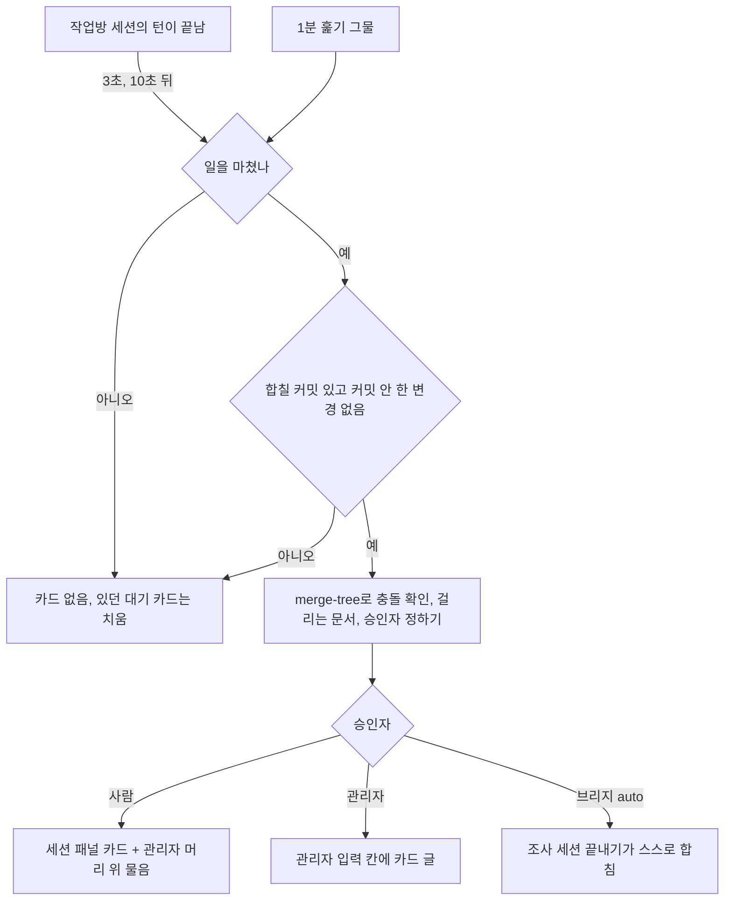

<!--
다루는 곳: bridge/mergeprep.py, bridge/docrefs.py, tools/docs.py, bridge/doctext/config.py, bridge/inspector_close.py, bridge/coder_room.py, bridge/api/coder.py, bridge/static/js/coder.js, bridge/static/js/handoff.js, migrations/0032_merge_card.sql, tests/js/coder.test.mjs, tests/js/mergeprep.test.mjs, tests/test_mergeprep.py, tests/test_mergeprep_check.py, tests/test_mergeprep_db.py, tests/test_merge_remind_catchup.py, tests/test_docs_tool.py, tests/test_docs_config.py, tests/test_docrefs_config.py
읽은 커밋: a6b77af
-->

# 합치기 카드

작업방(worktree, 세션마다 따로 떼어 준 작업 폴더와 브랜치)에서 일하는 세션이 일을 마치면, 그 일을 main에 합칠지 누군가 정해야 한다. 이 편은 그 "정해야 하는 순간"을 브리지가 알아채고, 판단에 필요한 사실을 기계로 모아 한 장의 카드로 내미는 과정을 다룬다. 카드를 승인한 뒤 실제로 rebase하고 fast-forward로 합치는 몸통, 누가 합치는지, 확인과 합치기를 한 명령에 묶지 않는 까닭은 → 「07 합치기」에서 다룬다. 합치고 끝낸 뒤 남은 폴더나 어긋난 기록을 훑는 일은 → 「끝난 뒤 맞추기」에서 다룬다.

## 왜 카드인가

카드가 생기기 전에는 합치기가 전부 사람 손에 달려 있었다. 코더 세션이 "다 했습니다"라고 보고하면 사람이 그 보고를 읽고, 관리자 세션에 "합쳐라"를 시키고, 관리자는 `git merge-tree`로 충돌을 따로 보고, 합치기 API를 부르고, 결과를 다시 사람에게 알렸다. 이 가운데 판단이 필요한 곳은 "합쳐도 되는가" 하나뿐이고 나머지는 늘 같은 순서로 도는 판에 박힌 단계다. 판에 박힌 단계를 사람이나 모델이 매번 손으로 하면 하나쯤 빠뜨리고, 빠뜨린 것은 아무도 모른 채 남는다. 실제로 일을 마친 브랜치가 아무도 합치지 않은 채 며칠씩 남는 일이 있었다.

그래서 합치기 준비를 브리지의 일로 옮겼다. 브리지는 LLM을 쓰지 않고 git과 DB만 보고 "이 세션은 일을 마쳤다", "합칠 커밋이 이만큼 있다", "main과 충돌하는 파일은 이것이다"를 정해 카드에 싣는다 [code:bridge/mergeprep.py]. 사람이나 관리자에게 남는 일은 카드를 보고 [합치기]를 누를지 정하는 것 하나다. 카드는 "합치기까지"만 한다. 합친 뒤의 시험, push, 브리지 다시 띄우기, 화면 점검은 여전히 관리자 몫이다. 설정에 `stage = 2`라는 칸이 있어 그다음 단계까지 기계로 옮길 자리를 마련해 두었지만, 사람이 1단계를 충분히 써 본 뒤 정하기로 하고 지금은 비워 두었다. `stage = 2`로 켜도 브리지는 아무것도 더 하지 않고 "2단계는 아직 만들지 않았다"를 카드와 로그에 남긴다. 켰는데 조용히 아무 일도 안 일어나는 것을 막으려는 것이다 [code:bridge/mergeprep.py].

## 어떤 세션을 보나

브리지가 카드를 만들려고 보는 세션은 좁게 골라진다. 작업 폴더(`cwd`)가 `.worktrees/` 아래에 있는 에이전트 세션이어야 하고, 같은 폴더를 쓴 세션이 여럿이면 가장 나중 세션만 본다 [code:bridge/mergeprep.py]. 작업방 이름은 다시 쓰이기 때문이다. `foreman-4`라는 작업방을 쓰던 세션이 합쳐져 사라진 뒤 새 세션이 같은 이름의 작업방을 받으면, 앞 세션의 행은 지금 폴더와 아무 상관이 없다. 폴더가 실제로 디스크에 있어야 하고, 숨긴 세션은 보지 않는다. 설정의 `projects` 목록에 든 프로젝트만 본다. 지금은 FOREMAN, 인프라, 펫퍼민트, 런슈즈 넷 모두가 들어 있다 [code:config/handoff.toml].

사람이 Ctrl+Z로 멈춰 둔 세션(프로세스 상태 `T`)은 처음부터 건너뛴다. 멈춘 세션은 사용자가 일부러 남겨 둔 것이라, 브리지가 일을 마쳤다고 판정해 끝내고 합쳐 버리면 안 된다.

## 「일을 마침」 판정

카드의 가장 중요한 판단은 "이 세션이 일을 마쳤는가"다. 세션이 이미 끝났으면(살아 있는 CC 프로세스가 없으면) 판정은 간단하다. 근거 글 "세션이 끝났습니다"로 일을 마친 것이 된다. 살아 있는 세션이면 아래 조건을 차례로 본다 [code:bridge/mergeprep.py].

| 조건 | 무엇을 보나 | 걸리면 |
|---|---|---|
| 일하는 중이 아님 | CC가 남기는 세션 상태 파일이 `busy`가 아닌가 | 아직 일하는 중 |
| 열린 턴이 없음 | DB `turn` 표에 끝나지 않은 턴(`ended_at`이 빈 것)이 없는가 | 아직 응답하는 중 |
| 응답이 하나라도 있음 | `event` 표에 모델 응답(`assistant_msg`)이 한 줄이라도 있는가 | 막 띄워 아직 아무 말도 안 한 세션 |
| 권한 거부로 멈추지 않음 | 대시보드의 사람 필요 판정(`human_needs`)에 권한 거부가 없는가 | 막혀서 멈춘 것이지 마친 것이 아님 |
| 세션 행이 있음 | 브리지가 그 세션 행을 읽을 수 있는가 | 판정 불가 |
| 뒤에서 도는 일이 없음 | 백그라운드 셸, Monitor, 돌고 있는 서브에이전트가 없는가 | 일이 남았음 |

모두 통과하면 근거 글은 "보고 옴(일하지 않고 응답을 마쳤습니다)"이 된다. 그다음 git 쪽 조건이 붙는다. 작업방이 있어야 하고, 합칠 커밋이 하나 이상 있어야 하고(`ahead > 0`), 커밋 안 한 변경이 하나도 없어야 한다. 커밋 안 한 변경이 있으면 합칠 수 없으니 카드를 내지 않는다. 마지막으로 사람이나 관리자가 이 브랜치 끝 커밋에서 [나중에]를 눌렀으면 카드를 다시 띄우지 않는다. 끝 커밋이 바뀌면, 곧 세션이 새로 커밋하면 다시 뜬다.

뒤에서 도는 일의 기준은 대시보드의 같은 표시와 하나를 쓴다. 이것이 있는데 세션을 끝내려고 `/exit`를 보내면 CC가 "뒤에서 도는 일이 있는데 끝낼까요" 확인 창을 띄우고 멈춘다 [log:old_session_exit_bg_20261109.md]. 카드를 승인하면 살아 있는 세션을 끝내고 합치기 때문에, 끝낼 수 없는 세션을 "마쳤다"고 보면 승인 뒤에 걸린다.

### 묻는 말과 일을 마친 것은 따로 본다

처음 판정에는 "마지막 응답이 사람에게 묻는 말이 아님"이 조건으로 들어 있었다. 묻는 말을 남긴 세션은 답을 기다리는 것이니 일을 마친 것이 아니라고 본 것이다. 그런데 디자이너 세션 하나가 일을 다 마치고 보고 끝에 "한 번씩 확인해 주세요"라고 붙였더니, 이 말이 묻는 말로 잡혀 카드가 아예 뜨지 않았다 [code:bridge/mergeprep.py]. 보고 끝에 확인을 부탁하는 것은 아주 흔한 꼴이고, 그 때문에 합치기가 조용히 멈추면 카드를 만든 뜻이 없어진다.

그래서 둘을 떼었다. 묻는 말이 있어도 일을 마친 것으로 보고 카드를 만든다. 대신 묻는 말을 카드에 따로 싣고(`asks`), 카드 위에 "세션이 묻는 말이 있습니다. 패널에서 답하십시오"와 그 말의 끝부분을 띄운다. 합칠지 정하는 사람이 그 물음을 보고 먼저 답할지 그냥 합칠지 고른다. 같은 커밋에서 묻는 말만 새로 생기거나 풀리면 카드를 새로 만들지 않고 표시만 고친다. 이 고침 뒤 시험 세션에 같은 꼴의 보고를 시켰더니, 커밋 4초 뒤에 "묻는 말 있음, 턴 끝"이 붙은 카드가 떴다 [log:merge_turnend_282_20261111.md].

### 「보고 옴」 표시는 조건으로 쓰지 않는다

대시보드에는 세션이 응답을 마치면 켜지는 "보고 옴" 표시가 있다. 이것을 그대로 "일을 마침"으로 쓰면 편해 보이지만 쓰지 않았다. 이 표시는 사람이 그 세션 패널을 열면 읽음으로 꺼진다. 사람이 읽었든 안 읽었든 세션이 일을 마친 사실은 같은데, 표시를 조건으로 쓰면 사람이 패널을 한 번 열어 본 것만으로 카드가 사라진다 [log:coder_lifecycle_20261111.md]. 그래서 같은 판정 함수에서 묻는 말과 권한 거부만 빌려 쓰고, 나머지는 위 표의 조건으로 직접 본다. 근거 글에 "보고 옴"이라는 말이 남은 것은 사람이 읽을 때 익숙한 말이라서다.

## 언제 보나: 턴 끝에 바로, 1분 훑기는 그물

처음에는 브리지가 60초마다 모든 작업방 세션을 훑어 카드를 만들었다. 이렇게 하면 세션이 일을 마친 뒤 길게는 1분을 기다려야 카드가 뜬다. 사람이 보기엔 "다 했다는데 왜 아무 일도 없지"가 되고, 관리자는 그사이 손으로 합치기를 시작하기도 했다. 그래서 세션이 응답을 마치는 순간을 신호로 삼았다.

조립기가 턴을 닫으면 곧바로 합치기 준비의 `on_turn_closed`를 부른다. 여기서는 일을 예약만 하고 바로 돌아온다. 조립기가 아직 DB 트랜잭션 안에 있을 수 있어 그 자리에서 git을 돌리거나 DB를 오래 붙잡으면 기록 적재가 막히기 때문이다. 예약된 일은 3초 뒤와 10초 뒤 두 번 그 세션 하나만 본다(`check_one`) [code:bridge/mergeprep.py]. 두 번 보는 데는 까닭이 있다. Stop hook(응답이 끝났다는 CC의 알림, → 「CC hook 받기」)은 트랜스크립트의 마지막 응답 줄이나 CC 상태 파일보다 먼저 올 수 있다. 3초 뒤 첫 번째로 볼 때는 상태 파일이 아직 `busy`이거나 마지막 응답이 DB에 안 들어와 묻는 말 판정이 틀릴 수 있고, 10초 뒤 두 번째에서 그것을 바로잡는다. 한 번 보는 데 60초를 넘기면 끊는다.

60초 훑기는 없애지 않고 그물로 남겼다 [code:bridge/mergeprep.py]. 턴 끝 확인이 놓치는 경우가 있기 때문이다. 브리지를 다시 띄우는 사이에 끝난 턴은 신호 자체가 없다. 턴 끝 확인이 git 오류 등으로 실패한 세션도 있다. 세션이 다시 일을 시작했거나, 사람이 패널에서 합쳤거나, 작업방을 버린 경우에는 대기 카드를 치워야 하는데, 이것도 훑기가 한다. 턴 끝 확인이 실패하면 그 횟수와 마지막 사유가 합치기 준비의 상태 정보(`health.turn_end`)에 쌓이고 다음 훑기가 그 세션을 줍는다. 훑기마저 실패하면 텔레그램으로 알린다. 한 번의 훑기가 10분(`stuck_min`)을 넘기면 git이나 DB가 막힌 것으로 보고 끊은 뒤 알린다 [code:config/handoff.toml].

## 카드를 만든다

일을 마쳤고 합칠 것이 있으면 카드를 만든다. 카드에 들어가는 사실은 모두 git 명령으로 얻는다.

| 칸 | 얻는 법 |
|---|---|
| 브랜치, 바탕(base), 끝 커밋 | `git rev-parse`로 브랜치 끝과 바탕 끝 |
| 앞섬, 뒤처짐 | 브랜치가 바탕보다 앞선 커밋 수(`ahead`)와 바탕이 그 사이 앞선 커밋 수(`behind`) |
| 커밋 목록 | 합칠 커밋 |
| 바뀐 파일 | `git diff --name-only base...branch`, 60개까지 |
| 충돌 | `git merge-tree --write-tree --name-only --no-messages base branch` |
| 걸리는 문서 | 바뀐 코드를 가리키는 docs, 노션 원고, 포트폴리오의 줄과 이 브랜치에서 그 문서를 고쳤는지(옛 이름 정리 후보) |
| 문서 점검 | 그 브랜치 판으로 돌린 문서 점검(`tools/docs.py check`)의 틀린 것 수. 이 브랜치로 새로 생긴 것과 갈라진 곳에 원래 있던 것을 가름 |
| 규칙 파일 | 바뀐 파일 전부(60개에서 자르지 않음)를 지금 도는 승인 규칙의 보호 목록과 맞댐 |
| 승인자, 사람에게 올린 까닭 | 프로젝트 설정과 늘 사람에게 올릴 것 판정 |

충돌 확인에 `merge-tree`를 쓰는 것은 작업 트리를 건드리지 않고 메모리 안에서 합치기를 해 보기 때문이다. 종료 코드가 0이면 충돌이 없고, 1이면 출력의 둘째 줄부터가 충돌한 파일 이름이다. 그 밖의 코드는 판정 실패로 보고 카드를 실패 상태로 만든다 [code:bridge/mergeprep.py]. 브리지가 하는 이 확인은 관리자가 합치기 전에 따로 하던 바로 그 확인이다. 사람이나 모델이 확인과 합치기를 한 명령에 묶었다가 충돌을 못 보고 합쳐 버린 일이 있었는데(→ 「07 합치기」), 카드는 확인 결과를 먼저 보여 주고 그다음에 누르게 하므로 그 실수가 구조적으로 생기지 않는다.

카드의 열쇠는 브랜치 끝 커밋, 바탕 끝 커밋, 세션이 살아 있는지 셋이다. 셋이 모두 그대로면 있던 카드를 그대로 돌려주고 다시 계산하지 않는다. 바탕만 앞섰거나 세션이 끝나 살아 있음만 바뀌어 카드를 다시 재더라도, 브랜치 끝 커밋이 같으면 처음 만든 시각(`made_at`)을 잇는다 [log:mergeprep_db_20261113.md]. 카드의 "오래됨"은 사람이 이 일을 얼마나 기다리게 했는지를 재는 값이라, 같은 일이면 시각을 새로 매기지 않는 것이 맞다. 같은 커밋이면 관리자에게 이미 알린 것, 관리자 머리 위에 올린 물음, 사람이 그 물음을 끈 것도 그대로 이어받는다. 같은 일을 두 번 알리지 않으려는 것이다.

카드가 새로 생기면(또는 끝 커밋이 바뀌면) 세션 기록(`session_action`)에 `mprep-card` 한 줄을 남긴다. 거기에 작업방 이름, 끝 커밋, 충돌 여부, 묻는 말 여부, 턴 끝에서 만들었는지 훑기에서 만들었는지, 승인자가 담긴다. 나중에 "카드가 언제 왜 떴나"를 이 줄로 거슬러 볼 수 있다. 텔레그램에도 "합치기 준비됨"을 세션과 끝 커밋마다 한 번 보낸다(`notify_ready`) [code:bridge/mergeprep.py].

### 걸리는 문서

카드는 이 브랜치가 바꾼 코드를 가리키는 문서도 함께 찾는다. 이름은 「걸리는 문서」이고, 전에는 「정리 후보」였다 [log:foreman-8_docrefs_20261117.md]. 찾는 일은 거꾸로 찾기 도구(`bridge/docrefs.py`, 명령으로는 `tools/docs.py refs`)가 한다 [code:bridge/docrefs.py] [code:bridge/mergeprep.py] [code:tools/docs.py]. 같은 결과를 내는 옛 이름 `tools/docrefs.py`도 한동안 남아 있었는데, 이름이 둘이면 어느 쪽을 적을지부터 애매해져서 지웠다 [log:foreman-5_docs_check_20261117.md]. 바탕에서 갈라진 곳부터 브랜치 끝까지 바뀐 파일 가운데 걸게 하는 것을 고른다. 코드가 먼저다. `log/` 같은 기록 폴더와 `.md` 파일은 코드가 아니고, docs, 원고, 포트폴리오 폴더 아래 사진 같은 파일도 확장자와 상관없이 뺀다. 포트폴리오 사진이 코드로 세어져 「안 고침」이 헛걸린 뒤 고쳤다 [log:foreman-4_fail_notify_docrefs_20261117.md]. 그다음은 docs 문서와 README.md, CLAUDE.md처럼 문서 묶음 밖에 있는 `.md` 파일이다. 다만 원고에서 README를 만드는 저장소(설정에 `[readme]` 표가 있는 FOREMAN)에서는 맨 위 README.md를 걸게 하는 파일로 보지 않는다. 그 README는 사람이 고치는 글이 아니라 도구가 만드는 생성물이기 때문이다 [code:bridge/docrefs.py]. 원고가 이런 문서를 근거 표시로 가리키고 있으면 그 문서가 바뀔 때 원고도 걸린다. docs가 바뀌면 원고가 밀리는 사슬의 가운데 고리라서, 인프라 저장소가 먼저 이렇게 찾던 것을 FOREMAN 도구로 합치면서 함께 들였다 [log:foreman-4_docrefs_config_20261117.md]. 문서는 경로를 글에 적기만 한 줄로는 걸지 않는다. 고른 파일을 가리키는 docs, 노션 원고, 포트폴리오를 브랜치 판으로 읽어 줄을 찾는다. 어느 폴더가 기록이고 원고인지처럼 저장소마다 다른 것은 그 저장소의 `.foreman/docs.toml`이 정하고, 없으면 FOREMAN 꼴을 쓴다 [code:bridge/doctext/config.py]. 가리키는 꼴은 셋이다. 원고의 근거 표시(대괄호 안에 `code:`나 `docs:`와 경로를 적은 것, 폴더를 적었으면 그 아래 파일 모두), 백틱이나 맨글로 적은 저장소 경로, 그리고 백틱 안에 파일 이름만 적은 것이다. 이름만 적은 것은 저장소에 그 이름의 파일이 하나뿐일 때만 건다. `bridge/`처럼 맨 위 폴더 하나만 적은 백틱은 「그 폴더 전체」라는 뜻이라 모든 파일에 걸려 버려서 치지 않는다. 경로를 글자로 쪼갤 때 한글도 이름 글자로 보므로 한글 이름 파일도 이름 그대로 걸린다. 설정에서 번호 짝(`pair_numbers`)을 켠 저장소에는 넷째 꼴이 있다. docs의 `NN_*.md`가 바뀌면 같은 번호의 원고 `NN_*.md`와 `NN_*/` 아래 편을 건다. 지금은 인프라 저장소만 켰다 [code:bridge/docrefs.py] [code:bridge/doctext/config.py].

원고와 포트폴리오 머리 주석의 「다루는 곳」은 보지 않는다. 전에는 넷째 꼴로 보았는데, 같은 자리를 문서 점검의 덮기 검사(저장소 파일 하나하나가 어느 편에 드는가)도 읽어서 두 검사가 서로 다른 뜻으로 한 자리를 썼다. 다루는 곳에 파일을 넓게 넣으면 덮기는 좋아지지만 그 파일이 바뀔 때마다 편 전체가 걸리고, 좁게 넣으면 헛걸림은 줄지만 덮기에 구멍이 났다. 인프라 원고에서는 CLAUDE.md를 덮는 편이 CLAUDE.md가 바뀔 때마다 걸리는 식으로 편 셋이 돌아가며 헛걸렸다. 그래서 자리를 나눴다. 다루는 곳은 파일 단위로 덮기 검사만 읽고, 카드의 거꾸로 찾기는 문장 끝 근거 표시만 따라간다 [log:foreman-5_docs_check_20261117.md]. 대가로 다루는 곳에만 있고 어떤 근거 표시도 가리키지 않는 파일이 바뀌면 카드에 걸리지 않는다. 자리를 나눌 때 FOREMAN에서 그런 파일은 일곱 개였다(`.claude/settings.json`, `.gitignore`, `__init__.py` 넷, `bridge/doctext/repo.py`). 그 가운데 `.gitignore`와 `__init__.py` 넷은 근거 표시를 달 문장이 없는 파일이라 문서 설정의 `not_code`에 넣어 이 셈에서 뺐다 [code:.foreman/docs.toml]. 같은 때 main 최근 커밋 60개를 커밋 하나씩 범위로 옛 판과 새 판에 돌려 보니, 걸리는 문서 합이 654에서 653이 되었고 다루는 곳으로만 걸리던 문서는 하나였다 [log:foreman-5_docs_check_20261117.md]. FOREMAN 원고는 다루는 곳의 파일을 근거 표시로도 거의 다 가리키기 때문이다. 편 전체를 다시 볼 때인지는 서기실이 다루는 곳으로 계속 센다(→ 「서기실과 일감」).

문서마다 이 브랜치에서 그 문서도 고쳤는지를 본다. 고쳤으면 「고침」, 아니면 「안 고침」이다. 카드 위 줄에는 수가 두 줄로 보인다. 「📄 코드로 걸린 문서 N, 안 고침 M」은 이 브랜치가 바꾼 코드를 가리키는 문서이고, 「📄 문서로만 걸린 문서 K, 안 고침 L」은 docs나 CLAUDE.md 같은 문서만 바뀌어 그것을 가리키는 원고가 걸린 것이다. 한쪽이 0이면 그 줄은 뺀다. 「자세히」 안에는 문서마다 「코드로」나 「문서로만」 표시, 줄, 고침 여부가 있다. 같은 수가 「합치기 준비됨」 텔레그램과 관리자에게 가는 카드 글, 합친 뒤 글에도 한 줄로 들어간다 [code:bridge/static/js/handoff.js] [code:bridge/docrefs.py]. 둘로 나눈 까닭은 문서를 걸게 하는 것을 들인 뒤 수가 크게 늘었기 때문이다. main 최근 커밋 60개를 커밋 하나씩 범위로 옛 도구와 새 도구에 돌렸더니 21개 범위에서 결과가 달랐고, 그 21개 범위의 걸리는 문서 합이 407에서 600이 되었다. 새로 걸린 줄은 모두 문서가 걸게 한 것이고 코드로 새로 걸린 것은 하나도 없었다. 두 성격이 섞인 수 하나를 보이면 사람은 둘 다 안 보게 된다 [log:foreman-4_docrefs_config_20261117.md].

브랜치가 문서 설정 파일(`.foreman/docs.toml`)을 바꿨으면 카드에 「이 브랜치가 설정을 바꿨습니다. 이 셈은 main 설정 기준입니다」가 한 줄 더 붙는다. 카드는 원본 폴더에서 돌아 그 폴더의 설정, 곧 합치기 전 값으로 세기 때문이다. 조용히 옛 값으로 세면 나중에 왜 숫자가 달랐는지 찾을 수 없다 [code:bridge/mergeprep.py]. 찾다가 git이 실패하면 0으로 두지 않고 「걸리는 문서를 찾지 못했습니다」와 까닭을 위 줄에 보인다. 아무것도 안 걸린 것과 찾지 못한 것이 같은 모양이면 조용한 고장이 되기 때문이다.

카드에는 문서 점검 한 줄도 있다. 그 브랜치 판 파일로 문서 점검(`bridge/doctext/check.py`)을 돌려 틀린 것을 세고, 갈라진 곳(`git merge-base`)에서 돌린 점검과 맞대어 「이 브랜치로 새로 생긴 틀린 것 N」과 「원래 있던 것 M」으로 가른다. 사람이 볼 것은 새로 생긴 쪽이다. 같은 틀림인지는 문서와 틀린 내용으로 보고 줄 번호는 보지 않는다(브랜치가 앞에 줄을 더하면 줄이 밀리기 때문이다). 새로 생긴 것이 있으면 노랑으로 보이고 처음 다섯 줄이 「자세히」에 나온다. 없으면 흐린 글로 「0」이라고만 보인다. 같은 줄이 「합치기 준비됨」 텔레그램과 관리자 카드 글에도 들어간다 [code:bridge/mergeprep.py] [code:bridge/static/js/handoff.js]. 의심(틀림은 아니고 근거 표시 없는 숫자나 인용이 있는 줄)은 FOREMAN에서 이백 줄이 넘고 틀림이 아니라서 세지 않는다. 문서 점검에는 새 줄의 em dash와 가운뎃점 검사도 들어 있어서, 브랜치가 문서나 코드 주석에 새로 들인 기호도 새로 생긴 틀린 것으로 센다. 원고에 새로 더하거나 고친 줄에 「」 없이 쓴 편 사이 참조(화살표 뒤에 편 제목만 적은 것)도 틀린 것이다. 노션 링크가 되지 않고 제목을 맞대 볼 수도 없기 때문이다(→ 「근거 확인과 물어보기」) [code:bridge/doctext/check.py] [code:.foreman/docs.toml]. 점검을 돌리지 못했으면(설정이 깨졌거나 git이 실패했으면) 0으로 두지 않고 「점검을 돌리지 못했습니다」와 까닭을 노랑으로 보인다. 이 줄을 카드에 넣은 까닭은 새 시험 파일이 어느 편의 다루는 곳에도 들지 않았을 때 그 브랜치에서 바로 보이게 하려는 것이다. 문서를 낡게 만드는 쪽은 주로 코더라 서기 브랜치에만 거는 길은 고르지 않았다. 카드는 보이게만 할 뿐이라, 아무도 안 보면 조용히 낡는다. 깨지게 만드는 것은 시험뿐이어서 pytest에도 점검을 걸었다 [log:foreman-5_docs_check_20261117.md]. 이 저장소 작업 트리에 같은 점검을 돌려 틀린 것이 하나라도 있으면 시험이 깨지고, 의심은 실패시키지 않는다 [code:tests/test_docs_selfcheck.py].

이렇게 바꾼 까닭은 문서가 밀리는 사슬이다. 코더가 코드를 고치면 docs가 밀리고, 서기가 docs를 고치면 원고가 밀리고, 다른 서기가 원고를 고치는 사이 코드가 또 바뀐다. 서기는 코더가 왜 그렇게 고쳤는지 다시 알아내야 했다. 그래서 이제 코드를 고친 코더가 그 코드를 가리키는 문서도 같은 브랜치에서 함께 고친다(→ 「역할 다섯」). 카드의 「안 고침」은 그 규칙이 지켜졌는지를 승인하는 사람이 바로 보게 하는 자리다. 옛 정리 후보는 바뀐 파일 이름이 나오는 docs 줄만 맞대고 원고와 포트폴리오는 보지 않아, 사슬의 뒤쪽이 카드에 보이지 않았다.

한계도 있다. 근거 표시가 모두 파일이나 폴더 단위라서 걸린 문단이 이번 고침과 상관없어도 걸린다. 「안 고침」은 「낡았다」가 아니라 「보라」라는 뜻이다. 근거 표시의 경로 뒤에 코드 줄 번호가 붙으면(`:10-20`처럼) 도구는 바뀐 줄과 겹칠 때만 그 줄을 건다. FOREMAN 원고는 그런 표시를 쓰지 않고(근거 표시 꼴을 설명하는 보기 하나뿐이다), 줄 번호를 붙여 쓰는 인프라 원고에서 쓰인다 [code:bridge/docrefs.py]. 파일 단위로 남긴 까닭은 줄 번호를 지키는 품이다. 이 갈래를 정할 때 FOREMAN 근거 표시는 2,454개였고 코드가 인프라보다 자주 바뀐다 [log:foreman-6_doctext_20261117.md]. 그 수를 어떻게 셌는지는 기록에 없다. 지금 기술문서 원고 묶음에서 대괄호 안이 `code:`, `docs:`, `c:`, `log:`로 시작하는 표시를 모두 세면 4,232개이고, 그 가운데 `code:`와 `docs:`만 세면 3,019개다. 처음에는 README의 할 일 표 줄도 후보로 찾았지만, 그 표 자체가 없어지면서 함께 뺐다 [log:foreman-4_readme_cleanup_20261115.md]. 옛 카드 모양과 맞추려고 카드 JSON의 README 칸은 늘 빈 목록으로 남아 있다.

### 규칙 파일

카드는 바뀐 파일 가운데 규칙 파일이 있는지도 본다. 규칙 파일은 승인 규칙과 알림 규칙 설정, 승인 문지기 노릇을 하는 hook 스크립트처럼 이 안전장치 자체를 바꿀 수 있는 파일이다. 작업방에서 고친 규칙 파일은 그 자리에서는 효과가 없고, 합친 뒤 브리지를 다시 띄울 때 살아난다. 그래서 합치기 몸(→ 「07 합치기」)이 합칠 때 하는 것과 같은 맞대기를 카드를 만들 때도 해서, 걸린 파일을 `rule_files`에 싣는다 [code:bridge/mergeprep.py] [code:bridge/worktree.py]. 맞대기에 실패하면 빈 목록으로 두지 않고 `rule_files_error`에 까닭을 싣는다. 확인을 못 한 것과 바뀐 것이 없는 것을 같은 모양으로 두면 조용한 고장이 되기 때문이다.

이 표시는 승인자를 바꾸지 않는다. 누가 승인하는지는 아래 늘 사람 경로를 포함해 이 편에서 설명한 규칙 그대로이고, 규칙 파일 표시는 그 위에 더하는 알림이다 [docs:11_worktree.md]. 걸린 파일이 있으면 「🛡 규칙 파일이 바뀝니다: …. 합치기는 막지 않습니다. 합친 뒤 브리지를 다시 띄우면 반영됩니다.」 한 줄이 "합치기 준비됨" 텔레그램과 관리자 카드 글에 붙고, 카드 화면에도 뜬다. 이 한 줄이 붙은 "합치기 준비됨"은 묶음을 켠 프로젝트여도 21:00 하루 묶음으로 미루지 않고 바로 보낸다 [code:bridge/mergeprep.py]. 🛡는 급한 표시 목록에 없어서, 전에는 승인자가 관리자이면 묶음으로 갔다. 합친 뒤의 🛡 알림이 바로 가는 것과 기준을 맞췄다 [docs:11_worktree.md].

## 누가 승인하나: 사람, 관리자, 브리지

카드를 누가 승인할지는 프로젝트마다 설정으로 정한다(`approver`). 기본은 사람이지만 지금 네 프로젝트 모두 관리자다 [code:config/handoff.toml]. 관리자 승인 프로젝트라도 모든 카드를 관리자에게 맡기지는 않는다. 아래 "늘 사람에게 올릴 것"에 하나라도 걸리면 그 카드는 사람 승인이 된다 [code:bridge/mergeprep.py].

| 늘 사람에게 올릴 것 | 판정 |
|---|---|
| 늘 사람 경로 | 바뀐 파일이 `config/*.toml`, `CLAUDE.md`, `.claude/*`, 마이그레이션 폴더, `*values*.yaml` 같은 패턴에 맞음. 프로젝트마다 더할 수 있다(FOREMAN은 `docs/style_guide.md`, `docs/operations.md`) |
| 자원 크기 | YAML에서 정해 둔 자원 키 줄이 바뀜 |
| 지우기 | 파일을 지운 커밋이 있음 |
| 다른 저장소 | 서브모듈이 바뀜 |
| 이력 다시 쓰기 | 커밋 글에 force push 같은 말이 있음 |

이 판정은 기계로 가를 수 있는 것만 담았다. "사람이 직접 쓴 글은 사람이 승인한다" 같은 기준은 git으로 가를 수 없다. 커밋이 모두 같은 사용자 이름에 같은 공동 작성자 줄을 달고 있어서다 [log:merge_approver_20261112.md]. 그런 것은 경로로 더하거나 관리자 판단에 맡긴다. 판정 자체가 실패하면 사람 승인으로 둔다. 모를 때는 안전한 쪽으로 간다.

관리자 승인 카드가 되려면 그 저장소 원본 폴더에 살아 있는 관리자 세션도 있어야 한다. 없으면 "살아 있는 관리자 세션이 없어 사람이 승인합니다"가 되고, 관리자에게 카드 글을 보내다 실패해도 사람 승인으로 돌린다. 관리자 승인 카드는 관리자 입력 칸에 "[FOREMAN 합치기 카드] …"로 시작하는 글이 들어간다. 그 글에는 커밋 수, 바뀐 파일 수, 충돌 여부, 걸리는 문서 수(코드로 걸린 것과 문서로만 걸린 것을 나눠서, 찾지 못했으면 그 까닭, 브랜치가 문서 설정을 바꿨으면 그 한 줄, 문서 점검 한 줄과 새 틀림 처음 몇 줄), 합치는 API와 미루는 API, squash로 합칠 때 제목을 넘기는 법, 카드 전부를 보는 주소가 들어 있다 [code:bridge/mergeprep.py]. 관리자가 늘 사람 카드를 승인하려 하면 API가 까닭을 적어 거부한다.

세 번째 승인자 `auto`(브리지)는 조사 세션과, 서기실 전체 줄이 띄운 서기 세션에만 있다. 조사는 아래 「조사 작업방은 승인 없이 합친다」 절에서 다룬다. 서기실 줄은 새 길을 따로 두지 않고 같은 `auto` 길을 넓혔다. 줄이 띄워 지금 도는 편의 세션이면 카드를 만들 때 네 갈래로 가른다 [code:bridge/mergeprep.py].

| 카드 내용 | 갈래 | 줄이 하는 일 |
|---|---|---|
| 충돌이 있음 | 카드 | 카드가 합쳐지기를 기다린다 |
| 문서 점검 새 틀림이 있거나 점검을 돌리지 못함, 걸리는 문서를 찾지 못함 | 실패 | 그 편을 실패로 두고 다음 편으로 |
| 늘 사람에게 올릴 것에 걸림 | 미룸 | 카드를 사람 승인으로 두고, 그 편을 미룬 것으로 넣고 다음 편으로 |
| 바뀐 파일이 그 편 원고(더함, 고침)와 기록 폴더뿐 | `auto` | 브리지가 승인 없이 합친다 |
| 그 밖(원고 밖 파일이 섞임, 원고를 지움, 원고가 안 바뀜) | 카드 | 까닭을 카드에 싣고 카드가 합쳐지기를 기다린다 |

파일 판정은 서기실 줄 쪽 함수(`piece_only_why`)가 하고, 기록 폴더는 그 저장소 문서 설정의 `records`를 읽는다 [code:bridge/scribe_queue.py]. 조사 카드와 다른 점이 둘 있다. 줄 카드는 나중에 묻는 말이 생겨도 `auto`에서 내리지 않는다. 줄은 서기의 마지막 응답에서 「사람이 정할 것」을 모아 두었다가 줄이 끝난 뒤 사람에게 한 번에 보이므로, 묻는 말은 판단거리로 따로 모인다. 그리고 합치려는 사이 충돌이 나면 살아 있는 서기 세션에 풀라고 보낸다. 서기는 조사와 달리 rebase로 풀 수 있다. 사람이 [나중에]로 줄 카드를 미루면 그 편은 실패가 되고 줄은 다음 편으로 간다. 줄 자체는 → 「서기실과 일감」에서 다룬다.

## 카드에 무엇이 뜨나

사람 화면의 카드는 세션 패널 「세션 정리」 탭 맨 위 「합치기 승인」이다. 이 카드를 다듬은 기준은 하나다. 사람이 합칠지 판단하는 데 필요한 것은 "걸린 파일이 무엇인가" 하나뿐이다 [log:coder_sesstab_short_20261114.md]. 그래서 위에는 그것만 남기고 나머지는 접는 칸 「자세히」 안으로 보냈다. 지운 것이 아니라 접어 둔 것이다.

위쪽에 보이는 것은 이렇다. 머리 줄에 「합치기 승인」과 상태 배지, 오른쪽 끝에 브랜치 이름. 그 아래 한 줄에 "커밋 N개, 바뀐 파일 N개, 충돌 없음(또는 충돌 N개)". 커밋 목록과 바뀐 파일 목록은 따로 펼치지 않고 그 숫자에 마우스를 올리면 처음 10개와 "외 N개"가 뜬다. 사람 승인 카드면 "승인해야 할 파일 N개"와 파일 이름이 한 줄씩 붙는다. 전체 경로는 호버에 있다. 묻는 말이 있으면 그 줄이, 충돌이면 충돌 파일 목록이, 규칙 파일이 바뀌면 「🛡 규칙 파일이 바뀝니다: 파일 이름」 한 줄이 붙는다(전체 경로는 호버). 끝에 [합치기]와 [나중에] 단추가 있다. [합치기] 호버에는 "승인하면 세션을 끝내고 main에 합칩니다(충돌이면 끝내지 않습니다)"가 들어 있다 [code:bridge/static/js/handoff.js].

| 상태 | 배지 | 뜻 |
|---|---|---|
| `ready` | 승인 기다림(노랑) | 카드가 떠 승인을 기다림 |
| `merging` | 합치는 중 | 승인 뒤 합치는 중 |
| `merged` | 합쳤습니다(초록) | main에 들어감 |
| `conflict_sent` | 충돌(빨강) | 살아 있는 세션에 풀라고 보냄 |
| `conflict_manager` | 충돌(빨강) | 관리자에게 풀기를 넘김 |
| `failed` | 멈췄습니다(빨강) | 준비나 합치기가 실패, 사유가 붙음 |

"승인해야 할 파일"은 서버가 만든 까닭 글에서 화면이 뽑는다. 서버 글은 "늘 사람 경로(패턴): 경로, 경로" 꼴이라, 화면은 그 가운데 카드의 바뀐 파일 목록에 실제로 있는 경로만 파일로 집는다. 파일이 없는 까닭(이력 다시 쓰기, 판정 실패 등)은 까닭 글을 한 줄로 보이고, 60자를 넘으면 잘라서 전체는 호버에 둔다.

합친 뒤에는 카드가 짧은 안내 두 줄로 바뀐다. "main에 커밋 N개를 하나로 합쳤습니다. push는 아직입니다."와 새 커밋의 해시와 제목이다. 합친 뒤 사람이 알아야 할 것은 합쳤다는 것과 push가 아직인지 둘뿐이라는 판단에서 나온 꼴이다. push 여부는 원격에 묻지 않는다. 합친 커밋이 원격 추적 ref(`refs/remotes/origin/main`)에 들어갔는지를 `git merge-base --is-ancestor`로 본다 [code:bridge/mergeprep.py]. 관리자가 원본 폴더에서 push하면 그 ref가 갱신되므로 fetch 없이 알 수 있고, 1분마다 네트워크를 쓰지 않는다. 합친 카드가 남아 있는 동안 훑기마다 다시 봐서 push되면 "push까지 했습니다"로 바뀐다. 다른 곳에서 push하고 이 저장소가 fetch하지 않았으면 "아직"으로 남는 한계가 있다.

### 「자세히」에는 위에 보이는 말을 다시 쓰지 않는다

「자세히」 안에 무엇을 둘지에는 약속이 하나 있다. 카드 위쪽에 이미 보이는 말은 「자세히」에 다시 쓰지 않는다 [log:foreman-4_more_overlap_20261115.md]. 처음 카드를 줄였을 때는 위에서 뺀 것을 「자세히」로 옮기기만 해서, 펼치면 같은 말이 또 나왔다. 위에 "충돌 없음"이 있는데 「자세히」에도 합치는 법 머리말 아래 "충돌 없음"이 있었고, 위에 "승인해야 할 파일 2개"가 있는데 「자세히」에 "늘 사람이 승인해야 하는 파일입니다"와 같은 파일 두 줄이 또 있었다. 서버가 보낸 안내 글 "사람 승인 카드입니다 …"나 "관리자가 승인합니다 …"도 위 줄과 같은 뜻이었다. 합친 뒤에는 위 안내 줄, [합치기]를 누른 뒤 뜨는 결과 글, 「자세히」의 결과 원문으로 같은 말이 세 번 떴다.

지금 「자세히」에 남는 것은 위에 없는 것뿐이다. main이 앞선 카드에만 붙는 "main에 새 커밋 N개(rebase)" 한 줄, "보고 옴(…)" 같은 일을 마친 근거, 늘 사람 경로가 아닌 까닭(지우기, 자원 크기 등, 위에는 호버에만 있다), 위에서 60자로 잘린 긴 까닭의 전문, 걸리는 문서 목록이다(수는 위 줄에 있다). 합친 카드면 squash 설명과 원래 커밋을 보는 `git log refs/foreman/squashed/…` 명령이 붙는다. 남은 것이 하나도 없으면 「자세히」 칸 자체를 그리지 않는다. 빈 접는 칸은 열어 볼 까닭만 만든다.

이 약속에는 예외가 하나 있다. 관리자 세션에 카드나 결과를 알리지 못한 경우(`manager_told`가 거짓)는 위 줄과 겹치더라도 경고색으로 남긴다. 알렸다는 말은 안 그리지만 못 알렸다는 말은 그린다. 알리지 못한 것은 조용한 고장이기 때문이다. 화면 글을 이렇게 바꾼 것은 화면 쪽(`handoff.js`)만 고친 것이고, 서버가 카드에 싣는 `note`와 관리자에게 가는 글은 그대로다.

## 사람 화면에는 승인만

사람 화면에는 사람이 눌러야 하는 카드만 뜬다. 관리자 승인 카드와 브리지 승인 카드(`auto`)는 승인 막대의 「🔀 합치기 대기 N」 숫자에도, 머리 위 말풍선에도 넣지 않는다 [code:bridge/api/dashboard.py]. 세션 패널을 열면 카드는 보이지만 단추 대신 "관리자 세션이 승인합니다. 사람이 누를 것은 없습니다.", "브리지가 스스로 합치고 조사 세션을 끝냅니다. 사람이 누를 것은 없습니다.", "브리지가 스스로 합칩니다(서기실 전체 줄의 원고). 사람이 누를 것은 없습니다." 가운데 한 줄만 있다 [code:bridge/static/js/handoff.js]. 누를 것이 없는 카드가 막대 숫자에 들어가면 사람은 그 숫자를 줄이려고 들여다보게 되고, 그것이 곧 사람 일이 된다.

사람 승인 카드도 작업 세션 머리 위에 바로 띄우지 않는다. 사람은 관리자하고만 이야기한다는 원칙에 따라, 브리지가 그 저장소 원본 폴더의 관리자 세션 머리 위에 「사용자 답 기다림」 물음을 기계적으로 만든다 [log:merge_wait_to_manager_20261113.md]. 관리자가 직접 올리게 하지 않은 것은 관리자가 잊으면 조용히 묻히기 때문이다. 그 말풍선을 누르면 카드 세션 패널의 「세션 정리」 탭이 열린다. 카드가 합쳐지거나 미뤄지거나 사라지면 브리지가 물음을 내리고, 관리자가 인계로 바뀌면 옛 물음을 내리고 새 관리자에게 다시 올린다. 관리자가 없거나 올리기가 거부되면 카드에 까닭(`esc_error`)을 달고 작업 세션 머리 위 「합치기 기다림」 말풍선으로 남긴다.

사람이 그 물음을 [답 안 해도 됨]으로 끄면 다시 올리지 않는다. 답을 안 하겠다는 뜻이고, 숫자로 남아 있으면 그것도 결국 보게 되기 때문이다 [c:28911c6]. 끈 카드는 막대 숫자와 머리 위에서 함께 빠지지만 패널에는 끈 시각과 함께 남아 [합치기]를 누를 수 있다. 세션이 새로 커밋해 새 카드가 생기면 다시 올린다. 물음은 7일이 지나면 머리 위에서 사라지므로, 5일째에 텔레그램을 바로 한 번 보낸다(`remind_days = 5`) [code:config/handoff.toml]. 브리지가 꺼져 있던 동안 이 날짜가 지나갔으면 다시 뜰 때 한 번 따라 보낸다.

## [합치기]를 누르면

승인하면 브리지는 카드를 믿지 않고 다시 잰다 [code:bridge/mergeprep.py]. 작업방이 사라졌으면 카드를 치우고 거부한다. 커밋 안 한 변경이 생겼으면 아무것도 하지 않고 거부한다. 카드를 만든 뒤 브랜치에 커밋이 더 생겼으면 카드를 치우고 거부한다. 사람이 본 카드와 실제로 합칠 내용이 다르면 안 되기 때문이다. 이 세 경우 모두 "아무것도 하지 않았습니다"를 붙여 돌려준다.

충돌을 다시 볼 때 하나를 더 본다. 세션이 살아 있고 main이 앞섰으면, 세션을 끝내기 전에 임시 작업 폴더(분리된 HEAD)를 만들어 거기서 rebase가 되는지 먼저 해 본다 [log:coder_lifecycle_20261111.md]. `merge-tree`는 세 갈래 합치기라 브랜치 안에서 바꿨다가 되돌린 줄이 있으면 충돌이 없다고 하는데, 커밋을 하나씩 얹는 rebase는 중간 커밋에서 충돌할 수 있다. 세션을 끝낸 뒤에 이것을 알면 풀 세션이 없다. 임시 폴더는 확인이 끝나면 바로 지운다.

충돌이면 세션을 끝내지 않는다. 세션이 살아 있으면 그 세션 입력 칸에 "main을 가져와 충돌을 풀고 커밋한 뒤 보고해라, push와 브리지 다시 띄우기는 하지 마라"를 보낸다(`conflict_sent`). 세션이 풀고 커밋하면 브리지가 새 카드를 만든다. 세션이 이미 끝났으면 관리자에게 넘긴다(`conflict_manager`). 충돌이 없으면 살아 있는 세션은 끝내고 합친다. 합치는 몸은 → 「07 합치기」와 같은 함수다. 합치기 직전에 카드 상태를 `merging`으로 DB에 먼저 써 둔다. 그 사이 브리지가 내려가면 다시 뜰 때 이 카드를 "결과를 모릅니다"가 붙은 `failed`로 바꾼다. 그대로 두면 합치는 중 카드가 영영 멈춰 있기 때문이다 [log:mergeprep_db_20261113.md]. 결과는 관리자 입력 칸에 "[FOREMAN 합치기] … 합쳤다"로 들어가고, 그 글에 시험, push, 브리지 다시 띄우기, 화면 점검이 관리자 몫이라는 말과 걸리는 문서 수가 붙는다. 이 브랜치에서 고치지 않은 문서가 있으면 그 이름(다섯까지)과 함께 "낡았으면 코더(원고와 포트폴리오는 서기)에게 맡긴다, 확인은 `tools/docs.py refs --range`로 한다"가 붙는다. 서기실 줄이 `auto`로 합친 편이면 이 글 대신 "줄이 띄운 서기 세션이 그 편 원고만 고쳤고 문서 점검 새 틀림이 없어 브리지가 승인 없이 합쳤다, push와 브리지 다시 띄우기는 관리자가 한다, 줄은 다음 편으로 넘어간다"가 바뀐 파일 이름과 함께 간다. 승인자가 관리자인 카드면 관리자가 보고 맡길 곳을 정하고, 사람 승인 카드면 맡길 곳은 사람 승인 뒤 정한다 [code:bridge/mergeprep.py].

## 카드는 DB에 남는다

카드는 처음에 브리지 메모리에만 있었다. 관리자가 카드를 승인해 합친 뒤 정해진 절차대로 브리지를 다시 띄우자 카드와 정리 후보(지금의 걸리는 문서) 6개가 사라졌다 [log:mergeprep_db_20261113.md]. 합친 뒤 브리지를 다시 띄우는 것은 늘 하는 일이라, 늘 일어나는 조용한 손실이었다. 그래서 `merge_card` 표를 만들었다.

표는 세션 하나에 한 줄이다. 카드의 모든 칸(커밋, 바뀐 파일, 충돌, 걸리는 문서, 승인자, 까닭, 결과, 오류 …)은 `card`라는 JSON 칸 하나에 넣고, 고를 때 쓰는 프로젝트, 끝 커밋, 상태, 만든 시각, 바뀐 시각만 칸으로 뺐다 [code:migrations/0032_merge_card.sql]. 칸을 잘게 쪼개지 않은 것은 카드에 칸이 더해질 때마다 마이그레이션을 하지 않으려는 것이다. 되살릴 때 모르는 칸은 버리고 없는 칸은 기본값을 쓰니, 앞뒤 버전이 섞여도 뜬다.

메모리 카드와 DB는 `sync`가 맞춘다. 지난번에 쓴 JSON과 견줘 바뀐 카드만 쓰고, 메모리에서 빠진 카드는 지운다. 카드 칸을 고치는 곳이 여러 군데라 고치는 곳마다 저장을 부르는 대신 견줘서 맞추는 쪽을 골랐다. 빠뜨린 곳이 있어도 1분 훑기 안에 따라온다 [log:mergeprep_db_20261113.md]. 브리지가 뜨면 첫 훑기 전에 `restore`가 표에서 카드를 되살린다. 되살리기 전에는 `sync`가 쓰지 않는다. 턴 끝 확인이 먼저 돌아 메모리가 비어 있는 채로 맞추면 DB의 카드를 지워 버리기 때문이다.

끝난 카드(합침, 실패, 충돌 넘김)는 6시간(`keep_h`) 뒤 치우고, 걸리는 문서가 남은 합친 카드는 72시간(`keep_docs_h`) 남긴다 [code:bridge/mergeprep.py]. 관리자가 걸리는 문서를 다 봤으면 `docs_done`으로 바로 치울 수 있다. DB에 쓰거나 읽다 실패해도 카드는 메모리로 계속 돈다. 처음 실패할 때 텔레그램 한 번과 카드 목록의 사유로 알린다. 이 알림만은 "보낸 적이 있나"를 DB로 보지 않고 메모리 표시로 한 번만 보낸다. DB가 문제인데 그 DB로 중복을 확인하면 알림이 안 나갈 수 있어서다.

## 조사 작업방은 승인 없이 합친다

조사(inspector, 화면에서는 「조사」) 세션은 코드를 읽고 알아보기만 하는 역할이다(→ 「역할 다섯」). 결과는 `log/`에 새 파일로 남긴다. 조사가 일을 마친 뒤에도 세션과 작업방이 남아 있으면, 끝나면 남을 까닭이 없는 것들이 화면과 디스크에 쌓인다. 그래서 조사 세션은 일을 마치면 브리지가 스스로 끝낸다 [code:bridge/inspector_close.py]. 다른 역할(코더, 디자이너, 서기, 관리자)은 그대로다.

문제는 작업방에서 일한 조사다. 결과 log 커밋은 그 브랜치에만 있어서 작업방을 그냥 지우면 결과가 사라진다. 끝내기 전에 main에 합쳐야 하는데, 그때마다 카드를 사람이나 관리자에게 올리면 조사 하나 끝낼 때마다 누군가 눌러야 한다. 그래서 바뀐 것이 log 새 파일뿐인 조사 카드는 승인자를 `auto`로 두고 브리지가 합친다.

### 승인을 거치지 않아도 되는 근거

조사 브랜치에 들어갈 수 있는 것은 권한으로 막혀 있다. 역할 막기(`roleguard`)가 조사 세션의 쓰기를 `log/` 새 파일로만 허락한다(→ 「글이 아니라 권한으로」). log 새 파일은 다른 파일을 바꾸지 않고, 시험이나 브리지 동작에 닿지 않으며, 늘 사람 경로에 들지 않는다. 그래도 규칙만 믿지 않는다. 규칙이 관찰 모드로 돌고 있었거나 누군가 브리지 밖에서 커밋했을 수 있으니, 합치기 전에 브랜치를 다시 본다 [log:foreman-6_inspector_close_20261115.md].

그 확인이 `log_only_why`다. `git diff --raw --no-renames base...branch`로 바뀐 파일과 그 상태를 읽어, 모두 `log/` 아래이고 상태가 모두 A(새로 더함)여야 통과한다 [code:bridge/mergeprep.py]. `log/` 밖 파일이 하나라도 있으면 "log/ 밖 파일이 바뀌었습니다: …", 있던 log를 고치거나(M) 지웠으면(D) "새 파일이 아니라 있던 log를 고치거나 지웠습니다: …"가 까닭이 된다. 다른 세션이 남긴 기록을 조사가 고쳐 쓴 것은 새 파일과 무게가 다르다. 여기에 충돌이 없고, 묻는 말이 없고, 늘 사람 까닭(커밋 글의 이력 다시 쓰기 말 등)이 없어야 `auto`가 된다.

`auto` 카드는 관리자 카드 글도, "합치기 준비됨" 텔레그램도, 사람 승인 물음도 내지 않는다. 조건 하나라도 걸리면 지금처럼 카드로 남기고, 카드에 까닭(`auto_why`)을 싣고, 텔레그램을 한 번 보내고, 관리자 카드 글에 "조사 세션이지만 브리지가 스스로 끝내고 합치지 않았다: …"를 붙인다. 이때 세션은 끝내지 않는다. 이미 `auto`로 만든 카드에 나중에 묻는 말이 생기면 `demote_auto`가 그 카드를 관리자나 사람 승인으로 돌리고 알린다. `auto`인 채로 조용히 남지 않게 하려는 것이다.

### 조사 세션의 「일을 마침」은 더 좁다

조사 세션 끝내기는 합치기 카드와 같은 재료를 쓰지만 판정이 더 좁다 [code:bridge/inspector_close.py]. 턴이 끝나고 15초(`settle_s`)를 기다린 뒤 본다. 합치기 준비의 턴 끝 확인(3초, 10초)과 턴 끝 알림 판정이 먼저 끝나게 하려는 간격이다.

| 끝내지 않는 까닭 | 종류 |
|---|---|
| 사람이 멈춰 둔 세션 | 아직 일함(다음 턴 끝에 다시) |
| 작업 중, 열린 턴, 그 턴 뒤 새 턴이 시작됨 | 아직 일함 |
| 승인 대기가 있음 | 아직 일함 |
| 응답이 없음 | 아직 일함 |
| 뒤에서 도는 일이 있음 | 아직 일함 |
| 권한 거부로 멈춤 | 답을 받아야 함 |
| 마지막 응답이 묻는 말 | 답을 받아야 함 |
| 사람 답 기다림(escalate 물음)이 떠 있음 | 답을 받아야 함 |

합치기 카드는 묻는 말이 있어도 뜨지만 조사 끝내기는 묻는 말이 있으면 끝내지 않는다. 세션을 끝내면 답할 곳이 사라지고, 끝내기는 되돌릴 수 없기 때문이다 [log:foreman-6_inspector_close_20261115.md]. 카드는 띄워도 사람이 보고 판단할 여지가 남지만 끝내기는 그렇지 않다. 승인 대기도 합치기 카드 판정에는 따로 없는 조건이다. "답을 받아야 함"으로 끝내지 않을 때는 그 세션의 `auto` 카드를 지금 카드로 돌린다.

끝내도 되면 턴 끝 알림이 그 턴을 기록했는지 최대 90초 기다린다(`relay_wait_s`). 세션의 보고가 관리자에게 넘어가는 길(→ 「관리자에게 넘기기와 보고」)이 먼저 끝나야 순서가 맞다. 포스트잇 [갱신] 세션이면 결과 블록을 먼저 읽어 둔다(→ 「포스트잇」). 그다음은 세션이 어디서 일했는지에 따라 갈린다.

| 경우 | 하는 일 |
|---|---|
| 원본 폴더 조사 | 세션만 끝낸다. 커밋은 이미 main에 있고 push는 관리자 몫. 관리자에게 작업 보고 한 번 |
| 작업방, 커밋 안 한 변경 있음 | 끝내지 않는다(log를 잃지 않게). 텔레그램, 관리자에게 알림 |
| 작업방, 커밋 없음 | 세션을 끝내고 작업방을 버린다. 잃을 것이 없다. 관리자에게 작업 보고 |
| 작업방, 커밋 있음, `auto` 카드 | 카드를 그 자리에서 다시 재고 `approve(by="auto")`. 세션을 끝내고, 합치고(커밋이 둘 이상이면 squash), 작업방과 브랜치를 지운다 |
| 작업방, 커밋 있음, `auto` 아님 | 카드로 남긴다. 까닭은 합치기 준비가 알렸다 |

스스로 합치려는 사이 main에 같은 이름의 log가 생겨 충돌하면, 조사 세션에 풀라고 보내지 않고 관리자에게 넘긴다. 조사는 log 새 파일만 쓸 수 있어 rebase로 충돌을 풀 수 없기 때문이다 [code:bridge/mergeprep.py]. 끝내기, 합치기, 치우기가 실패하거나 확인 자체가 예외로 끝나면 텔레그램 한 번, 관리자 입력 칸에 한 번, 세션 기록 `insp-close`(실패)에 사유를 남긴다. 5분마다 그물이 살아 있는 조사 세션과 끝난 세션의 `auto` 카드를 다시 본다. 브리지를 다시 띄우는 사이 끝난 턴을 줍는다. 숨긴 시험 세션도 같은 길을 가도록 이 확인은 숨긴 세션까지 본다. 끄려면 `config/handoff.toml`의 `[inspector_close] enabled = false`를 넣고 브리지를 다시 띄운다. 칸이 없으면 켜져 있고 FOREMAN만 대상이다.

## 쉬게 하기와 이어서

작업방 세션을 끝내는 길은 원래 둘뿐이었다. 합치거나 버리거나. 그런데 하다 만 일, 오늘은 여기까지 하고 내일 잇고 싶은 일이 들어갈 자리가 없었다. 세션을 살려 두면 자원을 쓰고, 끝내면 커밋 안 한 변경 때문에 합치지도 못하는 작업방이 남는다. 그래서 세 번째 길로 "쉬게 하기"를 만들었다. 세션만 끝내고 작업방은 남긴다 [log:coder_resident_20261109.md].

화면에서는 살아 있는 작업방 세션의 [끝내기 ▾] 메뉴에 있는 「커밋만 하고 끝내기」가 이것이다. 누르면 브리지가 이렇게 한다 [code:bridge/handoff.py]. 먼저 작업 중이거나 뒤에서 도는 일이 있으면 막고 까닭을 띄운다. 커밋도 하지 않는다. 그대로 끝내면 CC 끝내기 확인 창에서 멈추기 때문이다. 없으면 변경을 모두 올리되, 넣으면 안 되는 것(견본이 아닌 `.env*`, `.venv`, `.tools`, `node_modules`, 작업방 밖을 가리키는 링크)은 내린다. 이것들을 이유로 통째 거부하지 않고 빼고 진행하며, 뺀 것은 결과 글에 적는다. 링크 하나 때문에 진행 중 저장 전체를 못 하는 것보다 낫고, 조용히 빼지도 않는다. 그다음 "쉬게 하기: 진행 중 저장 — 제목" 커밋을 만들고 `/exit`를 보낸다. 안 내려가면 tmux 화면에서 끝내기 확인 창을 찾아 그렇다고 알린다. 결과는 세션 기록 `rest`에 남는다.

쉬는 세션은 끝난 세션의 「브랜치 이름」 칸에 "쉬는 중: 합치기 기다림, …부터, N일째"로 보인다. 거기서 [이어서]를 누르면 새 tmux 창에서 같은 작업방으로 `claude --resume`을 띄워 같은 대화를 잇는다. 대화 기록 파일이 없거나 45초 안에 붙지 않으면 까닭을 띄운다. CC가 다른 세션 id로 이으면 새 행에 이름, 역할, 캐릭터, 모델을 물려준다. CC가 실제로 다른 id를 주는 경우는 시험한 적이 없어, 저장소 할 일 목록에 있다 [docs:TODO.md]. [합치기]와 [버리기]도 그 칸에 그대로 있다.

쉬게 하기로 끝낸 세션도 커밋이 있으니 합치기 카드가 뜬다. 세션이 끝났으니 판정은 "세션이 끝났습니다"로 바로 통과한다. 카드를 승인하면 쉬는 일이 그대로 main에 들어간다. 진행 중 저장을 합치는 것이 맞는지는 카드를 보는 쪽이 정한다.

## 코더 창

방마다 코더 캐릭터가 늘 있다. 살아 있는 코더 세션이 없어도 쉬는 자리에 앉아 있고, 그 머리 위 말풍선과 누르면 뜨는 「코더」 창이 "코더에게 맡길 일"을 모아 보여 준다 [code:bridge/static/js/coder.js]. 맡길 일은 모두 기계로 센다. 새로 판정하지 않고, 브리지나 화면이 이미 아는 값을 모으기만 한다.

| 맡길 일 | 어디서 세나 |
|---|---|
| 쉬게 한 일(합치기 기다림) | `/api/coder/todo`, DB의 `rest` 기록 |
| 어긋남 | 끝난 뒤 맞추기의 마지막 훑기 결과(→ 「끝난 뒤 맞추기」) |
| 파이프라인 실패 | 화면의 파이프라인 값 |
| 빌드 알림 없음 | push 뒤 빌드 시작 알림이 오지 않음 |
| 승인 대기 | 그 방 살아 있는 세션의 승인 대기(질문 도구는 뺀다) |
| 권한 거부 | 그 방 살아 있는 세션의 권한 거부 표시 |

쉬게 한 일을 셀 때 브리지는 "정말 아직 기다리는 일인가"를 다시 본다 [code:bridge/coder_room.py]. 쉬게 한 기록이 있어도, 그 뒤 합치기나 버리기 기록이 있으면 뺀다. 세션이 다시 살아났으면 뺀다. 작업방 폴더가 없으면 뺀다. 같은 작업방 이름을 뒤에 다른 세션이 다시 썼으면 이 세션의 작업방은 이미 한 번 지워진 것이라 뺀다. 브랜치가 없거나, 브랜치의 커밋이 모두 원본에 들어 있고 변경도 없으면(밖에서 `git merge`로 손으로 합친 경우) 뺀다. 이런 일을 세지 않던 때에는 이미 끝난 일이 "합치기 기다림"으로 며칠씩 남아 사람을 헷갈리게 했다.

말풍선은 쉬게 한 일만 있으면 "맡은 일 N: 합치기 기다림", 하루가 넘었으면 뒤에 "N일째"를 붙인다. 다른 것이 섞이면 "맡길 일 N, 합치기 기다림 M"이다. 쉬게 한 일이 잊히지 않게 날수를 붙인다. 창 안의 줄마다 [세션 열기]가 있어 그 세션의 「세션 정리」 탭으로 간다. 줄에 마우스를 올리면 그 일이 무엇이고 어떻게 푸는지가 뜬다.

빈 작업방(커밋이 모두 원본에 들어 있고 변경이 없고 세션도 끝난 것)은 맡길 일로 세지 않는다. 고장이 아니라 치울 것이라, 창에 "치울 것: 빈 작업방 N"이라는 따로 접는 칸으로 두고 [버리기]를 단다. 누르면 확인 창을 거쳐 지운다. 저절로 지우지는 않는다.

코더에게 할 일을 적어 넘기던 받는 함은 없앴다. 코더에게 맡길 만한 할 일은 이제 포스트잇의 코더 추천이 맡는다. 창 아래 [포스트잇 보기]가 그 방 포스트잇을 펼친다 [code:bridge/static/js/coder.js]. `/api/coder/todo`는 화면이 1분마다 부르고, 서버는 15초 동안 같은 답을 돌려준다 [code:bridge/api/coder.py].

## 조용한 고장을 어떻게 알리나

이 편의 모든 기계 판단은 틀리거나 막힐 수 있다. 막혔을 때 아무도 모르는 일이 없도록 경우마다 알리는 길을 정해 두었다 [code:bridge/mergeprep.py].

| 막힘 | 알리는 길 |
|---|---|
| 한 세션 준비 실패(git 오류 등) | 카드가 `failed`와 사유, 텔레그램 한 번 |
| 턴 끝 확인 실패 | 상태 정보에 횟수와 사유, 다음 훑기가 주움 |
| 한 번 훑기가 10분을 넘김, 훑기 예외 | 카드 자리에 빨간 줄, 텔레그램 한 번 |
| 승인 뒤 합치기 실패나 거부 | 카드 `failed`와 사유, 텔레그램, 세션이 끝났으면 관리자에게 |
| 충돌 풀기를 세션에 못 보냄 | 카드 사유와 텔레그램 |
| 관리자 세션이 없거나 못 보냄 | 텔레그램으로 바로(21:00 묶음으로 미루지 않음), 카드에 경고. 관리자 몫 글은 같은 글을, 카드 알림은 「알리지 못했습니다」를 보내고 관리자 승인 카드면 승인자를 사람으로 바꾼다 |
| 카드 DB 저장, 되살리기 실패 | 텔레그램 한 번, 목록에 사유, 카드는 메모리로 계속 |
| 사람 승인 물음이 5일째 | 텔레그램 바로 한 번 |
| 문서 점검을 돌리지 못함 | 0으로 두지 않고 카드 위 줄에 노랑으로 「점검을 돌리지 못했습니다」와 까닭, 텔레그램과 관리자 카드 글에도 같은 말 |
| 걸리는 문서를 찾지 못함 | 0으로 두지 않고 카드 위 줄에 「걸리는 문서를 찾지 못했습니다」와 까닭, "합치기 준비됨" 텔레그램과 관리자 카드 글에도 까닭 |
| 규칙 파일이 바뀌는지 확인하지 못함 | 카드와 "합치기 준비됨" 텔레그램에 「확인하지 못했습니다」와 까닭. 이 텔레그램은 묶음 없이 바로 |
| 조사 세션을 스스로 합치지 않음 | 텔레그램 한 번, 관리자 카드 글에 까닭 |
| 조사 세션 끝내기, 치우기 실패 | 텔레그램 한 번, 관리자에게 한 번, `insp-close` 기록 |

텔레그램 알림은 모두 열쇠를 달아 보낸다. 같은 열쇠로 이미 보낸 기록이 있으면 다시 보내지 않으니, 브리지를 다시 띄워도 같은 일로 두 번 울리지 않는다. 알림을 보내는 쪽의 자세한 규칙은 → 「11 알림」에서 다룬다. 카드가 새로 생길 때의 "합치기 준비됨" 알림이 실제로 텔레그램에 나가는지 브리지 로그로 확인하는 일은 저장소 할 일 목록에 있다 [docs:TODO.md].

합치기 준비를 통째로 끄려면 `config/handoff.toml`의 `[merge_prep] enabled = false`로 두고 브리지를 다시 띄운다. 카드만 사라지고, 패널 「브랜치 이름」 칸의 [합치기]와 합치기 API는 그대로 쓸 수 있다.
