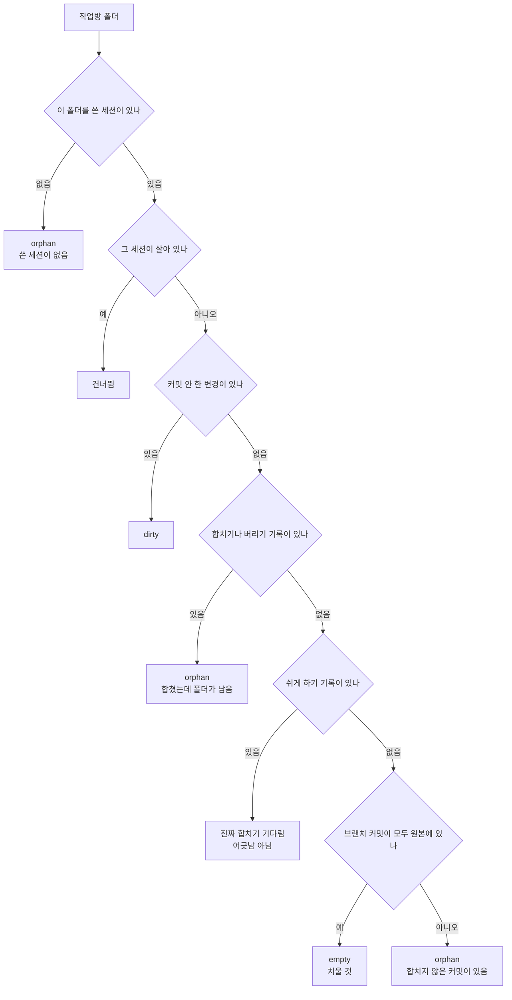

<!--
다루는 곳: bridge/reconcile.py, tests/test_reconcile.py
읽은 커밋: e5d584b
-->
# 끝난 뒤 맞추기

세션 하나가 일을 마치고 합치기까지 끝내면, 저장소 안은 깨끗해야 한다. 작업방(코드 이름 worktree, 세션마다 따로 떼어 준 작업 폴더)은 지워지고, `cc/<이름>` 브랜치도 지워지고, 「합치기 기다림」으로 쉬게 해 둔 기록도 풀려야 한다. 그런데 실제로는 그렇지 않을 때가 있다. 세션이 합치기 없이 끝나기도 하고, 사람이 FOREMAN 밖에서 `git merge`로 합치기도 하고, 폴더를 지우다 마는 일도 생긴다. 그러면 기록과 실제가 어긋난 채 남는다.

끝난 뒤 맞추기는 이 어긋남을 훑어서 사람에게 알리는 장치다. 이름은 「맞추기」지만 스스로 맞추지는 않는다. 찾고, 화면에 띄우고, 텔레그램으로 한 번 알릴 뿐이고, 지우는 일은 사람이 한다 [code:bridge/reconcile.py]. 이 편은 무엇을 어긋남으로 보는지, 왜 지우지 않는지, 언제 돌고 어디로 알리는지를 다룬다. 합치기 자체의 길은 → 07 합치기, 합치기 전에 사람이 보는 카드는 → 합치기 카드, 작업방을 만들고 세션을 띄우는 쪽은 → 06 세션 띄우기와 따로 작업에서 다룬다.

## 왜 만들었나

이 장치가 생기기 전에는 끝난 뒤 남은 것을 사람이 눈으로 찾아 손으로 치웠다. 실제로 한 번은 세션 하나의 작업방과 다른 세션 하나의 「합치기 기다림」 기록이 실제와 다르게 남아 있어 사람이 정리했다 [code:bridge/reconcile.py]. 그때까지 이 일은 README의 나중에 할 일 줄 하나로만 남아 있었다.

이런 찌꺼기는 아무 소리도 내지 않는다. 남은 작업방은 디스크만 조금 차지하고, 남은 브랜치는 `git branch`를 치기 전에는 보이지 않는다. 그러나 그 안에 커밋하지 않은 변경이 있다면 그것은 누군가 한 일이 저장소에 들어가지 못하고 사라지기 직전이라는 뜻이다. FOREMAN이 있는 까닭이 바로 이런 조용한 고장을 잡는 것이다. 포트 포워딩 하나가 한 달 넘게 수십만 번 재시작하는 것을 아무도 몰랐던 일이 이 프로젝트의 출발점이었다 [code:CLAUDE.md]. 끝난 뒤 맞추기는 그 원칙을 합치기 뒤에 적용한 것이다. 어긋남이 있으면 사람이 찾으러 가지 않아도 먼저 알린다.

작업방 이름이 다시 쓰인다는 점이 일을 더 어렵게 만들었다. FOREMAN은 새 세션에 `foreman`, `foreman-3`, `foreman-4` 같은 이름을 주는데, 앞 세션이 끝나고 폴더가 지워지면 같은 이름이 다음 세션에 다시 간다 [log:coder_screen_state_20261111.md]. 그래서 「이 폴더가 있다」만 보고는 그것이 어느 세션의 것인지 알 수 없고, 옛 세션의 쉬게 하기 기록이 뒤 세션이 새로 만든 폴더를 제 것으로 셀 수도 있었다. 판정은 폴더만이 아니라 그 폴더를 마지막으로 쓴 세션과 그 세션이 남긴 행동 기록까지 함께 봐야 했다.

## 무엇을 훑나

### 훑을 저장소 고르기

먼저 어느 저장소를 볼지 정한다. 서버에는 FOREMAN 말고도 여러 저장소가 있고, 모든 폴더를 뒤질 수는 없다. 그래서 최근 30일 안에 작업방에서 돈 세션이 있었던 저장소만 고른다(`REPO_DAYS = 30`) [code:bridge/reconcile.py]. DB의 세션 기록에서 작업 폴더(cwd)가 `/.worktrees/`를 품은 것을 찾고, 그 경로에서 원본 저장소 경로를 떼어 낸다. 원본에 `.git` 폴더가 실제로 있는 것만 남긴다. 저장소마다 그 세션이 속한 프로젝트 이름도 함께 기억해 두었다가 알림을 프로젝트별로 나눌 때 쓴다.

30일로 자른 것은 오래 손대지 않은 저장소까지 매번 git을 돌리지 않으려는 것이다. 대신 한 달 넘게 작업방 세션이 없던 저장소에 남은 찌꺼기는 이 훑기가 보지 못한다.

### 작업방 폴더마다

저장소의 `.worktrees/` 아래 폴더를 하나씩 본다. 폴더마다 그 폴더(또는 그 아래)를 작업 폴더로 쓴 세션 가운데 가장 최근 것을 DB에서 찾는다. 그 세션이 지금 살아 있으면 건너뛴다. 살아 있는지는 CC가 `~/.claude/sessions/` 아래 남기는 세션 파일로 판정한다(→ 03 세션 지켜보기와 글 넣기). 도는 세션의 작업방은 어긋남이 아니라 일하는 자리이기 때문이다 [code:bridge/reconcile.py].

살아 있지 않은 폴더에는 `git status --porcelain`을 돌려 커밋하지 않은 변경의 개수를 센다. 그리고 그 세션이 합치기(`wt-merge`), 버리기(`wt-discard`), 쉬게 하기(`rest`)를 했는지 행동 기록(`session_action` 표)에서 본다. 판정 차례는 아래와 같다.

폴더 판정이 끝나면 저장소 단위로 두 가지를 더 본다. 하나는 「합치기 기다림」 기록이 실제와 맞는지, 다른 하나는 git이 아는 것과 디스크가 맞는지다. 모두 모아 여섯 종류(kind)가 나온다.

| kind | 무엇인가 | 알림 |
|---|---|---|
| `dirty` | 끝난 세션의 작업방에 커밋하지 않은 변경이 있다 | 텔레그램 |
| `orphan` | 작업방이 남았는데 쓴 세션이 없거나, 이미 합치기나 버리기를 했거나, 쉬게 하기 없이 끝났다 | 텔레그램 |
| `empty` | 끝난 세션의 작업방인데 앞선 커밋도 변경도 없다 | 화면만 |
| `stale_rest` | 「합치기 기다림」 기록인데 실제로는 끝난 일이다 | 텔레그램 |
| `branch` | 작업방 없이 `cc/*` 브랜치만 남았다 | 텔레그램 |
| `prunable` | git은 작업방으로 아는데 폴더가 없다 | 텔레그램 |

### 여섯 종류를 하나씩

`dirty`가 가장 무겁다. 세션이 합치기도 쉬게 하기도 못 한 채 끝났고, 그 사이 고친 파일이 커밋되지 않은 채 폴더에만 있다. 이 폴더를 지우면 그 변경은 어디에도 남지 않는다. 판정 차례에서 변경 검사를 합치기 기록 검사보다 앞에 둔 것도 그래서다. 합쳤다는 기록이 있어도 폴더에 새 변경이 있으면 먼저 그것을 알린다 [code:bridge/reconcile.py].

`orphan`은 세 갈래다. 첫째는 폴더를 쓴 세션이 DB에 아예 없는 경우로, 누군가 FOREMAN 밖에서 `git worktree add`로 만들었거나 기록이 사라진 것이다. 이때는 커밋 안 된 변경이 있으면 그 개수도 붙인다. 둘째는 세션이 합치기나 버리기를 했다는 기록이 있는데 폴더가 남은 경우다. 합치고 지우다 만 것이니 어긋남이 맞다. 셋째는 세션이 합치기도 쉬게 하기도 없이 끝났고, 브랜치에 원본에 없는 커밋이 있는 경우다. 이때 알림 글에 「합치지 않은 커밋이 있습니다」를 덧붙인다.

`empty`는 처음에는 없었다. 처음 판정은 셋째 갈래의 `orphan`에 앞선 커밋이 없는 빈 작업방까지 함께 넣었다. 그런데 세션이 아무것도 바꾸지 않고 끝나는 일은 흔하다. 조사만 하고 끝난 세션, 띄웠다가 바로 끈 세션이 그렇다. 그런 폴더는 잃을 것이 없으니 고장이 아니라 치울 거리일 뿐인데, 매번 텔레그램 「어긋남」으로 오면 진짜 어긋남이 묻힌다. 그래서 커밋 안 한 변경이 0이고, 합치기나 버리기나 쉬게 하기 기록이 없고, 브랜치의 커밋이 모두 원본에 들어 있으면 `empty`로 따로 뺐다 [log:judge_three_20261113.md] [c:80b1aa2]. 「모두 원본에 들어 있다」는 `wt.in_base`가 판정한다. 브랜치가 원본의 조상이거나(`git merge-base --is-ancestor`), 커밋이 있어도 `git cherry`로 본 같은 변경이 원본에 이미 있으면(rebase 뒤에 합친 경우) 들어 있다고 본다 [code:bridge/worktree.py].

`stale_rest`는 쉬게 하기 기록이 실제와 다른 경우다. 쉬게 하기는 코더가 커밋만 해 두고 세션을 끝내 「합치기 기다림」에 올려 두는 것이다. 이 기록은 합치기나 버리기가 없는 한 남는데, 그 사이 일이 다른 길로 끝났을 수 있다. 판정은 코더 쪽 화면이 「합치기 기다림」 목록을 만들 때 쓰는 함수(`rest_stale`)를 그대로 가져다 쓴다 [code:bridge/coder_room.py] [c:59e2a8c]. 같은 작업방 이름을 뒤 세션이 다시 썼으면, 작업방 폴더가 없으면, 브랜치가 없으면, 브랜치 커밋이 모두 원본에 들어 있고 변경도 없으면 끝난 일로 본다. 화면은 이미 이런 것을 「합치기 기다림」에서 빼고 보여 주므로, 여기서 알리는 것은 「DB에 기록이 남아 있다」는 사실뿐이다. 판정을 한 곳에서만 해 두어서 화면과 알림이 서로 다른 말을 하지 않는다.

`branch`는 작업방 폴더는 없는데 `cc/<이름>` 브랜치만 남은 경우다. 이것도 `in_base`로 나눈다. 원본에 모두 들어 있으면 「지워도 됩니다」, 아니면 「원본에 없는 커밋이 있습니다(합치지 않은 일)」라고 쓴다. 뒤쪽은 폴더를 지울 때 브랜치를 남겨 일을 살려 둔 것일 수도 있고, 합치기를 잊은 것일 수도 있다.

`prunable`은 `git worktree list --porcelain`이 `prunable`로 표시한 것이다. git 안쪽 기록에는 작업방이 있는데 폴더가 디스크에 없다. 누군가 `rm -rf`로 폴더만 지운 흔적이고, `git worktree prune` 한 번으로 정리된다.

## 왜 알리기만 하나

여섯 종류 가운데 여럿은 지워도 된다는 것이 판정에서 이미 드러난다. `empty`와 원본에 들어 있는 `branch`는 지워도 잃을 것이 없다. 그래도 이 장치는 아무것도 지우지 않는다. 지우기는 사람이 패널의 [합치기]나 [버리기]로 한다. [버리기]는 확인 창에서 작업방 이름을 한 번 더 받은 뒤에야 폴더와 브랜치를 지운다 [code:bridge/static/js/coder.js].

첫째 까닭은 되돌릴 수 없다는 것이다. 커밋하지 않은 변경은 git 기록 어디에도 없어서, 폴더를 지우면 그대로 사라진다. 커밋이 있는 브랜치도 지우고 나면 reflog를 뒤지지 않는 한 찾기 어렵다. 판정이 맞을 때 얻는 것은 폴더 몇 개 치우는 수고를 더는 것이고, 판정이 틀릴 때 잃는 것은 누군가의 일이다. 둘의 무게가 다르다.

둘째 까닭은 다른 세션이 쓰고 있을 수 있다는 것이다. 판정은 폴더를 쓴 「가장 최근 세션」이 살아 있는지를 보는데, 세션 파일은 CC가 쓰는 것이라 잠깐 비거나 늦을 수 있다. 작업방 이름이 다시 쓰이므로, 훑는 그 순간에 같은 이름으로 새 세션이 막 뜨는 일도 있을 수 있다. 사람이 FOREMAN 밖의 셸에서 그 폴더를 열어 두었을 수도 있다. 기계가 「아무도 안 쓴다」고 확신할 길이 없다.

셋째 까닭은 지울지 말지가 애초에 판단이라는 것이다. 처음 훑었을 때 실제로 걸린 것은 FOREMAN이 아니라 다른 프로젝트 저장소의 작업방 하나였다 [log:coder_screen_state_20261111.md]. 커밋은 모두 원본에 있었으니 지워도 되는 것이었지만, 다른 저장소는 사용자가 시킬 때만 고친다는 규칙이 있어 사람이 확인해야 했다 [code:CLAUDE.md]. 남은 브랜치도 마찬가지로, 합치지 않은 커밋이 실수인지 일부러 남긴 것인지는 git이 알 수 없다.

대신 지우는 길은 가깝게 두었다. 화면에서 어긋남 줄을 누르면 그 세션 패널이 열리고, 거기서 [합치기]나 [버리기]를 고르면 된다. `empty`는 줄마다 [버리기]가 바로 붙어 있다.

## 언제 도나

정해진 주기로 돌지 않는다. 어긋남은 세션이 끝나거나 합치기와 버리기가 일어난 직후에만 새로 생기므로, 그 순간에 맞춰 돈다. 부르는 곳은 세 군데다 [code:bridge/main.py] [code:bridge/api/handoff.py].

| 부르는 때 | 부르는 곳 |
|---|---|
| 세션 프로세스가 사라졌을 때 | 세션 상태 감시기(`SessionStateWatcher.on_gone`) |
| 합치기, 버리기를 했을 때 | 작업방 API(`POST /api/sessions/{sid}/worktree`), 합치기 카드 승인 |
| 브리지가 떴을 때 | 브리지 시작에서 한 번 |

부르면 곧바로 훑지 않고 60초를 기다린다(`DEBOUNCE_S = 60.0`) [code:bridge/reconcile.py]. 합치기와 세션 끝남은 보통 잇달아 온다. 끝내기까지 함께 고른 합치기는 브랜치를 합치고, 폴더를 지우고, 세션을 끝낸다. 그 사이에 훑으면 반쯤 정리된 상태를 어긋남으로 볼 수 있다. 그래서 첫 부름에서 60초짜리 일을 하나 걸어 두고, 그 일이 끝나기 전에 오는 부름은 모두 무시해 한 번으로 묶는다.

세션 상태 감시기는 세션 파일의 변화를 보다가 프로세스가 사라진 세션이 있으면 `on_gone`을 부른다 [code:bridge/session_state.py]. 브리지가 뜬 뒤에는 같은 자리에 교장의 진행 중인 일 노트 정리도 함께 걸린다(→ 진행 중인 일과 자동 기상). 끝난 뒤 맞추기는 트랜스크립트 감시가 켜져 있을 때만 만들어진다. 훑다가 git이나 DB에서 오류가 나면 로그에 경고 한 줄을 남기고 넘어간다. 훑기가 실패해서 브리지가 멈추는 일은 없게 했다.

## 어디로 알리나

### 화면

마지막으로 훑은 결과는 통째로 메모리에 둔다. 코더 패널이 1분마다 부르는 `GET /api/coder/todo`가 프로젝트마다 이 결과를 `drift`로 싣고, 마지막으로 훑은 시각을 `drift_at`으로 싣는다 [code:bridge/api/coder.py]. 이 응답은 15초 동안 같은 답을 돌려주는데, 훑기가 끝나면 그 캐시를 바로 비워서 새 결과가 다음 부름에 나온다.

화면은 `drift`를 둘로 나눈다. `empty`가 아닌 것은 「맡길 일」 목록에 「어긋남」 줄로 들어가 코더 머리 위 말풍선의 「맡길 일 N」에도 세어진다. `empty`는 그 아래 따로 뜨는 「치울 것」 칸에만 들어가고 말풍선에는 세지 않는다 [code:bridge/static/js/coder.js]. 어긋남 줄의 호버 글은 「세션이 끝난 뒤 브리지가 훑어 찾은, 실제와 다른 것」이고 「저절로 지우지 않습니다」로 끝난다. 화면에서도 이 장치가 지우지 않는다는 것을 숨기지 않는다.

### 텔레그램

텔레그램은 새로 찾은 것만 보낸다. 찾은 것마다 kind와 위치(폴더 경로, 브랜치, 쉬게 하기 기록의 세션 번호)로 키(`recon:<kind>:<해시 16자>`)를 만들고, 알림 기록(`notification` 표)에 같은 키가 이미 있으면 건너뛴다 [code:bridge/reconcile.py]. 같은 어긋남이 다음 훑기에서 또 걸려도 다시 알리지 않는다. 기록은 DB에 있으니 브리지를 다시 띄워도 마찬가지다.

새로 찾은 것은 프로젝트마다 한 통으로 묶는다. 첫 줄은 프로젝트 머리말과 함께 「🧹 끝난 뒤 어긋난 것 N」이고, 그 아래 한 줄에 하나씩 8개까지, 넘치면 나머지 개수만 적는다. 끝 줄은 「코더 패널 「맡길 일」에서 보고, 그 세션 패널의 [합치기] · [버리기]로 정리합니다」다. 한 통에 여러 키가 들어가므로 첫 키는 보내는 알림의 기록으로 남고, 나머지 키는 `grouped`로 따로 기록해 다음에 다시 알리지 않게 한다. `empty`는 텔레그램에서 아예 뺀다. 고장이 아니라 치울 거리라서다 [log:judge_three_20261113.md].

이 알림의 종류 이름(`recon`)은 알림 설정의 하루 묶음 종류에 들어 있다 [code:config/notify.toml]. 그래서 묶음을 켠 프로젝트(지금은 네 프로젝트 모두)에서는 바로 가지 않고 21:00 하루 묶음에 실려 간다. 🧹는 급한 표시가 아니어서 바로 보내는 쪽으로 빠지지 않는다. 어긋남은 사람이 그날 안에 치우면 되는 일이지 지금 손을 멈추고 볼 일이 아니라는 판단이다. 모아 둔 것이 26시간 넘게 안 나가면 바로 보내는 장치가 묶음 쪽에 있어서 묶음 때문에 조용히 묻히지는 않는다(→ 11 알림).

## 시험과 되돌리기

시험은 둘이다 [code:tests/test_reconcile.py]. 하나는 임시 저장소에 도는 세션, 변경이 남은 세션, 합쳤는데 폴더가 남은 세션, 진짜 쉬게 한 세션, 밖에서 합친 쉬게 한 세션, 쓴 세션이 없는 폴더, 브랜치만 남은 것, 폴더만 지운 것을 차려 놓고, 도는 세션과 진짜 쉬게 한 세션은 걸리지 않고 나머지 종류가 모두 걸리는지 본다. 이어서 텔레그램이 프로젝트마다 한 통만 가고, 같은 것을 두 번째 훑기에서 다시 보내지 않는지 본다. 다른 하나는 빈 작업방과 원본에 이미 합친 작업방이 `orphan`이 아니라 `empty`로 나오고, `empty`만 있으면 알림을 보내지 않지만 화면용 결과에는 남는지 본다.

빈 작업방도 다시 텔레그램으로 받고 싶으면 `Reconciler.run_once`에서 `empty`를 거르는 한 줄을 지우면 된다 [code:bridge/reconcile.py]. 훑는 범위는 맨 위 `REPO_DAYS`, 기다리는 시간은 `DEBOUNCE_S`를 고친다. 둘 다 설정 파일이 아니라 코드 값이라 바꾸면 브리지를 다시 띄워야 한다.

## 알려진 한계

- 남은 작업방과 브랜치를 알리기만 하고 지우지 않는다. 까닭은 셋이다. 지우면 되돌릴 수 없고, 다른 세션이 쓰고 있을 수 있고, 지울지 말지가 애초에 판단이다(위 「왜 알리기만 하나」). 그래서 판정이 맞아도 폴더를 치우는 것은 사람이 패널에서 한다
