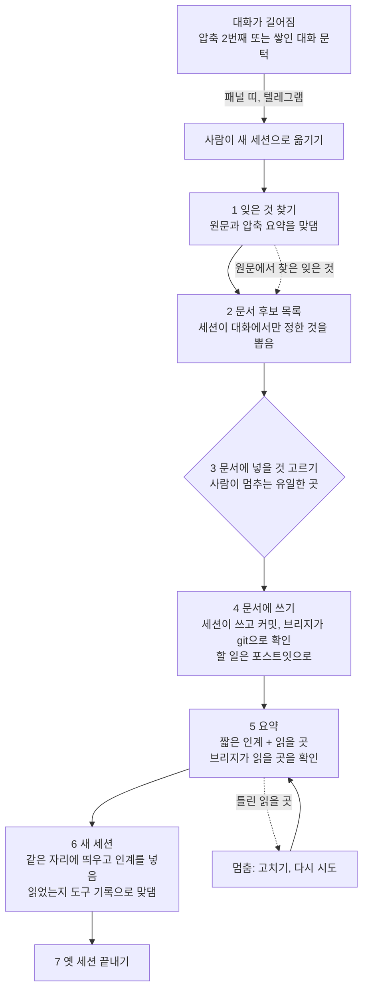

<!--
다루는 곳: bridge/handoff.py, bridge/pointers.py, bridge/static/js/moveflow.js
읽은 커밋: ff16b55
-->
# 08 인계와 압축 손실

Claude Code(CC) 세션 하나를 며칠, 길게는 몇 주씩 붙잡고 일하면 대화가 끝없이 길어진다. 대화가 모델이 한 번에 볼 수 있는 양을 넘기 전에 CC는 앞쪽 대화를 요약 한 덩어리로 바꿔 자리를 만든다. 이것이 압축이다. 압축 덕분에 세션은 멈추지 않고 이어지지만, 그 대가로 세션은 앞에서 사람이 한 말을 원문이 아니라 요약으로만 기억하게 된다. 이 편은 압축이 실제로 무엇을 얼마나 지웠는지 잰 결과, 그 결과 때문에 세션을 새 세션으로 넘기는 방식(인계)을 어떻게 다시 짰는지, 그리고 지금 FOREMAN에서 그 일이 어떤 흐름으로 이어지는지를 다룬다. 압축 손실을 기계로 재는 법, 인계 요약과 읽을 곳을 꺼내고 확인하는 법, 대화에서만 정한 것을 문서로 옮기는 법, 이 모두를 단추 하나로 잇는 흐름은 하위 네 편이 깊게 다룬다.

말을 하나 정해 둔다. 화면에서는 이 일을 **새 세션으로 옮기기**라고 부르고, 코드와 이 문서의 설명에서는 **인계**(handoff)라고 부른다. 두 말이 가리키는 것은 같다. 지금 세션이 들고 있는 일을 새 세션이 이어받게 넘기는 것이다. 화면 말을 따로 둔 까닭은 사람이 단추를 누를 때 하는 일이 「요약을 받는 것」이 아니라 「세션을 옮기는 것」이기 때문이다 [docs:style_guide.md].

## 압축이란 무엇이고 왜 문제인가

CC는 대화를 트랜스크립트 파일(`~/.claude/projects/…/<세션 id>.jsonl`, 한 줄이 메시지나 도구 호출 하나인 기록)에 쌓는다. 대화가 모델의 맥락 창(context window, 모델이 한 번에 읽을 수 있는 글의 양)에 가까워지면 CC는 그때까지의 대화를 요약해 새 출발점으로 삼는다. 사람이 `/compact`를 쳐서 일으킬 수도 있고, 자리가 모자라면 CC가 스스로 한다(auto-compact).

중요한 점이 하나 있다. 압축은 파일을 지우지 않는다. CC는 트랜스크립트에 요약 줄을 더할 뿐이고 압축 전 원문은 파일에 그대로 남는다. 잃는 것은 기록이 아니라 **모델의 맥락**이다 [docs:11_handoff.md]. 세션은 압축 뒤로 원문 대신 요약을 읽고 일한다. 그래서 압축으로 무엇을 잃었는지는 원문과 요약을 맞대 보면 알 수 있다. 원문이 남아 있다는 이 사실이 뒤에 나오는 측정과 「잊은 것 찾기」를 가능하게 했다.

문제는 요약이 무엇을 남기고 무엇을 버리는지 사람이 고르지 않는다는 것이다. 요약은 그 순간 모델이 중요하다고 본 것을 남긴다. 지금 하는 작업의 진행 상황은 잘 남는다. 반면 몇 주 전에 사람이 지나가듯 한 말, 예를 들어 「이 사이트는 내가 정할 때까지 열지 마라」나 「기존 리뷰가 어느 신발에 달렸는지는 절대 바꾸지 마라」 같은 금지와 기준은 지금 작업과 멀어 보이는 순간 빠진다. 빠진 뒤에는 세션이 그런 말이 있었다는 사실 자체를 모른다. 알림도 오류도 없이 규칙이 사라진다. FOREMAN이 잡으려는 것이 바로 이런 조용한 고장이다 [repo:CLAUDE.md].

이 문제가 커진 계기는 한 세션이었다. 런슈즈 프로젝트의 세션 하나가 17일째 이어지며 트랜스크립트가 730MB에 이르렀고 그동안 17번 자동 압축됐다 [docs:11_handoff.md]. 세션을 새 세션으로 넘기는 기능은 원래 로드맵에서 뒤쪽 단계였지만, 이 세션 때문에 앞당겼다 [docs:11_handoff.md].

## 실측: 압축은 지시와 결정의 약 63%를 지우거나 약하게 했다

감으로 「많이 잊는 것 같다」고 하는 대신 직접 쟀다. 두 세션을 같은 방법으로 손으로 점검했다. 트랜스크립트에서 압축 구간마다 사람이 한 말을 뽑고(이 단계는 스크립트로, 모델 없이), 그 가운데 오래 지켜야 하는 지시, 결정, 금지, 기준, 선호, 끝나지 않은 일을 골랐다. 그리고 하나하나가 **지금 세션이 들고 있는 것**에 남았는지 봤다. 들고 있는 것은 넷이다. 마지막 압축 요약, 그 뒤에 사람이 한 말, 저장소의 `CLAUDE.md`, CC의 지속 메모리. 판정은 구간을 나눠 에이전트 여러 개가 원문, 구간별 요약, 지금 맥락을 맞대 보게 했다 [log:runshoes_compaction_loss_20261105.md] [log:foreman_compaction_loss_20261105.md].

| | 런슈즈 세션 | FOREMAN 세션 |
|---|---|---|
| 점검 때 압축 횟수 | 17번 | 7번 |
| 뽑은 사람 말 | 344개 | 73개 |
| 골라낸 지시, 결정 | 282개 | 142개 |
| 사라짐 | 143 | 65 |
| 약해짐 | 37 | 25 |
| 잃은 것(사라짐 + 약해짐) | 180 (64%) | 90 (63%) |
| 뒤집힘(나중 결정이 바꿈) | 26 | 6 |
| 살아 있음 | 63 | 33 |
| 끝남 | 13 | 13 |

두 세션은 프로젝트도, 압축 횟수도, 대화 길이도 달랐는데 잃은 비율은 63~64%로 거의 같았다 [log:foreman_compaction_loss_20261105.md]. 압축은 문서가 있든 없든 세션의 기억을 같은 비율로 깎는다는 뜻이다. 다만 잰 것은 세션 둘이라, 늘 이 비율이라고 말할 만큼 표본이 넉넉하지는 않다. 런슈즈에서 잃은 180개의 종류는 기준 93, 결정 35, 금지 26, 끝나지 않은 일 17, 선호 8이었다 [log:runshoes_compaction_loss_20261105.md]. 가장 많이 잃은 것이 「무엇을 근거로 쓰고 무엇을 쓰지 않는가」 같은 기준이었고, 이런 것은 어기면 결과가 틀리는데도 겉으로는 일이 잘 되는 것처럼 보인다.

「뒤집힘」을 따로 센 데도 까닭이 있다. 사람이 앞에서 정했다가 나중에 바꾼 결정이다. 사라진 것을 무작정 되살리면 이미 버린 결정이 다시 살아난다. 그래서 되살릴 것을 고를 때는 기계 판정만 믿지 않고 사람이 원문을 보고 정한다 [log:runshoes_compaction_loss_20261105.md]. 이 원칙은 → 「압축 손실 재기」에서 기계로 옮길 때도 그대로 지켰다.

### 언제 잃나: 두 번째 압축

잃은 시점을 「그 말을 한 구간 뒤 몇 번째 압축에서 빠졌나」로 세면 모양이 뚜렷하다.

| 언제 빠졌나 | 런슈즈 | FOREMAN |
|---|---|---|
| 그 말을 한 구간의 첫 압축 | 41 | 22 |
| **그다음 압축** | **96** | **48** |
| 그 뒤 | 43 | 20 |

두 세션 모두 두 번째 압축에서 가장 많이 빠졌다 [docs:11_handoff_v2.md] [log:foreman_compaction_loss_20261105.md]. 첫 압축 때는 요약이 그 말을 한 줄로라도 옮겨 둔다. 그런데 다음 압축은 원문이 아니라 그 요약을 다시 요약한다. 한 번 줄어든 말이 두 번째에 지워진다. 런슈즈에서는 잃은 것의 76%가 말한 뒤 압축 두 번 안에 사라졌다 [docs:11_handoff_v2.md]. 주제가 바뀌는 압축에서도 몰렸다. 스펙 수집에서 관리 화면으로 넘어간 압축 두 번에 41개가 빠졌다 [log:runshoes_compaction_loss_20261105.md]. 지난 주제의 원칙은 새 주제와 상관없어 보이는 순간 통째로 버려진다.

이 숫자가 압축 알림의 기준이 됐다. 트랜스크립트 크기는 대부분 도구 출력이라 압축 횟수와 같이 늘 뿐 더 알려 주는 것이 없어 버렸다. 대신 압축 횟수를 세어 두 번째 압축 직후를 「넘어갈 때」로, 네 번째부터를 「늦었음」으로 알린다 [docs:11_handoff_v2.md]. 기준 값과 맥락 크기, 비율 문턱은 → 「압축 손실 재기」와 → 「새 세션으로 옮기기」에서 다룬다.

### 두 세션의 결정적 차이: 되살릴 곳이 있느냐

잃은 비율은 같았지만 한 가지가 크게 달랐다. 잃은 것 가운데 이미 저장소 문서에 적혀 있던 것의 수다.

| | 런슈즈 | FOREMAN |
|---|---|---|
| 잃은 것 | 180 | 90 |
| 그중 저장소 문서에 적혀 있던 것 | 약 5 | 56 |
| 살아 있던 것이 기댄 자리 | 요약 38, 메모리 16, 압축 뒤 대화 7, CLAUDE.md 2 | CLAUDE.md 15, 마지막 요약 10, 메모리 8 |

FOREMAN은 단계마다 결과와 판단 근거를 `log/`와 README에 남겨 왔다. 그래서 잃은 90개 가운데 56개는 새 세션이 그 문서를 읽기만 하면 돌아온다. 런슈즈는 대부분을 대화에서만 정했다. 잃은 180개 가운데 문서에 있던 것은 다섯 개 남짓이었다 [log:foreman_compaction_loss_20261105.md]. 런슈즈에서 살아 있던 63개도 절반 이상이 요약에 기대고 있었는데, 요약에 기댄 것은 다음 압축에서 또 깎인다 [docs:11_handoff_v2.md].

이 표가 인계를 다시 짠 근거다. 세션의 기억은 언젠가 깎인다. 깎이지 않는 것은 파일에 적힌 것뿐이다. 그렇다면 넘길 때 기억을 넘기려 애쓸 것이 아니라, 넘기기 전에 기억을 파일로 옮기고 새 세션에는 그 파일을 읽게 하면 된다.

점검 자체도 결과를 냈다. FOREMAN 점검에서 사라진 것 가운데 하나가 이 프로젝트가 있는 이유, 「조용한 고장을 잡는다」였다. 어느 압축 요약에도 실린 적이 없었다. 그 문장은 그날 CLAUDE.md 맨 위로 옮겼다 [log:foreman_compaction_loss_20261105.md]. 점검으로 찾은 다른 어긋남(CLAUDE.md의 문장이 실제 결정과 다른 것, 메모리가 뒤집힌 결정을 아직 들고 있는 것)도 같은 날 사람이 하나씩 정해 고쳤다.

## 인계 1판: 요약을 통째로 넘겼다

처음 만든 인계는 단순했다. 브리지가 넘길 세션에 요청 글을 넣으면, 그 세션이 지금까지의 대화 전체를 바탕으로 인계 문서를 써서 정해진 표지 사이에 담아 돌려준다. 브리지는 트랜스크립트에서 그 표지를 찾아 요약을 꺼내 DB에 저장하고, 사람이 패널에서 그 글을 보고 확인하면 새 세션을 띄워 요약 전체를 첫 입력으로 넣는다 [docs:11_handoff.md].

1판에서 정한 원칙 셋은 지금도 그대로다. 첫째, 요약은 **그 세션 자신이 쓴다.** 맥락을 들고 있는 당사자가 쓰는 것이 가장 정확하고, 다른 모델을 따로 부르면 그 모델은 대화를 처음부터 다시 읽어야 한다. 둘째, 이미 죽은 세션의 요약(`claude -p --resume`으로 그 세션을 되살려 쓰게 하는 것)은 토큰을 쓰므로 사람이 단추를 누를 때만 한다. 셋째, 새 세션에 넣기 전에 사람이 넣을 글을 본다 [docs:11_handoff.md]. 이 원칙들은 2판으로 넘어가며 오히려 더 단단해졌다. 압축 손실 점검에서도 「인계 요약은 그 세션 자신이 쓴다」는 결정이 사라짐 목록에 올라 있었고, 그래서 서기나 다른 장치가 이를 어기지 않게 따로 짚어 뒀다 [log:foreman_compaction_loss_20261105.md].

1판의 요청 글은 이런 꼴이었다. 목표와 맥락, 한 일, 진행 중이거나 끝나지 않은 것, 다음 할 일, 주의, 참고의 여섯 절을 4,000자 안에 쓰고, 사용자가 정한 결정과 금지는 빠짐없이 「주의」에 적으라고 했다. 넣는 글이 8,000자를 넘으면 진행 중, 다음 할 일, 주의는 통째로 넣고 나머지 절은 앞부분만 넣은 뒤 전체는 파일로 따로 두었다. 이 줄이기는 지금도 1판과 2판을 가리지 않고 새 세션에 넣는 글 모두에 걸린다. 다만 2판 요약은 2,500자 안이라 거의 닿지 않는다 [code:bridge/handoff.py].

버리는 세션으로 한 바퀴 돌려 보니 기계적으로는 잘 돌았다. 짧은 대화 세 개 뒤 요약을 요청하자 34초 만에 1,537자가 저장됐고, 사용자 결정 두 개가 「주의」에 들어갔다. 새 세션은 요약을 받고 다섯 줄로 이해한 것을 말한 뒤 지시대로 확인을 기다렸다 [log:stage11_handoff_result.md].

### 1판을 버린 까닭

문제는 기계가 아니라 재료였다. 1판의 요약은 세션이 **지금 기억하는 것**으로 쓴다. 압축으로 이미 잃은 것은 세션 스스로 되살릴 수 없다 [docs:11_handoff.md]. 「사용자가 정한 것은 빠짐없이 주의에 적어라」라고 시켜도, 세션은 자기가 잊은 결정이 있다는 것조차 모른다. 위 실측대로라면 오래 산 세션의 요약은 사람이 한 지시와 결정의 3분의 2 가까이를 이미 잃은 기억에서 나온다.

여기에 요약을 넘기는 일 자체가 또 하나의 압축이라는 문제가 겹친다. 4,000자 요약은 대화 전체를 한 번 더 줄인 것이다. 새 세션이 그 요약을 받고 일하다 다시 압축되면, 요약의 요약이 된다. 측정에서 가장 많이 잃은 때가 두 번째 압축이었으니, 인계 요약을 통째로 넣는 방식은 손실을 줄이는 것이 아니라 한 단계 더 쌓는다 [code:bridge/handoff.py] [log:foreman_compaction_loss_20261105.md].

그래서 사용자 제안으로 방향을 바꿨다. 요약은 모델의 기억에서 나와 한계가 있고, 문서는 남아 있으니 읽게 하면 된다 [docs:11_handoff_v2.md]. 그런데 측정이 한 가지를 더 알려 줬다. 「읽을 곳만 넘긴다」로는 모자란다. 런슈즈처럼 대화에서만 정한 것은 가리킬 문서가 없다. **넘기기 전에 먼저 문서로 옮겨야 한다** [docs:11_handoff_v2.md].

1판은 바로 지우지 않았다. 패널에서 1판과 2판을 고를 수 있게 두고 써 본 뒤 빼기로 했다. 2판이 생긴 뒤 1판으로 받은 요약이 0개였다. 그래서 화면의 고르기만 뺐다 [log:stage11_session_tab_result.md]. 코드에는 아직 1판이 남아 있다. API가 `fmt: v1`을 받고, 요청 글 `REQUEST_PROMPT`와 넣는 글 `INJECT_PROMPT`도 그대로다. 넣을 때 브리지는 요약에 「## 읽을 곳」 절이 있는지로 2판인지 가르고, 없으면 1판 꼴로 넣는다 [code:bridge/handoff.py] [code:bridge/pointers.py]. 사람이 고친 요약이나 압축 요약에서 만든 요약처럼 읽을 곳이 없는 글도 넣을 수 있게 남긴 길이다. 다만 이 길로 들어온 글은 읽을 곳 확인을 받지 않는다.

## 인계 2판: 문서로 옮기고, 읽을 곳을 넘긴다

2판은 세 단계다. 넘기기 전에 대화에서만 정한 것을 문서로 옮기고, 남은 것만 짧게 요약하면서 새 세션이 읽을 곳을 붙이고, 새 세션이 실제로 그곳을 읽었는지 브리지가 확인한다 [docs:11_handoff_v2.md].

| | 1판 | 2판 |
|---|---|---|
| 넘기는 것 | 대화 전체의 요약 | 문서에 없는 것만 담은 짧은 요약 + 읽을 곳 |
| 요약 분량 | 4,000자, 여섯 절 | 2,500자, 다섯 절(지금 상태, 다음 할 일, 걸려 있는 것, 문서와 다른 지금, 읽을 곳) |
| 결정과 금지 | 요약의 「주의」 절에 | 넘기기 전에 문서(CLAUDE.md, docs, 메모리, 포스트잇)에 써서 커밋 |
| 이미 잊은 것 | 되살릴 길 없음 | 원문에서 찾아 문서 후보에 같이 넣음 |
| 새 세션이 받는 것 | 요약 본문 | 「먼저 읽을 곳을 모두 Read로 읽어라」와 짧은 요약 |
| 확인 | 사람이 넣을 글을 봄 | 읽을 곳이 실제로 있는지 기계로 보고, 새 세션이 읽었는지 도구 기록으로 맞댐 |

[code:bridge/handoff.py] [docs:11_handoff_v2.md]

이 구조의 장점은 새 세션의 출발점이 작고 최신이라는 것이다. 요약 본문을 통째로 넣지 않으니 시작 맥락이 작고, 문서가 최신이면 맥락도 최신이다. 반대로 약점도 분명하다. 문서가 지금과 다르면 틀린 맥락이 그대로 들어간다. 2판은 이를 여러 겹으로 막는다. 세션이 아는 차이를 「문서와 다른 지금」 절에 적게 하고, 브리지가 읽을 곳마다 마지막 커밋 시각을 붙여 오래된 문서를 표시하고, 서기가 문서를 코드에 맞춰 두고, 인계를 만든 뒤 git과 스키마 잠금이 바뀌었으면 넣는 글 맨 앞에 「인계 뒤 바뀐 것」을 붙인다 [docs:11_handoff_v2.md]. 마지막 장치는 실제 사고에서 나왔다. 인계를 받은 세션이 이미 합쳐진 브랜치와 없어진 작업 폴더를 「지금 상태」로 받아 일했다. 이 겹들의 자세한 동작은 → 「인계 요약과 읽을 곳」에 있다.

### 무엇을 포기했나

2판은 대가가 있다. 첫째, 넘기는 데 시간과 토큰이 더 든다. 문서 후보를 뽑고, 사람이 고르고, 세션이 문서를 쓰고 커밋하는 단계가 앞에 붙는다. 잊은 것 찾기는 `claude -p`로 판정을 돌려 비용이 든다. 둘째, 문서가 쌓인다. 대화에서 정한 결정이 CLAUDE.md와 docs에 계속 들어가므로 그 문서들을 정리하는 일(서기의 몫, → 「10 서기와 문서」)이 필요해졌다. 셋째, 사람이 한 번은 멈춰야 한다. 무엇을 문서에 넣을지는 사람이 고른다. 기계 판정이 뒤집힌 결정을 되살릴 수 있기 때문이다 [docs:11_handoff_v2.md].

다른 길도 있었다. 요약을 별도 모델이 원문 전체에서 다시 쓰게 하는 것이다. 이 길은 1판의 첫 원칙(맥락을 든 당사자가 쓴다)과 부딪히고, 매번 수백 MB 트랜스크립트를 다시 읽혀야 한다. 결정적으로, 그렇게 만든 요약도 결국 다음 압축에서 다시 깎인다. 파일에 적힌 것만이 압축을 견딘다는 측정 결과를 넘어서지 못했다 [docs:11_handoff.md] [log:runshoes_compaction_loss_20261105.md].

## 지금의 흐름

처음에는 각 단계가 따로 있는 단추였다. 손실을 찾고, 목록을 뽑고, 같이 넣을 것을 고르고, 승인하고, 쓰고, 요약하고, 띄우고, 끝내기까지 사람이 일곱 번 끼어들었다 [code:bridge/static/js/moveflow.js]. 지금은 세션 정리 탭의 [새 세션으로 옮기기] 단추 하나가 이를 잇고, 사람은 「문서에 넣을 것 고르기」 한 번만 멈춘다. 이 한 흐름은 `config/handoff.toml`의 `[move] one_flow = true`로 켜져 있다 [code:config/handoff.toml].

단계 이름은 화면에 보이는 그대로다 [code:bridge/static/js/moveflow.js]. 1에서 찾은 「잊은 것」은 2의 문서 후보를 물을 때 같이 들어간다. 세션의 기억에서 이미 빠진 것을 원문에서 되살리는 길이 이것이다. 이미 끝난 세션은 문서를 쓸 세션이 없으므로 이 한 흐름을 타지 않고, 요약을 보고 확인한 뒤 넣는 옛 흐름으로 옮긴다 [docs:11_handoff_v2.md].

인계 요약을 꺼내는 길은 1판 그대로다. 브리지가 요청 글을 세션의 입력 칸에 넣고, 세션이 `<<<FOREMAN-HANDOFF r=…>>>`와 `<<<END r=…>>>` 표지 사이에 쓴 글을 트랜스크립트의 응답 줄에서 꺼낸다. 요청 글 첫 줄 `[FOREMAN 인계 요청 r=…]` 덕분에 조립기가 그 턴을 보통 대화와 갈라, 보통의 끝남 알림 대신 인계 요약 저장 알림이 나간다. 10분 안에 표지가 오지 않으면 실패로 남기고 응답 원문을 함께 둔다 [code:bridge/handoff.py]. 요약 저장 같은 성공 알림은 하루 묶음을 켠 프로젝트에서 저녁 21:00 묶음으로 가지만, 요약 실패와 시간 초과 알림은 글 앞에 ⚠를 달고 묶지 않고 바로 보낸다. 실패를 저녁에야 알 까닭이 없어서다 [code:bridge/handoff.py] [log:foreman-5_fail_now_unpriced_20261117.md]. 요청 id `r=`이 매번 달라 다른 턴이나 인용된 예시와 섞이지 않는다.

## 하위 편 길잡이

네 편은 위 그림의 다른 부분을 맡는다. 어디서부터 읽어도 되지만, 까닭을 따라가려면 차례대로가 낫다.

| 편 | 맡는 부분 | 이런 물음에 답한다 |
|---|---|---|
| → 「압축 손실 재기」 | 그림의 맨 위와 1 | 손으로 한 점검을 어떻게 기계(추출은 모델 없이, 판정은 `claude -p`)로 옮겼나. 압축 알림을 왜 파일 크기가 아니라 횟수로 정했나. 「없음」과 「실패」를 어떻게 가르나 |
| → 「인계 요약과 읽을 곳」 | 그림의 5와 6 | 요약을 표지로 어떻게 꺼내나. 세션이 응답 못 하는 상태(일하는 중, 멈춤, 죽음)는 어떻게 다루나. 읽을 곳 한 줄의 꼴과 기계 확인, 새 세션이 실제로 읽었나 확인, 인계 뒤 바뀐 것 붙이기 |
| → 「문서로 옮기기」 | 그림의 2, 3, 4 | 세션이 대화에서만 정한 것을 어떻게 목록으로 내나. 목적지(CLAUDE.md, docs, 메모리, 포스트잇, 버림)는 어떻게 정하나. 쓴 커밋을 브리지가 어떻게 확인하나 |
| → 「새 세션으로 옮기기」 | 그림 전체를 잇는 흐름과 7 | 일곱 번 끼어들던 흐름을 어떻게 한 번으로 줄였나. 언제 옮기라고 권하나(쌓인 대화 비율, 전환 말투, 커밋이나 긴 쉼). 새 세션은 어디에 뜨나, 알려진 한계 |

이 편이 다룬 공통 까닭, 즉 압축이 기억을 약 63% 깎는다는 것, 그 가운데 가장 많이 깎는 때가 두 번째 압축이라는 것, 깎이지 않는 것은 파일뿐이라는 것은 네 편 모두의 전제다. 하위 편에서 어떤 장치가 왜 그 모양인지 궁금해지면 대부분 이 세 문장으로 돌아온다 [log:foreman_compaction_loss_20261105.md].

이 편과 맞닿은 다른 편도 있다. 새 세션을 띄우고 작업방(worktree, 저장소를 따로 꺼낸 작업 폴더와 브랜치. 화면에서는 작업방이라 부른다)을 고르는 일은 → 「06 세션 띄우기와 따로 작업」, 세션 입력 칸에 글을 넣는 방법(붙여넣기 뒤 Enter)은 → 「03 세션 지켜보기와 글 넣기」, 옮긴 문서를 코드에 맞춰 두는 서기의 일은 → 「10 서기와 문서」, 압축과 맥락 알림이 텔레그램으로 나가는 길은 → 「11 알림」이 다룬다.
