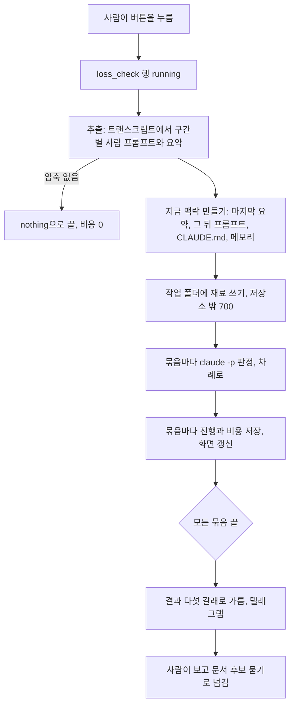

<!--
다루는 곳: bridge/losscheck.py, bridge/compactwatch.py, bridge/static/js/losscheck.js, migrations/0021_loss_check.sql, tests/js/losscheck.test.mjs, tests/test_compactwatch.py, tests/test_losscheck.py
읽은 커밋: fb7121b
-->

# 압축 손실 재기

CC(Claude Code) 세션은 대화가 길어지면 앞부분을 스스로 요약해 줄인다. 이것을 자동 압축(auto-compact)이라 하고, 화면에서는 「대화 자동 요약」이라고 부른다. 모델이 한 번에 읽을 수 있는 양(창)이 정해져 있으니 줄이지 않으면 대화를 이어 갈 수 없다. 문제는 요약이 무엇을 남기고 무엇을 버릴지를 모델이 정한다는 점이다. 사람이 세션 초반에 "이건 절대 하지 마라", "이 기준으로 판정해라"라고 정해 둔 것이 요약 몇 번을 거치면 조용히 빠진다. 세션은 잊었다고 말하지 않는다. 잊은 채로 계속 일하고, 사람은 같은 말을 다시 해야 할 때가 되어서야 알게 된다.

FOREMAN이 잡으려는 것이 바로 이런 조용한 고장이다. 이 편은 압축이 실제로 얼마나 지우는지를 손으로 두 번 잰 이야기, 그 재는 법을 브리지가 버튼 하나로 돌리게 옮긴 기능(화면 이름 [압축으로 잊은 것 찾기]), 그 결과로 정한 압축 알림과 쌓인 대화 % 재기, 그리고 이 모든 것이 화면에 어떻게 보이는지를 다룬다.

잰 결과를 바탕으로 인계 방식을 어떻게 바꿨는지(요약을 통째로 넘기던 방식을 버리고 문서로 옮긴 뒤 읽을 곳을 넘기는 방식으로 간 것)는 → 08 인계와 압축 손실, 찾은 것을 실제 문서로 옮기는 단계는 → 문서로 옮기기, 버튼 한 번으로 찾기부터 새 세션까지 이어 가는 흐름과 작업 전환 권유는 → 새 세션으로 옮기기에서 다룬다.

## 압축이 트랜스크립트에 남기는 흔적

압축이 일어나도 CC는 새 파일을 만들지 않는다. 같은 트랜스크립트(대화 기록 파일, JSONL)에 압축 경계 줄(`compact_boundary`)을 남기고, 그 바로 뒤에 요약 글을 사람 메시지처럼 한 줄 넣는다. 이 요약 줄에는 `isCompactSummary: true`가 붙는다. 이 둘 덕분에 파일 하나만 읽으면 "압축이 몇 번 있었고, 각 압축이 어떤 대화를 대신했으며, 그 자리를 무엇이 메웠는지"를 다 되짚을 수 있다 [code:bridge/losscheck.py].

브리지는 트랜스크립트를 실시간으로 읽다가 압축 경계 줄을 만나면 DB `event` 표에 `type = 'compact'` 행을 남기고 그 턴에 압축 표시를 단다. 압축 알림은 이 행의 개수를 세서 판단한다 [code:bridge/compactwatch.py]. 파일을 읽어 턴을 조립하는 쪽 이야기는 → 턴 조립에 있다.

## 손으로 두 번 재다

압축 손실을 처음 잰 것은 손으로였다. 한 번은 다른 프로젝트(러닝화 카탈로그 서비스, 이하 런슈즈)의 오래된 세션, 한 번은 FOREMAN 자신을 만들던 세션이었다. 둘 다 세션이나 저장소를 고치지 않고 읽기만 했다.

### 재는 법

방법은 두 단계로 나뉜다. 먼저 추출이다. 스크립트가 트랜스크립트를 처음부터 읽으며 압축 경계마다 구간을 끊고, 각 구간에서 사람이 직접 친 프롬프트만 골라낸다. 각 구간 끝에 생긴 압축 요약도 따로 뽑는다. 여기까지는 LLM(대형 언어 모델)을 쓰지 않는다.

다음이 판정이다. 판정은 에이전트(서브에이전트로 띄운 모델)가 했다. 에이전트는 사람 프롬프트를 하나씩 읽으며 그 가운데 오래 지켜야 하는 것을 골라낸다. 오래 지켜야 하는 것은 여섯 종류로 나눴다. 사용자가 정한 결정, 금지, 기준, 선호, 그 뒤로도 지켜야 하는 지시, 그리고 끝나지 않은 일(미완)이다. 그때만 필요한 요청, 질문, 잡담은 뺀다. 그런 다음 골라낸 항목마다 "지금 세션이 이것을 아직 들고 있나"를 판정한다 [log:foreman_compaction_loss_20261105.md].

여기서 "지금 세션이 들고 있는 것"을 무엇으로 볼지가 중요하다. 네 가지로 정했다. 첫째는 마지막 압축 요약이다. 압축된 세션이 옛 대화에 대해 아는 것은 사실상 이 요약뿐이다. 둘째는 마지막 압축 뒤의 사람 프롬프트로, 아직 압축되지 않았으니 원문 그대로 남아 있다. 셋째는 저장소의 `CLAUDE.md`로, 매 세션 자동으로 읽힌다. 넷째는 CC의 지속 메모리 폴더다. 이 넷 어디에도 없으면 세션은 그것을 모른다고 본다 [log:foreman_compaction_loss_20261105.md].

판정은 다섯 상태로 냈다.

| 상태 | 뜻 |
|---|---|
| 살아 있음 | 내용과 이유가 지금 맥락에 그대로 있다 |
| 약해짐 | 뜻은 남았지만 이유, 조건, 범위, 숫자가 빠졌다 |
| 사라짐 | 지금 맥락 어디에도 없다 |
| 뒤집힘 | 나중에 사용자가 바꿨다. 되살리면 안 된다 |
| 끝남 | 미완이나 지시가 실행돼 더 할 것이 없다 |

사라짐과 약해짐을 합쳐 "잃은 것"이라 부른다. 판정마다 사용자 말 원문 인용, 요지, 지금 남은 곳이나 되살릴 곳, 처음 빠진 요약 이름을 함께 적게 했다. 판정은 모델 판단이라 틀릴 수 있어서, 살릴 것을 고를 때는 원문 인용을 다시 보고 정했다 [log:runshoes_compaction_loss_20261105.md].

### 결과 수치

런슈즈 세션은 자동 압축이 17번 있었고 트랜스크립트가 730MB였다. 구간 18개에서 사람 프롬프트 344개를 뽑아 282개 항목을 골랐다 [log:runshoes_compaction_loss_20261105.md]. FOREMAN 세션은 자동 압축 7번, 구간 8개에서 프롬프트 73개를 뽑아 142개 항목을 골랐다. FOREMAN 쪽 판정은 구간을 둘로 나눠 Opus 에이전트 2개가 했다 [log:foreman_compaction_loss_20261105.md].

| | 런슈즈 | FOREMAN |
|---|---|---|
| 압축 횟수 | 17 | 7 |
| 사람 프롬프트 | 344 | 73 |
| 골라낸 항목 | 282 | 142 |
| 사라짐 | 143 | 65 |
| 약해짐 | 37 | 25 |
| 뒤집힘 | 26 | 6 |
| 살아 있음 | 63 | 33 |
| 끝남 | 13 | 13 |
| 잃은 것(사라짐 + 약해짐) | 180 (64%) | 90 (63%) |

두 세션 모두 오래 지켜야 할 것의 약 63%를 잃었다 [log:foreman_compaction_loss_20261105.md]. 프로젝트 성격도, 압축 횟수도, 세션 길이도 달랐는데 비율은 거의 같았다. 압축은 무엇을 다뤘든 비슷한 비율로 기억을 깎는다는 뜻이다. 다만 잰 것은 세션 둘이라, 늘 이 비율이라고 말할 만큼 표본이 넉넉하지는 않다.

잃은 것의 종류를 보면 런슈즈는 기준이 93개로 가장 많았고 결정 35, 금지 26, 미완 17, 선호 8이 뒤를 이었다 [log:runshoes_compaction_loss_20261105.md]. FOREMAN은 결정 44, 기준 22, 금지 11, 지시 5, 미완 5, 선호 3이었다 [log:foreman_compaction_loss_20261105.md]. "발볼 판정에서 와이드 판 언급은 근거로 쓰지 않는다" 같은 세세한 기준, "운영에서 일부러 오류를 일으키지 않는다" 같은 금지가 잃은 것의 대부분이었다. 요약은 "무엇을 했나"는 잘 남기지만 "어떤 조건에서 어떻게 해야 하나"는 잘 버린다.

살아 있던 것이 어디에 남아 있었는지도 셌다. 런슈즈는 살아 있던 63개 가운데 38개가 마지막 요약에, 16개가 메모리에, 7개가 압축 뒤 대화에, 2개만 `CLAUDE.md`에 있었다 [docs:11_handoff_v2.md]. 요약에 기대어 살아 있는 것은 다음 압축에서 또 깎일 수 있으니 안전하지 않다. FOREMAN은 33개 가운데 15개가 `CLAUDE.md`, 10개가 마지막 요약, 8개가 메모리에 있었다 [log:foreman_compaction_loss_20261105.md].

### 가장 많이 빠지는 때는 두 번째 압축

잃은 것마다 처음 빠진 요약을 찾아, 그 말을 한 구간 기준으로 몇 번째 압축에서 빠졌는지 셌다. 런슈즈는 말한 구간의 첫 압축에서 41개, 그다음 압축에서 96개, 그 뒤에 43개가 빠졌다. 잃은 것의 76%가 압축 두 번 안에 사라졌다 [docs:11_handoff_v2.md]. FOREMAN도 첫 압축 22개, 그다음 압축 48개, 그 뒤 20개로 모양이 같았다 [log:foreman_compaction_loss_20261105.md].

첫 압축은 방금 한 말을 비교적 잘 남긴다. 그 구간이 요약의 주된 내용이기 때문이다. 그런데 두 번째 압축에서는 그 요약 자체가 다시 요약된다. 요약의 요약이 되면서 조건과 예외가 한꺼번에 떨어져 나간다. 런슈즈에서는 작업 주제가 바뀌는 압축에서 특히 많이 빠졌다. 스펙 수집에서 관리 화면으로 넘어간 두 압축에서 41개, 카탈로그 판정으로 넘어간 두 압축에서 33개가 빠졌다 [log:runshoes_compaction_loss_20261105.md]. 지난 주제의 원칙은 새 주제의 요약에 자리를 얻지 못한다.

이 관찰이 뒤에 나올 압축 알림의 기준이 되었다. 두 번째 압축이 지나면 이미 많이 늦었으니, 그 직후에 알려야 한다.

### 같은 비율로 잃어도 되살릴 곳은 달랐다

두 세션의 가장 큰 차이는 잃은 것이 저장소 문서에 적혀 있었느냐였다. 런슈즈는 잃은 180개 가운데 저장소 문서에 적혀 있던 것이 약 5개뿐이었다. 거의 다 대화에서만 정한 것이었다. FOREMAN은 잃은 90개 가운데 56개가 `log/`나 README, docs에 적혀 있어 읽기만 하면 되살릴 수 있었다 [log:foreman_compaction_loss_20261105.md]. FOREMAN은 단계마다 결과와 판단 근거를 문서로 남겨 왔기 때문이다.

이 차이가 인계 2판의 근거가 됐다. 새 세션에 "읽을 곳"만 넘겨서는 대화에서만 정한 것을 살릴 수 없다. 넘기기 전에 먼저 문서로 옮겨야 한다. 이 결정과 흐름은 → 08 인계와 압축 손실에서 다룬다.

### 손 점검이 실제로 바꾼 것

FOREMAN 점검에서는 지금 규칙과 부딪히는 항목 몇 개를 원문으로 다시 확인해 사용자가 그날 정리했다. 그 가운데 가장 큰 것은 이 프로젝트가 존재하는 이유였다. 사용자가 "조용한 고장을 잡으려는 거야"라고 말한 대목이 어느 압축 요약에도 실린 적이 없었다. 이 문장은 그 뒤 `CLAUDE.md` 맨 위로 올라갔다 [log:foreman_compaction_loss_20261105.md] [code:CLAUDE.md]. 메모리 파일 하나가 이미 뒤집힌 옛 결정을 들고 있던 것도 이때 찾아 고쳤다.

## 손 점검을 기계로: 압축으로 잊은 것 찾기

손 점검은 한 번에 큰 비용이 들었다. FOREMAN 세션 하나를 판정하는 데 Opus 에이전트 두 개가 합쳐 35.4만 토큰, 약 13.5분을 썼다 [log:foreman_compaction_loss_20261105.md] [log:handoff_v2_d_result.md]. 사람이 스크립트를 짜고 에이전트를 나눠 띄우고 결과를 모아야 했다. 이것을 세션마다 버튼 하나로 돌릴 수 있게 옮긴 것이 `bridge/losscheck.py`다. 손 점검과 같은 두 단계를 그대로 따른다. 추출은 브리지가 LLM 없이 하고, 판정만 `claude -p`(CC를 대화 없이 한 번 실행해 답만 받는 모드)로 맡긴다 [code:bridge/losscheck.py].



### 추출: LLM 없이

추출 함수는 트랜스크립트를 파일 순서대로 한 줄씩 읽는다. 줄에 적힌 시각(timestamp)으로 다시 정렬하지 않는다. CC가 쓴 순서가 실제 대화 순서이고, 시각은 같은 값이 겹치거나 순서가 어긋날 수 있기 때문이다 [code:bridge/losscheck.py]. 이 규칙은 트랜스크립트를 읽는 다른 곳에서도 같다(→ 트랜스크립트 읽기).

사람 메시지 줄(`type: user`)만 본다. 그 가운데 압축 요약 줄을 만나면 지금 구간의 요약으로 저장하고 새 구간을 연다. 나머지는 사람이 직접 친 프롬프트인지 걸러 낸다. 서브에이전트 대화(사이드체인), CC가 내부용으로 붙인 메타 줄, 도구 결과를 담은 줄은 프롬프트가 아니다. 다른 세션이 보낸 메시지, 작업 알림, 중단 표시, 슬래시 명령의 흔적, 시스템 알림, 브리지가 인계 때 넣은 글처럼 정해진 머리로 시작하는 글도 뺀다. 줄에 출처(origin)가 사람이 아니라고 적힌 것도 뺀다. 붙여 넣은 글을 감싼 껍데기 태그는 벗겨 낸다 [code:bridge/losscheck.py].

결과는 구간 목록이다. 구간마다 사람 프롬프트들과 그 구간이 끝날 때 생긴 요약이 들어 있다. 마지막 구간은 아직 압축되지 않았으므로 요약이 없다. 함수에 시각 하나를 주면 그 뒤 줄을 보지 않게 할 수도 있다. 손 점검 결과(정답)와 같은 자리에서 잘라 맞대 보려고 만든 것이다. 실제로 손 점검의 FOREMAN 세션에 돌려 보니 구간 8개의 프롬프트 수(17, 5, 17, 6, 3, 15, 5, 5)와 요약 전문이 손 점검과 글자 그대로 같았다 [log:handoff_v2_d_result.md].

### 지금 맥락과 작업 폴더

추출이 끝나면 손 점검과 같은 네 가지로 "지금 세션이 들고 있는 것"을 한 파일로 묶는다. 마지막 압축 요약, 마지막 구간의 프롬프트 원문, 저장소의 `CLAUDE.md`, 지속 메모리 폴더의 `.md` 파일 전부다. 메모리 폴더 위치는 CC의 규칙을 따라, 세션 작업 폴더 경로에서 영문자와 숫자가 아닌 글자를 모두 `-`로 바꾼 이름 아래 `memory/`다 [code:bridge/losscheck.py].

판정 재료는 작업 폴더 `~/.foreman/losscheck/<점검 번호>/`에 쓴다. 묶음마다 프롬프트 파일(`prompts_A.md`, `prompts_B.md` …), 구간마다 요약 파일(`summary_00.md` …), 그리고 지금 맥락 파일(`current_context.md`)이 들어간다. 폴더 권한은 주인만 읽고 쓰는 700이다 [code:bridge/losscheck.py]. 이 폴더를 저장소 밖에 둔 까닭은 내용 때문이다. 사용자가 친 프롬프트 원문과 요약 전문이 그대로 들어 있다. 저장소 안에 두면 실수로 커밋돼 GitHub에 올라갈 수 있고, 그 저장소에서 일하는 세션의 작업 트리에 자기가 만들지 않은 파일이 생긴다.

### 판정: claude -p

판정은 묶음마다 `claude -p`를 한 번씩 띄워 한다. 실제로 붙이는 인자는 아래와 같다 [code:bridge/losscheck.py].

```
claude -p --model <모델> --output-format json --no-session-persistence
  --settings '{"disableAllHooks": true}'
  --allowedTools Read,Grep,Glob
  --disallowedTools Bash,Edit,Write,NotebookEdit,WebFetch,WebSearch,Agent
  --add-dir <저장소>
(작업 폴더에서, 지시문은 stdin으로)
```

하나하나 까닭이 있다. 작업 폴더를 현재 폴더로 두고 띄우므로 판정 모델은 재료 파일을 `Read`로 읽는다. 저장소는 `--add-dir`로 읽기만 허락한다. 잃은 것이 저장소 문서에 적혀 있는지 찾게 하려는 것이다. 손 점검에서 "읽기만 하면 되살릴 수 있나"가 가장 중요한 갈림이었으니 기계 판정도 그 근거를 찾아야 한다. 고치는 도구와 웹 도구, 서브에이전트는 막는다. 훅을 모두 끄는 까닭은 이 실행이 브리지의 감시 대상 세션처럼 기록되거나 승인 카드를 띄우지 않게 하려는 것이고, 세션을 저장하지 않는 까닭도 같다. 지시문을 인자가 아니라 표준 입력(stdin)으로 넣는 것은 `--add-dir`이 값을 여러 개 받아 뒤에 오는 인자를 삼키기 때문이다. 띄울 때 tmux 환경 변수를 지워 tmux 안에서 도는 세션으로 오해받지 않게 한다. 계획 세우기(→ 계획 한 번)가 `claude -p`를 부르는 방식과 같다 [log:handoff_v2_d_result.md].

지시문의 모양은 이렇다. 먼저 작업 폴더에 무엇이 있는지 알려 준다. 판정할 프롬프트 파일 이름과 개수, 요약 파일 범위, 지금 맥락 파일, 읽기만 할 저장소 경로다. 그다음 할 일을 네 단계로 적는다. 첫째, 프롬프트를 하나도 빼지 말고 차례로 읽어 오래 지켜야 할 것을 골라낸다. 한 프롬프트에 여럿이 있으면 번호 끝에 `-a`, `-b`를 붙여 나누고, 고를 것이 없는 프롬프트는 `empty`에 번호를 적는다. 모든 프롬프트 번호가 결과 항목이나 `empty`에 나와야 하고 브리지가 이것을 센다고 미리 알린다. 둘째, 항목마다 다섯 상태로 판정한다. 셋째, 잃은 것은 구간부터 차례로 요약을 보며 처음 빠진 요약 이름을 적는다. 넷째, 남은 곳이나 되살릴 곳을 정해진 꼴(`CLAUDE.md(…)`, `memory:<파일>`, `repo:<경로>` 등)로 적는다 [code:bridge/losscheck.py].

답은 정해진 표지 줄 두 개 사이에 JSON 하나로 내게 한다. 표지에는 점검마다 다른 요청 꼬리표가 붙는다. 판정 모델이 재료 파일을 읽다가 옛 결과처럼 생긴 글을 본뜨더라도, 이번 요청의 표지가 아니면 브리지가 받지 않는다. 표지가 여러 번 나오면 마지막 것을 쓴다. 상태나 종류가 정해진 값이 아니면 각각 사라짐과 결정으로 받는다. 인용은 400자, 요지는 300자에서 자른다 [code:bridge/losscheck.py].

### 묶음을 20개로 줄인 까닭

설계에서는 프롬프트 약 80개를 한 번에 판정하려 했다. 손 점검에서 Opus 에이전트가 그 정도를 무리 없이 다뤘기 때문이다. 그런데 Sonnet에 68개를 한 번에 주니 구간마다 몇 개씩만 훑고 끝냈다. 정답이 무언가를 골라낸 프롬프트 53개 가운데 18개만 봤다 [log:handoff_v2_d_result.md]. 모델이 일을 덜 했는데 결과는 멀쩡해 보였다. 항목이 적을 뿐 형식은 맞았기 때문이다. 이것 자체가 조용한 고장이었다.

그래서 두 가지를 바꿨다. 묶음 크기를 20개로 줄였고, 판정이 모든 프롬프트를 봤는지를 기계로 센다 [code:bridge/losscheck.py]. 묶을 때는 구간을 되도록 쪼개지 않는다. 지금 묶음에 다음 구간이 다 들어가지 않으면 새 묶음부터 시작하고, 한 구간이 20개보다 클 때만 나눈다. 판정 결과가 오면 프롬프트 번호마다 결과 항목이나 `empty`에 나왔는지 맞대어, 어디에도 없는 번호를 "건너뛴 프롬프트"로 남긴다. 건너뛴 것이 하나라도 있으면 그 점검은 다 끝났다고 말하지 않는다(뒤의 결과 다섯 갈래).

묶음은 차례로 하나씩 돈다. 동시에 돌리면 빠르겠지만 같은 계정의 토큰 한도에 한꺼번에 걸린다. 묶음 하나가 실패해도 나머지는 계속 돌고 결과를 남긴다. 판정 하나에는 30분 시간 제한이 있다 [code:bridge/losscheck.py].

### 정답과 맞대 보기

기계 판정이 쓸 만한지는 손 점검 결과를 정답으로 놓고 맞대 봤다. 판정 품질만 보려고 지금 맥락도 손 점검 때의 것을 그대로 넣었다. 점검 뒤에 `CLAUDE.md`가 고쳐졌으니 지금 것을 쓰면 결과가 달라지기 때문이다. 항목 하나하나는 고르는 결이 달라 1대1로 맞출 수 없다. 그래서 프롬프트 단위로 맞댔다. 정답이 "잃은 것이 있다"고 한 프롬프트 가운데 기계도 그렇다고 한 비율이 재현율, 반대 방향이 정밀도다 [code:bridge/losscheck.py] [log:handoff_v2_d_result.md].

| | 1차 | 2차 | 3차 | 정답 |
|---|---|---|---|---|
| 방식 | 68개 한 번 | 20개씩 5번, 건너뜀 세기 | 2차 + 끝남 범위 못 박기 | Opus 에이전트 2개 |
| 항목 | 21 | 146 | 168 | 142 |
| 재현율 | 0.29 | 0.64 | 0.71 | |
| 정밀도 | 1.0 | 1.0 | 0.91 | |
| 사라짐, 약해짐 | 10, 3 | 22, 23 | 48, 16 | 65, 25 |
| 끝남 | 0 | 74 | 69 | 13 |
| 잃은 것 중 저장소 위치를 찾음 | 11 | 32 | 50 | 56 |
| 비용, 시간 | 0.59달러, 1.7분 | 1.64달러, 7.2분 | 1.99달러, 7.2분 | 35.4만 토큰, 13.5분 |

2차에서 새 문제가 보였다. 이미 구현됐거나 문서에 적힌 결정을 "끝남"으로 넘겼다. 끝남 74개 가운데 28개가 결정이었다 [log:handoff_v2_d_result.md]. 결정이 구현됐다고 끝나는 것은 아니다. 앞으로 코드나 문서를 고칠 때 계속 지켜야 하는 규칙이다. 그래서 지시문에 "결정, 금지, 기준, 선호는 끝남이 될 수 없다. 문서에만 있으면 사라짐으로 하고 저장소 위치를 적는다"를 못 박았다. 3차의 끝남 69개는 대부분 "커밋하고 push해라" 같은 그때뿐인 지시였다. 정답은 이런 것을 아예 고르지 않았지만 화면에는 사라짐과 약해짐만 보이므로 해가 없다.

3차가 끝내 못 잡은 프롬프트는 12개였다 [log:handoff_v2_d_result.md]. 재현율 0.71은 잃은 것 열 개 가운데 일곱 개쯤을 찾는다는 뜻이다. 정밀도 0.91은 기계가 잃었다고 한 것은 대부분 실제로 잃은 것이라는 뜻이다.

### 모델과 비용

모델은 Sonnet으로 정했다. 사용자는 Opus와 비교해 보는 것도 하지 않기로 했다. 근거는 두 마디였다. 정밀도가 0.91이라 없는 것을 지어내지 않으니 놓친 것은 사람이 보다가 더하면 된다는 것, 그리고 비교에 10달러를 쓸 가치가 없고 어차피 마지막 관문은 사람이라는 것이다 [log:handoff_v2_d_result.md]. 모델은 코드에 박지 않고 `config/models.toml`의 `[tasks]` 칸 `losscheck` 값으로 뺐다. 지금 값은 `claude-sonnet-5-5`다 [code:config/models.toml]. 바꾸면 브리지를 다시 띄워야 한다.

비용은 3차 실측에서 나왔다. 프롬프트 68개를 5묶음으로 판정해 1.99달러, 7.2분이 들었다 [log:handoff_v2_d_result.md]. 이것을 사람이 알아보기 쉽게 "내가 보낸 말 20개당 약 0.4달러, 1.5분"으로 어림해 버튼 호버와 확인 창에 적었다. 이 어림값은 화면 코드 한 곳(`LOSS_COST`)에만 두고, 버튼 호버, 확인 창 두 곳, 패널 띠 호버가 모두 거기서 글을 만든다 [code:bridge/static/js/losscheck.js] [log:coder_loss_cost_const_20261115.md]. 다만 이 숫자는 손으로 정한 어림값이다. 점검마다 실제 비용(`cost_usd`)과 프롬프트 수를 DB에 남기지만, 화면은 지난 점검들을 모아 어림값을 다시 계산하지 않는다. 그렇게 하려면 서버에 집계와 그것을 내려 주는 길이 새로 필요해서 미뤘다 [log:coder_loss_cost_const_20261115.md].

묶음마다 `claude -p`의 사용량도 따로 남긴다. 판정 실행은 트랜스크립트를 남기지 않으므로(세션 저장을 끔) 다른 세션처럼 트랜스크립트에서 토큰을 셀 수 없다. 그래서 응답 JSON의 사용량을 그 자리에서 사용량 표에 적고, 사용량 화면에는 「압축으로 잊은 것 찾기」라는 이름으로 나온다 [code:bridge/usage.py]. 사용량 기록 전체는 → 13 사용량과 모델에서 다룬다.

### 결과를 다섯 갈래로 가르기

점검이 끝나면 결과를 다섯 갈래 가운데 하나로 가른다. 서버가 내려 주는 값(`OUTCOMES`)에는 아직 도는 중(`running`)이 하나 더 있어 모두 여섯이고, 끝난 점검의 결과는 아래 다섯이다 [code:bridge/losscheck.py]. 처음에는 이 갈래가 없었다. 압축된 적 없는 세션도 실패로 남았고, 묶음 일부가 실패한 점검도 끝남으로 남아 실패가 조용히 "잊은 것 없음"처럼 보일 수 있었다. 사용자가 "없음"과 "실패"가 같은 글로 보인다고 짚은 뒤 서버가 갈래를 정해 내려 주게 바꿨다 [code:bridge/losscheck.py] [c:e0135a1].

| 갈래 | 뜻 |
|---|---|
| `found` | 다 봤고 잊은 것을 찾았다 |
| `clean` | 다 봤고 잊은 것이 없다 |
| `nothing` | 압축된 적이 없어 볼 것이 없다(판정을 돌리지 않아 비용 0) |
| `partial` | 묶음 일부가 실패했거나 건너뛴 프롬프트가 있다. 0개여도 없다고 말할 수 없다 |
| `failed` | 찾지 못했다(모든 묶음 실패, 브리지 재시작, 예외) |

`partial`이 따로 있는 것이 핵심이다. 묶음 다섯 개 가운데 하나가 실패하고 나머지 넷에서 잊은 것이 0개 나왔다면, 그것은 "잊은 것이 없다"가 아니라 "넷에서는 못 찾았고 하나는 보지 못했다"다. 이 둘을 같은 글로 보이면 사람은 안심하고 넘어간다.

멈춘 점검도 조용히 남기지 않는다. 점검은 브리지 안의 백그라운드 작업으로 도는데, 브리지가 다시 뜨면 그 작업도 같이 죽는다. 그래서 브리지가 뜰 때 상태가 `running`으로 남은 점검을 모두 `failed`로 바꾸고 "브리지가 다시 떠서 멈췄습니다. 다시 눌러 주세요"를 적는다. 어떤 예외가 나도 `running`으로 남기지 않고 실패로 적은 뒤 알린다. 한 세션에서 점검 둘이 동시에 돌지 않게, 이미 도는 것이 있으면 시작을 거부한다 [code:bridge/losscheck.py].

### DB에 남기는 것

점검 하나는 `loss_check` 표의 행 하나다 [code:migrations/0021_loss_check.sql].

| 칸 | 담는 것 |
|---|---|
| `status` | `running`, `done`, `nothing`, `failed` |
| `model` | 판정에 쓴 모델 |
| `workdir` | 판정 재료가 있는 저장소 밖 폴더 |
| `segments`, `prompts` | 구간 수, 판정할 프롬프트 수 |
| `groups_total`, `groups_done` | 묶음 수와 끝낸 묶음 수(진행 표시) |
| `items` | 판정 항목 JSON(번호, 시각, 종류, 인용, 요지, 상태, 있는 곳, 빠진 요약, 빠진 것, 왜 중요한가) |
| `runs` | 묶음마다 프롬프트 수, 항목 수, 빈 것, 건너뛴 것, 걸린 시간, 비용, 토큰 합, 오류 |
| `cost_usd`, `error` | 비용 합, 오류 글 |

`items`는 DB에 넣기 전에 비밀값 가리기(마스킹)를 거친다. 사용자가 프롬프트에 토큰 같은 값을 붙여 넣었을 수 있고, 인용이 그 값을 그대로 옮길 수 있기 때문이다 [code:bridge/losscheck.py]. 가리는 규칙은 → 열쇠와 비밀. `runs`에는 응답 사용량 원본 대신 토큰 합만 남긴다. 같은 마이그레이션이 문서로 옮기기 요청 표(`promotion`)에 `loss_check_id` 칸을 더해, 어떤 점검 결과를 넣고 문서 후보를 물었는지 이어 둔다 [code:migrations/0021_loss_check.sql].

설계에는 결과를 저장소 `log/`에 파일로 쓰는 단계가 있었지만 하지 않았다. 브리지가 저장소에 파일을 만들면 그 저장소에서 일하는 세션 입장에서는 자기가 만들지 않은 변경이 작업 트리에 생긴다. 결과는 DB와 화면에 두고, 문서로 들어가는 길은 하나로만 남겼다 [log:handoff_v2_d_result.md].

## 사람이 마지막 관문인 까닭

기계 판정에는 알려진 약점이 있다. 정답이 뒤집힘으로 본 프롬프트 6개 가운데 4개에 Sonnet이 사라짐이나 약해짐 항목을 냈다 [log:handoff_v2_d_result.md]. 프롬프트 단위로 맞댔으므로 그 항목이 바로 뒤집힌 결정인지까지는 가리지 못했다. 그래도 "나중에 바뀐 옛 결정을 되살릴 것으로 내놓을 수 있다"는 위험은 분명히 있다.

이 위험이 왜 무거운지는 손 점검의 뒤집힘 목록을 보면 안다. FOREMAN의 뒤집힘 가운데 하나는 "기존 흐름은 바꾸지 않고 관찰만 한다"였다. 이 결정은 나중에 "본 흐름을 깨지 못할 때만 알림을 더한다"로 바뀌었다 [log:foreman_compaction_loss_20261105.md]. 기계가 옛 결정을 잃은 것으로 내고 그것이 그대로 문서에 들어가면, 다음 세션은 사용자가 이미 버린 규칙을 지키려 든다. 잊은 것보다 나쁘다. 잘못 기억하는 것이기 때문이다.

그래서 찾은 결과는 곧바로 어디에도 들어가지 않는다. 경로는 이렇다. 사람이 결과 목록을 보고 [잊은 것으로 문서 후보 묻기]를 누르면, 찾은 사라짐과 약해짐(최대 40개)이 문서로 옮기기 요청에 같이 실려 세션에 간다 [code:bridge/losscheck.py] [code:bridge/promote.py]. 세션은 그 가운데 아직 지켜야 하고 문서에 없는 것만 후보로 다시 고른다. 그 요청에는 나중에 바뀐 결정은 넣지 말라는 말이 들어 있다. 세션은 대화 전체를 겪은 당사자라 기계보다 뒤집힘을 잘 알아볼 수 있다. 마지막으로 사람이 후보를 하나씩 보고 승인한 것만 문서에 쓰인다 [log:handoff_v2_d_result.md]. 다른 세션의 점검은 넣을 수 없게 막았다.

이 구조 덕분에 재현율 0.71과 정밀도 0.91이 받아들일 만한 수치가 됐다. 기계는 사람이 처음부터 다 읽지 않아도 되게 후보를 좁혀 주는 일만 하고, 무엇을 남길지는 사람이 정한다. 화면도 이 점을 숨기지 않는다. 결과 아래에 "기계 판정입니다. 놓친 것이 있을 수 있고, 나중에 바뀐(뒤집힌) 결정이 섞일 수 있습니다"라고 적는다 [code:bridge/static/js/losscheck.js]. 문서로 옮기는 단계 자체는 → 문서로 옮기기에서 다룬다.

## 압축 알림: 파일 크기가 아니라 압축 횟수로

손 점검이 알려 준 두 번째 사실, 두 번째 압축에서 가장 많이 빠진다는 것은 알림의 기준이 됐다. 언제 "이제 새 세션으로 넘어가라"고 알릴지 후보를 실제 기록으로 견줘 보고 골랐다 [docs:11_handoff_v2.md].

| 후보 | 기록 | 판단 |
|---|---|---|
| 압축 횟수 | 잃은 것의 76%가 압축 두 번 안에 빠짐 | 쓴다 |
| 트랜스크립트 크기 | 런슈즈 735MB, 다른 프로젝트 393MB, FOREMAN 98MB | 쓰지 않는다 |
| 압축 간격 | 압축 사이 사람 턴이 2~36번으로 들쭉날쭉 | 보조로만 쓴다 |
| 압축 직후 | 맥락이 1~2만 토큰으로 가벼움 | 알리는 시점으로 쓴다 |

트랜스크립트 크기를 버린 것은 그 안이 거의 도구 출력이기 때문이다. 파일을 크게 읽거나 긴 명령 출력을 받으면 파일이 커지지만, 사람이 정한 것이 빠지는 일과는 상관이 없다. 크기는 압축 횟수와 함께 늘 뿐 더 알려 주는 것이 없다 [code:bridge/compactwatch.py]. 반면 압축 횟수는 손실을 일으키는 사건 그 자체다.

압축 간격은 쓸모가 애매했다. 짧은 간격은 대개 큰 도구 출력 하나 때문이었고 점점 짧아지는 추세도 없었다 [docs:11_handoff_v2.md]. 그래서 단독 기준이 아니라 덧붙이는 말로만 쓴다. 압축 사이 사람 턴이 3번 이하인 간격이 두 번 이어지면 "맥락이 금방 찬다"를 덧붙인다.

알리는 시점은 압축 직후로 정했다. 압축 직후에는 맥락이 요약 하나로 가벼워져 있다. 이때 인계 요청을 넣으면 세션이 적은 비용으로 응답한다 [docs:11_handoff_v2.md].

정리하면 기준은 이렇다. 설정은 `config/notify.toml`의 `[compact]` 칸에 있다 [code:config/notify.toml].

| 설정 | 값 | 뜻 |
|---|---|---|
| `due_at` | 2 | 이 횟수부터 "넘어갈 때" |
| `late_at` | 4 | 이 횟수부터 "늦었음" |
| `notify_at` | [2, 4] | 이 횟수의 압축 직후 텔레그램 한 번씩 |
| `short_turns` | 3 | 압축 사이 사람 턴이 이 이하로 두 번 이어지면 짧은 간격 |

압축 알림은 조립기가 실시간으로 읽다가 압축을 봤을 때만 판정한다. 브리지가 처음 떠서 지난 기록을 한꺼번에 읽는(백필) 동안에는 보내지 않는다. 몇 달 전 압축에 알림이 쏟아지면 안 되기 때문이다. 압축 이벤트가 DB에 들어간 뒤에 판정하고, 횟수가 `notify_at`에 든 값일 때만 보낸다. 숨긴 세션과 알림 접두어가 없는 프로젝트(미분류)에는 보내지 않는다. 알림을 보내다 실패해도 적재를 막지 않게 오류는 로그로만 남긴다 [code:bridge/compactwatch.py] [code:bridge/assembler.py]. 횟수는 세션 하나 안에서 센다. 새 세션으로 옮기면 새 세션 행이 생기므로 횟수가 처음부터 다시 시작한다.

## 쌓인 대화 % 재기

압축 횟수만으로는 놓치는 경우가 나왔다. 압축은 창이 거의 다 찬 뒤에야 일어난다. 창이 1M(100만 토큰)인 Opus 세션은 압축 0번인 채로 300k~470k를 쌓아 두고 돌았고, 응답마다 그 전부를 다시 읽었다. 그 주의 사용량을 나눠 보니 57%가 캐시 읽기, 곧 쌓인 대화를 다시 읽는 데 나갔다 [log:stage15_usage_result.md]. 압축 횟수만 보면 이런 세션은 아무 알림도 받지 않는다. 그래서 쌓인 대화 크기 자체를 재기로 했다.

### 무엇을 재나

세션마다 본 대화(서브에이전트가 아닌)의 마지막 응답을 하나 고른다. 그 응답이 읽은 맥락은 입력 토큰, 캐시 읽기, 캐시 쓰기의 합이다. CC는 대화 앞부분을 캐시로 두고 응답마다 그것을 다시 읽으므로, 이 합이 곧 지금 쌓인 대화의 크기다. 출력 토큰은 넣지 않는다. 모델 이름이 `<synthetic>`인 가짜 응답(CC가 오류 등으로 만들어 넣은 줄)은 뺀다 [code:bridge/compactwatch.py].

### 모델 창 크기

비율을 내려면 모델이 한 번에 읽을 수 있는 양, 곧 창 크기를 알아야 한다. 그런데 DB에 남는 모델 이름에는 1M 창을 뜻하는 꼬리가 붙지 않아서 이름만으로는 창을 알 수 없다. 그래서 `config/models.toml`의 `[windows]` 칸에 모델별 창 크기를 적어 둔다 [log:foreman_context_pct_20261109.md] [code:config/models.toml].

| 모델 | 창 | 근거 |
|---|---|---|
| `claude-opus-5-5` | 1,000,000 | 실측. 응답 하나의 맥락이 971,510까지 갔다 |
| `claude-haiku-5-5` | 200,000 | 추정. 지금까지 본 최대는 114k |
| `claude-sonnet-5-5` | 적지 않음 | 200k로 추정했다가 본 대화 맥락 223,147이 보여 뺐다 |

모델 이름으로 먼저 찾고, 없으면 날짜 꼬리를 뗀 이름으로, 그래도 없으면 모델 계열(opus, sonnet, haiku)로 찾는다. 목록에 없는 모델은 %를 내지 않고 토큰 수(k)만 보인다 [code:bridge/model_choice.py]. 모르는 것을 그럴듯한 값으로 메우지 않는다.

추정이 틀릴 수 있으니 틀렸을 때 스스로 알리게 했다. 실제 맥락이 설정한 창보다 크면 그 창 값이 틀렸다는 뜻이다. 브리지는 세션과 창마다 텔레그램을 한 번 보내고 경고 로그를 남긴다. 알림에는 `config/models.toml`의 `[windows]`를 고쳐야 쌓인 대화 %가 맞는다고 적는다. %는 100에서 멈춘다 [code:bridge/compactwatch.py]. Sonnet 값을 뺀 것도 이렇게 실제 기록이 추정을 넘었기 때문이다.

### 두 문턱, 먼저 닿는 쪽

쌓인 대화에는 문턱이 두 종류 있고, 둘 중 먼저 닿는 쪽이 단계를 정한다 [code:bridge/compactwatch.py] [code:config/notify.toml].

| 설정 | 값 | 나온 곳 |
|---|---|---|
| `context_at` | [300000, 500000] 토큰 | 비용. 응답마다 맥락 전체를 다시 읽는다 |
| `context_pct` | [50, 75] % | 창이 작은 모델. 200k 창이면 300k에 영영 닿지 않는다 |

첫 값을 넘으면 "넘어갈 때", 끝 값을 넘으면 "늦었음"이다. 비율 문턱이 따로 있는 것은 토큰 문턱만으로는 창이 작은 모델에서 띠가 영영 뜨지 않기 때문이다. 75%는 자동 압축이 창의 80~90%에서 일어나므로 그 직전 마지막 경고이고, 50%는 압축 전에 손실 없이 옮기기 좋은 때다. 두 번째 압축에서 가장 많이 잃는다는 손 점검 결과가 여기서도 근거가 된다. 압축 전에 옮기면 잃을 것이 없다 [code:config/notify.toml]. 1M 창인 Opus에서는 300k가 30%, 500k가 50%라 토큰 문턱이 먼저 닿으므로 비율 문턱을 더해도 동작이 같다. 실제 세션 80개를 새 기준으로 다시 돌렸을 때 단계가 달라진 것은 Haiku 세션 하나(114k, 57%)와 Sonnet 세션 하나(141k, 71%)뿐이었다 [log:foreman_context_pct_20261109.md].

이 판정은 턴이 끝날 때마다 1초 뒤에 한 번 한다. 텔레그램은 세션과 단계마다 한 번만 보낸다. 보낸 알림에는 그 단계를 만든 쪽을 `ctx:300000`이나 `pct:50`처럼 표시해 두고, 같은 단계나 더 높은 단계를 이미 보냈으면 다시 보내지 않는다. 압축으로 맥락이 줄었다가 다시 커져도 같은 알림이 되풀이되지 않는다. 알림에는 응답 하나가 맥락을 다시 읽는 데 드는 대략의 금액도 붙는다 [code:bridge/compactwatch.py]. 같은 판정 자리에서 작업 전환 권유도 함께 보는데, 그 기준은 → 새 세션으로 옮기기에서 다룬다.

## 화면에서 어떻게 보이나

### 캐릭터와 패널 띠

압축이 2번이 되면 픽셀 지도에서 그 세션 캐릭터 머리 오른쪽에 📦가 뜬다. 4번부터는 📦 뒤에 빨간 동그라미가 깔린다. 캐릭터에 마우스를 올리면 "📦 대화 자동 요약 N번(대화가 길어 앞부분을 요약해 줄였습니다. 줄일수록 처음에 정한 것을 잊습니다)"과 단계가 보인다 [code:bridge/static/js/office.js].

그 세션을 고르면 옆 패널 머리줄 아래에 띠가 뜬다. 노란 띠는 "📦 대화 자동 요약 2번: 넘어갈 때입니다. 처음에 정한 것이 빠지기 시작합니다", 빨간 띠는 "늦었습니다. 앞에서 정한 결정 · 금지가 이미 많이 빠졌을 수 있습니다"라고 쓴다. 간격이 짧으면 "요약 간격도 짧습니다"가 붙는다. 띠에는 버튼 셋이 있다. [새 세션으로 옮기기]는 옮기기 흐름을 시작하고, [압축으로 잊은 것 찾기]는 확인 창을 거쳐 이 편의 점검을 돌리며, [나중에]는 다음 압축까지 띠를 숨긴다. [나중에]로 숨긴 압축 횟수는 이 브라우저에만 기억하고, 지도의 📦도 같은 기준으로 같이 숨는다 [code:bridge/static/js/opanel.js].

압축 단계가 없을 때는 같은 자리에 쌓인 대화 띠가 뜬다. "🧠 지금까지 쌓인 대화 Nk (N%) · 응답당 약 $…"처럼 크기와 비율, 응답당 금액을 보인다. 호버에는 토큰 수와 창, 한글로 대략 몇 자인지, 책 몇 권쯤인지를 사람 말로 적는다. 이 띠의 [나중에]는 다음 단계까지 숨긴다. 작업 전환 권유 띠가 떠 있으면 그쪽이 같은 권유를 더 분명한 까닭과 함께 하므로 이 띠는 숨는다 [code:bridge/static/js/opanel.js].

### 머리줄의 쌓인 대화 %

패널 머리줄에는 단계와 상관없이 늘 「쌓인 대화 N%」가 있다. 창을 모르는 모델이면 「쌓인 대화 Nk」, 설정한 창보다 크면 ⚠가 붙는다. 색은 단계를 따라 회색, 노랑, 빨강이 된다. 계정의 사용 한도도 %로 보이므로 헷갈리지 않게 이름을 「쌓인 대화」로 나눴다. 호버에는 토큰 수와 창이 나오고, 압축이 있었던 세션이면 "대화 자동 요약 N번, 요약하고 남은 양입니다"가 붙는다 [code:bridge/static/js/opanel.js] [log:foreman-4_ctx_chip_compact_20261115.md]. 요약을 여러 번 한 세션은 %가 낮아 보여도 이미 여러 번 줄인 대화라는 것을 놓치지 않게 하려는 것이다.

### 세션 정리 탭의 찾기 줄

점검 결과는 패널 [세션 정리] 탭 안의 접힌 칸 「옮기기 전 정리」에 나온다. 맨 위 한 줄에 [압축으로 잊은 것 찾기] 버튼이 있고, 그 옆에 마지막 점검의 상태, 진행 중이면 "묶음 n/N 진행", 비용, 몇 분 전인지, 쓴 모델 배지가 칸마다 띄어 놓인다. 점검을 한 번도 하지 않았으면 "아직 없습니다"가 보인다 [code:bridge/static/js/losscheck.js] [code:bridge/static/js/handoff.js].

끝난 점검은 다섯 갈래에 따라 다르게 보인다 [code:bridge/static/js/losscheck.js].

| 갈래 | 화면 |
|---|---|
| 찾음 | 「사라짐 N」, 「약해짐 M」 두 수를 크게. 나머지(살아 있음, 뒤집힘, 끝남, 보낸 말 수)는 「그 밖 N개」 호버로 |
| 없음 | 초록 「✓ 끝까지 찾았고 잊은 것이 없습니다.」 |
| 볼 것 없음 | 「찾을 것 없음」. 호버에 압축된 적이 없다는 까닭 |
| 일부만 | 노랑 「⚠ 일부만 찾았습니다」. 아래 수는 찾은 데까지이고 0이어도 없음이 아니라고 적는다 |
| 실패 | 빨강 「✗ 찾기 실패: 잊은 것이 없는 것이 아니라 찾지 못했습니다.」와 오류, 다시 찾을 수 있다는 안내 |

숫자 여섯 개를 한 줄에 다 붙였던 때는 한눈에 들어오지 않았다. 사람이 할 일이 있는 것은 사라짐과 약해짐뿐이므로 그 둘만 크게 두고 나머지는 호버로 보냈다 [code:bridge/static/js/losscheck.js].

잊은 것이 있으면 [잊은 것으로 문서 후보 묻기] 버튼과 기계 판정이라는 주의 글이 붙고, 그 아래 접힌 목록 「잃은 것 N」이 있다. 목록을 펴면 사라짐을 먼저, 그다음 약해짐을 보인다. 항목마다 상태와 요지, 원문 인용, 있는 곳, 약해짐이면 빠진 것, 처음 빠진 요약 이름이 나온다. 화면에 보내는 항목은 40개까지다 [code:bridge/losscheck.py] [code:bridge/static/js/losscheck.js]. 뒤집힘, 끝남, 살아 있음은 목록에 넣지 않는다. 되살리면 안 되거나 이미 남아 있는 것이라 사람이 할 일이 없다.

점검이 끝나면 텔레그램도 간다. 끝났으면 사라짐과 약해짐 수, 일부 실패나 건너뛴 것이 있으면 그 내용, 그리고 패널 어디서 볼 수 있는지를 적는다. 실패했으면 실패와 까닭을 보낸다 [code:bridge/losscheck.py]. 이 알림은 인계 요약 알림과 같은 길(종류 `handoff`)로 나간다. 그래서 하루 묶음을 켠 프로젝트(지금은 네 프로젝트 모두)에서는 끝남 알림이 저녁 21:00 묶음에 실린다 [code:config/notify.toml]. 실패 알림은 인계 요약의 실패와 같이 실패 표시를 달고 불러, 글 앞에 ⚠가 붙고 바로 간다(→ 인계 요약과 읽을 곳). 끝났어도 판정 묶음 일부가 실패했으면 그 끝남 알림도 같이 바로 간다. 건너뛴 프롬프트만 있으면 묶음에 둔다 [code:bridge/losscheck.py] [code:bridge/handoff.py]. 처음에는 이 표시가 빠져 실패 알림도 21:00 묶음에 실렸다 [log:foreman-4_fail_notify_docrefs_20261117.md]. 점검이 실패한 것은 패널의 찾기 줄에도 곧바로 보인다. 압축 알림 텔레그램은 "압축 2번, 넘어갈 때입니다. 처음에 정한 것이 빠지기 시작합니다"처럼 쓰고 패널에서 [새 세션으로 옮기기]를 누르라고 안내한다 [code:bridge/compactwatch.py].

### 옮기기 흐름 안에서

[새 세션으로 옮기기]로 시작하는 한 흐름은 첫 단계로 이 점검을 돌린다. 시작 확인 창에 "찾는 데 내가 보낸 말 20개당 약 0.4달러, 1.5분 걸립니다"가 들어간다. 점검이 끝나면 결과가 자동으로 문서 후보 묻기에 실리고, 흐름 맨 위에 다섯 갈래에 맞는 한 줄이 같은 색으로 남는다. 이미 도는 점검이 있어 시작하지 못하면 이 단계를 건너뛰고 그 까닭을 흐름 위에 적는다 [code:bridge/static/js/handoff.js] [code:bridge/static/js/moveflow.js]. 흐름 전체는 → 새 세션으로 옮기기.

## 아직 약한 곳

기계 판정의 재현율은 0.71이다. 잃은 것 열 개 가운데 셋쯤은 놓친다 [log:handoff_v2_d_result.md]. 사람이 목록을 보다가 더하는 것을 전제로 받아들인 수치다. 뒤집힌 결정을 잃은 것으로 내는 위험은 판정 지시문과 세션의 재선별, 사람 승인 세 겹으로 막지만 판정 단계에서 없앤 것은 아니다.

화면의 비용 어림값은 실측 한 번으로 정한 고정값이다. 점검이 쌓이면 DB의 실제 비용으로 다시 계산할 수 있지만 그 길은 아직 없다 [log:coder_loss_cost_const_20261115.md]. 창 크기는 Opus만 실측으로 확인했고 Haiku는 추정, Sonnet은 모른다 [code:config/models.toml]. 그래서 Sonnet 세션은 지금 %가 아니라 토큰 수로만 보이고, 비율 문턱도 걸리지 않는다. 추정이 틀리면 창 초과 알림이 알려 준다.
