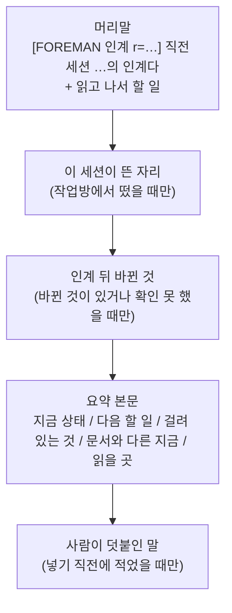

<!--
다루는 곳: bridge/handoff.py, bridge/pointers.py, bridge/handoff_state.py, migrations/0014_handoff.sql, migrations/0024_summary_state.sql
읽은 커밋: e5d584b
-->

# 인계 요약과 읽을 곳

인계는 한 세션이 하던 일을 이 대화를 전혀 모르는 새 세션에 넘기는 일이다. 이 편은 그 가운데 「무엇을 넘기나」를 다룬다. 요약을 누가 쓰고 브리지가 그것을 어떻게 꺼내는지, 세션이 답할 수 없는 상태일 때 어떻게 하는지, 요약 끝에 붙는 「읽을 곳」 목록을 브리지가 어떻게 확인하고 새 세션이 그것을 실제로 읽었는지 어떻게 보는지, 인계를 쓴 뒤 세상이 바뀌었으면 무엇을 덧붙이는지, 그리고 마지막에 새 세션에 들어가는 글이 어떤 모양인지까지다.

왜 요약을 통째로 넘기지 않고 「문서로 옮기고, 읽을 곳을 넘긴다」로 바꿨는지 그 큰 그림은 「→ 08 인계와 압축 손실」에 있다. 압축이 무엇을 얼마나 지우는지 재는 일은 「→ 압축 손실 재기」, 대화에서만 정한 결정을 넘기기 전에 문서에 적는 일은 「→ 문서로 옮기기」, 단추 하나로 이 모든 단계를 잇고 새 세션을 띄워 옛 세션을 끝내는 흐름은 「→ 새 세션으로 옮기기」가 맡는다. 글을 세션의 입력 칸에 붙여 넣고 Enter를 치는 방법(브리지 안에서는 방법 C라고 부른다) 자체는 「→ 03 세션 지켜보기와 글 넣기」에, 새 세션이 원본 폴더에서 뜰지 작업방(worktree, 같은 저장소를 다른 폴더와 브랜치로 하나 더 꺼낸 것)에서 뜰지 정하는 일은 「→ 06 세션 띄우기와 따로 작업」에 있다.

## 요약은 그 세션 자신이 쓴다

인계 요약을 누가 쓸지는 처음부터 정해 두었다. **요약은 일을 하던 그 세션이 직접 쓴다. 브리지는 따로 LLM을 부르지 않는다** [docs:11_handoff.md] [code:bridge/handoff.py].

다른 길도 있었다. 브리지가 트랜스크립트(Claude Code가 대화를 한 줄씩 적어 두는 JSONL 파일)를 읽어 별도 모델에게 「이 대화를 요약해라」라고 시키는 길이다. 사람 손이 덜 들고, 세션이 바쁘거나 죽어 있어도 언제든 돌릴 수 있다는 장점이 있다. 그런데 이 일을 처음 앞당긴 까닭이 바로 그 길을 어렵게 만들었다. 인계를 서두른 세션은 런슈즈 세션으로, 트랜스크립트가 730MB, 17일째, 자동 압축이 17번 일어난 상태였다 [docs:11_handoff.md]. 별도 모델이 이 일을 이어받을 만큼 이해하려면 이 기록을 처음부터 다시 읽어야 하고, 그 비용은 요약 한 장의 값으로 맞지 않는다. 반면 그 세션은 지금 무엇을 하다 멈췄는지, 어느 파일을 열어 두었는지, 사용자와 방금 무엇을 정했는지를 이미 맥락에 들고 있다. 묻기만 하면 된다. 그래서 「컨텍스트를 들고 있는 당사자」에게 쓰게 했다.

이 선택에는 대가가 있다. 세션은 자기가 **지금 기억하는 것**으로만 쓴다. 압축으로 이미 잃은 것은 스스로 되살리지 못한다 [docs:11_handoff.md]. 트랜스크립트 파일에는 압축 전 원문이 그대로 남아 있으니, 바깥 모델이 읽으면 오히려 세션이 잊은 것까지 볼 수 있다. FOREMAN은 이 두 일을 나눴다. 요약은 세션이 쓰고, 잃은 것을 원문에서 찾아내는 일은 따로 단추를 눌렀을 때만 `claude -p`로 돌린다(「→ 압축 손실 재기」). 찾아낸 것은 요약에 끼워 넣는 대신 문서에 적어(「→ 문서로 옮기기」) 새 세션이 「읽을 곳」으로 읽게 한다. 요약 안에 다시 넣으면 다음 압축에서 또 깎이기 때문이다.

이 결정은 뒤에도 지켜야 할 약속으로 남았다. 압축 손실을 재던 때 이 결정은 「서기와 인계 2판이 이를 어기면 안 된다」는 항목으로 함께 적혔다 [log:foreman_compaction_loss_20261105.md].

## 요청 한 번, 표지 한 쌍

브리지는 요약을 시킬 때 세션의 입력 칸에 요청 글을 넣는다 [code:bridge/handoff.py]. 글의 첫 줄은 늘 `[FOREMAN 인계 요청 r=7f3a9c]` 꼴이다. `r=` 뒤의 여섯 글자는 요청마다 새로 뽑는 16진수(`secrets.token_hex(3)`)이고, DB의 `summary.req` 칸에 유일 키로 걸려 있어 같은 값이 두 번 쓰이지 않는다 [code:migrations/0014_handoff.sql].

요청 글은 세션에게 이렇게 시킨다. 파일을 고치거나 커밋하거나 배포하지 마라. 정확히 쓰려고 `git status`, `git log`, 문서를 읽는 것은 된다. 이 대화에서 정했는데 아직 어느 문서에도 없는 결정, 금지, 기준이 있으면 「문서와 다른 지금」에 적어라. 2,500자 안에서, 마지막 응답에 한 번만, 아래 형식 그대로 써라 [code:bridge/handoff.py].

```
<<<FOREMAN-HANDOFF r=7f3a9c>>>
## 지금 상태
(어디까지 왔나: 브랜치, 마지막 커밋 해시, 돌고 있는 것. 5~8줄)
## 다음 할 일
(순서대로 3~5개)
## 걸려 있는 것
(승인 대기, 서브에이전트, 타이머, 커밋 안 한 변경, 사람이 하기로 한 것. 없으면 "없음")
## 문서와 다른 지금
(문서에는 X인데 지금은 Y. 문서를 아직 못 고친 것만. 없으면 "없음")
## 읽을 곳
- `경로` 「절 이름」 — 왜
<<<END r=7f3a9c>>>
```

세션의 응답은 보통 응답과 섞여 나온다. 세션은 표지 앞뒤로 「git log를 확인했습니다」 같은 말을 덧붙이기도 하고, 도구를 몇 번 부른 뒤에야 표지를 쓰기도 한다. 그래서 브리지는 응답 전체를 요약으로 보지 않고 **표지 한 쌍 사이만** 꺼낸다. 이 꺼내기에는 세 가지 조심이 들어 있다 [code:bridge/handoff.py].

첫째, user 줄은 보지 않는다. 요청 글 안에도 형식 예시로 표지가 들어 있기 때문이다. 요청을 보낸 직후 트랜스크립트 파일의 크기를 offset으로 적어 두고, 그 뒤에 붙은 줄 가운데 `type`이 `assistant`인 줄의 text 블록만 모은다. 서브에이전트가 쓴 줄(`isSidechain`)도 뺀다. 둘째, 표지에 `r=` 값이 들어 있어 짝이 맞아야 한다. 세션이 지난번 인계를 인용하거나 표지 모양을 예로 들어도 이번 요청 값과 다르면 걸리지 않는다. 셋째, 짝이 여러 개면 **마지막 짝**을 쓴다. 세션이 초안을 쓴 뒤 고쳐 다시 쓰는 경우 나중 것이 맞다.

요청 글의 첫 줄은 기록 쪽에도 쓰인다. 기록을 모으는 조립기는 프롬프트 앞머리에 `[FOREMAN 인계 요청 r=`가 있으면 그 턴의 출처(origin)를 `handoff`로, 인계를 넣는 글의 머리 `[FOREMAN 인계 r=`가 있으면 `handoff_in`으로 단다 [code:bridge/assembler.py]. 「끝남」 알림을 보낼 출처 목록은 `human`, `meta` 둘뿐이라 [code:config/notify.toml], 인계 요청 턴이 끝나도 보통의 알림은 나가지 않는다. 대신 요약을 저장하면 「인계 요약 저장 (1,537자)」 같은 알림이 따로 간다 [log:stage11_handoff_result.md].

### 기다리는 동안 무엇을 보나

요청을 보낸 뒤 브리지는 바로 돌아오고, 뒤에서 2초마다 트랜스크립트를 다시 읽는다. 최대 600초를 기다린다 [code:bridge/handoff.py]. 기다림은 네 가지로 끝난다.

| 끝 | 조건 | 상태 | 남는 것 |
|---|---|---|---|
| 받음 | 표지 한 쌍을 찾았다 | `ok` | 본문, 응답 원문, 그 턴 id |
| 표지 없음 | 요청 턴이 닫혔는데 6초가 지나도 표지가 없다 | `failed` | 「턴이 끝났는데 인계 표지가 없다」와 응답 원문 |
| 세션이 끝남 | 기다리는 중에 세션 프로세스가 사라졌다 | `failed` | 「기다리는 중에 세션이 끝났다」 |
| 시간 초과 | 600초 안에 아무 일도 없었다 | `timeout` | 그때까지의 응답 원문 |

턴이 닫힌 뒤 6초를 더 보는 까닭은 트랜스크립트의 마지막 줄이 턴이 닫힌 것보다 조금 늦게 쓰일 수 있어서다. 실패해도 응답 원문(`raw`, 끝의 20만 자까지)을 버리지 않는다 [code:bridge/handoff.py]. 세션이 형식을 조금 틀리게 썼을 때 사람이 원문을 보고 고쳐 저장할 수 있게 하기 위해서다. 실패와 시간 초과도 알림으로 간다. 요약을 시켜 놓고 아무 소식이 없는 상태를 만들지 않으려는 것이다.

처음 이 길을 버리는 세션으로 시험했을 때, 짧은 대화 세 번 뒤에 [지금 요약]을 누르자 34초 만에 1,537자 요약이 저장됐다. 세션은 대화에서 정한 암호명, 막힌 곳, 사용자가 정한 두 가지를 모두 적었고 승인 대기, 서브에이전트, 타이머가 없다는 것까지 적었다 [log:stage11_handoff_result.md].

## 세션이 답할 수 없을 때

요약을 세션에게 묻는 방식은 세션이 물음을 받을 수 있을 때만 통한다. 패널의 인계 단추들은 아래 상태를 보고 켜지거나 꺼지고, 실제로 누를 때 한 번 더 확인한다 [code:bridge/handoff.py].

| 상태 | 패널에 뜨는 까닭 | 어떻게 하나 |
|---|---|---|
| 일하는 중 | 작업 중입니다 | 거절한다. 대기열에도 넣지 않는다 |
| 일시정지(프로세스 상태 `T`) | 일시정지된 세션입니다 | 거절한다. FOREMAN이 멈춘 것이면 되살린 뒤에 |
| FOREMAN 터미널(tmux) 밖 | 화면에서 보내거나 끌 수 없습니다 | 넣을 수 없다 |
| 이미 요약이나 문서 적기를 기다리는 중 | (단추가 꺼진다) | 겹쳐 보내지 않는다 |
| 끝난 세션 | 끝난 세션입니다 | 아래 두 길 |

일하는 중인 세션에 요청을 대기열로 넣지 않는 데는 까닭이 있다. Claude Code는 일하는 중에 들어온 글을 새 턴으로 받지 않고 지금 열린 턴에 끼워 넣는다. 인계 요청이 작업 한가운데 끼면 세션은 하던 일과 요약을 섞어 버린다. 그래서 「작업이 끝난 뒤에 요약해 주세요(중간에 끼면 작업과 섞입니다)」로 거절한다 [code:bridge/handoff.py]. 겹침도 막는다. 같은 세션에 15분 안에 보낸 요청이 아직 `requested`로 남아 있거나, 문서로 옮기기 요청을 기다리는 중이면 새 요청을 받지 않는다. 두 요청의 답이 한 응답에 섞이지 않게 하려는 것이다.

### 끝난 세션의 두 길

세션이 이미 끝났으면 물을 상대가 없다. 이때는 두 길이 있고 둘 다 사람이 단추를 눌렀을 때만 돈다.

첫째 길은 `claude -p --resume <세션 id>`다. 끝난 세션의 대화를 그대로 다시 불러와 같은 요청 글을 한 번 던진다 [code:bridge/handoff.py]. 새 갈래(fork)를 만드는 것이 아니라 그 세션이 이어서 답하는 것이라, 「요약은 그 세션 자신이 쓴다」는 약속이 그대로 지켜진다. 대신 대화 전체를 다시 불러오므로 토큰이 든다. 그래서 자동으로 돌리지 않고 단추로만 연다. 이 길은 그 세션을 잡고 있는 살아 있는 프로세스가 있으면 거절한다. 「같은 세션을 두 곳에서 이어 쓰지 않도록 막았습니다」 [code:bridge/handoff.py]. 돌릴 때는 환경 변수에서 `TMUX`, `TMUX_PANE`을 빼 FOREMAN 터미널 안의 세션으로 잘못 보이지 않게 한다. 출력에서 같은 표지 한 쌍을 꺼내고, 없으면 종료 코드와 함께 `failed`로 남긴다.

둘째 길은 Claude Code가 자동 압축 때 스스로 쓴 요약을 쓰는 것이다(DB 출처 `compact`). 트랜스크립트에서 마지막 압축 요약(앞 6,000자까지), 그 뒤에 사람이 보낸 프롬프트 최근 15개(각 300자), 마지막 응답(2,000자)을 모아 한 장으로 만든다 [code:bridge/handoff.py]. 모델을 다시 부르지 않으니 비용이 없지만, 이것은 FOREMAN이 시킨 형식이 아니고 「읽을 곳」도 없다. 압축된 적이 없는 세션이면 「자동 압축 요약이 없습니다」로 거절한다. 사람이 터미널에서 직접 `/exit`로 끝낸 세션은 끝나는 순간 요약을 받을 수 없으므로 이 두 길이 남는다 [docs:11_handoff.md].

## 요약이 쌓이는 표

요약은 `summary` 표에 한 줄씩 쌓인다 [code:migrations/0014_handoff.sql] [code:migrations/0024_summary_state.sql].

| 칸 | 뜻 |
|---|---|
| `req` | 요청 값 `r=`의 여섯 글자. 유일 키 |
| `kind` | `handoff`(끝내기 전 인계), `snapshot`(지금 요약만) |
| `source` | `self`(살아 있는 세션에 물음), `self_headless`(끝난 세션을 `claude -p --resume`으로), `compact`(자동 압축 요약), `edited`(사람이 고침) |
| `status` | `requested`, `ok`, `failed`, `timeout` |
| `body`, `chars` | 꺼낸 요약과 그 글자 수 |
| `raw`, `error` | 응답 원문과 실패 까닭 |
| `parent_id` | 고친 요약이면 원본 요약 id |
| `state` | 요약을 만들 때의 git과 스키마 잠금 상태(JSON) |
| `injected_cc_session`, `injected_at` | 이 요약을 넣은 새 세션과 그 시각 |
| `drift` | 넣을 때 붙인 「인계 뒤 바뀐 것」 줄들(JSON) |

사람이 요약을 고치면 그 줄을 덮어쓰지 않는다. `source = edited`, `parent_id = 원본`으로 새 줄을 만든다 [code:bridge/handoff.py]. 그래서 세션이 처음 쓴 글과 사람이 고친 글을 나란히 볼 수 있다. 고친 요약은 원본의 `state`를 그대로 물려받는다. 사람이 글을 고쳤어도 그 글이 말하는 「지금」은 원본을 쓴 때이기 때문이다. 고친 시각을 기준으로 다시 찍으면 그 사이 바뀐 것이 사라진다.

같은 표에 형식이 다른 요약이 섞여 있다. 처음 형식(1판)은 목표, 한 일, 진행 중, 다음 할 일, 주의, 참고의 여섯 절로 대화 전체를 4,000자 안에 담았다. 지금 형식(2판)은 위의 다섯 절로 2,500자 안에 문서에 없는 것만 담는다 [code:bridge/handoff.py]. 둘을 가르는 칸은 따로 없다. 본문에 `## 읽을 곳` 제목 줄이 있으면 2판으로 본다(`pointers.is_v2`) [code:bridge/pointers.py]. 표를 바꾸지 않고 형식을 늘릴 수 있었던 까닭이다. 패널에서 1판을 고르는 칸은 2판이 생긴 뒤 1판으로 받은 요약이 0개라 뺐고, API의 `fmt: v1`만 남겼다 [docs:11_handoff_v2.md] [log:stage11_session_tab_result.md].

## 「읽을 곳」 한 줄의 꼴

2판 요약의 마지막 절은 새 세션이 직접 Read 도구로 열어 볼 문서 목록이다. 요약은 기억에서 나와 빠지지만 문서는 저장소에 남아 있다는 것이 이 목록을 두는 까닭이다. 요청 글은 한 줄에 하나씩 두 꼴만 쓰라고 시킨다 [code:bridge/handoff.py].

```
- `CLAUDE.md` 「작업 규칙」 — 금지 항목
- `docs/11_handoff.md` — 인계 흐름 전체
```

앞은 `경로` 「절 이름」 — 왜, 뒤는 `경로` — 왜다. 경로는 저장소 맨 위 기준이고 절대 경로도 받는다. 절 이름은 문서의 `#` 제목 글을 그대로 쓴다. 「왜」는 새 세션이 이 문서를 무엇에 쓰는지 알게 하는 한 마디다.

브리지는 이 절을 정규식 하나로 푼다 [code:bridge/pointers.py]. 앞의 목록 표시(`-`, `*`, `•`), 백틱으로 감쌀 수도 있는 경로, 그 뒤의 `:시작-끝` 줄 범위(있어도 되고 없어도 된다), 「」 안의 절 이름, 대시 뒤의 까닭을 차례로 읽는다. 목록 표시로 시작했는데 이 모양에 맞지 않는 줄은 버리지 않는다. 「모양을 알아보지 못했습니다(경로 — 이유)」라는 문제를 달아 목록에 그대로 남긴다. 읽을 곳 하나가 조용히 빠진 채 넘어가는 일을 막으려는 것이다.

### 넣기 전에 기계로 확인한다

요약을 새 세션에 넣기 전, 그리고 패널이 넣을 글을 미리 보여 줄 때마다 브리지는 읽을 곳을 한 줄씩 확인한다 [code:bridge/pointers.py] [code:bridge/handoff.py].

| 확인 | 틀리면 |
|---|---|
| 파일이 있나 | 「파일이 없습니다」. 넣지 않는다 |
| 줄 범위가 있으면 파일 안인가 | 「줄 범위가 맞지 않습니다(파일은 N줄). 줄 번호 대신 절 제목으로 가리켜 주세요(예: …)」. 넣지 않는다 |
| 절 이름이 있으면 문서에 있나 | 「「…」을(를) 찾지 못했습니다」. 넣지 않는다 |
| 문서가 마지막으로 바뀐 뒤 저장소 커밋이 몇 개 쌓였나 | 20개 이상이면 「오래됐을 수 있음」으로 표시만. 막지 않는다 |

목록이 비었거나 틀린 줄이 하나라도 있으면 넣지 않는다 [code:bridge/handoff.py]. 미리보기에는 막힌 까닭이 뜨고, 띄우기와 넣기는 tmux 창을 만들기도 전에 409로 거절된다. 고치는 길은 요약을 고쳐 새 판으로 저장하는 것이다. 버리는 저장소로 처음 시험했을 때, 요약에 없는 파일 하나를 넣자 미리보기가 「docs/veggie.md: 파일이 없습니다」로 막혔고 tmux 창은 만들어지지 않았다 [log:handoff_v2_result.md].

절 이름 확인은 부분 맞춤이다. 문서의 어느 줄이든 그 글자를 품고 있으면 맞다고 본다 [code:bridge/pointers.py]. 그래서 「4-1. 화면 글」처럼 제목 앞부분만 적어도 통한다. 느슨한 대신 세션이 제목의 덧말까지 글자 그대로 옮겨 적지 못해 막히는 일이 적다.

오래됨 표시를 막는 조건으로 쓰지 않은 것도 정한 일이다. 커밋 수는 그 문서와 상관없는 커밋까지 센다. 바쁜 저장소에서는 거의 모든 문서가 20개를 넘는다. 이것으로 막으면 인계가 매번 멈춘다. 그래서 새 세션과 사람이 「이 문서는 조금 의심하며 읽어라」를 알 수 있게 표시만 한다. 문서가 틀렸을 위험은 다른 겹(인계를 쓰는 세션이 아는 차이를 「문서와 다른 지금」에 적기, 서기가 문서를 코드에 맞춰 두기)이 맡는다 [docs:11_handoff_v2.md].

### 줄 번호가 아니라 절 제목으로

처음에는 세 꼴을 권했다. `경로`, `경로 「절」`, 그리고 `경로:시작-끝`이다 [log:handoff_v2_result.md]. 줄 범위는 정확해 보였다. 그런데 문서는 늘 고쳐진다. 문서가 조금만 짧아져도 줄 번호는 깨진다.

실제로 그렇게 막혔다. 관리자 세션이 쓴 인계의 읽을 곳에 `docs/11_worktree.md:224-260`이 있었는데 그 파일은 239줄이었다. 새 세션으로 옮기기는 「읽을 곳이 틀렸습니다 … 줄 범위가 맞지 않습니다(파일은 239줄)」에서 멈췄다 [log:manager410_overhead_20261115.md]. 세션이 요청 글의 「실제로 있는 파일, 줄, 절만」을 보고도 끝 줄을 재지 않고 어림으로 적은 것이었다. 세션에게 더 조심하라고 시키는 것으로는 막을 수 없다. 줄 번호라는 꼴 자체가 문서가 바뀌는 속도를 따라가지 못한다.

그래서 요청 글에서 줄 범위 꼴과 그 예시를 빼고, 「문서의 일부는 줄 번호가 아니라 절 제목으로 가리켜라. 줄 번호는 문서가 조금만 바뀌어도 어긋난다」는 한 줄을 더했다 [code:bridge/handoff.py] [c:b8d071d]. 확인 쪽은 옛 인계와 사람이 손으로 쓴 것을 위해 줄 범위를 계속 받는다. 다만 틀리면 그 자리의 절 제목을 찾아 거부 글에 붙여 준다(`section_hint`) [code:bridge/pointers.py]. 가리키던 시작 줄 위로 가장 가까운 `#` 제목을 고르고, 시작 줄이 파일보다 길면 끝 줄을 기준으로 삼는다. 코드 울타리(백틱 세 개) 안의 제목 줄은 형식 예시라 절로 치지 않는다. 긴 제목은 첫 덧말(` — `, ` (`, ` [`) 앞까지만 쓴다. 절 확인이 부분 맞춤이라 그 앞부분으로도 맞고, 화면에 뜨는 거부 글에 em dash가 끼지 않는다. 위의 `docs/11_worktree.md:224-260`은 이제 「8. 화면 말을 바꿀 때」로 고치라고 알려 준다 [log:foreman-4_move_three_20261115.md].

### 어느 폴더를 기준으로 보나

같은 저장소가 원본 폴더와 여러 작업방에 동시에 펼쳐져 있으므로, 「파일이 있나」에는 「어느 폴더에서」가 따라붙는다. 처음에는 요약을 쓴 세션의 폴더로 확인했다. 런슈즈에서 이것이 틀렸다. 요약을 쓴 세션의 작업방이 main보다 뒤처져 있었고, main에는 이미 있는 절을 「찾지 못했다」고 막았다 [log:handoff_pointer_basis_20261109.md].

새 세션은 늘 기준 브랜치(main)의 내용으로 시작한다. 원본 폴더에서 뜨거나, 작업방으로 뜨더라도 기준 브랜치에서 새로 가르기 때문이다. 그래서 **넣기 전 확인은 원본 폴더를 기준**으로 한다 [code:bridge/handoff.py]. 원본에는 없고 요약을 쓴 작업방에만 있으면 막되 까닭을 붙인다. 「원본 폴더에는 아직 없고 요약을 쓴 작업방에만 있습니다(합친 뒤 넣습니다)」. 새 세션이 정말 못 읽는 경우이므로 막는 것이 맞다. 쓴 쪽이 뒤처졌을 뿐이면 통과한다. 「이 문서 뒤로 커밋 N개」도 원본 폴더 기준으로 센다.

## 새 세션이 실제로 읽었나

「읽어라」라고 시키는 것과 실제로 읽는 것은 다르다. 브리지는 새 세션이 실제로 Read 도구를 불렀는지 기록으로 맞대 본다 [code:bridge/handoff.py] [code:bridge/pointers.py].

맞대는 차례는 이렇다. 패널이 어떤 세션을 열면, 브리지는 `summary.injected_cc_session`이 그 세션인 가장 최근 요약을 찾는다. 2판이면 읽을 곳을 풀고, 그 세션의 도구 이벤트 가운데 `Read`의 대상(절대 경로)을 모두 모아 하나씩 맞댄다. 결과는 「읽을 곳 5/6 읽음, 안 읽음: docs/07…」 같은 한 줄이 되고, 안 읽은 곳이 있으면 [안 읽은 곳 다시 보내기]가 켜진다. 누르면 그 세션에 「「읽을 곳」 중 아직 읽지 않은 곳이 있다. 지금 Read로 읽고, 각각 이 일에 걸리는 규칙 · 결정을 2줄씩 말해라」와 안 읽은 경로만 보낸다. 다 읽은 세션에서 누르면 「다시 보낼 곳이 없습니다」로 거절된다 [log:handoff_v2_result.md].

맞댈 때 두 가지를 바로잡는다. 첫째, 같은 파일을 원본 폴더 경로로 읽었든 작업방 경로(`.worktrees/<이름>/…`)로 읽었든 같은 파일로 친다 [code:bridge/pointers.py]. 합치기 전에 작업방 경로로 읽은 결과 문서를, 합친 뒤 원본 기준 인계가 「안 읽음」으로 센 일이 있었다. 둘째, 저장소 맨 위의 `CLAUDE.md`는 Claude Code가 세션을 시작할 때와 압축 뒤에 스스로 넣는다. Read 도구로 읽히지 않으니 그대로 두면 늘 「안 읽음」으로 뜬다. 그래서 읽은 것으로 세되 「자동으로 들어감」으로 따로 보인다.

받은 세션 쪽 확인은 **그 세션의 폴더**를 기준으로 한다. 넣기 전 확인과 기준이 다른 까닭은, 이제는 새 세션이 실제로 읽는 곳이 그 폴더이기 때문이다. 거기에 파일이나 절이 없는데 원본에는 있으면 「이 작업방이 main보다 커밋 N개 뒤처졌습니다(main에는 있습니다). fast-forward하면 읽을 수 있습니다」를 붙인다 [code:bridge/handoff.py].

확인에 실패한 곳은 Read를 했더라도 **읽음에서 뺀다**. 열었어도 찾던 절이 없었으니 읽은 것이 아니다. 전에는 「6/6 읽음」 아래에 실패 표시가 섞여 나왔다. 이제는 「4/6 읽음 · 확인 실패 2」처럼 따로 센다 [log:handoff_pointer_basis_20261109.md]. 다시 보내기는 안 읽은 곳에만 보낸다. 확인 실패한 곳은 다시 보내도 읽을 수 없기 때문이다.

이 확인에는 한계가 있다. 맞대는 단위는 파일이다. 새 세션이 그 파일을 Read로 열었는지는 알지만, 「읽을 곳」이 가리킨 절까지 읽었는지는 보지 않는다. 긴 문서의 앞부분만 읽었어도 읽음으로 센다. 그래서 넣는 글은 읽은 뒤 각 문서에서 걸리는 규칙과 결정을 두 줄씩 말하라고 시킨다 [code:bridge/handoff.py]. 사람이 그 답을 보고 정말 읽었는지 판단할 수 있게 하는 것이다.

처음 한 바퀴에서 이 흐름은 의도대로 돌았다. 대화에서만 정한 결정(「멜론은 초록, 아직 파일은 고치지 마」)이 「문서와 다른 지금」에 잡혔고, 새 세션은 읽을 곳 두 곳을 실제로 열어 「2/2 읽음」이 됐다. 새 세션은 인계에 없던 충돌(목록 번호가 아라비아 숫자인데 규칙은 숫자를 한글로)까지 스스로 찾아 물었다 [log:handoff_v2_result.md].

## 인계 뒤 바뀐 것

인계는 쓴 순간부터 낡기 시작한다. 요약을 쓰고 새 세션에 넣기까지 몇 분일 수도 있고 하루일 수도 있다. 그 사이 다른 세션이 브랜치를 합치거나, 작업방을 지우거나, 스키마 잠금을 가져갈 수 있다.

실제로 그렇게 틀렸다. 한 세션이 인계 r=690cec를 받았다. 「지금 상태」에는 「c는 cc/foreman-2에만 있고 아직 합치지 않았다, 잠금은 65d05e2c」라고 적혀 있었다. 받은 때에는 그 c가 이미 main에 합쳐졌고, 작업방 foreman-2는 지워졌고, 잠금은 다른 세션이 갖고 있었다 [code:bridge/handoff_state.py] [log:overlap_alert_20261106.md]. 받은 세션이 이것을 알아챈 것은 우연이었다. 알아채지 못했다면 이미 합쳐진 일을 다시 합치려 하거나 없는 폴더에서 일을 이으려 했을 것이다. 아무도 틀렸다고 말하지 않는 채 지난 상태를 사실로 믿고 일하는 모양이라, FOREMAN이 잡으려는 조용한 고장과 같다. 사용자는 이를 두고 「조용한 고장이랑 같은 모양이니까 기계가 하는 게 맞아」라고 했다 [log:handoff_verify_20261106.md].

### 만들 때 찍고, 넣을 때 비교한다

요약 줄을 만들 때 브리지는 그 세션 폴더의 지금 상태를 찍어 `summary.state`에 JSON으로 적는다 [code:bridge/handoff_state.py] [code:migrations/0024_summary_state.sql]. 찍는 것은 찍은 시각, 저장소 위치, 작업방 이름, 브랜치, HEAD 커밋, 기준 브랜치와 그 HEAD, 스키마 잠금 주인(세션 id 앞 8자와 작업방)이다. 저장소가 아니면 찍지 않는다. 찍기에 실패해도 요약은 만든다. 상태가 없을 뿐 요약 자체가 막힐 까닭은 없다.

넣을 때(미리보기 포함) 그때 상태와 지금을 비교해 사람이 읽는 줄을 만든다(`handoff_state.drift`) [code:bridge/handoff_state.py]. 보는 것은 네 가지다.

| 무엇 | 나오는 줄의 예 |
|---|---|
| 작업방이 아직 있나, 합쳐졌나 | 「worktree `foreman-2`(브랜치 `cc/foreman-2`)는 지금 없습니다. 인계 때 커밋 edcd41a은 `main`에 합쳐졌습니다.」, 합쳐지지 않았으면 「…`main`에 없습니다(합치지 않고 버렸을 수 있습니다).」 |
| 그 브랜치에 커밋이 더 생겼나 | 「브랜치 `cc/foreman-2`에 인계 뒤 커밋이 3개 더 있습니다.」 |
| 기준 브랜치에 새 커밋이 생겼나 | 「`main`에 인계 뒤 커밋이 7개 생겼습니다: …」 (앞 5개 제목, 나머지는 「외 N개」) |
| 읽을 곳 파일이 그 사이 바뀌었나 | 「읽을 곳 중 인계 뒤 바뀐 파일: `docs/11_handoff_v2.md`」 (8개까지) |
| 스키마 잠금 주인이 바뀌었나 | 「스키마 잠금이 세션 65d05e2c에서 세션 5a3b93e0로 바뀌었습니다.」 |

원본 폴더에서 쓴 인계라면 작업방 대신 원본 폴더의 브랜치가 바뀌었는지, 그 브랜치에 커밋이 더 생겼는지를 본다. 바뀐 것이 하나라도 있으면 맨 앞에 「인계를 쓴 지 2시간 13분 지났습니다.」 같은 줄이 붙는다 [code:bridge/handoff_state.py].

이 줄들은 넣는 글 본문 앞에 한 절로 붙는다 [code:bridge/handoff_state.py].

```
## 인계 뒤 바뀐 것 (브리지가 git · 잠금으로 확인)
- 인계를 쓴 지 …
- …
- **아래 「지금 상태」 · 「다음 할 일」은 인계를 쓴 때 기준이다. 위와 어긋나는 것은 지금 상태를 직접 보고 다시 판단하라.**
```

마지막 줄이 이 절의 몸통이다. 브리지는 무엇이 바뀌었는지까지만 알고, 그래서 다음에 무엇을 해야 하는지는 모른다. 「이미 합쳐졌으니 합치기 단계를 건너뛰라」를 기계가 정하면 틀릴 수 있다. 그래서 사실만 앞에 놓고 판단은 받은 세션에 맡긴다. 붙인 줄은 넣을 때 `summary.drift`에 남겨 받은 세션의 패널에도 「바뀐 것」으로 보인다 [code:bridge/handoff.py].

### 비교하지 못한 것도 숨기지 않는다

이 확인이 조용히 실패하면 그 자체가 또 하나의 조용한 고장이 된다. 그래서 확인하지 못한 경우에도 줄을 붙인다 [code:bridge/handoff.py]. 상태 기록이 없는 요약(이 기능이 생기기 전의 인계)이면 「이 인계에는 만들 때의 상태 기록이 없습니다 … 「지금 상태」가 맞는지 git · 잠금으로 직접 확인하라」가 붙는다. 비교하다 예외가 나면 「인계 뒤 바뀐 것을 확인하지 못했습니다(예외 이름). 지금 상태를 직접 확인하라」가 붙는다. 요약을 쓴 저장소가 아예 없어졌으면 그 사실 한 줄이 나온다. 바뀐 것이 없을 때만 절이 붙지 않는다.

처음 만들 때 r=690cec 상황을 임시 저장소에서 그대로 재현해 시험했다. 작업방에서 커밋하고 인계를 쓴 뒤, main으로 합치고 작업방을 지우고 main에 커밋을 더하고 잠금을 바꾸자 네 가지가 모두 나왔다. 지금 저장소로 r=690cec 때 상태를 만들어 돌렸을 때도 작업방 없음, edcd41a 합쳐짐, main 새 커밋 7개, 잠금 65d05e2c에서 5a3b93e0로 바뀜이 모두 나왔다 [log:handoff_verify_20261106.md] [c:f0871c7].

## 새 세션에 넣는 글의 모양

새 세션의 입력 칸에 들어가는 글은 여러 조각을 정해진 차례로 이은 것이다 [code:bridge/handoff.py].



**머리말**은 `[FOREMAN 인계 r=…] 직전 세션 <id 앞 8자>(<세션 제목>)의 인계다. 너는 이 일을 이어받는 새 세션이다.`로 시작한다. 2판이면 이어서 「먼저 아래 「읽을 곳」을 모두 Read로 읽어라」, 다 읽은 뒤 (1) 각 문서에서 이 일에 걸리는 규칙과 결정을 두 줄씩 (2) 「문서와 다른 지금」을 어떻게 다룰지를 말하고 (3) 「다음 할 일」을 시작하기 전에 사용자의 확인을 기다리라고 한다. 「읽었는지는 브리지가 확인한다」로 끝난다. 1판 요약이면 이해한 것을 5줄 안으로 말하고 확인을 기다리라고만 한다.

머리말에는 두 판이 있다. 사람이 패널에서 옮기기를 누른 경우는 위처럼 「확인을 기다려라」다. 계획 세우기에서 사람이 계획 카드로 이미 첫 글과 인계를 보고 [시작]을 누른 경우에는 같은 일을 한 번 더 묻지 않게 「「다음 할 일」을 바로 시작하라(사람이 계획 카드에서 이미 봤다)」로 바뀐다 [code:bridge/handoff.py]. 이때는 계획이 쓴 첫 글 뒤에 인계 글이 붙는다.

**이 세션이 뜬 자리**는 새 세션이 작업방에서 떴을 때만 붙는다(`wt_block`) [code:bridge/handoff.py]. 작업방 이름과 브랜치, 커밋은 이 브랜치에 하고 push와 합치기는 기본으로 하지 않는다는 것, 브리지를 다시 띄우지 않는다는 것, `pgrep -f`를 쓰지 않는다는 것, 그 밖의 것은 그 저장소의 CLAUDE.md를 따르라는 것을 적는다. 인계를 쓴 세션은 받을 세션이 어디서 뜰지 모른다. 그래서 「지금 상태」에 「브랜치 main」이라고 적었는데 새 세션은 작업방에서 뜬 일이 두 번 있었다 [log:handoff_flow_check_20261109.md]. 띄우는 브리지는 그것을 안다. 그래서 브리지가 붙이고, 「아래 인계에 "브랜치 main"이라고 적혀 있어도 이것이 맞다」고 덧붙인다. 이 절은 모든 저장소에 들어가므로 공통 사실만 담는다. 처음에는 FOREMAN 규칙(README 표, `log/`)이 들어 있었는데, 런슈즈 세션이 그것을 자기 저장소 규칙으로 읽었다. 그래서 저장소마다 갈래를 만들지 않고 나머지는 그 저장소의 CLAUDE.md에 맡겼다 [code:bridge/handoff.py].

**인계 뒤 바뀐 것**은 위에서 본 절이다. **요약 본문**은 세션이 쓴 글 그대로다. 브리지는 본문을 고치지 않는다.

**사람이 덧붙인 말**은 사람이 넣기 직전에 적은 말(2,000자까지)을 `## 사람이 덧붙인 말 (넣기 직전)` 절로 맨 끝에 붙인 것이다(`note_block`) [code:bridge/handoff.py]. 맨 끝에 두는 까닭은 새 세션이 마지막에 읽는 말이 가장 또렷하기 때문이다. 요약 본문에 섞지 않는 까닭은 본문을 바꾸면 요약 이력과 읽을 곳 확인이 그 말까지 떠안게 되기 때문이다. 지금 켜져 있는 옮기기 한 흐름에는 넣기 직전 확인 창이 없어 이 칸은 옛 흐름(끝난 세션에서 옮길 때 등)에서만 쓰인다. 자세한 것은 「→ 새 세션으로 옮기기」에 있다.

### 분량

넣는 글의 상한은 8,000자다 [code:bridge/handoff.py]. 넘으면 진행 중, 미완, 다음 할 일, 주의가 들어간 절은 통째로 두고, 나머지 절은 남은 자리를 나눠 앞부분만 넣은 뒤 「…(줄임)」을 붙인다. 그리고 전체 요약을 `~/.foreman/handoff/<req>.md`에 소유자만 읽을 수 있게(권한 600) 써 두고 「전체는 이 파일을 Read하라」를 덧붙인다. 이 줄이기는 대화 전체를 4,000자로 담던 1판과 사람이 길게 고친 요약을 위한 것이다. 2판 요약은 2,500자 안이라 머리말과 덧붙는 절을 더해도 거의 닿지 않는다.

### 넣은 뒤

넣기는 「→ 03 세션 지켜보기와 글 넣기」의 입력 길로 보내고, 새 세션의 트랜스크립트에 그 글이 실제로 제출됐는지 15초까지 확인한다 [code:bridge/handoff.py]. 제출이 확인되면 `summary`에 넣은 세션(`injected_cc_session`), 시각(`injected_at`), 붙인 바뀐 것(`drift`)을 적는다. 이 세 칸이 위의 「실제로 읽었나」 확인과 받은 세션 패널의 「넘겨받은 글」의 출발점이다. 확인되지 않으면 「인계 글을 보냈지만 제출을 확인하지 못했습니다. 입력 칸을 확인해 주세요.」를 돌려준다. 넣었다고 믿었는데 실제로는 입력 칸에 남아 있는 상태를 그대로 두지 않으려는 것이다.

인계 글 자체도 기록에 남는다. 머리 `[FOREMAN 인계 r=…]` 덕분에 새 세션의 첫 턴은 출처 `handoff_in`으로 달리고, 대화 목록에서 무엇을 넘겼는지 나중에 그대로 볼 수 있다 [code:bridge/assembler.py].

## 남은 빈자리

코드를 읽으며 확인한, 아직 메워지지 않은 곳을 적어 둔다.

계획 세우기로 띄울 때(첫 글 + 인계)는 넣은 세션과 시각만 적고 `drift`는 적지 않는다 [code:bridge/handoff.py]. 글 앞에는 「인계 뒤 바뀐 것」이 붙어 들어가지만, 받은 세션 패널의 「바뀐 것」에는 빈 목록으로 보인다.

「문서와 다른 지금」은 인계를 쓰는 세션의 기억에서만 나온다. 세션이 모르는 차이는 이 칸에 들어오지 않는다 [docs:11_handoff_v2.md]. 그 빈자리는 넘기기 전의 문서 옮기기와 압축 손실 재기가 메운다.

요청 글은 대화에서 정한 결정을 「문서로 옮길 것」으로 따로 알리라고 하지만, 처음 시험에서 세션은 그것을 「문서와 다른 지금」에 함께 넣었다 [log:handoff_v2_result.md]. 그래서 문서 옮기기는 인계가 있으면 그 「문서와 다른 지금」 절을 함께 받아 옮길 후보로 삼는다 [code:bridge/promote.py].
