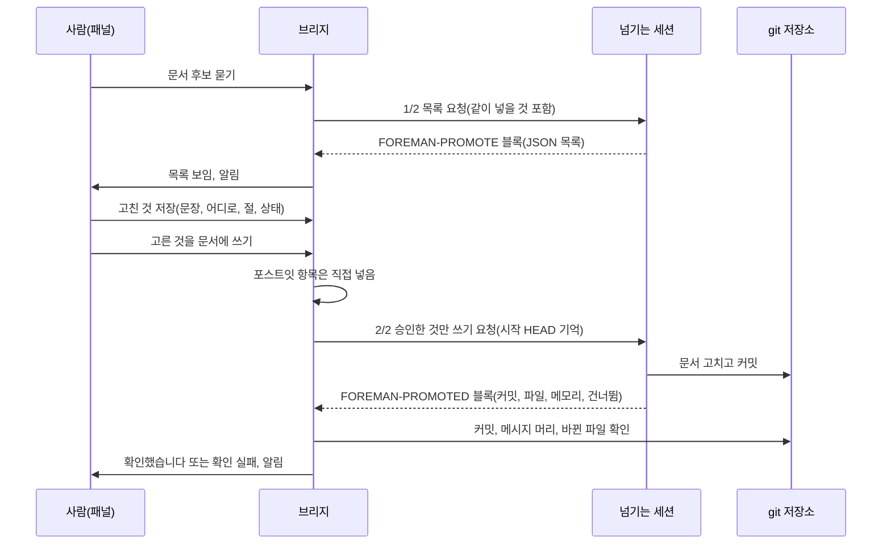
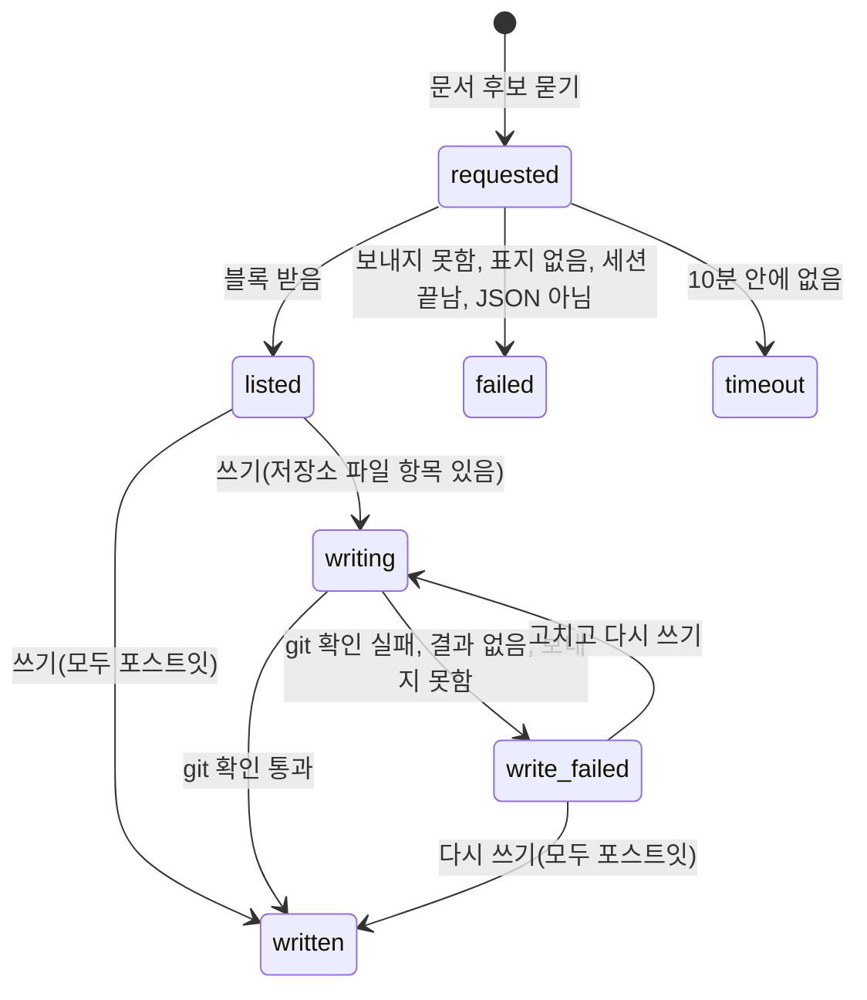

<!--
다루는 곳: bridge/promote.py, bridge/static/js/promote.js, bridge/static/js/handoff.js, bridge/static/js/moveflow.js, migrations/0020_promotion.sql
읽은 커밋: 0f98e1d
-->
# 문서로 옮기기

세션을 새 세션으로 넘기기 전에, 이 대화에서 사람과 정했지만 아직 어느 문서에도 적히지 않은 것을 찾아 저장소 문서에 적어 두는 단계다. 세션이 후보를 목록으로 내고, 사람이 그중 무엇을 어디에 적을지 고르고, 세션이 고른 것만 써서 커밋하고, 마지막으로 브리지가 그 커밋을 git으로 직접 확인한다. 코드 이름은 promote(승격)이고, 화면에서는 「대화에서만 정한 것 문서에 적기」 단추와, 새 세션으로 옮기기 흐름 안의 「문서에 넣을 것 고르기」 칸으로 보인다 [code:bridge/promote.py] [code:bridge/static/js/promote.js].

이 편은 왜 요약이 아니라 문서인지, 네 단계에서 무엇이 오가는지, 목록 하나가 거치는 상태들, 세션의 「썼습니다」를 믿지 않고 git으로 확인하는 까닭, 그리고 사람이 고르는 화면을 다룬다. 압축이 무엇을 얼마나 지우는지 재는 일은 → 「압축 손실 재기」, 옮긴 뒤 새 세션에 넘기는 짧은 요약과 「읽을 곳」은 → 「인계 요약과 읽을 곳」, 이 단계를 앞뒤 단계와 단추 하나로 잇는 흐름은 → 「새 세션으로 옮기기」에서 다룬다. 끝나지 않은 할 일이 옮겨 가는 포스트잇 자체는 → 「포스트잇」에서 다룬다 [docs:11_handoff_v2.md].

## 왜 요약이 아니라 문서인가

처음 만든 인계(1판)는 넘기는 세션이 대화 전체를 요약해 그 글을 새 세션에 통째로 넣었다. 이 방식은 요약이 모델의 기억에서 나온다는 한계를 그대로 안는다. 세션이 오래 돌면 Claude Code(아래 CC)는 대화가 맥락 창에 다 들어가지 않을 때 앞부분을 요약으로 갈아 끼우는데, 이것을 압축(compaction)이라 한다. 압축을 몇 번 겪은 세션이 쓰는 인계 요약은 이미 깎인 기억에서 나온다. 그리고 그 요약을 받은 새 세션도 언젠가 압축되므로, 요약에 실린 결정은 다음 압축에서 또 깎인다 [docs:11_handoff_v2.md].

이것을 숫자로 확인한 것이 런슈즈 세션의 압축 손실 점검이다. 사용자가 그 세션에서 말한 지시와 결정 282개를 하나씩 따라가 보니 180개가 압축 뒤에 사라지거나 약해져 있었다 [log:runshoes_compaction_loss_20261105.md]. 더 중요한 발견은 그 180개 가운데 저장소 문서에 이미 적혀 있던 것이 다섯 개 남짓뿐이었다는 점이다. 잃어버린 것은 거의 다 대화에서만 정하고 문서에는 적지 않은 것이었다. 살아남은 쪽도 들여다보면, 살아 있던 63개의 자리 중 38개가 압축 요약 안이었다. 요약에 기대어 살아 있는 결정은 다음 압축에서 다시 깎일 차례를 기다리는 셈이다 [docs:11_handoff_v2.md].

여기서 두 가지 결론이 나왔다. 첫째, 문서는 압축에 지워지지 않는다. 저장소의 `CLAUDE.md`는 CC가 세션 시작과 압축 뒤에 스스로 다시 읽어 넣고, `docs/` 아래 문서는 필요할 때 다시 열어 읽으면 된다. 그러니 지켜야 할 결정은 요약이 아니라 문서에 있어야 한다. 둘째, 그래서 인계 2판은 요약을 통째로 넘기는 대신 「읽을 곳」(어느 문서의 어느 절을 읽으라는 가리킴)을 넘기기로 했는데, 이것만으로는 부족하다. 대화에서만 정한 것은 가리킬 문서가 아예 없기 때문이다. 그래서 넘기기 전에 먼저 문서로 옮기는 단계가 필요했고, 그것이 이 편의 기능이다 [docs:11_handoff_v2.md].

다른 길도 있었다. 요약을 더 길고 꼼꼼하게 쓰게 하는 길은, 요약이 기억에서 나온다는 뿌리를 건드리지 못하고 새 세션의 시작 맥락만 키운다. 브리지가 대화를 기계로 읽어 결정을 뽑아 바로 문서에 넣는 길은, 무엇이 아직 지켜야 할 결정이고 무엇이 나중에 뒤집혔는지를 기계가 가려야 해서 틀릴 때 문서를 오염시킨다. 그래서 「무엇이 문서에 남을 만한가」는 그 대화를 겪은 세션이 판단해 후보로 내고, 「정말 남길지, 어디에 남길지」는 사람이 정하고, 실제로 남았는지는 기계(git)가 확인하는 나눔을 골랐다 [docs:11_handoff_v2.md] [code:bridge/promote.py].

## 네 단계 한눈에



세션과 브리지 사이의 말은 모두 세션 입력 칸에 글을 넣고(→ 「03 세션 지켜보기와 글 넣기」), 세션이 응답 끝에 남긴 표지 블록을 트랜스크립트(CC가 대화를 한 줄씩 적는 파일)에서 읽는 방식으로 오간다. 세션이 FOREMAN API를 부를 필요가 없다. 토큰도, curl도 쓰지 않고 응답 글만 정해진 꼴로 쓰면 된다 [code:bridge/promote.py].

두 요청 모두 머리가 인계 요청과 같은 `[FOREMAN 인계 요청 r=X]`로 시작한다. `X`는 요청마다 새로 만드는 여섯 글자 표지다. 이 머리를 쓰는 까닭은 턴 조립기가 이 글자를 보고 그 턴을 `origin=handoff`로 달기 때문이다. 그렇게 해야 이 턴이 보통 작업 턴처럼 알림을 보내거나 화면에 일반 응답으로 섞이지 않는다 [code:bridge/promote.py] [code:bridge/assembler.py].

## 1/2 목록: 세션이 후보를 낸다

### 요청 글에 담기는 것

사람이 단추를 누르면 브리지는 세션에 「이번에는 목록만 만든다」는 요청을 넣는다. 요청 글은 파일을 고치거나 커밋하지 말라고 먼저 못박는다. 다만 이미 문서에 있는지 확인하려고 읽거나 grep하는 것은 허락한다. 이미 문서에 있는 것은 목록에서 빼라고 하기 때문이다. 대상은 사용자가 정한 결정, 금지, 기준, 선호, 그리고 끝나지 않은 일이다. 이미 끝난 일과 그때뿐인 지시는 빼라고 한다 [code:bridge/promote.py].

항목마다 세션이 채워야 하는 칸은 여섯이다.

| 칸 | 뜻 | 예 |
|---|---|---|
| kind | 결정, 금지, 기준, 선호, 미완 중 하나 | 금지 |
| what | 문서에 들어갈 한두 문장. 그 문서의 문체로 | 마이그레이션은 RENAME 대신 추가 후 복사, DROP은 안정된 뒤 따로 한다 |
| quote | 사용자가 한 말 그대로. 없으면 빈 글 | 사용자 원문 |
| dest | 어디로 갈지. 저장소 맨 위 기준 .md 경로, 또는 `memory`, `drop`, `postit` | `docs/07_database.md` |
| section | 그 파일의 절 제목. 있는 절이면 글자 그대로, 없으면 새 이름 | 3. 마이그레이션 |
| why | 왜 거기인지 한 줄 | CLAUDE.md는 꼭 지킬 것만 짧게, 상세는 docs |

`dest`의 특별한 값 셋은 저장소 파일이 아니다. `memory`는 사람의 작업 선호처럼 저장소가 아니라 CC 지속 메모리(사용자 홈 아래 메모리 폴더)에 둘 것이고, `drop`은 그때뿐이라 버릴 것이고, `postit`은 끝나지 않은 할 일이라 포스트잇에 붙일 것이다. 「why」 칸을 둔 것은 사람이 고를 때 판단 근거가 바로 보이게 하려는 것이다. 첫 실제 사례에서 사용자는 다섯 항목을 고치지 않고 모두 승인하면서 「왜 거기가 적혀 있어서 판단하기 좋다」고 했다 [log:handoff_v2_c_result.md].

세션은 이 목록을 응답 맨 끝에 한 번만, 정해진 표지 두 줄 사이에 JSON 배열로 쓴다.

```
<<<FOREMAN-PROMOTE r=X>>>
[{"kind": "결정", "what": "…", "quote": "…", "dest": "CLAUDE.md", "section": "작업 규칙", "why": "…"}]
<<<END r=X>>>
```

브리지는 보낸 뒤에 새로 생긴 세션 응답 글만 읽고, 그 안에서 표지의 `r=` 값이 이번 요청의 것과 같은 블록만 찾는다. 같은 블록이 여럿이면 마지막 것을 쓴다. 세션이 중간에 목록을 한 번 쓰고 다시 고쳐 쓰는 경우 마지막 것이 최종 답이기 때문이다. 표지 값을 요청마다 새로 만드는 것은 지난 요청에 대한 옛 블록을 이번 답으로 잘못 줍지 않기 위해서다 [code:bridge/promote.py] [code:bridge/handoff.py].

### 같이 넣을 것

목록 요청에는 세션 기억만이 아니라 바깥 자료를 하나 같이 넣을 수 있다. 세션이 잊은 것은 세션에게 「잊은 것을 말해 보라」고 해서는 나오지 않기 때문이다. 넣을 수 있는 자료는 두 종류다 [code:bridge/promote.py].

하나는 이 세션의 압축 손실 점검 결과다. 점검이 「압축으로 사라지거나 약해졌다」고 판정한 말들을 원문과 함께 넣는다. 세션 기억에서 이미 빠진 것을 원문에서 되살리는 길이다. 이 판정은 기계가 한 것이라 틀릴 수 있다고 요청 글에 적고, 하나씩 판단해 아직 지켜야 하고 문서에 없는 것만 넣으라고 한다. 특히 나중에 뒤집힌 결정은 넣지 말라고 따로 적는다. 압축 전 원문에는 나중에 바뀐 결정도 그대로 남아 있어서, 그것까지 문서로 옮기면 옛 결정이 되살아나기 때문이다 [code:bridge/promote.py]. 점검이 어떻게 사라짐과 약해짐을 가르는지는 → 「압축 손실 재기」.

다른 하나는 인계 2판 요약의 「문서와 다른 지금」 절이다. 2판 요약은 「문서에는 X라고 적혀 있지만 지금은 Y」인 것을 이 절에 모은다. 문서를 아직 못 고친 것들이므로 바로 이 단계가 옮겨야 할 재료다 [code:bridge/promote.py] [docs:11_handoff_v2.md].

후보는 순서가 있다. 이 세션의 마지막 압축 손실 점검(사라짐이나 약해짐이 하나라도 있을 때만)이 맨 앞이고, 그다음은 이 세션이 받은 요약, 이 세션이 쓴 요약, 같은 프로젝트의 다른 세션 요약 순이다. 「같은 프로젝트」까지 넓힌 것은 설계와 달라진 점이다. 설계는 넘기는 세션 자신의 것만 봤다. 그런데 작업방(worktree, 원본 폴더와 따로 떨어진 작업 폴더)에서 일한 세션은 합치려면 먼저 끝내야 한다. 받은 세션이 끝나 버리면 그 세션이 받은 「문서와 다른 지금」을 옮길 세션이 아무도 없게 된다. 그래서 다른 세션에서도 같은 프로젝트의 요약을 골라 옮길 수 있게 했다 [code:bridge/promote.py] [log:handoff_v2_c_result.md].

후보가 여럿일 때 말없이 첫째를 고르지 않는다. 이것은 첫 실제 사례에서 드러난 문제를 고친 것이다. 사용자는 요약 #6을 넣으려 했는데, 화면과 서버 모두 고르지 않으면 후보의 첫째(이 세션이 받은 #7)를 넣었고, 무엇이 들어갔는지 화면에 보이지도 않았다. 그때는 #7에도 같은 두 항목이 있어 결과가 같았지만, 다른 요약이었다면 엉뚱한 「문서와 다른 지금」이 들어가고도 결과가 그럴듯해 아무도 몰랐을 것이다 [log:handoff_v2_c_result.md] [c:af1c25e]. 지금은 서버가 고르지 않은 요청을 받았을 때 후보가 하나뿐이면 그것을 쓰고, 둘 이상이면 「같이 넣을 것이 여럿입니다. 하나를 고르거나 『넣지 않음』을 골라 주세요」로 거부하고 아무것도 보내지 않는다. 화면도 후보가 여럿이면 고르기 칸을 빈 값으로 두고, 「넣지 않음」을 따로 고를 수 있게 했다. 빈 값 그대로 단추를 누르면 화면이 서버에 묻기 전에 막는다. 무엇을 같이 넣었는지는 목록 받은 시각에 마우스를 올리면 「같이 넣은 것은 요약 #N입니다」처럼 보인다 [code:bridge/promote.py] [code:bridge/static/js/promote.js].

### 보내기와 기다리기

브리지는 보내기 전에 몇 가지를 막는다. 이 세션에 이미 요약 요청이나 문서 적기 요청이 걸려 있으면 거부한다. 두 요청이 같은 세션의 입력 칸에 겹쳐 들어가면 응답이 섞이기 때문이다. 이 막기는 양쪽이다. 인계 요약 요청 쪽도 문서 적기 요청이 걸려 있으면 막는다. 「걸려 있다」는 요청 상태이거나 쓰기 상태인 목록이 최근 15분 안에 바뀐 적이 있다는 뜻이다. 15분 넘게 그대로인 요청은 멈춘 것으로 보고 새 요청을 막지 않는다 [code:bridge/promote.py] [code:bridge/handoff.py]. 세션이 작업 중이면 「작업 중입니다. 작업이 끝난 뒤에 해 주세요」로 거부한다. 작업 중간에 글이 끼면 하던 작업과 섞인다 [code:bridge/promote.py].

보낸 뒤에는 입력이 실제로 제출됐는지 확인한다. 입력 칸에 글만 남고 제출되지 않은 경우를 잡으려는 것이다. 입력 칸에 글이 남았거나 화면도 기록도 읽지 못했으면 그 목록을 실패로 남기고 거부 사유를 화면에 돌려준다. 기록에서만 아직 못 찾았고 입력 칸이 비었으면(CC가 기록을 늦게 쓰는 일) 넣은 것으로 보고 기다림으로 넘어간다. 판정은 입력 API와 같은 `submitted()` 한 곳이다(→ 「03 세션 지켜보기와 글 넣기」). 이 경우는 기록이 끝내 안 남으면 아래 기다림이 시간 초과로 실패와 알림을 남긴다 [code:bridge/promote.py].

제출이 확인되면 기다리는 일은 뒤에서 따로 돈다. 2초마다 트랜스크립트에서 보낸 뒤 새로 생긴 응답 글만 읽어 표지 블록을 찾는다. 기다림이 끝나는 길은 넷이다. 블록을 찾으면 성공이다. 세션의 턴이 끝났는데 6초가 지나도 블록이 없으면 「턴이 끝났는데 표지가 없습니다」로 실패한다. 기다리는 중에 세션이 끝나면 「기다리는 중에 세션이 끝났습니다」로 실패한다. 600초(10분) 안에 아무것도 없으면 시간 초과다 [code:bridge/promote.py] [code:bridge/handoff.py]. 턴이 끝났는지는 넣은 글의 번호(prompt_id)로 그 턴을 찾아 본다. 입력 칸이 비었다는 것만으로 넣은 것으로 본 경우에는 이 번호가 없어서, 턴 끝 판정 없이 세션 끝남과 시간 초과 둘로만 끝난다 [code:bridge/promote.py]. 어느 쪽이든 결과는 DB에 남고 텔레그램 알림이 한 번 간다. 실패했는데 화면에만 조용히 남지 않게 하려는 것이다. 이 알림은 인계 요약 알림과 같은 길(종류 `handoff`)로 나가고, 그 종류는 하루 묶음으로 미루는 목록에 들어 있다 [code:config/notify.toml]. 하루 묶음은 급하지 않은 알림을 모아 저녁 21:00에 한 번에 보내는 것으로, 지금은 네 프로젝트가 모두 켰다. 그래서 성공 알림(「문서에 적을 대화 결정 N개」)은 21:00 묶음에 실린다. 「목록 실패」 알림은 인계 요약의 실패와 같이 실패 표시를 달고 부른다. 그러면 글 앞에 ⚠가 붙고 묶음을 켠 프로젝트에서도 바로 간다 [code:bridge/promote.py] [code:bridge/handoff.py]. 처음에는 이 표시가 빠져 실패도 21:00 묶음에 실렸다 [log:foreman-4_fail_notify_docrefs_20261117.md].

### 받은 목록 다듬기

세션이 낸 JSON은 그대로 믿지 않고 한 번 다듬는다. JSON이 아니거나 배열이 아니면 실패로 남기고, 그 응답 원문은 따로 저장해 화면의 「응답 원문」에서 볼 수 있게 한다. 항목은 최대 60개까지 받고, 「what」이 비었거나 객체가 아닌 항목은 버린다. 종류가 다섯 중 하나가 아니면 「결정」으로 본다. 칸마다 길이도 자른다(what과 quote 2,000자, 경로 255자, 절 200자, why 500자) [code:bridge/promote.py].

목적지에 대한 손질이 둘 있다. 종류가 미완인데 세션이 dest를 비웠거나 `README.md`로 냈으면 `postit`으로 바꾼다. 예전에는 끝나지 않은 할 일이 README의 「나중에 할 일」로 갔는데, 그 표가 쌓이기만 하고 지금 상태를 틀리게 알리게 되면서 할 일은 포스트잇이 맡도록 바뀌었다. 세션이 옛 습관대로 README를 내도 브리지가 고쳐 잡는다. 규칙과 결정, 기준은 지금처럼 docs, style_guide, CLAUDE.md로 간다 [code:bridge/promote.py] [log:foreman-5_postit_20261115.md]. 그리고 dest가 아예 비면 `drop`(버림)으로 본다.

항목마다 번호(id)를 1부터 새로 매기고, 상태를 붙인다. 버림이면 처음부터 「빼기」, 나머지는 「대기」다. 이 상태들이 다음 단계에서 사람이 고르는 대상이다 [code:bridge/promote.py].

## 사람: 고치고 고른다

### 고칠 수 있는 칸과 없는 칸

사람이 바꿀 수 있는 칸은 넷뿐이다. 문장(what), 어디로(dest), 절(section), 상태(대기, 승인, 빼기)다. 종류, 원문, 왜 거기는 세션이 낸 그대로 둔다. 원문은 사용자가 실제로 한 말이라 고치면 근거가 사라지고, 종류와 이유는 세션의 판단을 보여 주는 칸이라 사람이 고친 값으로 덮으면 무엇을 세션이 냈는지 알 수 없게 된다 [code:bridge/promote.py]. 목적지를 `memory`, `drop`, `postit`으로 바꾸면 절은 저절로 비고, 목적지가 버림인데 상태를 승인으로 고르면 빼기로 돌린다. 버림을 승인한다는 말은 뜻이 없기 때문이다.

고치기는 목록을 받은 뒤(listed)와 쓰기 확인에 실패한 뒤(write_failed)에만 된다. 쓰는 중이나 이미 쓴 목록을 고치면 화면의 값과 실제로 쓴 값이 어긋나므로 「지금은 고칠 수 없습니다」로 거부한다 [code:bridge/promote.py].

### 목적지 확인

목록을 화면에 보일 때마다 브리지는 항목의 목적지를 확인해 결과를 붙인다. 막는 것과 알리기만 하는 것을 나눴다 [code:bridge/promote.py].

| 경우 | 결과 | 까닭 |
|---|---|---|
| `memory`, `drop`, `postit` | 통과 | 저장소 파일이 아니다 |
| 목적지가 빔 | 막음 | 쓸 곳이 없다 |
| 세션의 저장소를 못 찾음 | 막음 | 경로를 맞댈 기준이 없다 |
| 절대 경로, `..`, `~`로 시작 | 막음 | 저장소 밖을 고칠 수 있다 |
| `.md`가 아님 | 막음 | 이 기능은 문서만 고친다. 코드나 설정 파일은 다루지 않는다 |
| 파일이 없음 | 통과, 「새 파일입니다」 | 새 문서를 만드는 것도 맞을 수 있다. 다만 사람이 알아야 한다 |
| 절 제목이 그 파일의 `#` 줄에 없음 | 통과, 「새 절입니다」 | 같다 |

새 파일과 새 절을 막지 않고 알리기만 하는 것은, 세션이 절 이름을 조금 다르게 적었을 때(오타나 새 절이 맞는 경우) 일을 멈추게 하는 비용이 크기 때문이다. 대신 화면 항목 줄에 노란 글로 띄워 사람이 눈으로 보게 한다. 막힌 항목은 빨간 ✗와 사유로 보인다. 목적지 확인은 쓰기 직전에 한 번 더 한다. 고친 뒤 저장한 목적지가 틀렸으면 「목적지가 틀렸습니다. #3 …」으로 쓰기 전체를 거부한다 [code:bridge/promote.py].

## 2/2 쓰기: 고른 것만 세션이 쓴다

### 포스트잇 항목은 세션에 보내지 않는다

쓰기를 누르면 브리지는 저장된 목록에서 상태가 승인인 항목만 꺼낸다. 하나도 없으면 「승인한 항목이 없습니다」로 거부한다. 그다음 목적지가 `postit`인 항목을 따로 떼어 브리지가 직접 포스트잇에 붙인다. 출처는 「옮기기 미완」(`promote`), 근거 표시는 `pr:<목록 번호>:<항목 번호>`이고, 사용자 원문이 있으면 「사람 말:」로 덧붙인다 [code:bridge/promote.py]. 같은 근거로는 두 번 붙지 않는다. 쓰기 확인에 실패해 사람이 다시 쓰기를 눌러도 같은 할 일이 두 장 생기지 않게 하려는 것이다 [code:bridge/postit.py].

할 일을 세션에 쓰게 하지 않는 까닭은 포스트잇이 파일이 아니라 DB의 표이기 때문이다. 세션에게 API를 부르게 하면 토큰이 필요하고 확인할 거리도 늘어난다. 브리지가 이미 내용을 다 들고 있으니 직접 넣는 것이 가장 짧다. 승인한 것이 모두 포스트잇이면 세션에 아무 요청도 보내지 않고 바로 「썼습니다」로 끝낸다 [code:bridge/promote.py].

### 세션에 보내는 것

남은 항목이 있으면 브리지는 먼저 저장소의 지금 HEAD(마지막 커밋)를 읽어 「시작 HEAD」로 기억한다. 확인은 이 커밋 뒤에 생긴 커밋만 보기 때문이다. 시각도 하나 기억한다. 메모리 파일이 요청 뒤에 쓰였는지 볼 기준이다. 그리고 새 표지로 쓰기 요청을 넣는다 [code:bridge/promote.py].

쓰기 요청에는 승인한 항목이 번호, 종류, 문장, 원문, 어디로, 절만 담긴 JSON으로 들어간다. 지시는 이렇다. 항목마다 그 파일의 그 절에 넣되 그 문서의 문체와 짧기를 따르고, 비슷한 줄이 이미 있으면 고쳐 합친다. 절이 없으면 맞는 자리에 만든다. 메모리 항목은 CC 지속 메모리 규칙대로(파일 하나와 색인 한 줄) 쓴다. 목록에 없는 파일은 고치지 말고, 저장소 파일은 목록의 파일만 `git add`해서 커밋 하나로 묶는다. 커밋 메시지 첫 줄은 `인계 전 결정 기록: <요지>`다. push는 그 저장소 규칙을 따르고, 작업방 세션이면 push하지 않는다. 못 쓴 항목은 건너뛴 이유를 적는다 [code:bridge/promote.py].

세션은 끝에 결과 블록을 쓴다.

```
<<<FOREMAN-PROMOTED r=Y>>>
{"commit": "<커밋 해시>", "files": ["CLAUDE.md"], "memory": ["<메모리 파일 절대 경로>"], "skipped": [{"id": 3, "why": "…"}]}
<<<END r=Y>>>
```

작업방에서 도는 세션이면 그 작업방의 브랜치에 커밋한다. 원본에 들어가는 것은 그 브랜치를 합칠 때다. 합치기는 → 「07 합치기」에서 다룬다 [code:bridge/promote.py].

## 세션의 「썼습니다」를 git으로 확인한다

### 왜 믿지 않는가

이 단계의 목적은 결정이 문서에 실제로 남는 것이다. 세션이 「썼습니다」라고 말했는데 실제로는 커밋하지 않았거나, 다른 파일을 함께 고쳤거나, 메시지를 다르게 달았다면, 사람은 결정이 문서에 있다고 믿고 세션을 넘긴다. 그러면 새 세션은 그 결정을 읽을 길이 없고, 넘긴 세션은 끝났으니 아무도 그 결정을 기억하지 못한다. 이것이 FOREMAN이 가장 경계하는 조용한 고장이다. 알림도 표시도 없이 결정이 사라진다 [repo:CLAUDE.md].

세션의 말은 모델이 쓴 글이다. 커밋 해시를 지어낼 수도 있고, 결과 블록을 빠뜨릴 수도 있고, 커밋하다 hook에 막혀 실패한 것을 모르고 지나갈 수도 있다. 반면 git 저장소의 상태는 거짓말을 하지 않는다. 그래서 확인은 세션이 블록에 적은 값보다 git을 앞세운다. 블록은 「어느 커밋을 보면 되는지」 힌트로만 쓰고, 판정은 git이 한다 [code:bridge/promote.py] [log:handoff_v2_c_result.md].

### 무엇을 보나

확인(`verify`)은 아래 차례로 본다 [code:bridge/promote.py].

먼저 커밋을 찾는다. 승인한 항목 중 저장소 파일로 가는 것이 있으면 커밋이 반드시 있어야 한다. 세션이 블록에 커밋 해시를 적었으면 그 해시가 저장소에 실제 있는지 `git rev-parse`로 본다. 없으면 「세션이 알린 커밋 …이 저장소에 없습니다」를 문제로 남기고, 해시를 버린 뒤 직접 찾는다. 직접 찾을 때는 시작 HEAD부터 지금 HEAD까지의 커밋 가운데 메시지가 `인계 전 결정 기록`으로 시작하는 것을 고른다. 세션이 블록을 아예 쓰지 않았거나 블록이 깨진 경우에도 이 길로 커밋을 찾을 수 있다. git 로그는 새 커밋부터 나오므로 머리가 맞는 커밋이 여럿이면 가장 나중 것을 고른다. 그래도 못 찾으면 「『인계 전 결정 기록』 커밋이 없습니다」다 [code:bridge/promote.py].

커밋을 찾았으면 셋을 본다. 그 커밋이 시작 HEAD 뒤에 생긴 것인지 `git merge-base --is-ancestor`로 본다. 쓰기 요청 전에 있던 옛 커밋을 가리키면 문제다. 메시지 첫 줄이 정해진 머리로 시작하는지 본다. 그리고 그 커밋이 실제로 바꾼 파일 목록을 `git diff-tree`로 꺼내 승인한 파일과 맞댄다. 승인하지 않은 파일이 하나라도 바뀌었으면 「승인하지 않은 파일도 바뀌었습니다: …」다. 승인했는데 커밋에 없는 파일은, 그 파일로 가는 항목이 모두 세션의 건너뜀 목록에 있으면 넘어가고, 하나라도 설명 없이 빠졌으면 「승인했는데 커밋에 없는 파일: …」이다 [code:bridge/promote.py].

메모리 항목은 git 밖이라 다르게 본다. 메모리를 승인했으면 세션이 블록에 적은 메모리 파일 경로 가운데 실제로 있고, 쓰기 요청 시각 뒤에(1초 여유를 두고) 고쳐진 파일이 하나는 있어야 한다. 없으면 「메모리 항목을 승인했는데 새로 쓴 메모리 파일이 없습니다」다 [code:bridge/promote.py].

마지막으로 결과 블록 자체가 없었으면 그 이유(턴이 끝났는데 표지가 없음, 시간 초과 등)를 문제 목록 맨 앞에 「결과 블록 없음: …」으로 넣고 실패로 친다. git으로 커밋을 찾았더라도 세션이 끝을 알리지 않은 것은 사람이 알아야 하기 때문이다. 블록은 있는데 그 안이 JSON 객체가 아닌 경우는 다르다. 이때는 블록 값을 버리고 git 판정만 따르며, 「결과 블록 없음」 문제는 붙지 않는다. 커밋과 파일이 맞으면 「썼습니다」가 된다. 다만 메모리를 승인했으면 블록에서 메모리 경로를 얻지 못해 메모리 확인에서 실패한다 [code:bridge/promote.py].

문제가 하나도 없으면 목록은 「썼습니다」(written)가 되고 「대화에서만 정한 것 문서에 적기 끝 — N개, 커밋 …」 알림이 간다. 하나라도 있으면 「확인 실패」(write_failed)가 되고 문제들을 이어 붙인 알림이 간다. 이 확인 실패 알림도 위 목록 실패와 같이 ⚠를 달고 묶음을 켠 프로젝트에서도 바로 간다. 끝남 알림은 21:00 묶음에 실린다 [code:bridge/promote.py]. 확인 실패한 목록은 다시 고칠 수 있고 다시 쓰기를 누를 수 있다 [code:bridge/promote.py].

### 왜 이렇게 엄격한가

「승인한 파일만」은 꽤 엄격한 조건이다. 세션이 쓰는 김에 근처 오타를 고치거나 관련 문서를 함께 맞추면 그것만으로 실패한다. 이렇게 한 까닭은 사람이 승인한 범위를 넘는 변경이 「인계 전 결정 기록」이라는 이름을 달고 조용히 들어가는 것을 막기 위해서다. 사람은 고른 문장만 들어갈 것으로 믿고 넘긴다. 그 믿음이 틀리면 나중에 그 커밋을 본 사람도 다른 변경이 섞였다는 것을 알기 어렵다. 엄격하게 실패시키고 사람이 보게 하는 쪽이, 넓게 통과시키고 모르고 지나가는 쪽보다 낫다고 봤다 [log:handoff_v2_c_result.md]. 아래 「시험이 지키는 것」의 DB 시험도 같은 목록을 다른 파일까지 커밋하게 해서 확인 실패가 나는지를 본다 [code:tests/test_stage2_db.py].

반대로 확인하지 않는 것도 분명히 해 둔다. git으로는 파일이 바뀌었는지까지만 알 수 있고, 고른 문장이 그 절에 그 뜻대로 들어갔는지는 보지 않는다. 절 제목을 찾아 그 아래 줄을 맞대는 길도 있었지만, 세션은 「비슷한 줄이 있으면 고쳐 합친다」는 지시를 받으므로 문장이 그대로 들어가지 않는 것이 정상이다. 그래서 내용 맞대기는 넣지 않았고, 화면 결과 줄에 커밋 해시와 바뀐 파일을 보여 사람이 필요하면 직접 열어 보게 했다 [code:bridge/static/js/promote.js]. 메모리도 같다. 메모리는 git 밖이라 「요청 뒤에 고쳐진 파일이 있다」까지만 확인하고, 그 파일에 무엇이 쓰였는지는 보지 않는다 [code:bridge/promote.py].

## 목록 하나가 거치는 상태

목록 하나는 DB `promotion` 표의 한 줄이고, 그 줄의 `status`가 지금 어디인지를 말한다 [code:migrations/0020_promotion.sql].



| 상태 | 화면 글 | 뜻 | 사람이 할 수 있는 것 |
|---|---|---|---|
| requested | 목록 기다리는 중… | 목록 요청을 보내고 블록을 기다린다 | 기다린다 |
| listed | (글 없음) | 목록을 받았다. 사람 차례 | 고치기, 저장, 쓰기 |
| failed | 실패 | 보내지 못했거나 블록이 없거나 깨졌다 | 응답 원문 보기, 다시 묻기 |
| timeout | 시간 초과 | 10분 안에 돌아오지 않았다 | 응답 원문 보기, 다시 묻기 |
| writing | 쓰는 중… | 쓰기 요청을 보내고 결과를 기다린다 | 기다린다 |
| written | 썼습니다 | git 확인을 통과했다 | 결과 보기 |
| write_failed | 확인 실패 | git 확인이 어긋났다 | 문제 보기, 고치기, 다시 쓰기 |

항목 하나하나에도 따로 상태가 있다. 대기(pending), 승인(approved), 빼기(dropped)다. 목록 상태는 일이 어디까지 왔는지를, 항목 상태는 사람이 무엇을 골랐는지를 말한다 [code:bridge/promote.py].

실패와 시간 초과일 때는 세션이 그동안 쓴 응답 글을 표에 남겨 둔다(끝에서 20만 자까지). 화면에는 그중 마지막 4,000자를 「응답 원문」 접힌 칸으로 보인다. 세션이 블록 꼴을 조금 틀리게 썼다면 사람이 원문에서 목록을 읽을 수 있고, 왜 실패했는지도 볼 수 있다 [code:bridge/promote.py] [code:bridge/static/js/promote.js].

### 표의 칸

| 칸 | 뜻 |
|---|---|
| `session_id` | 어느 세션의 목록인가 |
| `summary_id` | 목록을 뽑을 때 같이 넣은 요약. 없으면 비움 |
| `loss_check_id` | 같이 넣은 압축 손실 점검. 0021에서 더했다 |
| `req`, `write_req` | 목록 요청과 쓰기 요청의 표지. 목록 표지는 겹치지 않게 유일 열쇠 |
| `status` | 위 일곱 상태 |
| `items` | 항목 JSON 배열(id, kind, what, quote, dest, section, why, state) |
| `base_head` | 쓰기 요청 때의 HEAD. 확인은 이 뒤 커밋만 본다 |
| `commit_sha` | 확인이 찾은 커밋 |
| `result` | 확인 결과 JSON(ok, problems, commit, files, memory, skipped, postit) |
| `raw`, `error` | 세션 응답 원문, 실패 사유(512자) |

[code:migrations/0020_promotion.sql] [code:migrations/0021_loss_check.sql]

항목을 줄마다 나눈 표가 아니라 JSON 한 칸에 둔 것은, 항목이 늘 목록 단위로 읽히고 고쳐지며 따로 찾을 일이 없어서다. 이 표를 인계 요약(`summary`) 표에 섞지 않은 것도 일부러다. 섞으면 「마지막으로 받은 정상 요약」을 고르는 코드가 옮기기 목록을 인계 요약으로 착각해 새 세션에 넣을 수 있다 [log:handoff_v2_c_result.md].

## 화면에서 고르는 모양

사람이 이 기능을 만나는 곳은 패널의 「세션 정리」 탭 안 두 군데다. 평소에는 한 곳만 쓰고, 다른 한 곳은 글을 고칠 때만 연다. 작업방에서 도는 세션은 탭에 「새 세션으로 옮기기」 묶음이 없으므로(흐름이 이미 도는 중일 때만 보인다) 「옮기기 전 정리」 한 곳만 쓴다 [code:bridge/static/js/handoff.js].

### 새 세션으로 옮기기 흐름의 「문서에 넣을 것 고르기」

[새 세션으로 옮기기] 단추를 누르면 잊은 것 찾기(화면에서 압축 손실 점검을 부르는 이름), 문서 후보 목록, 문서에 넣을 것 고르기, 문서에 쓰기, 요약, 새 세션, 옛 세션 끝내기의 일곱 단계가 차례로 이어진다. 그 가운데 사람이 멈춰서 판단하는 곳은 셋째인 고르기 하나다. 예전에는 사람이 일곱 번 끼어들어야 했는데, 진짜 판단할 것은 「무엇을 문서에 넣을지」 하나뿐이라 나머지를 저절로 넘어가게 했다 [code:bridge/static/js/moveflow.js]. 흐름 전체는 → 「새 세션으로 옮기기」에서 다룬다.

고르기 칸에서는 후보마다 한 칸이 그려진다. 맨 앞에 체크 상자 하나, 그 옆에 종류 꼬리표와 문장, 그 아래 「갈 문서」 경로와 절, 「왜 거기」 줄이다. 체크하면 승인, 풀면 빼기다. 위에는 「후보 N개 중 M개 고름」과 [전부 고르기], [전부 풀기]가 있고, 아래 단추는 고른 수에 따라 「고른 N개를 문서에 쓰고 옮기기」나 「문서에 넣지 않고 옮기기」로 글이 바뀐다 [code:bridge/static/js/handoff.js] [code:bridge/static/js/moveflow.js].

목적지 확인에 걸린 후보와 세션이 버림을 권한 후보는 흐리게 그리고 체크할 수 없게 막는다. 칸 안에 까닭(「목적지가 틀렸습니다(…)」 또는 「세션이 문서에 남기지 않아도 된다고 했습니다」)을 적고, 목적지를 고치려면 「옮기기 전 정리」에서 하라고 호버로 알려 준다. 포스트잇으로 갈 후보는 호버에 「고르면 끝나지 않은 할 일을 포스트잇에 올립니다. 세션이 쓰지 않고 브리지가 넣습니다」라고 적는다 [code:bridge/static/js/handoff.js].

이 칸에는 두 번의 고침이 있었다. 하나는 「고른 1개를」이라고 적혔는데 실제로는 여럿을 쓴 일이다. 원인을 코드에서 찾아보니 고른 수는 임시 고침값(draft)의 승인을 세고, 체크 표시는 목적지 확인 실패를 빼고, 실제 쓰기는 목적지가 버림이면 승인을 빼기로 바꾸는 다른 함수를 보고 있었다. 세 곳이 서로 다른 기준을 봤으니 수와 체크와 실제 쓰는 것이 어긋날 수 있었다. 지금은 셋 다 한 함수(`chosen`)를 보고, 쓰기 직전에 화면에 체크가 없는데 서버 값이 승인인 것(고를 수 없는 후보)을 빼기로 바꿔 보낸다 [log:move_screens_20261113.md] [code:bridge/static/js/moveflow.js]. 다른 하나는 후보 열 개 중 여덟째를 체크하면 목록이 맨 위로 튀어 다시 내려와야 했던 일이다. 체크 한 번에 패널 전체를 다시 그리면서 목록 상자의 스크롤이 0으로 돌아갔다. 지금은 체크와 [전부 고르기], [전부 풀기]가 바뀐 줄과 수, 단추 글만 고치고 패널을 다시 그리지 않는다 [log:foreman-4_move_three_20261115.md].

### 「옮기기 전 정리」

탭 아래쪽의 「옮기기 전 정리」는 늘 접힌 채로 시작한다. 위의 고르기에서 고르면 그대로 들어가므로, 이 칸은 문장이나 목적지를 직접 고칠 때만 연다. 접힌 머리 줄에는 「승인 N개」, 「고칠 수 있음」(목록을 받았거나 확인 실패이고 항목이 있을 때), 그리고 경고(확인 실패, 도는 중, 잊은 것 찾기 실패 등)가 붙는다. 접혀 있어도 확인 실패가 묻히지 않게 하려는 것이다 [code:bridge/static/js/handoff.js] [log:foreman-3_docs_fold_20261114.md].

펼치면 맨 위에 「고치고 싶은 곳을 고쳐주세요. 고치지 않아도 위에서 고른 대로 들어갑니다.」가 있고, 그 아래에 압축 손실 점검 묶음이 먼저 온다(→ 「압축 손실 재기」). 그 다음 줄에 「대화에서만 정한 것 문서에 적기」 단추와 상태, 목록 받은 시각, 같이 넣을 것 고르기 칸이 한 줄로 놓인다. 흐름을 거치지 않고 이 단추로 목록만 따로 물을 수도 있다 [code:bridge/static/js/handoff.js] [code:bridge/static/js/promote.js].

항목은 평소 한 줄로 접혀 있다. 줄에는 상태 고르기(대기, 승인, 빼기), 번호, 종류, 갈 문서, 절, 그리고 ▶가 보인다. 항목마다 글 칸, 원문, 왜 거기가 다 펼쳐져 있던 때는 항목 하나가 화면 반을 먹었다. 상태 고르기는 접기 단추 바깥에 두어서, 고르기를 눌러도 줄이 펼쳐지지 않고 펼치지 않고도 상태를 바꿀 수 있다. 접기를 브라우저 기본 펼침 상자가 아니라 단추로 만든 것은, 펼침 상자 머리 안에 고르기를 넣으면 누를 때 펼쳐지는지가 브라우저마다 달라서다. 누르면 ▼로 펼쳐져 어디로 입력 칸, 절 입력 칸, 문장 글 칸, 원문, 왜 거기가 보인다 [code:bridge/static/js/promote.js] [log:foreman-3_docs_fold_20261114.md].

```
▼ 옮기기 전 정리   승인 2개  고칠 수 있음
  고치고 싶은 곳을 고쳐주세요. 고치지 않아도 위에서 고른 대로 들어갑니다.
  (압축 손실 점검 묶음)
  [대화에서만 정한 것 문서에 적기]  3분 전  [넣지 않음 ▾]
  [승인 ▾] #1 기준  docs/style_guide.md  「4-1. 화면 글」 ▶
  [대기 ▾] #2 금지  CLAUDE.md  「작업 규칙」 ▶   새 절입니다
  [빼기 ▾] #3 미완  포스트잇 ▶
  승인 2 · 대기 1 · 빼기 0 (저장 전)   [고친 것 저장]  [고른 것을 문서에 쓰기(1)]
```

고친 것은 바로 서버로 가지 않는다. 사람이 고친 값은 화면이 따로 들고 있는 임시 고침값에 쌓이고, 화면은 세션이 낸 값 위에 그것을 얹어 보여 준다. 패널은 15초마다 서버 데이터로 다시 그려지는데, 고친 값을 따로 들고 있지 않으면 고치던 글이 그때마다 원래 값으로 돌아간다. 펼친 항목도 같은 까닭으로 따로 기억해 다시 그려도 접히지 않는다 [code:bridge/static/js/promote.js] [code:bridge/static/js/handoff.js].

저장과 쓰기는 두 단추로 나뉜다. [고친 것 저장]은 세션 값과 달라진 칸만 서버에 보낸다. [고른 것을 문서에 쓰기(N)]의 N은 저장된 승인 수이고, 저장 안 된 고침이 있는데 쓰기를 누르면 「고친 것이 저장되지 않았습니다. 먼저 [고친 것 저장]을 눌러 주세요.」로 막는다. 저장이 끝난 상태면 「승인한 N개를 세션이 문서에 쓰고 커밋합니다」 확인 창을 한 번 띄운 뒤 보낸다. 승인 수가 저장된 값과 다르면 줄에 「(저장 전)」이 붙고 저장 단추가 강조된다. 쓰기를 저장과 합치지 않은 것은, 화면에 보이는 값과 서버가 세션에 보내는 값이 늘 같아야 하기 때문이다. 저장하지 않은 고침이 쓰기 순간에 끼어들면 무엇을 보냈는지 나중에 표로 확인할 수 없다 [code:bridge/static/js/promote.js] [code:bridge/static/js/handoff.js]. 옮기기 흐름의 고르기 칸은 반대로 쓰기 단추 하나가 저장과 쓰기를 차례로 한다. 거기서는 고칠 칸이 체크 하나뿐이라 보이는 것과 보내는 것이 어긋날 틈이 작다 [code:bridge/static/js/handoff.js].

쓰기가 끝나면 목록 아래에 결과 줄이 붙는다. 통과면 초록 「✓ 확인했습니다. 커밋 xxxxxxxx · 바뀐 파일들 · 메모리 N」, 실패면 빨간 「✗ 확인 실패」와 문제마다 한 줄, 세션이 건너뛴 항목은 노란 「건너뜀 #3: 이유」로 보인다. 목록을 받았는데 항목이 없으면 「세션이 문서에 남길 것이 없다고 했습니다.」가 뜬다 [code:bridge/static/js/promote.js].

## 시험이 지키는 것

이 기능의 시험은 세 겹이다. 서버 함수 하나하나를 보는 파이썬 시험, 화면 조각을 그려 글자를 맞대는 JS 시험, 그리고 실제 DB에 목록을 만들고 요청부터 확인까지 한 바퀴 도는 DB 시험이다. 시험을 돌리는 법과 시험 전체의 차례는 → 「16 시험과 배포」에서 다룬다.

파이썬 시험은 요청 글과 응답 다듬기부터 본다. 두 요청 글이 모두 인계 요청 머리로 시작해 턴 조립기가 `origin=handoff`로 다는지, 「문서와 다른 지금」 절이 인용으로 들어가는지, 쓰기 요청에 「왜 거기」 칸이 빠지는지를 확인한다. 「왜 거기」는 사람이 고를 때 보는 칸이라 세션에게 다시 보낼 까닭이 없다. 표지 블록이 여럿이면 마지막 것을 고르는지, 다른 표지 값의 블록은 줍지 않는지도 본다. 목록 다듬기는 번호를 1부터 매기는지, 버림은 처음부터 빼기인지, 모르는 종류는 결정으로 보는지, JSON이 아니거나 배열이 아니면 거부하는지, 그리고 README로 낸 미완이 포스트잇으로 바뀌되 README로 낸 결정은 그대로인지를 본다. 사람 고침을 얹는 함수는 문장, 어디로, 절, 상태만 받고 원문과 종류는 세션 값을 지키는지 본다 [code:tests/test_promote.py].

git 확인은 시험용 저장소를 그 자리에서 만들어 여러 커밋을 쌓고 본다. 머리가 맞는 커밋을 블록 없이도 찾는지, 승인하지 않은 파일이 섞인 커밋, 머리가 다른 커밋, 쓰기 요청 전의 커밋, 승인했는데 빠진 파일이 각각 문제로 잡히는지, 빠진 파일이라도 세션이 이유를 단 건너뜀이면 통과하는지를 차례로 맞댄다. 포스트잇 항목만 승인했으면 커밋과 파일을 바라지 않는지, 메모리 항목은 요청 시각 뒤에 쓴 파일이 있을 때만 통과하는지도 본다 [code:tests/test_promote.py].

JS 시험은 「옮기기 전 정리」 묶음을 그린 글을 본다. 세션이 낸 글이 이스케이프되는지, 틀린 목적지가 접힌 줄에서도 ✗와 사유로 보이는지, 저장하지 않은 승인은 쓰기 단추의 수에 세지 않고 「(저장 전)」만 붙는지, 쓴 뒤에는 글 칸이 잠기고 확인 결과가 보이는지를 확인한다. 같이 넣을 것 고르기는 후보가 여럿이면 빈 값으로 두고 하나뿐이면 그것을 고르는지, 목록 받은 시각의 호버가 무엇을 같이 넣었는지 말하는지를 본다. 항목 접기는 기본으로 접히고, 접혀도 상태 고르기가 보이며, 고르기가 접기 단추 밖에 있는지를 본다 [code:tests/js/promote.test.mjs].

DB 시험은 세션 대신 시험 함수가 응답 글을 돌려주게 해 놓고 실제 표로 한 바퀴를 돈다. 목록을 기다리는 동안 인계 요약 요청이 막히는지, 옮기기 목록이 인계 요약으로 섞이지 않는지, 승인 없이 쓰기를 누르면 거부하는지, 고친 문장이 쓰기 요청에 그대로 실리고 버림 항목은 실리지 않는지, git 확인을 거쳐 「썼습니다」가 되는지를 본다. 이어서 같은 목록을 세션이 다른 파일까지 커밋하게 해 확인 실패와 그 파일 이름이 남는지, 같이 넣을 요약이 둘이 되면 아무것도 보내지 않고 거부하는지를 본다. 포스트잇 항목만 승인한 목록은 세션에 아무것도 보내지 않고 포스트잇 한 장과 「사람 말:」 덧붙임, `pr:<목록 번호>:<항목 번호>` 근거로 끝나는지를 따로 본다 [code:tests/test_stage2_db.py].

## 첫 실제 사례

이 기능을 만든 세션은 작업방에서 일했으므로 실제 세션에서 돌려 보지 못하고 합쳤다. 합친 뒤 원본 폴더 세션이 마이그레이션 0020을 적용하고 브리지를 다시 띄운 다음 처음으로 목록을 물었다. 같이 넣은 것은 그 세션이 받은 요약의 「문서와 다른 지금」 절이었다 [log:handoff_v2_c_result.md].

세션은 다섯 항목을 냈다. 다음 단계의 차례, 화면 세션의 범위, 시험 세션을 숨기는 관행, 스키마 잠금 방침, 그리고 끝나지 않은 일 하나(작업방 세션에게 넘기는 인계에 그 사실을 덧붙이기)였다. 사용자는 고치지 않고 다섯 개를 모두 승인했다. 세션은 `CLAUDE.md`, `README.md`, `docs/11_handoff_v2.md`, `docs/11_worktree.md` 네 파일을 고쳐 커밋 하나로 묶었고, 브리지 확인은 「썼습니다」였다 [c:500f30e] [log:handoff_v2_c_result.md]. 시험 세션 숨김 관행은 이 사례로 처음 문서에 들어갔다. 그때까지는 대화에서만 오간 약속이었다.

이 첫 사례에서 세 가지가 드러나 바로 고쳤다. 같이 넣을 요약이 말없이 첫째로 들어간 일(위 「같이 넣을 것」), 그리고 인계 요약의 「읽을 곳」 확인이 작업방 경로로 읽은 것과 `CLAUDE.md`를 「안 읽음」으로 센 일이다. 뒤의 둘은 → 「인계 요약과 읽을 곳」에서 다룬다 [c:af1c25e].

## 남은 한계

- 세션이 블록에 적은 건너뜀은 그대로 받아들인다. 승인한 파일이 커밋에 없더라도 그 파일의 항목이 모두 건너뜀에 있으면 통과다. 건너뛴 이유가 타당한지는 기계가 가릴 수 없어, 화면의 노란 줄을 사람이 읽고 판단한다 [code:bridge/promote.py]
- 목록을 뽑는 판단은 넘기는 세션 자신이 한다. 이것은 세션 자신이 문서와 요약을 쓰게 한 결정에서 나온 일이라 → 「17 알려진 한계」에 모았다. 압축 손실 점검 결과를 같이 넣는 길이 이 빈틈을 메우려는 것이지만, 그 점검도 기계 판정이라 틀릴 수 있다 [docs:11_handoff_v2.md]
