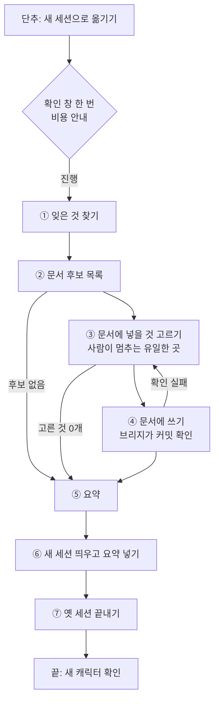

<!--
다루는 곳: bridge/static/js/moveflow.js, bridge/static/js/handoff.js, bridge/switchwatch.py, config/handoff.toml, bridge/losscheck.py
읽은 커밋: 5e0f7c5
-->
# 새 세션으로 옮기기

CC 세션은 오래 쓸수록 무거워진다. 응답 하나를 낼 때마다 지금까지 쌓인 대화 전체를 다시 읽기 때문에, 대화가 길어지면 응답이 느려지고 값이 오른다. 그러다 창이 차면 CC가 앞부분을 저절로 줄이는 압축을 하는데, 이 압축이 대화에서만 정한 결정을 지운다. 그래서 FOREMAN은 한 세션을 끝없이 끌고 가지 않고, 적당한 때에 지금까지 한 일을 정리해 새 세션에게 넘기고 옛 세션을 끝낸다. 화면에서 이 일을 부르는 이름이 「새 세션으로 옮기기」다(코드와 문서 안에서는 인계, handoff라고도 부른다).

이 편은 옮기기의 마지막 고리, 곧 사람이 단추를 누른 뒤 새 세션이 일을 이어받고 옛 세션이 꺼지기까지의 흐름을 다룬다. 그 흐름이 왜 지금 꼴이 되었는지, 언제 옮기라고 권하는지, 옛 세션과 새 세션과 화면 속 캐릭터가 어떻게 이어지는지, 그리고 아직 풀지 못한 한계를 적는다. 압축이 무엇을 얼마나 지우는지는 → 08 인계와 압축 손실, 잊은 것을 찾는 기계는 → 압축 손실 재기, 요약의 꼴과 「읽을 곳」 확인은 → 인계 요약과 읽을 곳, 대화에서 정한 것을 문서로 쓰는 단계는 → 문서로 옮기기에서 깊게 다룬다. 여기서는 그 셋을 하나의 흐름으로 꿰는 쪽을 본다.

## 옮기기가 해야 하는 일

옮기기는 단순히 「요약해서 새 세션에 붙여넣기」가 아니다. 압축 손실을 손으로 재 보니, 잃어버린 지시와 결정은 거의 다 저장소 문서에는 없고 대화에만 있던 것이었다 [docs:11_handoff_v2.md]. 요약에 담아 넘겨도 그 요약 자체가 모델의 기억에서 나오므로 이미 잊은 것은 담기지 않고, 새 세션에서 다음 압축이 오면 또 깎인다. 그래서 FOREMAN의 옮기기는 순서가 정해져 있다. 먼저 압축으로 잊은 것을 찾고, 대화에서만 정했던 것을 문서에 쓰고 커밋한 뒤, 짧은 요약과 「읽을 곳」만 새 세션에 넘긴다. 새 세션은 요약을 믿는 대신 문서를 읽는다.

이 순서를 지키면 단계가 많아진다. 잊은 것 찾기, 문서 후보 목록 받기, 고르기, 쓰기, 요약, 새 세션 띄우기, 옛 세션 끝내기. 일곱 단계 각각이 세션에 요청을 보내고 결과를 기다려야 하는 일이다. 문제는 이 일곱 단계를 사람이 어떻게 지나가게 하느냐였다.

## 옛 흐름: 사람이 일곱 번 끼어들었다

처음 만든 흐름에서는 단계마다 단추가 따로 있었다. 사람은 패널의 「세션 정리」 탭에서 압축으로 잊은 것 찾기를 누르고, 끝나기를 기다렸다가 목록을 뽑는 단추를 누르고, 같이 넣을 것을 고르고, 승인하고, 승인한 것을 쓰는 단추를 누르고, 다시 위로 올라가 새 세션으로 옮기기를 누르고, 요약 확인 창을 보고, 폴더와 역할을 골랐다. 이 차례가 코드 머리 주석에 그대로 남아 있다 [code:bridge/static/js/moveflow.js].

일곱 번 가운데 사람이 정말로 판단해야 하는 것은 하나뿐이었다. 「대화에서 정한 것 가운데 무엇을 문서에 남길까」다. 이것은 사람만 정할 수 있다. 어떤 결정이 이번 한 번만의 것인지, 앞으로도 지켜야 할 규칙인지, CLAUDE.md에 올릴 만큼 무거운지는 모델이 후보를 낼 수는 있어도 마지막 판단은 사람 몫이다. 나머지 여섯 번은 판단이 아니라 「다음 단계로 가라」는 손짓이었다. 서버 상태만 보면 다음에 무엇을 할지 기계가 알 수 있는데도 사람이 그 자리를 지키고 있어야 했다.

이게 그냥 귀찮은 정도로 끝나지 않았다. 사람이 단계 사이에서 자리를 뜨면 흐름이 조용히 멈췄다. 잊은 것 찾기는 끝났는데 목록 뽑기를 아무도 누르지 않아 반쯤 된 옮기기가 그대로 남는 식이다. 단계가 많으면 빠뜨리기도 쉽다. 잊은 것 찾기를 건너뛰고 바로 옮기거나, 문서 쓰기를 확인하지 않고 옮기면 옮기기를 이렇게 설계한 까닭이 사라진다.

## 한 흐름: 고르기에서 한 번만 멈춘다

그래서 단추 하나로 일곱 단계를 잇는 「한 흐름」을 만들었다 [c:92df97f]. 사람은 [새 세션으로 옮기기]를 한 번 누르고, 「문서에 넣을 것 고르기」에서 한 번 멈춰 고른 뒤, 그다음은 지켜보기만 한다. 설정은 `config/handoff.toml`의 `[move] one_flow` 한 칸이고, 지금 켜져 있다 [code:config/handoff.toml].

화면 위쪽에는 일곱 단계 이름이 차례로 놓인 줄이 있고, 지난 단계에는 체크가, 지금 단계에는 강조가, 실패한 단계에는 빨간색이 붙는다. 단계 이름은 코드의 `MOVE_STEPS` 한 곳에서 나온다 [code:bridge/static/js/moveflow.js].

| 번호 | 화면 단계 이름 | 누가 | 하는 일 |
|---|---|---|---|
| ① | 잊은 것 찾기 | 브리지 | 압축 구간마다 사람이 한 말을 뽑아 `claude -p`로 지금 세션이 아직 기억하는지 판정한다 |
| ② | 문서 후보 목록 | 세션 | 대화에서 정했지만 문서에 없는 것을 항목으로 낸다. ①에서 찾은 것이 있으면 같이 넣는다 |
| ③ | 문서에 넣을 것 고르기 | 사람 | 후보마다 체크해서 고른다 |
| ④ | 문서에 쓰기 | 세션, 브리지 | 세션이 고른 것을 문서에 쓰고 커밋하면 브리지가 그 커밋을 git으로 확인한다 |
| ⑤ | 요약 | 세션 | 2판 꼴(지금 상태, 다음 할 일, 걸려 있는 것, 문서와 다른 지금, 읽을 곳)의 짧은 요약을 쓴다 |
| ⑥ | 새 세션 | 브리지 | 같은 역할, 같은 모델로 새 세션을 띄우고 요약을 첫 입력으로 넣는다 |
| ⑦ | 옛 세션 끝내기 | 브리지 | 옛 세션에 `/exit`를 보낸다 |

### 시작할 때 묻는 것

단추를 누르면 확인 창이 한 번 뜬다. 지금 세션을 끝내고 같은 자리에 새 세션을 띄운다는 것, 먼저 잊은 것을 찾아 문서 후보를 보여 주니 고르기만 하면 된다는 것, 그리고 잊은 것 찾기에 드는 비용이다. 비용 글은 `LOSS_COST` 한 곳에서 나오며 지금 값은 「내가 보낸 말 20개당 약 0.4달러, 1.5분」이다 [code:bridge/static/js/losscheck.js]. 이 값은 실측에서 계산하지 않고 손으로 정한 어림값이다. 여러 화면(버튼 호버, 확인 창, 패널 띠)에서 같은 비용을 말해야 하므로 값을 한 곳에만 두었다.

확인 창을 이 자리에 남긴 까닭은 이 단추가 돈과 세션 하나를 쓰기 때문이다. 잊은 것 찾기는 토큰을 쓰고, 끝까지 가면 지금 세션이 꺼진다. 고르기 말고 사람이 한 번 더 판단하는 자리가 있다면 「정말 옮길까」 하나여야 한다고 보았다.

### 단계를 잇는 것은 화면이다

한 흐름은 서버에 따로 일을 지휘하는 부분을 두지 않았다. 브라우저의 패널이 단계를 잇는다 [log:coder_c_wave2_20261111.md]. 패널은 세션 데이터(`/api/sessions/{id}/handoff`)를 주기적으로 받아 그릴 때마다 `moveStep`이라는 순수 함수에 「이 브라우저가 기억하는 흐름 상태」와 「서버가 알려 준 요약, 문서 후보, 잊은 것 찾기의 상태」를 넣는다 [code:bridge/static/js/moveflow.js]. 함수는 지금 몇 번째 단계인지, 사람 차례인지, 저절로 할 일이 있는지, 실패했는지를 돌려준다. 저절로 할 일은 네 가지다. 문서 후보를 요청하기, 요약을 요청하기, 새 세션을 띄우기, 그리고 고른 것이 없을 때 쓰기를 건너뛰기다. 패널은 데이터를 받은 뒤마다 `moveTick`을 불러, 저절로 할 일이 있으면 해당 API를 부르고 흐름 상태를 한 칸 옮긴다 [code:bridge/static/js/handoff.js].

어디까지 왔는지는 브라우저의 `localStorage`에 세션마다 `foremanFlow:<세션 번호>` 열쇠로 적어 둔다. 옛 흐름도 같은 열쇠를 쓰는데, 한 흐름은 `v: 2`를 달아 둘을 가른다. 그래서 다른 세션을 봤다가 돌아오거나 화면을 새로 고쳐도 흐름이 이어진다. 새 세션을 띄우는 중이나 옛 세션을 끝내는 중에 새로 고치면, 그 진행 표시만 지우고 서버 데이터로 다시 판단한다 [code:bridge/static/js/handoff.js].

흐름이 도는 동안 패널은 데이터를 3초마다 받는다. 사람 차례(고르기)이거나, 끝났거나, 실패한 상태면 15초마다로 늦춘다. 세션이 아직 일하는 중이라 요청을 받을 수 없으면(`can.promote`, `can.summary`가 꺼짐) 그 단계를 미루고 다음 번 데이터에서 다시 본다 [code:bridge/static/js/handoff.js].

이렇게 정한 데는 까닭이 있다. 옛 흐름과 같은 자리, 같은 API를 그대로 쓰니 바뀌는 코드가 작았다. 서버에 새 상태 기계와 표를 만들지 않아도 됐고, 문제가 생기면 설정 한 칸으로 옛 흐름으로 돌아갈 수 있다. 대신 치른 값이 있다. 패널을 닫으면 흐름이 멈춘다. 다시 열면 이어 가지만, 아무도 패널을 열지 않으면 흐름은 그 자리에 서 있다. 다른 브라우저나 다른 기기에서는 흐름 상태를 모른다. 서버가 흐름을 이어 받게 하는 것은 다음에 할 일의 후보로 남겨 두었다 [log:coder_c_wave2_20261111.md].

### 단계마다 일어나는 일

**① 잊은 것 찾기.** 시작하자마자 `POST /api/sessions/{id}/losscheck`를 부른다. 이미 도는 점검이 있는 등의 까닭으로 시작하지 못하면 흐름을 멈추지 않고 이 단계를 건너뛰어 ②부터 간다. 건너뛴 까닭은 흐름 위에 한 줄로 남긴다. 찾는 동안에는 「잊은 것을 찾는 중입니다 3/7」처럼 묶음 진행을 보여 주고, [잊은 것 찾기 건너뛰기]로 기다리지 않고 넘어갈 수도 있다 [code:bridge/static/js/handoff.js].

**② 문서 후보 목록.** 찾기가 끝나면 패널이 저절로 `POST /api/sessions/{id}/promote`를 부른다. 잊은 것이 하나라도 나왔으면 그 점검 번호를 같이 보내, 세션이 이미 기억에서 빠진 결정을 원문에서 되살려 후보에 넣게 한다. 하나도 없거나 찾기가 실패했으면 그 입력 없이 묻는다. 세션이 후보를 내면 브리지가 목적지(어느 문서, 어느 절)를 기계로 확인해 둔다. 세션이 「문서에 넣을 것이 없다」고 하면 ③과 ④를 건너뛰고 바로 ⑤로 간다.

**③ 문서에 넣을 것 고르기.** 사람이 멈추는 유일한 곳이다. 아래 「고르기 칸」에서 자세히 본다. 단추 글은 고른 수에 따라 바뀌어, 하나 이상이면 「고른 N개를 문서에 쓰고 옮기기」, 하나도 안 골랐으면 「문서에 넣지 않고 옮기기」가 된다 [code:bridge/static/js/moveflow.js].

**④ 문서에 쓰기.** 고른 것이 있으면 고친 값을 저장하고 `POST /api/promotions/{id}/write`를 부른다. 세션이 쓰고 커밋하면 브리지가 커밋이 실제로 있는지 git으로 확인한다. 확인이 실패하면(`write_failed`) 흐름은 ③으로 돌아와 문제를 보이고 다시 고르게 한다. 조용히 다음 단계로 넘어가지 않는다.

**⑤ 요약.** 쓰기가 확인되면 패널이 저절로 2판 요약(`kind: handoff`, `fmt: v2`)을 요청한다. 세션이 요약을 쓰면 브리지가 표지로 꺼내 저장한다.

**⑥ 새 세션.** 요약이 저장되면 패널이 저절로 `POST /api/sessions/{id}/spawn`을 `replace: true`로 부른다. 옛 흐름에는 이 앞에 「넣을 글을 보여 주고 확인받는」 창이 있었는데, 한 흐름에서는 뺐다. 대신 새 세션의 패널에 「넘겨받은 글」 줄을 두어, 무엇이 넘어갔는지는 받은 쪽에서 본다(아래 「옛 세션과 새 세션」). 응답에 새 세션 번호가 없거나 요약을 넣었는지 확인하지 못하면 이 단계에서 실패로 멈춘다.

**⑦ 옛 세션 끝내기.** 새 세션이 요약을 받았으면 곧바로 옛 세션에 `exit` 동작을 보낸다. 맥락이 큰 세션은 끝나는 데 수십 초가 걸려, 그동안 「옛 세션을 끝내는 중입니다」를 보인다. 끝나면 「새 세션으로 옮겼습니다. 새 캐릭터를 확인해주세요.」가 뜬다 [code:bridge/static/js/handoff.js].

### 멈춘 것을 숨기지 않는다

한 흐름은 사람이 지켜보지 않아도 가도록 만든 것이라, 멈췄을 때 그 사실을 드러내는 일이 더 중요해졌다. 사람이 손짓하던 옛 흐름에서는 멈추면 사람이 알았지만, 저절로 가는 흐름이 서 버리면 화면에는 「~하는 중입니다」만 계속 떠 있게 된다. 이 프로젝트가 가장 피하려는 조용한 고장이다.

그래서 한 단계가 `STALL_MS`, 곧 10분 넘게 그대로면 「멈춘 것 같습니다」로 바꾸고 몇 분째인지 적은 뒤 [다시 시도]와 [멈추기]를 준다 [code:bridge/static/js/moveflow.js]. [다시 시도]는 실패한 단계에 따라 다르게 군다. 문서 후보 단계면 목록을 다시 묻고, 요약 단계면 요약을 다시 받고, 새 세션 단계면 띄우기를 다시 하고, 옛 세션 끝내기 단계면 `/exit`만 다시 보낸다. 앞의 두 단계에서 막혔으면 [문서 후보 없이 묻기]로 잊은 것 찾기를 버리고 갈 수 있다. [멈추기]는 어느 단계에서나 흐름을 그만두며, 이미 쓴 문서와 받은 요약은 남는다.

잊은 것 찾기의 결과도 같은 태도로 다룬다. 처음에는 서버가 「압축된 적이 없어 찾을 것이 없음」을 실패로, 「일부 묶음이 실패함」을 성공으로 저장해, 화면이 실패를 「없음」처럼 보일 수 있었다 [log:move_screens_20261113.md]. 지금은 서버가 끝난 점검의 결과를 다섯 갈래로 가르고, 아직 도는 중(`running`)까지 더해 여섯 값 가운데 하나(`outcome`)로 내려 준다 [code:bridge/losscheck.py]. 흐름은 끝난 점검의 다섯 갈래를 흐름 맨 위 한 줄로 다른 글과 다른 색으로 남긴다. 서버가 `outcome`을 주지 않는 옛 기록도 `lossOutcome`이 같은 갈래로 맞춘다 [code:bridge/static/js/moveflow.js].

| 갈래 | 뜻 | 흐름 위에 남는 줄의 결 |
|---|---|---|
| found | 끝까지 찾았고 잊은 것이 있다 | 초록. 찾은 수와 「문서 후보를 물을 때 같이 넣었다」 |
| clean | 끝까지 찾았고 잊은 것이 없다 | 초록 |
| nothing | 압축된 적이 없어 찾을 것이 없다 | 회색. 짧게 「잊은 것 없음」 |
| partial | 일부 묶음만 끝났다 | 노랑. 0개여도 「없음」이 아니라고 적는다 |
| failed | 찾기가 실패했다 | 빨강. 그 결과 없이 문서 후보를 물었다고 적는다 |

### 고르기 칸

③의 화면은 후보마다 칸을 나눈다. 종류 꼬리표와 무엇, 「갈 문서」와 절, 「왜 거기」가 각각 제 줄에 있고, 맨 앞에 「넣기」 체크가 하나 있다. 처음에는 글이 통째로 흐르고 갈 문서가 본문 속에 끼어 있어 읽기 힘들었다 [log:move_screens_20261113.md]. 끝나지 않은 할 일처럼 목적지가 포스트잇인 후보는, 고르면 세션이 쓰지 않고 브리지가 포스트잇에 올린다고 호버에 적는다. 포스트잇 쪽은 → 포스트잇에서 다룬다.

모든 후보를 고를 수 있는 것은 아니다. 브리지의 목적지 확인에 걸린 후보(없는 문서, 없는 절)와 세션이 「버림」을 권한 후보는 흐리게 그리고 체크를 끈 채 까닭을 칸 안에 적는다. 이 판단은 `selectable` 한 함수가 한다 [code:bridge/static/js/moveflow.js]. 고칠 수 있는 칸은 늘 접혀 있는 「옮기기 전 정리」에 따로 있어, 목적지를 고치면 고를 수 있게 된다.

고른 수가 어긋난 일이 한 번 있었다. 「고른 1개를」이라고 떴는데 실제로는 여럿을 쓴 것이다. 따져 보니 세는 곳, 체크를 그리는 곳, 실제로 쓰는 곳이 서로 다른 기준을 보고 있었다. 세는 쪽은 초안의 승인을 세고, 체크는 목적지 확인 실패를 빼고, 쓰기는 문서로 옮기기 모듈의 합치기 규칙을 따랐다 [log:move_screens_20261113.md]. 지금은 셋 다 `chosen` 하나를 본다. 쓰기 직전에는 `chooseFinal`이 화면에 체크가 없는데 서버 값만 승인으로 남아 있는 후보(고를 수 없는 후보)를 빼기로 바꿔, 쓰는 것과 화면에 보이는 것이 같아지게 했다 [code:bridge/static/js/moveflow.js]. [전부 고르기]와 [전부 풀기]도 고를 수 있는 것만 바꾼다.

후보가 많으면 목록 상자는 제 높이 안에서 따로 스크롤한다. 처음에는 체크 하나를 누를 때마다 패널 전체를 다시 그려 목록 상자가 맨 위로 튀었다. 열 개 가운데 여덟째를 고르면 다시 내려와야 했다. 지금은 체크와 [전부 고르기], [전부 풀기]가 바뀐 줄, 수, 단추만 고치고 패널은 다시 그리지 않는다. 데이터가 바뀌어 전체를 다시 그릴 때도 목록 상자의 스크롤 자리를 지킨다 [log:foreman-4_move_three_20261115.md].

### 고친 요약으로 다시 시도하기

⑥에서 새 세션을 못 띄우는 흔한 까닭은 요약의 「읽을 곳」이 틀린 것이다. 없는 절을 가리키거나 줄 범위가 파일보다 길면 브리지가 넣지 않는다(→ 인계 요약과 읽을 곳). 이때 멈춤 줄에는 [고치기], [다시 시도], [멈추기]가 이 차례로 놓인다. 먼저 고치고 다시 시도하라는 차례다.

여기에 걸림돌이 하나 있었다. [고치기]로 저장하면 원본 요약은 그대로 두고 `parent_id`를 단 새 판이 생긴다. 그런데 흐름은 처음 잡은 요약 번호를 들고 있어서, 고친 판을 저장하고 [다시 시도]를 눌러도 옛 판을 다시 보내 같은 거부가 났다. 서버는 받은 번호대로 제대로 검사했고, 탈은 화면이 고친 판을 찾지 않은 데 있었다 [log:foreman-4_move_three_20261115.md]. 지금은 띄우기 직전에 `retrySummaryId`가 그 판에서 이어 고친 판 가운데 저장이 끝난 가장 새 것을 따라간다. 다른 탭에서 고쳤어도 찾는다 [code:bridge/static/js/moveflow.js].

## 옮길 때를 권하기

언제 옮길지는 사람이 정한다. 다만 옮길 만한 때를 기계가 알아채 알려 주면 놓치지 않는다. 이 일을 `bridge/switchwatch.py`가 한다 [code:bridge/switchwatch.py]. 사람 턴이 닫힐 때마다 브리지가 1초 뒤 쌓인 대화의 크기를 보고, 이어서 이 판정을 한 번 한다 [code:bridge/compactwatch.py].

### 세 신호가 겹칠 때만

판정에 쓰는 신호는 셋이다. 하나씩은 약하다. 그래서 셋이 겹칠 때만 권한다.

첫째는 **전환 말투**다. 사람이 「다음 작업」, 「다른 얘기」, 「그건 됐고」, 「이번엔」, 「별개로」, 「넘어가자」, 「next task」 같은 말로 새 일을 꺼내는지 본다. 요청 글의 앞머리 160자만 본다. 긴 지시서 안에 우연히 섞인 낱말에 걸리지 않게 하려는 것이다 [code:bridge/switchwatch.py]. 하지만 이 말만으로는 같은 일의 다음 단계, 예를 들어 「이제 테스트 돌려줘」 같은 것도 잡는다.

둘째는 **일이 끝난 흔적**이다. 그 사람 턴이 시작되기 전 30분 안에 이 세션의 커밋이 있었거나, 직전 턴이 끝나고 20분 넘게 쉬었다가 온 말이면 켜진다. 둘 중 하나면 된다 [code:bridge/switchwatch.py]. 하지만 커밋이나 쉼만으로는 같은 주제를 이어 가는 경우가 많다.

셋째는 **쌓인 대화의 양**이다. 마지막 응답의 맥락 토큰을 그 모델의 창 크기로 나눈 비율이 40% 이상이어야 한다. 이 값은 `config/notify.toml`의 `switch_min_pct`다 [code:config/notify.toml]. 창 크기를 모르는 모델은 비율을 낼 수 없으므로 권하지 않는다.

전환 말과 끝난 흔적이 같이 있고 대화가 이미 40% 넘게 찼다면 「새 일이 시작됐고, 세션은 이미 무겁다」로 읽을 수 있다. 옮길 까닭이 분명해진다. 판정 함수 `should_suggest`가 이 세 조건을 그대로 적은 한 줄이다 [code:bridge/switchwatch.py].

| 신호 | 값 | 자리 |
|---|---|---|
| 전환 말을 찾는 범위 | 요청 글 앞 160자 | `HEAD_CHARS` [code:bridge/switchwatch.py] |
| 커밋 | 그 턴 시작 전 30분 안 | `COMMIT_WINDOW` [code:bridge/switchwatch.py] |
| 쉼 | 직전 턴 끝에서 20분 이상 | `IDLE_GAP` [code:bridge/switchwatch.py] |
| 쌓인 대화 | 창의 40% 이상 | `switch_min_pct` [code:config/notify.toml] |

40%라는 문턱은 맥락 알림의 문턱(50%, 75%)보다 낮다 [code:config/notify.toml]. 맥락 알림은 「무거워졌다」를 알리는 것이고, 전환 권유는 그보다 앞서 「마침 일이 바뀌는 지금이 옮기기 좋은 때」를 알리는 것이라 더 이른 자리에 두었다. 자동 압축은 창이 80~90% 찼을 때 일어나므로, 그 전에 손실 없이 옮길 시간을 넉넉히 둔 셈이다.

### 막지 않고 알리기만

권유는 두 곳에 뜬다. 하나는 텔레그램이다. 사람 턴마다 한 번만, `switch:<턴 번호>`라는 규칙 이름으로 알림 기록을 남겨 같은 턴에 두 번 보내지 않는다. 숨긴 세션에는 보내지 않는다 [code:bridge/compactwatch.py]. 다른 하나는 세션 패널의 띠다. 대시보드가 같은 판정 함수로 쌓인 대화가 문턱을 넘은 세션만 따져 싣고, 패널이 「다른 일로 넘어가시는 것 같습니다」로 시작하는 줄을 그린다. 그 줄에 [새 세션으로 옮기기]와 [나중에]가 있다. [나중에]는 그 사람 턴 동안만 띠를 숨기고, 다음 입력이 오면 다시 판정한다.

권유가 틀려도 치르는 값은 알림 한 번, 띠 한 줄이다. 그래서 막지 않고 알리기만 한다. 같은 일을 하는 세션이 있을 때 알리는 겹침 알림과 같은 태도다(→ 겹침 알림). 반대로 권유가 없어서 옮길 때를 놓치면 두 번째 압축에서 결정이 가장 많이 깎인다 [docs:11_handoff_v2.md]. 헛걸림의 값이 놓침의 값보다 훨씬 싸다.

권하는 것이 CC의 `/clear`가 아니라 옮기기인 데도 까닭이 있다. `/clear`는 대화를 비우기만 하므로 대화에서만 정한 결정이 그대로 사라진다. 옮기기는 그 결정을 문서로 먼저 옮긴 뒤 넘기므로 잃지 않는다. 권유 글 끝에 「옮기기 전에 대화에서만 정한 결정은 문서로 옮겨 둡니다」를 붙인 것도 그래서다 [code:bridge/switchwatch.py].

## 옛 세션과 새 세션

⑥에서 패널이 부르는 `spawn`은 옛 세션의 자리를 그대로 물려받은 새 세션을 띄운다 [code:bridge/handoff.py]. 물려받는 것은 다음과 같다.

**역할과 모델.** 옛 세션의 역할(코더, 서기, 관리자 등)과 모델을 그대로 쓴다. 역할이 바뀌지 않아야 새 세션이 같은 권한과 같은 규칙으로 일을 잇는다. 역할 이야기는 → 05 역할과 권한에 있다.

**이름.** 사람이 옛 세션에 붙인 이름이 있으면 새 세션도 그 이름으로 뜬다. 옮길 때마다 세션 행이 새로 생기니, 물려주지 않으면 이름이 자동 제목으로 돌아간 것처럼 보였다 [code:bridge/handoff.py].

**서기의 일감.** 서기 세션이면 무슨 서기 일을 하던 중인지를 새 세션에 다시 적는다. 서기실의 열린 일과 겹침 막기가 새 세션도 같은 일로 본다.

**폴더.** 옛 세션이 일하던 저장소에 뜬다. 다만 그 저장소에 다른 살아 있는 세션이 있으면 같은 폴더에 둘이 붙지 않도록 새 작업방(worktree, 따로 떼어 둔 작업 폴더와 브랜치)에 뜬다. 이때 옛 세션은 세지 않는다. 옛 세션은 곧 끝나므로 「하나 더 생기는」 것이 아니기 때문이다 [code:bridge/handoff.py]. 관리자는 예외로 늘 원본 폴더에 뜨고, 원본 폴더에 다른 관리자가 이미 살아 있으면 아무것도 만들기 전에 거절한다. 이 판단은 옮기기 전 미리보기와 실제 띄우기가 같은 함수를 쓴다. 작업방 쪽은 → 06 세션 띄우기와 따로 작업에서 다룬다.

새 세션이 뜨면 브리지가 요약을 첫 입력으로 넣는다. 넣기 직전에 요약을 만들 때와 지금 사이에 git과 잠금이 바뀐 것을 비교해 글 앞에 붙이고, 2판 요약이면 「읽을 곳」을 기계로 다시 확인한다. 틀린 곳이 있으면 넣지 않고 ⑥에서 멈춘다. 새 세션은 넣은 글의 지시대로 읽을 곳을 읽고, 이해한 것을 다섯 줄 안으로 말한 뒤 사람의 확인을 기다린다 [code:bridge/handoff.py].

옛 흐름에 있던 「넣을 글 확인 창」을 없앤 대신, 받은 세션의 패널 「세션 정리」 탭에 「넘겨받은 글: 세션 N에서」 줄이 생긴다. 받은 지 한 시간 안이면 펼친 채로 보여 무엇이 넘어왔는지 바로 볼 수 있다 [code:bridge/static/js/handoff.js]. 확인을 넘기기 전이 아니라 받은 뒤로 옮긴 것이다. 넘기기 전에 사람이 확인하려면 또 한 번 멈춰야 하는데, 요약은 이미 세션이 문서를 쓴 뒤의 짧은 글이고 읽을 곳은 기계가 확인하므로, 사람이 매번 막아설 까닭이 작다고 보았다.

옛 세션은 ⑦에서 `/exit`로 끝난다. 끝낸 뒤 옛 세션의 행과 기록은 그대로 남는다. 새 세션이 요약을 받았는데 옛 세션을 끝내는 데만 실패하면, 흐름은 「새 세션이 이어받았습니다. 옛 세션 끝내기만 남았습니다」를 보이고 [옛 세션 다시 끝내기]를 준다. 이미 끝난 세션이라면 끝내기를 건너뛴다.

## 캐릭터가 이어지는 법

FOREMAN의 화면은 세션 하나하나를 픽셀 사무실의 캐릭터로 그린다. 캐릭터는 세션보다 오래 사는 단위다. 프로젝트마다 「코더」, 「서기」, 「조사」 같은 역할 캐릭터가 있고, 세션은 그 캐릭터에 붙는다. 옮기기는 세션을 바꾸는 일이지 캐릭터를 바꾸는 일이 아니다. 그래서 새 세션은 새 캐릭터를 만들지 않고 역할로 캐릭터를 찾아 붙는다 [code:bridge/handoff.py].

`_character_for`가 그 일을 한다. 원본 폴더에 뜬 세션이면 그 프로젝트의 역할 캐릭터(예: 「코더」)에 붙는다. 옛 세션도 원본 폴더의 같은 역할이었다면 새 세션은 같은 캐릭터에 붙으므로, 화면에서는 같은 캐릭터가 계속 일하는 것으로 보인다. 작업방에 뜬 세션이면 그 자리의 일꾼 캐릭터(예: 「코더 foreman-2」)에 붙는다. 이 일꾼은 작업방을 합치거나 버릴 때 퇴장하고, 같은 이름이 퇴장해 있으면 되살려 쓴다. 역할의 화면 이름이 바뀐 경우(옛 이름 캐릭터가 남아 있는 경우)에는 그 캐릭터의 이름을 새 이름으로 바꿔 이어 쓴다.

이름이 비슷한 `character_session_move_0017` 표는 옮기기와 상관이 없다. 이 표는 처음에 모든 세션이 프로젝트의 감독 캐릭터에 묶여 있던 것을 역할 캐릭터로 다시 나눈 마이그레이션이 남긴 되돌리기용 표다 [code:migrations/0017_character_reassign.sql]. 옮기기가 캐릭터를 잇는 데는 별도 표가 없고, 새 세션 행의 `character_id`를 역할로 찾은 캐릭터로 채우는 것이 전부다.

끝난 흐름이 「새 캐릭터를 확인해주세요」라고 말하는 데에는 사정이 있다. 원본 폴더끼리 옮기면 같은 캐릭터가 새 세션을 이어받지만, 옮긴 새 세션이 작업방에 뜨면 다른 이름의 일꾼 캐릭터가 화면에 새로 선다. 어느 쪽인지 화면이 미리 가르지 않으므로, 사람에게 한 번 보라고 하는 것이다.

## 알려진 한계

### 작업방 세션을 옮기면 새 세션이 원본 폴더에 뜰 수 있다

작업방에서 일하던 세션을 옮기면, 새 세션은 그 작업방으로 돌아가지 않는다. 지금 코드에서도 그렇다는 것을 확인했다. `spawn`은 옛 세션의 폴더에서 작업방 부분을 떼어 낸 원본 저장소 경로를 기준으로 새 세션을 띄운다. 그다음 작업방을 쓸지 판단하는데, 옛 세션은 세지 않는다. 그래서 그 프로젝트에 다른 살아 있는 세션이 없으면 새 세션은 원본 폴더에 뜨고, 있으면 옛 작업방이 아닌 새 작업방에 뜬다. 어느 경우든 옛 작업방과 옛 브랜치로 돌아가는 길은 없다 [code:bridge/handoff.py].

그런데 요약은 옛 세션이 썼으므로 「브랜치 X의 작업방에서 일하고 있다」고 적혀 있다. 새 세션이 그 글을 따라 옛 작업방으로 걸어 들어가 일을 이어 가면, 기록상 그 작업방의 주인은 이미 끝난 옛 세션으로 남는다. 실제로 다른 저장소에서 이런 일이 있었다. 옮겨서 뜬 새 세션이 원본 폴더에 뜬 뒤 인계문을 따라 옛 작업방에 커밋 여러 개를 쌓았다. 합치기 카드는 그 작업방을 마지막으로 가졌던 세션을 주인으로 보므로, 카드가 「세션이 끝났습니다」로 뜨고, 그대로 승인하면 새 세션의 작업 자리를 지울 수 있었다. 그때는 그 세션의 폴더 기록만 손으로 바로잡았다 [log:runshoes_manager_20261112.md]. README의 알려진 한계 표에도 같은 줄이 있고, 고치는 법은 아직 정하지 않았다 [code:README.md].

화면은 이 길을 반쯤 막아 두었다. 세션 정리 탭의 「새 세션으로 옮기기」 묶음은 작업방이 있는 세션에서는 아예 보이지 않는다. 작업방 세션에서 옮기기를 한 번도 쓴 적이 없어 뺀 것이다 [code:bridge/static/js/handoff.js]. 작업방 세션은 대개 일을 마치면 합치고 끝내는 길로 가기 때문이다. 하지만 막은 것은 그 탭 하나다. 패널 머리의 쌓인 대화 띠와 전환 권유 띠에 있는 [새 세션으로 옮기기]는 세션에 글을 넣을 수 있는지만 보고 작업방 여부는 보지 않으므로, 거기서 누르면 작업방 세션도 한 흐름을 탄다. 한 번 시작된 흐름은 세션 정리 탭에도 다시 보인다. 그래서 위 한계는 지금도 닿을 수 있는 길에 있다.

### 그 밖의 한계

흐름이 브라우저에 산다는 것이 두 번째 한계다. 패널을 닫으면 흐름이 멈추고, 다른 기기에서 열면 흐름을 모른다. 멈춘 지 10분이 지나면 「멈춘 것 같습니다」가 뜨지만, 그것도 누가 패널을 열어야 보인다 [code:bridge/static/js/moveflow.js]. 다만 각 단계의 요청(잊은 것 찾기, 문서 후보, 요약)은 서버에 기록되어 있으므로 흐름이 멈춰도 한 일은 남는다.

끝난 세션은 한 흐름을 타지 않는다. 문서에 쓸 세션이 없기 때문이다. 끝난 세션의 [새 세션으로 옮기기]는 옛 흐름(요약, 확인, 새 세션, 옛 세션 끝내기)으로 가고, 요약은 그 세션을 잠깐 다시 불러 받거나 마지막 자동 압축 요약으로 만든다. 한 흐름을 끈 경우에도 옛 흐름으로 간다.

권유 쪽의 한계도 있다. 전환 말은 정해 둔 낱말 목록으로만 찾으므로, 목록에 없는 말로 새 일을 꺼내면 놓친다. 창 크기를 모르는 모델에서는 비율을 낼 수 없어 아예 권하지 않는다.

## 설정과 값

| 자리 | 값 | 뜻 |
|---|---|---|
| `config/handoff.toml` `[move] one_flow` | `true` | 한 흐름을 켠다. 끄면 옛 흐름. 브리지는 파일이 바뀌면 다시 읽고, 화면은 다음에 새로 그릴 때 읽는다. 파일을 못 읽으면 꺼짐으로 본다 [code:config/handoff.toml] |
| `config/notify.toml` `switch_min_pct` | `40` | 전환 권유를 할 쌓인 대화 비율 [code:config/notify.toml] |
| `STALL_MS` | 10분 | 이만큼 그대로면 「멈춘 것 같습니다」 [code:bridge/static/js/moveflow.js] |
| 흐름이 도는 동안 데이터 받는 간격 | 3초, 사람 차례나 끝, 실패면 15초 | [code:bridge/static/js/handoff.js] |
| `LOSS_COST` | 말 20개당 약 0.4달러, 1.5분 | 시작 확인 창의 비용 안내 [code:bridge/static/js/losscheck.js] |
| `HEAD_CHARS`, `COMMIT_WINDOW`, `IDLE_GAP` | 160자, 30분, 20분 | 전환 권유의 세 신호 [code:bridge/switchwatch.py] |

`one_flow`는 처음 기능을 넣을 때 꺼진 채로 들어갔다가, 사용자가 켜도록 해 켰다 [c:b3e1218]. `config/handoff.toml`의 나머지 칸(`[merge_prep]` 묶음)은 옮기기가 아니라 합치기 카드의 설정이다. → 합치기 카드에서 다룬다.

## 고르지 않은 길

**서버가 흐름을 지휘하는 길.** 서버에 흐름 상태를 두고 브리지가 단계를 이으면 패널을 닫아도 흐름이 간다. 이 길이 더 단단하지만, 새 표와 상태 기계와 실패 처리를 서버에 새로 만들어야 했다. 옛 흐름과 같은 API를 화면이 잇는 쪽을 먼저 골랐고, 서버가 이어 받는 것은 다음에 할 일 후보로 남겼다.

**모든 단계에서 사람에게 묻는 길.** 옛 흐름이 그것이었다. 사람이 판단할 것은 고르기 하나인데 여섯 번을 더 손짓하게 했고, 손짓을 잊으면 조용히 멈췄다.

**요약 확인 창을 남기는 길.** 넘기기 전에 넣을 글을 사람에게 보여 주면 이상한 요약을 막을 수 있다. 하지만 그만큼 한 번 더 멈춘다. 읽을 곳은 기계가 확인하고, 문서에 남길 것은 이미 ③에서 사람이 골랐으므로, 확인은 받은 쪽 패널의 「넘겨받은 글」로 옮겼다.

**`/clear`를 권하는 길.** 가장 싸고 빠르지만 대화에서만 정한 것을 지운다. 이 프로젝트가 옮기기를 만든 까닭과 맞지 않는다.
