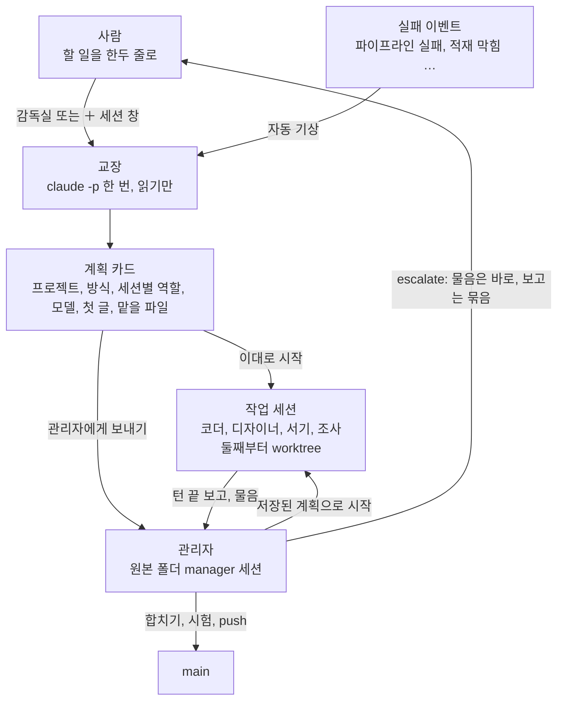

<!--
다루는 곳: bridge/foreman.py, bridge/api/foreman.py, docs/11_foreman_dispatch.md, docs/14_dispatcher_note_wake.md
읽은 커밋: e5d584b
-->
# 09 교장과 관리자

FOREMAN에서 새 일이 시작되는 길은 거의 언제나 같다. 사람이 무엇을 하려는지 한두 줄로 말하면, 교장이 그 일을 어느 프로젝트에서 어떤 세션으로 할지 계획을 세운다. 사람이 그 계획을 보고 고쳐 승인하면 세션이 뜨고, 뜬 세션이 일을 마치면 그 프로젝트의 관리자가 결과를 거둬 합치고 시험하고 내보낸다. 이 편은 이 길의 두 자리, 곧 계획을 세우는 교장과 일을 거두는 관리자가 무엇이고 왜 지금 모양이 되었는지를 다룬다. 계획 하나가 어떻게 만들어지는지, 교장이 무엇을 기억하는지, 같은 일이 겹칠 때 어떻게 알리는지, 관리자에게 어떻게 넘기고 보고가 어떻게 오르는지는 하위 네 편이 깊게 다룬다.

## 이름부터: 교장, 팀장, 소장, 그리고 디스패처

코드와 문서에서 이 기능의 이름은 디스패처(dispatcher)다. 일을 받아 어디로 보낼지 정하는 자리라는 뜻이다. 그런데 화면에는 이 낱말이 나오지 않는다. 화면 사무실 맨 앞의 감독실에 서 있는 캐릭터가 디스패처의 얼굴이고, 그 이름은 테마마다 다르다. 오피스 테마에서는 팀장, 마법학교 테마에서는 교장, 공사 현장 테마에서는 소장, 장식 없는 기본 테마에서는 감독이다 [code:bridge/static/themes/]. 기능을 가리킬 때 화면은 「계획 세우기」라고 쓴다 [code:bridge/usage.py]. 디스패처가 무엇인지 모르는 사람에게 그 낱말은 아무 도움이 안 된다는 판단에서 화면 말을 하는 일로 바꿨다 [docs:style_guide.md]. 이 글은 사람 사이에서 가장 많이 쓰는 이름인 교장으로 부르고, 코드 이야기를 할 때만 디스패처라고 쓴다.

프로젝트마다 따로 교장이 있는 것은 아니다. 교장은 하나이고, 방마다 서 있는 팀장은 같은 교장의 그 프로젝트 창구다. 런슈즈 방의 팀장에게 말하면 요청에 「이 프로젝트에서 말했다」는 표시가 붙어 들어갈 뿐, 판단하는 쪽은 같다 [code:bridge/foreman.py]. 사람이 요청에 「포먼」이라고 한글로 써도 FOREMAN 프로젝트로 알아보도록 별명 표도 둔다.

관리자는 전혀 다른 것이다. 교장은 세션이 없는 계획 창구이고, 관리자는 실제 Claude Code(CC) 세션이다. 역할 값으로도 둘을 가른다. 교장의 역할 키는 `foreman`이고 관리자는 `manager`다. 이 둘을 한 값으로 섞지 않은 까닭은, 섞으면 「세션 없는 창구」와 「세션 하나」를 화면과 권한이 구별할 수 없게 되기 때문이다 [docs:11_foreman_dispatch.md].

## 교장은 상주하지 않는다: 부를 때마다 `claude -p` 한 번

교장을 처음 설계할 때 갈림길은 하나였다. tmux 안에 늘 떠 있는 교장 세션을 두고 대화하듯 이어 갈 것인가, 아니면 요청이 올 때마다 새로 불러 한 번 답을 받고 끝낼 것인가. FOREMAN은 뒤쪽을 골랐다. 사람이 [＋ 세션] 창이나 감독실에서 말을 걸면 브리지가 그때 `claude -p`(CC를 대화 화면 없이 한 번 실행해 답만 받는 방식)를 한 번 부르고, 답으로 정해진 모양의 계획을 받는다 [code:bridge/foreman.py] [c:98b4e23].

상주를 버린 까닭은 셋이다.

첫째는 맥락이 오염된다는 것이다. 상주 세션은 대화가 쌓일수록 결국 압축(대화가 너무 길어지면 CC가 앞부분을 요약으로 바꿔 줄이는 일)을 겪는다. 교장을 설계하던 바로 그날, 런슈즈 세션의 압축 요약을 사람이 손으로 대조해 보니 사용자 지시와 결정의 상당수가 요약에서 사라지거나 약해져 있었다 [log:foreman_compaction_loss_20261105.md]. 교장이 상주하면 같은 일이 교장에게도 일어난다. 게다가 쉬는 동안에도 맥락은 낡는다. 어제 오후에 본 「세션 156이 발볼 검증 중」이라는 사실은 오늘 아침에는 틀린 사실일 수 있는데, 상주 세션은 그것을 모른 채 들고 있다. 부를 때만 쓰면 매번 브리지가 지금 상태를 새로 모아 넣으므로 낡은 기억이 끼어들 틈이 없다.

둘째는 비용이다. 한 번 부를 때 들어가는 글은 상황 묶음 10~25k 토큰에 답 1~2k 토큰이고, 모델은 Sonnet이다 [docs:11_foreman_dispatch.md]. 하루 열 번 불러도 큰 작업 세션 하나가 하루에 읽는 양에 비하면 작다. 상주 세션은 부르지 않는 동안에도 쌓인 대화를 들고 있고, 부를 때마다 그 전체를 다시 읽는다. 상황 묶음 가운데 프로젝트 부분은 파일이 바뀌지 않으면 같은 글이라 프롬프트 캐시도 잘 먹는다.

셋째는 조용히 죽는다는 것이다. 늘 떠 있는 세션은 끝내기 확인 창에 걸려 멈추거나, 누군가 Ctrl+Z로 세워 두거나, tmux와 함께 사라져도 다음에 말을 걸기 전까지 아무도 모른다. 한 번 부르는 방식은 실패가 부른 그 자리에서 드러난다. 180초 안에 답이 없으면 시간 초과, 실행 파일이 없으면 「claude를 띄우지 못했습니다」, 답에 JSON이 없거나 깨졌으면 그 까닭이 한 줄로 화면에 뜨고, 실패한 요청도 `dispatch` 표에 `failed`로 남는다 [code:bridge/foreman.py]. 사용량 한도에 막힌 것인지, 호출이 실패한 것인지, 빈 답인지, 형식이 깨진 것인지까지 가려 보인다.

다만 이 셋째 까닭에는 반성이 하나 붙어 있다. 부를 때만 드러난다는 말은, 아무도 부르지 않으면 고장도 드러나지 않는다는 뜻이기도 하다. 브리지를 systemd 서비스로 옮기면서 서비스의 PATH에 `claude` 실행 파일이 있는 폴더가 빠졌고, 그 뒤 이틀 동안 교장과 인계 요약이 모두 「claude를 띄우지 못했습니다」 상태였다. 그 사이에 부른 사람이 없어서 아무도 몰랐다 [docs:14_dispatcher_note_wake.md]. 이 프로젝트가 잡으려는 바로 그 조용한 고장이었다. 그래서 지금은 브리지가 뜰 때 `claude`를 PATH에서 찾아 보고, 못 찾으면 로그에 오류를 남기고 텔레그램으로 한 번 알린다. 계획 세우기, 새 세션으로 옮기기의 요약, 자동 기상이 모두 같은 실행 파일을 쓰기 때문이다 [code:bridge/main.py] [c:8907665].

### 한 번 부를 때 교장이 할 수 있는 것과 없는 것

교장은 계획만 낸다. 세션을 띄우는 것은 사람이 계획을 승인한 뒤 브리지가 한다. 이 선은 지시문 한 줄이 아니라 실행 인자로 긋는다. 브리지는 교장을 부를 때 쓸 수 있는 도구를 Read, Grep, Glob 셋으로 열고, Bash, Edit, Write, NotebookEdit, WebFetch, WebSearch, Agent를 막는다. hook도 모두 끄고(`disableAllHooks`), 세션 기록을 남기지 않는다(`--no-session-persistence`). 작업 폴더는 어느 프로젝트도 아닌 브리지 전용 폴더(`~/.foreman/dispatch`)이고, 각 프로젝트 저장소는 `--add-dir`로 읽기만 열어 준다 [code:bridge/foreman.py].

그래서 교장은 문서를 더 찾아 읽을 수는 있지만 명령을 실행하거나 파일을 고치지 못한다. 세션 기록을 남기지 않으니 트랜스크립트도 없고, 교장이 쓴 토큰은 브리지가 `claude -p`의 JSON 결과에서 직접 꺼내 사용량 표에 「계획 세우기」로 적는다 [code:bridge/usage.py]. 프롬프트는 인자가 아니라 표준 입력으로 넣는다. `--add-dir`가 값을 여러 개 받아 뒤에 오는 프롬프트까지 폴더 이름으로 삼켜 버렸기 때문이다 [log:stage11_foreman_dispatch_result.md].

이 제약은 교장이 보지 못하는 것도 만든다. 프로세스와 tmux 화면(끝내기 확인 창이 떠 있는지), worktree 브랜치와 커밋 안 한 변경, 브리지를 언제 다시 띄웠는지, 시험 결과, 아직 문서에 적히지 않은 대화 속 결정은 Read, Grep, Glob으로는 닿지 않는다 [docs:11_foreman_dispatch.md]. 교장은 문서로 읽고, 관리자는 코드와 기록과 실제로 도는 프로세스를 본다. 이 차이가 관리자라는 자리가 다시 생긴 까닭 가운데 하나다(아래).

### 승인 없이는 아무것도 시작하지 않는다

교장이 틀릴 수 있다는 것을 전제로 설계했다. 계획 카드의 모든 칸(프로젝트, 방식, 역할, 모델, 이름, 첫 글, 읽기 전용, 맡을 파일)은 사람이 고칠 수 있고, [이대로 시작]을 누르기 전에는 아무것도 뜨지 않는다. 틀린 계획의 비용은 그 요청의 토큰뿐이다. 계획에는 판단 근거와 확신도가 붙는다. 지시문은 프로젝트가 모호하면 추측해서 고르지 말고 되묻기(`ask`)로 사람에게 물으라고, 확신도가 0.6 아래면 되묻기를 생각하라고 이른다 [code:bridge/foreman.py]. 교장이 아예 답을 못 내면 [＋ 세션] 창 아래에 접혀 있는 「계획 없이 직접 띄우기」가 그대로 남아 있다 [code:bridge/static/js/foremanchat.js]. 교장을 만들면서도 사람이 프로젝트와 역할을 손으로 고르던 옛 창을 없애지 않은 까닭이 이것이다.

사람이 고친 칸은 `dispatch.edited`에 따로 남는다. 다음에 교장을 부르면 같은 프로젝트의 지난 디스패치 몇 건과 사람이 고친 칸이 상황 묶음에 함께 들어가, 같은 실수를 되풀이하지 않게 한다 [code:bridge/foreman.py]. 같은 방에서 사람이 계획을 다시 받으면 아직 돌고 있는 앞 계획의 `claude -p` 프로세스를 PID로 끊는다. 늦게 도착한 앞 계획의 결과가 새 계획을 덮지 않게 하기 위해서다 [c:2a5ebeb].

## 교장이 있어야 하는 까닭: 이미 같은 일을 하는 세션을 알아챈다

교장을 만든 까닭을 한 문장으로 줄이면 「포먼은 이미 같은 일을 하는 세션을 알아챈다」다 [code:CLAUDE.md]. 세션이 셋, 넷 동시에 돌고 프로젝트가 넷이면, 사람은 어느 세션이 지금 무엇을 하는지 다 기억하지 못한다. 그러면 이미 한 세션이 하고 있는 일을 새 세션에 또 시키게 된다. 두 세션이 같은 파일을 고치면 합칠 때 충돌하고, 같은 조사를 두 번 하면 토큰과 시간이 두 배로 든다. 더 나쁜 것은 이것이 아무 소리 없이 일어난다는 점이다. 두 세션은 서로를 모르고, 사람은 결과를 받고 나서야 알게 된다. FOREMAN이 잡으려는 조용한 고장이 바로 이런 것이다.

교장이 처음 이것을 보인 것은 첫 시험 때였다. 「런슈즈 발볼 검증 이어서」라는 요청에 첫 판 교장은 새 세션을 띄우라는 계획을 냈다. 세션 156이 이미 그 일을 하고 있다는 것을 몰랐다. 상황 묶음에 세션 제목만 있었기 때문이다. 세션마다 최근 사람 요청 세 개와 각 답의 첫머리를 넣자, 같은 요청에 교장은 「세션 156에 이어 보내기(`attach`)」를 확신도 0.85로 골랐고, 근거로 그 세션이 돌리던 타이머와 남은 43켤레를 짚었다 [log:stage11_foreman_dispatch_result.md]. 제목만으로는 이어 하기와 새로 하기를 가를 수 없었고, 세션이 지금 실제로 무엇을 받고 무엇을 답했는지가 결정적이었다. 그래서 계획의 방식에는 새로 띄우기, 인계받아 띄우기, 되묻기와 함께 「새로 띄우지 않고 살아 있는 세션에 글만 보내기」가 처음부터 들어 있다.

뒤에 이 생각은 두 갈래로 넓어졌다. 하나는 교장이 띄울 때만 돈다는 한계에서 나왔다. 사람이 교장을 거치지 않고 살아 있는 세션 입력 칸에 바로 일을 시키면, 그 일이 다른 세션과 겹치는지는 아무도 보지 않았다. 실제로 장애 뒤 같은 조사를 두 세션이 나란히 한 일이 있었다. 그래서 사람 입력이 들어올 때마다 같은 프로젝트의 다른 살아 있는 세션과 맞대 보는 겹침 알림을 따로 만들었다 [c:6804298]. 다른 하나는 여러 세션을 한꺼번에 띄우게 되면서 나왔다. 계획의 세션마다 맡을 파일을 적게 하고, 그것이 이미 돌거나 아직 합치지 않은 세션이 고치는 파일과 겹치면 계획 카드에 경고로 띄운다 [code:bridge/foreman.py]. 두 갈래 모두 막지는 않고 알리기만 한다. 일부러 두 세션에 같은 일을 시킬 수도 있기 때문이다. 자세한 것은 → 「겹침 알림」과 → 「계획 한 번」.

## 관리자: 원본 폴더의 manager 세션

관리자는 각 프로젝트 원본 폴더(`.worktrees/` 밖, main 브랜치가 있는 폴더)에서 도는 역할 `manager`의 CC 세션이다. 하는 일은 다른 세션의 일을 거두는 것이다. 교장 경로로 세션을 띄우고, worktree 세션이 끝낸 일을 합치고, 시험을 돌리고, push하고, 브리지 코드가 바뀌었으면 다시 띄우고, 화면을 점검하고, 기록을 남긴다. 그리고 코드를 고치지 않는다. 직접 고쳐도 되는 것은 합친 뒤 깨진 것을 바로 막는 되돌리기나 몇 줄, 사용자가 시킨 설정 값과 기록, 동작이 바뀌지 않는 주석과 오타, 이 셋뿐이다 [code:CLAUDE.md]. 역할마다 이 선을 어떻게 권한으로 지키는지는 → 「05 역할과 권한」.

관리자는 프로젝트마다 원본 폴더에 하나다. 브리지는 관리자를 worktree로 띄우는 것을 거절하고, 원본 폴더에 관리자가 이미 살아 있으면 둘째를 거절한다 [c:4ccd8e2]. 관리자를 worktree에 띄우면 합칠 곳(main)과 합치는 사람이 다른 폴더에 있게 되고, 둘이 서면 누가 합치고 push하는지가 갈린다. 실제로 한 번, 옮기기가 역할을 보지 않고 「그 프로젝트에 살아 있는 세션이 있으면 worktree」 규칙만 따라 관리자를 worktree로 보낸 일이 있었고, 그것을 바로잡으며 이 규칙이 생겼다 [log:plan_structure_20261111.md]. 기본 모델은 Opus 5.5다. 합칠지, 무엇을 사람에게 올릴지 판단할 것이 많아서다 [code:config/models.toml].

### 상주로 두지 않던 결정

관리자의 역사는 교장보다 굴곡이 크다. 처음 FOREMAN 원본 폴더의 메인 세션은 코더였고, 사람의 거의 모든 지시를 받았다. 하루에 이 세션이 받은 지시를 세어 보니 「할 일에 넣어라」가 열 번쯤, 질문과 분석이 다섯 번쯤, 운영이 네 번, 코드 한 번, 세션 띄우기 한 번이었고, 그 사이 맥락이 쌓여 두 번 인계했다 [log:dispatch_flow_decision_20261109.md]. 이 세션의 역할을 관리자로 바꾸면서 동시에 정한 것이 「관리자를 상주로 두지 않는다」였다 [c:b63122c].

까닭은 교장을 상주시키지 않은 것과 같았다. 상주하면 맥락이 쌓여 압축된다. 그리고 관리자가 하는 일을 하나씩 나눠 보니 세션이 꼭 들고 있어야 하는 것이 없어 보였다. 띄우기와 지시문은 교장과 버튼이, 합친 뒤의 시험과 push와 다시 띄우기는 브리지가, 조사와 설계 답과 코드와 기록은 그때 띄우는 조사, 코더, 서기 세션이 하면 된다는 판단이었다 [docs:11_foreman_dispatch.md]. 같은 때 흐름을 「교장 → 관리자 → worktree」로 고정하지 않고 교장을 키우기로 했다. 교장이 한 번에 여러 세션을 계획하게 하고, 모든 띄우기가 `dispatch` 기록을 남기게 하는 일이 그 할 일 목록 맨 앞에 올랐다.

이 결정에서 함께 정한 규칙이 하나 남아 있다. 관리자도 세션을 띄울 때 `/api/spawn`을 바로 부르지 않고 교장에게 짧은 요청으로 계획을 받은 뒤 첫 글만 자기 지시문으로 바꿔 시작한다. 바꾼 칸은 사람이 계획 카드에서 고친 것과 똑같이 `dispatch.edited`에 남는다. 관리자가 `/api/spawn`으로 서기를 바로 띄웠다가 기록이 남지 않은 일이 있어서다 [log:dispatch_flow_decision_20261109.md]. 지금은 `/api/spawn`과 새 세션으로 옮기기도 `dispatch`에 한 줄을 남겨, 약속을 어겨도 기록은 빠지지 않는다 [code:bridge/api/foreman.py].

### 그 뒤 프로젝트별 관리자를 둔 흐름

이틀 뒤 방향이 다시 바뀌었다. 상주하지 않는 관리자는 생각보다 많은 것을 사람에게 되돌렸다. 교장은 문서로 판단하는데, 정작 값을 낸 것은 실제로 도는지를 확인하는 눈이었다. 교장이 계획 근거에 「알림 셋은 이미 있다」고 적어 두고도 경고 칸이 비어 카드에서 눈에 띄지 않았는데, 관리자는 코드와 기록과 브리지 기동 시각으로 그것이 실제로 도는지 확인했다 [log:dispatch_flow_decision_20261109.md]. 런슈즈, 펫퍼민트, 인프라에서는 세션이 일을 마쳐도 받을 사람이 없어 사람이 직접 합치고 push했다. 사람이 교장 계획 카드를 복사해 관리자에게 옮겨 붙이는 일도 되풀이됐다.

그래서 구조를 다시 짰다. 설계 원칙은 「판에 박힌 단계는 브리지가 기계로, 판단만 관리자나 사람에게」였다 [log:plan_structure_20261111.md]. merge-tree 확인, 시험, push 전 확인, 승인 대기 0 확인 같은 단계는 브리지가 맡고, 관리자는 충돌 풀기와 무엇을 사람에게 올릴지 같은 판단만 한다. 그리고 프로젝트마다 원본 폴더에 상주 관리자를 둔다. 각 관리자는 자기 저장소만 쓰고 push하며, 다른 저장소는 읽기만 하고, 다른 프로젝트에 부탁할 일은 그 프로젝트 관리자에게 보낸다 [c:7eac3b8]. 이 기능들은 설정 스위치 뒤에 두고 하나씩 켰다 [log:enable_c_wave2_20261111.md].

상주가 다시 가져올 맥락 문제는 인계로 넘는다. 관리자의 대화가 차면 새 세션으로 옮기기로 역할을 물려준 새 관리자를 띄운다. 관리자에서 관리자로 역할이 이어진다 [log:manager318_overhead_20261113.md]. 「상주하면 압축된다」는 문제가 사라진 것이 아니라, 압축 대신 사람이 고른 문서와 인계 요약으로 다음 세션에 넘기는 길(→ 「08 인계와 압축 손실」)이 그 사이에 생겼기 때문에 상주를 다시 받아들일 수 있었다.

교장의 지시문에는 지금도 관리자에 대해 「상주 세션이 아니다. 사람이 그런 일을 콕 집어 맡길 때만 고른다」는 줄이 남아 있다 [code:bridge/foreman.py]. 교장이 일을 받을 때마다 관리자를 새로 띄우지 말라는 뜻이다. 관리자 자리는 이미 서 있고, 교장 계획은 그 관리자에게 넘긴다.

## 사람에서 작업 세션까지의 길

지금 일이 흐르는 길을 그림으로 그리면 이렇다.

사람은 두 곳에서 교장을 부른다. 감독실 캐릭터를 누르거나 [＋ 세션] 창 맨 위의 말하기 칸에 쓴다. 그 방에서 말하면 그 프로젝트가 정해져 들어간다. 교장이 계획을 세우는 10~30초 동안 감독실 캐릭터는 책상에서 일하는 모습을 보인다 [docs:14_dispatcher_note_wake.md].

계획 카드에서 사람은 두 길 가운데 하나를 고른다. [이대로 시작]은 브리지가 바로 세션을 띄운다. 한 계획에 세션이 여럿이면 차례로 띄우고, 둘째부터는 worktree가 기본이다(관리자는 예외). [관리자에게 보내기]는 고친 계획을 저장해 두고 그 프로젝트 관리자 입력 칸에 계획 요약과 시작 명령을 넣는다. 관리자는 저장된 계획 그대로 시작한다. 어느 길로 가든 같은 `start` 함수를 지나므로 `dispatch`와 세션별 기록(`dispatch_session`)이 똑같이 이어진다 [code:bridge/api/foreman.py].

반대 방향의 길도 있다. 작업 세션의 턴 끝 보고와 사람에게 묻는 말은 사람에게 바로 가지 않고 그 프로젝트 관리자에게 간다. 관리자는 그것을 거두고, 사람에게 올릴 것만 escalate API로 올린다. 물음은 바로 텔레그램으로, 보고는 하루 한 번 묶음으로 간다 [code:CLAUDE.md]. 관리자가 응답 글로 쓰기만 하면 사람 화면에도 알림에도 뜨지 않는다는 것이 이 길의 함정이다.

실패 이벤트가 교장을 부르는 길도 같은 계획 카드로 모인다. 파이프라인 실패나 적재 막힘 같은 이벤트가 오면 브리지가 교장에게 「원인을 살펴볼 조사 세션 계획」을 받아 텔레그램과 화면에 올리고, 사람이 [이대로 시작]을 눌러야 뜬다. 자는 사이에 커밋이 쌓이면 안 된다는 까닭으로 이 계획의 조사 세션은 늘 읽기 전용이다 [code:bridge/foreman.py].

이 길에서 「조용히 사라지는 것」이 없게 하는 장치가 곳곳에 있다. 여러 세션 중 일부만 떴으면 화면과 함께 텔레그램이 한 번 간다. 띄우기 기록을 남기지 못했으면 띄우기는 되돌리지 않되 화면 글과 텔레그램으로 알린다 [code:bridge/api/foreman.py]. 관리자가 없거나 계획을 넣지 못하면 넘기기를 되돌리고 사유를 알린다. 관리자에게 넘긴 계획이 15분 안에 시작되지 않아도 알린다 [code:bridge/handover.py]. 자동 기상이 계획을 못 세웠으면 그것도 알린다.

## 하위 편 길잡이

| 편 | 무엇을 다루나 |
|---|---|
| → 「계획 한 번」 | 브리지가 LLM 없이 모으는 상황 묶음(프로젝트, CLAUDE.md, 메모리 색인, docs 색인, 세션, 인계 요약, 파이프라인), 계획 JSON의 칸, `check`가 계획을 사실과 맞추는 법, 한 계획에 여러 세션과 맡을 파일 겹침, 계획 실패의 원인 가르기, 다시 받기로 앞 계획 끊기 |
| → 「진행 중인 일과 자동 기상」 | 상주하지 않는 교장이 무엇을 기억하나. 사람이 고르는 압축 요약인 「진행 중인 일」, 무엇을 쌓지 않는지, 끝난 줄을 기계가 내리는 법. 실패가 계획을 부르고 사람이 누르는 자동 기상 2단계와 그 상한 |
| → 「겹침 알림」 | 교장을 거치지 않고 들어온 입력이 다른 세션과 겹칠 때. 드문 낱말 맞대기, 실제로 같은 파일을 고친 흔적, 헛경보를 줄인 경위 |
| → 「관리자에게 넘기기와 보고」 | [관리자에게 보내기], 관리자 주소와 관리자끼리 부탁, 작업 세션 보고가 관리자에게 가는 중계, 사람에게 올리는 escalate와 하루 묶음 |

하위 편에서 다루지 않는 공통 까닭은 이 편에 모았다. 교장을 부를 때만 쓰는 것, 관리자를 원본 폴더에 하나만 두는 것, 승인 없이는 아무것도 시작하지 않는 것, 그리고 모든 띄우기가 기록을 남기는 것은 네 편 모두의 바탕이다. 띄워진 세션이 worktree에서 어떻게 일하는지는 → 「06 세션 띄우기와 따로 작업」, 그 일을 어떻게 합치는지는 → 「07 합치기」가 다룬다.
