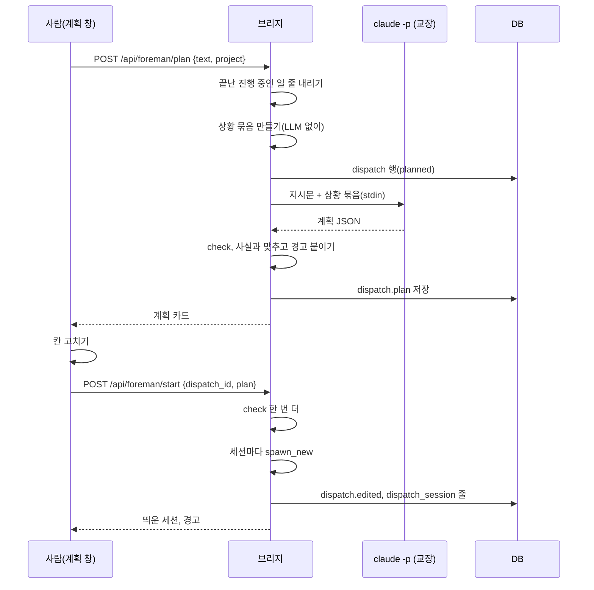

<!--
다루는 곳: bridge/foreman.py, bridge/api/foreman.py, bridge/static/js/foremanchat.js, migrations/0016_foreman_dispatch.sql, migrations/0030_dispatch_session.sql, migrations/0029_seed_ronanlab_infra.sql, bridge/scribe_room.py, bridge/docrefs.py
읽은 커밋: aaa2de7
-->

# 계획 한 번

사람이 FOREMAN에게 세션을 띄워 달라고 할 때 실제로 하는 말은 짧다. 「런슈즈 발볼 검증 이어서」, 「빌드 터진 거 봐줘」, 「포스트잇 두 장 코더 둘로 띄워」. 그런데 이 한 줄을 세션으로 바꾸려면 정할 것이 많다. 어느 프로젝트인가, 이미 같은 일을 하는 세션이 살아 있지는 않은가, 끝난 세션의 일을 이어 가는 것이라면 그 세션의 인계 요약을 붙일 것인가, 역할은 코더인가 조사인가, 원본 폴더에서 띄울 것인가 작업방에서 띄울 것인가, 그리고 새 세션에게 첫 글로 무엇을 넣어 줄 것인가. 처음에는 이것을 사람이 [+ 세션] 창에서 칸마다 직접 골랐다 [docs:11_foreman_dispatch.md]. 앞의 두 예는 지금 계획 창 입력 칸의 자리표시 글에도 그대로 들어 있다 [code:bridge/static/js/foremanchat.js].

이 편은 그 결정을 대신 내려 주는 장치, 코드 이름으로 **디스패처**를 다룬다. 화면에서는 감독실에 서 있는 캐릭터가 이 장치의 얼굴이다. 테마마다 이름이 달라 오피스 테마에서는 팀장, 마법학교 테마에서는 교장, 현장 테마에서는 소장이라고 부르고, 테마에 이름이 없으면 감독이라고 쓴다 [code:bridge/static/js/foremanchat.js]. 이 글에서는 화면 말을 따라 주로 교장이라고 부른다. 교장은 세션이 아니다. 사람이 부를 때마다 `claude -p`를 한 번 돌려 계획 하나를 받아 오고 끝난다. 계획은 사람이 보고 고친 뒤 [이대로 시작]을 눌러야 세션이 된다.

교장이 왜 상주하지 않는지, 관리자와 어떻게 일을 나누는지는 → 「09 교장과 관리자」에서 다룬다. 계획에 함께 실리는 진행 중인 일과 실패가 교장을 깨우는 자동 기상은 → 「진행 중인 일과 자동 기상」, 두 세션이 같은 파일을 만질 때 턴마다 울리는 알림은 → 「겹침 알림」, 계획을 관리자에게 넘기는 단추는 → 「관리자에게 넘기기와 보고」에서 다룬다. 이 편은 계획 한 번이 어떻게 만들어지고, 어떻게 확인되고, 어떻게 세션이 되는지를 처음부터 끝까지 따라간다 [docs:14_dispatcher_note_wake.md].

## 한 번의 흐름



한 번의 계획은 다섯 단계로 나뉜다. 브리지가 지금 상황을 글로 모으고(상황 묶음), 그것을 지시문과 함께 `claude -p`에 넣어 JSON 계획을 받고, 받은 계획을 DB와 파일의 실제 상태에 맞춰 고친 뒤 경고를 붙이고(check), 사람이 화면에서 칸을 고치고, [이대로 시작]을 누르면 다시 한 번 check를 거쳐 세션을 띄운다 [code:bridge/foreman.py]. 두 번째 check가 있는 것은 사람이 계획을 받아 놓고 몇 분 뒤에 누를 수 있어서다. 그 사이 세션이 끝났거나 다른 계획이 같은 파일을 잡았을 수 있다.

## 상황 묶음: LLM 없이 브리지가 모은다

교장이 판단하려면 지금 상황을 알아야 한다. 이 상황을 교장 스스로 찾아보게 하는 길도 있었다. 도구를 열어 주고 「알아서 살펴보고 정해라」라고 하는 방식이다. FOREMAN은 그 길을 택하지 않고, 브리지가 LLM 없이 기계적으로 상황을 모아 한 덩어리의 글로 넣는다. 이 덩어리를 **상황 묶음**이라고 부른다 [docs:11_foreman_dispatch.md].

까닭은 셋이다. 첫째, 매번 같은 재료를 보게 해야 판단이 재현된다. 같은 요청과 같은 상황 묶음이면 같은 판단이 나와야 틀렸을 때 무엇이 틀렸는지 따질 수 있다. 둘째, 교장이 쓸 수 있는 도구는 Read, Grep, Glob뿐이라 프로세스, tmux 화면, DB를 볼 수 없다. 살아 있는 세션 목록이나 인계 요약은 DB에 있으니 브리지가 넣어 줘야 한다. 셋째, 토큰과 시간이다. 교장이 매번 저장소를 훑게 하면 그만큼 도구 호출이 늘어 느려지고 토큰도 더 든다. 브리지가 모으는 일은 git 명령 몇 번과 DB 조회, 바뀐 파일 다시 읽기뿐이다.

묶음을 직접 보고 싶으면 `GET /api/foreman/context?text=…&project=…`를 부른다. 교장에게 실제로 넣는 것과 같은 글과 그 글자 수를 돌려준다. 교장이 이상한 판단을 냈을 때 「무엇을 보고 그랬는가」를 확인하는 창이다 [code:bridge/api/foreman.py].

### 묶음에 들어가는 것

묶음은 맨 위 몇 줄과 프로젝트마다의 절, 맨 아래 파이프라인 절로 이루어진다. 아래 표는 코드가 실제로 넣는 순서와 크기 제한이다 [code:bridge/foreman.py].

| 무엇 | 어디서 읽나 | 크기 제한 | 어느 프로젝트에 |
|---|---|---|---|
| 지금 시각, 요청 글 | 시계, 요청 | 없음(요청은 API가 4000자까지 받는다) | 맨 위 한 번 |
| 어느 방에서 말했나 | 계획 창의 방 | 한 줄 | 방이 정해졌을 때 |
| 서버 공통 경로 | `docs/operations.md` 「1.」 절 | 파일 앞 8000자에서 찾은 절 | 맨 위 한 번, 늘 |
| 저장소, 브랜치, 커밋 안 한 파일 수, 최근 커밋 5개 | `git` | 커밋 한 줄 140자 | 모든 프로젝트 |
| CLAUDE.md 전문 | 저장소 맨 위 | 앞 6000자 | 자세히 볼 프로젝트 |
| 메모리 색인 | `~/.claude/projects/<저장소 경로>/memory/MEMORY.md` | 앞 4000자 | 자세히 볼 프로젝트 |
| docs 목록 | `docs/*.md`의 파일 이름과 첫 제목 | 파일 60개, 제목 100자 | 자세히 볼 프로젝트 |
| 압축 손실 점검 파일 | `log/<프로젝트>_compaction_loss_*.md` 가운데 마지막 | 경로 한 줄 | 자세히 볼 프로젝트, 있을 때 |
| 진행 중인 일 | `foreman_note` 표 | 약 2000토큰, 넘치는 줄은 접힌다 | 자세히 볼 프로젝트 |
| 지난 디스패치 | `dispatch` 표 | 시작했거나 버린 것 5건, 요청 160자 | 자세히 볼 프로젝트 |
| 세션 | `character_session`, `turn`, `event` | 최근 25개 가운데 살아 있거나 48시간 안 | 모든 프로젝트 |
| 세션마다 최근 사람 요청과 답 | `turn`, `event` | 요청 3개, 각 220자 | 위 세션마다 |
| 세션마다 최신 인계 요약 | `summary`(status ok) | 앞부분 600자 | 위 세션마다, 있을 때 |
| 파이프라인 | 파이프라인 관리자의 스냅숏 | 프로젝트마다 마지막 빌드 한 줄 | 맨 아래 한 번 |

CLAUDE.md, MEMORY.md, docs 파일은 파일의 수정 시각(mtime)을 기억해 두고 바뀐 것만 다시 읽는다 [code:bridge/foreman.py]. 설계할 때 잰 docs 폴더 크기만 해도 런슈즈 193KB, 펫퍼민트 495KB였다. 지금 등록된 프로젝트는 넷이라 [code:migrations/0029_seed_ronanlab_infra.sql] 매번 읽으면 느리고, 같은 글이 그대로 들어가면 프롬프트 캐시(앞부분이 같으면 다시 계산하지 않는 API 기능)도 잘 먹는다 [docs:11_foreman_dispatch.md].

### 무엇을 넣지 않았나

설계 때 가장 먼저 바로잡은 사실이 있다. 새 CC 세션은 자기 작업 폴더의 CLAUDE.md와 메모리 색인을 스스로 읽는다. 그러니 교장이 그 내용을 새 세션의 첫 글에 다시 옮겨 줄 필요는 없다. 교장이 넣어야 하는 것은 **세션이 스스로 볼 수 없는 것**이다. 이번 일에 맞는 docs 위치, 이어 갈 세션의 인계 요약, 압축 중에 잃은 결정, 지금 다른 세션과 파이프라인의 상태가 그것이다 [docs:11_foreman_dispatch.md]. 지시문도 이 점을 못 박는다. 첫 글에 「먼저 읽을 문서 경로」는 쓰되 「CLAUDE.md와 메모리 색인은 스스로 읽으니 다시 옮기지 마라」고 쓰고, 인계 요약 본문은 넣지 말고 번호만 고르라고 한다. 번호를 고르면 브리지가 띄울 때 요약을 첫 글 뒤에 붙인다 [code:bridge/foreman.py].

그래서 묶음 안의 CLAUDE.md와 메모리 색인은 교장이 판단하는 데 쓰는 재료이지 새 세션에 건넬 짐이 아니다. 메모리는 색인 한 줄 목록만 넣는다. 본문이 필요하면 교장이 Read로 그 파일을 연다. docs도 제목 목록만 넣고 본문은 Read로 읽게 했다. 교장이 쓰는 도구가 읽기 셋으로 정해진 까닭이 여기에 있다.

### 자세히 볼 프로젝트 고르기

프로젝트가 넷이면 묶음도 넷 몫으로 커진다. 그래서 요청 글에 프로젝트 이름이 나오면 그 프로젝트만 자세히 넣고 나머지는 저장소 줄과 세션 목록만 넣는다(「요약만」 표시). 이름은 영문 이름, 앞부분(`petmint-rag-chatbot`이면 `petmint`), 화면 이름표(런슈즈, 펫퍼민트), 별명으로 찾는다 [code:bridge/foreman.py]. 처음에는 영문 이름으로만 찾아 「런슈즈」라고 쓴 요청이 걸리지 않았고, 화면 대응표로 한국어 이름도 찾게 고쳤다 [log:stage11_foreman_dispatch_result.md]. 화면 이름표가 FOREMAN으로 바뀐 뒤에도 사람은 여전히 「포먼」이라고 쓰므로 FOREMAN에는 별명 셋(포먼, FOREMAN, Foreman)을 붙여 두었다 [code:bridge/foreman.py].

사람이 감독실 캐릭터를 눌러 어느 방에서 말하면 이름이 요청에 없어도 그 방의 프로젝트가 정해진다. 묶음 위에 「사람이 런슈즈(runshoes) 방에서 말했다. 다른 프로젝트라는 근거가 없으면 이 프로젝트」라는 줄이 들어간다. 어느 이름도 걸리지 않으면 모든 프로젝트를 자세히 넣는다 [code:bridge/foreman.py].

### 세션 줄이 판단을 바꾼 일

묶음에서 가장 비싼 재료는 세션마다의 최근 사람 요청과 답 앞부분이다. 처음 만든 날 이 칸이 없었다. 「런슈즈 발볼 검증 이어서」를 넣자 상황 묶음 6.2k자로 20초 만에 「새로 시작」이 나왔다. 세션 156이 바로 그 검증을 하고 있다는 것을 몰랐던 것이다. 세션 제목만으로는 이어 할 일인지 새 일인지 가를 수 없었다. 세션마다 최근 사람 요청 셋과 그 답 앞부분을 넣자 묶음이 11.4k자로 커졌고, 19초 만에 「세션 156에 보내기」를 확신도 0.85로 골랐다. 근거로 그 세션의 타이머 이름과 남은 43켤레를 들었다 [log:stage11_foreman_dispatch_result.md]. FOREMAN이 있어야 하는 까닭으로 꼽는 「이미 같은 일을 하는 세션을 알아챈다」가 이 칸에서 나온다 [repo:CLAUDE.md].

세션 줄에는 상태도 붙는다. 살아 있는지, Ctrl+Z로 멈춰 있는지, 끝났는지, 그리고 살아 있다면 tmux 안이라 입력을 넣을 수 있는지 밖이라 못 넣는지를 적는다 [code:bridge/foreman.py]. 「살아 있는 세션에 보내기」는 tmux 안 세션에만 할 수 있어서 이 표시가 없으면 교장이 보낼 수 없는 곳으로 보내자고 한다.

### 서버 공통 경로를 늘 넣는 까닭

`docs/operations.md`의 「1.」 절(클러스터 VM, 매니페스트, 저장소 위치, 접속 방법)은 어느 프로젝트 일이든 묶음 맨 위에 늘 들어간다. 이 표는 원래 FOREMAN CLAUDE.md에 있었는데, CLAUDE.md를 정리하면서 operations.md로 옮겨 갔다. 그 뒤 「펫퍼민트 파드 보기」처럼 FOREMAN 이름이 없는 요청은 FOREMAN CLAUDE.md를 묶음에 싣지 않으니 클러스터에 들어가는 법이 첫 글에서 빠졌다. 사실 정리 전에도 같은 까닭으로 빠지고 있었다. 그래서 이 절만 따로 뽑아 늘 넣는다 [code:bridge/foreman.py] [c:7f714a1].

## 교장 부르기

묶음이 만들어지면 브리지는 `dispatch` 표에 행 하나를 `planned`로 먼저 만들고 교장을 부른다. 행을 먼저 만드는 것은 실패해도 기록이 남게 하려는 것이다 [code:bridge/foreman.py].

```
claude -p --model sonnet --output-format json --no-session-persistence
  --settings '{"disableAllHooks": true}'
  --allowedTools Read,Grep,Glob
  --disallowedTools Bash,Edit,Write,NotebookEdit,WebFetch,WebSearch,Agent
  --add-dir <프로젝트 저장소> …
```

모델은 Sonnet이다. 계획은 읽고 고르는 일이고 사람이 다시 보므로 가장 비싼 모델이 필요하지 않다. 훅을 끈 것은 교장의 Read 하나하나가 FOREMAN 자신의 hook으로 들어와 세션처럼 적재되지 않게 하려는 것이고, `--no-session-persistence`는 트랜스크립트 파일을 남기지 않게 한다. 트랜스크립트가 없으니 사용량은 `--output-format json`의 결과에서 직접 읽어 남긴다(→ 「13 사용량과 모델」) [code:bridge/foreman.py]. 작업 폴더는 어느 프로젝트도 아닌 `~/.foreman/dispatch`이고, 저장소들은 `--add-dir`로 읽기만 열어 준다.

프롬프트는 인자가 아니라 표준 입력으로 보낸다. 처음에 인자로 넣었더니 `--add-dir`가 값을 여러 개 받는 옵션이라 뒤의 프롬프트까지 폴더 이름으로 삼켜 버렸다 [log:stage11_foreman_dispatch_result.md]. 시간은 180초까지 기다린다. 보통은 20초 안팎이다. 실제 기록으로 런슈즈 방의 「발볼 검증 이어서」가 16.7초, 묶음 19,910자였다 [log:stage14_dispatcher_note_wake_result.md].

### 다시 받기는 앞 계획을 끊는다

사람이 계획을 기다리다 요청을 고쳐 [계획 받기]를 다시 누르는 일이 잦다. 그러면 앞 요청의 `claude -p`가 그대로 돌아 토큰을 쓰고, 늦게 도착한 앞 계획이 새 계획을 덮어 화면에 뜰 수도 있었다. 지금은 같은 방에서 사람이 계획을 또 받으면 아직 도는 앞 계획의 `claude -p` 프로세스를 PID로 끊는다. 이름 패턴으로 프로세스를 찾지 않는 것은 그 패턴이 엉뚱한 프로세스에 걸릴 수 있어서다. 끊긴 계획은 `replaced` 상태와 「다시 받기로 끊었습니다」로 남고, 끊기 직전에 돌아온 결과도 번호를 보고 버려 화면과 사용량 기록에 섞이지 않는다. 자동 기상이 만든 계획과 다른 방의 계획은 끊지 않는다 [code:bridge/foreman.py] [c:2a5ebeb].

## 계획의 칸

교장은 아래 모양의 JSON 하나만 json 코드 블록으로 답한다. 자유 대화가 아니다. 되물을 것이 있으면 대화로 묻지 않고 계획의 `questions` 칸에 적는다 [code:bridge/foreman.py].

```json
{"project": "foreman", "mode": "new", "base_session": null, "summary_id": null, "attach_session": null,
 "sessions": [{"role": "coder", "read_only": false, "title": "…", "first_prompt": "…",
               "files": ["bridge/x.py"], "merge_order": 1}],
 "reasons": ["…"], "confidence": 0.8, "questions": [], "note_updates": []}
```

| 칸 | 뜻 | 교장이 정하나 | 브리지가 맞추는 것 |
|---|---|---|---|
| `project` | 어느 프로젝트에서 할지 | 정한다. 모호하면 `ask` | 목록에 없으면 경고 붙이고 `ask` |
| `mode` | `new`(새 일), `handoff`(끝난 세션 이어 가기), `attach`(살아 있는 세션에 보내기), `ask`(되묻기) | 정한다 | 모르는 값은 `new`. 요약이 없는 `handoff`, 보낼 곳이 없는 `attach`는 `new` |
| `summary_id` | 이어 갈 세션의 인계 요약 번호 | `handoff`일 때 | 없거나 다른 프로젝트 것이거나 ok가 아니면 비우고 경고 |
| `attach_session` | 보낼 세션 번호 | `attach`일 때 | 끝났거나 멈췄거나 tmux 밖이면 비우고 `new`나 `handoff`로 |
| `sessions[].role` | 역할 다섯 가운데 하나 | 정한다 | 모르는 값은 코더 |
| `sessions[].model` | 모델 | 정하지 않는다 | 사람이 고른 값이 목록에 있으면 그것, 아니면 역할 기본값 |
| `sessions[].read_only` | CC 읽기 전용 모드로 띄울지 | 보통 false | 조사 역할이면 프로젝트에 따라 정한다(아래) |
| `sessions[].title` | 세션 이름, 짧은 한국어 | 정한다 | 120자까지 |
| `sessions[].first_prompt` | 새 세션에 넣을 첫 글 | 정한다 | 12000자까지 |
| `sessions[].worktree` | 작업방에서 띄울지 | 정하지 않는다 | 살아 있는 세션이 있거나 둘째 세션이면 켬, 관리자는 늘 끔 |
| `sessions[].files` | 맡을 파일 | 알면 적는다 | 저장소 기준 상대 경로만 40개까지, 겹침 검사 |
| `sessions[].merge_order` | 합칠 순서 | 여럿이고 겹칠 때 | 없으면 계획 안 순서 |
| `sessions[].task` | 서기 일 종류(doccheck, trim, later, docfix, portfolio, techdoc). 지시문은 이 목록을 서기실 일 목록 한 곳(`bridge/scribe_room.py`)에서 가져오고, 세션이 아니라 버튼인 게시(publish)만 뺀다 | 서기일 때 | 꼴이 맞지 않으면 버린다 |
| `reasons` | 판단 근거 | 정한다 | 그대로 |
| `confidence` | 확신도 0~1 | 정한다 | 그대로, 0.7 아래면 카드에서 근거를 펼쳐 둔다 |
| `questions` | 사람에게 물을 것 | 정한다 | 그대로 |
| `note_updates` | 진행 중인 일 고치기 제안 | 정한다 | 지금 줄과 맞추고 없는 줄 제안은 뺀다 |

교장이 고르지 않는 칸이 둘 있다는 점이 눈여겨볼 대목이다. 모델과 작업방이다. 모델을 교장에게 맡기면 「이 일은 더 좋은 모델이 필요하다」는 판단이 역할을 바꾸는 핑계가 된다. 실제로 지시문에 「모델이 더 필요하다고 코더로 고르지 마라(모델은 사람이 카드에서 고른다)」라는 줄이 들어가 있다 [code:bridge/foreman.py]. 작업방은 지금 그 저장소에 살아 있는 세션이 있느냐로 기계가 정할 수 있는 일이라 LLM에 맡길 까닭이 없다.

역할마다 무엇을 맡는지를 교장에게 알려 주는 한 줄 설명은 지시문에 직접 쓰지 않고 역할 값이 모인 한 곳에서 만들어 넣는다. 화면의 역할 고르기 칸에 보이는 글과 같은 글이다. 역할 다섯이 각각 무엇을 하는지, 그리고 교장 지시문에 덧붙인 역할별 판단 규칙(디자이너와 코더가 걸칠 때 코더를 먼저 내는 것 등)은 → 「역할 다섯」에서 다룬다.

### 조사 세션의 읽기 전용

조사는 고치지 않는 역할이라 원래 CC 읽기 전용 모드(`--permission-mode plan`)로 띄웠다. 그런데 이 모드에서는 결과 log 하나를 쓰는 데도 계획 승인이 필요해 관리자가 조사를 피하고 코더로 띄웠다. 지금은 브리지가 그 프로젝트에서 「조사는 log만 쓴다」를 실제로 막고 있으면 읽기 전용을 끄고 보통 모드로 띄운다. 막지 않는 프로젝트에서는 예전처럼 읽기 전용으로 켜고 「역할이 조사라 읽기 전용으로 시작합니다」 경고를 붙인다. 자동 기상이 만든 계획은 막는 프로젝트여도 늘 읽기 전용이다. 사람이 자는 사이에 log 커밋이라도 쌓이지 않게 하려는 것이다. 사람이 카드에서 읽기 전용 칸을 직접 바꿨으면 그 값을 그대로 둔다 [code:bridge/foreman.py]. 막는 방법 자체는 → 「글이 아니라 권한으로」에서 다룬다.

### 첫 글은 바로 시작하게 쓴다

첫 글의 끝에는 원래 「이해한 것을 5줄 안으로 말하고 확인을 기다려라」를 붙였다. 새 세션이 엉뚱하게 이해했으면 사람이 거기서 멈추게 하려는 것이었다. 그런데 사람은 이미 계획 카드에서 첫 글을 읽고 고쳤다. 같은 확인을 두 번 하는 셈이었고, 다섯 줄 요약을 보고 되돌린 일은 한 번도 없었다. 그래서 뺐다. 지금 지시문은 그런 말을 붙이지 말라고 하고, 인계 요약을 붙일 때도 요약 글의 「확인을 기다려라」를 「바로 시작하라」로 바꿔 넣는다 [code:bridge/foreman.py] [docs:11_foreman_dispatch.md] [c:9358735]. 다만 일하는 중에 사람이 정해야 할 것, 예를 들어 운영 DB 적재나 push에서 멈추라는 말은 첫 글의 「지켜야 할 것」에 그대로 둔다.

코더 세션이면 브리지가 첫 글 끝에 한 절을 더 붙인다. 고친 코드를 가리키는 문서도 함께 고치라는 사용자 문장, 어느 문서가 걸리는지 찾는 명령, 저장소마다 다른 규칙을 보는 곳, 모든 저장소가 같이 쓰는 원고 쓰는 기준이다. 사람 승인으로 정한 문서(README.md, CLAUDE.md 같은)를 고치면 합치기 카드가 사람에게 가고, 고치지 못한 문서는 마지막 보고에 무엇이 걸리는지 적으라는 줄도 함께 들어간다. FOREMAN이 아닌 저장소면 찾는 명령이 FOREMAN 도구를 그 저장소에 대고 읽기만 하는 꼴로 바뀌고, 규칙은 그 저장소의 CLAUDE.md와 style_guide를 따르라고 적는다 [code:bridge/docrefs.py] [code:bridge/handoff.py] [code:bridge/manuscript_rules.py]. 이 절은 역할 값이 모인 곳에서 코더 한 역할에만 붙게 정해져 있고, 디자이너와 조사에는 붙지 않는다 [code:bridge/roles.py]. 교장 지시문은 이 규칙을 first_prompt에 옮기지 말고, 코드 고침 뒤 그 문서만 맞추는 서기 세션을 따로 내지 말라고 적는다 [code:bridge/foreman.py]. 코드를 고친 세션이 까닭을 가장 잘 알기 때문이다(→ 「05 역할과 권한」).

## check: 계획을 사실에 맞춘다

교장의 답은 그대로 쓰지 않는다. 브리지가 DB와 파일과 프로세스를 보고 사실과 다른 곳을 고친다 [code:bridge/foreman.py]. 없는 프로젝트를 고르면 `ask`로 바꾸고 「모르는 프로젝트 '…'입니다. 사람이 골라 주세요」를 붙인다. 다른 프로젝트의 인계 요약을 고르면 비운다. 이미 끝났거나 tmux 밖인 세션에 보내자고 하면 새로 띄우기로 바꾼다. 바꾼 것마다 경고 한 줄을 붙이고, 이 경고는 카드 맨 위 노란 상자에 뜬다.

경고에 무엇을 올릴지에는 원칙이 있다. 사람이 알아야 할 것, 곧 계획이 바뀌었거나 사람이 골라야 할 것만 올린다. 브리지가 교장의 답을 다듬은 내부 처리는 로그로만 남긴다. 이 원칙은 사용자의 한마디에서 나왔다. 진행 중인 일 제안의 출처 칸이 비어 「이번 요청」으로 바꿨다는 글이 카드에 두 번 떴는데, 사용자는 무슨 소리인지 모르겠다며 내부 처리면 빼라고 했다 [log:plan_dialog_escape_retry_20261109.md]. 지금 코드에는 모르는 방식을 `new`로 바꾼 것, 노트 제안의 출처를 채운 것 같은 다듬기가 모두 로그로만 간다 [code:bridge/foreman.py].

check는 계획을 받을 때, 저장된 계획을 다시 열 때, [이대로 시작]을 누를 때 세 번 돈다. 그때마다 지난번에 브리지가 붙인 경고는 빼고 새로 붙인다(`auto_warnings`). 겹침이 풀렸으면 경고가 사라지고, 같은 경고가 쌓이지도 않는다 [code:bridge/foreman.py].

## 사람이 고쳐 [시작]

계획은 사람이 승인하기 전에는 아무것도 시작하지 않는다. 틀린 계획은 화면에서 끝나고, 그 비용은 그 요청에 든 토큰뿐이다 [docs:11_foreman_dispatch.md]. 카드의 모든 칸은 고칠 수 있다. 프로젝트를 바꾸면 쓸 수 있는 인계 요약 목록도 그 프로젝트 것으로 바뀐다 [code:bridge/static/js/foremanchat.js].

[이대로 시작]을 누르면 화면은 고친 계획 전체를 `POST /api/foreman/start`로 보낸다. 브리지는 그 계획이 아직 `planned`인지 보고(이미 시작했거나 버렸거나 다시 받기로 끊긴 계획이면 그 까닭으로 거절), check를 다시 돌리고, `ask`면 「되묻는 계획입니다」로 거절하고, 켠 세션이 없거나 첫 글이 비었으면 거절한다. 통과하면 방식에 따라 살아 있는 세션의 입력 칸에 첫 글을 넣거나(`attach`), 세션마다 차례로 새 세션을 띄운다 [code:bridge/foreman.py]. 띄우는 몸(tmux 창, `claude` 명령, 세션 행, 첫 글 넣기)은 [+ 세션]과 같은 함수다(→ 「06 세션 띄우기와 따로 작업」).

시작이 끝나면 사람이 고친 계획 전체가 `dispatch.edited`에, 세션마다의 결과가 `dispatch_session`에 남는다. 진행 중인 일 고치기 제안도 사람이 켠 것만 같은 트랜잭션으로 반영된다. 포스트잇에서 연 계획이면 뜬 세션이 그 포스트잇을 가져간다(→ 「포스트잇」) [code:bridge/foreman.py].

### 교장의 계획과 사람이 고친 것을 함께 남기는 까닭

`dispatch` 표에는 교장이 낸 원래 계획(`plan`)과 사람이 고쳐 시작한 계획(`edited`)이 따로 들어간다 [code:migrations/0016_foreman_dispatch.sql]. 표를 만든 목적이 교장이 자주 틀리는 유형을 찾아 상황 묶음이나 지시문을 고치는 것이었기 때문이다. 이 기록은 다음 계획에도 쓰인다. 묶음의 「지난 디스패치」 칸이 그 프로젝트에서 시작했거나 버린 계획 다섯 건을 「요청 → 방식, 역할, 이름 → 시작함, 사람이 고침: …」 꼴로 보여 주고, 위에 「같은 실수를 되풀이하지 마라」를 붙인다 [code:bridge/foreman.py]. 교장은 상주하지 않아 지난 대화를 기억하지 못하지만, 사람이 고친 흔적을 매번 다시 읽는 셈이다.

| `dispatch.status` | 뜻 |
|---|---|
| `planned` | 계획만 나왔다. [이대로 시작]을 기다린다 |
| `started` | 시작했다 |
| `failed` | 교장 호출이 실패했거나 바로 띄우기가 실패했다 |
| `discarded` | 사람이 [버리기]를 눌렀다 |
| `replaced` | 같은 방에서 다시 받기로 끊겼다 |

`dispatch.origin`은 계획이 어디서 왔는지다. `human`은 사람이 계획 창에서 말한 것, `wake`는 실패 이벤트가 부른 것이다 [code:bridge/foreman.py]. 여기에 `spawn`(계획 없이 [+ 세션]이나 API로 바로 띄움)과 `move`(새 세션으로 옮기기)가 더해졌고, 서기실 [시키기]는 `scribe`로 남는다 [code:migrations/0030_dispatch_session.sql] [docs:11_foreman_dispatch.md].

### 계획을 거치지 않은 띄우기도 남긴다

처음에는 교장 계획으로 띄운 세션만 `dispatch`에 남았다. 관리자가 `POST /api/spawn`으로 서기 세션을 바로 띄우자 그 세션에는 기록이 없었다 [docs:11_foreman_dispatch.md]. 맡을 파일 겹침이나 지난 디스패치처럼 이 표를 읽는 기능은 기록이 빠진 세션을 보지 못한다. 그래서 지금은 바로 띄우기와 새 세션으로 옮기기도 계획 카드와 같은 모양(세션 한 칸짜리 계획)으로 `dispatch`와 `dispatch_session`에 한 줄을 남긴다. 기록이 실패해도 띄운 세션은 되돌리지 않는다. 대신 응답 글과 텔레그램으로 한 번 알린다. 기록이 조용히 빠지지 않게 하려는 것이다 [code:bridge/api/foreman.py] [c:9bac043].

## 한 계획에 여러 세션

처음 계획은 세션 하나만 담았다. 관리자가 교장에게 「worktree 세션 둘을 띄워줘라」라고 하자 교장은 계획 하나를 내면서 이유 칸에 「한 세션만 담는다 … 알림 세션은 따로 한 번 더」라고 적었고, 다시 물어 시작한 결과도 세션 하나만 떴다 [log:dispatch_flow_decision_20261109.md]. 모양이 하나뿐이니 교장도 어쩔 수 없었다.

지금 계획에는 `sessions` 목록이 있고 최대 여섯까지 담는다. 세션마다 역할, 모델, 이름, 첫 글, 읽기 전용, 작업방, 맡을 파일, 합칠 순서, 켬을 따로 갖는다 [code:bridge/foreman.py]. 교장에게는 기본은 하나이고, 여럿은 사람이 개수를 말했거나 큰 일을 맡을 파일이 겹치지 않게 나눠 동시에 하는 것이 분명히 나을 때만 내라고 한다. 여럿이면 세션끼리 맡을 파일이 겹치지 않게 나누고, 각 첫 글에 맡을 파일과 「맡은 파일 밖은 고치기 전에 멈추고 묻는다」를 적게 한다. 보내기(`attach`)는 보낼 곳이 하나라 세션 하나만 된다 [code:bridge/foreman.py].

[이대로 시작]은 켠 세션을 차례로 띄운다. 둘째부터는 첫 세션이 살아 있게 되니 작업방을 기본으로 켠다. 관리자는 예외로 늘 원본 폴더다. 인계 요약은 첫 세션에만 붙는다. 첫 세션이 못 뜨면 아무것도 띄우지 않은 것이라 그대로 거절하고, 계획은 `planned`로 남아 다시 누를 수 있다. 둘째부터 못 뜨면 이미 띄운 세션은 그대로 두고, 화면에 「세션 2「…」은 띄우지 못했습니다(…). 띄운 세션은 그대로 둡니다」를 띄우고 텔레그램으로 한 번 알린다 [code:bridge/foreman.py] [code:bridge/api/foreman.py]. 하나만 조용히 뜨고 끝나면 사람은 둘이 떴다고 믿기 때문이다.

### 옛 계획과 옛 카드

여러 세션을 들이면서 옛 모양도 그대로 읽히게 했다. 계획 맨 위에도 `role`, `title`, `first_prompt` 같은 칸이 남아 있고 늘 첫 세션과 같은 값으로 맞춘다. `sessions`가 없는 옛 계획은 위쪽 칸으로 세션 하나를 만든다. 위쪽 칸만 고쳐 보내는 옛 카드라면 위쪽 칸이 첫 세션을 이기고, 세션마다 고치는 지금 카드는 `sessions_edit: true`를 붙여 세션 칸을 믿게 한다 [code:bridge/foreman.py]. 이 겹친 칸 때문에 생긴 실수가 하나 있다. 관리자가 계획의 지시문이나 모델을 바꿀 때 `sessions[0]`만 고치고 `sessions_edit`를 붙이지 않으면 위쪽 칸의 옛 값이 이긴다. 그래서 관리자는 둘 다 고친다.

### dispatch_session

세션마다의 결과는 `dispatch_session` 표에 한 줄씩 남는다. 같은 정보가 계획 JSON 안에도 있지만, 살아 있는 세션의 맡을 파일을 찾을 때마다 JSON을 풀지 않으려고 표로 옮겨 둔다 [code:migrations/0030_dispatch_session.sql].

| 칸 | 뜻 |
|---|---|
| `dispatch_id`, `idx` | 어느 계획의 몇 번째 세션(둘을 묶어 하나뿐) |
| `role`, `model`, `title` | 띄운 역할, 모델, 이름 |
| `files` | 맡을 파일, JSON 배열 |
| `merge_order` | 합칠 순서, 작은 것 먼저 |
| `status` | `started`(띄움), `failed`(못 띄움), `off`(사람이 끔) |
| `session_id`, `cwd` | 뜬 세션 번호와 작업 폴더 |
| `error` | 못 띄운 까닭 |

이 표는 더하기만 하는 마이그레이션이라 되돌릴 때는 표를 지우면 되고, 그 전 코드는 이 표를 몰라도 돈다 [code:migrations/0030_dispatch_session.sql].

## 맡을 파일 겹침

세션 둘이 같은 파일을 고치면 합칠 때 충돌한다. 충돌은 합치는 순간에야 드러나고, 그때는 두 세션의 일이 이미 끝난 뒤다. 그래서 띄우기 전에, 계획 단계에서 겹침을 본다. 이 검사가 `file_conflicts`다 [code:bridge/foreman.py].

맡을 파일은 저장소 기준 경로로 적는다. 폴더는 끝에 `/`를 붙이고, `*` 같은 글롭도 된다. 절대 경로나 `..`이 든 경로는 버린다 [code:bridge/foreman.py]. 두 목록이 겹치는지는 `files_overlap`이 본다. 같은 경로이거나, 한쪽이 폴더이고 다른 쪽이 그 안에 있거나, 한쪽이 글롭이고 다른 쪽이 거기 걸리면 겹친다. 경고에 보일 이름은 더 구체적인 쪽을 고른다. `bridge/`와 `bridge/foreman.py`가 겹치면 `bridge/foreman.py`를 보인다.

겹침을 맞대는 상대는 넷이다.

| 상대 | 어디서 아나 | 경고 글 |
|---|---|---|
| 이 계획의 다른 세션 | 계획 안 `sessions` | 이 계획의 세션 N「…」과 겹칩니다 |
| 다른 세션이 맡은 파일 | `dispatch_session`(14일 안에 띄워 지금 살아 있는 세션, 또는 합치지 않은 작업방이 남아 있는 세션)과 서기실의 열린 일 | 살아 있는 세션, 합치지 않은 세션, 열려 있는 서기 세션 N「…」이 맡은 파일과 겹칩니다 |
| 살아 있는 세션이 이미 고치고 있는 파일 | 그 세션 작업 폴더의 git 변경(바탕 뒤, 커밋 안 한 것 포함) | 살아 있는 세션 N「…」이 이미 고치고 있는 파일과 겹칩니다 |
| 아직 시작하지 않은 다른 계획 | 하루 안 `planned` 계획 20건 | 아직 시작하지 않은 계획 #N의 맡을 파일과 겹칩니다 |

셋째 줄이 중요하다. 맡을 파일을 적지 않고 뜬 세션도 있고, 맡은 파일 밖을 고친 세션도 있다. 그런 세션은 적어 둔 목록으로는 잡히지 않으니 그 작업 폴더의 git 변경을 직접 읽는다. 바탕은 그 작업 폴더와 원본 폴더 HEAD의 갈림점(`git merge-base`)이고, 그 저장소에 살아 있는 세션 가운데 앞 8개까지만 읽는다. 한 세션의 변경을 git으로 읽지 못하면 「살아 있는 세션 N이 고치고 있는 파일을 git으로 읽지 못했습니다」를 붙인다 [code:bridge/foreman.py]. 이 줄로 맡을 파일 겹침을 처음 실제로 잡았다. 한 코더 세션이 도는 동안 다른 계획이 `tests/test_terminal.py`를 맡겠다고 하자 경고가 떴다 [docs:11_foreman_dispatch.md].

둘째 줄의 「열려 있다」는 서기실과 같은 판단을 쓴다. 합치거나 버리기 전이면 열려 있다. 작업방 세션은 그 폴더가 남아 있는 동안, 원본 폴더 세션은 끝나기 전까지다. CC가 끝나도 합치지 않은 작업방은 합칠 때 충돌하니 겹침에 넣는다. 처음에는 합치기 기록이 있는지만 봤는데, 기록 없이 지운 작업방이 영영 열린 채로 남아 헛경보를 냈다. 그래서 폴더가 실제로 있는지도 본다 [code:bridge/foreman.py].

겹침은 막지 않고 경고만 한다. 사람이 일부러 나눠 시킬 수도 있고, 겹쳐도 합칠 순서를 정하면 풀 수 있는 일도 있어서다. 대신 겹침 검사 자체가 실패하면(마이그레이션 전 DB, git이 응답하지 않음) 「보지 못했습니다」 경고를 따로 붙인다. 겹침이 없는 것과 보지 못한 것을 사람이 같은 것으로 읽지 않게 하려는 것이다 [code:bridge/foreman.py]. FOREMAN이 무엇을 만들든 먼저 묻는 질문, 막히거나 틀어지면 스스로 알리는가에 대한 이 검사의 답이 이 한 줄이다.

[+ 세션]에서 계획 없이 바로 띄울 때도 「맡을 파일」 칸을 적으면 띄운 뒤 같은 검사를 돌려 결과 글에 노랗게 붙인다 [code:bridge/api/foreman.py]. 이미 뜬 뒤에 두 세션이 같은 파일을 실제로 만지는 것을 턴마다 알리는 일은 → 「겹침 알림」, 겹치는 작업방 여럿을 어느 순서로 합칠지 알려 주는 `GET /api/foreman/merge-order`는 → 「07 합치기」에서 다룬다.

## 교장이 틀릴 때

교장은 틀린다. 첫날 시험에서도 이미 같은 일을 하는 세션을 못 보고 새로 띄우자고 했다. 그래서 설계 첫 줄부터 원래 [+ 세션] 창의 직접 고르기를 지우지 않고 남겼다 [docs:11_foreman_dispatch.md]. 지금 이 칸은 계획 창 아래에 「계획 없이 직접 띄우기」라는 이름으로 접혀 있다. 원래 이름은 「직접 고르기 — 프로젝트 · 시작 방식을 내가 정한다」였는데, 사용자가 무엇을 하는지 안 보인다고 해서 하는 일로 바꿨다 [log:plan_dialog_escape_retry_20261109.md].

교장이 틀리는 길은 넷이고, 길마다 받는 곳이 있다.

계획 내용이 틀린 경우가 가장 흔하다. 사람이 카드에서 칸을 고치거나 [다시 물어보기]로 요청을 고쳐 다시 받는다. 틀린 것을 알아보기 쉽게 계획에는 근거와 확신도가 붙고, 확신도가 0.7 아래면 근거 칸이 펼쳐진 채로 뜬다 [code:bridge/static/js/foremanchat.js]. 교장에게는 0.6 아래면 되묻기를 생각하라고 한다.

모호한 경우에는 교장이 스스로 멈춘다. 지시문은 프로젝트가 모호하면 추측하지 말고 `ask`로 되물으라고 한다. 런슈즈 방에서 「발볼 검증 이어서」를 다시 물었을 때 교장은 메모리상 그 검증이 이미 끝났고 이어 갈 검증이 기록에 없다며 확신도 0.3으로 되물었다 [log:stage14_dispatcher_note_wake_result.md]. 되묻는 계획은 [이대로 시작]이 눌리지 않는다.

교장이 알면서도 카드에 드러내지 못한 경우도 있었다. 관리자가 세션 둘을 띄워 달라고 한 날, 교장은 알림 세 가지가 이미 인계 요약에 들어 있다는 것을 이유 칸에 적었다. 그런데 경고와 질문 칸은 비어 있어 카드에서 눈에 띄지 않았고, 관리자가 코드와 기록을 따로 보고서야 확인했다 [log:dispatch_flow_decision_20261109.md]. 교장은 문서를 읽을 수 있지만 프로세스, tmux 화면, 작업방의 커밋 안 한 변경, 브리지를 언제 다시 띄웠는지, 시험 결과는 볼 수 없다. 이 한계 때문에 계획을 관리자가 한 번 더 보는 길이 생겼다(→ 「관리자에게 넘기기와 보고」).

마지막은 교장 호출 자체가 실패하는 경우다. 이때는 화면이 「계획을 받지 못했습니다」와 함께 아래 「계획 없이 직접 띄우기」로 띄울 수 있다고 안내한다 [code:bridge/static/js/foremanchat.js]. 처음에는 실패 원인이 「답에서 계획을 찾지 못했습니다」 한 가지 글뿐이라 사용량 한도인지, 빈 답인지, JSON이 깨졌는지 가를 수 없었다. 지금은 원인을 다섯 가지로 나눠 화면에 한 줄로 적는다 [code:bridge/foreman.py] [c:bcd40ae].

| 종류 | 화면 글 | 어떻게 가르나 |
|---|---|---|
| `limit` | 사용량 한도에 막혔습니다 | 답이나 오류 출력에 한도 문구, 또는 API 429 |
| `call` | claude 호출이 실패했습니다 | 종료 코드가 0이 아니거나 결과가 오류 |
| `empty` | 답이 비어 있습니다 | 결과 글이 비었다 |
| `noblock` | 답에 계획(JSON)이 없습니다 | 글에 `{`가 없다 |
| `broken` | 답의 형식이 깨졌습니다 | JSON을 읽다 실패, 깨진 자리 앞뒤를 남긴다 |

답 앞부분 400자와 JSON이 깨진 자리 앞뒤는 비밀값을 가린 뒤 `dispatch.error`와 브리지 로그에 남는다. 실패해도 `dispatch` 행은 `failed`로 남으니 화면의 [버리기]는 서버를 부르지 않고 카드만 치운다 [code:bridge/foreman.py] [code:bridge/static/js/foremanchat.js]. 이 처리 전에는 계획을 못 받은 뒤 남은 옛 카드의 [버리기]가 빈 계획을 버리려다 실패했다 [c:8087442].

## 이틀 동안 조용히 죽어 있던 교장

교장이 실제로 이틀 동안 죽어 있었던 적이 있다. 감독실 캐릭터를 만들던 날 오랜만에 계획을 받아 보니 「claude를 띄우지 못했습니다: [Errno 2]」가 나왔다. 브리지를 systemd 사용자 서비스로 옮긴 날부터였다. 서비스의 PATH에 `claude` 실행 파일이 있는 `~/.npm-global/bin`이 빠져 있었다 [log:stage14_dispatcher_note_wake_result.md].

아무도 몰랐던 까닭은 이 길을 아무도 지나가지 않았기 때문이다. 교장만이 아니라 인계 요약(`claude -p --resume`)도 같은 실행 파일을 쓰는데, 서비스로 옮긴 직후부터 요약 요청이 0건이라 드러나지 않았다. 세션 띄우기는 멀쩡했다. 세션은 tmux 셸 안에서 뜨고, 그 셸이 사용자 프로필을 읽어 PATH를 다시 잡기 때문이다 [log:stage14_dispatcher_note_wake_result.md]. 브리지가 쓰는 길 가운데 tmux를 거치지 않는 `claude` 호출만 죽어 있었던 것이다. 이 프로젝트가 잡으려는 조용한 고장, 곧 막혀도 아무 표시가 없는 고장의 꼴 그대로였다.

바꾼 것은 둘이다. 서비스 파일의 PATH에 그 폴더를 넣었다 [code:deploy/systemd/foreman-bridge.service]. 그리고 같은 일이 다시 생기면 부를 때까지 기다리지 않고 바로 알게 했다. 브리지가 뜰 때 `shutil.which("claude")`로 실행 파일을 찾아 보고, 없으면 「계획 세우기 · 새 세션으로 옮기기 요약 · 자동 기상이 안 됩니다」와 그때의 PATH를 로그 error와 텔레그램으로 한 번 보낸다 [code:bridge/main.py] [c:8907665]. 계획을 부르다 실행 파일이 없어 실패하면 거절 글에도 「PATH에 claude가 없습니다(브리지 서비스의 PATH 확인)」를 붙인다 [code:bridge/foreman.py]. 고장을 고치는 것과 함께, 고장이 나면 스스로 알리게 만드는 쪽까지 해야 끝난 것으로 본다.

## 계획 창 화면

계획 창은 [+ 세션] 창 맨 위에 붙는다. [+ 세션] 창을 만드는 코드는 건드리지 않고, 그 창이 화면에 생기면 위에 말하기 칸을 얹고 원래 칸들은 「계획 없이 직접 띄우기」 아래로 접는다 [code:bridge/static/js/foremanchat.js]. 칸 id를 그대로 두었기 때문에 원래 창의 코드는 바뀐 줄 모르고 그대로 돈다. 창을 여는 길은 넷이다. 머리줄 [+ 세션], 감독실 캐릭터 누르기(그 방의 프로젝트로 열린다), 자동 기상 제안의 말풍선과 텔레그램 링크(그 계획을 불러온다), 포스트잇 [띄우기](글을 채우고 바로 계획을 받는다)다.

### 중요한 것만 먼저

처음 계획 카드는 칸 여덟 개와 체크 칸, 긴 첫 글이 한 화면에 모두 펼쳐져 있었다. 사용자는 「칸이 8개에 체크박스에 긴 글까지 한 화면에」라며 중요한 것만 먼저, 나머지는 자세히로, 노트 제안은 개수만 보이라고 했다 [log:plan_dialog_escape_retry_20261109.md]. 지금 카드는 그 꼴이다.

| 자리 | 무엇 |
|---|---|
| 맨 위 | 경고(노란 상자), 교장이 묻는 것 |
| 먼저 보이는 칸 | 프로젝트, 방식, 넣을 요약(방식이 요약 넣고 시작일 때만), 이름, 넣을 첫 글(12줄) |
| [자세히] 접힘 | 역할, 모델, 보낼 세션, 맡을 파일, 합칠 순서(여럿일 때), 읽기 전용, 작업방 |
| 세션 칸 | 세션이 둘 이상이면 세션마다 켜기와 접힌 「세션 N 고치기」 |
| 진행 중인 일 고치기 제안 | 접고 「N개」만, 펼치면 줄마다 켜고 끄기 |
| 왜 이렇게 판단했나 | 근거와 확신도, 0.7 아래면 펼쳐 둠 |
| 단추 | [버리기], [다시 물어보기], [관리자에게 보내기](켜져 있을 때), [이대로 시작] |

[자세히]가 접혀 있어도 지금 값이 보이게, 접힌 줄 오른쪽에 「코더 · Opus · 원본 폴더」처럼 한 줄 요약을 붙인다. 방식이 살아 있는 세션에 보내기면 보낼 세션 번호가 꼭 필요하니 [자세히]를 저절로 펼친다 [code:bridge/static/js/foremanchat.js]. 이 꼴은 이 창에서 시작해 화면 글 규칙이 됐다. 창은 중요한 것만 먼저, 나머지는 [자세히]로 접고 접힌 줄에 지금 값을 한 줄로 보인다는 규칙이고, 그 본보기로 계획 창을 든다 [docs:style_guide.md].

세션이 여럿이면 첫 세션은 위 칸 그대로이고, 둘째부터는 아래에 세션마다 「세션 N 띄우기」 켜기와 그 옆 한 줄 요약(이름, 역할, 모델, 맡을 파일 수)이 붙는다. 「세션 N 고치기」를 펼치면 이름, 역할, 모델, 맡을 파일, 합칠 순서, 첫 글, 읽기 전용, 작업방을 고칠 수 있다. 세션을 카드에서 더하는 단추는 없다. 교장이 낸 수만큼 고치거나 끌 수만 있다 [log:coder_foreman_multi_20261111.md]. 세션이 몇 개 뜨는지는 칸이 접혀 있어도 알 수 있게 경고 맨 위에 「이 계획은 세션 2개를 띄웁니다」로 시작하는 한 줄을 적고, 켠 세션마다 번호와 이름, 역할, 모델, 작업방이면 작업방 표시를 붙인다 [code:bridge/foreman.py].

### 기다리는 동안과 다시 열 때

계획을 받는 동안에는 입력 칸 아래 상자에 「교장이 계획을 세우고 있습니다… 7초」처럼 지난 초를 세고, 둘째 줄에 「프로젝트 상황 · 진행 중인 일 · 문서를 읽느라 보통 20초쯤 걸립니다」를 적는다. 처음에는 단추 옆 작은 회색 글이었는데 읽기 힘들다는 말에 상자로 키웠다 [log:plan_dialog_escape_retry_20261109.md]. Ctrl+Enter로도 계획을 받는다. 이미 묻는 중이면 단추가 꺼져 겹쳐 부르지 않는다 [code:bridge/static/js/foremanchat.js].

창을 다시 열 때 입력 칸을 비울지에도 작은 규칙이 있다. 계획을 받고 세션까지 띄운 뒤 창을 다시 열었더니 지난 글이 그대로 있었다는 말에, 이미 계획으로 보낸 글이면 비우고 보내지 않은 초안은 그대로 두게 했다 [code:bridge/static/js/foremanchat.js]. 초안을 조용히 날리지 않으려는 것이다.

[이대로 시작]이 끝나면 결과 글이 단추 왼쪽에 뜬다. 띄운 tmux 창과 모델, 작업방 브랜치, 첫 글을 넣었는지, 진행 중인 일을 몇 줄 고쳤는지, 그리고 서버가 보낸 경고(못 띄운 세션, 맡을 파일 겹침, 포스트잇을 못 가져간 까닭)를 적는다. 경고가 없으면 1.2초, 있으면 4초 뒤 창을 닫고 새 세션의 패널을 연다. 경고를 읽을 시간을 주려는 것이다 [code:bridge/static/js/foremanchat.js].

## 남은 한계

교장이 문서만 보는 것과 겹침을 알리되 막지 않는 것은 여러 편에 걸려 → 「17 알려진 한계」에 모았다.
