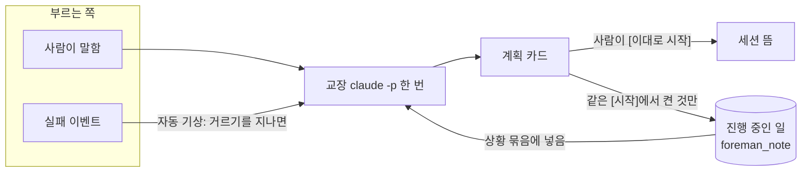

<!--
다루는 곳: bridge/foreman_note.py, bridge/wake.py, config/wake.toml, bridge/static/js/fmpanel.js, migrations/0025_foreman_note.sql, migrations/0029_seed_ronanlab_infra.sql, tests/js/fmpanel_notes.test.mjs, tests/test_foreman_note.py, tests/test_note_auto_retire.py, tests/test_wake_url.py, tests/test_instructions_note_threads.py
읽은 커밋: fb7121b
-->
# 진행 중인 일과 자동 기상

교장(코드 이름은 디스패처)은 상주하는 세션이 아니다. 사람이 무엇을 하려는지 말할 때마다 브리지가 `claude -p`를 한 번 새로 띄워 계획 하나를 받고 끝낸다. 계획을 세우는 차례와 계획 창은 → 계획 한 번 편이 다룬다. 이 편은 그 「한 번씩 새로 부르는」 방식이 남기는 두 가지 빈자리를 다룬다 [code:bridge/foreman.py].

첫째는 기억이다. 매번 새로 부르면 교장은 지난번에 무엇을 맡겼는지 모른다. 그래서 프로젝트마다 크기를 정한 기록을 하나 두고, 부를 때마다 상황 묶음(교장에게 함께 넣어 주는 배경 자료)에 끼워 넣는다. 코드와 DB에서는 이것을 노트(`foreman_note`)라고 부르고, 화면과 교장에게 주는 글에서는 「진행 중인 일」이라고 부른다 [code:bridge/foreman_note.py].

둘째는 부르는 쪽이다. 사람만 교장을 부를 수 있으면, 사람이 자리에 없을 때 터진 실패(빌드 실패, 적재 막힘 같은 것)는 사람이 돌아와 알림을 읽을 때까지 아무도 들여다보지 않는다. 그래서 실패 이벤트가 교장을 부르게 했다. 이것이 자동 기상이다. 다만 교장이 스스로 세션을 띄우게 하지는 않았다. 실패가 부르면 교장은 계획만 세우고, 텔레그램과 화면으로 사람에게 「[시작]?」을 묻는다. 사람이 눌러야 세션이 뜬다 [code:bridge/wake.py].

두 가지는 서로 다른 기능처럼 보이지만 같은 생각에서 나왔다. 교장이 무엇을 기억하고 무엇을 혼자 할지를 사람이 고른다는 것이다.



## 1. 노트는 「무엇이 남을지 사람이 고르는 압축 요약」이다

### 상주하면 왜 안 되나

오래 도는 CC 세션은 대화가 쌓이면 압축된다. 압축은 지난 대화를 모델이 요약해 짧게 바꾸는 일이고, 그 요약에 무엇이 남을지는 사람이 고를 수 없다. FOREMAN은 이 문제를 직접 겪었다. 압축 손실을 재어 보니 프로젝트가 왜 있는지를 말한 사용자의 문장(「조용한 고장을 잡으려는 거야」)이 어느 압축 요약에도 실린 적이 없었다 [code:CLAUDE.md]. 압축 손실을 재는 법은 → 압축 손실 재기 편에 있다.

교장을 상주시키면 같은 일이 생긴다. 며칠 동안 계획을 세우며 쌓은 맥락이 어느 날 압축되면, 무엇이 빠졌는지 아무도 모른 채 다음 계획이 나간다. 그래서 교장은 부를 때마다 새로 띄운다. 대신 기억할 것을 따로 적어 두고 그것만 함께 넣는다. 노트는 압축 요약과 하는 일이 같지만, 무엇이 남을지를 모델이 아니라 사람이 고른다 [docs:14_dispatcher_note_wake.md].

### 노트를 파일이 아니라 DB에 둔 까닭

처음에는 노트를 마크다운 파일로 두는 길도 있었다. 파일이면 사람이 편집기로 바로 고칠 수 있다. 그런데 노트를 고치는 순간은 사람이 계획 카드에서 [이대로 시작]을 누르는 순간과 묶여야 한다(아래 3절). 세션을 띄운 기록, 계획을 승인한 기록, 노트를 고친 기록이 모두 DB에 있으니, 노트까지 DB에 두어야 이 셋을 한 트랜잭션(전부 되거나 전부 안 되거나 하는 한 묶음의 DB 작업)으로 묶을 수 있다. 화면 패널과 낡음 비교(세션 활동, 커밋 수)도 DB에서 바로 읽는다 [docs:14_dispatcher_note_wake.md].

표는 `foreman_note` 하나다 [code:migrations/0025_foreman_note.sql].

| 칸 | 뜻 |
|---|---|
| `project` | 어느 프로젝트의 줄인가. 노트는 프로젝트마다 따로 센다 |
| `kind` | 줄의 종류. 지금은 `thread`(진행 중인 일) 하나만 읽는다 |
| `body` | 줄 내용. 코드가 300자에서 자른다(칸 자체는 600자까지 받는다) |
| `source` | 출처. `세션 N`, `log/….md`, `docs/….md`, `dispatch #N`, `커밋 <sha>` 가운데 하나 |
| `refs` | JSON. 붙은 세션 번호들, 그때의 HEAD 커밋, 기계가 내렸으면 그 까닭, 사람이 되살렸으면 `keep` |
| `checked_at` | 마지막으로 확인한 시각. 낡음을 재는 기준 |
| `retired_at`, `replaced_by` | 내려간 시각, 고쳐 쓴 줄이면 새 줄 번호. 줄을 지우지 않고 이력으로 남긴다 |
| `dispatch_id` | 마지막으로 이 줄을 건드린 계획 번호 |

같은 마이그레이션이 `dispatch` 표(계획 기록)에도 칸 넷을 더했다. `origin`은 사람이 부른 계획(`human`)인지 실패가 부른 계획(`wake`)인지, `project`는 계획의 프로젝트, `wake_key`는 같은 실패를 두 번 계획하지 않게 하는 열쇠, `wake_text`는 화면에 보일 실패 한 줄이다 [code:migrations/0025_foreman_note.sql].

## 2. 쌓는 것은 진행 중인 일 하나뿐이다

### 무엇을 쌓나

노트에 쌓는 것은 지금 돌고 있는 일의 줄기 하나뿐이다. 무엇을 하는 중인지, 어느 세션들에서 하는지, 어디까지 왔는지, 남은 것이 무엇인지를 한 줄(300자 안)로 적는다. 일이 끝나면 줄은 내려간다. 지난 계획들과 사람이 계획 카드에서 고친 칸은 노트에 따로 저장하지 않는다. `dispatch` 표에 이미 있으니 최근 5건을 그때그때 읽어 「지난 요청」으로 함께 넣는다. 교장이 같은 실수(예: 늘 사람이 역할을 바꿔야 했던 계획)를 되풀이하지 않게 하려는 것이다 [code:bridge/foreman_note.py].

### 무엇을 쌓지 않나, 그리고 왜

규칙, 금지, 설계 결정, 사람이 정한 판단, 저장소 구조, 자주 쓰는 명령은 쌓지 않는다. 이것들은 이미 CLAUDE.md, docs, CC 메모리에 있고, 교장이 띄운 새 세션은 그것들을 스스로 읽는다. 노트에 같은 것을 한 번 더 적으면 사본이 생긴다. 사본은 원본이 바뀌어도 함께 바뀌지 않고, 바뀌지 않았다는 사실도 알리지 않는다. 낡은 규칙이 노트에 남아 교장의 판단을 계속 끌고 가는데 아무도 모르는 것, 이 프로젝트가 가장 싫어하는 조용한 고장이 바로 그것이다 [docs:14_dispatcher_note_wake.md].

### 판단 칸을 없앤 일

처음에는 쌓는 것이 둘이었다. 진행 중인 일(`thread`)과 「사람이 정한 판단」(`decision`)이다. 판단 칸은 사람이 한 번 정한 것을 교장이 기억하게 하려고 만들었다. 써 보니 판단 칸에 16줄이 쌓였는데, 들여다보니 그 가운데 8줄은 이미 끝난 일이었고 5줄은 문서에 이미 있거나 문서로 옮겨야 할 규칙이었다 [log:note_threads_only_20261113.md].

왜 그렇게 쌓였는지 계획 기록을 거슬러 읽었다. 16줄 모두 교장이 계획마다 한 줄씩 제안했고, 사람은 [시작] 때 16개를 모두 켠 채 눌렀다. 교장이 지시를 어긴 것이 아니라 지시를 지킨 것이었다. 지시문이 「쌓는 것은 둘: thread와 decision(사람이 정한 판단, 금지)」이라고 했고, 「금지」가 판단의 정의 안에 들어 있었다. 관리자가 넘기는 요청 글은 거의 늘 「사용자 지시」나 「사용자 결정」으로 시작했으니 「사람의 말에 근거가 있는 것만」이라는 거르개는 늘 통과됐다. 노트가 비어 있으면 「사람이 정한 판단이 보이면 decision을 제안하라」는 안내가 붙어 쌓기를 부추겼다. 계획 카드에서 노트 제안은 접혀 개수만 보였고 기본이 켜짐이라, 펼쳐서 끄지 않으면 다 들어갔다. 그리고 판단 줄은 내려가는 길이 아예 없었다. 일이 끝나 커밋과 문서에 들어간 뒤에도 줄은 남았다 [log:note_threads_only_20261113.md].

그래서 판단 칸을 없앴다 [c:9f198b5]. 세 군데를 막았다. 지시문에서는 쌓지 않는 것에 규칙, 금지, 설계 결정, 사람이 정한 판단을 이름으로 적고, 요청 글의 「사용자 지시」는 노트가 아니라 이번 세션의 첫 글에 「지켜야 할 것」으로 넣게 했다. 오래 지킬 규칙이면 그 일을 맡은 세션이 CLAUDE.md나 docs에 적게 첫 글에 쓴다 [code:bridge/foreman.py]. 빈 노트의 부추김 글을 뺐다. 코드에서는 교장이 그래도 판단을 쌓자고 제안하면 그 제안을 빼고 계획 카드에 「규칙 · 판단 제안을 뺐습니다」로 시작하는 경고를 띄운다. 지시문을 어기면 사람이 보게 하려는 것이다 [code:bridge/foreman_note.py]. DB에 남은 옛 판단 줄은 지우지 않았지만 읽지도 않는다. 노트를 읽는 함수가 `kind = 'thread'`인 줄만 고르니 상황 묶음, 패널, 제안 맞추기, 자동 훑기 어디에도 들어가지 않는다.

관리자를 띄우는 일도 노트에 쓰지 않는다. 관리자가 어디 있는지는 관리자 목록 API가 따로 안다. 관리자를 띄우면서 다른 일을 함께 맡겼다면 그 다른 일만 진행 중인 일로 쓴다 [code:bridge/foreman.py]. 관리자 쪽 이야기는 → 관리자에게 넘기기와 보고 편에 있다.

### 줄마다 출처와 확인 시각

줄에는 반드시 출처가 붙는다. 출처는 정해진 꼴 다섯 가지(`세션 N`, `dispatch #N`, `log/….md`, `docs/….md`, `커밋 <sha>`)만 받는다. 교장이 알아볼 수 없는 출처를 내면 비워 두었다가 [시작] 때 이번 계획 번호(`dispatch #N`)로 채우고, 계획 카드에 그렇게 바꿨다고 경고한다. 출처가 `log/`나 `docs/` 파일인데 그 파일이 없으면 그것도 경고한다 [code:bridge/foreman_note.py].

줄을 상황 묶음에 넣을 때는 확인한 뒤 무엇이 바뀌었는지를 기계가 붙인다. 붙는 것은 둘이다. 줄에 붙은 세션에서 확인 시각 뒤에 활동이 있었으면 「확인 뒤 세션 N에 활동 있음」, 출처 파일이 사라졌으면 「출처 파일이 없음」이 ⚠와 함께 붙는다. 교장은 지시문에서 「⚠가 붙은 줄은 그대로 믿지 말고 필요하면 읽어서 확인한 뒤 고치기를 제안하라」는 말을 받는다 [code:bridge/foreman.py].

한때는 「확인 뒤 커밋 N개」도 붙였다. 이 수는 그 줄의 일과 상관없는 저장소 전체 커밋 수였다. FOREMAN은 하루에 커밋이 60개에서 110개쯤 쌓이는 저장소라 거의 모든 줄에 하루 안에 이 표시가 붙었다 [log:note_auto_retire_20261113.md]. 늘 켜진 경고는 경고가 아니다. 교장은 모든 줄을 의심하게 되고, 정말 볼 표시가 그 사이에 묻혔다. 그래서 글에서는 떼고, 커밋 수는 아래 낡음 문턱을 재는 데만 쓴다 [log:note_threads_only_20261113.md].

### 크기 상한과 접기

노트는 프로젝트마다 약 2000토큰까지만 상황 묶음에 넣는다(`TOKEN_CAP`). 교장에게 넣는 상황 묶음 전체가 1만에서 2만 토큰쯤이라, 프로젝트 셋이 2000씩 써도 넘치지 않는 크기로 잡았다 [docs:14_dispatcher_note_wake.md]. 셋은 이 값을 정한 11-08의 프로젝트 수다. 11-10에 인프라 저장소가 더해져 지금은 넷이지만 [code:migrations/0029_seed_ronanlab_infra.sql], 넷이 2000씩 써도 8000토큰이라 여전히 묶음 크기 안이다. 토큰 수는 실측하지 않고 넉넉하게 어림한다. 한글 한 글자를 1토큰, 나머지는 3.5글자를 1토큰으로 센다 [code:bridge/foreman_note.py].

줄은 최근에 확인한 것부터 넣는다. 상한을 넘친 줄은 지우지 않고 접는다. 접힌 줄은 상황 묶음에는 들어가지 않지만 패널에는 「접힘(상한을 넘어 계획을 세울 때 안 들어갑니다)」이라는 표시와 함께 남는다. 기억이 조용히 사라지지 않게, 사라진 것이 보이게 한 것이다 [code:bridge/static/js/fmpanel.js].

## 3. 누가 노트를 고치나

노트를 고치는 손은 셋이다. 교장이 제안하고 사람이 승인하는 길, 사람이 패널에서 바로 고치는 길, 기계가 사실을 보고 내리는 길이다.

### 교장이 제안하고 사람이 [시작]으로 승인한다

교장은 계획에 `note_updates`라는 칸을 함께 낸다. 할 수 있는 일은 넷이다 [code:bridge/foreman_note.py].

| 제안 | 하는 일 |
|---|---|
| `add` | 새 줄을 쌓는다 |
| `update` | 기존 줄을 지금 상태로 고쳐 쓴다. 옛 줄은 `retired_at`과 `replaced_by`로 남고 새 줄이 들어간다 |
| `retire` | 끝난 줄을 내린다. 까닭(`why`)을 적는다 |
| `touch` | 다시 확인했는데 아직 진행 중이다. 확인 시각만 지금으로 바꾼다 |

브리지는 이 제안을 사실과 맞춰 본다. 모양이 틀린 제안, 이 프로젝트의 지금 줄이 아닌 번호를 가리키는 제안은 빼고 경고한다. 한 계획에서 받는 제안은 8개까지다. 맞춘 제안은 계획 카드에 체크 칸으로 뜨고, 사람이 [이대로 시작]을 누르면 켜 둔 것만 세션을 띄우는 것과 같은 트랜잭션에서 반영된다. 새로 쌓거나 고친 진행 중인 일 줄에는 이번에 띄운 세션 번호가 붙는다(최근 6개까지). 이 세션 번호가 아래 자동 내리기의 단서가 된다 [code:bridge/foreman_note.py].

사람의 승인을 거치게 한 까닭은 노트가 교장의 다음 판단을 이끄는 유일한 기억이기 때문이다. 교장이 스스로 고치게 하면 틀린 기억이 다음 계획에 그대로 들어가고, 그 계획이 또 틀린 기억을 쌓는다. 사람이 이미 계획을 보고 [시작]을 누르는 순간이 있으니, 그 순간에 노트 고치기도 함께 보게 했다 [docs:14_dispatcher_note_wake.md]. 다만 판단 칸 일에서 보듯, 제안이 접혀 있고 기본이 켜짐이면 사람은 사실상 보지 않고 누른다. 그래서 노트에 들어갈 수 있는 것의 종류 자체를 좁혔다(2절).

### 사람이 패널에서 바로 고친다

감독실 캐릭터(테마마다 오피스 팀장, 마법학교 교장, 현장 소장)를 누르면 옆 패널에 그 프로젝트의 진행 중인 일이 뜬다 [code:bridge/static/js/fmpanel.js]. 패널에서 사람이 할 수 있는 일은 셋뿐이다.

| 단추 | 하는 일 |
|---|---|
| [내리기] | 그 줄을 진행 중인 일에서 뺀다. 다음 계획부터 들어가지 않는다. 기록은 남는다 |
| [아직 진행 중] | 낡음 표시가 붙은 줄에만 뜬다. 확인 시각을 지금으로 바꿔 낡음을 푼다 |
| [되살리기] | 기계가 끝났다고 내린 줄을 되돌린다. 다시 자동으로 내리지 않는다 |

새 줄을 사람이 직접 쓰는 단추는 없다. 새 줄은 늘 계획과 함께, 그 일을 맡은 세션 번호와 함께 들어와야 뒤에서 기계가 끝남을 가를 수 있기 때문이다.

패널에는 진행 중인 일 말고도 「낡음: 확인 필요 N」, 「끝난 일 N」, 「지난 요청 N」 묶음이 접혀 있다. 맨 위에는 실패가 부른 계획 가운데 아직 [시작]을 기다리는 것이 「[시작]을 기다리는 제안 N」으로 뜨고, [계획 보기]를 누르면 가운데 계획 창이 그 계획으로 열린다 [code:bridge/static/js/fmpanel.js].

### 기계가 끝난 줄을 내린다

써 보니 끝난 일이 진행 중인 일로 남았다. 줄을 내리려면 교장이 다음 계획에서 `retire`를 제안하거나 사람이 [내리기]를 눌러야 했는데, 일이 끝난 뒤 그 프로젝트로 교장을 다시 부르지 않으면 줄은 영영 남았다. 교장은 끝난 일을 진행 중으로 믿고 계획을 세웠다. 그래서 기계가 사실을 보고 내리게 했다 [c:718472b].

기계가 보는 것은 줄에 붙은 세션들이다. 붙은 세션이 모두 끝났고, 그 가운데 작업방(worktree, 저장소 안의 따로 떨어진 작업 폴더) 세션이 하나라도 있고, 그 작업방 세션이 모두 「남은 일 없음」이면 내린다. 「남은 일 없음」으로 보는 사실은 여섯이다 [code:bridge/foreman_note.py].

| 사실 | 까닭에 붙는 말 |
|---|---|
| 합치기 기록(`wt-merge`)이 있다 | 합침 |
| 버리기 기록(`wt-discard`)이 있다 | 버림 |
| 합치기 카드가 `merged`다 | 합침(카드) |
| 같은 작업 폴더를 뒤 세션이 다시 썼다 | 브랜치 없어짐 |
| 그 브랜치 커밋이 원본 브랜치에 이미 들어 있다 | 커밋이 원본에 들어 있음 |
| 브랜치도 폴더도 없다 | 폴더 · 브랜치 없어짐 |

반대로 합치지 않은 커밋이 남았거나 저장소를 못 읽으면 내리지 않는다. 붙은 세션 가운데 살아 있는 것이 있거나, 붙은 세션이 아예 없거나, 원본 폴더 세션뿐인 줄은 끝남을 가르지 못한다고 보고 그대로 둔다. 원본 폴더 세션은 같은 일이 다음 세션으로 이어지는 일이 많아 세션이 끝났다고 일이 끝났다고 볼 수 없기 때문이다 [log:note_auto_retire_20261113.md].

「같은 작업 폴더를 뒤 세션이 다시 썼다」는 판단에는 사정이 있다. 작업방 이름(`foreman-3`, `foreman-4` 같은 것)은 다시 쓰인다. 폴더가 있는지만 보면 앞 세션 것인지 뒤 세션 것인지 가를 수 없다. 작업방을 새로 만들 때는 쓰고 있는 이름과 브랜치를 피하니, 같은 자리를 뒤 세션이 썼다면 앞 세션의 브랜치는 그 전에 이미 없어졌다고 본다. 지워진 브랜치의 커밋은 다시 셀 수 없으니(이벤트 기록에는 도구 결과 본문을 저장하지 않는다) 브랜치가 없어졌다는 사실 자체를 「남은 일 없음」으로 받았다. `git branch -d`는 합치지 않은 커밋이 있으면 거부하고, 강제로 지우는 `-D`는 버리기 길이기 때문이다 [log:note_auto_retire_20261113.md].

내린 줄은 지우지 않는다. `retired_at`과 함께 `refs.auto_retired`에 까닭(예: 「자동: 세션 247 합침 · 248 끝남(원본 폴더) · 249 합침」)이 남고, 패널 「끝난 일」 묶음에 14일 동안 [되살리기] 단추와 함께 보인다. 사람이 되살린 줄에는 `refs.keep`이 붙어 다시는 기계가 내리지 않는다 [code:bridge/foreman_note.py]. 처음 이 규칙을 운영 DB의 줄 15개에 시험 삼아 대어 보니 12줄이 내려가고 3줄이 남았고, 관리자가 손으로 가른 결과와 같았다 [log:note_auto_retire_20261113.md].

훑기는 브리지가 뜰 때, 세션이 끝날 때, 합치기나 버리기 뒤, 계획을 세우기 직전, 그리고 30분마다 돈다. 30분 주기는 브리지 밖에서 합쳐 신호를 놓친 경우를 메우려는 것이다. 훑기가 실패해도 계획과 브리지는 멈추지 않고 로그만 남는다 [code:bridge/foreman.py].

관리자 띄우기 줄을 위한 규칙도 코드에 넣어 두었다. 살아 있는 관리자가 그 줄의 계획으로 떴고 첫 턴이 끝났으면 「관리자 띄움 끝」으로 내리는 규칙이다. 하지만 기본은 꺼 두었다(`manager_spawn_done = false`). 띄운 계획의 첫 글에 띄우기 말고 다른 일(「띄워서 X를 정리하게」)이 섞였는지 기계로 가를 수 없어서다. 켜면 아직 남은 일이 있는 줄도 내려갈 수 있다 [code:config/wake.toml].

### 낡음: 확인 필요

기계로 끝남을 가르지 못하는 줄이 오래 확인되지 않으면 「낡음: 확인 필요」로 따로 모아 맨 뒤에 둔다. 상황 묶음에서도 맨 뒤에 「낡음(확인 필요, 끝났을 수 있다. 진행 중이라고 믿지 말고 확인하라)」이라는 말과 함께 들어간다 [code:bridge/foreman_note.py]. 문턱은 설정 파일에 있다 [code:config/wake.toml].

```toml
[note]
stale_days = 3
stale_commits = 150
manager_spawn_done = false
```

마지막 확인 뒤 3일이 지났거나, 그 사이 저장소에 커밋이 150개 넘게 쌓였으면 낡음이다. 날수를 주 기준으로 한 까닭은 프로젝트마다 커밋 속도가 열 배 가까이 달라서다. FOREMAN은 하루 커밋이 60개에서 110개쯤이고, 펫퍼민트는 나흘에 51개였다. 커밋 수만으로 문턱을 잡으면 FOREMAN은 반나절 만에 모든 줄이 낡음이 되고 펫퍼민트는 거의 걸리지 않는다. 커밋 150개는 FOREMAN에서 1.5일에서 2일쯤인데, 날수보다 저장소가 훨씬 빨리 움직인 줄(런슈즈의 한 줄은 0.9일에 커밋 219개)만 먼저 거는 데 쓴다 [log:note_auto_retire_20261113.md].

날수 3일은 넉넉하게 잡지 않았다. 낡음은 표시일 뿐 줄을 빼지 않는다. 너무 일찍 켜져서 잃는 것은 화면이 조금 시끄러워지고 교장이 한 번 더 확인하는 것뿐이다. 너무 늦게 켜지면 교장이 끝난 일을 진행 중으로 믿는 처음 문제가 그대로 남는다. 줄을 실제로 빼는 일은 문턱이 아니라 사실(합침, 버림, 브랜치 없어짐)로만 한다 [log:note_auto_retire_20261113.md]. [아직 진행 중] 단추는 진짜로 오래 걸리는 일이 영영 낡음으로 남지 않게 하려고 더했다.

## 4. 자동 기상: 1, 2, 3단계 가운데 2단계에서 멈췄다

### 처음 설계와 다시 본 것

처음 설계에는 자동 기상 규칙이 이미 있었다. 실패 이벤트에서만 깨우고(성공은 무시), 동시에 도는 세션은 셋까지, 읽기 전용으로 시작하고, 하루 횟수에 상한을 두고, 밤에는 끈다 [code:README.md]. 교장을 만들고 나서 이 규칙을 다시 보았다. 사람 세션만으로 이미 서너 개가 늘 돌고 있어 「동시 셋」은 맞지 않았고, 30분 강제 종료보다 보고하면 스스로 끝내는 쪽이 나았다. 그보다 중요한 것은 차례였다. 한 번에 「실패가 오면 세션이 저절로 뜬다」로 가지 않기로 했다 [docs:11_foreman_dispatch.md].

| 단계 | 누가 부르나 | 누가 시작하나 | 지금 |
|---|---|---|---|
| 1단계 | 사람이 말한다 | 사람이 계획을 보고 [이대로 시작] | 있다 |
| 2단계 | 실패 이벤트가 부른다 | 사람이 텔레그램이나 화면에서 계획을 보고 [이대로 시작] | 있다 |

### 왜 2단계에서 멈췄나

3단계(실패 이벤트가 부르면 묻지 않고 읽기 전용 조사 세션을 띄우는 것)는 2단계를 몇 주 써 보고 제안이 맞는지 본 뒤 정하기로 했다 [code:config/wake.toml]. 교장의 계획이 실패 상황에서 맞는 세션을 맞는 역할로 띄우는지 아직 모른다. 맞는지 모르는 계획을 묻지 않고 실행하면, 틀린 세션이 사람 없는 밤에 뜨고 그 세션이 무엇을 읽고 무엇을 했는지는 아침에야 안다. 2단계는 계획까지만 자동으로 하고 실행 버튼은 사람에게 남긴다. 틀린 계획이 나와도 잃는 것은 계획 한 번의 비용과 알림 한 통이다. 그 사이 쌓인 계획들은 3단계로 갈지 판단할 재료가 된다.

2단계에서도 교장은 조심스럽게 계획을 세우게 지시받는다. 실패가 부른 계획에는 지시문 뒤에 따로 몇 줄이 붙는다. 사람이 지금 자리에 없을 수 있으니 첫 글만 읽어도 무엇을 할지 알게 쓸 것, 원인을 살펴보는 일이니 역할은 조사로 할 것(고치기는 사람이 결과를 보고 정한다), 같은 실패를 이미 살펴보는 살아 있는 세션이 있으면 그 세션에 보낼 것, 프로젝트가 없는 실패(인프라 전체)면 가장 가까운 프로젝트를 고르고 이유를 적을 것이다 [code:bridge/foreman.py]. 밤에도 계획은 세운다. 시작은 어차피 사람이 누르기 때문이다. 밤, 동시 1개, 20분 같은 규칙은 3단계로 갈 때 정한다 [docs:14_dispatcher_note_wake.md].

### 무엇을 실패로 보나

실패 이벤트는 파이프라인 감시와 적재 감시에서 온다. 두 감시는 원래 하던 대로 텔레그램 알림을 보내고, 같은 때에 `on_failure` 콜백으로 자동 기상에 실패를 넘긴다 [code:bridge/wake.py].

| 종류 | 화면 이름 | 같은 실패를 가르는 열쇠 |
|---|---|---|
| `build_failed` | 파이프라인 실패 | 프로젝트, 단계, 빌드 번호 |
| `no_build` | 빌드 알림 없음 | 프로젝트, 커밋 |
| `webhook_broken` | 웹훅 끊김 의심 | 프로젝트, 날짜 |
| `infra_down` | 인프라 응답 없음 | 무엇이, 언제부터 |
| `ingest_stuck` | 적재 막힘 | 파일, 언제부터 |

적재 막힘 가운데 DB 끊김이나 시간 초과처럼 기다리면 돌아오는 것(`transient`)은 넘기지 않는다. 계획을 세울 거리가 아니어서다 [code:bridge/ingest_health.py]. 파이프라인 쪽 이야기는 → 12 CI/CD 인과 체인 편에 있다.

자동 기상은 알림을 보내는 쪽에 어떤 영향도 주지 않게 짰다. 콜백은 일을 뒤로 넘기고 바로 돌아오며, 자동 기상 안에서 무엇이 잘못돼도 실패 알림은 이미 나간 뒤다 [code:bridge/wake.py]. 자동 기상이 켜지지 못해도 브리지는 뜬다 [code:bridge/main.py].

## 5. 하루 상한과 같은 실패 거르기

실패는 몰려서 온다. 빌드 하나가 깨지면 같은 실패 알림이 여러 번 오고, 서버가 흔들리면 여러 종류의 실패가 한꺼번에 온다. 이것을 모두 계획으로 바꾸면 교장(`claude -p`)이 줄줄이 뜨고, 사람에게는 비슷한 제안이 쌓인다. 그래서 세 겹으로 거른다 [code:bridge/wake.py].

```toml
enabled = true
daily_max = 5
dedupe_hours = 12
public_url = "http://localhost:8000"
kinds = ["build_failed", "no_build", "webhook_broken", "infra_down", "ingest_stuck"]
```

이 값들이 `config/wake.toml`에 있다 [code:config/wake.toml]. 바꾸면 브리지를 다시 띄워야 한다.

**같은 실패는 12시간에 한 번.** 실패마다 `wake_key`라는 열쇠를 만든다(위 표의 「같은 실패를 가르는 열쇠」). 같은 열쇠로 12시간(`dedupe_hours`) 안에 이미 계획을 세웠으면 다시 세우지 않고 로그만 남긴다. 열쇠는 계획 기록(`dispatch`)에 함께 저장되니 브리지를 다시 띄워도 거르기가 이어진다 [code:bridge/wake.py].

**하루에 다섯 번.** 하루(한국 시각 0시부터) 동안 실패가 부른 계획이 5번(`daily_max`)에 닿으면 그날 남은 실패는 계획하지 않는다. 다만 조용히 멈추지 않는다. 상한에 처음 닿은 순간 텔레그램으로 「오늘 자동 계획 5번을 다 썼습니다. 오늘 남은 실패는 알림만 갑니다」를 그날 한 번만 보낸다. 상한이 있다는 것을 사람이 모르면, 여섯 번째 실패부터 계획이 오지 않는 것을 고장으로 알거나 아예 알아채지 못하기 때문이다 [code:bridge/wake.py].

**한 번에 하나.** 계획 세우기는 잠금 하나를 지나야 한다. 실패가 몰려 와도 `claude -p`는 하나씩 돈다. 다음 실패는 앞 계획이 끝난 뒤 거르기를 다시 거친다 [code:bridge/wake.py].

무엇을 실패로 볼지(`kinds`)도 설정에서 고른다. 목록에 없는 종류는 넘어와도 무시한다. `enabled = false`면 자동 기상 전체가 꺼지고, 사람이 부르는 1단계만 남는다 [code:bridge/wake.py].

### 계획을 못 세워도 알린다

자동 기상이 조용한 고장이 되지 않게 한 장치가 하나 더 있다. 교장이 계획을 세우지 못하면(실행 실패, 거절, 그 밖의 오류) 그것도 텔레그램으로 「⚠ <실패 종류>. 살펴볼 계획을 세우지 못했습니다. 실패 알림을 직접 봐 주세요」를 보낸다 [code:bridge/wake.py]. 이 장치가 왜 필요한지는 실제로 겪었다. 브리지를 systemd 서비스로 옮긴 뒤 서비스의 PATH에 `claude`가 있는 폴더가 빠져 교장이 이틀 동안 뜨지 못했는데, 그 사이 부른 사람이 없어 아무도 몰랐다. PATH를 고치고, 브리지가 뜰 때 `claude`를 못 찾으면 텔레그램으로 알리게 했다 [log:stage14_dispatcher_note_wake_result.md].

## 6. 텔레그램과 화면에서 묻는 법

계획이 서면 두 곳에 뜬다. 화면에서는 감독실 캐릭터 머리 위에 「시작할 일 N」이 뜨고, 패널 맨 위에 「[시작]을 기다리는 제안 N」이 보인다. 24시간 안에 세워졌고 아직 시작도 버리기도 안 한 계획만 센다 [code:bridge/foreman.py]. 텔레그램에는 이런 글이 간다 [code:bridge/wake.py].

```
[FOREMAN] 🧭 인프라 응답 없음 — 이렇게 살펴보자는 계획을 세웠습니다
▶ <계획 이름> — 조사 · 읽기 전용 · 새 세션
이유: <교장이 든 첫 번째 이유>
[시작]? 계획을 보고 화면에서 눌러 주세요. 서버 PC 화면이나 ssh -L 8000:localhost:8000으로 엽니다: http://localhost:8000/?dispatch=N
```

시험으로 부른 실패면 첫 줄에 〔시험〕이 붙는다. 시험 경로는 `POST /api/foreman/wake-test`다. 알림 글 하나를 넣으면 실제 경로(교장 계획, 텔레그램, 화면 제안)를 끝까지 돈다 [code:bridge/api/foreman.py].

### 버튼이 아니라 링크인 까닭

텔레그램 메시지에 [시작] 버튼을 달 수도 있었다. 그러려면 브리지가 텔레그램에서 오는 신호를 받아야 하는데, 브리지는 텔레그램에 보내기만 하고 받는 길이 없다 [docs:14_dispatcher_note_wake.md]. 받는 길을 열면 밖에서 브리지로 들어오는 입구가 하나 생긴다. 그래서 링크로 화면을 열고, 사람이 화면에서 계획을 직접 본 뒤 누르게 했다. 계획을 보지 않고 누르는 일을 막는 효과도 있다.

### 시작 링크가 열리지 않던 고장

이 링크는 만든 날부터 한 번도 열린 적이 없었다. 처음 링크의 바탕 주소(`public_url`)는 FOREMAN 화면을 밖에서 열 때 쓰려던 공개 도메인이었다. 그런데 FOREMAN은 그보다 앞서 터널로 밖에 열지 않기로 결정했다. 밖에서 필요한 정보(턴 종료, 승인 대기, 파이프라인 실패, 적재 막힘)는 이미 텔레그램으로 받고, 화면 하나 보려고 호스트 셸과 승인 권한을 가진 관제실을 밖에 여는 것은 값어치가 없다는 판단이었다 [code:README.md]. 터널을 열지 않았으니 그 도메인은 이름이 풀리지 않았다. 서버에서 이름을 찾아보면 빈 답이 왔고, 접속하면 이름을 풀지 못했다는 오류로 끝났다 [log:wake_link_20261115.md].

두 결정이 서로 어긋나 있었다. 한쪽은 「밖에 열지 않는다」였고, 다른 쪽은 「밖에서 여는 주소로 링크를 보낸다」였다. 그리고 어긋남을 알리는 곳이 없었다. 링크는 알림 글 끝에 붙어 나갈 뿐 아무도 열리는지 확인하지 않았고, 자동 기상이 실제 실패로 계획을 낸 일이 드물어 사람이 링크를 눌러 볼 일도 거의 없었다. 노션 기술문서 목차를 정하던 조사 세션이 설정 파일을 읽다가 찾았고, 사용자가 「조용한 고장이면 고쳐라」라고 해서 코더 세션이 고쳤다 [log:manager410_overhead_20261115.md].

고친 것은 세 가지다 [c:10e1e5b].

먼저 바탕 주소를 `http://localhost:8000`으로 바꿨다. FOREMAN 화면은 서버 PC 앞에서 보거나, 다른 컴퓨터에서 `ssh -L 8000:localhost:8000`으로 서버의 8000 포트를 자기 컴퓨터로 끌어와 보는 것뿐이다 [code:README.md]. 어느 쪽이든 브라우저 주소창에는 `localhost:8000`이 찍히니, 링크도 그 주소면 열린다. 휴대폰 텔레그램에서 누르면 열리지 않지만 그것은 밖에 열지 않기로 한 결정의 몫이다. 그래서 링크 앞에 「서버 PC 화면이나 ssh -L 8000:localhost:8000으로 엽니다」라는 안내를 붙였다. `public_url`을 비워 두어도 같은 주소로 떨어진다. 고치기 전에는 비우면 `/?dispatch=N` 같은 상대 링크가 나갔는데, 텔레그램에서는 그것도 열리지 않는 꼴이었다 [log:wake_link_20261115.md].

둘째로, 같은 고장이 다시 조용히 생기지 않게 브리지가 뜰 때 링크의 이름이 풀리는지 한 번 본다(`check_public_url`). 10초 안에 풀리지 않으면 로그에 오류를 남기고 텔레그램을 한 번 보낸다. 글은 「public_url의 이름을 찾지 못합니다. 자동 기상 알림의 [시작] 링크가 열리지 않습니다. public_url을 localhost로 고치거나 비워 주십시오」 꼴이다. `localhost`, `127.0.0.1`, `::1`은 풀어 보지 않는다. 이 점검은 뜨는 길을 막지 않는다. 이름이 안 풀려도 브리지는 뜨고 알림만 간다 [code:bridge/wake.py]. 누군가 나중에 다시 공개 주소를 넣었는데 그 주소가 열리지 않으면, 이제는 브리지를 다시 띄우는 그 순간 알게 된다.

셋째로, 이 동작을 시험으로 붙잡았다. 가짜 이름 풀기, 로컬 주소는 풀어 보지 않음, 주소가 비면 로컬, 배포된 설정 파일이 로컬 주소인지를 본다 [log:wake_link_20261115.md]. 마지막 시험은 설정 파일에 다시 공개 도메인이 들어가면 시험부터 깨지게 하려는 것이다.

고친 것을 합친 뒤 브리지를 다시 띄웠을 때 링크 경고가 나지 않은 것도 확인했다. 주소가 localhost라 풀어 보지 않으니 경고가 없는 것이 맞다 [log:manager410_overhead_20261115.md].

이 고장은 자동 기상의 「계획을 못 세워도 알린다」, 「하루 상한에 닿으면 알린다」와 같은 무리다. 알림 자체는 나갔으니 겉으로는 멀쩡했지만, 알림이 이끄는 다음 걸음(링크를 열고 [시작]을 누르는 것)이 막혀 있었다. 무엇을 만들든 「이것이 막히면 스스로 알리는가」를 묻는다는 원칙이 링크 한 줄에도 걸린다는 것을 보여 준 일이다 [code:CLAUDE.md].

## 7. 아직 모르는 것

시험 경로로 부른 계획(예전에 있었던 Jenkins 무응답 상황을 〔시험〕으로 다시 만든 것)은 약 18초 만에 펫퍼민트, 조사, 읽기 전용, 새 세션, 확신도 0.7로 나왔고, 첫 글에 「〔시험〕이고 마지막 빌드가 모두 성공이니 지금도 죽어 있는지부터」를 적어 텔레그램과 화면 제안까지 나갔다 [log:stage14_dispatcher_note_wake_result.md]. 텔레그램에서 바로 [시작]을 누르는 길은 없고, 밖에 열지 않는 한 앞으로도 링크로 화면을 여는 길이 남는다. 화면을 밖에 열지 않는 까닭은 관제실이 호스트 셸과 승인 권한을 쥐고 있기 때문이다. 여기가 한 번 뚫리면 네 저장소 전부에 push할 수 있고, 위험 작업을 통과시킬 수 있고, 비밀값이 든 설정도 만질 수 있다. 다른 서비스는 뚫려도 그 서비스 하나에서 끝나지만 여기는 나머지 전부로 번진다. 그래서 Access를 앞에 두는 데서 그치지 않고 아예 열지 않았고, 밖에서 필요한 것은 텔레그램으로 받는다 [log:foreman-5_todo_collect_20261117.md].
