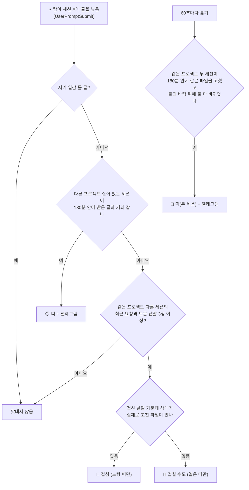

<!--
다루는 곳: bridge/overlap.py, tests/test_overlap.py, tests/test_overlap_base.py
읽은 커밋: 5e0f7c5
-->

# 겹침 알림

겹침 알림은 「지금 이 세션에 시킨 일을 다른 세션이 이미 하고 있지 않은가」를 브리지가 스스로 살피는 장치다. 사람이 어느 세션에든 글을 넣는 순간, 같은 프로젝트에서 살아 있는 다른 세션들이 최근에 받은 요청과 맞대 보고, 겹치면 세션 옆 패널에 띠를 띄운다. 두 세션이 실제로 같은 파일을 고치고 있으면 텔레그램으로도 알린다. 글을 엉뚱한 프로젝트의 창에 또 붙여 넣은 것도 여기서 잡는다. 코드는 `bridge/overlap.py` 한 파일이다 [code:bridge/overlap.py].

이 편이 다루지 않는 것도 먼저 적는다. 교장(코드 이름은 디스패처, 테마마다 감독, 팀장, 소장으로 보인다)이 계획을 세울 때 세션들이 맡을 파일이 서로 겹치는지 보는 판단(`file_conflicts`)은 → 「계획 한 번」에 있다. 합치기 카드와 합치는 차례 자체는 → 「07 합치기」, 텔레그램을 실제로 보내는 길과 하루 묶음은 → 「11 알림」, 인계(화면에서는 새 세션으로 옮기기)는 → 「08 인계와 압축 손실」에서 다룬다 [code:bridge/foreman.py].

## 1. 왜 있나: 포먼이 있어야 하는 까닭

FOREMAN 저장소의 규칙 문서 맨 위에는 이 프로젝트가 있는 이유가 한 문장으로 적혀 있다. 무엇을 만들든 「이것이 막히거나 틀어지면 스스로 알리는가」를 먼저 묻고, 같은 이유로 포먼은 이미 같은 일을 하는 세션을 알아챈다는 것이다. 사용자는 이것을 두고 "그게 포먼이 있어야 하는 이유"라고 했다 [code:CLAUDE.md]. 같은 일을 두 세션이 하고 있으면 아무것도 깨지지 않는다. 화면에도 오류가 없고, 두 세션 모두 성실히 일한다. 다만 사용량이 두 배로 나가고, 둘이 같은 파일을 고치면 합칠 때 부딪친다. 알리는 장치가 없으면 사람은 두 세션의 기록을 나란히 놓고 읽기 전까지 모른다. 조용한 고장과 같은 모양이다.

처음에는 이 일을 교장이 맡았다. 교장은 사람이 하려는 일을 말하면 상황 묶음을 읽고 계획을 내는데, 계획의 방식 가운데 `attach`가 바로 「같은 일을 이미 하는 살아 있는 세션이 있으면 새로 띄우지 말고 그쪽으로 보내라」는 뜻이다 [docs:11_foreman_dispatch.md]. 교장에게 주는 상황 묶음에는 세션마다 최근 사람 요청 세 개와 마지막 답의 앞부분이 들어 있어서, 교장은 그것을 읽고 겹침을 판단한다 [code:bridge/foreman.py].

그런데 실제로 같은 조사를 두 세션이 한 일이 생겼다. 서버 PC가 정전으로 꺼졌다 다시 켜진 날, 사람이 Jenkins와 Harbor가 이상한 것을 보고 조사를 시켰다 [log:infra_20261106_jenkins-harbor-after-outage.md].

| 시각(첫 사건 기준) | 일 |
|---|---|
| 0초 | 세션 198을 작업방에 띄움. 교장 계획을 거치지 않았다 |
| 8초 | 198의 첫 요청: jenkins-0이 Unknown, harbor-jobservice 원인 조사 |
| 71초 | 이미 브리지 복구를 하고 있던 원본 폴더 세션 197의 두 번째 요청에 같은 조사가 tmux 이름 고치기와 한 덩어리로 들어감 |
| 76초 ~ 117초 | 197도 노드, jenkins 상태, 시작 로그, 볼륨 순으로 같은 조사를 함(도구 호출 5번) |

교장이 이것을 거르지 못한 까닭은 셋이었다 [log:infra_20261106_jenkins-harbor-after-outage.md]. 첫째, 겹침 판단은 교장에게만 있었고 교장은 세션을 새로 띄울 때만 돈다. 이번 겹침은 이미 살아 있는 세션(197)에 넣은 글로 생겼다. 살아 있는 세션에 들어가는 글은 패널 입력 칸으로 넣든 tmux에서 바로 치든 아무도 다른 세션과 맞대 보지 않았다. 둘째, 198도 교장을 거치지 않았다. 교장은 사람이 교장에게 말할 때만 돌기 때문이다. 셋째, 설령 198을 띄울 때 교장을 거쳤더라도 그 순간 197은 브리지 복구 중이어서 겹칠 것이 없었다. 새로 띄우는 것이 맞는 판단이었다.

정리하면, 「먼저 띄운 세션의 일을 나중에 다른 세션에 다시 시키는 것」은 지금 구조로는 어디에서도 보지 않았다. 교장의 판단을 아무리 다듬어도 이 틈은 메워지지 않는다. 교장이 돌지 않는 순간에 생기는 겹침이기 때문이다. 그래서 겹침을 보는 자리를 「세션을 띄울 때」에서 「사람이 글을 넣을 때마다」로 옮겼다. CC(Claude Code)의 UserPromptSubmit hook은 모든 세션에 걸려 있어서, 어느 길로 글을 넣든 브리지가 받는다. 이 hook을 받는 길은 → 「CC hook 받기」에 있다 [log:infra_20261106_jenkins-harbor-after-outage.md].

## 2. 제목만으로는 모자랐다

같은 일을 하는 세션을 찾는 가장 쉬운 길은 세션 제목을 맞대는 것이다. 화면에도 제목이 있고, 사람도 세션을 제목으로 기억한다. 그러나 이번 사례에서 제목은 아무 도움이 되지 않았을 것이다. 198의 제목은 「재부팅 후 jenkins-0·harbor-jobservice 장애」처럼 조사 내용이 그대로 들어 있었지만, 197은 브리지 복구를 하려고 띄운 세션이라 제목도 그 일이었다 [log:overlap_alert_20261106.md]. 겹친 조사는 197의 두 번째 요청에 다른 일과 섞여 들어왔다. 세션 제목은 대개 첫 일을 따라 붙고, 그 뒤에 덧붙여 시킨 일은 제목에 나타나지 않는다. 사람이 「하는 김에 이것도 봐 줘」라고 얹는 일이 바로 겹치기 쉬운 일인데, 그것이 제목에서 가장 안 보인다.

그래서 겹침 알림은 제목을 맞대지 않고 상대 세션이 최근에 받은 사람 요청 글 자체를 맞댄다. 제목은 띠에 「세션 197「…」」처럼 누구인지 보여 줄 때만 쓴다 [code:bridge/overlap.py]. 교장도 같은 이유로 상황 묶음에 제목만이 아니라 최근 요청 세 개와 답 앞부분을 넣는다 [code:bridge/foreman.py].

요청 글 전체를 맞대려면 무엇으로 비교할지가 문제다. 언어 모델에게 「이 두 요청이 같은 일인가」를 물으면 가장 정확하겠지만, 이 판단은 사람이 글을 넣을 때마다 돈다. 하루에도 수십 번이고, 그때마다 모델을 부르면 돈과 시간이 든다. 무엇보다 겹침을 보는 일이 글 적재를 늦추면 안 된다. 그래서 기계적으로 싸게 거를 수 있는 신호를 찾았다. 정전 날 사례에서 두 요청이 공유한 것은 `jenkins-0`, `harbor-jobservice`, `CrashLoopBackOff` 같은 낱말이었다. 평소 요청에는 거의 나오지 않는 낱말이 두 요청에 함께 나오면, 같은 대상을 다루고 있을 가능성이 높다. 이것이 드문 낱말 맞대기다 [log:overlap_alert_20261106.md].

## 3. 판정은 세 가지

겹침 알림이 내는 판정은 세 가지이고, 언제 돌고 무엇을 보고 어떻게 알리는지가 다르다.

| 판정 | 언제 도나 | 무엇을 맞대나 | 텔레그램 | 패널 띠 |
|---|---|---|---|---|
| 낱말 겹침 | 사람이 글을 넣을 때 | 같은 프로젝트 다른 세션의 최근 요청과 드문 낱말 | 보내지 않음 | 🔁 겹침(노랑) 또는 🔁 겹칠 수도(옅게) |
| 같은 파일 | 60초마다 훑기 | 같은 프로젝트 두 세션이 실제로 고친 파일 | 보냄 | 📝 같은 파일(빨강), 두 세션 모두 |
| 다른 프로젝트에 같은 글 | 사람이 글을 넣을 때 | 다른 프로젝트 세션이 최근 받은 글 전체 | 보냄 | 📋 다른 프로젝트(빨강) |

[code:bridge/overlap.py] [code:config/notify.toml]



셋 모두 막지 않는다. 사람이 일부러 두 세션에 같은 일을 나눠 시킬 수도 있고, 같은 글을 두 프로젝트에 넣을 수도 있기 때문이다. 알림 글도 모두 「막지 않았습니다 — 일부러 나눠 시킨 것이면 그대로 두면 됩니다」로 끝난다 [code:bridge/overlap.py].

## 4. 드문 낱말로 맞대기

### 4-1. 글을 낱말로 자른다

요청 글 하나를 낱말 집합으로 바꾸는 것이 `words()`다 [code:bridge/overlap.py]. 먼저 시스템이 넣는 꼬리표(`<pasted_content>`, `<system-reminder>`, `<command-…>` 같은 것)를 지운다. 사람이 쓴 낱말이 아니기 때문이다. 그다음 두 종류의 낱말을 뽑는다.

영숫자 낱말은 글자나 숫자로 시작하고 끝나며, 가운데에 `-`, `_`, `.`이 끼어 있으면 하나로 잇는다. 그래서 `jenkins-0`, `harbor-jobservice`, `bridge.db.migrate`, `0020_promotion.sql`이 쪼개지지 않고 한 낱말이 된다 [code:bridge/overlap.py]. 장애 조사나 코드 일에서 가장 뚜렷한 신호가 바로 이런 이름이라서, 이것을 쪼개면 신호가 흐려진다. 뽑은 낱말은 소문자로 바꾸고 양끝의 `-_.`를 떼며, 네 글자보다 짧은 것, 숫자만으로 된 것, 흔한 낱말 목록에 있는 것은 버린다. 흔한 낱말 목록에는 영어 기능어(the, and, with 등), 확장자(md, py, js, toml 등), 그리고 이 서버의 일에서 어디에나 나오는 이름(bridge, claude, foreman, runshoes, petmint, home 등)이 들어 있다. 말뭉치가 작을 때도 이런 낱말이 드문 낱말로 잡히지 않게 하려는 것이다.

한글 낱말은 한글이 두 글자 이상 이어진 것이다. 끝에 붙은 조사(에서는, 으로, 에게, 까지, 은, 는, 이, 가, 을, 를 등 스물네 개)를 하나만 떼고, 떼고 남은 것이 두 글자 이상일 때만 뗀다. 형태소 분석기는 쓰지 않는다 [code:bridge/overlap.py]. 그래서 「Unknown이고」는 영숫자 쪽에서 `unknown`이, 한글 쪽에서 「이고」가 따로 잡힌다. 한글 처리가 이렇게 거칠다는 점이 뒤에서 한글 낱말을 점수에서 뺀 까닭이 된다.

실제로 정전 날 사례와 비슷한 두 요청을 넣으면 이렇게 잘린다(지금 코드로 돌린 결과).

| 요청 | 낱말 집합 |
|---|---|
| 재부팅 후 jenkins-0 파드가 Unknown이고 harbor-jobservice가 CrashLoopBackOff야. 원인 조사해줘 | crashloopbackoff, harbor-jobservice, jenkins-0, unknown, 원인, 이고, 재부팅, 조사해줘, 파드 |
| tmux 이름 고치고, jenkins-0 Unknown이랑 harbor-jobservice CrashLoopBackOff도 같이 봐줘 | crashloopbackoff, harbor-jobservice, jenkins-0, tmux, unknown, 같이, 고치고, 봐줘, 이랑, 이름 |

### 4-2. 드문 낱말을 가른다

같은 낱말이 두 요청에 나왔다고 모두 신호는 아니다. 「확인」이나 `commit`처럼 늘 나오는 낱말이 겹치는 것은 아무 뜻이 없다. 그래서 최근 사람 요청 전체를 말뭉치로 삼아, 각 낱말이 몇 개의 요청에 나왔는지(문서 빈도)를 센다 [code:bridge/overlap.py].

말뭉치는 `turn` 표에서 출처가 사람(`human`)이거나 받은 인계(`handoff_in`)인 요청을 최근 30일, 새것부터 최대 3000개 읽어 만든다. 만드는 데 드는 일이 있으니 30분에 한 번만 다시 만들고, 그 사이에는 만들어 둔 것을 쓴다 [code:bridge/overlap.py]. 낱말 하나가 드문지는 다음 식으로 가른다.

```
드물다  ⇔  그 낱말이 나온 요청 수  ≤  max(rare_min_df, ⌊요청 수 × rare_ratio⌋)
           (rare_min_df = 3, rare_ratio = 0.01)
```

말뭉치가 3000개로 차 있으면 문턱은 30이다. 3000개 가운데 30개 이하의 요청에만 나온 낱말이 드문 낱말이다. 말뭉치가 작을 때(요청 400개 미만)는 1%가 4보다 작아지므로 문턱을 3으로 받친다. 브리지를 처음 들였거나 요청이 적은 동안에도 「세 번 이하로 나온 낱말」은 드물다고 보겠다는 뜻이다 [code:config/notify.toml].

### 4-3. 점수를 매긴다

두 요청의 낱말 집합에서 함께 나오고 드문 낱말만 골라 점수를 매긴다(`match`, `score`) [code:bridge/overlap.py].

| 낱말 종류 | 점수 | 판정 |
|---|---|---|
| 식별자 | 2점 | `-`, `_`, `.`이 들어 있거나, 숫자와 영문 소문자가 섞였다(jenkins-0, opanel.js, a6d6e83, 300k) |
| 그 밖의 영문 낱말 | 1점 | unknown, crashloopbackoff |
| 한글 낱말 | 0점 | 점수에도, 띠에 보이는 낱말에도 넣지 않는다 |

3점부터 겹침으로 본다(`min_score = 3`). 식별자 하나만 겹치면 2점이라 모자라고, 식별자 하나와 영문 낱말 하나, 또는 영문 낱말 셋이 겹쳐야 넘는다. 위 두 요청을 요청 201개짜리 시험 말뭉치(문턱 3)로 맞대면 겹친 드문 낱말은 harbor-jobservice, jenkins-0, crashloopbackoff, unknown이고 점수는 2+2+1+1 = 6이다 [code:bridge/overlap.py]. 실제 운영 DB로 정전 날 그 순간을 다시 돌렸을 때도 같은 네 낱말로 6점이 나왔다 [log:overlap_alert_20261106.md].

식별자를 두 배로 친 까닭은 그것이 대상을 가장 좁게 가리키기 때문이다. `jenkins-0`이 두 요청에 함께 나오면 같은 파드를 다루고 있다는 뜻이지만, 영어 낱말 하나가 겹치는 것은 우연일 수 있다 [code:bridge/overlap.py].

한글을 0점으로 둔 것은 처음부터가 아니었다. 처음에는 영문과 한글을 모두 1점으로 셌는데, 지난 일을 다시 돌려 보니 걸린 것이 거의 다 「글은」, 「주제」, 「가진」처럼 한글만 겹친 것이었다 [log:overlap_alert_20261106.md]. 조사만 떼는 거친 처리로는 「알린다」 같은 흔한 동사 꼴이 드문 낱말로 잡혔다. 한글을 형태소 분석으로 제대로 다루는 길도 있었지만, 그러면 분석기를 들여야 하고 그래도 틀 글의 문장 낱말을 다 걸러낸다는 보장이 없었다. 대신 한글은 세지 않기로 했다. 대가는 분명하다. 한글로만 쓴 같은 요청(파일 이름이나 영문 식별자가 하나도 없는 요청)은 놓친다 [log:overlap_alert_20261106.md]. 처음에는 한글을 세지 않으면서도 띠의 「겹친 낱말」에는 보여 줬는데, 그랬더니 「쉬어서」, 「중이라」 같은 낱말이 근거처럼 찍혀 사람을 헷갈리게 했다. 그래서 지금은 점수에 든 낱말만 보여 준다 [log:overlap_handoff_20261108.md] [c:0c876af].

### 4-4. 누구와 맞대나

글이 들어온 세션을 A라 하자. A와 맞댈 상대는 다음을 모두 만족하는 세션의 요청이다(`_check`) [code:bridge/overlap.py].

| 조건 | 까닭 |
|---|---|
| A와 같은 프로젝트 | 다른 프로젝트끼리는 낱말이 아니라 글 전체로 따로 본다(8절) |
| 프로세스가 살아 있고 멈춤(T)이 아님 | 끝났거나 Ctrl+Z로 세워 둔 세션은 지금 일하는 세션이 아니다 |
| 숨기지 않았고 떼어 내지 않았음 | 화면에서 치운 세션 |
| 요청이 A의 글보다 180분 안 | `window_min`. 오래전 요청까지 보면 끝난 일과 겹친다 |
| 출처가 사람 요청 또는 받은 인계 | 서브에이전트 글, 작업 알림 글은 사람이 시킨 일이 아니다 |
| 세션마다 새 요청부터 5개까지 | `per_session`. 오래 일한 세션 하나가 판정을 다 차지하지 않게 |

상대마다 5개 요청과 각각 맞대어 3점을 넘은 것 가운데 가장 높은 점수를 그 세션의 점수로 삼고, 겹친 낱말은 합치며, 「언제부터」는 겹친 요청 가운데 가장 이른 시각으로 둔다. 상대가 여럿이면 점수가 가장 높은 한 세션만 띠에 올린다. 같은 두 세션(A와 그 상대)은 60분 안에 다시 알리지 않는다(`repeat_min`). 이 기억은 브리지 메모리에만 있어서 브리지를 다시 띄우면 처음부터 센다 [code:bridge/overlap.py].

### 4-5. 기준을 정한 근거: 지난 30일 다시 돌리기

수치는 짐작으로 정하지 않고 지난 요청에 대고 다시 돌려 정했다. 지난 30일 사람 요청 949개를 시간순으로 다시 넣으며 알림이 몇 번 나는지 셌다 [log:overlap_alert_20261106.md]. 과거 시점에 어느 세션이 살아 있었는지는 알 수 없어서 「창 안에 요청이 있던 세션」을 모두 살아 있다고 쳤다. 실제보다 후보가 많으니 나온 숫자는 상한이다.

| 기준 | 알림 수 | 헛알림 모양 |
|---|---|---|
| 영문, 한글 모두 1점(7일만) | 7 | 한글만 겹침. 서기 일감 틀 글 |
| 한글만 겹치면 0점(30일) | 32 | style_guide.md, home, 「알린다」. 서기 일감 틀 글이 대부분 |
| 한글 0점, 3점부터(30일) | 18 | 여전히 서기 일감끼리 |
| 위에 더해 서기 일감 양쪽 빼기, home과 kopo17을 흔한 낱말로 | 11 | 남은 것은 대부분 같은 실험을 여러 세션이 나눠 하던 진짜 겹침 |

[log:overlap_alert_20261106.md]

마지막 줄의 11건 가운데 대부분은 펫퍼민트 프로젝트에서 같은 실험 이름(`exp_c` 등)을 여러 세션이 나눠 돌리던 때였다. 헛알림이라기보다 실제로 겹친 일이었다. 그리고 정전 날 jenkins-0 사례는 네 기준 모두에서 잡혔다. 한 달에 열한 번이면 사람이 띠를 무시하지 않을 만한 빈도라고 보고 이 기준을 택했다 [log:overlap_alert_20261106.md].

## 5. 맞대지 않는 것

드문 낱말이 겹쳐도 같은 일이 아닌 경우가 있다. 이것들은 판정 전에 뺀다. 모두 실제 헛알림을 보고 하나씩 더한 것이다.

**서기 일감 틀 글.** 포먼이 서기 세션에 일감을 줄 때 쓰는 글은 머리가 `[FOREMAN 서기 일감`으로 시작하고, 일부러 여러 세션에 나눠 시키는 같은 틀이다. 이 틀 글끼리 낱말이 겹치는 것이 다시 돌리기 헛알림의 대부분이었다 [code:bridge/overlap.py]. 그래서 들어온 글이든 상대의 요청이든 꼬리표를 지운 앞 300자가 이 머리로 시작하면 맞대지 않는다(`skip`).

**인계로 이어진 세션.** 맥락이 찬 세션을 새 세션으로 옮기면, 새 세션은 옛 세션의 일을 그대로 넘겨받는다. 낱말이 겹치는 것이 당연하다. 실제로 인계받은 세션 214에 넘겨준 세션 211과 겹친다는 알림이 갔다 [log:overlap_handoff_20261108.md]. 인계 스크립트는 요약을 만들고, 새 세션에 넣고, 옛 세션을 끝내는 순서로 돌기 때문에 새 세션의 첫 요청은 늘 옛 세션이 아직 살아 있을 때 들어온다. 게다가 「넣었다」는 기록(`summary.injected_at`)이 인계 글 적재보다 0.3초 늦게 적혀서 기록만 보고는 첫 요청 때 알 수 없었다. 그래서 세 가지를 모두 본다(`_handoff_linked`). 이 글 앞부분에 `[FOREMAN 인계 r=X]`가 있으면 그 요약을 만든 세션, 나에게 넣은 인계의 넘겨준 세션, 내가 넘겨준 인계의 받은 세션이다. 이렇게 이어진 세션은 그 뒤의 요청에서도 서로 맞대지 않는다.

**나를 띄운 관리자.** 관리자 세션이 교장 계획이나 `/api/spawn`으로 코더를 띄우면, 코더의 첫 지시문은 관리자가 받은 일을 옮겨 쓴 것이다. 관리자 자신의 요청과 낱말이 겹치는 것이 당연하고, 실제로 그렇게 헛경보가 났다 [log:judge_three_20261113.md]. 그런데 기록에는 「누가 띄웠나」가 없다. `dispatch` 표에는 띄워진 새 세션만 적히고, `/api/spawn` 요청에도 부른 세션 번호가 들어 있지 않다. 스키마를 바꾸지 않고 풀려고 「이 세션이 dispatch 기록으로 띄워졌다면, 같은 프로젝트의 관리자 역할 세션을 띄운 쪽으로 본다」고 정했다(`without_spawner`, `_dispatched`) [code:bridge/overlap.py]. 관리자가 아닌 다른 코더와는 그대로 맞댄다. 그쪽은 진짜 겹침일 수 있기 때문이다. 약점은 둘이다. 한 프로젝트에 관리자가 둘이면 둘 다 빠지고, 첫 지시문이 dispatch 기록보다 먼저 적재되면 그 한 번은 못 뺀다 [log:judge_three_20261113.md].

**숨긴 세션, 프로젝트 없는 세션.** 글이 들어온 세션 자신이 숨겨졌거나 어느 프로젝트에도 속하지 않으면 아예 보지 않는다.

## 6. 낱말만으로는 모자랐다: 실제로 고쳤나

낱말 맞대기를 쓰기 시작하고 사흘 뒤, 하루에 낱말 겹침 알림이 네 번 텔레그램으로 왔고 네 번 모두 헛경보였다 [log:foreman-2_screen_ctx_switch_overlap_20261109.md]. 사용자는 "오늘 두 번째 헛경보다. 둘 다 내가 지시서에 파일 이름을 적어서 났다"고 했다.

| 받은 세션 ~ 상대 | 겹친 낱말 | 상대가 그 세 시간 동안 실제로 고친 것 |
|---|---|---|
| 231 ~ 230 | a6d6e83, context.window, foreman_context_pct_20261109.md, opanel.js, screen.py 등 | scratchpad 파일 둘뿐. 코드는 고치지 않았다 |
| 228 ~ 226 | dashboard.py, opanel.js | 226은 dashboard.py를 72분 전에 다른 일로 고쳤다. 228은 끝까지 고치지 않았다 |
| 226 ~ 228 | compactwatch.py, dashboard.py, model_choice.py, models.toml, notify.toml, opanel.js | 228이 실제로 고치는 중. 226은 지시서로 이름을 들었을 뿐 |
| 226 ~ 228 | 628c74a, tipaudit | 겹치는 파일 없음 |

[log:foreman-2_screen_ctx_switch_overlap_20261109.md]

원인은 같았다. 사람이 두 세션에게 같은 지시서를 보내면서 그 안에 파일 이름과 커밋 번호를 적었다. 파일 이름과 커밋 번호는 이 장치가 가장 무겁게 치는 식별자다. 낱말 점수로는 「지시서에 그 파일 이름이 적혀 있다」와 「그 파일을 고치고 있다」를 가를 수 없다. 「상대가 그 파일을 실제로 고쳤나」까지 봐도 모자랐다. 둘째, 셋째 줄은 상대가 정말로 그 파일을 고쳤지만, 알림을 받은 세션은 아직 아무것도 고치지 않았다. 겹침이 문제가 되는 것은 두 세션이 같은 파일을 고칠 때다 [log:foreman-2_screen_ctx_switch_overlap_20261109.md].

그래서 판정을 둘로 갈랐다 [c:9507b4d].

낱말 겹침은 텔레그램을 보내지 않고 패널 띠만 띄운다. 다만 띠에 근거의 세기를 붙인다. 겹친 낱말 가운데 파일 이름처럼 생긴 것(`file_word` — 끝이 `.확장자`이고 숫자만으로 된 것이 아님)이 있고, 상대 세션이 최근 180분 안에 그 파일을 실제로 고쳤으면(`named_edits` — 파일 이름이 같거나 경로 끝이 같음) `edited`로 표시하고 노란 띠를 띄운다. 그런 근거가 없으면 `weak`로 표시하고 옅은 띠를 띄운다 [code:bridge/overlap.py]. `context.window`처럼 점이 들어간 이름은 확장자 자리가 다섯 글자를 넘어 파일 이름으로 보지 않는다.

텔레그램은 실제로 고친 흔적이 겹칠 때만 보낸다. 두 세션이 둘 다 같은 파일을 고쳤을 때(7절)와, 다른 프로젝트에 같은 글을 또 붙였을 때(8절)다 [code:bridge/overlap.py].

사용자는 이 결정을 보고 그대로 두기로 했다. "텔레그램으로 올 만한 게 아니었다. 조사형 겹침은 패널 띠로 보이면 충분하다. 놓쳐서 문제가 생기면 그때 되돌리자" [log:foreman-2_screen_ctx_switch_overlap_20261109.md]. 여기서 포기한 것이 있다. 이 장치를 만들게 한 정전 날 사례는 바로 파일을 고치지 않고 같은 것을 조사한 조사형 겹침이었다. 그런 겹침은 이제 텔레그램 없이 패널 띠로만 보인다. 되돌릴 길은 남겨 두었다. 낱말 겹침용 알림 글을 만드는 `message()` 함수가 그대로 있어서, `_check` 끝에서 `edited`일 때 그 글을 보내기만 하면 된다 [code:bridge/overlap.py].

## 7. 같은 파일 훑기

같은 파일 판정은 사람 글을 기다리지 않고 따로 돈다(`scan_files`) [code:bridge/overlap.py]. 60초마다(`edit_scan_sec`, 0이면 끔) 다음을 본다. 한 번 훑기는 30초 안에 끝나야 하고, 실패해도 다음 차례에 다시 본다.

먼저 살아 있고 멈추지 않은 세션이 둘 이상인지 본다. 그 세션들 가운데 프로젝트가 있고 숨기거나 떼어 내지 않은 것만 남긴다. 그다음 각 세션이 최근 180분 안에 고친 파일을 이벤트 기록에서 뽑는다(`edits_since`). 고쳤다는 것은 도구 이름이 Edit, Write, NotebookEdit, MultiEdit인 도구 호출이 있었다는 뜻이다. 서브에이전트가 고친 것도 그 세션 것으로 센다 [code:bridge/overlap.py].

경로는 저장소 기준으로 맞춘다(`rel_path`). 작업방(코드 이름 worktree)에서 일하는 세션은 `…/.worktrees/<이름>/bridge/x.py`를 고치고, 원본 폴더 세션은 `…/bridge/x.py`를 고친다. 둘 다 `bridge/x.py`로 바꿔야 같은 파일로 셀 수 있다. 세션 폴더 밖의 파일(메모리, scratchpad, 다른 저장소)은 버린다. 같은 저장소 안의 겹침만 보겠다는 것이다.

이렇게 모은 세션별 파일 목록에서, 같은 프로젝트의 두 세션이 둘 다 고친 파일을 찾는다(`same_files`). 인계로 이어진 두 세션은 뺀다. 넘겨받아 이어 고치는 것이기 때문이다.

### 7-1. 바탕 뒤에 바뀐 것만

이렇게 만들고 처음 온 「같은 파일」 알림이 헛경보였다 [log:overlap_false_same_file_20261109.md]. 세션 230과 233이 파일 여덟 개를 둘 다 고쳤다는 알림이었다. git으로 맞대 보니 230이 고친 것은 이미 커밋되어 main에 들어갔고, 233은 그 커밋을 바탕(merge-base, 두 브랜치가 갈라진 공통 조상 커밋)으로 시작했다. 233은 230의 변경을 이미 다 갖고 그 위에 쌓은 것이라 합칠 때 부딪칠 일이 없었다. 감지기는 「두 세션이 같은 파일에 Edit했다」만 보고, 한쪽 변경이 이미 상대의 바탕에 들어 있는지는 보지 않았다.

그래서 두 세션이 둘 다 고친 파일 가운데, 두 쪽 모두에서 「둘의 바탕 뒤에」 바뀐 파일만 남기게 고쳤다(`_since_base`, `real_changes`) [c:1ae7022]. 차례는 이렇다.

1. 두 세션 작업 폴더의 `HEAD`를 읽는다(`git rev-parse HEAD`) [code:bridge/overlap.py].
2. 두 `HEAD`의 바탕을 구한다(`git merge-base`). 두 세션이 같은 폴더에 있으면 바탕은 `HEAD` 자신이고, 남는 것은 커밋하지 않은 변경끼리다 [code:bridge/overlap.py].
3. 각 폴더에서 바탕 뒤에 바뀐 파일을 모은다. `git diff --name-only <바탕>`(커밋한 것과 커밋하지 않은 것을 함께)과 `git ls-files --others --exclude-standard`(새 파일)를 합친다 [code:bridge/overlap.py].
4. 둘 다 고친 파일 가운데 두 목록 모두에 든 것만 남긴다 [code:bridge/overlap.py].

git 명령 하나는 8초 안에 끝나야 한다. git을 못 읽거나 시간이 넘으면 걸러내지 않고 그대로 알린다. 놓치는 것보다 헛경보가 낫다고 보았다 [code:bridge/overlap.py].

### 7-2. 알리는 법

남은 파일 가운데 그 두 세션에 대해 아직 알리지 않은 파일이 하나라도 있으면 알린다. 이미 알린 파일만 계속 겹치면 다시 알리지 않고, 새로 겹친 파일이 생기면 그때 다시 알린다. 이 기억도 브리지 메모리에 있어서 브리지를 다시 띄우면 같은 파일을 한 번 더 알릴 수 있다 [code:bridge/overlap.py].

알릴 때는 두 세션 모두에게 📝 띠를 띄운다. 각자의 띠에는 상대 세션과 겹친 파일(최대 12개), 상대가 그 파일들을 마지막으로 고친 시각이 실린다. 텔레그램은 한 통만 보내며, 두 세션 가운데 마지막 편집이 더 늦은 쪽(나중에 끼어든 쪽)의 기록으로 남긴다 [code:bridge/overlap.py]. 글은 다음 꼴이다.

```
[접두] 같은 파일 — 세션 230「…」과 세션 233「…」이 둘 다 고쳤습니다: bridge/main.py, … 외 N개
합칠 때 부딪치거나 서로 고친 것을 덮을 수 있습니다. 일부러 나눈 것이면 그대로 두면 됩니다.
```

`README.md`처럼 여러 세션이 자주 함께 고치는 파일을 미리 빼 두자는 생각도 있었지만 빼지 않았다. 사용자는 "지금 빼면 진짜 겹침도 놓칠 수 있다"고 했고, 실제로 헛경보가 나면 어떤 파일이었는지 기록하고 그때 빼기로 했다 [log:foreman-2_screen_ctx_switch_overlap_20261109.md].

훑기는 브리지가 뜰 때가 아니라 첫 사람 글이 들어올 때 시작한다(`start_scan`). 브리지의 시작 코드를 고치지 않으려는 것이었고, 브리지가 막 떠서 아무 글도 들어오지 않았다면 고칠 파일도 없다는 판단이다 [code:bridge/overlap.py].

## 8. 다른 프로젝트에 같은 글

FOREMAN은 여러 프로젝트(FOREMAN 자신, 런슈즈, 펫퍼민트, 인프라)의 세션을 한 화면에서 다룬다. 창이 많으니 런슈즈 세션에 넣으려던 신발 지시문이 FOREMAN 세션에 들어가는 일이 생겼다. 그것도 두 번이었다 [log:cross_paste_20261109.md]. 프로젝트가 다르니 낱말 겹침 판정의 상대에는 들지 않는다. 그래서 이것은 낱말이 아니라 글 전체가 거의 같은지를 따로 본다(`_cross`, `same_text`) [code:bridge/overlap.py].

들어온 글과 다른 프로젝트의 살아 있는 세션이 최근 180분 안에 받은 사람 글(최근 200개)을 맞댄다. 두 글을 낱말 집합(이번에는 한글도 넣는다)으로 바꾸고, 양쪽 모두 낱말이 12개 이상일 때만 자카드 비율(두 집합의 교집합 크기를 합집합 크기로 나눈 값)을 구해 0.8 이상이면 같은 글로 본다. 짧은 글(「확인해줘」 같은 것)은 우연히 같을 수 있어 보지 않는다. 한글을 넣어도 되는 까닭은 여기서는 드문 낱말을 고르는 것이 아니라 글 전체가 같은지를 보기 때문이다. 꼬리표 번호 하나가 다르거나 한 줄을 덧붙인 글은 같은 글로 잡히고, 다른 글은 잡히지 않는다 [code:tests/test_overlap.py].

기준을 정할 때 지난 7일 사람 글 429개를 다시 돌렸더니 9쌍이 걸렸고, 9쌍 모두 같은 붙여넣기 글이 두 프로젝트에 그대로 들어간 것이었다. 헛알림이 하나도 없었고, 오히려 잘못 붙여 넣기가 한 주에 여러 번 있었다는 것이 드러났다 [log:cross_paste_20261109.md]. 그래서 이것은 처음부터 텔레그램으로 보낸다.

걸리면 들어온 세션에 📋 띠를 띄우고, 그 세션이 지금 일하는 중이면 띠에 [이 세션 작업 중단] 버튼을 붙인다. 잘못 붙인 글이면 세션이 이미 그 일을 시작했을 것이기 때문이다. 버튼은 세션을 끝내지 않고 지금 하는 작업만 멈춘다(Esc). 이 판정은 낱말 겹침보다 먼저 돈다. 걸리면 같은 프로젝트 맞대기는 하지 않는다. 같은 두 세션은 역시 60분에 한 번만 알린다 [code:bridge/overlap.py] [code:bridge/static/js/opanel.js].

## 9. 띠 세 갈래와 근거 세기

패널 띠는 세션을 골랐을 때 옆 패널 위쪽에 뜬다(`drawOverlap`) [code:bridge/static/js/opanel.js]. 같은 프로젝트의 겹침 띠는 근거가 얼마나 단단한지에 따라 세 갈래로 나뉘고, 색이 다르다 [docs:style_guide.md].

| 띠 | 색 | 뜻 | 근거 |
|---|---|---|---|
| 📝 같은 파일: 세션 N「…」도 <파일>를 고쳤습니다(마지막 HH:MM). | 빨강 | 두 세션이 최근 3시간 안에 같은 파일을 실제로 고쳤다 | 둘 다 고친 흔적. 가장 확실하다 |
| 🔁 겹침: 세션 N「…」이 HH:MM부터 비슷한 일을 하고 <파일>를 실제로 고쳤습니다. | 노랑 | 요청 낱말이 겹치고, 상대가 그 낱말의 파일을 실제로 고쳤다 | 한쪽만 고친 흔적 |
| 🔁 겹칠 수도: 세션 N「…」과 요청 낱말이 겹칩니다. 말에 나왔을 뿐일 수 있습니다. | 옅은 테두리, 회색 글 | 낱말만 겹쳤다 | 말뿐. 지시서에 나왔을 뿐일 수 있다 |

[docs:style_guide.md] [code:bridge/static/css/panel.css]

여기에 다른 프로젝트용 📋 띠(빨강)가 하나 더 있다. 색을 근거 세기로 나눈 것은 사람이 띠를 보는 순간 얼마나 급한지 알게 하려는 것이다. 모두 같은 색이면 「겹칠 수도」가 자주 뜨는 동안 사람은 띠 자체를 무시하게 되고, 정작 빨간 「같은 파일」도 놓친다. 「겹칠 수도」에는 「말에 나왔을 뿐일 수 있습니다」라는 말을 띠 글에 그대로 넣어, 사람이 같은 지시서를 두 세션에 보냈다는 것을 스스로 알아챌 수 있게 했다 [docs:style_guide.md].

띠에 마우스를 올리면 더 자세한 글이 뜬다. 낱말 띠는 겹친 낱말(최대 8개)을 보여 주고, 같은 파일 띠는 겹친 파일의 전체 경로를 보여 준다. 띠 겉에는 좁은 패널에서 경로가 띠를 다 먹지 않도록 파일 이름만 셋까지 쓰고 「외 N개」를 붙인다 [code:bridge/static/js/opanel.js].

한 세션에 두 종류가 함께 있으면 같은 파일 띠를 먼저 보인다. 브리지는 세션마다 같은 파일 띠와 낱말 띠를 따로 들고 있고, 화면 자료를 낼 때 같은 파일 쪽부터 본다(`for_session`) [code:bridge/overlap.py]. 띠는 생긴 뒤 120분(`show_min`) 동안 보인다. 띠는 브리지 메모리에만 있어서 브리지를 다시 띄우면 사라진다. 기록은 텔레그램을 보낸 경우에만 알림 표에 남는다.

띠의 버튼은 둘 또는 셋이다. [세션 N 보기]는 상대 세션을 골라 패널을 그 세션으로 바꾼다. [나중에]는 이 띠만 숨긴다. 숨긴 것은 그 브라우저의 로컬 저장소에 「이 세션의 이 시각 겹침」으로 기억하므로, 새 겹침이 생기면 다시 뜬다 [code:bridge/static/js/opanel.js]. 📋 띠에는 앞에서 말한 [이 세션 작업 중단]이 더 붙는다.

## 10. 알림 기준 정리

| 판정 | 텔레그램 | 다시 알리는 기준 | 띠 |
|---|---|---|---|
| 낱말 겹침 | 보내지 않음 | 같은 두 세션은 60분에 한 번 | 120분 |
| 같은 파일 | 보냄 | 그 두 세션에 새로 겹친 파일이 생길 때만 | 120분, 두 세션 모두 |
| 다른 프로젝트에 같은 글 | 보냄 | 같은 두 세션은 60분에 한 번 | 120분 |

[code:bridge/overlap.py] [code:config/notify.toml]

텔레그램은 규칙 판정을 거치지 않는 직접 보내기(`send_direct`, 종류 `overlap`)로 나간다. 다만 알림 설정에 접두어(「[런슈즈]」 같은 머리글)가 정해진 프로젝트만 보낸다. 접두어가 없는 프로젝트는 띠만 뜬다 [code:bridge/notify.py]. 겹침은 하루 묶음(21:00에 한 번에 보내는 것)으로 미루는 종류에 들어 있지 않아서 바로 간다 [code:config/notify.toml]. 겹친 채 몇 시간을 두면 합칠 때 일이 커지기 때문이다. 보내는 길 자체는 → 「11 알림」에 있다.

설정은 `config/notify.toml`의 `[overlap]` 절이다. 값을 바꾸면 브리지를 다시 띄워야 한다.

| 키 | 값 | 뜻 |
|---|---|---|
| `enabled` | true | 꺼짐이면 판정도 훑기도 하지 않는다 |
| `window_min` | 180 | 상대의 요청, 편집을 이 분 안에서만 본다 |
| `per_session` | 5 | 상대 세션마다 새 요청부터 몇 개까지 맞대나 |
| `min_score` | 3 | 이 점수부터 겹침 |
| `rare_ratio` | 0.01 | 말뭉치에서 이 비율 이하로 나오면 드문 낱말 |
| `rare_min_df` | 3 | 말뭉치가 작을 때 받치는 문턱 |
| `repeat_min` | 60 | 같은 두 세션을 다시 알리지 않는 분 |
| `show_min` | 120 | 띠를 보이는 분 |
| `corpus_days`, `corpus_max` | 30, 3000 | 말뭉치 범위. 설정 파일에는 없고 코드 기본값 |
| `edit_scan_sec` | 60 | 같은 파일 훑기 간격. 설정 파일에는 없고 코드 기본값, 0이면 끔 |

[code:config/notify.toml] [code:bridge/overlap.py]

## 11. 실패해도 적재를 막지 않는다

겹침 알림은 기록 모으기의 곁가지다. 조립기가 사람 글(UserPromptSubmit)을 DB에 적재한 뒤 `on_prompt`를 부르고, `on_prompt`는 판정을 별도 작업으로 띄우고 곧장 돌아온다 [code:bridge/main.py]. 판정 하나는 20초 안에 끝나야 하고, 어떤 예외가 나도 경고 한 줄만 남기고 아무것도 하지 않는다 [code:bridge/overlap.py]. 겹침을 못 알리는 것은 아쉽지만, 겹침을 보다가 기록 적재가 막히면 화면 전체가 멈춘다. 둘 가운데 무엇이 더 큰 고장인지는 분명하다. 다만 실패가 조용히 쌓이지 않게 로그에는 「겹침 확인 실패」, 「같은 파일 확인 실패」, 「git으로 읽지 못해 걸러내지 않고 알린다」를 남긴다.

## 12. 같은 파일에 들어 있는 합칠 순서 판정

`overlap.py`에는 겹침 알림 말고도 합칠 순서를 정하는 판정(`merge_order`)이 들어 있다. 같은 파일을 git으로 보는 도구(`git_lines`)를 함께 쓰기 때문에 한 파일에 두었다. 합칠 작업방 브랜치가 둘 이상일 때, 브랜치마다 main 이후 바뀐 파일과 커밋하지 않은 변경을 모으고, 같은 파일을 건드리는 쌍마다 `git merge-tree --write-tree`로 실제로 부딪치는지 본 뒤 권하는 순서를 낸다 [code:bridge/overlap.py]. 순서 기준은 앞에서부터, 같은 계획에서 사람이 정한 합칠 순서, 다른 브랜치와 겹치는 파일이 적은 것, 커밋하지 않은 변경이 없는 것, 바뀐 파일이 적은 것, 이름 순이다. 겹치는 쪽을 뒤로 미는 것은 뒤에서 한 번만 rebase로 풀게 하려는 것이다. `GET /api/foreman/merge-order`로 부른다 [code:bridge/api/foreman.py]. 합치기 전체 흐름은 → 「07 합치기」에 있다.

## 13. 한계

지금 알고 있는 한계를 모아 둔다. 모두 일부러 남긴 것이다.

한글로만 쓴 같은 요청을 낱말 겹침에서 놓치는 것, 조사형 겹침이 띠로만 보이는 것, 띄운 관리자를 빼는 규칙의 약점 둘은 겹침을 알리되 막지 않고 스키마를 바꾸지 않은 결정의 값이라 → 「17 알려진 한계」에 모았다.
