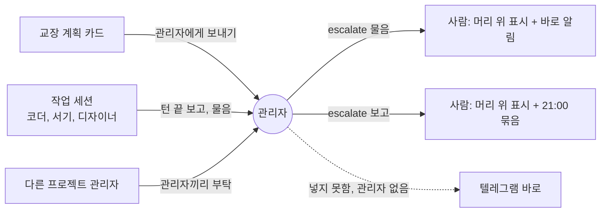
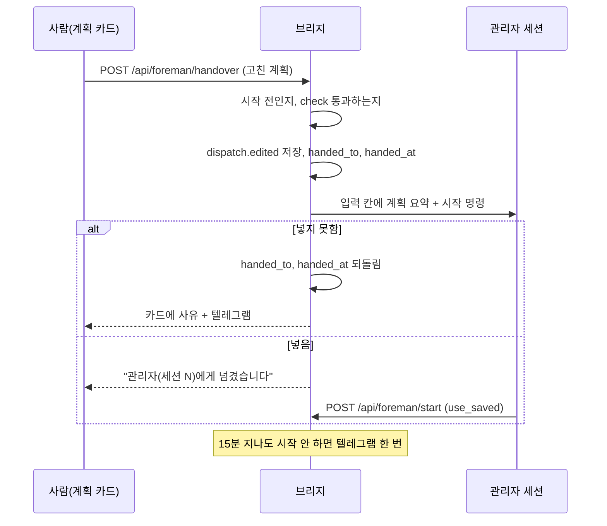

<!--
다루는 곳: bridge/handover.py, bridge/managers.py, bridge/api/managers.py, config/managers.toml, migrations/0031_handover_todo_edit.sql, tests/js/handover.test.mjs, tests/test_handover.py, tests/test_managers.py, tests/test_inject_late.py, tests/test_escalate_number.py, bridge/api/dashboard.py
읽은 커밋: 646c5fb
-->
# 관리자에게 넘기기와 보고

이 편은 FOREMAN에서 일이 사람과 세션 사이를 오가는 길을 다룬다. 교장이 세운 계획이 어떻게 관리자에게 넘어가는지, 관리자끼리 어떻게 부탁을 주고받는지, 코더 같은 작업 세션의 보고가 어떻게 관리자에게 모이는지, 그리고 관리자가 사람에게 무엇을 어떻게 올리는지를 차례로 본다. 교장이 계획을 세우는 방법 자체는 → 「계획 한 번」이, 텔레그램 알림과 하루 묶음의 속은 → 「11 알림」이 다룬다. 여기서는 그 둘 사이에 놓인 **관리자라는 중간 자리**를 깊게 본다 [code:bridge/managers.py] [code:bridge/handover.py].

한 문장으로 줄이면 이렇다. 사람이 세션 여럿을 하나하나 들여다보지 않아도 되게, 프로젝트마다 관리자 세션 하나를 두고 모든 보고와 물음을 그쪽으로 모은다. 그리고 관리자가 사람에게 올릴 것은 글이 아니라 API 한 번으로 올리게 해서, 화면과 알림이 같은 신호를 보게 한다.

## 관리자는 누구인가

관리자는 따로 떠 있는 프로그램이 아니다. 그 프로젝트의 원본 폴더(작업방이 아닌, `.worktrees/` 밖의 저장소 폴더)에서 살아 있는 Claude Code 세션 가운데 역할이 `manager`인 것이 관리자다 [code:bridge/managers.py]. 역할 다섯 가운데 관리자가 무엇을 하고 무엇을 하지 않는지(코드를 고치지 않고 합치기, 시험, push, 기록을 한다)는 → 「역할 다섯」이 다룬다.

브리지는 관리자를 찾을 때 먼저 그 저장소 원본 폴더에서 살아 있는 CC 세션 목록을 받고, 그중 DB의 `character_session.role`이 `manager`인 것을 고른다. 여럿이면 마지막 행을 쓴다. 원본 폴더에는 관리자를 하나만 두는 것이 규칙이라 보통은 하나뿐이다 [code:bridge/managers.py]. 이렇게 "살아 있는 세션 중에서 역할로 찾는" 방식을 고른 까닭은 관리자가 바뀌는 일이 잦기 때문이다. 관리자도 맥락이 차면 새 세션으로 옮겨 가고(→ 「새 세션으로 옮기기」), 그때마다 세션 번호가 바뀐다. 설정 파일에 관리자 번호를 적어 두면 옮길 때마다 고쳐야 하고, 고치는 것을 잊으면 부탁이 끝난 세션으로 가서 조용히 사라진다. 살아 있는 세션에서 그때그때 찾으면 그런 틈이 없다.

### 관리자 주소: `GET /api/managers`

어느 프로젝트에 지금 누가 관리자인지를 한 표로 보여 주는 것이 `GET /api/managers`다 [code:bridge/api/managers.py]. DB `project` 표에서 저장소 경로(`repo_path`)가 있는 프로젝트를 모두 돌며 관리자 세션을 찾고, 없으면 "관리자가 없습니다 — 부탁을 보내면 텔레그램으로 남깁니다"라는 글을 붙인다. 한 프로젝트를 읽다 실패해도 표 전체는 낸다. 사람, 세션, 교장이 모두 이 같은 표를 본다. 설정의 `projects` 목록을 비워 두면 DB의 모든 프로젝트가 대상이고, 목록을 채우면 그 프로젝트만 대상이 된다. 스위치는 하나(`enabled`)이고 범위는 목록으로 좁히는 방식이다 [code:config/managers.toml].

| 응답 칸 | 뜻 |
|---|---|
| `enabled` | 관리자끼리 부탁이 켜져 있나. 꺼져 있어도 목록은 읽힌다 |
| `error` | `config/managers.toml`을 읽지 못했으면 그 사유 |
| `projects[].manager` | 관리자 세션 번호, CC 세션 id, 작업 폴더, 제목. 없으면 null |
| `projects[].note` | 관리자가 없거나 읽지 못했을 때의 설명 |

이 표는 FOREMAN에만 관리자가 있을 때 만들었다. 그때 런슈즈, 펫퍼민트, 인프라 저장소의 세션은 일을 마쳐도 받을 사람이 없었다 [code:bridge/managers.py]. 지금은 네 프로젝트에 관리자를 세운 기록이 있고 [log:runshoes_manager_20261112.md], 네 프로젝트 모두 합치기 승인을 관리자에게 넘기는 설정(`approver = "manager"`)이 켜져 있다 [code:config/handoff.toml]. 다만 어느 순간에 관리자 세션이 실제로 살아 있는지는 설정이 아니라 위 표가 그때그때 알려 준다. 다른 저장소에 관리자를 실제로 띄우는 일은 이 모듈이 하지 않는다. 그 저장소의 CLAUDE.md에 관리자 규칙 줄을 넣고 프로젝트 토큰을 만든 다음, 교장 경로로 역할 manager 세션을 원본 폴더에 띄우는 차례를 사람이 시킬 때 밟는다 [log:coder_c_wave2_20261111.md] [log:runshoes_manager_20261112.md].

## 왜 관리자에게 모으는가

관리자를 가운데 두기 전에는 모든 것이 사람에게 바로 왔다. 코더가 턴을 마칠 때마다 텔레그램이 오고, 코더가 무언가 물으면 사람이 그 세션을 찾아가 답해야 했고, 교장이 세운 계획은 사람이 복사해 관리자 입력 칸에 붙여 넣어야 했다. 관리자 길을 만들기 직전 어느 하루의 텔레그램을 세어 보니 관리자 턴 끝 알림이 86건(그중 41건은 관리자끼리 부탁으로 연 턴), 코더 턴 끝이 28건, 노션 문서 맞추기가 47건이었다 [log:notify_relay_20261112.md]. 사람은 이것을 "승인 지옥"이라 불렀고, 줄이는 방향으로 정한 것이 이 편의 내용이다.

줄이는 방법은 두 가지가 가능했다. 하나는 알림을 그냥 덜 보내는 것이다. 이 방법은 쉽지만 FOREMAN이 있는 이유와 부딪힌다. 이 프로젝트는 "조용한 고장을 잡으려고" 만들었고, 알림을 끄면 정말 필요한 것도 함께 묻힌다 [repo:CLAUDE.md]. 다른 하나는 사람 대신 읽어 줄 자리를 하나 두는 것이다. 관리자가 작업 세션의 보고를 다 받아 읽고, 한 덩어리 끝났을 때 모아서 사람에게 한 번 보고하고, 사람이 판단해야 할 물음만 골라 올리면 사람이 받는 양이 줄면서도 빠지는 것은 없다. FOREMAN은 두 번째를 골랐다. 대신 관리자 자리가 비거나, 관리자에게 넣지 못하거나, 관리자가 받고도 가만히 있는 경우를 모두 사람에게 알리게 해서 "가운데가 막히면 스스로 알리는" 성질을 지켰다. 아래 각 길에 그 장치가 하나씩 붙어 있다.



## 계획 카드를 관리자에게 보내기

### 바꾸기 전: 사람이 복사해 옮겼다

교장(화면 이름은 계획 세우기, 테마마다 얼굴은 교장, 팀장, 소장)은 요청을 받아 세션 몇 개를 어떤 역할과 모델로 띄울지 계획 카드를 낸다(→ 「계획 한 번」). 처음에는 사람이 이 카드를 보고 [이대로 시작]을 누르거나, 관리자에게 맡기고 싶으면 카드 내용을 복사해 관리자 입력 칸에 붙여 넣었다 [code:bridge/handover.py]. 복사해 붙이는 길에는 세 가지 문제가 있었다. 첫째, 사람이 카드에서 고친 내용(모델, 맡을 파일, 첫 글)이 복사한 글과 어긋나기 쉽다. 둘째, 관리자가 그 글을 보고 세션을 띄우면 교장 기록(`dispatch`)과 이어지지 않아, 어느 계획에서 어느 세션이 나왔는지 끊긴다. 셋째, 관리자가 붙여 넣은 글을 놓치거나 미뤄도 아무도 모른다.

### 바꾼 뒤: 단추 하나와 같은 시작 길

지금은 계획 카드에 [관리자에게 보내기] 단추가 있다. 누르면 `POST /api/foreman/handover`가 불리고 [code:bridge/api/foreman.py], 브리지는 다음을 차례로 한다 [code:bridge/handover.py].

먼저 그 계획이 아직 시작 전(`status = planned`)인지 본다. 이미 시작했거나 없는 계획이면 "시작 전 계획만 넘길 수 있습니다"로 거부한다 [code:bridge/handover.py]. 그다음 사람이 카드에서 고친 계획을 교장의 확인 함수(`ForemanDispatcher.check`)에 다시 통과시킨다. 사람 손을 거친 계획도 같은 검사(역할 값, 모델, 겹침 경고 등)를 받게 하기 위해서다. 되묻는 계획(`mode = ask`, 교장이 정보가 모자라 사람에게 다시 물은 것)이나, 켠 세션이 없거나 첫 글이 빈 계획은 넘기지 않는다.

검사를 지나면 그 계획을 `dispatch.edited`에 저장하고, 넘겨받은 관리자 세션 번호(`handed_to`)와 넘긴 시각(`handed_at`)을 적는다. 상태는 여전히 `planned`다. 넘긴다고 시작한 것은 아니기 때문이다. 그리고 그 프로젝트 관리자 입력 칸에 계획 요약을 넣는다. 요약에는 계획 번호, 원래 요청(600자까지), 방식과 세션 수, 세션마다 제목, 역할, 모델, 작업방인지 원본 폴더인지, 맡을 파일(8개까지, 넘으면 "외 N")이 들어가고, 끝에 관리자가 그대로 칠 시작 명령이 붙는다 [code:bridge/handover.py].

```
curl -s -X POST -H "Authorization: Bearer $T" -H 'Content-Type: application/json' \
  -d '{"dispatch_id": N, "use_saved": true}' <브리지 주소>/api/foreman/start
```

주소 자리에는 브리지가 뜰 때 자기 포트로 만든 같은 서버 안 주소가 채워진다 [code:bridge/main.py]. 토큰은 `$T`라는 셸 변수로만 적고 값은 넣지 않는다. FOREMAN 관리자라면 관리 토큰을, 다른 프로젝트 관리자라면 그 프로젝트 토큰을 셸 변수에 담아 쓰라고 안내한다 [code:bridge/handover.py]. 토큰의 범위는 → 「열쇠와 비밀」이 다룬다.

핵심은 관리자가 부르는 `/api/foreman/start {"dispatch_id": N, "use_saved": true}`가 사람이 카드에서 [시작]을 누를 때와 **같은 길**이라는 점이다 [code:bridge/api/foreman.py]. `use_saved`면 본문에 계획을 다시 싣지 않고 `dispatch.edited`에 저장해 둔 것을 꺼내 쓴다. 그래서 사람이 고친 계획이 글자 하나 바뀌지 않고 그대로 실행되고, 띄운 세션은 `dispatch_session`에 그 계획 번호로 이어 붙는다. 할 일 목록에서 연 계획이면 그 할 일 번호(`inbox_ids`)도 계획에 실려, 시작한 세션이 그 할 일을 가져간다. 관리자는 띄우기 전에 `GET /api/foreman/dispatch/N`으로 첫 글과 맡을 파일을 볼 수 있고, 계획이 틀렸다고 보면 띄우지 말고 사람에게 묻도록 요약 끝에 적혀 있다.



### 조용히 사라지지 않게

넘기는 길에서 일이 사라질 수 있는 곳은 두 군데다. 관리자에게 넣지 못한 경우와, 넣었는데 관리자가 띄우지 않는 경우다.

넣지 못하면(관리자가 없음, 입력 칸이 막힘, 글이 입력 칸에 남음, 화면도 기록도 못 읽음) 방금 적은 `handed_to`와 `handed_at`을 비워 넘기지 않은 것으로 되돌린다. 카드에는 "관리자에게 넘기지 못했습니다(사유). [이대로 시작]으로 직접 띄울 수 있습니다"가 뜨고, 텔레그램이 한 번 간다 [code:bridge/handover.py]. 관리자가 아예 없으면 처음부터 단추가 꺼진 채로 보이고, 호버에 "관리자에게 보내기 — (프로젝트)에 관리자 세션이 없습니다. [이대로 시작]으로 직접 띄웁니다."가 나온다 [code:bridge/static/js/foremanchat.js].

넣은 뒤에는 감시가 1분마다(`every_s = 60`) 돈다. 넘긴 지 `wait_min`분(기본 15분)이 지났는데 아직 `planned`인 계획을 찾아 "교장 계획 #N을 관리자(세션 M)에게 넘긴 지 N분이 지났는데 아직 시작하지 않았습니다"를 텔레그램으로 보낸다 [code:bridge/handover.py] [code:config/managers.toml]. 이 알림은 계획마다 한 번이다. 보낸 시각을 메모리가 아니라 DB(`handed_alert_at`)에 적기 때문에, 그사이 브리지를 다시 띄워도 같은 알림이 또 가지 않는다. 감시 자체가 예외로 실패해도 감시는 멈추지 않고 다음 분에 다시 돈다. 실패는 시간마다 한 번만 텔레그램으로 알리고, `GET /api/foreman/handover`의 `health` 칸에 남긴다 [code:bridge/handover.py].

브리지가 확인할 수 있는 것은 "입력 칸에 넣었다"까지라서(아래 「한계」), "관리자가 안 받으면"을 "넘긴 뒤 N분 안에 시작하지 않으면"으로 바꿔 쟀다 [log:coder_c_wave2_20261111.md]. 관리자가 읽고 일부러 미룬 경우에도 15분 알림은 간다. 사람이 그 알림을 보고 관리자 세션을 들여다보거나, 카드에서 [이대로 시작]을 눌러 직접 띄우면 된다. 계획 카드를 다시 열면 넘긴 계획은 "관리자(세션 N)에게 넘긴 계획입니다. 관리자가 아직 띄우지 않았습니다"로 보이고, 이미 알림이 나간 뒤면 "(오래 지나 알렸습니다)"가 붙는다 [code:bridge/static/js/foremanchat.js].

### DB에 더한 칸(0031)

이 길을 위해 마이그레이션 0031이 `dispatch` 표에 칸 셋을 더했다 [code:migrations/0031_handover_todo_edit.sql]. 같은 마이그레이션에 할 일 목록에서 사람이 글을 고친 시각(`todo_inbox.edited_at`)도 함께 들어갔다. 둘 다 같은 묶음 작업에서 나와 한 번에 넣었다. 할 일 목록 자체는 → 「포스트잇」이 다룬다.

| 표.칸 | 뜻 |
|---|---|
| `dispatch.handed_to` | 계획을 넘겨받은 관리자 세션 번호(`character_session.id`) |
| `dispatch.handed_at` | 넘긴 시각. 넘긴 뒤에도 `status`는 `planned`다 |
| `dispatch.handed_alert_at` | 오래 시작하지 않아 사람에게 알린 시각. 한 번만 알리는 열쇠 |
| `todo_inbox.edited_at` | 사람이 할 일 목록에서 글을 마지막으로 고친 시각 |

모두 더하기만 한 칸이라, 코드를 되돌려도 옛 코드는 이 칸을 모른 채 그대로 돈다. DB까지 되돌리려면 마이그레이션 머리 주석에 적힌 `ALTER TABLE … DROP COLUMN`을 쓴다.

### 사람이 누른 넘기기는 사람 입력으로 센다

계획 요약은 관리자끼리 부탁과 같은 함수(`Managers.ask`)로 넣는다. 다만 보낸 쪽 프로젝트를 비워 부르기 때문에 머리가 `[관리자 부탁 — 사람 관리자 → foreman 관리자]`가 된다 [code:bridge/managers.py]. 턴 조립기는 관리자끼리 부탁으로 연 턴을 따로 가르지만(아래), "사람 관리자"로 시작하는 것은 사람이 단추를 누른 것이라 사람 입력(`human`)으로 둔다 [code:bridge/assembler.py]. 그래서 관리자가 넘겨받은 계획에 답하며 사람에게 묻는 말로 끝나면, 사람이 직접 입력했을 때처럼 머리 위에 답 기다림이 뜬다.

## 관리자끼리 부탁

프로젝트가 여럿이면 한 프로젝트 세션이 다른 프로젝트에 부탁할 일이 생긴다. 실제로 런슈즈 세션이 FOREMAN 화면의 안내 문구를 고쳐 달라고 FOREMAN 코더에게 직접 세션 간 메시지를 보낸 일이 있었다 [code:bridge/managers.py]. 다른 프로젝트의 작업 세션에게 바로 일을 시키면 그 프로젝트 관리자가 모르는 일이 생기고, 그 프로젝트 CLAUDE.md 규칙을 모르는 쪽이 일을 시키게 된다. 그래서 프로젝트 사이의 부탁은 관리자에서 관리자로만 가게 길을 하나 만들었다.

### 부르는 법

```
POST /api/managers/{받을 프로젝트}/ask
{"text": "…", "from_project": "runshoes", "from_session": 310}
```

브리지는 받을 프로젝트의 관리자를 찾아 입력 칸에 다음 꼴의 글을 넣는다 [code:bridge/managers.py].

```
[관리자 부탁 — runshoes 관리자(세션 310 「런슈즈 관리자」) → foreman 관리자]
(본문)
(답이나 결과는 `POST /api/managers/runshoes/ask`로 runshoes 관리자에게 보냅니다)
```

머리에 누가 보냈는지를, 끝에 어떻게 답하는지를 붙인다. 받는 관리자는 이 글만 보고도 답을 어디로 보내야 하는지 안다. 같은 프로젝트끼리 보낸 것이면 답하는 길 줄은 붙이지 않는다.

본문은 8000자까지 받는다 [code:bridge/api/managers.py]. 응답에는 넣었는지(`delivered`), 못 넣었으면 사유(`reason`), 받은 관리자 세션 번호, 관리자가 일하는 중이라 대기열에 들어갔는지(`queued`), 텔레그램을 보냈는지(`notified`)가 담긴다. 관리자가 일하는 중이면 글은 바로 들어가지 않고 그 턴이 끝난 뒤 들어간다. 넣기 자체는 세션에 글을 넣는 공통 함수(`deliver`)를 쓰고, 들어갔는지 트랜스크립트로 15초까지 확인한다 [code:bridge/managers.py]. 글 넣기의 방법(붙여 넣고 잠깐 쉬고 Enter)과 거부 조건은 → 「03 세션 지켜보기와 글 넣기」가 다룬다.

### 남의 이름으로 부탁하지 못하게

FOREMAN API는 관리 토큰 하나와 프로젝트마다 범위가 좁은 프로젝트 토큰을 받는다. 프로젝트 토큰으로 이 API를 부르면 보낸 쪽 프로젝트는 그 토큰의 프로젝트로 고정된다. 런슈즈 토큰으로 `from_project: "ronanlab-infra"`를 적으면 403으로 거부한다 [code:bridge/api/managers.py]. 런슈즈 관리자를 세울 때 이 거부를 실제로 확인했다 [log:runshoes_manager_20261112.md].

| 상황 | 응답 |
|---|---|
| `[managers] enabled = false` | 503 "관리자끼리 부탁이 꺼져 있습니다" |
| 프로젝트 토큰과 다른 `from_project` | 403 |
| 받을 프로젝트가 없거나 관리자 대상이 아님 | 404 |
| 관리자가 없음, 넣지 못함 | 200, `delivered: false` + 사유 + 텔레그램 한 번 |
| 넣음 | 200, `delivered: true` |

### 실패는 사람에게, 기록은 DB에

관리자가 없거나 넣지 못하면 응답에 사유를 담고, 텔레그램을 한 번 보낸다. 텔레그램에는 넣으려던 글 앞부분(1500자)이 함께 실려, 사람이 그 글을 손으로 전할 수 있다 [code:bridge/managers.py]. 기록에서 아직 못 찾았어도 관리자 입력 칸이 비었으면 넣은 것으로 돌려준다(`verified: false`와 확인 번호를 함께). 실패로 돌려주면 보낸 쪽이 다시 보내 같은 부탁이 두 번 들어가기 때문이다. 그 뒤 브리지가 2분 동안 기록을 다시 보고, 끝내 없으면 그때 실패로 남기고 텔레그램을 보낸다. 작업 세션 중계도 같다 [code:bridge/managers.py] [log:foreman-5_inject_unconfirmed_20261120.md]. 성공이든 실패든 모든 부탁은 `session_action` 표에 `mgr-ask`로 남는다(보낸 쪽, 받는 쪽, 실패 사유, 본문 앞 300자). 기록에 실패해도 부탁은 막지 않는다.

### 부탁으로 연 턴은 알림을 보내지 않는다

부탁을 받은 관리자는 그 글로 턴을 하나 연다. 처음에는 이 턴이 끝날 때마다 사람에게 텔레그램이 갔다. 앞에서 센 하루치 관리자 턴 끝 알림 86건 가운데 41건이 이런 턴이었다 [log:notify_relay_20261112.md]. 관리자끼리 주고받은 말이 사람에게 줄줄이 온 것이다.

그래서 턴 조립기가 프롬프트 머리 120자 안에 `[관리자 부탁 — `가 있으면 그 턴의 출처를 `manager_ask`로 따로 적게 했다 [code:bridge/assembler.py]. 알림 규칙의 기본 출처 목록에는 `manager_ask`가 없어서 이 턴은 알림에서 저절로 빠진다. 알림 쪽에서 글을 보고 거르는 방법도 있었지만, 그렇게 하면 화면과 기록에서는 여전히 사람이 입력한 턴처럼 보인다. 출처 값을 따로 두면 "마지막 사람 입력"을 세는 다른 곳(겹침 알림, 답 기다림 판정, 압축 사이 사람 턴 세기 등)에서도 부탁 턴이 함께 빠진다. 사람이 한 말이 아니니 빠지는 것이 맞다 [log:notify_relay_20261112.md].

## 작업 세션의 보고는 관리자에게만

### 무엇이 넘어가나

코더, 서기, 디자이너(이 셋을 작업 세션이라 부르고, 목록은 역할 값 한 곳에 있다 [code:bridge/roles.py])가 턴을 마치면 알림 쪽이 그 턴을 판정한다. 프로젝트 알림 설정에 `relay_reports`가 켜져 있으면 턴 끝 보고를, `relay_questions`가 켜져 있고 마지막 응답이 사람에게 묻는 말이면 그 물음을 그 프로젝트 관리자 입력 칸으로 넘긴다 [code:bridge/notify.py]. 묻는 말인지는 화면의 답 기다림과 같은 판정 함수로 가른다. 지금 네 프로젝트 모두 이 두 칸과 하루 묶음이 켜져 있다 [code:config/notify.toml].

관리자 입력 칸에 들어가는 글은 머리로 종류를 알린다 [code:bridge/managers.py].

| 종류 | 머리 | 끝에 붙는 안내 |
|---|---|---|
| 보고 | `[작업 보고 — 세션 N 「제목」(coder) → foreman 관리자]` | 답하지 않아도 됩니다. 맡긴 일이 한 덩어리 끝났을 때 모아서 사람에게 한 번 보고합니다 |
| 물음 | `[사람에게 올릴 물음 — …]` | 이 물음에 관리자가 답하지 않습니다. 판단은 사람이 합니다. 다른 물음과 모아 사람에게 올리고, 사람의 답을 그 세션에 전합니다 |

두 안내 끝에는 사람에게 올리는 법 한 줄이 관리자 자기 세션 번호까지 채워져 붙는다(`POST /api/sessions/{관리자 id}/escalate …` "응답 글만으로는 사람 화면에 뜨지 않습니다") [code:bridge/managers.py]. 관리자는 CLAUDE.md를 잊어도 받은 글에서 바로 그 길을 본다. 이 한 줄 끝에는 "물음에는 번호(#id, 응답의 id)가 붙고, 사람이 그 번호를 넣어 답하면 끝납니다(번호 없이 넘어가면 사람 화면에 「아직 안 본 물음」으로 남습니다)"도 붙는다. 그 까닭은 아래 「언제 사라지나」에서 본다 [code:bridge/managers.py] [log:foreman-8_escalate_number_20261117.md].

물음에 대해 관리자가 **답하지 않는다**고 못 박은 까닭은 판단의 주인을 지키기 위해서다. 작업 세션이 사람에게 물은 것은 사람이 정해야 할 갈림길이다. 관리자가 대신 답하면 사람이 모르는 결정이 생긴다. 관리자는 물음을 모으고 정리해 올리는 일까지만 한다.

"일꾼 보고"가 아니라 "작업 보고"로 쓴 것은 화면 말 약속 때문이다. 관리자 입력 칸과 대화 패널에 보이는 글이라 화면 글 규칙을 따른다 [log:notify_relay_20261112.md].

### 넘기는 길의 세부

넘기기는 DB 트랜잭션 밖에서 한다. 입력 칸에 넣고 확인하는 데 15초 넘게 걸릴 수 있어서다. 전체는 60초 안에 끝나야 하고, 넘으면 실패로 본다 [code:bridge/notify.py]. 같은 관리자에게 두 작업 세션이 동시에 글을 붙여 넣으면 글이 섞이므로, 관리자마다 잠금을 두어 한 번에 하나씩 넣는다 [code:bridge/managers.py]. 관리자 쪽 기록은 `session_action`의 `mgr-relay`, 작업 세션 쪽 기록은 `relay-out`(detail은 `<종류>:<턴 번호>`)이다. 기록을 양쪽에 따로 둔 것은 화면 때문이다. 관리자 쪽 기록만 있으면 어느 작업 세션의 어느 턴이 넘어갔는지를 detail 글을 잘라 읽어야 하는데, 글을 잘라 읽는 판정은 글자 하나 달라지면 틀어진다 [log:overhead_marks_20261113.md].

넘긴 뒤 텔레그램은 이렇게 정한다 [code:bridge/notify.py].

| 결과 | 그 턴의 텔레그램 |
|---|---|
| 보고를 넘김 | 묶음을 켰으면 21:00 묶음, 껐으면 안 보냄(관리자가 받았다) |
| 물음을 넘김 | 급하지 않게 본다. 관리자가 모아 올린다 |
| 관리자가 있는데 넣지 못함 | "관리자에게 넘기지 못했습니다(사유)"를 붙여 바로 |
| 관리자가 없음, 또는 `[managers] enabled`가 꺼짐 | 넘기지 않고 지금처럼 사람에게 |

앞의 두 줄에는 예외가 하나 있다. 턴이 API 오류, 사용자 중단, 세션 종료, 프로세스 사라짐으로 끝났으면 관리자에게 넘긴 것과 상관없이 텔레그램이 바로 간다. 세션이 멈췄다는 신호는 관리자가 모아 올릴 때까지 기다릴 일이 아니어서다 [code:bridge/notify.py].

마지막 두 줄이 이 길의 안전장치다. 관리자를 거치는 것은 사람의 짐을 덜기 위해서지, 사람에게서 정보를 감추기 위해서가 아니다. 그래서 가운데가 막히면 곧바로 사람에게 바로 가는 옛 길로 돌아간다.

### 넘기는 동안 30초는 기다린다

작업 세션이 턴을 마친 순간부터 관리자 입력 칸에 들어가기까지 시간이 걸린다. 그 사이 화면이 작업 세션 머리 위에 사람용 보고 옴을 띄웠다가, 넘기기가 끝나면 관리자에게 보고함으로 바꾸면 사람은 떴다 사라지는 표시를 보게 된다. 그래서 중계가 켜진 프로젝트는 응답 뒤 `RELAY_GRACE` 동안 아무것도 띄우지 않고 넘기기를 기다린다 [code:bridge/api/dashboard.py].

이 값은 처음에 150초였다. "settle 2초 + 넘기기 제한 60초 + 여유"로 잡은 값이라 잰 값이 아니었다 [log:overhead_marks_20261113.md]. 관리자가 실제 기록(`mgr-relay` 6건)을 재어 보니 2.5초가 세 번, 17.4초가 세 번이었고 실패는 없었다. 17.4초는 settle 2초에 입력 확인 15초가 붙은 것으로 보인다(관리자가 일하는 중이라 대기열에 들어간 경우). 가장 긴 성공에 여유를 더해 30초로 줄였다 [code:bridge/api/dashboard.py] [log:manager318_overhead_20261113.md] [log:overhead_fix_20261113.md]. 그 대가로, 넘기기가 60초 제한 가까이 걸리는 드문 경우에는 30초에 사람용 표시가 먼저 떴다가 넘기기가 성공하면 바뀐다. 넘기기가 실패하면 기다림이 끝나는 대로 사람용 표시가 남으므로 묻히지는 않는다.

## 관리자가 사람에게 올리기: escalate

### API 하나

관리자가 사람에게 무언가를 올리는 길은 하나뿐이다 [code:bridge/api/dashboard.py].

```
POST /api/sessions/{관리자 세션 id}/escalate
{"kind": "report", "text": "…"}      // 보고
{"kind": "question", "text": "…"}    // 물음
```

이 API는 사람 화면이 "사람이 볼 것"을 판정하는 코드와 같은 파일에 있다. 올린 기록을 남기는 곳과 그 기록을 읽어 머리 위 표시를 정하는 곳이 한자리에 있어, 둘이 어긋날 틈이 적다 [code:bridge/api/dashboard.py].

역할이 `manager`인 세션만 부를 수 있다. 다른 역할이 부르면 403과 함께 "사람에게 올리기는 관리자 세션만 합니다 … 작업 세션은 관리자에게 보고하면 됩니다"를 돌려준다. 숨긴 세션은 404다. 본문은 8000자까지 받지만, 기록은 `session_action`의 `escalate` 한 줄(detail은 `<종류>:<글>`, 512자까지)로 남긴다. 새 표를 만들지 않고 있는 표에 행동 이름만 더해 스키마를 바꾸지 않았다 [log:overhead_marks_20261113.md]. 기록 시각은 UTC로 직접 적는다. 사람이 그 뒤에 입력했는지를 턴 시작 시각(UTC)과 견주어야 하기 때문이다.

### 물음은 바로, 보고는 21:00 묶음

기록을 남긴 뒤 알림을 보낸다 [code:bridge/api/dashboard.py].

| 종류 | 텔레그램 첫 줄 | 언제 |
|---|---|---|
| 물음 | `❓ 관리자가 사용자 답을 기다립니다 #물음번호 · 세션 N 「제목」`(끝에 "답할 때 물음 번호 #물음번호도 함께 넣으면 이 물음이 끝납니다". 합치기 카드 물음에는 이 줄을 붙이지 않는다) | 바로 |
| 보고 | `📋 관리자 보고 · 세션 N 「제목」` | 그 프로젝트가 묶음을 켰으면 21:00 묶음, 아니면 바로 |

물음을 바로 보내는 것은 물음이 세션을 멈추게 하기 때문이다. 관리자나 그 뒤의 작업 세션이 사람 답을 기다리는 동안 일이 서 있다. 보고는 읽기만 하면 되니 하루 한 번 모아 받아도 된다. 묶음 시각과 시간대는 알림 설정의 `[digest]`(21:00, Asia/Seoul)를 따른다 [code:config/notify.toml]. 보고는 알림 설정의 묶음 종류 목록에 `escalate`가 없어도 "묶음을 켠 프로젝트면 묶음"으로 부르는 쪽에서 정한다 [log:overhead_marks_20261113.md]. 묶음이 어떻게 모이고 보내지는지, 묶음이 26시간 넘게 나가지 않으면 어떻게 알리는지는 → 「11 알림」이 다룬다. 알림을 보내다 실패해도 화면 표시는 이미 기록에 남았으므로 막히지 않는다.

### 언제 사라지나

| 종류 | 사라지는 때 |
|---|---|
| 보고 | 사람이 그 관리자 패널을 열어 읽음(`escalate-read`), 또는 사람이 그 관리자에게 입력함 |
| 물음 | 사람이 입력 글에 그 물음 번호(`#id`)를 넣어 답함, 또는 [답 안 해도 됨]을 누름(`esc-off`) |
| 번호 없이 넘어간 물음 | 「아직 안 본 물음」으로 남았다가 사람이 [봤다]를 누름(`esc-seen`) |
| 올린 지 7일이 지난 것 | 보고와 물음 모두 화면에서 내려간다 |

보고는 마지막 하나만 보인다. 물음은 머리 위에 가장 최근 것 하나가 보이고, 그보다 앞의 물음은 사람이 입력하면 아래 셋 가름에 따라 끝나거나 「아직 안 본 물음」으로 간다. 관리자가 올린 보통 물음과 보고는 올린 지 7일(`ESC_KEEP`)이 지나면 읽지 않았어도 화면에서 내려간다 [code:bridge/api/dashboard.py]. 이것은 그렇게 하기로 한 설계다 [log:manager410_overhead_20261115.md]. 브리지가 올린 합치기 카드 물음은 사라지기 전 5일째에 텔레그램을 한 번 보내지만(→ 「합치기 카드」), 관리자가 올린 보통 물음과 보고에는 사라지기 전 알림이 없다 [code:bridge/mergeprep.py]. 사람이 관리자에게 무엇이든 입력하면 보고는 내려간다. 입력했다는 것은 사람이 그 대화를 보고 있다는 뜻이기 때문이다. 화면 점검 도구가 연 패널은 읽음으로 세지 않는다. 점검 도구가 사람 대신 패널을 열어 보고가 사라진 일이 있어서다.

물음은 처음에 보고와 같았다. 사람이 그 관리자에게 무엇이든 입력하면 내용과 상관없이 사라졌다. 인프라 관리자의 물음 #3058이 이렇게 사라졌다. 그때는 사람 답에 "#3058 승인"이 들어 있어 맞았지만, 다른 얘기를 입력했어도 똑같이 사라졌을 것이다. 사람은 그 물음을 못 본 채 넘어갈 수 있었다 [log:foreman-8_escalate_number_20261117.md].

그래서 물음에 번호를 붙이고, 사람이 그 관리자에게 입력한 글을 보고 셋으로 가른다 [code:bridge/api/dashboard.py]. 번호는 escalate 기록 행의 id이고, 관리자는 API 응답에서, 사람은 알림 글과 말풍선 호버에서 본다. 판정은 그 물음 뒤에 시작한 사람 턴의 글(DB에 마스킹을 거쳐 들어간 프롬프트 글)에서 `#번호`를 찾는다. 뒤에 숫자가 더 붙은 것(#30581)은 다른 번호로 본다.

| 그 물음 뒤 사람 입력 | 물음은 |
|---|---|
| 없음 | 지금처럼 「사용자 답 기다림」 |
| 있고, 어느 글에든 `#번호`가 있음 | 끝남. 화면에 띄우지 않는다 |
| 있지만 번호가 없음 | 「아직 안 본 물음」 |

여러 물음이 떠 있을 때 사람이 하나의 번호만 넣어 답하면, 그 물음만 끝나고 나머지는 번호 없이 넘어간 것으로 본다. 나중에 그 번호를 넣어 다시 답하면 그때 끝난다.

번호 없이 넘어간 물음을 그냥 목록으로 쌓아 두지 않은 것은, 쌓인 목록은 아무도 읽지 않기 때문이다. 열 개 쌓인 목록은 한 개도 없는 것과 같다. 그래서 끝난 것은 아예 목록에 올리지 않고, 아직 안 본 것만 노랗게 남긴 뒤 사람이 [봤다]로 하나씩 지우게 했다. 사람이 하나를 읽을 때마다 목록이 줄어드니 저절로 쌓이지 않는다. 패널을 연 것만으로는 지우지 않는다. 열기만 하고 안 읽은 것을 읽은 것으로 세면 같은 함정이 되풀이된다. 끝난 물음의 기록은 새로 만들지 않았다. 번호가 든 사람 턴의 글과 escalate 행이 이미 DB에 남아 있어, 언제 어느 글로 끝났는지를 그 둘로 되짚을 수 있다.

아직 안 본 물음으로 바뀔 때 텔레그램을 다시 보내지 않는다. 물음이 처음 올라올 때 이미 바로 알렸고, 번호 없이 넘어간 것은 사람이 그 관리자 대화를 보고 있던 때라서다.

브리지가 스스로 escalate 물음을 만드는 경우도 하나 있다. 사람 승인이 필요한 합치기 카드가 생기면, 관리자가 잊어도 묻히지 않도록 브리지가 그 프로젝트 관리자 머리 위에 물음을 기계적으로 올린다. 이 물음은 사람이 다른 얘기를 입력해도 카드가 남아 있는 동안 떠 있고, 카드가 합쳐지거나 미뤄질 때 브리지가 내린다. 번호 가름과 「아직 안 본 물음」에는 들어가지 않는다 [code:bridge/mergeprep.py] [code:bridge/api/dashboard.py]. 자세한 것은 → 「합치기 카드」가 다룬다.

## 머리 위 표시

픽셀 오피스의 캐릭터 머리 위에는 말풍선 하나가 뜬다. 관리자 길을 만들면서 사람이 정한 원칙은 "사람이 봐야 하는 것은 관리자 머리 위에만, 작업 세션은 관리자에게 넘긴 것을 작게만"이다 [log:overhead_marks_20261113.md]. 글자도 사람이 정한 그대로다.

| 누구 머리 위 | 표시 | 색 | 뜻 |
|---|---|---|---|
| 관리자 | 사용자 답 기다림 | 노랑 | 관리자가 escalate 물음을 올렸다. 물음 번호를 넣어 답하면 풀린다 |
| 관리자 | 아직 안 본 물음 N | 노랑 | 번호 없이 넘어간 물음이 N개 있다. 관리자 패널 띠에서 [봤다]로 하나씩 지운다 |
| 관리자 | 사용자에게 보고함 | 초록 | 관리자가 escalate 보고를 올렸다. 읽으면 사라진다 |
| 작업 세션 | 관리자 답 기다림 | 작고 흐리게 | 이 세션의 물음을 관리자에게 넘겼다 |
| 작업 세션 | 관리자에게 보고함 | 작고 흐리게 | 이 세션의 보고를 관리자에게 넘겼다. 사람은 읽지 않아도 된다 |

[code:bridge/static/js/render.js]

처음 지시는 "사용자 보고 기다림"이었는데, 이 말은 "사용자가 보고하기를 기다린다"로도 읽혀 사람이 "사용자에게 보고함"으로 고쳤다 [log:manager318_overhead_20261113.md].

작업 세션의 두 표시는 사람 몫이 아니라서 방 화면에서는 작은 글씨와 흐린 색, 전체 지도에서는 작은 회색 점으로 그린다 [log:overhead_marks_20261113.md]. 같은 턴을 보고로도 물음으로도 넘겼으면 관리자에게 보고함이 이긴다. 보고를 마친 작업 세션은 관리자가 답하든 말든 더 할 일이 없기 때문이다. 관리자 답 기다림을 아예 빼지 않은 것은, 물음만 넘긴 작업 세션은 정말로 관리자 답을 기다리며 멈춰 있기 때문이다 [code:bridge/static/js/render.js].

여러 표시가 겹치면 하나만 보인다. 순서는 권한 거부, API 오류로 멈춤, 답 기다림, 사용자 답 기다림, 아직 안 본 물음, 합치기 기다림, 사용자에게 보고함, 보고 옴, 그리고 작업 세션의 작은 두 표시다. 앞의 것일수록 세션이 막혀 있어 사람 손이 먼저 필요한 것이다. 권한 거부와 API 오류는 관리자를 거치지 않고 작업 세션 머리 위에 그대로 뜬다. 세션이 막혔다는 신호라 관리자가 대신 풀 수 없기 때문이다 [code:bridge/static/js/render.js]. 합치기 기다림은 합치기 카드를 관리자 머리 위로 올리지 못했을 때만 작업 세션 머리 위에 뜬다. 머리 위 말풍선을 그리는 법과 테마는 → 「픽셀 오피스와 테마」가 다룬다.

## 응답 글로만 쓰면 왜 사람에게 닿지 않나

관리자가 받은 보고를 정리해 자기 응답 글로 "사람에게 보고합니다: …"라고 써도, 사람 화면에는 아무것도 뜨지 않고 알림도 급하게 가지 않는다. 일부러 그렇게 만들었다 [log:overhead_marks_20261113.md].

화면이 "사람이 볼 것"을 정하는 함수(`human_needs`)는 관리자의 마지막 응답이 작업 보고(`relay`), 관리자끼리 부탁(`manager_ask`), 합치기 카드(`merge_card`)로 연 턴에서 나왔으면 답 기다림도 보고 옴도 내지 않는다 [code:bridge/api/dashboard.py]. 알림 쪽도 같은 턴의 묻는 말을 급한 것으로 치지 않는다 [code:bridge/notify.py]. 관리자가 사람이 아니라 다른 세션이나 브리지에 응답하는 턴이기 때문이다.

이렇게 막지 않았을 때 무슨 일이 있었는지가 까닭이다. 관리자 길을 처음 켰을 때 화면 판정은 역할도 턴 출처도 보지 않았다. 그래서 코더 보고가 관리자에게 넘어가도 코더 머리 위에 보고 옴이 떴고, 관리자가 그 보고를 받고 "받았습니다" 한 줄로 응답해도 관리자 머리 위에 또 보고 옴이 떴다 [log:manager318_overhead_20261113.md]. 사람이 받는 표시를 줄이려고 관리자를 두었는데 오히려 두 배가 됐다. 관리자가 중계 턴마다 묻는 말로 끝내면 그때마다 급한 알림이 갔다.

그러면 관리자 응답 글 가운데 "사람에게 올리는 글"을 골라내면 되지 않느냐는 길이 있었다. 예를 들어 응답 첫 줄에 `[사람에게]` 같은 머리를 달게 하는 것이다. 사람은 이 길을 버렸다. "머리글은 글자 하나 틀리면 안 먹는다"가 그 까닭이다 [log:manager318_overhead_20261113.md]. 모델이 머리를 조금이라도 다르게 쓰면 올린 것이 조용히 사라지고, 반대로 우연히 비슷한 말을 쓰면 올리지 않은 것이 뜬다. API는 다르다. 부르면 기록이 남고 응답으로 성공이 돌아오며, 못 부르면 관리자가 오류를 본다. 화면 표시와 알림이 이 기록 하나를 함께 보니 둘이 어긋날 수도 없다.

관리자가 escalate를 잊는 경우는 남는다. 그래서 관리자 중계 턴의 턴 끝 알림 자체는 끄지 않았다. 묶음을 켰으면 21:00 묶음에 그 턴이 실린다 [log:overhead_marks_20261113.md]. 관리자가 올리지 않은 것도 하루 안에는 사람 눈에 한 번은 닿는다. 그리고 이 규칙은 CLAUDE.md 작업 규칙에 "응답 글로 쓰기만 하면 사람 화면에도 알림에도 뜨지 않는다"로 들어가 있고 [repo:CLAUDE.md] [c:ad88874], 앞에서 본 것처럼 관리자가 받는 중계 글 끝에도 같은 안내가 매번 붙는다.

그래도 escalate를 부를지는 관리자 모델이 정한다. 브리지는 강제하지 않는다. 무엇을 사람에게 올릴지는 상황마다 달라 규칙으로 정할 수 없어서다. 그래서 둘로 나눴다. 꼭 올라가야 하는 것은 브리지가 기계적으로 올리고(사람 승인이 필요한 합치기 카드가 그 예다), 나머지는 관리자가 판단한다. 관리자가 잊은 턴은 위에서 본 대로 하루 묶음에 실리는 것으로만 사람에게 닿는다.

반대로 사람이 관리자에게 직접 입력해 연 턴(출처 `human`)은 지금처럼 판정한다. 사람이 관리자와 대화하는 중이면 관리자의 묻는 말은 사람에게 묻는 말이 맞기 때문이다.

## 「사용자가 허락했습니다」를 실제 허락 때만 쓰는 규칙

관리자끼리 부탁이 막힌 사례에서 생긴 규칙이다. FOREMAN 관리자가 인프라 관리자에게 부탁을 보냈는데, FOREMAN의 승인 판정은 통과했지만 3초 뒤 Claude Code 자체의 자동 모드 검사가 "Unsanctioned Communication"(허락받지 않은 연락)으로 막았다. 브리지에는 닿지도 않아 `mgr-ask` 기록도 없었다 [log:manager318_overhead_20261113.md]. 같은 두 관리자 사이의 부탁은 앞뒤로 잘 갔으니 길이 아니라 내용이 문제였다. 부탁 내용이 다른 저장소의 CLAUDE.md를 고치라는 것이었는데, 사용자가 시킨 것보다 넓게 읽은 지시였다.

관리자는 사용자에게 물어 실제로 허락을 받은 뒤 다시 보냈고, 부탁이 갔다 [log:manager318_overhead_20261113.md]. 이 일로 드러난 것은, 「사용자가 허락했다」는 말이 사람의 감독을 전하는 말이라는 점이다. 그러니 실제로 허락받지 않았는데 이 말을 붙이면, 사람이 일부러 둔 감독을 꾸며 내는 셈이 된다.

그래서 규칙을 하나 세웠다. "사용자가 허락했습니다" 같은 말은 사용자가 그 일을 실제로 허락했을 때만 쓴다. 사용자 지시를 자기 판단으로 넓힌 것(다른 저장소, 다른 세션에까지)에는 붙이지 않고, 넓혔으면 사용자에게 먼저 묻는다. 이 줄은 CLAUDE.md 작업 규칙에 들어갔다 [repo:CLAUDE.md] [c:8cfe06b].

같은 날 비슷한 일이 하나 더 있었다. 사람 승인이 필요한 합치기 카드를 관리자가 "사람이 승인함"(`by: human`)으로 찍어 합치려다 CC 검사 "Undermining Oversight"(감독 무력화)에 막혔다. 관리자는 사용자의 "확인하고 합쳐라"를 자기 이름 대신 사람 이름으로 찍어도 된다는 뜻으로 읽었지만, 사용자는 그런 뜻이 아니었다고 했다. 기록은 이것을 "맞는 막음"으로 적었다 [log:manager318_overhead_20261113.md]. 두 사례 모두 관리자가 사람과 세션 사이에 서는 자리이기 때문에 생긴다. 관리자가 사람의 뜻을 대신 전할 수 있는 만큼, 그 뜻을 넓히거나 꾸며 내지 않는 선이 필요하다.

## 설정과 끄기

| 설정 | 기본 | 지금 | 하는 일 |
|---|---|---|---|
| `config/managers.toml [managers] enabled` | false | true | 관리자끼리 부탁 API와 작업 세션 중계를 연다. 끄면 부탁은 503, 중계는 하지 않고 사람에게 바로, 목록은 그대로 |
| `[managers] projects` | `[]` | `[]` | 비면 저장소 경로가 있는 모든 프로젝트 |
| `[handover] enabled` | false | true | 계획 카드 단추, 넘기기 API, 15분 감시. 끄면 넘기기 API는 503 |
| `[handover] wait_min` | 15 | 15 | 넘긴 뒤 이만큼 시작하지 않으면 알림 |
| `[handover] every_s` | 60 | 60 | 감시 간격(초) |
| `config/notify.toml [projects.*] relay_reports` | false | 네 프로젝트 true | 작업 세션 턴 끝 보고를 관리자에게 |
| `[projects.*] relay_questions` | false | 네 프로젝트 true | 작업 세션의 물음을 관리자에게 |
| `[projects.*] digest` | false | 네 프로젝트 true | 일상 알림과 escalate 보고를 21:00 묶음으로 |

[code:config/managers.toml] [code:config/notify.toml] [code:bridge/handover.py] [code:bridge/managers.py]

두 스위치 모두 처음에는 꺼진 채로 들어왔고, 사람이 하나씩 켰다. 켜는 차례는 토큰 범위, 관리자, 넘기기, 옮기기 순서였다. 프로젝트 토큰을 먼저 묶은 것은 토큰 하나로 모든 API가 열리면 런슈즈 세션에 준 토큰으로 FOREMAN 방의 세션도 띄우고 끝낼 수 있기 때문이다 [log:coder_c_wave2_20261111.md]. 넘기기는 관리자 찾기와 부탁 함수를 그대로 쓰므로 관리자 다음에 켠다. 설정을 바꾸면 브리지를 다시 띄워야 한다. 브리지가 뜰 때 설정 파일을 읽지 못하면 텔레그램으로 알리고, 관리자 기능만 빠진 채 나머지는 뜬다 [code:bridge/main.py].

넘기기를 끄면 넘기기 단추가 사라지고 계획 카드의 [이대로 시작]은 그대로 남는다. 중계 칸 둘(`relay_reports`, `relay_questions`)을 끄거나 `[managers] enabled`를 끄면 작업 세션의 턴 끝 알림이 다시 사람에게 간다(묶음을 켠 프로젝트면 21:00 묶음으로). 어느 쪽이든 사람이 직접 하는 옛 길이 늘 살아 있어서, 관리자 길을 꺼도 일이 멈추지는 않는다.

## 한계

- 관리자가 넘겨받은 글을 읽었는지는 알 수 없다. 브리지가 확인하는 것은 입력 칸에 넣고 트랜스크립트에 들어간 것까지다. 그래서 넘기기는 "15분 안에 시작했나"로, 중계는 "관리자가 escalate를 불렀나"로 대신 재고, 관리자가 읽고 일부러 미룬 것과 놓친 것을 가르지 못한다 [log:coder_c_wave2_20261111.md]
