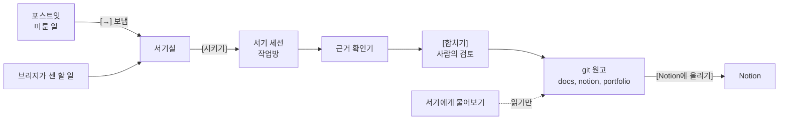

<!--
다루는 곳: docs/12_scribe.md, config/scribe.toml, bridge/postit.py
읽은 커밋: fb7121b
-->
# 10 서기와 문서

FOREMAN의 캐릭터 가운데 서기는 코드를 고치지 않고 글을 쓰는 캐릭터다. 프로젝트마다 하나씩 있고, 그 프로젝트 저장소의 문서(docs, CLAUDE.md, README의 알려진 한계, 포트폴리오, 그리고 지금 읽고 있는 이 기술문서 원고)를 쓰고 맞춘다. 역할 이름은 코드에서 `scribe`, 화면에서는 서기라 부르고, 역할 설명은 「문서를 쓰고 맞춥니다」 한 줄이다 [code:bridge/roles.py]. 코더가 코드를 만들고 디자이너가 화면을 고치듯, 서기는 문서를 맡는다. 역할 다섯이 어떻게 나뉘는지는 → 05 역할과 권한 편에 있다.

이 편은 서기 이야기 전체의 지도다. 서기가 왜 있는지, 문서를 네 갈래로 나눈 생각, 서기가 실제로 어떻게 돌고 사람이 어디서 검토하는지, 무엇을 일부러 하지 않게 했는지를 다룬다. 구체적인 장치는 아래 네 하위 편이 깊게 다룬다.

| 하위 편 | 다루는 것 |
|---|---|
| 서기실과 일감 | 서기에게 일을 시키는 창(서기실), 시킬 수 있는 일 종류, 할 일을 기계로 세는 법, 같은 일과 같은 파일만 막는 규칙 |
| 포스트잇 | 대화에서 미룬 일을 붙잡아 두는 함, [갱신]으로 끝났는지 보는 길, [→]로 알려진 한계에 보내는 길 |
| 근거 확인과 물어보기 | 서기가 단 근거 표시를 LLM 없이 확인하는 장치, 서기에게 세션 없이 한 번 묻는 길 |
| 노션 게시 | git 원고를 Notion 페이지로 올리는 게시기, 사람이 Notion에서 고친 것을 덮지 않는 법 |

## 서기는 누구인가: 떠돌이에서 프로젝트의 문서 담당으로

처음 설계에서 이 자리는 「포트폴리오를 쓰는 떠돌이 캐릭터」였다. 떠돌이란 어느 프로젝트 방에도 속하지 않는 캐릭터를 말한다. 여러 프로젝트를 돌아다니며 바깥 사람에게 보여 줄 포트폴리오 글만 쓰게 하려는 생각이었다. 이것을 프로젝트마다 하나씩 두는 문서 담당으로 바꿨다 [c:331e949] [log:retro_20261105_foreman.md]. 까닭은 문서 일이 포트폴리오 하나로 끝나지 않는다는 데 있다. 실제로 손이 가는 일은 docs가 코드와 어긋난 곳 찾기, 길어진 CLAUDE.md 정리, 미뤄 둔 한계를 README에 적기 같은 것이고, 이 일들은 모두 한 저장소의 사정을 알아야 할 수 있다. 떠돌이 캐릭터는 어느 저장소에서 일하는지가 정해지지 않아 이런 일을 맡기기 어렵다. 그래서 서기를 각 프로젝트 방에 앉히고, 포트폴리오는 그 서기가 하는 일 가운데 하나로 낮췄다 [docs:12_scribe.md].

서기 캐릭터는 그 프로젝트의 포먼(프로젝트마다 있는 대표 캐릭터)이 띄운 캐릭터로 기록되고, 색은 잉크 갈색이다. 포먼의 금색과 다른 역할의 파랑, 초록, 보라와 겹치지 않게 고른 색이다. 일이 없으면 픽셀 오피스의 서기실 자리에 앉아 있다. 서기 세션의 기본 모델은 `config/models.toml`의 `scribe = "claude-opus-5-5"`이고 일감마다 바꿀 수 있다 [code:config/models.toml]. 모델 고르기 자체는 → 13 사용량과 모델 편에 있다.

## 네 문서와 세 축

서기가 쓰는 모든 글의 바탕은 「문서가 넷이고, 넷은 맡은 일이 다르다」는 생각이다 [docs:12_scribe.md]. 이것을 정하기 전에는 같은 내용이 README, docs, 회고, 포트폴리오에 조금씩 다른 말로 되풀이되었고, 그중 어느 것이 지금 맞는지 아무도 장담하지 못했다. 그래서 문서마다 읽는 사람을 하나로 정하고, 그 사람에게 맞는 깊이와 말투를 따로 정했다.

깃헙(커밋 로그)은 언제 무엇을 했는지를 맡는다. 다른 문서는 이것을 되풀이하지 않고, 날짜순으로 쌓아 쓰지도 않는다. docs는 세션(CC, 즉 Claude Code)이 일할 때 읽는 글이다. 사람이 읽으라고 쓴 글이 아니어서 지금 상태와 결정의 까닭만 얕고 짧게 적고, 어려운 말을 써도 된다. 노션 기술문서는 사람이 읽는 글이고 이 프로젝트에서 가장 자세한 문서다. 깊게, 쉽게, 압축하지 않고 쓴다. 포트폴리오는 비개발자도 읽는 글이라 얕고 쉽고 짧게, 그리고 혼자만 경어체로 쓴다.

여기서 핵심은 깊이, 쉬움, 압축이 서로 다른 세 축이라는 점이다. 깊이는 얼마나 파고드는가, 쉬움은 어려운 말을 쓰는가, 압축은 같은 내용을 얼마나 짧게 쓰는가다. 흔히 「쉽게 써라」를 「얕게 써라」로 알아듣는데, 둘은 다르다. 노션 기술문서가 바로 깊으면서 쉬운 글이다. 포트폴리오의 「얕고 짧다」도 다루는 범위가 좁다는 뜻이지 문장을 잘게 끊으라는 뜻이 아니다. 그래서 서기 일감 지시문에는 「목록이 아니라 문단으로 풀어 쓴다」는 줄이 노션과 포트폴리오 모두에 들어 있다 [code:bridge/scribe_room.py] [log:foreman-4_scribe_prompts_20261115.md].

| 문서 | 읽는 쪽 | 깊이 | 쉬움 | 압축 | 문체 |
|---|---|---|---|---|---|
| docs | CC 세션 | 얕다 | 어려운 말을 써도 된다 | 짧다 | 평서체 |
| 노션 기술문서 | 사람 | 깊다 | 쉽다 | 길다 | 평서체 |
| 포트폴리오 | 비개발자를 포함한 사람 | 얕다 | 쉽다 | 짧다 | 경어체 |

이 나눔은 노션과 포트폴리오의 경계도 정한다. 포트폴리오는 「이 화면이 무엇을 해 주나」까지만 쓰고, 왜 그렇게 만들었는지, 무엇을 버렸는지, 무엇에 막혔는지는 노션 기술문서가 맡는다. 포트폴리오 편 끝에는 그 화면을 깊게 다루는 노션 원고로 가는 링크 한 줄을 둔다 [docs:12_scribe.md] [log:foreman-5_notion_toc_20261115.md].

## 서기가 하는 일

서기실에서 시킬 수 있는 일 종류는 코드의 `TASKS` 표 한 곳에 있다 [code:bridge/scribe_room.py]. 각 일은 자기가 고칠 파일 목록(`TOUCHES`)을 함께 가져서, 같은 파일을 고치는 일이 두 개 동시에 열리지 않게 하는 데 쓰인다.

| 일 | 하는 것 | 고치는 곳 |
|---|---|---|
| 문서 점검 | 코드와 문서(README, docs, CLAUDE.md)가 어긋난 곳을 찾아 보고만 한다 | `log/doccheck_*` |
| 문서 고치기 | 문서 점검 결과나 물어보기 답에 적힌 어긋남을 고친다. 메뉴에는 없고 그 결과 화면의 버튼으로만 뜬다 | README, CLAUDE.md, `docs/` |
| CLAUDE.md 정리 | 꼭 지킬 금지와 결정만 짧게 남기고 상세는 docs로 옮겨 가리킨다 | CLAUDE.md, `docs/` |
| 알려진 한계 쓰기 | 포스트잇에서 [→]로 보낸 것을 README 알려진 한계 절에 쓰고, 끝난 줄을 뺀다 | README.md |
| 포트폴리오 쓰기 | 화면 하나를 한 편으로, 비개발자도 읽을 글을 쓴다 | `portfolio/` |
| 기술문서 쓰기 | 코드를 읽고 이 노션 기술문서 원고를 통으로 쓴다 | `notion/` |
| Notion 게시 | 세션 없이 버튼으로 원고를 Notion에 올린다 | (세션 아님) |

설계 문서의 처음 표에는 인계 요약 다듬기나 압축 손실 반영 같은 일도 적혀 있었지만, 지금 코드의 `TASKS`에 있는 것은 위 일곱뿐이다. 각 일을 언제 할 일로 띄우는지, 무엇을 재료로 주는지는 → 서기실과 일감 편에 있다.

문서를 서기만 고치는 것은 아니다. 코드를 고친 코더 세션은 그 코드를 가리키는 문서(docs, 노션 원고, 포트폴리오)도 같은 브랜치에서 함께 고친다. 코더의 역할 설명도 「코드를 고치거나 만듭니다. 그 코드를 가리키는 문서도 함께 고칩니다」로 바뀌었다 [code:bridge/roles.py]. 브리지는 코더 세션을 띄울 때 첫 글 끝에 이 규칙과, 어느 문서가 그 코드를 가리키는지 거꾸로 찾는 도구(`tools/docrefs.py`) 쓰는 법을 붙인다 [code:bridge/docrefs.py] [code:bridge/handoff.py]. 디자이너와 조사 세션에는 붙이지 않는다. 예전에는 코더가 코드를 고치고, 그 뒤 서기가 문서를 따라잡는 차례였다. 그 사이 문서는 늘 한 걸음 늦었고, 코드가 바뀐 줄을 서기가 다시 찾아야 했다. 이 사슬을 끊으려고 고친 사람이 문서도 함께 고치게 했다 [docs:12_scribe.md] [log:foreman-8_docrefs_20261117.md]. 그래서 서기 일감은 여러 편에 걸친 고쳐 쓰기, 새 편, 코더가 고치지 못한 것으로 좁아졌다. 코더가 고쳐도 말투는 위 네 문서 표를 그대로 따른다.

## 실제 CC 세션이고, 작업방에서 돈다

서기는 `claude -p` 한 번으로 답만 받아 오는 방식이 아니라 실제 CC 세션으로 돈다. 문서 일은 여러 파일을 읽고 고친 뒤 diff를 만들어야 하는데, 한 번 묻고 답받는 방식으로는 그 일을 할 수 없기 때문이다 [docs:12_scribe.md]. 예외는 서기에게 물어보기 하나다. 이것은 읽기만 하고 답만 돌려주면 되는 일이라 세션 없이 읽기 전용 `claude -p` 한 번으로 돈다(→ 근거 확인과 물어보기).

서기 세션은 언제나 git worktree(화면 이름 작업방)에서 띄운다. 서기실의 [시키기]는 띄우기 함수에 `worktree=True`를 넘긴다 [code:bridge/scribe_room.py]. 작업방은 저장소 안에 따로 만든 작업 폴더와 자기 브랜치라서, 서기가 무엇을 쓰든 원본 `main`에는 바로 닿지 않는다. 그래서 작업방의 [합치기]가 곧 사람의 검토 관문이 된다. 서기용으로 따로 검토 화면을 만들지 않고 이미 있는 합치기 장치를 그대로 쓴 것이다. 서기 일감 지시문 끝에도 「사람이 [합치기] 전에 diff를 본다」는 줄이 들어 있다 [code:bridge/scribe_room.py].

합치기에는 서기만의 단계가 하나 더 붙는다. 합치면 브랜치가 지워지므로, 그 전에 브리지가 서기 브랜치의 근거 표시를 확인하고(근거 표시가 몇 개인지, 틀린 것이 몇 개인지, 근거 없이 숫자를 쓴 줄이 몇 개인지) 서기가 처음 쓴 줄 수와 그 뒤 고친 줄 수를 `scribe_review` 표에 남긴다 [code:bridge/handoff.py]. 고친 양이 시간이 지나며 줄어드는지가 서기 글의 수준을 재는 지표다. 사람이 고치지 않아도 되는 글이 늘수록 서기가 나아졌다는 뜻이기 때문이다. 근거 확인기가 무엇을 어떻게 보는지는 → 근거 확인과 물어보기, 합치기 장치 자체는 → 07 합치기 편에 있다.

서기 세션을 띄우는 길은 셋이다. 서기실의 [시키기], 교장 계획의 [시작], 그리고 직접 띄우기다. 예전에는 길마다 기록이 따로 남아 서기실이 계획 길로 띄운 서기를 몰랐고, 그래서 같은 파일을 고치는 서기가 둘 열려도 막지 못했다. 지금은 세 길이 모두 같은 띄우기 함수(`HandoffManager.spawn_new`)를 지나고, 그 함수가 서기 일 종류를 한 곳에서 남긴다 [code:bridge/handoff.py] [log:foreman-4_scribe_two_paths_20261115.md]. 그래서 길이 하나 더 늘어도 기록이 갈라지지 않는다. 막는 것은 같은 일과 같은 파일 둘뿐이고, 동시에 몇 개까지라는 개수 상한은 두지 않는다 [c:9fce185]. 자세한 판정은 → 서기실과 일감 편에 있다.

## 세기는 기계가, 시키기는 사람이

서기는 스스로 일을 시작하지 않는다. 브리지가 LLM 없이 「할 일」을 세어 서기 머리 위와 서기실에 보여 주고, 실제로 세션을 띄우는 것은 사람이 [시키기]를 눌렀을 때뿐이다 [docs:12_scribe.md].

커밋이 몇 개 쌓이면 자동으로 서기를 돌리는 길도 생각했지만 버렸다. 문서는 사람이 읽고 검토해야 하는 글이라, 자동으로 초안이 쌓이면 그대로 검토 빚이 된다. 아무도 보지 않은 초안 브랜치가 여러 개 열려 있으면 그것 자체가 또 하나의 조용한 고장이다. 또 같은 저장소에서 다른 세션이 일하는 중이면 자동으로 띄운 서기가 같은 문서를 고쳐 합칠 때 충돌이 난다. 그래서 할 일은 세되 실행은 사람이 누르게 했다.

기술문서 쓰기도 이 원칙을 따르면서 기준을 커밋 수가 아닌 「코드가 실제로 바뀌었나」로 잡았다. 마지막으로 기술문서 서기 세션을 합친 뒤 이틀(`TECHDOC_DAYS = 2`)이 지났고, 원고 가운데 다루는 코드가 바뀐 편이 하나라도 있을 때만 할 일에 오른다 [code:bridge/scribe_room.py]. 이틀이 지났어도 코드가 그대로면 올리지 않는다. 원고가 하나도 없으면 올리지 않는데, 첫 목차는 사람이 정하기 때문이다. 「코드가 바뀐 편」은 각 원고 맨 위 머리 주석에 적힌 읽은 커밋 뒤로, 그 편이 다루는 경로를 바꾼 feat나 fix 커밋이 있는 편이다. 머리 주석을 읽지 못한 편은 0으로 세지 않고 바뀐 편으로 센다. 읽지 못한 것을 「그대로」로 보이면 낡은 글이 조용히 남기 때문이다.

`config/scribe.toml`은 서기 자리에 뜨는 「포스트잇 쌓임」 말풍선의 기준을 정한다. 이 파일에서 읽는 표는 `[postit]` 하나이고, 읽는 코드는 포스트잇 쪽(`bridge/postit.py`의 `conf`, `nudge_of`)이다 [code:config/scribe.toml] [code:bridge/postit.py]. 포스트잇이 무엇이고 말풍선이 어떻게 보이는지는 → 포스트잇 편에 있다.

```toml
[postit]
open_max = 20      # 열린 포스트잇이 20장 이상이면
stale_days = 7     # 가장 오래된 것이 7일 지났으면
refresh_days = 7   # 마지막 [갱신] 뒤 7일 지났으면 말풍선을 띄운다
```

셋 중 하나만 맞아도 말풍선이 뜬다. [갱신]은 열린 포스트잇이 아직 맞는지 조사 세션이 다시 보게 하는 단추다. [갱신]을 한 번도 하지 않았으면 가장 오래된 포스트잇부터 날을 센다. 값이 없거나 0 이상 정수가 아니면 코드 기본값(20, 7, 7)으로 돌고, 모르는 표나 칸 이름과 함께 브리지 로그에 경고가 남는다 [code:bridge/postit.py]. 경고를 넣은 까닭이 있다. 예전에는 이 파일에 서기실 쪽 기준 `[nudge]`가 있었는데, 포스트잇이 생긴 뒤로 그 값을 읽는 코드는 시험뿐이어서 값을 바꿔도 아무 일이 없었다. 조용히 무시되던 설정이라 그 표와 코드를 빼고, 읽지 않는 칸은 경고하게 했다 [c:408e4ed]. 말풍선도 제안일 뿐이고, 세션은 사람이 [시키기]를 눌러야 붙는다. 값을 바꾸면 브리지를 다시 띄우지 않아도 서기실을 다음에 읽을 때부터 반영된다 [code:bridge/postit.py].

## 없앤 일: 회고와 README 갱신

서기에게는 원래 일이 둘 더 있었다. 회고 쓰기와 README 갱신이다. 둘 다 없앴고, 없앤 까닭이 네 문서의 생각을 그대로 보여 준다.

회고는 하루나 단계가 끝날 때 무엇을 했고 무엇을 배웠는지 적는 글이었다. 없앤 첫째 까닭은 사람이 읽지 않았다는 것이다. 둘째로 회고가 들어설 자리가 없었다. 무엇을 언제 했는지는 깃헙 커밋이, 결정과 그 까닭은 docs가 이미 맡고 있어서 회고는 그 둘을 다른 말로 한 번 더 쓰는 글이 되었다. 셋째로 회고를 쓰지 않고 지나간 만큼을 서기 할 일 줄에 「마지막 회고 뒤 커밋 N개」로 세어 보여 주었는데, 없애기 직전 그 수는 잰 때에 따라 542~546개였다 [docs:12_scribe.md] [log:foreman-4_scribe_retro_removal_20261115.md]. 아무도 읽지 않는 글이 밀렸다고 큰 숫자로 겁을 주는 것은 알림이 아니라 소음이다. 그래서 서기실 줄, 회고 세션, 회고 재료 묶음, 밀림 세기를 모두 뺐다 [c:f3ff5a8]. 이미 쓴 회고 한 편은 기록으로 저장소에 남겨 두었다.

README 갱신은 README의 로드맵 표(단계마다 한 줄씩 상태를 적은 표)를 지금 상태에 맞추는 일이었다. 이것을 없앤 까닭은 그 표가 실제로 틀린 것을 알리고 있었기 때문이다. 표는 어느 날 멈춘 뒤로 고쳐지지 않았고, 그사이 저장소에는 커밋이 340개 쌓였다 [log:foreman-7_scribe_design_20261115.md]. 예를 들어 사용량 단계 줄은 「1 끝, 2~4는 차례로」라고 적혀 있었지만, 실제로는 2와 4, 그리고 추가 요금 배지까지 이미 끝난 뒤였다. 표에 자리가 없는 새 일(관리자 체제, 화면 말 시험, 합치기 카드 등)도 여럿이었다. 그런데 화면은 「README 몇 개 쌓임」처럼 README 파일 전체가 바뀐 뒤의 커밋 수만 셌으니, 어느 줄이 틀렸는지는 말해 주지 못했다. 이 표를 맞추는 일을 서기에게 계속 맡기는 길도 있었지만, 만든 순서는 깃헙이, 기능마다의 상태는 docs가 이미 맡고 있으니 표 자체가 필요 없다고 보았다. 그래서 로드맵 표와 함께 서기실 줄, 밀림 세기, 일감 지시문과 교장 계획 지시문의 일 이름, 합치기 카드의 README 정리 후보까지 모두 뺐다 [c:74e722d] [log:foreman-4_readme_cleanup_20261115.md]. README에는 대신 「지금은 ~이다」 말투로 쓰는 알려진 한계 절이 남았고, 이것을 맞추는 일이 위의 알려진 한계 쓰기다.

두 일을 없앤 데서 같은 원칙이 보인다. 문서가 같은 내용을 두 번 맡으면 한쪽은 반드시 낡고, 낡은 쪽은 조용히 틀린 것을 알린다. 그래서 내용마다 맡는 문서를 하나로 정하고, 맡을 자리가 없는 문서는 없앤다.

## 이 기술문서는 어떻게 만들어지나

지금 읽고 있는 이 글도 서기가 쓴 원고다. 사람이 서기실에서 기술문서 쓰기를 시키면 서기 세션 하나가 작업방에서 뜬다. 이 세션은 먼저 `git rev-parse --short HEAD`로 지금 커밋을 적어 두는데, 모든 편의 읽은 커밋이 이 값 하나여서 원고 한 벌이 한 커밋의 사진이 된다. 다음으로 모듈 설명, API 라우터, 화면 스크립트, 마이그레이션, 설정 파일 같은 코드 지도를 읽고 목차를 정한다. 목차는 설정 파일의 주제 목록이 아니라 `notion/` 폴더 나무 그 자체다. 파일 하나가 Notion 페이지 하나이고, `notion/NN_이름/` 폴더 아래 글은 같은 이름 페이지의 하위 페이지가 된다. 그 뒤 편마다 서브에이전트(한 세션 안에서 따로 떠서 맡은 글 하나만 쓰고 결과를 돌려주는 보조 Claude)에게 한 편씩 맡기는데, 이때 그 편이 다루는 코드 경로, 읽은 커밋, 나무 규칙, 머리 주석 꼴, 쓰는 법을 같은 지시로 준다. 저장소의 코드와 docs를 합치면 3MB가 넘어 세션 하나가 다 들고 쓸 수 없기 때문에 이렇게 나눴다 [log:foreman-7_scribe_design_20261115.md]. 편마다 세션을 따로 띄우는 길도 있었지만 그러면 합치기가 여러 번이 되고 편마다 읽은 커밋이 달라질 수 있어, 세션 하나에 서브에이전트 여럿을 골랐다. 서브에이전트들이 돌려준 원고는 부모 세션이 맞대어, 편 사이에 겹친 곳, 어느 편에도 들지 않은 코드, 실제로 없는 경로, 틀린 근거 표시를 찾는다. 각 편 맨 위에는 노션에는 나가지 않는 머리 주석(다루는 곳과 읽은 커밋)이 붙는데, 이것이 있어야 나중에 서기실이 「읽은 커밋 뒤 이 편이 다루는 코드가 바뀌었나」를 셀 수 있다 [code:bridge/scribe_room.py] [c:16dcb3a]. 원고는 커밋된 뒤 사람이 [합치기]에서 diff를 보고, 다시 사람이 [Notion에 올리기]를 눌러야 Notion에 올라간다. 올릴 때 머리 주석과 근거 표시는 떼어지고 git 원고에만 남는다(→ 노션 게시).

## 하위 편이 이어지는 모습



포스트잇은 서기에게 일을 대 주는 한 갈래다. 대화에서 미룬 일이 포스트잇에 붙고, 사람이 그중 못 풀 것을 [→]로 보내면 알려진 한계 쓰기 할 일이 된다. 서기실은 포스트잇과 브리지가 센 할 일을 모아 사람에게 보여 주고, 사람이 [시키기]를 누르면 서기 세션이 작업방에서 뜬다. 세션이 쓴 글은 합치기 전에 근거 확인기를 지나고, 사람이 [합치기]로 받아들이면 git 원고가 된다. Notion은 그 원고의 사본일 뿐이고, 올리는 것도 사람이 누른다. 원본은 언제나 git이다.

## 아직 안 된 것

설계에는 있지만 아직 코드에 없는 것이 셋 있다 [docs:12_scribe.md]. 하나는 서기 초안을 조사 역할 세션이 원문과 맞대 읽게 하는 검토다. 근거 없는 주장, 뒤집힌 결정을 지금 것처럼 쓴 곳을 사람보다 먼저 짚게 하려던 것인데, 비용이 1.5배쯤 든다고 보아 포트폴리오와 CLAUDE.md 정리에만 쓰기로 하고 아직 잇지 않았다. 둘째는 글에 적힌 숫자(커밋 수, 토큰, 개수)가 DB 값과 맞는지 대조하는 일이다. 지금 근거 확인기는 근거 표시가 가리키는 커밋, 파일, 경로가 실제로 있는지와 숫자가 든 줄에 근거 표시가 있는지까지만 본다. 셋째는 Notion의 작업 기록 데이터베이스(날짜, 프로젝트, 커밋 수, 링크를 모은 표)다. 셋 다 없다는 사실을 숨기지 않고 여기 적어 두는 것도 같은 원칙에서다. 되는 척하는 기능은 조용한 고장과 다르지 않다.
