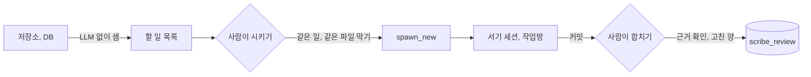
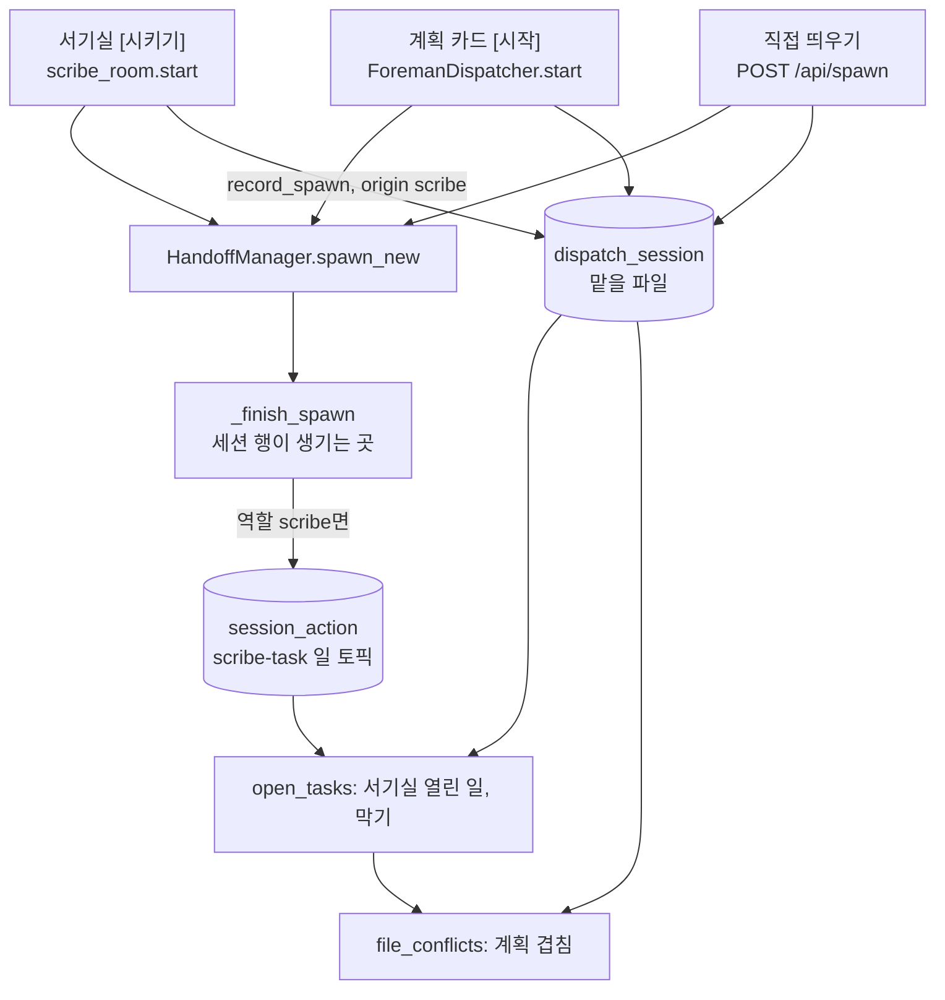

<!--
다루는 곳: bridge/scribe_room.py, bridge/scribe.py, bridge/api/scribe.py, config/scribe.toml, bridge/static/js/scribe.js, migrations/0023_scribe_review.sql
읽은 커밋: fb7121b
-->
# 서기실과 일감

서기는 프로젝트마다 하나씩 있는 문서 담당 캐릭터다. 코드를 고치는 코더, 읽고 알아보기만 하는 조사와 같은 층의 역할이고, 코드 값은 `scribe`다. 서기실은 그 서기에게 일을 시키는 창이다. 픽셀 오피스에서 서기 자리나 서기 캐릭터를 누르면 옆 패널에 서기실이 뜬다 [code:bridge/static/js/scribe.js].

이 편은 서기실이 무엇을 세고, 무엇을 시키고, 무엇을 막는지를 다룬다. 시킬 수 있는 일의 종류, 브리지가 LLM 없이 「할 일」을 세는 기준, 같은 일과 같은 파일만 막고 개수 상한은 둔 적이 있다가 없앤 까닭, 서기 세션이 「열려 있다」를 어떻게 판정하는지, 서기 세션이 뜨는 세 길이 한 곳으로 모인 사정, 재료 파일을 저장소 밖에 쓰는 까닭, 서기 세션이 처음 받는 일감 지시문의 내용, 그리고 서기실 화면 자체다.

서기실 안에 함께 있지만 따로 깊게 다루는 것은 다른 편에 있다. 할 일을 적어 두는 종이인 포스트잇은 → 포스트잇, 서기 원고의 근거 표시를 기계로 맞대는 근거 확인기와 세션 없이 한 번 묻는 물어보기는 → 근거 확인과 물어보기, 원고를 Notion에 올리는 길은 → 노션 게시에서 다룬다. 서기가 왜 있는지, 네 종류의 문서(깃헙, docs, 노션, 포트폴리오)가 어떻게 나뉘는지는 → 10 서기와 문서가 먼저다.

## 서기실이 하는 일, 한 문단으로

서기실의 뼈대는 세 줄로 요약된다. 첫째, 브리지가 저장소와 DB를 보고 「서기가 할 만한 일」을 기계로 센다. 둘째, 사람이 그 목록에서 하나를 골라 [시키기]를 누르면 브리지가 서기 세션 하나를 작업방(코드 이름 worktree, 세션마다 떼어 준 별도 작업 폴더와 브랜치)에 띄우고, 그 일에 맞는 첫 글(일감 지시문)을 넣는다. 셋째, 서기가 일을 마치면 사람이 diff를 보고 [합치기]를 누른다. 이 합치기가 곧 사람의 검토 관문이다 [code:bridge/scribe_room.py]. 브리지는 세기만 하고 저절로 세션을 띄우지 않는다.

## 시킬 일 종류

시킬 수 있는 일은 `scribe_room.TASKS` 한 곳에 있다. 화면에 뜨는 이름과 설명도 이 표에서 그대로 온다(`GET /api/scribe/todo`가 `tasks`로 함께 내려 준다) [code:bridge/scribe_room.py] [code:bridge/api/scribe.py].

| 키 | 화면 이름 | 하는 것 | 고치는 파일(`TOUCHES`) | 메뉴에 보이나 |
|---|---|---|---|---|
| `doccheck` | 문서 점검 | 코드와 문서(README, docs, CLAUDE.md)가 안 맞는 곳을 찾아 보고한다. 고치지 않는다 | `log/doccheck_*` | 늘 |
| `later` | 알려진 한계 쓰기 | 포스트잇에서 사람이 [→]로 보낸 것을 README 「알려진 한계」에 쓰고, [갱신]에서 끝났다고 닫은 줄을 뺀다 | `README.md` | 늘 |
| `trim` | CLAUDE.md 정리 | 꼭 지킬 것만 짧게 남기고 상세는 docs로 옮겨 가리킨다 | `CLAUDE.md`, `docs/` | 늘 |
| `techdoc` | 기술문서 쓰기 | 코드를 읽고 `notion/` 원고를 통으로 쓴다. 목차는 서기가 정하고 편마다 서브에이전트가 쓴다 | `notion/` | 원고 폴더가 `notion/`인 프로젝트만 |
| `portfolio` | 포트폴리오 쓰기 | 화면을 보고 편 목록을 정해 비개발자도 읽을 글을 `portfolio/`에 쓴다 | 편이 있으면 `portfolio/<편>*`, 없으면 `portfolio/` | `portfolio/` 폴더가 있는 저장소만, 따로 묶음으로 |
| `docfix` | 문서 고치기 | 물어보기 답이나 문서 점검 결과에 적힌 어긋남을 고친다 | `README.md`, `CLAUDE.md`, `docs/` | 메뉴에 없고 결과에서만 |
| `publish` | Notion 게시 | 포트폴리오와 기술문서를 Notion에 올린다 | 없음 | 세션이 아니라 버튼 |

이 가운데 `publish`는 세션으로 시키는 일이 아니다. [시키기]로 들어오면 서버가 「세션으로 시키는 일이 아닙니다」로 거절하고, 게시는 세션 없이 [게시]나 [Notion에 올리기] 버튼이 한다 [code:bridge/scribe_room.py]. 나머지 여섯은 모두 서기 세션 하나를 작업방에 띄운다. 모델은 역할 기본값으로 `config/models.toml`의 `scribe`(지금 Opus)를 쓴다 [code:config/models.toml].

메뉴에 보이는 순서는 화면의 `ORDER = ['doccheck', 'later', 'trim', 'techdoc']`가 정한다. 문서 점검이 맨 앞인 것은 「찾기, 그다음 고치기」가 서기 일의 핵심 흐름이라서다 [code:bridge/static/js/scribe.js]. 문서 고치기가 메뉴에 없는 것도 같은 생각이다. 무엇을 고칠지 목록이 있어야 시킬 수 있는 일이라, 합쳐진 문서 점검 결과 줄 옆의 [바로 고치기]나 물어보기 답 아래의 [이 답대로 문서 고치기]에서만 뜬다. 서버도 이를 강제한다. `docfix`는 `topic`에 `log/doccheck_*.md` 꼴의 결과 이름이 있거나 `note`에 물어보기 답이 있어야 하고, 둘 다 없으면 「고칠 목록이 없습니다」로 거절한다. 결과 이름이 있어도 그 파일이 main에 없으면(아직 점검 결과를 합치지 않았으면) 띄우지 않는다 [code:bridge/scribe_room.py].

### 설계 표에는 있고 코드에는 없는 일

서기 설계 문서의 일감 표에는 `sync`(문서 맞추기), `loss`(압축 손실 반영), `polish`(인계 요약 다듬기)도 있다 [docs:12_scribe.md]. 지금 코드의 `TASKS`에는 이 셋이 없다. 서기실에서 시킬 수 없다는 뜻이다.

실제로는 이 일들이 다른 길로 돌고 있다. 「docs를 지금 코드에 맞추기」 같은 문서 맞추기는 서기실 버튼이 아니라 관리자가 계획 길로 띄운 서기 역할 세션이 해 왔다. 한 조사에서 FOREMAN의 서기 역할 세션 가운데 버튼이 아닌 길로 뜬 것이 열 몇 개였고, 대부분 문서 맞추기 일이었다 [log:foreman-4_scribe_structure_20261115.md]. 압축 손실은 → 압축 손실 재기와 → 문서로 옮기기가 자기 화면에서 다루고, 인계 요약 다듬기는 설계에서도 「작아서 `claude -p` 한 번으로 돈다」고 예외로 둔 일이라 서기실 세션 길과 맞지 않는다. 그래서 이 편의 표는 코드에 있는 일만 적는다.

### 없앤 일

서기실에는 한때 회고를 쓰는 일과 README 로드맵 표를 맞추는 일도 있었다. 둘 다 뺐다. 회고는 사람이 읽지 않았고, 히스토리는 깃헙이, 결정과 까닭은 docs가 맡아 회고가 따로 있을 자리가 없었다. 게다가 회고 줄의 「밀림」 숫자는 마지막 회고 파일 뒤로 쌓인 저장소 전체 커밋 수를 세서, 없애기 직전에는 500을 넘는 숫자가 서기실에 노랗게 떠 사람을 겁줬다 [log:foreman-4_scribe_retro_removal_20261115.md] [log:foreman-4_scribe_structure_20261115.md]. README 로드맵 표는 어느 시점에 갱신이 멈춰 지금 상태를 틀리게 알렸고, 만든 순서는 커밋 기록이 이미 맡고 있어 표와 그 표를 맞추던 일을 함께 뺐다 [log:foreman-4_readme_cleanup_20261115.md]. 회고 재료를 모으던 함수 묶음도 이때 `bridge/scribe.py`에서 함께 빠졌다 [code:bridge/scribe.py].

## 할 일 세기: LLM 없이, 기준으로

서기실은 「지금 서기가 할 만한 일」을 목록으로 보여 준다. 이 목록은 브리지가 LLM 없이 기계적으로 센다. 화면이 `GET /api/scribe/todo`를 부르면 서버가 `scribe_room.todo`로 프로젝트마다 git, 파일, DB를 보고 셈을 낸다. git과 파일을 매번 훑으므로 서버는 30초 동안 같은 답을 돌려주고, 화면은 20초 안에 다시 부르지 않는다 [code:bridge/api/scribe.py] [code:bridge/static/js/scribe.js].

왜 LLM을 쓰지 않나. 할 일 세기는 1분 안팎마다 도는 일이고, 그때마다 모델을 부르면 비용이 들 뿐 아니라 숫자가 부를 때마다 달라진다. 「할 일이 있다」는 신호는 같은 상태에서 같은 답이 나와야 믿을 수 있다. 그래서 셈은 모두 파일 개수, 줄 수, 커밋 수, DB 행처럼 다시 세도 같은 값이 나오는 것으로만 한다 [code:bridge/scribe_room.py].

### 일마다 무엇을 세나

| 일 | 무엇을 세나 | 할 일에 올리는 기준 | 화면 글 |
|---|---|---|---|
| 문서 점검 | `docs/NN_*.md` 가운데 결과 문서(`log/NN_*`, `log/stage<N>_*`)가 하나도 없는 설계 문서 | 하나라도 있으면 (다섯까지 줄로) | 결과 없는 단계 N개 |
| CLAUDE.md 정리 | CLAUDE.md 줄 수 | 80줄(`CLAUDE_MD_MAX`)을 넘으면 | N줄 넘음 |
| 알려진 한계 쓰기 | 포스트잇에서 [→]로 보냈는데 README에 아직 안 쓴 줄, [갱신]에서 끝났다고 닫은 README 한계 줄 | 쓸 줄이나 뺄 줄이 하나라도 있으면 | N개 밀림 |
| 기술문서 쓰기 | 원고 편마다 「읽은 커밋 뒤 다루는 코드를 바꾼 feat, fix 커밋」이 있나 | 아래 「기술문서 쓰기의 이틀」 | 코드가 바뀐 편 N |
| 포트폴리오 쓰기 | 기술문서와 같은 셈을 `portfolio/` 편마다 | 목록에 올리지 않고 포트폴리오 묶음 머리줄에만 | 글 N편 가운데 코드가 바뀐 편 M |

[code:bridge/scribe_room.py] [code:bridge/static/js/scribe.js]

문서 점검의 셈에는 거짓 경보를 막는 문턱이 하나 있다. 저장소의 `log/`에 `_result.md`로 끝나는 파일이 하나도 없으면 셈을 아예 하지 않는다. 결과 문서를 따로 두는 관례가 FOREMAN의 것이라서다. 펫퍼민트처럼 설계 문서 자체가 기록인 저장소에서 이 셈을 돌리면 모든 설계 문서가 「결과 없음」으로 떠서 의미 없는 경보가 된다 [code:bridge/scribe_room.py].

할 일 목록에는 서기에게 시키는 일 말고도 두 종류의 줄이 더 섞인다. Notion 게시가 뒤처진 파일 묶음(→ 노션 게시)과 포스트잇 [갱신] 조사 세션이 결과 없이 끝난 실패 줄(→ 포스트잇)이다. 둘 다 「사람이 봐야 할 것」이라 같은 목록에 둔다 [code:bridge/scribe_room.py].

### 못 읽은 것은 0이 아니다

이 셈에서 가장 조심한 것은 「읽지 못했다」가 「0개」로 보이는 것이다. 0개는 「할 일 없음」으로 읽혀 사람이 안심하고 지나간다. 그런데 git을 못 읽었거나 Notion 게시기가 꺼져서 0이 나왔다면 그것은 조용한 고장이다. 그래서 셈을 못 한 칸은 `unread`나 `pub_error`로 내려보내고, 화면은 그 자리에 숫자 대신 「읽지 못했습니다」를 빨갛게 띄운다. 화면이 API를 부르다 실패하면 지난 값을 그대로 보이되 「지금 값을 읽지 못했습니다(지난 값입니다)」를 함께 붙인다 [code:bridge/scribe_room.py] [code:bridge/static/js/scribe.js]. Notion이 꺼져 있어도 다른 할 일은 그대로 센다. 한쪽이 실패했다고 목록 전체가 비면 그것 역시 조용한 고장이기 때문이다.

### 기술문서 쓰기의 이틀

기술문서(이 원고 묶음)를 언제 다시 쓰라고 할지는 다른 일보다 기준이 복잡하다. `techdoc_state`가 정하는 조건은 셋이 모두 맞아야 한다 [code:bridge/scribe_room.py].

첫째, 원고가 한 편이라도 있어야 한다. 원고가 없으면 할 일에 올리지 않는다. 첫 목차는 사람이 정한다는 결정 때문이다. 둘째, 「코드가 바뀐 편」이 하나라도 있어야 한다. 편마다 맨 위 머리 주석에 「다루는 곳」(그 편이 설명하는 코드 경로)과 「읽은 커밋」이 적혀 있다. 읽은 커밋 뒤로 그 경로를 바꾼 커밋 가운데 제목이 `feat:`이나 `fix:`인 것이 있으면 그 편은 낡았을 수 있다고 본다(병합 커밋은 뺀다) [code:bridge/manuscript.py]. 셋째, 마지막으로 기술문서 서기 세션을 합친 지 이틀(`TECHDOC_DAYS = 2`)이 지나야 한다 [code:bridge/scribe_room.py].

각 조건에는 까닭이 있다. 커밋 수로 세지 않는 것은 그 숫자가 원고와 상관없는 커밋까지 다 세기 때문이다. 앞서 없앤 회고, 포트폴리오의 옛 셈이 바로 「저장소 전체 커밋 수」를 세다가 수백이라는 숫자로 의미를 잃었다 [log:foreman-4_scribe_structure_20261115.md]. 편마다 다루는 코드만 보면 docs나 log만 바뀐 날에는 아무것도 뜨지 않고, 그 편이 설명하는 코드가 바뀌었을 때만 뜬다. 이틀이 지났어도 코드가 그대로면 올리지 않는다는 것도 같은 생각이다. 날짜만으로 일을 만들면 할 일 목록이 다시 소음이 된다.

머리 주석을 읽지 못한 편은 「바뀐 편」으로 센다. 머리 주석이 없거나, 읽은 커밋이 저장소에 없거나, 다루는 곳이 저장소 밖을 가리키면 그 편은 셀 수 없다. 이것을 0으로 치면 그 편은 영영 「그대로」로 남아 아무도 다시 쓰라고 하지 않는다. 그래서 셀 수 없는 편은 셀 수 있는 바뀐 편과 더해 `need`로 센다. 화면에는 「글 N편 가운데 코드가 바뀐 편 M, 머리 주석을 읽지 못한 편 K」로 따로 보인다 [code:bridge/scribe_room.py] [code:bridge/static/js/scribe.js].

「이틀」을 무엇에서부터 재느냐도 따져 본 것이다. 후보는 셋이었다. 마지막 원고 커밋 시각은 누가 한 글자만 고쳐도 0으로 돌아가고, 마지막 게시 시각은 쓰기가 아니라 올리기를 잰다. 그래서 「기술문서 서기 세션을 마지막으로 합친 시각」을 골랐다 [log:foreman-7_scribe_design_20261115.md]. `last_techdoc_merge`는 DB에서 합치기(`wt-merge`) 기록이 있고 일 종류가 `techdoc`인 세션의 가장 늦은 합친 시각을 찾는다. 그런 기록이 없으면 `notion/`을 마지막으로 바꾼 커밋 시각으로 대신한다 [code:bridge/scribe_room.py]. 이 대신 길은 계획 길로 일 종류 없이 띄운 서기가 원고를 쓴 경우 때문에 있다. 그런 세션은 일 종류가 `plan`으로 남아 합친 기록에 잡히지 않는다 [log:foreman-4_techdoc_portfolio_path_20261115.md]. 지금 이 원고 묶음도 서기실 버튼이 아니라 서기 세션이 쓰므로, 관리자가 계획 길로 기술문서 서기를 띄울 때는 일 종류로 `techdoc`을 넘겨야 이틀이 합친 시각에서 잰다.

기술문서 쓰기 줄은 게시기(`config/notion.toml`의 원고 폴더 `src`)가 `notion/`인 프로젝트에서만 보인다. 서버도 시킬 때 같은 조건을 다시 본다. 원고 폴더가 `docs/`인 프로젝트는 docs 파일을 그대로 Notion에 맞추는 다른 길을 쓰기 때문이다(→ 노션 게시) [code:bridge/scribe_room.py].

## 시켜도 되나: 같은 일과 같은 파일만 막는다

서기 세션은 작업방에서 돈다. 작업방은 서로를 보지 못한다. 서기 둘이 같은 파일을 고치고 있어도 각자는 모르고, 충돌은 뒤에 합치는 쪽이 rebase할 때 터진다. 그래서 서기실은 시키기 전에 「지금 열려 있는 서기 일」과 맞대 본다 [code:bridge/scribe_room.py].

막는 것은 둘뿐이다. 하나는 같은 일이다. 열린 서기 세션 가운데 일 종류가 같은 것이 있으면 막는다. 포트폴리오는 예외로, 편이 다르면 다른 일로 본다. 서로 다른 파일을 고치기 때문이다. 일 종류가 `plan`인 서기 세션(계획 길로 일 종류 없이 뜬 것)끼리는 같은 일로 보지 않는다. `plan`은 「무슨 일인지 모른다」는 뜻이지 같은 일이라는 뜻이 아니기 때문이다. 다른 하나는 같은 파일이다. 시키려는 일의 맡을 파일(`touches`)과 열린 세션들의 맡을 파일을 `foreman.files_overlap`으로 맞댄다. 이 함수는 같은 경로, 폴더 안(폴더는 끝에 `/`), 글롭(`*`)을 모두 겹침으로 본다 [code:bridge/foreman.py]. 예컨대 `docs/`를 통째로 고치는 「CLAUDE.md 정리」는 `docs/operations.md`를 맡은 계획 길 서기와 걸리고, 편 없이 시킨 포트폴리오(`portfolio/` 통째)는 어느 편과도 걸린다.

막을 때는 까닭을 문장으로 돌려준다. 「『문서 점검』이 이미 열려 있습니다(세션 N). 합치거나 버린 뒤에 시켜 주세요」, 또는 「같은 파일(README.md)을 고칩니다. 합칠 때 충돌합니다」 꼴이다 [code:bridge/scribe_room.py]. 이 판단 함수 `blocked` 하나를 화면 버튼과 서버가 같이 쓴다. 서버가 프로젝트마다 일마다 `blocked` 결과를 내려 주면 화면은 그 버튼을 끄고 까닭을 호버 글로 보인다. 사람이 오래된 화면에서 눌러도 서버가 같은 판단으로 다시 거절한다 [code:bridge/static/js/scribe.js].

### 개수 상한을 없앤 까닭

처음에는 막는 것이 셋이었다. 같은 일, 같은 파일, 그리고 프로젝트마다 서기 일이 동시에 둘까지라는 개수 상한(`MAX_OPEN = 2`)이다 [c:ccf0c0e] [log:foreman-4_scribe_two_paths_20261115.md]. 상한을 둔 처음 생각은 검토 빚이었다. 서기가 쓰는 것은 사람이 읽어야 하는 글이라, 초안이 한꺼번에 쌓이면 사람이 다 볼 수 없다.

이 상한은 사람 지시로 뺐다. 실제로 막은 적이 거의 없었고(지금까지 동시에 열린 서기 세션은 최대 둘이었다) [log:foreman-7_scribe_design_20261115.md], 서기 세션이 뜨는 세 길을 한 기록으로 합치자 문제가 생겼다. 상한이 계획 길 서기까지 세게 되면 관리자가 문서 일을 여럿 나눠 띄우는 것을 상한이 막는다. 검토 빚은 개수로 막을 것이 아니라 합치기 관문에서 사람이 보면 된다. 같은 일과 같은 파일 막기는 남겼다. 이 둘은 개수가 아니라 겹침이고, 겹침은 실제로 합칠 때 충돌을 만든다 [log:foreman-4_scribe_two_paths_20261115.md]. 화면의 「열려 있는 일」 설명도 이때 개수 표현을 뺐다고 화면 말 목록에 남겼다 [code:tests/data/screen_words.toml].

## 「열려 있다」의 판정

같은 일과 같은 파일을 막으려면 「지금 열려 있는 서기 일」이 무엇인지 알아야 한다. 서기실은 이것을 「합치거나 버리기 전」으로 정의한다. 세션이 끝났어도 아직 합치기를 기다리면 열려 있다. 그 작업방의 변경은 아직 main에 들어가지 않았고, 같은 파일을 고치는 새 일은 여전히 충돌하기 때문이다 [code:bridge/scribe_room.py].

`open_tasks`가 이 판정을 한다. 역할이 `scribe`인 세션 가운데, 서기 일 종류 기록(`session_action`의 `scribe-task`)이나 계획 기록(`dispatch_session`의 `started`)이 있는 것을 고른다. 거기서 합치기나 버리기 기록이 있는 것을 뺀다(`UNMERGED_SQL`). 마지막으로 `still_open`을 본다. 작업방 세션이면 그 폴더가 디스크에 아직 있는 동안만, 원본 폴더에서 돈 세션이면 세션이 끝나기 전까지만 열려 있다 [code:bridge/scribe_room.py] [code:bridge/foreman.py]. 맡을 파일은 계획 기록의 `files`를 먼저 쓰고, 없으면 그 일 종류의 `TOUCHES`로 채운다.

마지막 폴더 확인이 늦게 들어간 조각이다. 처음에는 「합치기 기록이 없다」만 봤다. 그러면 사람이 FOREMAN 밖에서 작업방을 손으로 지우거나, 합치기 기록 없이 폴더가 사라진 세션이 영영 열린 채로 남는다. 실제로 펫퍼민트에서 문서 점검으로 띄운 서기 세션 하나가 작업방 폴더가 이미 없는데도 합치기 기록이 없어 닷새 넘게 「열려 있음」이었다. 그동안 펫퍼민트의 「문서 점검」 버튼은 아무 소리 없이 막혀 있었다 [log:foreman-4_scribe_two_paths_20261115.md]. 사람이 보기에는 그냥 눌러지지 않는 버튼이었다. 이것이야말로 이 프로젝트가 잡으려는 조용한 고장이라, 폴더가 사라지면 닫힌 것으로 보는 확인을 넣었다. 같은 확인이 FOREMAN 코더 세션 두 개의 유령 「열림」도 함께 걷어 냈다.

「열려 있다」는 계획 겹침(`foreman.file_conflicts`, 교장이 계획을 세울 때 맡을 파일이 겹치는지 보는 판단)과 같은 정의를 쓴다. 전에는 계획 쪽이 「CC가 살아 있고 14일 안」으로 따로 판정했다. 충돌은 합칠 때 나므로 「합치거나 버리기 전」이 맞는 정의이고, 지금은 두 곳이 같은 `UNMERGED_SQL`과 `still_open`을 쓴다 [log:foreman-7_scribe_design_20261115.md] [code:bridge/foreman.py].

## 띄우는 길 셋, 기록 하나

서기 세션이 뜨는 길은 셋이다. 서기실의 [시키기](`scribe_room.start`), 감독실 계획 카드의 [시작](`ForemanDispatcher.start`), 그리고 관리자나 사람이 직접 띄우는 새 세션(`POST /api/spawn`)이다. 셋 모두 결국 `HandoffManager.spawn_new` 하나를 부른다 [code:bridge/handoff.py] [docs:12_scribe.md].

전에는 이 길들이 서로를 몰랐다. 서기실은 `scribe-task` 기록만 봤고 계획 겹침은 `dispatch_session`만 봤다. 서기실 [시키기]는 `dispatch` 기록을 남기지 않았고, 계획 길 서기는 `scribe-task`를 남기지 않았다. 그래서 관리자가 계획 길로 띄운 서기 열댓 개를 서기실이 하나도 몰랐고, 거꾸로 서기실에서 README를 고치는 서기가 도는 동안 관리자가 README 서기를 또 띄워도 계획 겹침이 아무 말도 하지 않았다 [log:foreman-7_scribe_design_20261115.md] [log:foreman-4_scribe_two_paths_20261115.md]. 프로젝트 규칙 맨 위에 「포먼은 이미 같은 일을 하는 세션을 알아챈다」가 있는데 [code:CLAUDE.md], 판단이 두 벌이면 한쪽이 조용히 모른다.

두 가지 안을 놓고 비교했다. 하나는 서기실이 두 기록을 모두 읽는 것(고칠 곳이 적다), 다른 하나는 기록 자체를 한 곳으로 모으는 것이다. 앞의 안은 계획 길이 서기실 세션을 계속 모르고, 겹침 판단이 `TOUCHES`와 `files_overlap` 두 벌로 남아 다시 어긋난다. 그래서 고칠 곳이 많아도 뒤의 안을 골랐다 [log:foreman-7_scribe_design_20261115.md] [c:9fce185].

지금은 이렇게 돈다. 일 종류는 `spawn_new`가 받는 `scribe_task` 하나로 들어와, 세션 행이 실제로 생기는 `_finish_spawn`에서 역할이 `scribe`면 `session_action scribe-task`로 남는다. 서기실은 「일 토픽」(예 `portfolio 03_coder`, `docfix doccheck_20261115.md`)을 넘기고, 계획 카드는 세션 칸의 `task`를, 직접 띄우기는 요청의 `task`를 넘긴다. 아무것도 없으면 새 세션으로 옮기기는 옛 세션의 일 종류를 잇고, 그것도 없으면 `plan`이 된다 [code:bridge/handoff.py]. 기록을 `_finish_spawn`에 둔 것은 그곳이 세션 id가 생기는 유일한 곳이라서다. 폴더 신뢰 창이 떠서 사람 답을 기다렸다가 뒤늦게 이어 띄우는 길도 이곳을 지난다 [log:foreman-4_scribe_two_paths_20261115.md].

맡을 파일 기록은 `spawn_new` 안에 넣지 않았다. 계획 길은 계획 하나에 세션 여럿을 한 줄씩 적고, 직접 띄우기는 실패도 적는 등 길마다 적는 방식이 달라서 한 곳에 넣으면 계획 길이 두 번 적는다. 대신 빠져 있던 서기실만 `record_spawn`으로 채웠다. 서기실 [시키기]가 끝나면 `_record`가 `dispatch`(origin `scribe`)와 `dispatch_session`(맡을 파일 = 그 일의 `touches`)을 남긴다. 이 기록이 실패해도 이미 뜬 세션은 되돌리지 않는다. `open_tasks`는 `scribe-task`로도 세기 때문이다 [code:bridge/scribe_room.py].

결과로 서기실의 열린 일과 막기는 계획 길 서기도 세고, 계획 겹침은 서기실 서기도 본다. 화면의 「열려 있는 일」 설명에 「계획으로 띄운 서기 세션도 셉니다」라고 적은 것이 이 뜻이다. 길이 넷째로 늘어도 `spawn_new`를 지나는 한 기록은 갈라지지 않는다 [code:bridge/static/js/scribe.js].

남은 틈도 있다. 「알려진 한계 쓰기」의 기준점(지난 정리가 어디까지 봤나, `scribe-later`)과 [바로 고치기]로 고친 점검 결과 목록은 서기실 길에서만 쌓인다. 계획 길로 `later`를 띄우면 열린 일과 막기에는 잡히지만 기준점은 옮겨 가지 않는다 [log:foreman-4_scribe_two_paths_20261115.md]. 교장 지시문의 서기 일 이름은 이제 손으로 적지 않고 `TASKS`에서 만든다. 그 전에는 지시문에 적은 목록이 없어진 `sync`, `loss`를 말하고 `techdoc`을 빠뜨려 있었다. 지금은 `TASKS`에서 세션이 아닌 버튼인 `publish`만 빼고 doccheck, trim, later, docfix, portfolio, techdoc을 모두 적는다 [code:bridge/foreman.py] [c:408e4ed]. 브리지는 지금도 꼴만 맞으면 어느 이름이든 받는다.

## 재료는 저장소 밖에

서기가 일을 시작하려면 무엇을 읽어야 하는지 알아야 한다. 일 대부분(문서 점검, CLAUDE.md 정리, 포트폴리오, 기술문서)은 재료 파일 없이 저장소를 직접 읽는다. 브리지가 미리 재료 파일을 만들어 주는 것은 「알려진 한계 쓰기」 하나다 [docs:12_scribe.md].

그 재료 `later.md`는 저장소 밖 `~/.foreman/scribe/<프로젝트>_<날짜>/` 아래에 쓴다. 폴더 권한은 700, 파일은 600이다 [code:bridge/scribe.py]. 저장소 밖에 쓰는 까닭은 재료에 사람이 친 글 원문이 들어가기 때문이다. 포스트잇은 사람이 적은 할 일이고, 사람 프롬프트 원문은 GitHub에 올라가면 안 된다. 작업방 안에 두면 서기가 실수로 `git add`할 수 있다. 재료를 쓰기 전에는 비밀 가리기(`Masker`)를 한 번 거친다 [code:bridge/scribe_room.py].

재료의 모양은 두 절이다. 「쓸 줄」은 사람이 포스트잇에서 [→]로 보낸 것으로, 포스트잇 번호와 적은 시각과 원문이 들어간다. 「뺄 줄」은 [갱신] 조사 세션이 「끝남」으로 보고 사람이 닫은 README 「알려진 한계」 줄로, 그 줄과 판정 번호, 근거가 들어간다. 맨 위에는 「사람 말은 자르지 않은 원문이다. 길면 쪽으로 나눠 끝까지 읽는다」를 적어 둔다 [code:bridge/scribe_room.py]. 쓸 줄도 뺄 줄도 없으면 서버가 세션을 띄우지 않는다. 범위가 비어 사람 턴 0개로 Opus 세션이 떴던 일이 있어서 넣은 문턱이다.

### 사람 말은 자르지 않는다

재료의 사람 말은 글자 하나 빼지 않는다. 이 규칙이 생긴 것은 실제로 잘려서 빠진 일이 있어서다. 예전에는 사람 턴을 1,500자에서 잘라 재료에 넣었고, 그 뒤쪽에 있던 지시가 서기에게 전해지지 않았다 [log:scribe_material_noclip_20261110.md] [c:dcd57de].

지금은 `_full`이 사람 말에서 붙여넣기 껍데기(`<pasted_content>`)만 벗기고 나머지는 그대로 둔다. 다만 한 가지 손질을 한다. CC의 Read 도구는 2,000자를 넘는 한 줄을 조용히 자르므로, 긴 줄은 글자를 빼지 않고 1,500자(`LINE_WRAP`)마다 줄바꿈만 넣는다 [code:bridge/scribe.py]. 자르는 함수 `_clip`은 따로 있지만 목록 한 줄 같은 요약 칸에만 쓴다. 잘려도 줄 앞의 번호가 먼저 오므로 원문을 찾아갈 수 있다.

상한을 두지 않은 근거는 실제 크기다. 잴 당시 FOREMAN에서 가장 긴 사람 턴이 1만 자 남짓, 다른 프로젝트까지 봐도 2만 자 아래였다. 서기가 Read를 쪽으로 나눠 읽으면 충분한 크기다 [code:bridge/scribe.py] [log:scribe_material_noclip_20261110.md]. 상한을 두면 같은 잘림이 언젠가 다시 생긴다.

다른 길도 따져 봤다. 재료에는 턴 번호만 주고 서기가 DB에서 원문을 읽게 하는 것이다. 이 길은 버렸다. 서기가 저장소 밖 재료만 읽는다는 약속이 깨지고, 원문을 읽을지 말지가 서기 판단에 달려 또 조용히 빠질 수 있기 때문이다 [docs:12_scribe.md].

## 일감 지시문: 서기가 처음 받는 글

[시키기]를 누르면 서기 세션의 첫 입력으로 `task_prompt`가 만든 일감 지시문이 들어간다. 세 부분으로 되어 있다 [code:bridge/scribe_room.py].

맨 앞 머리는 `[FOREMAN 서기 일감 — 일 이름] 프로젝트`와 「너는 이 프로젝트의 서기(문서 담당)다」 두 줄이다. 맨 끝에는 모든 일에 같은 `COMMON`이 붙는다. 먼저 그 저장소의 CLAUDE.md와 `docs/style_guide.md`(있으면)를 읽을 것, 작업방 세션이니 이 브랜치에 커밋하되 push하지 않고 브리지를 다시 띄우지 않을 것, 끝나면 바꾼 파일만 `git add`해 커밋하고 바꾼 것과 확인 못 한 것을 짧게 알릴 것, `pgrep -f`와 `pkill -f`를 쓰지 않을 것이다. 다른 저장소(런슈즈, 펫퍼민트)의 서기도 같은 지시문을 받으므로, 「그 저장소의 CLAUDE.md를 먼저 읽어라」가 여기 있어야 그 저장소의 규칙을 따른다.

가운데 본문이 일마다 다르다 [code:bridge/scribe_room.py].

| 일 | 본문이 담는 것 |
|---|---|
| 문서 점검 | 「고치지 마라, 보고만」. 대상(README, docs, CLAUDE.md에 적힌 경로, 함수, 설정 키, 명령, 숫자가 지금과 맞나), 결과 문서 없는 단계 목록, 항목마다 쓸 칸(문서 위치, 적힌 것, 실제, 근거), 쓸 곳 `log/doccheck_<날짜>.md`, 어긋남만 쓴다 |
| 문서 고치기 | 「찾기는 끝났다, 고치는 일이다」. 고칠 목록(점검 결과 파일 또는 물어보기 답, 그대로 믿지 말고 다시 맞는지 확인), 고칠 곳은 문서만이고 코드는 건드리지 않는다, 문서가 맞고 코드가 틀려 보이면 고치지 말고 알린다 |
| CLAUDE.md 정리 | 금지와 결정만 남기고 상세는 docs로 옮긴다, 규칙을 없애지 않고 옮길 뿐, 옮긴 목적지 표 `log/trim_<날짜>.md`, 사용자 원문 인용과 날짜는 그대로 |
| 알려진 한계 쓰기 | 재료 파일 경로, 쓸 줄은 할 일 말투를 「지금은 ~이다. ~하면 다시 연다」 말투로, 뺄 줄은 근거가 지금 저장소와 맞는지 본 뒤 지운다, README.md만 고친다 |
| 포트폴리오 쓰기 | 편 하나(그 편의 다루는 곳, 코드 바뀐 커밋 수, 다른 편 목록) 또는 폴더 통째(편 목록부터 정한다). 읽는 사람과 깊이(비개발자, 경어체), 문단으로 쓰기, 화면 축, 화면 사진과 영상 찍는 법, 머리 주석, 쓰는 법, 덧붙인 요청 |
| 기술문서 쓰기 | 읽는 사람과 깊이(가장 깊은 문서, 평서체), 일하는 순서 다섯 단계(읽은 커밋 적기, 목차 정하기, 편마다 서브에이전트, 맞대기, 커밋), 나무 규칙, 머리 주석, 쓰는 법, 서기실이 센 지금 원고 상태, 덧붙인 요청 |

기술문서와 포트폴리오 지시문에는 공통 덩어리 `MANUSCRIPT_HEAD`가 들어간다. 머리 주석의 꼴을 예시로 보이고, 「다루는 곳」을 너무 넓게 적으면 늘 바뀐 편이 되고 빠뜨리면 낡아도 모른다는 것, 머리 주석이 없거나 틀리면 서기실이 그 편을 셀 수 없다는 것을 적는다. 이 꼴은 `bridge/manuscript.py` 한 곳에서 만들어 서기실 셈과 지시문이 어긋나지 않게 했다 [code:bridge/scribe_room.py] [code:bridge/manuscript.py].

기술문서 지시문의 마지막 절 「지금 원고(서기실이 센 것)」는 시키는 순간 서기실이 센 값을 그대로 넣는다. 읽은 커밋 뒤 코드가 바뀐 편과 그 커밋 수, 머리 주석을 읽지 못한 편과 그 까닭, 있는 편 전체 목록이다. 서기는 이 목록을 보고 어느 편부터 고칠지 정한다. 사람이 관리자를 거쳐 넘긴 요청(목차 결정 같은 것)은 `note`로 받아 「덧붙인 요청」 절에 넣는다. 4,000자(`NOTE_MAX`)까지 받는다 [code:bridge/scribe_room.py] [code:bridge/api/scribe.py].

이 지시문은 서기실 길에서만 쓰인다. 계획 길로 서기를 띄우면 첫 글은 교장이 쓴 `first_prompt`이고 `task_prompt`를 거치지 않는다. 계획 길로 기술문서 서기를 띄울 때 쓰는 법을 따로 넘겨야 하는 까닭이다. 서기실 [시키기]가 가장 쉬운 길이다 [log:foreman-4_techdoc_portfolio_path_20261115.md].

세션 이름은 「서기 — 일 이름」(포트폴리오 편이면 뒤에 편 제목)으로 붙는다. 이 이름이 화면의 캐릭터 이름표와 세션 화면 제목이 된다 [code:bridge/scribe_room.py].

## 합칠 때 남는 것: scribe_review

서기 세션을 합칠 때는 다른 세션과 다른 일이 하나 더 돈다. 합치기 직전에 브랜치를 근거 확인기로 훑어 근거 표시가 몇 개인지, 틀린 근거와 근거 없는 줄이 몇 개인지 센다. 합치기가 성공하면 그 결과를 `scribe_review` 표에 한 줄 남긴다 [code:bridge/handoff.py] [code:migrations/0023_scribe_review.sql].

| 칸 | 뜻 |
|---|---|
| `session_id`, `task`, `branch` | 어느 서기 세션의 어떤 일, 어느 브랜치 |
| `marks`, `bad`, `unsupported` | 근거 표시 수, 틀린 근거 수, 근거 없는 줄(의심) 수 |
| `draft_lines`, `revision_lines` | 서기 첫 초안의 줄 수, 사람이 의견을 준 뒤 고친 줄 수(더한 것과 뺀 것) |
| `detail` | 파일마다 틀린 근거와 근거 없는 줄(JSON) |
| `merged_at` | 합친 시각 |

`task` 칸은 `scribe-task` 기록의 첫 낱말(일 종류)을 옮긴다. 그래서 「알려진 한계 쓰기를 합칠 때 사람이 얼마나 고쳤나」처럼 일 종류별로 묶어 볼 수 있다. 고친 양이 줄어드는지가 서기 글 수준의 지표이고, 나중에 하루 끝 자동 초안을 열지 정할 숫자로 남겨 둔 것이다 [code:migrations/0023_scribe_review.sql] [docs:12_scribe.md]. 이 기록이 실패해도 합치기는 되돌리지 않는다 [code:bridge/handoff.py]. 근거 확인기가 무엇을 어떻게 보는지는 → 근거 확인과 물어보기에서 다룬다.

## 서기실 화면

서기실은 옆 패널 하나에 위에서 아래로 쌓인다. 맨 위 한 줄은 「프로젝트 · 서기(문서 담당). 시킨 일은 작업방 세션으로 돌고, 끝나면 사람이 diff를 보고 합칩니다」다 [code:bridge/static/js/scribe.js].

**물어보기**는 늘 펼친 채로 맨 위에 있다. 서기 세션을 띄우지 않고 문서나 기록에 대해 한 번 묻는 칸이고, 답 아래 [이 답대로 문서 고치기]가 그 답을 고칠 목록으로 「문서 고치기」를 시킨다. 묻는 동안 쓴 글은 다시 그려져도 칸에 남고, 답을 못 받아도 글은 그대로 둔다(→ 근거 확인과 물어보기).

**포스트잇**은 접힌 채로 뜬다. 접힌 머리줄에 「N장, 확인 전 K, 끝난 것 같음 M」이 보이고, 펼치면 머리 탭의 포스트잇과 같은 목록과 동작이다. 서기실에 들어갈 때마다 접혀 있게 한 것은 할 일 목록을 가리지 않게 하려는 것이다(→ 포스트잇).

**할 일**은 서기실의 중심이다. 서기가 센 「문서 할 일」과 사람이 고를 수 있는 「시킬 일」 메뉴가 한 목록이다. 줄마다 일 이름, 밀린 수, 설명, [시키기]가 있다. 밀린 수는 일마다 단위가 다르다. 「결과 없는 단계 N개」, 「N줄 넘음」, 「N개 밀림」, 「코드가 바뀐 편 N」이고, 밀린 것이 없으면 이름만 보인다. 노란 글씨는 할 일 기준을 넘었다는 뜻이고, 호버하면 셈의 까닭(예 「CLAUDE.md 86줄(상한 80줄)」)이 나온다. 기술문서 쓰기 줄은 일 설명 대신 지금 원고 상태와 「마지막으로 합친 지 며칠(이틀이 지나야 할 일에 올립니다)」을 보인다. 막힌 일은 설명 자리에 막힌 까닭이 들어가고 [시키기]가 꺼진다. 접힌 머리줄에는 「밀린 것 N」 또는 「밀린 것 없음」이 보인다 [code:bridge/static/js/scribe.js].

문서 점검 줄 아래에는 합쳐진 가장 최근 점검 결과(`log/doccheck_*.md`)가 있으면 그 이름과 [바로 고치기]가 붙는다. 그 결과로 시킨 문서 고치기가 합쳐졌으면 「고쳐서 합쳤습니다」로 바뀐다. 같은 결과를 또 고치라고 하지 않게 하려는 것이다 [code:bridge/scribe_room.py]. 찾기만 하고 끝나지 않게, 찾은 자리 바로 옆에서 고치기로 이어지게 했다.

목록 아래 **열려 있는 일 N**은 위 「열려 있다」 판정의 결과를 그대로 보인다. 「합치거나 버리기 전까지(같은 일, 같은 파일을 고치는 일은 하나씩. 계획으로 띄운 서기 세션도 셉니다)」라는 설명 아래 세션마다 [세션 열기]가 있다. 이 버튼이 생긴 사정이 있다. 끝난 서기 세션은 몇 분 뒤 화면의 캐릭터가 사라지는데, 합치지 않은 작업방의 [합치기]에 닿을 길이 없었다. 지금은 서기실에서 그 세션 패널로 바로 간다 [code:bridge/static/js/scribe.js].

할 일 아래에는 원고 묶음 셋이 있다. **포트폴리오 쓰기**는 「글 N편 가운데 코드가 바뀐 편 M」과 [갱신](코드가 가장 많이 바뀐 편 하나를 고쳐 쓰게 함), 폴더 통째로 시키는 버튼, 편마다 「코드 바뀐 커밋 N」, 「그대로」, 「셀 수 없음」을 보이는 글 목록이다. **포트폴리오 게시**와 **기술문서 게시**는 접힌 채 「게시됨 N · 새 K · 바뀜 M」 숫자만 보이고, 펼치면 파일마다 게시 상태와 버튼이 나온다. 이 두 묶음은 → 노션 게시가 다룬다.

포트폴리오 게시 묶음은 서기실에서 고른 프로젝트의 상태를 보인다. 화면은 게시 목록을 프로젝트마다 따로 들고(`GET /api/publish?project=<고른 프로젝트>`), 못 읽었는지와 마지막으로 읽은 시각도 프로젝트마다 센다. [게시], [다시 게시], [내리기], [원본 없는 페이지 내리기]도 모두 그 프로젝트로 보낸다 [code:bridge/static/js/scribe.js]. 예전에는 화면이 FOREMAN 목록만 물었고, 다른 프로젝트를 고르면 「이 프로젝트는 포트폴리오를 게시하지 않습니다」 한 줄만 보였다. 게시기는 이미 프로젝트마다 하나씩 있었는데 화면이 그 길을 열지 않았던 것이다 [log:foreman-4_portfolio_per_project_20261117.md].

상태는 세 가지로 갈린다. 그 프로젝트가 게시에 쓰는 판(`config/notion.toml`의 `ref`. FOREMAN은 이 저장소 main인 `HEAD`, 다른 프로젝트는 push된 `origin/main`)에 `portfolio/` 폴더가 없고 게시 기록도 없으면 「아직 없음. 이 프로젝트에는 portfolio/ 폴더가 없습니다」가 뜬다. 작업 브랜치에만 있고 main에 합쳐지지 않은 글도 아직 없음으로 센다. 그 판을 읽지 못하면 「원본 커밋 … 을 읽지 못했습니다」가 뜬다. 읽지 못한 것을 「없음」으로 삼키면 조용히 낡기 때문이다. 셋째로, Notion에 포트폴리오를 놓을 자리(`config/notion.toml`의 `portfolio_page`)가 정해지지 않은 프로젝트는 목록과 상태는 보이되 접힌 머리줄에 「Notion 자리 없음」이 붙고, 펼치면 「게시할 수 없습니다」와 함께 [게시], [다시 게시]가 꺼진다. 호버하면 까닭이 나온다 [code:bridge/static/js/scribe.js]. 내리기와 원본 없는 페이지 내리기는 자리가 필요 없어 그대로 된다.

할 일 목록의 「Notion 포트폴리오: 파일 N개 뒤처짐」 줄도 같은 까닭으로 게시기가 있는 모든 프로젝트에서 센다. 자리가 없는 프로젝트면 줄 끝에 「Notion 자리가 정해지지 않아 아직 올릴 수 없습니다」가 붙는다. 포트폴리오 목록을 읽다 실패해도 기술문서 줄은 따로 세어 남는다 [code:bridge/scribe_room.py].

[시키기]를 누르면 확인 창이 먼저 뜬다. 「서기 세션이 작업방으로 뜨고(Opus), 끝나면 합쳐서 검토합니다」라는 내용이다. 모델이 Opus라는 것을 굳이 보이는 것은 서기 세션 한 번이 출력 수천에서 수만 토큰, 캐시 읽기 수십만에서 수백만 토큰을 쓰는 일이기 때문이다 [log:foreman-4_scribe_structure_20261115.md]. 띄우면 「서기 세션을 띄웠습니다」가, 막히면 서버가 돌려준 까닭이 그 자리에 뜬다.

### 서기 자리의 말풍선

서기실을 열지 않아도 오피스 화면의 서기 자리에 짧은 글이 뜬다. 할 일 줄이 있으면 「문서 할 일 N」, 포스트잇이 쌓였으면 「포스트잇 쌓임」이다. 이 글은 서기 캐릭터가 아니라 서기 자리에 붙어서, 서기 세션이 일하러 자리를 떠나도 남는다 [code:bridge/static/js/office.js]. 누르면 서기실이 열리고, 말풍선이 가리키는 일이 있으면 그 줄을 밝혀 [시키기]를 앞세운 채 연다. 이때도 세션은 뜨지 않는다. 화면 맨 위에 「골라 두었습니다. [시키기]를 눌러야 서기 세션이 뜹니다」가 보인다 [code:bridge/static/js/scribe.js]. 자동은 제안까지만 한다.

「포스트잇 쌓임」 말풍선의 기준은 `config/scribe.toml`의 `[postit]` 표(`open_max = 20`, `stale_days = 7`, `refresh_days = 7`) 하나이고, `bridge/postit.py`의 `conf`, `nudge_of`가 이 표를 읽어 정한다 [code:config/scribe.toml] [code:bridge/postit.py]. 예전에는 같은 파일에 `[nudge]`(`new_min = 3`, `oldest_days = 3`)가 있었다. 서기 몫으로 받은 할 일이 셋 이상이거나 가장 오래된 것이 사흘이면 「정리할까요?」를 띄우던 서기실 쪽 기준인데, 포스트잇이 생긴 뒤로 그 값을 읽는 코드는 시험뿐이었다. 그래서 그 표와 서기실 쪽 `nudge_conf`, `nudge_of`를 빼고, 이제는 파일에 읽지 않는 표나 칸이 있으면 브리지 로그에 경고가 남는다 [c:408e4ed] [code:bridge/scribe_room.py].

## 왜 자동으로 돌리지 않나

할 일이 있으면 서기를 저절로 띄우면 편하지 않을까. 일부러 그렇게 하지 않았다. 서기가 쓰는 것은 사람이 읽는 글이고, 초안이 저절로 쌓이면 그것은 사람이 갚아야 하는 검토 빚이 된다. 같은 저장소에서 다른 세션이 일하고 있으면 문서 파일에서 충돌도 난다. 그래서 할 일은 브리지가 세고, 실행은 사람이 누른다 [docs:12_scribe.md]. 할 일이 쌓였다고 텔레그램 알림을 보내지도 않는다. 서기 자리의 글과 서기실의 노란 숫자가 알림 몫을 한다 [log:foreman-4_scribe_structure_20261115.md].

서기 세션은 `claude -p` 한 번이 아니라 실제 CC 세션이다. 여러 파일을 읽고 diff를 만들어 커밋해야 하는 일이라, 한 번 묻고 답을 받는 꼴로는 할 수 없다. 대신 작업방에서 띄우므로 원본 폴더에서 도는 다른 세션과 섞이지 않고, 합치기라는 이미 있는 장치가 그대로 검토 관문이 된다 [docs:12_scribe.md] [code:bridge/scribe_room.py].

## API

| 경로 | 하는 것 |
|---|---|
| `GET /api/scribe/todo` | 프로젝트마다 할 일, 열린 일, 막힌 일, 밀린 수, 포스트잇 요약, 기술문서와 포트폴리오 상태, 게시 상태. 일 목록(`tasks`)도 함께. 30초 캐시 |
| `POST /api/scribe/start` | `{project, task, topic?, note?}`. 서기 세션을 작업방에 띄운다. 막히면 409와 `refused`, 띄우면 202 |
| `POST /api/scribe/ask` | 물어보기(→ 근거 확인과 물어보기) |
| `POST /api/scribe/inbox`, `GET /api/scribe/inbox`, `POST /api/scribe/inbox/{id}/drop` | 옛 받는 함 API. 지금은 포스트잇으로 이어진다(→ 포스트잇) |

모두 API 토큰이 필요하다. `topic`은 40자, `note`는 4,000자까지 받는다. 띄우거나 할 일을 바꾸는 요청이 오면 30초 캐시를 비워 다음 화면이 바로 새 값을 본다 [code:bridge/api/scribe.py].
