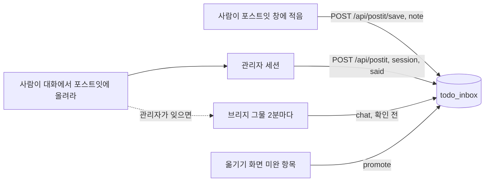

<!--
다루는 곳: bridge/postit.py, bridge/api/postit.py, bridge/api/todo.py, bridge/static/js/postit.js, migrations/0027_todo_inbox.sql, migrations/0028_todo_inbox_assignee.sql, migrations/0033_postit.sql
읽은 커밋: e5d584b
-->
# 포스트잇

포스트잇은 FOREMAN에서 아직 하지 않은 일을 적어 두는 곳이다. 화면 맨 위 머리줄의 노란 종이 단추(「포스트잇 4장」처럼 장 수가 적힌다)를 누르면 종이 한 장 꼴의 창이 펼쳐지고, 서기 캐릭터를 눌러 여는 서기실 안에도 같은 목록이 접혀 들어 있다. 둘은 같은 데이터를 같은 코드로 그린다 [code:bridge/static/js/postit.js]. 열려 있는 포스트잇이 곧 그 프로젝트의 할 일 목록이다. 누군가 이것을 다른 문서로 옮겨 적는 단계는 없다.

이 편은 포스트잇이 어디에 저장되는지, 무엇이 어떤 길로 들어오는지, 어떻게 닫히는지, 쌓이거나 고장 났을 때 어떻게 스스로 알리는지를 다룬다. 서기실 전체와 서기에게 일을 시키는 길은 → 서기실과 일감, [→]로 보낸 줄을 README에 쓰는 서기 일은 → 서기실과 일감, 옮기기 화면에서 미완 항목을 고르는 과정은 → 문서로 옮기기, [띄우기]가 여는 계획 창은 → 계획 한 번에서 다룬다.

## 받는 함이 곧 포스트잇

포스트잇의 뿌리는 그보다 먼저 있던 할 일 받는 함(코드 이름 `todo_inbox`)이다. 받는 함이 생긴 까닭부터 봐야 포스트잇이 왜 이런 꼴인지 이해된다.

FOREMAN에서 사람은 주로 관리자 세션(원본 폴더에서 도는 Claude Code 세션, 합치기와 시험과 기록을 맡는다)과 이야기한다. 일하다 보면 「이건 나중에 하자」 「할 일에 넣어 둬라」 같은 말이 자주 나온다. 처음에는 관리자가 그 말을 받아 README의 할 일 표에 직접 적었다. 그런데 이런 지시가 하루에 열 건쯤 몰리자 관리자 세션의 맥락(모델이 한 번에 기억하는 대화 분량)에 할 일 글이 계속 쌓였고, 그 탓에 관리자가 하루에 두 번이나 새 세션으로 옮겨 가야 했다 [log:todo_inbox_20261109.md] [log:dispatch_flow_decision_20261109.md]. 할 일을 적는 것은 생각이 필요한 일이 아닌데, 그 일이 가장 비싼 맥락을 잡아먹고 있었던 것이다.

그래서 세션을 거치지 않고 할 일을 바로 적는 칸을 만들었다. 적을 곳으로 DB 표를 새로 고른 데에는 까닭이 둘 있다. 이미 있던 메모 저장소(교장의 진행 중인 일 노트)는 글 한 줄이 300자로 잘리고 프로젝트마다 들어가는 양에 상한이 있어, 대개 600자를 넘는 실제 지시가 잘려 나갔다. README 표에 브리지가 바로 커밋하는 길은 여러 세션이 README를 동시에 고칠 때 충돌을 낸다 [log:todo_inbox_20261109.md]. 그래서 표 `todo_inbox`를 만들고 글을 8,000자까지 받게 했다 [code:migrations/0027_todo_inbox.sql].

처음 받는 함은 정거장이었다. 사람이 적은 글은 잠시 머물렀다가, 서기 세션이 몰아서 README 할 일 표로 옮겼다. 표의 상태도 칸에 적지 않고 계산했다. 가져간 세션이 없으면 새것, 가져간 서기 세션이 합쳐졌으면 옮긴 것, 그 세션이 버려졌으면 다시 새것이다 [code:migrations/0027_todo_inbox.sql]. 곧 받을 사람(`assignee`)을 고르는 칸이 붙어 코더에게 바로 맡기는 줄도 생겼고 [code:migrations/0028_todo_inbox_assignee.sql], 사람이 목록에서 글을 고친 시각을 남기는 칸도 더해졌다 [code:bridge/api/todo.py].

그런데 정거장 구조는 할 일이 두 곳에 사는 문제를 낳았다. 받는 함에 있는 것과 README 표에 있는 것이 따로 놀았고, README 표는 사람이 잘 열어 보지 않는 긴 문서 깊숙이 있었다. 서기에게 옮겨 달라고 시키는 단추도 한동안 아무도 누르지 않았다 [log:foreman-6_postit_proposal_20261115.md]. 그래서 정거장을 없애기로 했다. 받는 함에 열려 있는 줄이 할 일 목록 그 자체이고, 이것을 포스트잇이라 부른다 [code:migrations/0033_postit.sql]. 표 이름은 `todo_inbox` 그대로 두었다. 이름을 바꾸면 이 표를 읽는 다른 코드(계획 시작, 코더 방, 옛 API)를 모두 고쳐야 하는데, 이름이 다르다고 해서 얻는 것이 없기 때문이다. 코드 안의 `inbox_*` 함수 이름도 같은 까닭으로 남아 있다 [code:bridge/postit.py].

README에는 「알려진 한계」 절만 남았다. 지금 안 되는 것과 장기 계획만 두는 곳이고, 사람이 포스트잇에서 [→]로 보낸 줄이 그리로 간다 [code:README.md].

## 저장: 칸 몇 개를 더해서

포스트잇으로 바꾸면서 표를 새로 만들지 않고 기존 표에 칸을 더했다. 스키마는 더하기만 했으니 앞 버전 코드로 되돌려도 돈다 [code:migrations/0033_postit.sql]. 더한 칸과 뜻은 아래와 같다.

| 칸 | 뜻 |
|---|---|
| `source` | 어디서 왔나. `note` 포스트잇 창이나 서기실에서 바로 적음, `todo` 옛 머리줄 할 일 적기 단추(지금은 화면에 없다), `said` 대화에서 사람이 말해 관리자가 올림, `chat` 브리지 그물이 대화에서 찾음, `promote` 옮기기 화면의 미완 항목 |
| `source_ref` | 근거. `t:<턴 번호>`(대화에서 온 것), `pr:<옮기기 번호>:<항목 번호>`(옮기기에서 온 것) |
| `confirmed` | 확인했나. 그물에서 온 것만 0이고 나머지는 1 |
| `closed_reason` | 닫힌 까닭. `drop` 안 하기로 함, `limit` 알려진 한계로 보냄, `done` 끝남 |
| `closed_at`, `closed_note` | 닫은 시각과 근거([갱신]이 찾은 코드 자리나 사람이 쓴 한 줄) |

닫힌 까닭을 칸으로 둔 것은 정거장 시절의 계산이 뜻을 잃었기 때문이다. 예전에는 서기 세션이 가져가 합쳐지면 옮긴 것이었는데, 이제 서기가 가져가는 단계가 없다. 닫히는 길도 셋으로 늘었다(지움, 한계로 보냄, 끝남). 이 셋을 버린 시각 칸 하나로 나타낼 수는 없었다 [log:foreman-6_postit_proposal_20261115.md].

같은 마이그레이션이 지난 줄도 맞췄다. 버린 줄은 `drop`으로 닫고, 서기가 이미 README로 옮긴 줄과 코더가 끝낸 줄은 `done`으로 닫으면서 근거 칸에 포스트잇 전의 일이라고 적었다 [code:migrations/0033_postit.sql]. 맞춘 뒤 FOREMAN의 지난 줄 23개는 열린 것 4, 끝남 17, 삭제 2가 되었다 [log:foreman-5_postit_20261115.md]. 판정을 내는 [갱신] 결과를 담는 표 `postit_check`도 이때 만들었다(아래 [갱신] 절).

### 상태는 칸과 계산을 섞는다

화면에 보이는 상태는 닫힌 까닭 칸과, 그 줄을 가져간 세션(`taken_by`)이 어떻게 되었는지를 함께 보고 계산한다. 계산식은 SQL `CASE` 하나로 `bridge/postit.py`의 `STATE`에 있다 [code:bridge/postit.py].

| 상태 | 언제 | 화면 글 |
|---|---|---|
| `new` | 아무도 가져가지 않았다. 가져간 세션이 버려졌어도 여기로 돌아온다 | 열림 |
| `taking` | [띄우기]로 계획을 받아 시작한 코더 세션이 가져가 아직 일하는 중 | 코더가 하는 중 |
| `merged` | 가져간 세션이 합쳐졌거나 원본 폴더 세션이 끝났다 | 코더 세션 끝남 |
| `drop` | 사람이 [x]를 눌렀다 | 삭제 |
| `done` | [갱신] 판정을 보고 사람이 닫았다 | 끝남 |
| `limit` | 사람이 [→]를 눌렀다 | 알려진 한계로 보냄 |
| `limit_writing`, `limit_written` | 서기가 README에 쓰는 중, README에 다 씀 | 알려진 한계로 보냄(쓰는 중, 씀) |

여기서 눈여겨볼 것은 `merged`다. 코더 세션이 합쳐졌다면 일이 끝났을 것 같지만, 포스트잇은 이때 닫히지 않고 여전히 열린 목록에 남는다. 사용자가 커밋만 보고 할 일을 자동으로 지우지 말라고 정했기 때문이다 [code:bridge/postit.py]. 세션이 합쳐졌다는 것은 무언가 들어갔다는 뜻일 뿐, 포스트잇에 적힌 일이 다 되었다는 증거가 아니다. 일의 절반만 했을 수도 있고, 계획 단계에서 다른 일로 바뀌었을 수도 있다. 닫는 것은 사람이 하거나, [갱신]이 코드 자리를 근거로 제안한 것을 사람이 받아들일 때다.

## 들어오는 길 셋

포스트잇에 줄이 생기는 길은 크게 셋이다. 사람이 직접 적는 길, 대화에서 사람이 미룬 말을 관리자가 올리는 길, 관리자가 올리기를 잊었을 때 브리지가 대화를 훑어 건지는 길이다. 여기에 옮기기 화면의 미완 항목이 들어오는 곁길이 하나 있다.



### 사람이 적기

포스트잇 창이나 서기실 목록 아래의 글 칸(「할 일을 메모합니다」)에 적고 [저장]을 누르거나 Ctrl+Enter를 치면 `POST /api/postit/save`가 불린다 [code:bridge/static/js/postit.js]. 출처는 `note`이고 근거는 없다. 창 위에서 프로젝트를 고를 수 있는데, 처음 값은 지금 보고 있는 방이고 방이 없으면 FOREMAN이다.

[저장] 단추는 일을 하나 더 한다. 목록에 확인 전 줄(아래 그물에서 온 것)이 있으면 그 줄들도 한꺼번에 받아들인다. 그래서 단추 글이 「저장 (확인 전 2)」처럼 바뀌고, 호버에 아닌 줄은 먼저 [x]로 지우라고 적힌다 [code:bridge/static/js/postit.js]. 글 칸이 비어 있고 확인 전 줄도 없으면 저장할 글이 없다고 알린다.

예전에는 머리줄에 할 일 적기 단추와 그 창이 따로 있었고, 그 창은 옛 API `POST /api/scribe/inbox`(출처 `todo`)를 불렀다. 포스트잇 창이 프로젝트 고르기, 8,000자 글 칸, Ctrl+Enter를 모두 갖추게 되자 그 단추와 창을 뺐다 [log:foreman-5_postit_look_20261115.md]. 서버 쪽 옛 길은 지우지 않았다. `POST /api/scribe/inbox`, 목록을 고치는 `PUT /api/todo/{id}` 등은 화면에서 부르는 곳이 없지만 지금도 돈다 [code:bridge/api/todo.py]. 옛 길로 들어온 줄도 화면에는 「포스트잇에 적음」으로 보여 바로 적은 것과 구분하지 않는다. 구분은 DB의 `source` 칸에만 남는다 [code:bridge/postit.py].

### 관리자가 올리기: POST /api/postit

사람이 관리자에게 「포스트잇에 올려라」나 「나중에 할 일에 넣어라」라고 말하면, 관리자는 그 턴 안에서 아래처럼 API를 부른다. 이것은 CLAUDE.md의 작업 규칙 한 줄로 정해 두었다 [code:CLAUDE.md].

```
POST /api/postit
{"project": "foreman", "body": "할 일 글", "session": <관리자 자기 세션 id>}
```

`session`을 주면 출처는 `said`가 되고, 근거는 그 세션의 마지막 사람 턴(`t:<턴 번호>`)이 된다 [code:bridge/api/postit.py]. 관리자가 사람 말을 들은 바로 그 턴 안에서 부르니, 마지막 사람 턴이 곧 그 말이 담긴 턴이다. 사람 턴을 찾지 못하면 `s:<세션 번호>`를 근거로 쓴다 [code:bridge/postit.py]. 새로 만들면 201, 같은 근거에 같은 글이 이미 있어 만들지 않았으면 200을 돌려준다.

이 길을 앞에 세운 까닭은 정확해서다. 포스트잇을 설계하기 전 기록을 손으로 갈라 보니, 진짜로 미룬 말 13개 가운데 11개가 이미 「표에 올려라, 넣어라」처럼 사람이 직접 표시한 말이었다 [log:foreman-6_postit_proposal_20261115.md]. 예전에는 그 말을 관리자가 README에 적고, 서기가 나중에 같은 말을 정규식으로 다시 주웠다. 같은 것을 두 번 잡은 셈이다. 사람이 표시한 말을 그 자리에서 API로 넣으면 판정이 필요 없고 정확히 하나가 들어간다.

다른 프로젝트의 관리자도 같은 API를 쓴다. 이때는 프로젝트 토큰(그 프로젝트에만 닿는 열쇠)으로 부르는데, 이 토큰으로는 자기 프로젝트의 포스트잇만 읽고 올릴 수 있다. 다른 프로젝트 이름을 넣으면 거부 사유와 함께 막힌다 [code:bridge/scopetoken.py]. 토큰 범위의 전체 그림은 → 열쇠와 비밀.

### 대화를 거르는 그물: 「확인 전」

관리자가 API 부르기를 잊으면 사람이 미룬 말이 사라진다. 이것을 그대로 두면 조용한 고장이다. 사람은 분명히 말했는데, 아무 데도 적히지 않고, 아무도 모른다. 그래서 브리지가 2분마다 사람 턴을 훑어 미룬 말처럼 보이는데 포스트잇이 생기지 않은 턴을 찾아 「확인 전」으로 올린다 [code:bridge/postit.py]. 이것을 그물이라 부른다.

그물은 LLM을 쓰지 않고 문장 꼴(정규식) 다섯 갈래로 판정한다 [code:bridge/postit.py].

| 갈래 | 잡는 말 |
|---|---|
| 표에 | 「포스트잇」이나 「나중에 할 일」에 올려, 넣어, 추가, 더해, 보태, 적어. 「나중에 할 일」의 「…」 줄에 한 줄 더해 |
| 나중에 | 나중에 정한다, 정하자, 하자, 본다, 보자, 다시, 한다 |
| 미루 | 미루자, 미루기로, 미뤄 두 |
| 지금은 | 지금은 두, 지금은 하지 마, 지금은 손대지 |
| 그때 | 쌓이면 그때 다시, 그때 다시 이야기 |

「아니라 지금」이 든 줄은 뺀다. 「나중에 할 일이 아니라 지금 고칠 일이다」 같은 말이 그물에 걸리지 않게 하려는 것이다 [code:bridge/postit.py]. 걸린 줄은 맞은 자리 앞 150자와 뒤 250자만 잘라 최대 세 줄까지 포스트잇 글로 쓴다.

LLM 판정을 쓰지 않은 까닭은 비용과 표시 두 가지다. 관리자에게 온 사람 글은 하루 3만 자를 넘었고, 이것을 매번 모델에 넣으면 하루 수만 토큰이 든다. 더 큰 문제는 모델이 틀렸을 때 틀렸다는 표시가 없다는 점이다. 정규식은 무엇을 잡고 무엇을 놓치는지 시험으로 고정할 수 있다. 가짜 몇 개는 사람이 [x]로 지우는 편이 더 싸다고 봤다 [log:foreman-6_postit_proposal_20261115.md].

#### 들어오는 문에서 거르는 것

설계 단계에서 「나중에」나 「미루」가 들어간 사람 턴을 모두 세어 보니 88턴이었고, 그 가운데 진짜 미룬 말은 13턴(15%)뿐이었다 [log:foreman-6_postit_proposal_20261115.md]. 가짜의 뿌리를 캐 보니 셋이었다. 첫째, 작업 세션을 띄울 때 넣은 일감 글(「끝낸 줄은 할 일 표에서 뺍니다」 같은 문장이 든다)이 40턴이었고 모두 그 세션의 첫 턴이었다. 둘째, 브리지가 관리자 입력 칸에 넣는 합치기 카드 글이 15턴이었는데, 사람이 친 글이 아닌데도 사람 턴으로 기록되고 있었다. 셋째, 표 이름을 그냥 언급하거나 다른 뜻으로 「나중에」를 쓴 관리자 대화가 18턴이었다.

그래서 그물은 판정 전에 문에서 거른다 [code:bridge/postit.py].

- 브리지가 띄운 세션의 첫 턴은 보지 않는다. 띄울 때 넣은 일감 글이기 때문이다. 역할로 빼지 않고 브리지가 띄웠다는 기록(`session_action`의 `spawn`)으로 가린다. 역할로 빼면 사람이 작업 세션에 직접 미룬 말까지 놓친다
- 합치기 카드 글은 마이그레이션이 턴 출처를 `merge_card`로 바꾸어 사람 턴에서 빠졌다 [code:migrations/0033_postit.sql]
- 아직 열린 턴(끝나지 않았고 시작한 지 30분이 안 된 턴)은 보지 않는다. 관리자가 그 턴 안에서 API를 부를 틈을 주어, 같은 말이 두 번 올라가지 않게 한다 [code:bridge/postit.py]
- 숨긴 세션의 턴은 보지 않는다
- 이미 근거가 같은 포스트잇이 있는 턴은 보지 않는다

반대로 붙여 넣은 글(`pasted_content`) 안은 본다. 처음에는 붙여 넣은 지시서가 가짜의 뿌리라 짐작했는데, 실제로 갈라 보니 진짜 미룬 말 13개 가운데 10개가 붙여 넣은 글 안에 있었다 [log:foreman-6_postit_proposal_20261115.md]. 사람이 다른 곳에서 받은 글이나 길게 쓴 지시를 붙여 넣기 때문이다. 가짜를 내는 붙여 넣은 글은 관리자가 작업 세션에 넣은 일감이었고, 그것은 이미 첫 턴 거르기에서 빠진다.

#### 숫자와 한계

그물을 같은 기간 기록에 돌린 결과, 첫 턴과 카드를 빼고 남은 사람 턴 218개 가운데 20개가 걸렸다. 진짜 17개를 모두 잡았고, 경계 2개, 가짜 1개였다 [log:foreman-5_postit_20261115.md]. 처음 짠 꼴은 15개만 잡았는데, 놓친 둘이 모두 「『나중에 할 일』의 『…』 줄에 한 줄 더해」처럼 낫표가 겹친 꼴이라 이 꼴을 하나 더했다.

이 숫자는 정직하게 읽어야 한다. 꼴을 바로 그 기록에 맞춰 짰으니 기록에 잘 맞는 것은 당연하다. 새 말투에는 더 낮을 수 있다. 다른 프로젝트 기록에는 재 보지 않았다 [log:foreman-5_postit_20261115.md]. 그물은 사람 표시를 보완하는 장치이지 대신하는 장치가 아니다.

그물이 보기 시작하는 때는 0033 마이그레이션이 적용된 시각이다 [code:bridge/postit.py]. 그 전의 미룬 말은 서기가 이미 README로 옮겼으니 다시 올리면 겹친다. 브리지가 뜬 뒤 첫 훑기는 그때부터 전부 보고, 그 뒤로는 최근 2일만 본다. 매번 전부 훑지 않으려는 것이다. 브리지가 이틀 넘게 꺼져 있었다면 그 사이는 다시 뜬 뒤 첫 훑기가 다 본다.

#### 확인 전은 흐리게, 사람이 정한다

그물이 올린 줄은 `confirmed = 0`으로 들어가 목록에 흐리게 뜨고 「확인 전」 표가 붙는다. 표의 호버는 브리지 그물이 대화에서 찾았으니 맞으면 [저장], 아니면 [x]를 누르라고 말한다 [code:bridge/static/js/postit.js]. 출처 글은 「대화에서 찾음」, 근거 턴 번호가 함께 보인다. 확인 전 줄도 열린 줄이라 장 수에 들어간다. 머리줄에는 「, 확인 전 N」이 따로 붙는다.

그물이 먼저 올린 확인 전 줄이 있는데 관리자가 같은 턴으로 API를 부르면, 새 줄을 만들지 않고 그 확인 전 줄을 관리자의 글로 바꾸어 확인된 `said` 줄로 올린다 [code:bridge/postit.py]. 같은 말이 흐린 줄 하나와 확인된 줄 하나로 두 번 보이지 않게 하려는 것이다.

### 옮기기 미완 항목

새 세션으로 옮기거나 문서로 옮길 때, 대화에서 문서에 넣을 것을 고르는 화면이 있다(→ 문서로 옮기기). 거기서 종류가 미완인 항목, 곧 끝나지 않은 할 일은 기본 목적지가 README가 아니라 포스트잇이다. 사람이 승인하면 세션이 쓰지 않고 브리지가 바로 넣는다. 출처는 `promote`, 근거는 `pr:<옮기기 번호>:<항목 번호>`다 [code:bridge/promote.py].

## 같은 근거로 여러 장: 조용히 잃던 것을 고친 일

포스트잇에 가장 최근에 생긴 고장이 이 편의 원칙을 가장 잘 보여 준다.

### 무엇이 사라졌나

관리자가 한 대화 턴 안에서 글이 다른 포스트잇을 여러 장 올리면, 첫 장만 남고 나머지는 사라졌다. 실제로 관리자가 한 세션에서 21장을 올렸는데 한 장만 생겼다 [log:foreman-5_postit_dup_20261115.md]. 더 나빴던 것은 나머지 20번의 응답이었다. 실패가 아니라 성공처럼 보였다. 모두 첫 장과 같은 번호를 돌려받았고, 관리자는 이 응답만 보고 다 올렸다고 여길 수 있었다. 거부도 경고도 없이 일이 사라진 셈이다.

### 왜 사라졌나

원인은 근거 칸이었다. 관리자가 `session`을 주고 올리면 근거는 그 세션의 마지막 사람 턴이다. 한 턴 안에서 여러 장을 올리면 모두 같은 턴, 곧 같은 근거를 갖는다. 그런데 넣는 함수 `add`는 근거가 같은 줄이 이미 있으면 새로 만들지 않고 그 줄의 번호를 돌려주고 있었다 [c:db4f3e7].

이 규칙 자체는 까닭이 있었다. 그물이 같은 턴을 여러 번 주워도 한 장만 만들려는 것이었고, 그물이 먼저 올린 확인 전 줄에 관리자가 같은 턴으로 올리면 두 줄이 아니라 한 줄이 되게 하려는 것이었다 [log:foreman-5_postit_dup_20261115.md]. 문제는 이 규칙을 출처와 상관없이 모두에게 적용한 데 있었다. 그물에게 근거 하나는 한 장이지만, 사람이 한 번에 여러 가지를 말하면 관리자에게 근거 하나는 여러 장일 수 있다.

### 어떻게 고쳤나

출처에 따라 규칙을 나눴다 [code:bridge/postit.py].

| 출처 | 같은 근거가 이미 있을 때 |
|---|---|
| `chat`(그물), `promote`(옮기기) | 근거 하나에 한 장(`ONE_PER_REF`). 새로 만들지 않는다 |
| `said`(관리자), `note`(사람) | 글이 다르면 새 장. 앞뒤 공백을 뺀 글이 같을 때만 겹침으로 본다 |

겹쳐서 만들지 않았을 때는 이제 그 사실을 응답에 적는다. `{"created": false, "duplicate": true, "reason": "같은 근거에 같은 글이 이미 있어 새로 만들지 않았습니다"}`이고, API 상태 코드는 200이다 [code:bridge/api/postit.py]. 새로 만든 201과 구분되고, 부른 쪽이 왜 새 번호가 아닌지 글로 알 수 있다.

그물 확인 전 줄을 확인된 줄로 바꾸는 동작도 다듬었다. 같은 근거의 첫 글만 그 확인 전 줄을 차지하고(`upgraded: true`, 새로 만든 것으로 보고 201), 글이 다른 다음 것은 새 장이 된다 [code:bridge/postit.py]. 고치기 전에는 이 경우도 `created: false`로 돌려주었다.

마이그레이션은 필요 없었다. 근거 칸은 처음부터 유일 키가 아니라 찾기용 키였고, 막고 있던 것은 코드였다 [log:foreman-5_postit_dup_20261115.md]. 시험은 같은 근거에 글이 다른 세 장은 세 장, 같은 글을 두 번 올리면 한 장이고 응답이 겹침을 말함, 그물이 같은 턴을 다시 주우면 한 장, 세션으로 여러 장을 올린 뒤에도 그물이 그 턴을 다시 올리지 않음을 본다 [c:db4f3e7].

이 고장이 남긴 교훈은 FOREMAN 전체의 원칙과 같다. 하지 않은 일을 한 것처럼 돌려주면, 조용한 고장이 된다. 겹침 막기는 필요했지만, 막았다면 막았다고 말해야 했다.

한 가지 알아 둘 것이 있다. 겹침을 찾을 때는 닫힌 줄까지 본다 [code:bridge/postit.py]. 그래서 관리자가 같은 턴에서 올렸던 글을 사람이 [x]로 지운 뒤 같은 턴, 같은 글로 다시 올리면 새 장이 생기지 않고 닫힌 줄의 번호와 겹침 응답이 돌아온다. 같은 턴 안에서 같은 글을 다시 올릴 일은 드물어 그대로 두었다.

## 닫기: [x], [→], 그리고 [갱신]

### [x]와 [→]

줄마다 오른쪽에 단추가 있다. [x]는 안 하기로 한 것이다. `closed_reason = drop`으로 닫히고 목록에서 사라진다 [code:bridge/static/js/postit.js]. 옛 코드가 읽어도 버린 것으로 보이도록 옛 칸 `dropped_at`도 함께 채운다 [code:bridge/scribe_room.py].

[→]는 알려진 한계로 보내는 것이다. 할 일이 아니라 지금 구조로는 못 푸는 것, 장기 계획으로 둘 것이 여기 해당한다. 누르면 포스트잇은 `limit`으로 닫혀 목록에서 빠지고, README 「알려진 한계」 절에 쓸 줄로 서기 할 일에 잡힌다 [code:bridge/postit.py]. README는 커밋이 필요한 파일이라 브리지가 바로 쓰지 않는다. 서기 세션의 「알려진 한계 쓰기」 일이 쌓인 줄을 모아 한 번에 쓴다. 서기실 할 일 줄은 「알려진 한계 쓰기: 쓸 줄 N, 뺄 줄 M」 꼴이다 [code:bridge/scribe_room.py]. 서기가 줄을 가져가면 상태는 쓰는 중, 그 세션이 합쳐지면 씀이 되고, 그 세션이 버려지면 다시 [→]만 누른 상태로 돌아가 다음 서기가 가져간다.

[→]로 닫을 때는 가져간 세션 칸을 비운다 [code:bridge/postit.py]. 그 전에 코더가 가져갔던 줄이라도, 이제 README에 쓰는 서기가 새로 가져가야 하기 때문이다.

### [갱신]: 판정은 제안이고 닫기는 사람

포스트잇은 쌓이기 쉽다. 일은 다른 경로로 끝났는데 포스트잇만 남아 있는 경우가 많다. 이것을 사람이 하나하나 코드를 열어 확인할 수는 없으니 [갱신] 단추를 두었다.

[갱신]을 누르면 확인 창이 뜨고, 받아들이면 `POST /api/postit/refresh`가 원본 폴더에 조사 세션(역할 조사, 코드 이름 inspector, 읽고 알아보기만 하고 고치지 않는다)을 띄운다 [code:bridge/postit.py]. 재료는 그 프로젝트의 열린 포스트잇 전부, README 「알려진 한계」 절의 줄, 최근 커밋 40개 제목이다. 재료는 저장소 밖 파일로 써서 세션에게 경로만 넘긴다. 조사 세션은 항목마다 그 일이 지금 저장소에 되어 있는지 코드, 시험, 설정, docs를 직접 열어 보고 끝남, 남음, 모름 가운데 하나로 판정한다.

작업방(worktree)이 아니라 원본 폴더에 띄운 까닭은 고칠 것이 없어서다. 작업방에 띄우면 아무 변경도 없는 빈 합치기 카드가 생긴다 [log:foreman-5_postit_20261115.md]. 설계 단계에서는 `claude -p` 한 번(세션 없이 묻고 답만 받는 길)을 추천했으나 [log:foreman-6_postit_proposal_20261115.md], 사용자가 조사 세션 길을 골랐다. 세션은 화면에 캐릭터로 뜨니 사람이 지금 무엇을 보는지 들여다볼 수 있다. 이미 [갱신] 중인 조사 세션이 살아 있으면 두 번 띄우지 않는다.

조사 세션은 결과를 API로 보내지 않는다. 마지막 응답에 아래 꼴의 블록을 한 번 쓰고, 브리지가 2분마다 그 세션의 트랜스크립트(대화 기록 파일)에서 읽어 `postit_check` 표에 넣는다 [code:bridge/postit.py]. 옮기기 결과를 받는 꼴과 같다. 조사 세션이 토큰을 들고 curl을 칠 일이 없다.

```
<<<FOREMAN-POSTIT-CHECK r=<요청 번호>>>
[{"id": "p:12", "verdict": "끝남", "evidence": "bridge/x.py:40, tests/test_x.py::test_y", "reason": "한 줄", "coder": false}]
<<<END r=<요청 번호>>>
```

판정에는 강한 제약이 하나 있다. 「끝남」은 근거가 코드 자리, 곧 `파일:줄`이나 시험 이름일 때만 받는다. 근거가 커밋 해시, 커밋 제목, log 글뿐이면 브리지가 「모름」으로 내리고, 까닭 칸 앞에 근거가 코드 자리가 아니라 모름으로 둔다고 적는다 [code:bridge/postit.py]. 커밋 제목은 무엇을 하려 했는지는 말해도 실제로 되었는지는 말하지 않는다. 최근 커밋 목록을 재료에 넣되 「끝남의 근거가 아니다」라고 적어 둔 것도 같은 까닭이다. 재료에 없던 항목 번호나 같은 항목을 두 번 낸 것도 버린다.

판정을 받아도 아무것도 저절로 닫히지 않는다. 화면 목록 위에 「끝난 것 같음 N」 칸이 생기고, 줄마다 근거 코드 자리와 까닭이 보이며 [닫기]와 [남기기] 단추가 붙는다 [code:bridge/static/js/postit.js]. [닫기]를 누르면 포스트잇은 `done`으로 닫히고 근거가 `closed_note`에 남는다. [남기기]를 누르면 남은 일로 두고 다음 [갱신]에서 다시 본다. README 「알려진 한계」 줄을 닫으면 서기 「알려진 한계 쓰기」가 지울 줄로 센다 [code:bridge/postit.py]. 「남음」 판정은 줄의 표로 붙는다.

판정이 제안에 머무르는 까닭은 [갱신]도 모델의 판단이라는 데 있다. 코드 자리라는 근거를 요구해도 틀릴 수 있다. 할 일을 자동으로 지우면 틀린 판정이 일을 조용히 없앤다. 사람이 근거를 보고 한 번 누르는 비용이 그보다 싸다.

### 코더 추천과 [띄우기]

조사 세션이 어떤 줄을 「남음」으로 보고, 할 일이 정해져 있고 코드를 고치는 일이라 판단하면 `coder: true`를 단다. 그런 줄에는 「코더 추천」 표와 [띄우기] 단추가 붙는다 [code:bridge/api/postit.py]. 옛 받는 함에서 받을 사람을 코더로 고른 줄도 같다.

[띄우기]를 누르면 포스트잇 창이 닫히고 계획 창이 열리며, 그 포스트잇 글로 계획을 바로 받는다 [code:bridge/static/js/postit.js]. 사람이 계획 카드를 보고 [이대로 시작]을 누르면 뜬 코더 세션이 그 포스트잇을 가져가 상태가 「코더가 하는 중」이 된다 [code:bridge/foreman.py]. 이미 다른 세션이 가져갔거나 닫힌 줄이면 시작은 그대로 하고 그 사실을 알림 글로 붙인다.

관리자에게 넘기는 길이 아니라 계획 길을 쓴 데는 까닭이 있다. 관리자에게 넘기면 관리자 맥락에 글이 쌓이는데, 그것은 처음 받는 함을 만든 까닭과 거꾸로다 [log:foreman-5_postit_20261115.md]. 사람이 포스트잇에서 이미 골랐으니 계획은 바로 받고, 시작만 사람이 누른다.

## 못 읽으면 0이 아니라 「읽지 못했습니다」

할 일 목록에서 가장 위험한 고장은 숫자가 0으로 보이는 것이다. 0장이면 사람은 할 일이 없다고 여기고 안심한다. 그런데 그 0이 API를 못 읽어서 나온 0이라면, 할 일은 쌓여 있는데 아무도 모른다. 그래서 포스트잇 화면은 못 읽은 것과 없는 것을 엄격히 가른다 [code:bridge/static/js/postit.js].

- 머리줄 단추가 요약을 못 읽으면 「포스트잇 ?」로 바뀌고 주황이 된다. 호버는 개수를 읽지 못했으니 누르면 펼쳐 다시 읽는다고 말한다 [code:bridge/static/js/postit.js]
- 펼친 창이 목록을 못 읽으면 「포스트잇을 읽지 못했습니다.」를 빨간 글로 보인다. 아직 읽는 중이면 「포스트잇을 읽는 중입니다.」다. 셋(읽는 중, 못 읽음, 할 일이 없습니다) 모두 다른 글이다 [code:bridge/static/js/postit.js]
- 이미 읽은 값이 있는데 다시 읽기에 실패하면 지난 값을 보이되 머리줄에 「지금 값을 읽지 못했습니다. 지난 값입니다」를 붙인다. 서기실처럼 머리줄을 그리지 않는 곳에서도 이 경고 한 줄은 남긴다 [code:bridge/static/js/postit.js]
- [갱신] 조사 세션이 도는 중이면 「조사 세션 N이 코드를 보는 중입니다」가 노랗게, 결과 블록 없이 끝났으면 「지난 [갱신]이 결과 없이 끝났습니다」가 빨갛게 보인다. 이때 브리지는 `postit-done` 기록을 실패(ok 0)로 남기고, 서기 할 일에도 「포스트잇 [갱신] 실패」 줄이 생긴다 [code:bridge/postit.py] [code:bridge/scribe_room.py]. 조사 세션이 블록을 안 쓰고 끝나도 조용히 사라지지 않는다
- 그 밖에는 「마지막 갱신: 월/일 시:분」 꼴로 결과를 받은 마지막 [갱신]의 때를 보는 사람의 시각으로, 한 번도 안 했으면 「마지막 갱신: 없음」을 적는다 [code:bridge/static/js/postit.js]

그물 자체가 깨져 늘 0을 내는 고장도 있을 수 있다. 정규식 하나를 잘못 고치면 아무것도 안 잡혀도 아무 소리가 나지 않는다. 그래서 설계 때 손으로 가른 실제 사람 말 예문을 시험 자료로 박아 두었다. 진짜 미룬 말은 잡아야 하고, 가짜는 잡지 않아야 하며, 붙여 넣은 글 안도 보아야 한다 [code:tests/test_postit.py].

### 쌓이면 알린다

포스트잇이 쌓이기만 하고 아무도 치우지 않는 것도 조용한 고장이다. 쌓임 기준은 셋이고 하나라도 넘으면 쌓였다고 본다 [code:bridge/postit.py].

| 기준 | 기본값 | 설정 키 |
|---|---|---|
| 열린 포스트잇 수 | 20장 이상 | `open_max` |
| 가장 오래된 포스트잇 | 7일 | `stale_days` |
| 마지막 [갱신] 뒤(한 번도 안 했으면 가장 오래된 것부터) | 7일 | `refresh_days` |

값은 `config/scribe.toml`의 `[postit]` 절에서 바꿀 수 있고, 절이 없거나 값이 숫자가 아니면 위 기본값을 쓴다 [code:bridge/postit.py]. 쌓이면 머리줄 단추가 주황이 되고, 서기 자리에 「포스트잇 쌓임」 말풍선이 뜬다 [code:bridge/static/js/office.js]. 단추 호버에는 쌓인 까닭이 「할 일 26장, 가장 오래된 것 8일째」 꼴로 적힌다 [code:bridge/static/js/postit.js]. 단추 글에서 가장 오래된 날을 뺄 때 주황의 까닭이 볼 곳 없이 사라지지 않게 호버로 옮긴 것이다 [log:foreman-5_postit_look_20261115.md].

쌓임은 말풍선과 단추 색으로만 알리고, 텔레그램 21시 묶음 보고에는 넣지 않는다 [code:bridge/postit.py]. 포스트잇은 급한 일이 아니고, 하루 한 번 오는 묶음 보고마다 「포스트잇 N장」이 붙으면 그 줄은 곧 읽히지 않는 소음이 된다는 판단이다. 그 대신 화면에서는 기준을 넘는 순간 늘 보인다.

## 화면

### 머리줄 종이와 펼친 창

머리줄 단추는 지금 보고 있는 방의 할 일 수를 「포스트잇 N장」으로 보인다. 방을 보고 있지 않으면 모든 프로젝트의 합이고, 호버에 방마다 장 수가 붙는다 [code:bridge/static/js/postit.js]. 요약은 1분마다 다시 받고, 방을 옮기면 2초 안에 그 방 숫자로 바뀐다.

펼친 창은 창 전체가 포스트잇 한 장 꼴이다. 위쪽은 조금 짙은 노랑의 풀 바른 띠이고 그 위에 프로젝트 고르기와 [닫기]가 놓인다. 오른쪽 아래 모서리가 접혀 있고 바닥에 그림자가 진다. 종이 그림만 살짝 기울이고 글과 단추는 반듯이 두었다. 창 전체를 돌리면 글자가 흐려지고 호버가 재는 단추 자리도 기운 상자가 되기 때문이다 [log:foreman-5_postit_look_20261115.md]. 종이는 세 테마 모두에서 같은 종이다.

목록 줄은 첫 줄만 보이고 펼치면 원문 전체가 나온다. 줄 끝에는 출처 글(「포스트잇에 적음」, 「대화에서 올림」, 「대화에서 찾음」, 「옮기기 미완」)과 날짜, 대화에서 온 것이면 근거 턴 번호가 붙는다. 맨 아래 「끝낸 것 N」을 펼치면 최근 닫힌 20장과 어떻게 닫혔는지, 근거가 있으면 근거가 보인다 [code:bridge/api/postit.py].

### 서기실 포스트잇: 머리줄과 기본 접힘

서기실 안의 포스트잇은 접는 칸 하나다. 이 칸에 최근 두 가지가 바뀌었다.

첫째, 머리줄을 줄였다. 칸 제목 줄은 「포스트잇 N장」이고, 확인 전과 끝난 것 같음이 있으면 「, 확인 전 N」 「, 끝난 것 같음 N」이 덧붙는다. 쌓였으면 이 글이 주황이 된다 [code:bridge/static/js/scribe.js]. 예전에는 이 제목 줄 아래, 펼친 목록 안에 다시 「FOREMAN 할 일 N장」 머리줄이 그려져 같은 숫자가 두 번 보였고, 쌓였다는 안내 줄도 한 줄 더 있었다. 지금은 목록을 그리는 함수 `listHtml`에 `noHead` 선택을 두어 서기실만 안쪽 머리줄을 그리지 않는다 [code:bridge/static/js/postit.js]. 머리줄 창은 그대로 프로젝트 이름과 장 수를 보인다. 다만 못 읽었을 때의 경고는 서기실에서도 한 줄로 남긴다. 숫자를 줄이다 경고까지 줄이면 안 되기 때문이다 [log:postit_scribe_header_trim_20261115.md].

둘째, 서기실에 들어가면 포스트잇 칸은 늘 접힌 채다. 예전에는 포스트잇이 쌓인 채 서기 캐릭터를 누르면 이 칸이 저절로 펼쳐졌다. 사용자가 기본을 접힘으로 바꾸라고 해서 그 길을 없앴다. 지금은 사람이 펼친 칸만 다음에도 펼쳐진 채로 기억한다 [log:postit_scribe_collapsed_20261115.md]. 쌓였다는 표시는 줄지 않았다. 제목 줄의 주황, 서기 말풍선, 호버 글은 그대로이고, 호버 끝 글만 「누르면 서기실이 열립니다.」로 고쳤다.

서기실 목록에는 머리줄 창 같은 종이 꼴을 씌우지 않았다. 폭이 좁고 위아래로 다른 칸이 붙는 접는 칸 안이라, 거기서 종이를 기울이고 모서리를 접으면 칸 줄과 어긋나 창 안의 창처럼 보인다 [log:foreman-5_postit_look_20261115.md]. 평평한 노란 종이로 두고 글과 동작만 같다.

## API 한눈에

| 길 | 하는 일 |
|---|---|
| `GET /api/postit?project=` | 열린 포스트잇, 사람이 아직 정하지 않은 판정, 최근 닫힌 20장, 요약 |
| `GET /api/postit/summary` | 프로젝트마다 요약(머리줄 단추가 쓴다) |
| `POST /api/postit {project, body, session?}` | 한 장 올리기. 201 새로 만듦, 200 겹쳐서 만들지 않음 |
| `POST /api/postit/save {project, body?, confirm?}` | [저장]. 적은 글을 올리고 확인 전 줄을 받아들인다 |
| `POST /api/postit/{id}/close {reason, note?}` | `drop`, `limit`, `done`으로 닫기 |
| `POST /api/postit/refresh {project}` | [갱신]. 조사 세션을 띄운다(202) |
| `POST /api/postit/check/{cid} {action}` | 판정 한 줄을 `close` 또는 `keep` |
| `POST /api/scribe/inbox`, `PUT /api/todo/{id}` | 옛 길. 화면에서 부르지 않지만 돈다 |

모두 API 토큰이 필요하다 [code:bridge/api/postit.py]. 거부는 409와 `refused` 글로 돌려준다. 글이 비었거나, 8,000자를 넘었거나, 모르는 프로젝트이거나, 이미 [갱신] 중일 때다. 포스트잇이 바뀌면 서기 할 일과 코더 맡길 일의 캐시를 비워 다른 칸 숫자도 함께 맞춘다.

## 하지 않은 것

텔레그램으로 포스트잇을 적는 길은 만들지 않았다. 밖에서 적고 싶을 때가 있을 수 있지만 같은 API로 언제든 붙일 수 있어 미뤄 두었다 [log:todo_inbox_20261109.md]. 노션 원고를 보다가 이것도 써야겠다고 생각한 것은 포스트잇에 넣지 않고 관리자에게 말한다 [docs:12_scribe.md]. [갱신] 재료에 README 로드맵을 함께 넣을지는 정하지 않았고, 로드맵 표가 README에서 빠지면서 지금은 넣을 것도 없다.
