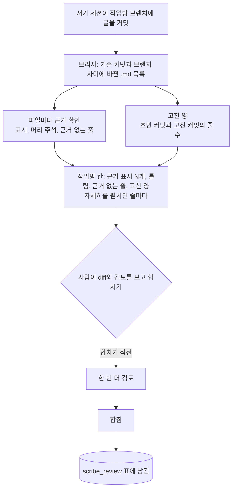

<!--
다루는 곳: bridge/evidence.py, bridge/scribe_ask.py, bridge/doctext/, tools/docs.py, .foreman/docs.toml, tests/test_evidence.py, tests/test_scribe_ask.py, tests/test_doctext.py, tests/test_techdoc.py, tests/test_docs_check.py
읽은 커밋: 5e0f7c5
-->
# 근거 확인과 물어보기

서기(문서를 맡은 AI 세션)가 쓴 글은 사람이 diff를 보고 합쳐야 저장소에 들어간다. 그런데 사람이 diff를 읽는다고 해서 그 안의 커밋 해시가 실제로 있는지, 가리킨 기록 파일이 정말 있는지, 숫자가 어디서 왔는지까지 하나하나 확인하지는 못한다. 이 편은 그 빈자리를 메우는 두 장치를 다룬다. 하나는 근거 확인기다. 서기가 문장 끝에 단 근거 표시가 실제로 있는 것을 가리키는지 브리지가 LLM 없이 기계로 보고, 숫자나 인용이 있는데 근거가 없는 줄을 의심으로 띄운다 [code:bridge/evidence.py]. 다른 하나는 서기에게 물어보기다. 서기 세션을 띄우지 않고 문서와 기록에 대해 한 번 묻고 답만 받는 길로, 읽기 전용 `claude -p` 한 번으로 돈다 [code:bridge/scribe_ask.py].

둘은 서로 다른 일을 하지만 같은 생각에서 나왔다. AI가 쓴 글은 그럴듯하게 틀릴 수 있고, 틀린 문장은 스스로 알리지 않는다. 그래서 확인할 수 있는 것은 기계로 확인하고, 고치는 일은 반드시 사람이 보는 길(작업방과 합치기)로만 지나가게 한다 [docs:12_scribe.md]. 서기가 무엇을 하는 캐릭터인지, 서기실에서 일을 어떻게 시키는지는 → 서기실과 일감에서, 원고가 노션으로 올라가는 길은 → 노션 게시에서 다룬다.

## 왜 만들었나: 「됐다」고 쓴 것이 실제로는 아니었다

이 프로젝트에서 사람이 가장 자주 짚은 실수는 AI가 「됐다」고 보고한 것이 실제로는 안 돼 있던 일이다. 첫 회고가 다룬 하루 동안에만 사람이 세 번 짚었다 [log:retro_20261105_foreman.md]. 첫째는 사무실 화면의 복도였다. 설계 대조표에는 ✅로 적혀 있었는데, 화면 속 캐릭터는 직선으로 걸어 탁자를 뚫고 지나갔다. 사람이 「설계에 적어 놨는데 그게 안 들어간 것 같다」고 하자 그제서야 길찾기와 복도를 넣었다 [log:retro_20261105_foreman.md] [log:stage10_office_result.md]. 둘째는 탁자 위 소품이었다. 고쳤다고 보고한 뒤에도 책이 사람 그림 위에 그려졌다. 받침을 찾는 함수가 감독실 가구를 빠뜨린 것이 원인이었다 [log:retro_20261105_foreman.md] [log:stage11_handoff_result.md]. 셋째는 백그라운드 작업 수를 보이는 배지였다. 설계 문서에 있던 그 배지는 만든 적이 없었는데, 있다고 보고됐다 [log:retro_20261105_foreman.md] [log:stage10_background_waiting_result.md].

세 일의 공통점은 같다. 설계 문서나 앞선 보고에 「됐다」고 적힌 것을 실제 화면과 다시 맞대지 않았다 [log:retro_20261105_foreman.md]. 같은 날 다른 종류의 단정도 있었다. 입력 칸에 회색으로 떠 있던 CC의 프롬프트 제안 글을 사용자가 직접 친 글이라고 보고했고, 패널에서 보낸 확인 두 번도 사람이 직접 입력했다고 적었다 [log:retro_20261105_foreman.md] [log:stage11_handoff_result.md]. 확인하지 않은 것을 확인한 것처럼 쓰는 일이 화면에서도, 보고에서도 일어났다.

문서를 AI에게 맡기면 같은 일이 글에서 일어난다. 실제로 일어난 예도 있다. 서기 설계 문서에는 하루 사람 턴이 34개, 9.3만 자라고 적혀 있었는데 DB로 세어 보니 51개, 2.3만 자였다. 회고 기간이 달랐고 DB 본문은 비밀값을 가린 글이라 차이가 났지만, 글만 보고는 어느 숫자가 맞는지 알 수 없었다 [log:stage12_scribe_result.md]. 모델 고르기 창의 안내 글은 브리지를 다시 띄우면 모델이 기본값으로 돌아간다고 적었는데, 실제로는 세션이 브리지와 따로 tmux에서 돌고 고른 모델은 세션 행에 남아 그대로 쓰인다 [log:foreman-3_model_menu_20261114.md]. 모델의 컨텍스트 창 크기를 200k로 짐작해 적었다가 실측이 223k로 나와 「모름」으로 바꾼 일도 있다 [log:manager318_overhead_20261114.md]. 반대 방향도 있다. docs에 「아직 확인하지 않았다」고 남은 줄이 실제로는 며칠 전에 이미 확인된 일이었고, 「없다」고 적힌 기능이 이미 만들어져 있었다 [log:done_lines_cleanup_20261114.md].

이런 틀림은 아무 소리도 내지 않는다. FOREMAN이 있는 까닭은 조용한 고장을 잡는 것이다. 포트 포워딩 하나가 한 달 넘게 수십만 번 재시작하는 것을 아무도 몰랐던 일이 출발점이었다 [code:CLAUDE.md]. 틀린 문장은 그 고장의 문서판이다. 그러다 회고를 바깥 사람이 읽을 포트폴리오로 쓰기로 하자 사람이 짚었다. 「지금은 사람이 diff 보는 게 유일한 관문이잖아. 포트폴리오로 쓸 거면 근거가 틀리면 안 되니까」 [log:stage12_scribe_result.md]. 근거 확인기는 이 말에서 나왔다.

## 근거 표시: 문장마다 어디서 왔는지 단다

서기 글의 약속은 단순하다. 주장이 있는 문장 끝에 그 주장이 어디서 왔는지 대괄호로 단다 [docs:12_scribe.md]. 대괄호 안은 종류와 값을 쌍점으로 이은 꼴이고, 종류는 다섯 가지다 [code:bridge/doctext/marks.py]. 아래는 그 꼴을 보인 것이다. 이 글은 근거 확인기가 읽는 원고라서, 예시를 본문에 그대로 쓰면 확인기가 진짜 표시로 읽고 없는 커밋이라며 틀림으로 띄운다. 그래서 예시는 코드 블록 안에만 둔다. 확인기는 코드 블록 안을 읽지 않는다 [code:bridge/evidence.py] [code:bridge/doctext/lines.py].

```
커밋은 49개였다 [c:e223f2e]
결과는 기록에 있다 [log:stage12_scribe_result.md]
설계의 그 절 [docs:12_scribe.md:97-125]
지금 코드 [code:bridge/evidence.py]  폴더면 [code:bridge/static/js/]
사람이 그렇게 말했다 [t:5787]
```

| 종류 | 가리키는 것 | 확인기가 보는 것 | 틀렸을 때 뜨는 말 |
|---|---|---|---|
| c | 커밋 | 값이 6~40자리 16진수이고 `git cat-file -e 값^{commit}`이 성공하는가 | 그 커밋이 저장소에 없습니다 |
| log | `log/` 아래 기록 파일 이름 | 그 파일이 있는가, 줄 범위를 적었으면 그 줄이 파일 안에 있는가 | log/… 파일이 없습니다, 줄 범위가 맞지 않습니다(파일은 N줄) |
| docs | `docs/` 아래 설계 문서 이름 | log와 같다 | docs/… 파일이 없습니다 |
| code | 저장소 맨 위 기준 경로 | 파일이면 있는가와 줄 범위, 끝이 /인 폴더면 폴더가 있는가 | … 파일이 없습니다 |
| t | DB의 대화 턴 번호 | 숫자인가, DB의 turn 표에 그 id가 있는가 | 턴 번호가 숫자가 아닙니다, 그 턴이 DB에 없습니다 |

파일을 가리키는 세 종류는 같은 함수가 본다 [code:bridge/evidence.py]. 이 함수는 문서 점검 명령(`tools/docs.py check`)도 함께 쓰도록 문서 문법 묶음에 있다 [code:bridge/doctext/check.py]. 값에서 파일 이름, 줄 범위, 뒤에 붙은 # 앵커를 나누는 규칙은 문서 문법 묶음에 있고 [code:bridge/doctext/marks.py], 확인기는 나눈 값을 받아 절대 경로이거나 .. 이 섞여 저장소 밖을 가리키면 「저장소 밖을 가리킵니다」로 거부한다. log와 docs는 그 폴더 아래에서 찾고, code는 저장소 맨 위에서 찾는다. 그래서 README.md나 CLAUDE.md처럼 맨 위에 있는 파일은 code 종류로 가리켜야 하고, docs 종류로 위 폴더를 거슬러 올라가 가리키면 저장소 밖으로 보고 실패한다 [code:bridge/evidence.py]. 줄 범위는 파일을 실제로 읽어 줄 수를 세고, 시작이 1보다 작거나 끝이 파일 길이를 넘거나 거꾸로 적혔으면 틀림이다. 다만 줄 번호는 코드가 바뀌면 곧 어긋나서, 원고에서는 되도록 파일까지만 적는다.

턴 표시는 다른 넷과 결이 다르다. 턴은 사람과 AI가 주고받은 대화 한 차례이고, 그 번호는 이 브리지의 DB에만 있다 [code:bridge/evidence.py]. 내부 회고에서는 「사람이 그때 그렇게 말했다」를 가리키는 가장 정확한 근거였지만, 바깥 사람은 그 번호로 아무것도 찾아볼 수 없다. 그래서 포트폴리오와 노션 원고에서는 턴 표시를 쓰지 않는다 [docs:style_guide.md]. 확인기는 여전히 턴 표시를 읽고, DB에 연결된 채 돌 때(합치기 전 검토)는 그 턴이 실제로 있는지까지 본다. 명령 줄에서 DB 없이 돌리면 숫자인지만 본다 [code:bridge/evidence.py].

code 종류는 가장 늦게 붙었다. 처음 근거 확인기는 커밋, 기록, 설계 문서, 턴 네 가지만 알았다 [c:fe1f843]. 노션 기술문서 원고를 쓰기로 하면서 「지금 코드가 이렇다」를 가리킬 표시가 필요해졌고, 저장소 맨 위 기준 파일과 폴더를 가리키는 code 종류를 더했다 [c:16dcb3a] [log:foreman-4_techdoc_portfolio_path_20261115.md]. 같은 커밋 하나를 여러 줄에서 가리켜도 git은 한 번만 부른다. 한 글 안에서 본 커밋과 턴은 결과를 기억해 두고 다시 쓴다 [code:bridge/evidence.py].

근거 표시는 git의 원고에만 남는다. 노션에 올릴 때는 게시기가 다섯 종류의 표시를 모두 떼고 올린다 [code:bridge/notion.py] [docs:12_scribe.md]. git 원고에 남기는 것은 확인기가 그 표시를 읽기 때문이다 [code:bridge/notion.py]. 노션 판에서 떼기로 정한 11-15 설계 기록에는 「뗀다」는 결정만 있고 까닭은 적혀 있지 않다 [log:foreman-7_scribe_design_20261115.md]. 그때 저장소는 비공개였고 지금은 공개다. 노션 판이 저장소 링크를 걸지 않는 일은 → 노션 게시 편이 다룬다.

## 왜 LLM 없이 보나

근거 확인을 다른 LLM에게 맡기는 길도 있었다. 서기가 쓴 글을 다른 모델에게 주고 사실과 맞는지 보라고 하는 것이다. 이 길을 고르지 않은 까닭은 확인할 것의 성질에 있다. 「이 커밋이 저장소에 있나」, 「이 파일이 있나」, 「이 턴이 DB에 있나」는 git, 파일 시스템, DB에 물으면 참과 거짓이 확정되는 질문이다. 모델에게 맡길 까닭이 없다 [docs:12_scribe.md] [log:stage12_scribe_result.md].

모델에게 맡기면 오히려 문제가 생긴다. 이 장치가 막으려는 것이 바로 AI가 확인하지 않고 「확인했다」고 쓰는 일인데, 그 확인을 다시 AI에게 맡기면 같은 종류의 틀림이 한 겹 더 쌓일 뿐이다. 기계 확인은 같은 글에 몇 번을 돌려도 같은 답을 낸다. 비용도 없다. 근거 확인기는 서기 세션의 작업방 칸을 그릴 때마다 돌 수 있을 만큼 가볍고, 그래서 서기가 글을 고칠 때마다 결과가 바로 바뀐다 [code:bridge/evidence.py] [code:bridge/handoff.py].

대신 포기한 것이 있다. 기계가 보는 것은 「그 표시가 가리키는 것이 있는가」까지다. 「그 근거가 그 문장을 뒷받침하는가」, 즉 가리킨 기록 파일에 정말 그 숫자가 적혀 있는지는 보지 않는다. 설계에는 그 위에 조사 역할(읽기만 하고 고치지 않는 AI 세션)이 원문과 맞대어 근거 없는 주장, 뒤집힌 결정을 지금 것처럼 쓴 곳, 빠진 실수를 짚는 층을 얹을 자리가 있다. 그러나 비용이 1.5배가 되는 일이라 아직 연결하지 않았다 [docs:12_scribe.md]. 글에 쓴 숫자가 DB 값과 맞는지 대 보는 일도 설계에 있지만 하지 않았다. 숫자마다 출처가 달라 일반 규칙으로 잡을 수 없어서, 근거 없는 숫자 줄을 의심으로 띄우는 데서 멈췄다 [log:stage12_scribe_result.md].

## 근거 없는 줄: 의심을 띄우는 판정

근거 표시가 틀린 것보다 더 흔한 것은 근거 표시가 아예 없는 것이다. 확인기는 근거가 있어야 할 것 같은 줄을 찾아 「근거 없는 줄」로 띄운다. 이것은 틀림이 아니라 의심이다. 판단은 사람이 한다 [code:bridge/evidence.py].

어떤 줄이 근거가 있어야 할 줄인지는 세 정규식이 가른다. 이름은 코드에 있는 그대로다 [code:bridge/evidence.py].

| 이름 | 하는 일 | 걸리는 것 |
|---|---|---|
| CLAIM | 근거가 있어야 할 줄을 고른다 | 숫자가 하나라도 있는 줄, 둥근 따옴표가 있는 줄, 곧은 큰따옴표 안에 네 글자 이상, 낫표 안에 두 글자 이상 |
| SKIP_LINE | 아예 보지 않을 줄을 뺀다 | 제목(#), 인용 블록(>), 표 줄(\|), 코드 울타리, 가로줄(---), 사진 줄, 빈 줄 |
| XREF | 다른 글을 가리키는 안내를 지운 뒤 CLAIM을 본다 | 화살표 뒤 낫표로 묶은 다른 글 제목 |

판정의 순서는 이렇다. 코드 블록 안과 HTML 주석 안은 먼저 건너뛴다. 무엇이 코드 블록이고 주석인지는 거꾸로 찾기, 게시기의 제목 읽기와 같은 규칙 하나로 가른다 [code:bridge/doctext/lines.py]. 남은 줄에서 근거 표시를 찾는다. 표시가 하나라도 있으면 그 줄은 의심하지 않는다. 표시가 없고, SKIP_LINE에 걸리지 않고, 다른 글 안내를 지운 나머지에 CLAIM이 걸리고, 앞뒤 공백을 뺀 길이가 20자를 넘으면 그 줄을 의심으로 올린다. 패널에는 줄 번호와 줄 앞 160자를 보인다 [code:bridge/evidence.py]. 이 판정도 문서 점검 명령과 한 함수다. 그래서 명령에 의심 줄까지 보라고 하면 패널과 같은 줄이 나온다 [code:bridge/doctext/check.py].

숫자와 인용을 기준으로 삼은 것은 그 둘이 지어내기 가장 쉽고 틀려도 가장 그럴듯한 것이기 때문이다. 「커밋 49개」, 「한 번에 2달러」, 「사람이 이렇게 말했다」 같은 문장은 근거 없이 쓰면 사실처럼 보이지만 확인할 길이 없다. 설계의 금지 목록에도 근거 없는 수치가 있다 [docs:12_scribe.md]. 짧은 줄을 뺀 것은 목록의 작은 항목이나 번호만 있는 줄까지 의심하면 의심이 너무 많아져 아무도 보지 않게 되기 때문이다 [log:stage12_scribe_result.md].

빼는 줄의 목록은 실제 글을 돌려 보며 늘었다. 처음 확인기를 첫 회고에 돌렸을 때 근거 표시 178개는 모두 맞았고 근거 없는 줄은 19개가 나왔다. 대부분은 위 줄에 근거가 달린 하위 항목이었지만, 「디스패치는 5건이다」처럼 정말 숫자에 근거가 빠진 줄도 있었다 [log:stage12_scribe_result.md]. 서기가 손으로 맞댄 근거가 틀리지 않았다는 확인이었고, 손으로는 숫자 줄 몇 개를 놓친다는 확인이기도 했다.

그 뒤 포트폴리오 여러 편을 합치며 의심을 하나씩 봤다. 두 편에서 나온 의심은 둘 다 다른 글을 가리키는 안내 줄이었다. 화살표 뒤에 낫표로 다른 글 제목을 쓰면 낫표 인용이 있다는 까닭으로 걸렸는데, 이것은 주장이 아니라 길 안내다. 그래서 XREF로 그 꼴을 지운 뒤에 CLAIM을 보게 고쳤다 [c:a7e18dc] [log:portfolio_publish_20261106.md]. 첫 편에서 나온 의심 두 개는 모두 사진 설명 줄이었고, 사진과 맞았다. 설명의 근거는 사진 자체라서 사진 줄도 SKIP_LINE에 넣었다 [c:f4c3d1a]. 이렇게 고친 뒤 합친 포트폴리오 여러 편은 근거 표시 69개에서 109개 사이였고 틀린 것은 0개였다 [log:portfolio_publish_20261106.md].

이 판정에는 알고 남겨 둔 구멍이 있다. 줄에 근거 표시가 하나라도 있으면 그 표시가 그 줄의 숫자와 관계있는지는 보지 않는다 [code:bridge/evidence.py]. 한 줄에 숫자 셋을 쓰고 그중 하나의 근거만 달아도 의심은 뜨지 않는다. 표 줄을 통째로 빼는 것도 같다. 표에 숫자가 많아도 의심하지 않는다. 표는 대개 다른 곳에 근거가 있는 내용을 모은 것이라 뺐지만, 표 안에서 새 숫자를 지어내면 이 판정은 잡지 못한다. 문장을 여러 줄로 나눠 쓰면 근거가 달린 줄과 숫자가 든 줄이 갈라져 의심이 뜨는 일도 있다. 그래서 노션 원고는 한 문단을 한 줄로 쓰고 문단 끝에 근거를 단다.

## 원고 머리 주석도 근거로 본다

노션 기술문서와 포트폴리오 원고는 맨 위에 HTML 주석을 하나 둔다. 노션에는 나가지 않고 git 원고에만 있는 이 주석에는 두 칸이 있다. 그 편이 설명하는 코드 경로를 적는 다루는 곳과, 원고를 쓸 때 읽은 저장소 커밋을 적는 읽은 커밋이다 [code:bridge/doctext/head.py]. 서기실은 이 두 칸으로 「읽은 커밋 뒤로 다루는 곳을 바꾼 feat, fix 커밋이 있는가」를 세어 그 편을 코드가 바뀐 편으로 띄운다. 그래서 이 주석이 틀리면 그 셈이 조용히 틀린다. 읽은 커밋이 없는 해시면 셀 수가 없고, 다루는 곳에 없는 경로를 적으면 그 경로는 영영 바뀌지 않으니 낡아도 모른다 [code:bridge/evidence.py] [log:foreman-4_techdoc_portfolio_path_20261115.md].

그래서 근거 확인기는 머리 주석도 근거로 센다 [code:bridge/evidence.py]. 주석이 있으면 근거 수에 읽은 커밋 하나와 다루는 곳 경로 수(없으면 하나)를 더한다. 그리고 읽은 커밋이 비었는지, 16진수 해시 꼴인지, 저장소에 실제 있는지를 본다. 다루는 곳이 비었는지, 경로가 저장소 밖을 가리키는지, 그 경로가 실제로 있는지를 본다. 경로에 별표나 물음표 같은 글롭 글자가 있으면 그 글롭에 맞는 파일이 하나라도 있는지를 본다. 틀린 것은 다른 근거와 같은 틀림 목록에 「머리 주석 다루는 곳 …」, 「머리 주석 읽은 커밋 …」 꼴로 올라간다. 경로가 있는지 보는 판정은 문서 점검 명령과 같은 함수를 쓴다 [code:bridge/doctext/check.py].

다루는 곳은 파일 단위 자리다. 저장소의 파일 하나하나가 어느 편이든 한 편의 다루는 곳에 드는지(덮기)와, 서기실이 「코드가 바뀐 편」을 셀 때 이 자리를 읽는다. 합치기 카드의 거꾸로 찾기는 이 자리를 읽지 않고 문장 끝 근거 표시만 따라간다(→ 07 합치기의 합치기 카드). 두 검사가 한 자리를 함께 읽으면, 덮으려고 넓게 적은 경로가 바뀔 때마다 편 전체가 헛걸렸기 때문이다 [log:foreman-5_docs_check_20261117.md]. 시험 파일도 그래서 그 시험이 지키는 기능의 편이 덮는다. 시험과 배포 편이 시험 폴더를 통째로 덮던 때는 시험 하나만 바뀌어도 그 편이 코드가 바뀐 편으로 떴다.

주석 안의 줄은 근거 없는 줄로 세지 않는다. 주석에는 해시와 경로가 들어 있어 CLAIM에 늘 걸리지만, 그것은 본문 주장이 아니라 원고의 꼬리표이고 따로 확인하기 때문이다 [log:foreman-4_techdoc_portfolio_path_20261115.md]. 머리 주석을 읽는 함수는 근거 확인기가 따로 만들지 않고 게시기와 서기실이 쓰는 원고 모듈의 것을 그대로 가져다 쓴다. 주석 꼴이 한 곳에서만 정해져야 확인기와 셈이 서로 다르게 읽는 일이 없다 [code:bridge/manuscript.py].

## 언제, 어디에 띄우나

근거 확인은 서기 세션의 작업방에서만 돈다. 작업방은 세션마다 따로 떼어 준 작업 폴더와 브랜치이고(코드 이름 worktree), 서기 일은 늘 작업방에서 돌아 합치기가 곧 검토 관문이 된다(→ 06 세션 띄우기와 따로 작업, → 07 합치기). 브리지는 세션 패널의 작업방 칸을 그릴 때 그 세션의 역할이 서기이고 작업방이 아직 있으면 검토를 돌린다 [code:bridge/handoff.py].



검토 함수는 기준 커밋과 서기 브랜치 사이에 바뀐 .md 파일 이름을 git으로 받아, 작업방 폴더에 실제로 있는 파일마다 근거 확인을 돌린다 [code:bridge/evidence.py]. 그 결과를 모아 근거 표시 수, 틀린 수, 근거 없는 줄 수, 고친 양을 하나로 돌려준다. 검토가 어떤 까닭으로 실패해도 작업방 칸은 뜬다. 그때는 칸에 「검토하지 못했습니다」와 실패 종류만 보인다 [code:bridge/handoff.py].

패널에 보이는 모양은 한 줄 머리와 펼치는 자세히다. 머리는 「근거 표시 N개: 모두 맞음」이나 「틀림 K」에 근거 없는 줄 수와 고친 양을 붙인 꼴이다. 틀림이 있으면 빨간 글씨로 보이고 자세히가 처음부터 펼쳐진다. 자세히에는 틀린 근거마다 파일, 줄, 표시, 까닭을 한 줄씩, 근거 없는 줄은 파일마다 앞 여덟 줄까지 보인다 [code:bridge/static/js/handoff.js].

합치기 확인 창도 검토를 본다. 틀린 근거가 있으면 [합치기]나 [끝내기 ▾]의 [합치고 끝내기]를 누를 때 뜨는 확인 창에 「주의: 근거 표시 N개가 틀렸습니다(없는 커밋, 파일, 턴).」와 어디서 보는지를 덧붙이고 「그래도 합칠까요?」로 묻는다 [code:bridge/static/js/handoff.js] [log:foreman-4_confirm_merged_20261115.md]. 근거 없는 줄만 있으면 확인 창에는 덧붙이지 않는다.

여기서 일부러 막지 않는다. 틀린 근거가 있어도 합치기는 된다 [log:stage12_scribe_result.md]. 근거 없는 줄은 의심일 뿐이라 막을 수 없고, 틀린 근거도 사람이 보고 「이 정도면 됐다」고 정할 수 있는 일이다. 막는 장치는 사람이 우회할 길을 찾게 만들고, 알리는 장치는 사람이 판단할 재료를 준다. FOREMAN의 다른 검사들과 같은 선택이다.

합치기를 누르면 브리지는 합치기 직전에 한 번 더 검토한다 [code:bridge/handoff.py]. 합치면 서기 브랜치가 지워져 다시 잴 수 없기 때문에 검토는 반드시 합치기 전에 한다 [log:stage12_scribe_result.md]. 합치기가 성공하면 그 결과를 DB의 scribe_review 표에 남긴다. 일감 종류, 브랜치, 근거 표시 수, 틀린 수, 근거 없는 줄 수, 초안 줄 수, 고친 줄 수, 파일마다의 요약이 한 줄에 들어간다 [code:migrations/0023_scribe_review.sql]. 이 기록이 실패해도 합치기는 되돌리지 않는다 [code:bridge/handoff.py].

## 고친 양: 사람이 얼마나 고쳤나

검토에는 근거 말고 숫자가 하나 더 있다. 서기의 첫 초안에 사람이 의견을 준 뒤 얼마나 고쳐졌는지를 줄 수로 잰 고친 양이다 [code:bridge/evidence.py].

나누는 기준은 사람이 서기 세션에 두 번째로 말한 때다. 첫 번째 말은 일감 자체이므로, 두 번째 말부터가 초안을 본 사람의 의견이다. 브리지는 그 세션에서 사람이 연 턴을 차례대로 두 개 읽어 두 번째 턴의 시작 시각을 기준으로 삼는다 [code:bridge/evidence.py]. 그리고 기준 커밋부터 서기 브랜치까지의 커밋을 오래된 것부터 읽으며, 커밋 시각이 그 기준보다 앞이면 초안, 같거나 뒤면 고침으로 나눈다. 줄 수는 git이 세는 더한 줄과 뺀 줄의 합이다. 사람이 두 번째로 말한 적이 없으면 모두 초안이다. 결과에는 초안 줄 수, 고친 줄 수, 커밋 수 각각과 둘의 비율이 들어간다.

이 숫자를 잰 까닭은 서기 글의 수준을 재는 지표가 필요했기 때문이다. 사람이 고친 양이 줄어든다면 서기가 처음부터 쓸 만한 글을 쓴다는 뜻이다 [docs:12_scribe.md]. 처음 설계에서는 이 숫자가 기준 아래로 내려가야 하루 끝에 회고 초안을 자동으로 띄우기로 했다. 그러나 회고를 없애면서 그 자동 초안도 함께 뺐다. 지금 고친 양은 패널에 보이고 합칠 때 기록으로 쌓이기만 한다 [code:bridge/evidence.py] [docs:12_scribe.md].

이 셈에는 거친 곳이 있다. 사람이 두 번째로 한 말이 의견이 아니라 「계속해」 같은 재촉이어도 거기서 나뉜다. 사람이 의견을 준 뒤 서기가 의견과 관계없이 원래 하던 다음 편을 써도 고침으로 센다 [code:bridge/evidence.py]. 그래서 이 숫자는 글 하나를 평가하는 데보다 여러 번 쌓인 흐름을 보는 데 맞다.

## 다른 검사기와 맞춰야 한다

근거 표시는 근거 확인기만 읽는 것이 아니다. FOREMAN에는 화면 말 시험이 있다. 화면에 뜨는 이름을 바꾸면 코드와 문서에 남은 옛 이름을 찾고, 문서가 대괄호로 인용한 버튼 이름이 실제 코드에 있는지 본다(→ 화면 점검과 시연) [code:tests/screen_words.py]. 이 시험은 문서 줄에서 대괄호 묶음을 버튼 인용으로 읽되, 근거 표시는 빼고 읽는다.

처음에는 빼는 목록을 시험 안에 따로 적어 두었고, 거기에는 log, c, docs, t 네 종류뿐이었다. code 종류는 근거 확인기에 나중에 더해졌고, 시험의 목록은 그때 함께 고쳐지지 않았다. 그래서 노션 원고를 처음 쓰자 code 표시를 단 줄마다 화면 말 시험이 그것을 「없는 버튼」으로 읽고 실패했다. 원고 쪽이 틀린 것이 아니라 시험 쪽이 새 종류를 몰랐던 것이다. 그 뒤 시험이 근거 확인기의 정규식(`MARK`)을 그대로 가져다 쓰게 바뀌었다 [c:e5d584b].

이 일이 보여 주는 것은 근거 표시가 한 검사기의 약속이 아니라는 점이다. 근거 확인기, 노션 게시기의 표시 떼기, 거꾸로 찾기, 화면 말 시험이 모두 같은 대괄호 꼴을 읽는다. 처음에는 확인기와 게시기, 거꾸로 찾기가 저마다 정규식을 따로 적어 두어서, 종류를 하나 늘리면 여러 곳을 함께 고쳐야 했고 한 곳만 고치면 다른 쪽이 그 표시를 엉뚱하게 읽었다. 지금은 근거 표시의 종류와 정규식, 값에서 파일과 줄 범위를 나누는 규칙을 문서 문법 묶음 한 곳에서만 정하고, 넷이 모두 그것을 가져다 쓴다 [code:bridge/doctext/marks.py] [code:tests/screen_words.py]. 묶음은 파이썬 표준 라이브러리만 써서 다른 저장소도 FOREMAN의 같은 명령으로 읽을 수 있게 했다. 저장소를 읽는 일은 묶음 안의 한 파일이 맡는다. 작업 폴더나 커밋 하나에서 추적하는 파일 목록과 파일 내용을 읽기만 하고, git이 실패하면 그 까닭을 화면과 합치기 카드에 그대로 보이는 오류로 올린다 [code:bridge/doctext/repo.py]. 다른 저장소가 같은 문법을 제 스크립트에 다시 베껴 적던 것도 이 묶음으로 옮기고 있다. 인프라 저장소의 거꾸로 찾기와 문서 점검(머리 주석, 근거 표시, 덮기, 편 사이 참조, 금지어, 그림)이 FOREMAN 명령 `tools/docs.py`의 `refs`와 `check`로 옮겨 왔고, 저장소마다 다른 규칙은 그 저장소의 `.foreman/docs.toml` 한 파일에 적는다 [code:tools/docs.py] [code:bridge/doctext/check.py] [code:bridge/doctext/config.py]. 그 파일의 `not_code` 칸은 바뀌어도 코드로 세지 않는 파일을 적는 곳으로, 확장자뿐 아니라 파일 경로와 글롭도 받는다. FOREMAN은 근거를 달 문장이 없는 빈 패키지 표시 파일 넷과 `.gitignore`를 여기 넣어 「근거 표시가 없는 파일」 셈에서 뺐다 [code:.foreman/docs.toml]. 인프라 원고에 그 값을 넣어 옛 점검 스크립트와 맞대 보니 같은 틀림을 잡았다 [log:foreman-5_docs_check_20261117.md].

## 서기에게 물어보기

### 왜 세션 없이 묻게 했나

서기실에는 서기 세션이 늘 떠 있는 것이 아니다. 서기는 사람이 일을 시킬 때만 작업방 세션으로 뜨고, 일을 마치고 합치면 끝난다 [docs:12_scribe.md]. 그런데 사람이 문서에 대해 궁금한 것은 일을 시키기 전에 생긴다. 「이 기능 설명이 docs 어디에 있지」, 「이 결정의 까닭이 적혀 있나」, 「README의 이 줄이 지금도 맞나」 같은 물음이다. 처음에는 서기 패널에 세션이 없으면 입력 칸 자체가 없었다. 입력 칸은 세션 패널에만 있었다 [log:scribe_ask_20261110.md].

물음 하나를 위해 서기 세션을 띄우는 것은 무겁다. 세션을 띄우면 tmux 창, 작업방 폴더와 브랜치, 화면의 캐릭터가 생기고, 끝나면 합치거나 버려야 한다. 물음에는 고칠 diff가 없으니 그 모든 장치가 필요 없다. 계획 세우기(교장이 다음 일을 계획하는 길)에 묻는 길도 봤지만, 그 길은 계획 꼴의 JSON만 돌려줘 답을 할 수 없었다 [log:scribe_ask_20261110.md]. 그래서 계획 세우기와 같은 방식, 곧 `claude -p`를 한 번 돌리고 답만 받는 길을 따로 두었다. 고치지 않는 물음은 작업방과 합치기의 원칙과 부딪치지 않는다 [log:scribe_ask_20261110.md].

### 길과 막는 것

서기 패널 맨 위의 물어보기 칸에 글을 쓰고 [물어보기]를 누르거나 Ctrl+Enter를 치면, 화면은 프로젝트 이름과 글을 브리지의 물어보기 API로 보낸다 [code:bridge/static/js/scribe.js] [code:bridge/api/scribe.py]. 브리지는 그 프로젝트의 저장소 경로를 DB에서 찾고, 재료 묶음을 만들어 지시문과 질문 앞에 붙인 뒤 `claude -p`를 그 저장소 폴더에서 한 번 띄운다 [code:bridge/scribe_ask.py].

막는 것은 말이 아니라 도구다. 지시문에도 「읽기만 한다」고 쓰지만, 그 말을 지키게 하는 것은 띄울 때 넘기는 옵션이다 [code:bridge/scribe_ask.py] [docs:12_scribe.md].

| 옵션이나 처리 | 값 | 하는 일 |
|---|---|---|
| `--allowedTools` | Read, Grep, Glob | 파일 읽기와 찾기만 허락한다 |
| `--disallowedTools` | Bash, Edit, Write, NotebookEdit, WebFetch, WebSearch, Agent | 명령 실행, 파일 고치기, 바깥 웹, 서브에이전트를 막는다 |
| `--no-session-persistence` | | 대화 기록 파일을 남기지 않는다. 브리지가 트랜스크립트를 읽어 세션으로 세는 일이 없다 |
| `--settings` | hook 모두 끔 | CC가 하는 일을 브리지에 알리는 hook이 돌지 않는다. 이 한 번은 세션이 아니라 알릴 것이 없다 |
| 환경 변수 | TMUX, TMUX_PANE을 뺌 | 브리지 자신의 tmux 정보를 넘기지 않는다 |
| `--output-format` | json | 답 글과 사용량을 한 번에 받는다 |
| 프롬프트 | 표준 입력으로 | 긴 재료를 명령 줄 인자에 싣지 않는다 |

이 허용 목록과 막는 목록은 계획 세우기와 압축 손실 재기가 쓰는 것과 똑같다 [code:bridge/foreman.py] [code:bridge/losscheck.py]. 세 길이 같은 목록을 쓰니, 읽기 전용 `claude -p`가 무엇을 할 수 있는지는 한 가지로 정해져 있다.

그 밖의 막음은 브리지 쪽에서 한다 [code:bridge/scribe_ask.py]. 질문은 앞뒤 공백을 떼고 비었으면 거부하고, 2000자를 넘으면 거부한다. 프로젝트의 저장소 경로가 없거나 그 안에 .git이 없으면 「이 프로젝트의 저장소를 찾지 못했습니다」로 거부한다. 120초 안에 답이 오지 않으면 프로세스를 죽이고 거부한다. claude를 띄우지 못했거나 답 글이 비었으면 그 까닭을 앞 200자까지 붙여 거부한다. 거부는 모두 화면에 그 까닭을 그대로 보인다.

### 재료와 답

재료 묶음은 LLM 없이 브리지가 만든다 [code:bridge/scribe_ask.py]. 그 프로젝트의 포스트잇을 최근 것부터 30장(닫힌 것 포함, 장마다 300자까지)과 최근 3일 커밋을 최대 40개 넣는다. 포스트잇이 무엇인지는 → 포스트잇에서 다룬다. git을 읽지 못하면 커밋 절만 「읽지 못했습니다」로 비우고 나머지는 그대로 간다. 묶음 전체는 비밀값 가리개를 거친다. 그 밖의 것, 곧 README, docs, log, CLAUDE.md는 묶음에 넣지 않고 모델이 Read와 Grep으로 저장소에서 직접 읽게 한다. 묶음에 넣으면 질문과 관계없는 문서까지 매번 실어야 하지만, 직접 읽게 하면 물음에 필요한 곳만 읽는다.

지시문은 짧다. 너는 이 프로젝트의 서기다, 사람이 문서와 기록에 대해 묻는다, 한국어로 답하라. 그리고 세 가지를 요구한다 [code:bridge/scribe_ask.py]. 읽기만 하고, 문서를 고쳐 달라는 말이면 고치지 말고 서기실에서 시키라고 답할 것. 근거가 있는 것만 답하고, 파일에서 읽은 것은 파일 이름을, 재료에서 읽은 것은 커밋 해시나 포스트잇 번호를 적을 것. 모르면 모른다고 할 것. 근거 확인기가 글에 요구하는 것을 답에도 요구한다.

답은 JSON에서 결과 글만 꺼내 다시 비밀값 가리개를 거친 뒤 걸린 시간과 함께 화면으로 돌려준다 [code:bridge/scribe_ask.py]. 쓴 토큰과 비용은 사용량 화면에 「서기에게 물어보기」로 따로 남는다 [code:bridge/usage.py]. 모델은 설정의 일감 모델 표에서 물어보기 칸을 읽고, 칸이 없으면 sonnet을 쓴다. 지금 그 칸은 비어 있어 sonnet으로 돈다 [code:bridge/model_choice.py] [code:config/models.toml]. 합친 날 실제로 물었을 때 API는 12초, 화면에서는 7.5초 만에 답이 떴다 [log:merge_screen_six_scribe_ask_20261110.md]. 화면은 기다리는 동안 「보통 20초쯤 걸립니다」라고 보인다 [code:bridge/static/js/scribe.js].

### 답에서 고치기로

물어보기는 답만 한다. 이전 대화도 기억하지 않는다. 같은 물음을 이어 가려면 다시 처음부터 물어야 하고, 길게 이어서 일할 것이면 [시키기]로 서기 세션을 띄운다 [docs:12_scribe.md]. 그러나 묻다 보면 문서가 틀렸다는 답이 자주 나온다. 그래서 답 아래에 [이 답대로 문서 고치기]를 두었다 [code:bridge/static/js/scribe.js] [log:designer_scribe_d2_20261111.md].

이 버튼은 답을 고칠 목록으로 넘겨 문서 고치기 일감의 서기 세션을 작업방으로 띄운다. 넘기는 답은 4000자까지다 [code:bridge/scribe_room.py]. 이때 서기에게 주는 지시가 중요하다. 넘겨받은 답은 「사람이 서기에게 물어 얻은 답」이니 그대로 믿지 말고 지금 저장소와 맞는지 확인한 뒤 고치라고 쓴다. 고칠 곳은 README, docs, CLAUDE.md 가운데 목록이 가리키는 문서뿐이고, 코드가 틀렸다고 보이면 고치지 말고 알리라고 한다. 확인할 수 없는 항목은 고치지 않고 따로 적으라고 한다 [code:bridge/scribe_room.py]. 물어보기의 답도 AI가 쓴 글이고, AI가 「됐다」고 쓴 것이 틀렸던 일이 이 편의 출발점이었다. 그 답을 다시 확인 없이 문서에 옮기면 같은 틀림이 한 번 더 생긴다. 그렇게 고친 글은 다시 근거 확인기를 거쳐 사람이 합친다.

### 물어보기가 막지 못하는 것

도구로 막은 것과 말로만 막은 것을 가려 둔다. Read가 허락되어 있으니 모델은 저장소 안의 .env 파일도 열 수 있다. 「비밀값은 읽지도 적지도 마라」는 지시문의 말일 뿐이다 [code:bridge/scribe_ask.py]. 이것을 받치는 것은 답을 돌려주기 전의 비밀값 가리개다. 가리개는 FOREMAN의 .env 파일에 있는 비밀 키의 실제 값, 알려진 토큰 모양, 이름에 PASSWORD나 TOKEN이 든 대입문의 값을 가린다 [code:bridge/mask.py]. 다른 저장소의 비밀값은 실제 값 목록에 없으니 모양으로만 걸러진다. 모양을 모르는 비밀은 지나갈 수 있다.

답의 근거도 확인하지 않는다. 답에 적힌 파일 이름이나 커밋 해시가 실제로 있는지 근거 확인기를 돌리지 않는다. 답은 화면에 한 번 보이고 저장소에 들어가지 않기 때문이다. 저장소에 들어가는 순간, 곧 [이 답대로 문서 고치기]로 고친 글이 합쳐질 때에야 근거 확인기가 그 글을 본다.

## 지금 확인기가 보지 않는 것

정리하면 근거 확인기는 「가리킨 것이 있는가」와 「근거가 있어야 할 줄에 근거가 있는가」만 본다. 근거가 문장을 뒷받침하는지는 사람이 diff를 보며 판단한다 [docs:12_scribe.md]. 숫자를 DB 값과 대 보는 일과 조사 역할이 원문과 맞대는 검토는 설계에만 있고 연결되지 않았다 [docs:12_scribe.md] [log:done_lines_cleanup_20261114.md]. 검토는 서기 역할 세션의 작업방에서만 돌아서, 코더나 관리자가 docs를 고친 것은 근거 확인을 거치지 않는다 [code:bridge/handoff.py]. 근거 없는 줄은 한 줄에 표시가 하나라도 있으면 지나가고, 표 줄은 보지 않는다 [code:bridge/evidence.py]. 이 빈자리들은 모두 「틀린 문장은 스스로 알리지 않는다」는 같은 문제의 남은 몫이다. 확인기는 그 가운데 기계로 확정할 수 있는 부분만 먼저 떼어 냈다.
