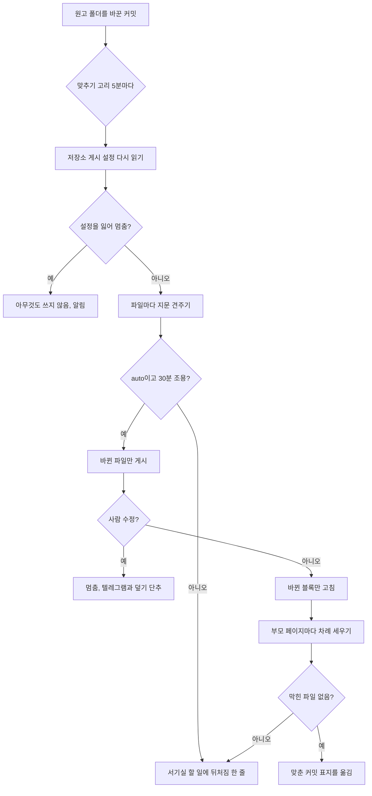

<!--
다루는 곳: bridge/notion.py, bridge/docsync.py, bridge/notioncfg.py, bridge/manuscript.py, bridge/doctext/head.py, bridge/doctext/titles.py, bridge/api/publish.py, config/notion.toml, migrations/0022_doc_publish.sql, tests/test_docsync.py, tests/test_docsync_last.py, tests/test_docsync_held_restart.py, tests/test_notion*.py, tests/test_portfolio_projects.py, tests/test_portfolio_sync.py, tests/test_publish_hold.py
읽은 커밋: b08115c
-->

# 노션 게시

FOREMAN은 저장소의 마크다운 글을 Notion 페이지로 올린다. 올리는 글은 세 갈래다. 각 프로젝트의 기술문서(런슈즈, 펫퍼민트, 인프라는 저장소 `docs/`, FOREMAN은 지금 읽고 있는 이 원고 `notion/`), 포트폴리오(`portfolio/`), 그리고 예전에 올리던 회고다 [code:config/notion.toml] [code:bridge/notion.py]. 회고는 지금 Notion에 두지 않고 git에만 남긴다. 이 편은 그 글이 어떤 길로 Notion에 닿는지, 왜 그 길을 골랐는지, 그 길에서 무엇이 막혔고 어떻게 풀었는지를 다룬다. 서기실 화면에서 이 일을 누르는 단추와 서기 세션이 원고를 쓰는 일감은 → 「서기실과 일감」에서, 원고에 다는 근거 표시를 확인하는 장치는 → 「근거 확인과 물어보기」에서 다룬다.

## 원본은 git, 노션은 사본

가장 먼저 정한 것은 어느 쪽이 진짜냐였다. 답은 git이다. 서기든 코더든 글은 저장소에 먼저 쓰고, 합쳐진 글만 Notion에 올린다. 고칠 때도 저장소에서 고치고 다시 올린다. Notion은 사람이 편하게 읽는 게시판이고, 거기 있는 페이지는 저장소에 있는 글의 사본이다 [docs:12_scribe.md].

이렇게 정한 까닭은 FOREMAN이 존재하는 이유와 같다. 이 프로젝트는 조용한 고장을 잡으려고 만들었다 [repo:CLAUDE.md]. 글이 두 군데에서 따로 고쳐지면 어느 순간 두 판이 갈라지는데, 그 갈라짐은 아무도 알려 주지 않는다. 원본을 하나로 정해 두면 "지금 Notion이 git과 같은가"라는 물음에 기계가 답할 수 있다. 이 편의 뒤쪽에 나오는 사람 수정 감지, 뒤처짐 세기, 지문 비교는 모두 이 물음에 답하는 장치다.

같은 원본은 늘 같은 Notion 페이지로 간다. 처음 올릴 때 만든 페이지의 id를 DB에 남겨 두고, 다시 올릴 때는 새 페이지를 만들지 않고 그 페이지의 내용을 고친다. 그래서 사람이 북마크해 둔 주소가 바뀌지 않는다 [code:bridge/notion.py].

## 왜 브리지가 직접 올리나

처음 설계 초안은 달랐다. 서기 세션(문서를 맡은 CC 세션)이 claude.ai의 Notion 커넥터를 써서 직접 페이지를 쓰는 길이었다. 모델이 글을 읽고, 커넥터 도구로 Notion에 옮겨 적는 방식이다. 이 길을 버리고 브리지(FOREMAN 서버 프로세스)가 Notion REST API를 직접 부르는 길로 바꿨다 [log:stage12_scribe_result.md].

버린 까닭은 둘이다. 첫째는 권한이다. 커넥터는 사용자 계정의 권한으로 움직이므로, 모델이 실수하거나 엉뚱한 지시를 받으면 이력서 같은 사람의 다른 페이지까지 고칠 수 있다. 이것을 막으려면 프롬프트에 "그 페이지는 건드리지 마라"라고 적는 수밖에 없는데, 글로 적은 금지는 지켜질 수도 있고 아닐 수도 있다. 한 줄로 줄이면 "권한을 코드가 아니라 구조로 막는 게 맞다" [log:stage12_scribe_result.md]. 둘째는 글이 바뀌는 위험이다. 첫 게시물이었던 회고는 17KB였는데, 모델이 이만한 글을 도구 호출로 옮겨 적다 보면 한 문장을 줄이거나 표를 다르게 바꾸는 일이 생길 수 있다 [log:stage12_scribe_result.md]. 원본과 사본이 같다는 약속이 모델의 성실함에 달리게 된다.

지금 길에서는 LLM이 게시에 끼지 않는다. 브리지가 git에서 글을 꺼내 정해진 규칙으로 Notion 블록으로 바꾸고, Notion 내부 통합 토큰으로 API를 부른다 [code:bridge/notion.py]. 같은 글은 늘 같은 블록이 된다. 토큰은 저장소 맨 위 `.env.notion` 파일의 `NOTION_TOKEN` 하나이고, 값은 로그나 오류 메시지 어디에도 찍지 않는다. 토큰 파일이 없으면 브리지는 게시 기능을 끈 채 뜨고 그 사유를 화면에 보인다 [code:bridge/main.py].

## 권한: 노션이 먼저 막고, 코드가 한 번 더 막는다

Notion의 내부 통합은 사람이 "이 페이지에 연결"을 눌러 준 페이지와 그 아래만 볼 수 있다. FOREMAN의 통합은 「프로젝트」라는 페이지 하나에만 연결돼 있다. 그 아래에 프로젝트마다 페이지가 있고, 각 프로젝트 페이지 아래에 [기술문서]와 [포트폴리오]가 있다. 「프로젝트」 밖에 있는 이력서나 자기소개서 같은 페이지는 통합이 읽지도 못한다. 처음 만들 때 코드를 거치지 않고 범위 밖 페이지에 휴지통 요청을 직접 보내 보았는데, Notion이 404로 거부했다 [log:stage12_scribe_result.md]. 이것이 첫째 벽이고, 코드에 버그가 있어도 무너지지 않는다.

둘째 벽은 코드 안의 `Scope`다. 프로젝트마다 그 프로젝트 페이지(설정의 `root`)가 정해져 있고, 게시기는 그 아래만 고친다. 같은 「프로젝트」 아래라도 다른 프로젝트의 페이지나 사람이 직접 만든 「인프라」 폴더는 건드리지 않는다는 뜻이다 [code:bridge/notion.py].

`Scope.under_root`는 페이지를 고치기 전에 매번 Notion에 그 페이지의 부모를 묻고, 그 부모의 부모를 다시 물으며 위로 올라간다. 최대 12단까지 올라가서 프로젝트 페이지에 닿으면 범위 안이다 [code:bridge/notion.py]. 중간에 휴지통에 든 페이지를 만나거나, 부모가 페이지가 아니라 워크스페이스나 데이터베이스면 범위 밖으로 본다. 이 결과는 캐시하지 않는다. 사람이 Notion에서 페이지를 끌어 다른 곳으로 옮겼을 수 있기 때문이다. 루트 페이지 자체는 고치거나 지울 수 없다.

고치기, 지우기, 옮기기는 모두 우리가 만든 페이지에만 한다. "우리가 만든 페이지"는 게시 기록 표(`doc_publish`, 아래)에 행이 있는 페이지다. 기록이 없는 페이지를 내리라고 하면 "게시한 기록이 없는 글입니다"로 거절한다. 지우기는 실제로 지우는 것이 아니라 휴지통으로 보내는 것이어서 Notion에서 30일 안에 되살릴 수 있다 [code:migrations/0022_doc_publish.sql].

게시할 수 있는 원본도 좁혀 두었다. 저장소 안의 `log/`, `docs/`, `portfolio/`, `notion/` 아래 `.md` 파일만 받고, 절대 경로나 `..`가 든 경로는 거절한다. 그림 파일도 같은 폴더 아래의 PNG, JPG, GIF, WebM만 올린다 [code:bridge/notion.py].

API를 부를 수 있는 사람도 나뉜다. 관리 토큰은 모든 길을 쓸 수 있고, 프로젝트 토큰(각 프로젝트 관리자 세션에 준 열쇠)은 자기 프로젝트 안에서만 한 편 게시, 내리기와 옮기기, 상태 읽기, 짝 등록을 할 수 있다. 사람 수정을 덮어쓰는 force와 한꺼번에 맞추기(기술문서든 포트폴리오든)는 관리 토큰으로만 된다 [code:bridge/api/publish.py] [code:bridge/scopetoken.py]. 토큰을 나누는 구조는 → 「열쇠와 비밀」에서 다룬다.

## 어느 판을 올리나

작업 트리에 있는 글은 올리지 않는다. 게시기는 늘 `git show <ref>:<경로>`로 커밋된 판을 읽는다. 다른 프로젝트(런슈즈, 펫퍼민트, 인프라)의 `ref`는 `origin/main`, 곧 push된 판이다 [code:config/notion.toml]. Notion은 GitHub에 올라간 것의 사본이라는 약속이다. 세션이 아직 push하지 않은 커밋이나 작업 중인 브랜치의 글이 Notion에 먼저 나가면, 나중에 그 커밋이 버려졌을 때 Notion에만 남은 글이 생긴다. 파일이 그 판에 없으면 "합친(push한) 뒤에 게시해 주세요"로 거절한다.

FOREMAN 자신은 `ref = "HEAD"`다 [code:config/notion.toml]. 브리지가 도는 원본 폴더의 `main`을 읽는다. FOREMAN에서는 관리자가 worktree 세션의 결과를 `main`에 합치고 시험한 뒤 push하고, 기술문서 게시는 사람이 서기실에서 단추를 눌러야만 일어나므로 이 둘의 차이가 문제 된 적은 없다. 다만 엄밀히 말하면 FOREMAN은 "push된 판"이 아니라 "main에 합쳐진 판"을 올린다.

`ref`와 `github`(저장소 링크)는 FOREMAN의 `config/notion.toml`에서만 정할 수 있다 [code:bridge/notioncfg.py]. 각 저장소가 자기 설정 파일에서 `ref = "HEAD"`로 바꾸면 push하지 않은 커밋이 게시될 수 있기 때문이다.

## 마크다운을 Notion 블록으로

Notion API는 마크다운을 받지 않는다. 문단, 제목, 목록, 표, 코드 같은 블록을 JSON으로 하나씩 보내야 한다. 그래서 `md_to_blocks`라는 변환기를 직접 만들었다 [code:bridge/notion.py]. 처리하는 것은 제목(`#`~`######`), 문단, 코드 울타리, 표, 인용, 구분선, 중첩 목록, 그림 줄, 줄 안의 굵게, 인라인 코드, 링크, 그리고 원고의 편 사이 참조(화살표 `→` 뒤에 낫표로 감싼 제목을 붙인 꼴, 아래 「편 사이 참조를 링크로」)다.

줄 안 꾸밈이 겹칠 때 막혔던 일이 있다. 굵게(글자를 진하게 하는 꾸밈) 안에 인라인 코드(글자를 코드 모양으로 보이게 하는 꾸밈)나 링크를 넣으면, 처음 변환기는 굵게 안쪽을 그냥 글자로만 보았다. 그래서 Notion에는 진한 글자 사이에 코드 표시 기호인 백틱이 날것으로 찍혀 나왔다. 굵게 안에 별표 하나가 든 경로(`config/*.toml` 같은 것)도 굵게로 읽지 못했다. 지금은 굵게 안쪽을 다시 한 번 풀어 코드와 링크를 찾고, 그 위에 굵게를 덧씌운다. 굵게 안의 혼자 있는 별표는 글자로 받는다. 백틱 두 개로 감싼 코드(안에 백틱 글자를 담을 때 쓰는 꼴)도 코드로 읽는다 [code:bridge/notion.py] [log:foreman-4_notion_inline_20261115.md].

표에도 같은 종류의 어긋남이 있었다. 표는 세로선으로 칸을 나누는데, 칸 안 코드에 세로선 글자가 들어 있으면 그것까지 칸 나눔으로 보아 칸이 갈라졌다. 지금 변환기는 짝이 맞는 코드 구간 안의 세로선은 칸 나눔으로 보지 않는다. 다만 GitHub는 코드 안의 세로선도 칸으로 가르므로, GitHub와 Notion에서 같은 모양이 되게 하려면 원고는 그 세로선 앞에 역슬래시를 붙여 써야 한다 [docs:12_scribe.md]. 이 고침은 변환 결과만 바꾸고 게시 지문(아래)은 원고 글로 셈하므로, 원고가 바뀌지 않은 편은 이것 때문에 다시 올라가지 않는다 [log:foreman-4_notion_inline_20261115.md].

제목은 문서의 첫 `# ` 줄을 페이지 제목으로 빼고, 본문 제목은 기본으로 한 단계씩 올린다. `##`이 Notion의 heading_1, `###`이 heading_2가 된다. 첫 `#`이 이미 페이지 제목이니 본문에서 가장 큰 제목은 `##`이기 때문이다 [code:bridge/notion.py]. 펫퍼민트처럼 사람이 옮겨 둔 페이지의 모양이 마크다운 단계 그대로인 프로젝트는 `headings = "md"`로 바꿀 수 있다.

`title = "h1"`이면 페이지 제목은 문서에서 처음 나오는 `# ` 줄이다. 이때 코드 울타리 안(셸 주석 `# …`), 맨 위 YAML 머리말, HTML 주석 안의 `#`은 제목으로 세지 않는다. 이 규칙은 서기실의 편 이름, 편 사이 참조 색인도 함께 쓰도록 문서 문법 묶음 한 곳에 둔다 [code:bridge/doctext/titles.py]. 이 원고의 맨 위 머리 주석이 제목으로 잘못 잡히지 않는 것도 이 규칙 덕분이다. H1이 없는 문서는 옛 방식(파일 이름과 `docs/README.md` 표의 설명)으로 제목을 정하고 로그에 경고를 남긴다.

Notion에는 덩어리 크기 한도가 있다. 글 한 덩어리는 2000자, 한 번에 붙이는 블록은 100개까지라서 변환기와 붙이는 함수가 그 크기로 잘라 보낸다 [code:bridge/notion.py]. API 요청은 0.35초 간격으로 천천히 보내고, Notion이 429(너무 많은 요청)를 돌려주면 `Retry-After`만큼 기다렸다가 세 번까지 다시 보낸다. 여러 프로젝트의 게시기가 한 클라이언트를 같이 쓰므로 이 간격은 모든 프로젝트를 합쳐서 지켜진다.

그림은 저장소 안 파일이면 Notion 파일 올리기 API로 올린 뒤 그림 블록에 붙이고, `.webm`이면 동영상 블록으로 만든다. 워크스페이스의 파일 크기 한도는 게시 전에 Notion에 물어 읽는다. 처음 확인했을 때 무료 요금제 한도는 5,242,880바이트(5MB)였다 [code:bridge/notion.py]. 한도를 넘는 파일은 보내기 전에 거절한다. Notion이 거절할 때까지 기다리면 글이 반쯤 올라간 채로 남기 때문이다.

링크는 글의 종류에 따라 다르게 다룬다. 기술문서 `docs/`는 저장소 안 상대 링크를 게시한 커밋의 GitHub 파일 링크로 바꾼다. 원고(`notion/`, `portfolio/`)는 저장소 링크를 걸지 않고 글자만 남긴다 [code:bridge/notion.py]. 이렇게 정한 때에는 저장소가 비공개라 바깥 사람이 누르면 404(페이지 없음)가 났다. 저장소는 지금 공개지만 링크 없이 두는 동작은 그대로이고, 공개된 뒤에도 그대로 둔 까닭은 기록에 없다. 원고끼리 서로를 가리키는 링크는 아래 「노션 기술문서 원고를 올리는 길」에서 다시 다룬다.

## 다시 올리기: 자리를 지키며 갈아 끼우기

### 막혔던 것: 게시할 때마다 mermaid 그림이 풀렸다

처음의 다시 올리기는 단순했다. 페이지 안의 블록을 모두 지우고 새로 붙였다. 그런데 이렇게 하면 게시할 때마다 mermaid 그림이 풀렸다. Notion의 코드 블록은 언어를 mermaid로 두면 [미리보기]로 바꿔 그림을 그릴 수 있는데, 이 보기 모드는 사람이 Notion 화면에서 한 번 눌러 줘야 한다. API로는 정할 수 없다. 코드 블록에 보낼 수 있는 칸은 `caption`, `language`, `rich_text`뿐이고, 다른 칸을 보내면 Notion이 "body.code.display should be not present"처럼 거부한다 [log:stage12_scribe_result.md]. 블록을 지우고 새로 만들면 그 블록은 새 블록이라 사람이 바꿔 둔 보기가 사라지고, 다시 코드 글자만 남는다.

풀이는 블록을 지우지 않는 것이었다. 블록 내용만 PATCH로 고치면 블록 id가 그대로 남고, 그 블록에 사람이 걸어 둔 보기 모드도 남는다. 실제 Notion에서 "내용을 고친 뒤 같은 블록인가"를 확인해 참으로 나왔다 [log:stage12_scribe_result.md]. 그래서 다시 올리기(`sync_children`)는 자리마다 같은 종류의 블록이면 내용만 고치고, 종류가 달라진 블록만 하나씩 바꿔 끼운다.

그런데 자리 순서로 짝을 지으면 또 풀렸다. 글 앞쪽에 사진 한 장을 끼우면 그 뒤의 블록이 모두 한 칸씩 밀리고, 밀린 자리마다 종류가 달라져 새 블록이 된다. 그래서 짝짓기를 자리 순서에서 내용 순서로 바꿨다. 옛 블록 목록과 새 블록 목록을 블록 지문(종류와 글)으로 맞대어(파이썬 `difflib`) 같은 구간은 그대로 두고, 바뀐 구간만 고치고, 빠진 블록은 지우고, 새 블록은 앞 블록 바로 뒤에 끼운다 [code:bridge/notion.py]. 런슈즈 문서 하나를 고쳐 push한 실제 시험에서 그 페이지의 바뀐 블록 9개만 고쳐졌고 나머지 페이지는 손대지 않았다 [log:notion_docsync_checks_20261109.md].

남은 한계도 있다. Notion API는 블록을 "어떤 블록 뒤에" 끼울 수만 있고 맨 앞에 끼울 수는 없다. 그래서 문서 맨 앞부터 달라지면 예전 방식(자리 순서)으로 돌아가고, 그래도 붙일 자리가 없으면 페이지를 통째로 갈아 끼운다. 이때는 mermaid 보기를 다시 바꿔야 한다. 또 하위 페이지 블록(child_page)은 보지도 지우지도 않는다. 블록을 지우면 그 하위 페이지가 휴지통으로 가기 때문이다 [code:bridge/notion.py].

### 바뀌지 않은 글은 건드리지 않는다

다시 올리기 전에 지문을 먼저 견준다. 지문은 본문의 SHA-256에 그 글이 가리키는 그림 파일 내용까지 더한 값이다 [code:bridge/notion.py]. 처음에는 본문만 해시했는데, 사진만 다시 찍어 바꾸고 본문은 그대로 두었더니 "바뀐 것 없음"으로 건너뛰었다. 그래서 그림 파일의 바이트도 지문에 넣었다. 지문이 지난번 게시 기록과 같으면 Notion에는 아무 요청도 보내지 않는다.

## 사람이 노션에서 고친 것

### 조용히 갈라지던 길

내용으로 짝짓는 다시 올리기에는 한 가지 빈틈이 있었다. 견주는 상대가 "지난번 올린 글"이 아니라 "지금 Notion"이었다. 가짜 Notion으로 실험해 보니, 사람이 Notion에서 문단 하나를 고치고 메모 한 줄을 더한 뒤 git에서 다른 문단을 고쳐 다시 올리자, 사람이 고친 문단은 git 글로 되돌아가고 메모는 지워졌다. 알림은 없었다 [log:notion_projects_docsync_20261109.md]. 사용자는 "git과 Notion이 조용히 갈라진다는 게 맞아. 그게 이 프로젝트가 막으려는 거고"라고 답했다 [log:notion_projects_docsync_20261109.md].

"수정: …"을 페이지에 덧붙이는 방식도 거론됐지만 쓰지 않았다 [docs:12_scribe.md]. git이 원본이라는 원칙은 그대로 두고, 덮기 전에 멈추고 알리기로 했다.

### 감지하는 방법

Notion은 블록마다 마지막으로 고친 사람(`last_edited_by`)을 알려 준다. 게시기는 먼저 자기 자신, 곧 통합 봇의 id를 `/users/me`로 읽는다. 그리고 다시 올리기 전에 페이지의 블록을 훑어, 마지막으로 고친 쪽이 봇이 아니고 글이 새 원본의 어느 블록과도 다른 블록을 찾는다 [code:bridge/notion.py]. 하나라도 있으면 그 파일은 올리지 않고 `HumanEdited` 예외로 멈춘다. 이때 Notion에는 아무것도 쓰지 않는다. 검사가 쓰기보다 앞서기 때문이다.

mermaid 코드 블록은 이 검사에서 뺀다. 사람이 [미리보기]만 눌러도 마지막 수정자가 사람이 되어, 그림을 보이게 한 것만으로 게시가 멈추기 때문이다.

### 잘못 잡던 것: 처음 쓴 사람이 남는 블록

이 검사는 나중에 다른 문제를 드러냈다. 다시 올리기는 글이 같은 블록을 손대지 않고 둔다(위의 "같은 구간은 그대로"). 그러면 Notion의 마지막 수정자는 그 블록을 처음 쓴 사람으로 계속 남는다. 인프라처럼 사람이 옮겨 둔 페이지는 거의 모든 블록의 마지막 수정자가 사람이다. 이 상태에서 git에서 그 문단을 고치면, 그 블록은 "사람이 마지막으로 고쳤고 새 원본과 글이 다른 블록"이 되어 사람 수정으로 걸렸다 [log:notion_publish_three_20261112.md].

고친 판정은 지난번에 올린 git 판을 함께 본다. 게시 기록에는 지난번 올린 커밋(`commit_sha`)이 남아 있으므로, 그 커밋에서 같은 파일을 읽어 블록으로 바꾼다. 그 사이 파일 이름이 바뀌었으면 git 이름 바꾸기 기록을 따라 옛 경로로 읽는다. Notion 블록의 글이 지난 git 판의 어느 블록과 같으면 그것은 사람이 고친 것이 아니라 git이 이미 가졌던 글이다 [code:bridge/notion.py]. 고친 뒤 인프라의 같은 문서를 force 없이 다시 올리자 멈추지 않고 올라갔다 [log:enable_c_wave2_20261111.md]. 지난 판을 읽을 수 없으면(처음 짝지은 페이지라 커밋 기록이 없을 때 등) 옛 판정 그대로 보수적으로 멈춘다.

글자가 없는 블록, 곧 빈 문단이나 공백만 있는 문단은 사람이 고친 것으로 세지 않는다. Notion은 페이지를 열거나 스크롤하는 중에도 끝에 빈 블록을 만들곤 해서, 이것까지 세면 아무 편이나 그 때문에 멈춘다. 글 칸이 있는 블록 종류만 이렇게 건너뛰고, 그림, 표, 구분선처럼 글이 없는 것이 본디인 블록은 지금처럼 센다. 글자가 있는 블록이 하나라도 바뀌었으면 빈 블록이 섞여 있어도 멈춘다. 빈 블록은 올릴 때 git 판에 맞춰 지워진다 [code:bridge/notion.py].

### 멈춘 뒤

멈추면 두 곳에 알린다. 텔레그램으로 「✋ Notion 기술문서 — 사람이 고친 곳이 있어 덮지 않았습니다」(포트폴리오 편이면 「Notion 포트폴리오」)와 어긋난 곳 몇 군데를 보내고, 서기실의 그 묶음 게시 줄(「기술문서 게시」나 「포트폴리오 게시」) 바로 아래에 그 파일 한 줄과 [Notion 수정 버리고 덮기] 단추를 띄운다. 서버가 덮기 줄마다 어느 묶음인지 달아 주므로 화면이 두 묶음의 단추를 섞지 않는다 [code:bridge/docsync.py] [code:bridge/static/js/scribe.js]. 같은 파일, 같은 커밋이면 알림은 한 번만 간다. 단추는 접는 칸 「할 일」 안에 있다가 칸 밖으로 옮겼다. 사람이 그 칸을 접어 두면 누를 단추가 보이지 않았기 때문이다. 접힌 「할 일」 머리줄에는 「덮기 N」만 붙는다.

멈춘 편 목록은 DB에도 남는다. 게시 기록 표(`doc_publish`)에 멈춘 편마다 `@docs-held/<경로>` 행을 두고, 풀리면 그 행을 `released`로 바꾼다. 전에는 목록이 브리지 메모리에만 있고 DB의 `@docs-last` 행에는 멈춘 수만 있었다. 그래서 브리지를 다시 띄우면 「사람이 고쳐 멈춤 N」 글자만 남고 누를 단추가 없었다. 지금은 메모리가 비어 있으면 서기실을 읽을 때 그 행에서 목록을 되살린다 [code:bridge/docsync.py] [code:bridge/scribe_room.py]. 행을 읽지 못하면 「사람이 고쳐 멈춘 편 목록을 읽지 못했습니다」를 띄우고, 멈춘 수는 있는데 행이 하나도 없으면(옛 브리지가 행을 남기지 않던 때 멈춘 편이다) 「멈춘 N편의 목록이 아직 없습니다. 다음 맞추기 뒤에 보입니다」라고 쓴다. 이때는 사람이 기다릴지 맞추기를 돌릴지 정할 수 있다 [code:bridge/docsync.py]. 행은 있는데 지금 덮을 편이 없으면(그 뒤 git이 다시 바뀌었거나 이미 맞춰졌으면) 그렇다고 쓴다. 두 사정을 서버가 갈라 주므로, 목록을 모르는 것을 덮을 편이 없는 것처럼 말하지 않는다. 단추 자리가 아무 말 없이 비지 않게 하려는 것이다 [code:bridge/static/js/scribe.js] [code:bridge/scribe_room.py].

푸는 길은 둘이다. 사람이 Notion에서 고친 내용이 맞으면 그것을 git에 옮긴다. 그러면 글이 같아져 다음 맞추기에서 저절로 풀린다. 버려도 되는 수정이면 서기실에서 [Notion 수정 버리고 덮기]를 누른다. 이 단추는 그 프로젝트 서기실에서 사람이 직접 누르게 했다. 관리자 세션이 대신 전달하는 길을 두지 않은 것이다 [docs:12_scribe.md]. 한때 한 쪽 게시가 멈췄을 때는 이 단추가 뜨지 않아, force 한 번에 세션 사이 메시지가 네 번 오간 일이 있었다. 지금은 자동 맞추기로 멈추든 한 쪽 게시로 멈추든 같은 자리에 한 줄만 남는다 [log:notion_onesided_hold_20261112.md]. 한 쪽 게시도 묶음 맞추기와 같은 함수에 「이 편만」을 붙여 부르기 때문이다. 같은 함수가 멈춘 편 행을 DB에 남기고, 그 편이 올라가면 행을 `released`로 바꾼다. 「이 편만」으로 돌 때는 먼저 DB의 멈춘 편 목록을 되살려 읽고 다른 편의 줄은 그대로 두므로, 브리지를 다시 띄운 직후에 한 편을 올려도 다른 편의 행을 잘못 풀지 않고, 이미 풀린 단추가 되살아나지도 않는다 [code:bridge/docsync.py] [code:bridge/api/publish.py].

사람이 실제로 Notion에서 고친 블록으로 멈추는지는 가짜 Notion으로만 시험한다. 통합 토큰은 봇이라 사람 수정을 만들 수 없기 때문이다 [log:notion_docsync_checks_20261109.md]. 검사는 페이지 바로 아래 블록만 본다. 표의 칸이나 목록 안쪽 줄을 고쳤을 때 그 부모 블록의 마지막 수정자가 바뀌는지 알아보는 일은 저장소 할 일 목록에 있다 [docs:TODO.md].

## 게시 기록 표

무엇을 어디에 올렸는지는 DB 표 `doc_publish` 하나에 남는다 [code:migrations/0022_doc_publish.sql]. 프로젝트와 경로의 짝이 유일하므로, 한 원본에 페이지는 하나다.

| 칸 | 뜻 |
|---|---|
| `project`, `path` | 프로젝트 이름과 저장소 맨 위 기준 원본 경로. 둘이 합쳐 유일하다 |
| `kind` | `doc`(글), `section`(묶음 페이지), `mark`(맞춘 커밋 표지) |
| `notion_page_id`, `parent_page_id` | 우리가 만든 페이지와 그 부모. 고치기, 내리기는 이 페이지만 |
| `commit_sha` | 마지막으로 올린 판의 커밋. 사람 수정 판정이 지난 판을 읽을 때 쓴다 |
| `content_hash` | 마지막으로 올린 내용의 지문. 같으면 다시 올리지 않는다 |
| `status` | `published`, `archived`(휴지통). 멈춘 편 행은 `held`, `released`(아래) |
| `title`, `url`, `error` | 페이지 제목, 주소, 마지막 오류 |

경로 칸에는 글이 아닌 행도 들어간다. `@section/<이름>`은 루트 아래 묶음 페이지(예전 「회고」 묶음이나 차례를 세울 때 잠깐 쓰는 「정렬 중」)이고, `@docs-sync`는 기술문서를 마지막으로 다 맞춘 커밋을 적어 두는 표지 행이다. `@docs-last`는 마지막 맞추기의 멈춘 수, 실패 수, 첫 실패를 적어 두는 표지 행이고, `@docs-held/<경로>`는 사람 수정으로 멈춘 편 하나를 적는 행이다(위 「멈춘 뒤」). 이 행의 `status`는 `held`이고 풀리면 `released`가 된다. 포트폴리오는 같은 뜻의 표지 행을 따로 쓴다. 다 맞춘 커밋은 `@portfolio-sync`, 마지막 결과는 `@portfolio-last`이고, 멈춘 편 행은 경로가 `@docs-held/portfolio/…`라 기술문서 행과 저절로 갈린다 [code:bridge/docsync.py].

서기실 기술문서 줄과 포트폴리오 줄의 「마지막으로 올림 …」은 이 표에서 읽는다. 때는 그 프로젝트 묶음 폴더(원고 폴더나 `portfolio/`) 아래 게시된 글의 `updated_at` 가운데 가장 늦은 것이고, 「올림 N」은 그 때에서 10분 안에 올라간 글 수다. 한 편씩 올린 게시도, 자동 맞추기도, [Notion에 올리기]도 모두 같은 게시기로 이 행을 쓰므로 어떤 길로 올렸든 같은 줄에 들어간다. 전에는 값이 브리지 메모리에만 있어 브리지를 다시 띄우면 비었고, 한 편씩 올린 것은 아예 들어가지 않아서 29편을 올리고도 화면이 「아직 올린 기록 없음」이라고 말할 수 있었다. 화면이 실제와 다른 말을 하는 조용한 고장이었다. 이제 이 말은 「Notion에 올린 기록이 없습니다」로 바꿔 읽는 사람이 무엇이 없는지 알게 했고(게시 기록 표에 이 원고 폴더의 글이 한 편도 없다는 뜻이다), 표에도 정말 없을 때만 뜨며, 표를 읽지 못하면 「읽지 못했습니다」가 뜬다 [code:bridge/docsync.py] [code:bridge/static/js/scribe.js] [log:foreman-4_docsync_last_db_20261117.md].

사람이 미리 옮겨 둔 Notion 페이지를 git 문서와 이으려면 짝 등록(`POST /api/publish/pair`)을 쓴다. 그 프로젝트 루트 아래 페이지만, 루트나 [기술문서], [포트폴리오] 자체가 아닌 것만, 이미 다른 경로와 짝이 아닌 것만 받는다. 원본도 `docs/`, `portfolio/`, `notion/` 아래 글이고 게시가 읽는 판에 있는 것만 받는다. Notion에는 쓰지 않고 제목, 부모, 주소를 읽어 기록만 남긴다. 처음 짝이므로 지문과 커밋 칸은 비워 둔다. 그래서 첫 게시는 사람 수정 판정이 보수적으로 돈다 [code:bridge/notion.py].

## 프로젝트마다 게시기 하나

브리지는 뜰 때 `config/notion.toml`을 읽어 프로젝트마다 게시기(`Publisher`)를 하나씩 만든다. 프로젝트 칸에 `root`가 없으면 그 프로젝트는 게시기를 만들지 않는다 [code:config/notion.toml]. 칸의 뜻은 아래와 같다.

| 칸 | 값 | 뜻 |
|---|---|---|
| `root`, `docs_page`, `portfolio_page` | Notion 페이지 id | 쓰기 범위. 프로젝트 페이지, 그 아래 [기술문서], [포트폴리오] |
| `github`, `ref` | 저장소 주소, 커밋 | 링크를 걸 저장소와 읽을 판 |
| `docs` | `off`, `manual`, `auto` | 기술문서를 다루지 않음, 단추로만, push 뒤 조용하면 자동 |
| `quiet_min` | 분 | `auto`가 기다리는 시간. 기본 30 |
| `src` | `docs/`, `notion/` | 기술문서 원고 폴더 |
| `title` | `keep`, `h1` | 제목을 건드리지 않음, 첫 H1을 제목으로 |
| `order` | `keep` | 페이지 자리와 차례를 사람이 둔 대로 |
| `header` | `footer` | 맨 위 사본 안내 상자 대신 맨 아래 회색 갱신 줄 |
| `create`, `archive` | 참, 거짓 | 짝 없는 문서를 새로 만드나, 원본이 사라지면 휴지통으로 보내나 |
| `headings`, `keep_notion`, `new_parent`, `new_title`, `skip` | | 사람이 옮겨 둔 페이지에 맞추는 선택(아래) |

지금 값은 프로젝트마다 다르다. 런슈즈는 `docs = "auto"`, `quiet_min = 30`으로 docs를 그대로 자동으로 올린다. 펫퍼민트도 자동이지만 사람이 옮겨 둔 페이지에 맞추는 선택을 거의 모두 켰다. FOREMAN은 `docs = "manual"`, `src = "notion/"`, `title = "h1"`, `header = "footer"`다 [code:config/notion.toml]. 인프라는 이 파일에 게시할 Notion 페이지 자리(`root`, `docs_page`, `portfolio_page`)와 저장소 주소, 읽을 브랜치(`github`, `ref`)만 두고, 게시 방식 칸(`docs`, `title`, `order` 등)은 자기 저장소의 `.foreman/notion.toml`에 둔다 [code:config/notion.toml].

포트폴리오도 기술문서와 같은 꼴로 프로젝트마다 그 게시기가 올린다. 포트폴리오 글은 `portfolio_page`가 가리키는 [포트폴리오] 페이지 아래에 놓인다. 이 칸이 비어 있는 프로젝트는 [Notion에 올리기]와 한 편 게시를 「포트폴리오 Notion 자리가 정해지지 않았습니다」로 거절한다(`Publisher.portfolio_place`) [code:bridge/api/publish.py]. 예전에는 칸이 비면 프로젝트 페이지 바로 아래로 조용히 떨어졌다. FOREMAN 하나만 포트폴리오를 올리던 때의 방식인데, 프로젝트마다 열고 나니 자리를 정하지 않은 프로젝트가 아무 데나 페이지를 쌓을 수 있어 막았다 [code:bridge/notion.py] [log:foreman-4_portfolio_per_project_20261117.md]. 내리기는 이미 있는 페이지를 휴지통으로 보낼 뿐이라 자리 없이도 된다.

게시할 포트폴리오 목록은 게시가 읽는 판(`ref`)에서 센다(`git ls-tree`로 그 판의 `portfolio/*.md`). 예전에는 작업 폴더의 색인을 보았는데, 그러면 `ref = "origin/main"`인 다른 프로젝트에서 아직 push하지 않은 글까지 목록에 섞일 수 있었다. 판을 읽지 못하면 빈 목록이 아니라 오류로 올린다. 빈 목록으로 삼키면 「글 없음」으로 보여 조용히 낡기 때문이다 [code:bridge/notion.py]. 한 프로젝트의 게시가 다른 프로젝트 페이지를 덮지 않는지는 쓰기 범위 확인이 그대로 지키고, 가짜 Notion 시험으로도 본다 [code:tests/test_portfolio_projects.py].

포트폴리오를 올리는 함수는 기술문서를 맞추는 함수와 같은 하나다. 다른 것은 읽는 폴더(`portfolio/`)뿐이다 [code:bridge/docsync.py]. 서기실 「포트폴리오 게시」의 [Notion에 올리기]를 한 번 누르면 새 편은 만들고, 바뀐 편은 고치고, git에서 지운 편의 페이지는 휴지통으로 보내고(30일 안에 Notion에서 되살릴 수 있다), 그 가운데 하나라도 했으면 [포트폴리오] 아래 차례를 파일 번호와 견주어 틀렸을 때만 다시 세운다(아래 「차례」와 같은 방법). 사람이 Notion에서 고친 편은 기술문서처럼 멈추고 덮기 단추를 남긴다. 자동 맞추기는 포트폴리오에 걸지 않는다. 바깥 독자에게 내는 글이라 사람이 눌러야만 올라간다. 예전에는 편마다 [게시]를 누르고, 옛 편 치우기와 번호순 다시 세우기를 따로 불렀다. 한 편씩 보내야 했던 까닭은 편 사이 링크를 걸려면 가리킨 편이 먼저 올라가 있어야 해서였는데, 이 일이 한 번의 누름 안에서 끝나게 되자(아래 「아직 안 올라간 편을 가리킬 때」) 따로 둘 까닭이 사라졌다. 같은 일을 하는 길이 둘 남으면 한쪽만 고쳐지고 다른 쪽이 낡는다. 그래서 단추와 길을 하나로 줄였다 [code:bridge/static/js/scribe.js] [code:tests/test_portfolio_sync.py].

한 편만 올리는 API(`action: "publish"`)는 남겨 두었다. 프로젝트 토큰은 한꺼번에 올리기를 부를 수 없으므로 자기 프로젝트 편을 올리는 길이 이것뿐이기 때문이다. 이 길도 같은 함수에 「이 편만」을 붙여 부른다. 그 편 하나만 다루고, 휴지통 보내기, 차례 세우기, 다 맞춘 커밋 표지는 하지 않는다 [code:bridge/api/publish.py]. 결과, 멈춤, 실패, 알림이 묶음 게시와 같은 자리에 남는다.

## 설정을 각 저장소로 옮긴 까닭

처음에는 모든 프로젝트의 게시 설정이 FOREMAN의 `config/notion.toml` 한 파일에 있었다. 문제는 그 설정의 주인이 각 프로젝트라는 점이었다. 인프라 관리자 세션이 "우리 문서는 제목을 H1으로, 휴지통으로 보내지 말고"라고 바라면, FOREMAN 관리자가 그 요청을 받아 FOREMAN 설정 파일을 고쳐야 했다. 그런데 FOREMAN에는 다른 세션의 요청만으로 `config/*.toml`을 바꾸지 않고 사용자에게 먼저 묻는다는 규칙이 있다 [repo:CLAUDE.md]. 설정 한 칸을 바꾸는 데 세션 사이 메시지와 사용자 확인이 매번 끼었다 [log:enable_c_wave2_20261111.md].

그래서 각 프로젝트 저장소에 `.foreman/notion.toml`을 둘 수 있게 했다 [code:bridge/notioncfg.py]. 이 파일이 그 저장소의 `ref` 판에 있으면 `docs`, `quiet_min`, `skip`, `create`, `archive`, `title`, `order`, `header`, `headings`, `keep_notion`, `new_parent`, `new_title`, `src`는 모두 그 파일의 값을 쓴다. 프로젝트 관리자는 자기 저장소에 커밋하고 push하는 것으로 설정을 바꾼다. 게시기는 5분마다 도는 맞추기 주기 앞에서 이 파일을 다시 읽으므로 브리지를 다시 띄우지 않아도 따라온다. 파일 내용(blob 해시)이 그대로면 다시 풀지 않는다. 다시 읽는 API를 따로 두지 않은 것은, 프로젝트 관리자가 push한 뒤 그 API 부르기를 잊으면 옛 설정으로 조용히 돌기 때문이다 [log:notion_publish_three_20261112.md].

몇 가지는 일부러 저장소에 넘기지 않았다. 쓰기 범위(`root`, `docs_page`, `portfolio_page`)와 `github`, `ref`는 FOREMAN에서만 정한다. 저장소 파일에 이 칸이 있으면 쓰지 않고 경고만 한다. 어떤 저장소가 남의 프로젝트 페이지를 자기 `root`로 적어 고치는 길을 막기 위해서다. Notion 토큰과 게시 기록도 FOREMAN 것 그대로다.

저장소 파일이 있으면 그 칸들은 통째로 저장소 것이고, 칸마다 섞지 않는다. 섞으면 저장소에서 칸을 지워도 FOREMAN 쪽 값이 살아남아 조용히 다르게 돌기 때문이다. FOREMAN 쪽에 같은 칸이 남아 있으면 "저장소 파일이 앞서 FOREMAN 칸의 …는 쓰지 않습니다"라고 한 번 알린다 [code:bridge/notioncfg.py].

파일이 깨졌을 때(TOML 오류, 칸 형식이 틀림, `ref`가 없음)는 지금 돌고 있던 설정을 그대로 쓰고 알린다. 조용히 꺼지거나 FOREMAN 칸으로 돌아가지 않는다. 다만 브리지가 뜰 때부터 깨져 있어 쓸 옛 설정이 없고, 그 프로젝트가 저장소 파일로 돈 적도 없으면(아래 기억에 없으면) FOREMAN 칸으로 돌고 "FOREMAN config/notion.toml 칸으로 돌았습니다"라고 알린다 [code:bridge/notioncfg.py]. 저장소 파일로 돈 적이 있는 프로젝트는 이렇게 떨어지지 않고 아래처럼 멈춘다.

### 그 파일을 잃으면 멈추는 까닭

여기에 빈틈이 하나 더 있었다. 인프라는 저장소 파일로 옮긴 뒤 FOREMAN 설정의 자기 칸을 비웠다. 두 곳에 같은 값을 두면 한쪽만 고쳐 조용히 벌어지기 때문이다. 그런데 그 상태에서 저장소 파일이 지워지거나, 브리지를 다시 띄운 뒤 파일이 깨져 있으면, 게시기는 비어 있는 FOREMAN 칸으로 떨어졌다. 빈 칸의 기본값은 `create`와 `archive`가 켜지고 차례도 다시 세우는 것이다. 인프라가 일부러 막아 둔 "새로 만들지 않음, 휴지통에 보내지 않음, 차례 그대로"가 알림 없이 풀린 채 돌 수 있었다 [log:notion_repo_config_halt_20261112.md].

그래서 한 번이라도 저장소 파일로 돈 프로젝트는 `.run/notion_repo_config.json`에 기억해 둔다. 브리지를 다시 띄워도 남는 파일이다. 기억에 있는 프로젝트가 그 파일을 잃으면(지워짐, 또는 깨졌는데 쓸 마지막 판이 없음) FOREMAN 칸으로 떨어지지 않고 게시를 멈춘다 [code:bridge/notioncfg.py]. 멈추면 API로 오는 한 편 게시, 내리기와 옮기기, 짝 등록, 한꺼번에 맞추기를 모두 409로 거절하고, 자동 맞추기는 그 프로젝트를 건너뛴다. Notion에는 아무것도 쓰지 않는다 [code:bridge/api/publish.py] [code:bridge/docsync.py]. 텔레그램 "🛑 …게시를 멈췄습니다"와 서기실 할 일 줄, 상태 읽기 응답의 `halted`로 알린다. 그 사이 게시기의 칸은 가장 좁은 값(단추로만, 새로 만들지 않음, 휴지통 안 보냄, 차례와 제목 그대로)으로 둔다. 거절하는 문이 뚫리더라도 피해가 가장 작게 하려는 것이다. `docs`를 `off`가 아니라 `manual`로 두는 까닭은, `off`면 서기실이 기술문서 줄을 숨겨 멈춤이 화면에 보이지 않기 때문이다 [log:notion_repo_config_halt_20261112.md].

파일이 바르게 돌아오면 다시 돌고 "게시를 다시 돌립니다"를 한 번 알린다 [code:bridge/notioncfg.py]. 일부러 FOREMAN 칸으로 되돌리고 싶으면 저장소 파일을 먼저 지운 뒤 관리 토큰으로 `DELETE /api/publish/repo-config?project=<이름>`을 부른다. 기억이 지워지고 FOREMAN 칸으로 다시 읽힌다.

## docs 자동 맞추기

`docs = "auto"`인 프로젝트는 사람이 단추를 누르지 않아도 기술문서가 Notion을 따라간다 [code:bridge/docsync.py]. 맞추기 고리는 브리지가 뜨고 60초 뒤부터 5분마다 돈다. 돌 때마다 프로젝트별로 원고 폴더의 파일을 하나씩 지문으로 게시 기록과 견주어 새 글, 바뀐 글, 지워진 글을 센다. 여기에 LLM은 끼지 않는다.

바로 올리지는 않는다. 그 프로젝트의 원고 폴더를 바꾼 마지막 커밋에서 `quiet_min`분(지금 30분)이 지나야 올린다 [code:config/notion.toml]. 세션이 문서를 고칠 때는 보통 커밋을 몇 번 이어서 한다. 커밋마다 올리면 Notion 페이지가 반쯤 고친 상태로 여러 번 바뀌고, 그동안 사람이 페이지를 고치면 사람 수정 판정도 꼬인다. 30분 조용하면 한 묶음의 일이 끝났다고 본다.

올릴 때는 바뀐 파일만 올린다. 지워진 원본의 페이지는 휴지통으로 보낸다. 다만 `archive = false`이거나 `create = false`인 프로젝트는 휴지통으로 보내지 않고 실패로 남긴다. 경로만 바뀐 것(`git mv`)이면 게시 기록의 짝을 새 경로로 옮기면 풀린다. 이 막음이 없었다면 펫퍼민트가 docs 폴더를 옮겼을 때 20쪽이 모두 휴지통으로 갈 뻔했다 [code:bridge/docsync.py].

파일 하나라도 사람 수정으로 멈추거나 실패하면 `@docs-sync` 표지(마지막으로 다 맞춘 커밋)를 옮기지 않는다. 그러면 서기실 할 일에 "Notion 기술문서:"로 시작하는 뒤처짐 한 줄이 프로젝트마다 계속 남는다. 그 줄은 맞춘 커밋 뒤 원고 폴더를 바꾼 커밋 수, 뒤처진 파일 수, 그리고 새, 바뀜, 링크만(아래 「아직 안 올라간 편을 가리킬 때」), 지워짐, 못 읽음 가운데 0이 아닌 수를 보인다 [code:bridge/docsync.py]. 실패한 채로 조용히 낡지 않게 하려는 것이다. 실패와 사람 수정은 텔레그램으로도 간다.

자동으로 올리는 대상은 `docs/` 아래 `.md` 전부(하위 폴더 포함)이고, `docs/archive/`(원고 폴더가 다르면 그 폴더의 `archive/`)는 늘 빼며, 프로젝트 `skip`에 적은 파일과 `…/`로 끝나는 폴더도 뺀다. 차례는 `docs/README.md` 표에 나온 순서다. 처음에는 README 본문 어디서든 먼저 나온 이름을 따랐는데, 본문이 표와 다른 순서로 문서를 언급해 차례가 틀렸다. 그래서 표의 줄만 본다 [code:bridge/docsync.py]. 런슈즈 문서는 H1이 없고 첫 줄이 상태 표시라서, 기본 제목은 파일 이름 뒤에 README 표 설명의 앞부분을 이은 것이다.

`docs = "manual"`인 프로젝트는 뒤처짐만 보이고, 서기실의 [지금 맞추기]를 눌러야 올라간다. FOREMAN의 기술문서와 모든 프로젝트의 포트폴리오는 [Notion에 올리기]라는 다른 이름의 단추로 같은 길(`POST /api/publish`, `action: "docsync"`, 포트폴리오는 경로를 `portfolio/`로)을 탄다 [code:bridge/api/publish.py]. 게시는 모두 한 잠금 안에서 차례로 돈다. 사람이 단추를 잇달아 눌러도 두 요청이 같은 페이지에 함께 쓰지 않는다. 함께 쓰면 한쪽이 지운 블록을 다른 쪽이 고치려다 Notion이 「Can't edit block that is archived」로 거절한다 [code:bridge/docsync.py].



## 사람이 옮겨 둔 페이지에 맞추기

펫퍼민트는 사정이 달랐다. FOREMAN이 게시를 맡기 전에 사람이 docs를 Notion에 손으로 옮겨 두었고, 제목, 자리, 하위 페이지 구조, 꾸밈을 사람 취향대로 다듬어 둔 상태였다. 이 페이지를 git 모양으로 덮으면 사람이 다듬은 것이 모두 사라진다. 그래서 몇 가지 선택을 펫퍼민트 칸에만 켰다 [code:config/notion.toml].

가장 큰 것은 쪽 단위 글 비교(`keep_notion`의 `"shape"`)다. 꾸밈 표시, 체크박스 표시, 공백, 줄바꿈, 블록 나눔, 제목 단계, 코드 언어를 모두 빼고 페이지 전체의 글만 견준다. 글이 같으면 Notion은 손대지 않고 맨 아래 갱신 줄만 고친다. Notion 글이 지난번 맞춘 git 판과 같으면 git만 바뀐 것이므로, git에서 바뀐 블록을 같은 글의 Notion 블록에서 찾아 그 자리의 글만 고친다. 블록 종류는 Notion 것을 그대로 둔다. 짝이 하나로 맞지 않으면(그 글의 Notion 블록이 없거나 여럿, 표나 그림, 맨 앞에 끼우기) 아무것도 쓰기 전에 멈추고 알린다 [code:bridge/notion.py]. 그 밖의 경우는 누군가 Notion 글을 고친 것이므로 사람 수정으로 멈춘다.

이 방식에서 잃는 것도 적어 둔다. 사람이 Notion에서 모양만 고친 것(굵게, 제목 단계, 체크박스 체크)은 사람 수정으로 잡히지 않는다. 글이 같은 동안은 덮지 않으니 남지만, git에서 그 블록의 글이 바뀌면 그 블록의 꾸밈은 git 것으로 바뀌어 알림 없이 사라질 수 있다 [docs:12_scribe.md].

### 중간 번호를 만들지 않는 까닭

펫퍼민트는 `create = true`로 새 문서를 Notion에 만들 수 있다. 새 페이지 제목은 파일 번호(`17_` → "17", `03a_` → "03-1")와 부모 페이지 원본 문서의 목록 줄에서 가져온 이름을 합쳐 정한다. 그런데 번호가 기존 페이지들 사이에 끼는 새 문서는 만들지 않고 실패로 남긴다 [code:bridge/notion.py].

까닭은 Notion API의 한계다. 새 하위 페이지는 늘 부모의 맨 끝에 붙고, API로는 자리를 정할 수 없다. 형제 가운데 가장 큰 번호보다 작은 번호의 문서를 만들면 사이드바 차례가 깨진다. 차례를 다시 세우려면 그 부모 아래 18쪽을 모두 임시 페이지로 옮겼다가 순서대로 되돌려야 하는데, 펫퍼민트의 상위 문서 본문 안에 놓여 있던 하위 페이지 자리까지 모두 끝으로 밀려난다 [docs:12_scribe.md]. 그래서 펫퍼민트는 `order = "keep"`으로 차례를 사람에게 맡기고, 맨 뒤 번호만 만든다. 중간 번호 문서는 "중간 번호라 자리를 정할 수 없습니다. 직접 만드십시오: <경로>(같은 폴더 마지막 번호 16)"으로 알리고 사람이 직접 만든 뒤 짝을 등록한다.

FOREMAN의 원고는 반대로 차례를 게시기가 세운다. 원고 나무 전체를 게시기가 만들었고 사람이 그 안에 다른 것을 섞어 두지 않았기 때문이다(아래).

## 노션 기술문서 원고를 올리는 길

FOREMAN의 기술문서는 `docs/`를 그대로 올리지 않는다. `docs/`는 세션이 일할 때 읽는 글이라 얕고 압축돼 있고 어려운 말을 그대로 쓴다. Notion 기술문서는 사람이 읽는 가장 깊은 글이다 [docs:12_scribe.md]. 둘의 독자가 다르므로 따로 쓴다. 그 원고가 지금 이 글이 들어 있는 저장소 폴더 `notion/`이고, 설정은 `src = "notion/"`이다. FOREMAN의 `docs/`를 [기술문서]로 맞추는 일은 하지 않는다.

### 폴더 나무가 곧 페이지 나무

`notion/NN_이름.md` 한 편이 [기술문서] 아래 페이지 하나가 되고, `notion/NN_이름/` 폴더 아래 글은 그 `NN_이름.md` 페이지의 하위 페이지가 된다. 이 편이 `notion/10_scribe/04_notion.md`이므로 「10 서기와 문서」 페이지 아래에 놓인다. 부모를 찾는 규칙은 `tree_parent` 한 줄이다. 파일이 있는 폴더 이름에 `.md`를 붙인 것이 부모 글이다 [code:bridge/manuscript.py]. 편 수와 깊이에 제한이 없고, 설정에 주제 목록을 두지 않는다. 폴더에 파일을 더하면 페이지가 늘어난다.

부모 글이 아직 Notion에 없으면 그 아래 글은 만들지 않고 "부모 글 …이 Notion에 없습니다"라는 실패로 남는다 [code:bridge/notion.py]. 아무 데나 만들어 두었다가 나중에 옮기면 차례가 꼬이기 때문이다. 대신 맞추기는 나무 차례로 올린다. `tree_order`는 경로를 칸마다 (번호, 이름)으로 정렬하되, 부모 글 `02_x.md`가 그 폴더 `02_x/`의 글보다 앞에 오도록 한다 [code:bridge/manuscript.py]. 그래서 한 번 누르면 부모가 먼저 올라가고 그 뒤에 자식이 올라간다. 번호 없는 이름은 번호 있는 것 뒤로 간다.

### 차례

차례는 파일 번호다. 사이에 끼울 때는 `03a_`처럼 글자를 붙인다. Notion은 새 페이지를 늘 끝에 붙이므로, 무엇인가 올라간 뒤에는 부모 페이지마다 그 아래 우리 페이지들을 파일 번호 차례로 다시 세운다 [code:bridge/docsync.py]. 다시 세우는 방법은 이렇다. 루트 아래에 「정렬 중」이라는 임시 묶음 페이지를 만들어 우리 페이지를 모두 그리로 옮긴 뒤, 번호 차례대로 하나씩 원래 부모로 되돌리고 임시 페이지를 내린다. 페이지 id와 주소, 안의 블록은 그대로다. 지금 차례가 이미 맞으면 옮기지 않는다 [code:bridge/notion.py]. 사람이 만든 페이지는 옮기지 않으므로, 혹시 [기술문서] 아래에 사람이 둔 페이지가 있다면 우리 페이지들이 모두 그 뒤로 붙는다. 펫퍼민트가 중간 번호를 만들지 못하는 것과 달리 FOREMAN 원고가 `03a`를 쓸 수 있는 것은 이 다시 세우기를 켜 두었기 때문이다.

부모 글을 git에서 지웠는데 그 폴더 아래 글이 남아 있으면 부모 페이지를 휴지통으로 보내지 않고 실패로 남긴다. 부모 페이지를 휴지통에 넣으면 Notion이 그 아래 페이지까지 함께 보내기 때문이다 [code:bridge/docsync.py].

### 머리 주석

편마다 맨 위에 Notion에 나가지 않는 HTML 주석을 둔다. 이 편의 맨 위에도 있다.

```
<!--
다루는 곳: bridge/notion.py, bridge/docsync.py, …
읽은 커밋: b08115c
-->
```

「다루는 곳」은 그 편이 설명하는 코드 경로(파일, 끝이 `/`인 폴더, `*`가 든 글롭)이고, 「읽은 커밋」은 서기가 그 글을 쓸 때 읽은 코드 판이다. 이 꼴을 읽고 쓰는 곳은 문서 문법 묶음의 `bridge/doctext/head.py` 한 곳이고, 포트폴리오 원고도 같은 꼴을 쓴다 [code:bridge/doctext/head.py]. 그 값으로 git을 읽어 코드가 바뀐 편을 세는 일은 `bridge/manuscript.py`가 한다 [code:bridge/manuscript.py]. 주석은 코드 울타리 밖의 것만 읽으므로, 위처럼 코드 블록 안에 예시로 적은 주석은 머리 주석으로 잡히지 않는다.

### 노션 판에서 떼는 것

원고(`notion/`, `portfolio/`)를 올릴 때는 세 가지를 뗀다 [code:bridge/notion.py]. 하나는 머리 주석이다. 변환기가 블록을 만들기 전에 HTML 주석 줄을 통째로 뺀다. 둘은 근거 표시다. 원고에는 문장마다 코드 경로, log 파일, docs 파일, 커밋을 대괄호로 가리키는 근거 표시를 단다(꼴은 → 「근거 확인과 물어보기」). git 원고에서는 근거 확인기가 이 표시를 읽어 경로와 커밋이 실제로 있는지 본다. 하지만 사람이 읽는 Notion에는 이것이 군더더기다. 그래서 Notion 판에서는 표시와 그 앞의 공백까지 지운다. 근거 표시만 있던 줄은 표시를 떼면 비게 되는데, 처음에는 이 줄이 Notion에 빈 문단으로 남았다. 지금은 표시를 뗀 뒤 글이 없으면 문단을 만들지 않는다 [code:bridge/notion.py]. 다만 코드 블록 안은 변환하지 않으므로 그대로 남는다. 셋은 저장소 링크다. 원고는 저장소로 가는 링크를 걸지 않는다(위 링크 문단).

대신 맨 아래 회색 갱신 줄(`header = "footer"`)에 그 글을 마지막으로 바꾼 커밋, 게시 시각, 그리고 머리 주석의 읽은 커밋을 적는다 [code:bridge/notion.py]. 읽는 사람은 이 글이 어느 코드 판을 보고 쓴 것인지 알 수 있다. 꼴은 `마지막 갱신 <커밋>(<게시 시각>), 읽은 커밋 <커밋>`처럼 쉼표와 괄호로 나눈다. 문서에 줄표와 가운뎃점을 쓰지 않는 약속을 이 줄에도 지킨다 [code:bridge/notion.py].

게시기는 다시 맞출 때 Notion 쪽 맨 아래 문단이 이 갱신 줄인지 알아봐야 한다. 못 알아보면 그 줄을 사람이 쓴 문단으로 보아 쪽 전체가 「사람이 고침」으로 멈춘다. 그래서 지금 꼴과 함께, 줄표와 가운뎃점으로 나눈 이전 꼴도 갱신 줄로 알아본다. Notion에 이미 올라간 쪽에는 이전 꼴이 남아 있기 때문이다. 판단은 한 함수에서만 한다. 판단은 첫머리 글자만이 아니라 줄 전체 꼴을 본다. 커밋 해시 자리까지 맞아야 갱신 줄로 보므로, 본문 문단이 「마지막 갱신은」처럼 같은 말로 시작해도 갱신 줄로 빼지 않는다 [code:bridge/notion.py] [code:tests/test_notion_footer.py]. 올린 글이 바뀌었는지는 원본 글과 사진만으로 정하므로 [code:bridge/notion.py], 갱신 줄 꼴만으로는 어느 쪽도 다시 올라가지 않는다. 이전 꼴 줄은 그 편 글이 다음에 바뀌어 다시 올라갈 때 지금 꼴로 바뀐다.

### 「코드가 바뀐 편」 세기

원고는 코드를 설명하는 글이라, 코드가 바뀌면 낡는다. 이것을 사람이 기억에 기대지 않게, 편마다 "읽은 커밋 뒤로 다루는 곳을 바꾼 커밋이 몇 개인가"를 센다 [code:bridge/manuscript.py]. `git log --no-merges <읽은 커밋>..<ref> -- <다루는 곳>`으로 커밋 제목을 꺼낸 뒤, 꼴이 `feat:`이나 `fix:`인 것만 센다. `docs`, `test`, `chore` 커밋은 세지 않는다. 문서를 맞추는 커밋이 코드 파일의 주석을 건드리는 일이 잦아서, 그것까지 세면 늘 바뀐 편이 되기 때문이다. 병합 커밋도 뺀다.

머리 주석이 없거나, 읽은 커밋이 비어 있거나, 그 커밋을 저장소에서 찾지 못하거나, 다루는 곳이 저장소 밖을 가리키면 0이 아니라 "셀 수 없음"(None)으로 둔다. 0으로 두면 낡았는지 모르는 편이 조용히 "그대로"로 보이기 때문이다. 이 셈은 서기실의 기술문서 줄과 [Notion에 올리기] 확인 창에 나온다. 확인 창은 새로 올릴 편, 바뀐 편, 지워진 편과 함께 "읽은 커밋 뒤 다루는 코드가 바뀐 편이 N편 있습니다. 올린 뒤에 고쳐 써도 됩니다"와 "머리 주석을 읽지 못한 편이 K편 있습니다"를 보인다 [code:bridge/docsync.py] [code:bridge/static/js/scribe.js]. 게시를 막지는 않는다. 코드가 바뀌었어도 글의 대부분은 맞을 수 있고, 먼저 올린 뒤 고쳐 쓰는 편이 나을 때가 많다. 같은 셈을 서기실이 무엇을 다시 써야 하는지 정하는 데 쓰는 이야기는 → 「서기실과 일감」에 있다.

원고 전체를 처음 쓸 때는 한 벌을 한 커밋에서 쓴다. 서기 세션 하나가 편마다 서브에이전트를 띄워 나눠 쓰더라도 모든 편의 읽은 커밋을 하나로 적는다. 편마다 다른 판을 보고 쓰면 같은 기능을 두 편이 서로 다르게 설명하는 일이 생기기 때문이다. 그 뒤로는 코드가 바뀐 편만 한 편씩 고쳐 쓰므로 편마다 읽은 커밋이 다르다. 한 편을 고쳐 쓴 서기는 그 편 전체를 지금 코드와 맞대 읽었을 때만 읽은 커밋을 올리고, 고친 자리만 보았으면 그대로 둔다. 올리면 그 편이 「그대로」로 세지기 때문이다. 어느 편을 어떤 차례로 띄우는지는 → 「서기실과 일감」에 있다. 올리는 것은 단추 한 번으로 바뀐 편을 모두 올린다.

### 포트폴리오에서 노션 원고로 거는 링크

포트폴리오는 "이 화면이 무엇을 해 주나"까지만 짧게 쓰고, 왜 그렇게 만들었는지와 버린 것, 막힌 것은 이 기술문서에 맡긴다. 그래서 포트폴리오 편 끝에 이 원고로 가는 링크 한 줄을 둔다. 원고에서는 `../notion/NN_이름.md`처럼 저장소 안 상대 경로로 적는다 [docs:12_scribe.md].

원고는 저장소 링크를 걸지 않으니 그대로 올리면 이 줄도 글자만 남는다. 그래서 게시기는 원고를 올릴 때 게시 기록에서 이미 올라간 원고들의 경로와 Notion 주소를 모아 `Ctx.pages`에 담는다 [code:bridge/notion.py]. 상대 링크를 풀다가 그 경로가 여기 있으면 저장소 링크 대신 그 원고의 Notion 페이지 주소로 건다 [c:16dcb3a]. 아직 올리지 않은 원고를 가리키면 글자만 남는다. 그래서 노션 원고를 먼저 올리고 포트폴리오를 그 뒤에 올려야 링크가 걸린다.

### 편 사이 참조를 링크로

원고는 다른 편을 가리킬 때 파일 경로 대신 그 편의 제목을 화살표 `→`와 낫표로 감싸 이어 쓴다(승인 카드 편이면 `→` 뒤에 `「승인 카드」`를 붙인다). 이 꼴은 마크다운 링크가 아니라서, 처음 게시기는 이것을 그냥 글자로 올렸다. 노션에서 읽는 사람은 화살표를 보고 눌러 보지만 아무 데도 가지 않았다 [log:foreman-5_notion_xref_20261117.md]. 원고 쪽을 마크다운 링크로 바꾸는 길도 있었지만 그러지 않았다. 원고는 프로젝트마다 저장소에 있고, 편 사이 참조 꼴은 모든 저장소가 함께 쓰는 문서 점검이 검사한다 [code:bridge/doctext/check.py]. 원고 쪽을 바꾸면 저장소마다 원고를 다 고치고 점검의 꼴도 함께 바꿔야 한다. 게시기는 모든 프로젝트가 같이 쓰니, 게시기에서 한 번 고치면 지금 프로젝트와 앞으로 생길 프로젝트가 함께 풀린다 [log:foreman-5_notion_xref_20261117.md].

지금 게시기는 원고를 올릴 때 같은 묶음 편들의 제목 색인을 만든다 [code:bridge/notion.py]. 묶음은 기술문서 원고 폴더(`src`가 `notion/`인 프로젝트)와 `portfolio/` 둘이고, 기술문서 편은 기술문서 편끼리, 포트폴리오 편은 포트폴리오 편끼리만 찾는다. 제목은 그 편의 첫 `#` 줄이다. 색인은 게시가 읽는 판(`ref`)의 파일 목록을 `git ls-tree` 한 번으로 읽고, 파일 내용이 같으면 앞서 읽은 제목을 다시 쓴다. 한 번 맞추기에 편마다 묶음 전체를 다시 읽지 않기 위해서다 [code:bridge/notion.py]. 그 뒤 줄 안 꾸밈을 풀 때 화살표 `→` 뒤에 낫표로 감싼 제목이 붙은 것을 만나면 그 제목을 가진 편을 찾아, 화살표는 글자로 두고 낫표로 감싼 제목에 그 편의 노션 페이지 주소를 건다. 한 줄에 여럿이 있어도, 표 칸이나 목록 안에 있어도, 굵게 안에 있어도 같다. 코드 구간 안의 화살표는 코드로 남는다 [code:tests/test_notion_xref.py].

제목은 두 가지로 맞춘다. 먼저 첫 `#` 줄과 그대로 같은 편을 찾고, 없으면 첫 `#` 줄 앞의 번호(`03 `이나 `02-01 ` 같은 두 자리 번호)를 뗀 제목으로 찾는다. FOREMAN 원고는 `→ 「03 세션 지켜보기와 글 넣기」`처럼 번호까지 쓰고, 인프라 원고는 번호 없이 쓰기 때문이다. 번호를 떼는 규칙은 문서 점검이 같은 꼴을 검사할 때 쓰는 규칙과 같고, 두 맞춤 차례와 함께 문서 문법 묶음에 있다 [code:bridge/doctext/titles.py].

못 찾으면 링크를 만들지 않고 원고 글자 그대로 둔다. 그 제목을 가진 편이 없거나 둘 이상이면 게시 결과에 경고를 남긴다. 서기실의 게시 결과 줄에 "링크로 못 바꾼 참조 N"과 첫 경고가 보이고, 브리지 로그에도 남는다 [code:bridge/static/js/scribe.js]. 조용히 글자로만 두면 읽는 사람도 쓰는 사람도 링크가 빠진 것을 모르기 때문이다. 경고가 남을 뿐 게시를 막지는 않는다. 원고가 아닌 글, 곧 `docs/`를 그대로 올리는 프로젝트(런슈즈, 펫퍼민트)의 글은 이 꼴을 알아보지 않는다. 펫퍼민트처럼 사람이 옮겨 둔 페이지와 블록을 맞대는 프로젝트에서 블록 모양이 바뀌지 않게 하려는 것이다 [code:bridge/notion.py].

### 아직 안 올라간 편을 가리킬 때

제목으로 편을 찾았는데 그 편이 아직 노션에 없을 수 있다. 처음 올리는 묶음이면 앞 편이 뒤 편을 가리키는 일이 흔하다. 글을 차례대로 올리면 앞 편을 올리는 순간에는 뒤 편의 페이지 주소가 없다. 위의 마크다운 링크는 이때 글자로 남고 다시 걸리지 않지만, 편 사이 참조는 다음 길로 건다.

[Notion에 올리기] 한 번으로 여러 편을 올릴 때는 글을 채우기 전에 새 편의 빈 페이지부터 모두 만들고, 만든 즉시 게시 기록에 짝을 적는다(`Publisher.reserve`) [code:bridge/notion.py]. 그러면 글을 채우는 차례가 오기 전에 묶음의 모든 편이 주소를 갖고 있어, 앞 편이 뒤 편을 가리켜도 첫 게시에서 링크가 걸린다. 편마다 글은 한 요청 안에서 한 번만 쓴다 [code:bridge/docsync.py] [code:tests/test_notion_xref.py]. 이렇게 바꾸기 전에는 두 가지로 다시 걸었다. 다 올린 뒤 못 건 편을 한 번 더 올렸고, 한 편씩 [게시]를 누르면 그 편을 기다리던 다른 편을 찾아 다시 올렸다. 둘 다 같은 페이지에 한 요청 안에서 두 번 쓰는 길이었고, 사람이 잇달아 누르면 두 쓰기가 겹쳤다. 빈 페이지만 만들고 글을 채우다 실패해도 짝이 적혀 있어 짝 없는 페이지가 남지 않는다. 그 편은 다음에 "바뀜"으로 잡혀 같은 페이지에 채워진다 [code:tests/test_portfolio_sync.py]. 빈 페이지를 먼저 만드는 것은 편 사이 참조를 쓰는 묶음(기술문서 원고 폴더가 `notion/`인 프로젝트와 `portfolio/`)뿐이다. `docs/`를 그대로 올리는 프로젝트, 특히 사람이 옮겨 둔 페이지와 쪽 단위로 맞대는 펫퍼민트는 빈 페이지가 사람 수정과의 비교를 흔들 수 있어 전처럼 한 번에 만든다.

그래도 못 거는 경우가 있다. 가리킨 편이 범위 밖이거나 노션이 거절해 올라가지 못했을 때, 또는 한 편만 올리는 길로 앞 편만 올렸을 때다. 그때는 그 편 이름으로 경고를 남기고 지문 칸을 비워 둔다. 지문이 비면 그 편은 다음에 다시 볼 때 "바뀜"으로 잡혀 건너뛰어지지 않는다 [code:bridge/notion.py]. 짝 등록으로 들어온 페이지와 빈 페이지만 만든 편도 지문이 비어 있지만 그쪽은 커밋 칸도 비어 있어 서로 섞이지 않는다. 글은 그대로이고 링크만 못 건 편은 올린 커밋이 지금 그 파일의 마지막 커밋과 같다. 화면은 이것으로 「원본이 바뀜」과 「링크를 다시 걸어야 함」을 갈라, 숫자 줄에는 「링크만 N」으로 보인다. 글이 바뀐 줄 알고 원고를 다시 읽는 일이 없게 하려는 것이다 [code:bridge/notion.py] [code:bridge/static/js/scribe.js]. 다음 [Notion에 올리기]가 다시 걸고, 다시 올리기는 바뀐 블록만 고치므로 링크가 생긴 문단 하나만 노션에서 바뀐다.

## API

게시는 모두 `/api/publish` 아래에서 하고, 토큰이 있어야 부를 수 있다 [code:bridge/api/publish.py].

| 부르기 | 하는 일 | 프로젝트 토큰 |
|---|---|---|
| `GET /api/publish?project=` | 그 프로젝트의 포트폴리오 게시 목록과 `portfolio` 상태(`has_dir`: 원본 판에 `portfolio/`가 있나, 못 읽으면 null이고 목록은 비움, `place`: Notion 자리가 정해졌나, `ref`, `place_why`), 지금 설정의 출처(`repo`, `foreman`)와 경고, 멈춤. `project`를 빼면 FOREMAN | 자기 프로젝트만 |
| `POST /api/publish` `action: "publish"` | 한 편 게시. 묶음에 든 편이면 묶음 게시와 같은 함수로 그 편만. 사람 수정이면 409와 덮기 줄 | 자기 프로젝트만 |
| `POST /api/publish` `force: true` | 사람 수정을 버리고 덮기 | 안 됨 |
| `POST /api/publish` `action: "docsync"` | 한 묶음 한꺼번에 올리기. 경로가 `portfolio/`로 시작하면 포트폴리오(휴지통 보내기와 번호순 다시 세우기 포함), 아니면 기술문서 | 안 됨 |
| `POST /api/publish` `action: "archive"`, `"move"` | 내리기(휴지통), 묶음 페이지로 옮기기 | 자기 프로젝트만 |
| `POST /api/publish/pair` | 사람이 옮겨 둔 페이지와 git 문서를 짝짓기 | 자기 프로젝트만 |
| `DELETE /api/publish/repo-config?project=` | 저장소 설정 기억을 지우고 FOREMAN 칸으로 | 안 됨 |

Notion이 오류를 돌려주면 응답은 502이고 [code:bridge/api/publish.py], 그 프로젝트 이름으로 텔레그램 알림이 간다. 범위 밖이거나 원본이 없으면 409와 거절 사유를 돌려준다. 멈춘 게시기는 모든 쓰기 길에서 409와 `halted: true`를 돌려준다.

## 시험과 실제 Notion

원고 나무는 처음에 가짜 Notion으로만 시험했다. 본문이 있는 페이지 아래에 하위 페이지를 만드는 것, 부모 페이지마다 「정렬 중」을 거쳐 차례를 세우는 것이 그렇다 [log:foreman-4_techdoc_portfolio_path_20261115.md]. 그 뒤 원고 50편을 처음 실제 Notion에 올렸을 때 모두 열어 보았고, 편마다 자리와 차례가 원고대로였다 [log:foreman-4_notion_first_publish_20261115.md]. 사람이 Notion에서 고친 블록으로 멈추는 것은 지금도 가짜 Notion으로만 시험한다(위 「멈춘 뒤」).
