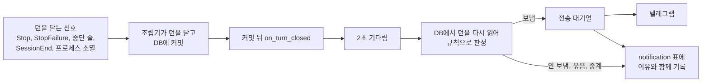

<!--
다루는 곳: bridge/notify.py, bridge/telegram.py, config/notify.toml, migrations/0005_notification.sql, deploy/mysql/backup.sh, deploy/systemd/foreman-bridge.service, scripts/foreman-bridge-alert.sh, bridge/mergeprep.py
읽은 커밋: 5e0f7c5
-->
# 11 알림

FOREMAN이 있는 까닭은 조용한 고장을 잡는 데 있다. 고장을 잡아도 사람이 모르면 잡지 않은 것과 같다. 사람은 대부분의 시간 동안 FOREMAN 화면을 보고 있지 않고, 서버 앞에 앉아 있지도 않다. 그래서 FOREMAN이 알아챈 것은 결국 사람 손에 있는 휴대폰으로 가야 한다. 그 길이 텔레그램 알림이다.

이 편은 그 길 자체를 다룬다. 세션의 한 턴(사람이 글을 넣고 Claude Code(CC)가 답을 마칠 때까지의 한 번)이 끝났을 때 무엇을 보내고 무엇을 보내지 않는지, 그 판정을 왜 모델이 아니라 브리지(FOREMAN의 서버 프로세스)가 하는지, 보낸 것과 보내지 않은 것을 어떻게 남기는지, 하루에 쏟아지는 알림을 어떻게 저녁 한 통으로 묶는지, 브리지가 꺼져 있을 때에도 알려야 하는 것은 어떻게 보내는지를 차례로 본다. 승인 대기, 적재 막힘, 파이프라인 실패처럼 다른 장치가 내는 알림은 이 편 끝의 「어디서 오나」 표에 모으고, 깊은 이야기는 각 편으로 넘긴다.

## 처음 방식: 모델이 스크립트를 불렀다

FOREMAN을 만들기 전에도 텔레그램 알림은 있었다. 다만 기계가 보내지 않았다. 각 저장소의 CLAUDE.md(CC가 세션마다 읽는 작업 지시 파일)에 「알림」 절이 있었고, 모델이 그 지시를 읽고 일이 끝났다고 판단하면 `scripts/notify-telegram.sh`를 직접 실행했다. 스크립트는 curl로 텔레그램 봇 API의 `sendMessage`를 부르는 몇 줄이었다. hook(CC가 특정 순간에 바깥 프로그램을 부르는 자리)도, cron도, systemd도 없었다. 킥오프 조사 때 그 스크립트가 불린 횟수는 런슈즈 75회, 펫퍼민트 14회였다 [log:01_kickoff_result.md].

이 방식의 뿌리 문제는 **턴이 끝났는지를 모델이 판정한다**는 데 있었다. 모델은 알림을 잊을 수 있다. 더 나쁜 것은 모델이 부를 기회 자체가 없는 끝이다. 사람이 Esc로 중단하면 모델은 그 자리에서 멈추고, API 오류로 턴이 끊기면 모델은 다음 말을 하지 못하고, 프로세스가 죽으면 아무것도 남지 않는다. 가장 알려야 할 끝, 즉 실패한 끝이 가장 알리기 어려운 끝이었다.

75회와 14회라는 숫자도 이 문제를 드러냈다. 두 프로젝트의 차이가 누락 때문인지 규칙 때문인지 가릴 길이 없었다. 나중에 보니 펫퍼민트 CLAUDE.md에는 「짧은 작업(5분 안)이나 단순 확인에는 보내지 않는다」는 줄이 있었으니 일부는 규칙이었다. 그러나 어디까지가 규칙이고 어디부터가 누락인지는 기록이 없어 끝내 알 수 없었다 [log:stage4_notify_result.md]. 보내지 않은 것에 대해 「왜 안 보냈는가」를 답할 수 없다는 것, 이것이 지금 설계에서 「보내지 않은 것도 이유와 함께 남긴다」가 생긴 까닭이다.

## 지금 방식: 조립기가 턴을 닫을 때 기계로 보낸다

지금은 모델이 알림에 손대지 않는다. 브리지의 조립기(트랜스크립트와 hook 신호를 모아 턴을 만들고 닫는 부분, → 「턴 조립」)가 턴을 닫는 순간, 그 사실이 알림 판정기 `Notifier`로 넘어간다 [code:bridge/notify.py]. 턴을 닫는 신호는 하나가 아니다. 정상 종료의 Stop hook, API 오류의 StopFailure hook, 트랜스크립트의 중단 표시 줄, 세션 종료의 SessionEnd hook, 프로세스가 사라진 것을 찾는 폴링 가운데 **먼저 온 것**이 턴을 닫는다 [code:README.md]. 어느 신호도 혼자서는 모든 끝을 잡지 못하기 때문이다. Esc 중단에는 Stop hook이 오지 않는다는 것도 이 알림을 옮기면서 실세션으로 처음 확인했다 [log:stage4_notify_result.md]. 신호를 맞대는 자세한 방법은 「턴 조립」 편에 있다.



두 가지 세부가 이 흐름을 지탱한다. 첫째, 판정은 **DB 커밋이 끝난 뒤에** 불린다. 처음에는 조립기의 트랜잭션 안에서 판정을 예약했는데, 시험에서 판정이 커밋 전의 DB를 읽어 「아직 안 닫힌 턴」으로 보고 조용히 끝나 버렸다. 운영에서도 한 덩어리가 크면 같은 일이 생길 수 있었다. 그래서 닫힌 턴을 모아 두었다가 커밋이 끝난 다음에 부르도록 바꿨다 [log:stage4_notify_result.md]. 지금 조립기의 `_after_commit`이 그 자리다 [code:bridge/assembler.py].

둘째, 판정은 불리자마자 하지 않고 **2초**(`settle_s`)를 기다린다 [code:config/notify.toml]. Stop hook이 트랜스크립트의 마지막 응답 줄보다 먼저 도착하는 일이 실측으로 확인됐기 때문이다. 바로 판정하면 알림에 실을 응답 첫 줄이 아직 DB에 없다. 2초 뒤 DB에서 턴을 다시 읽어 판정하고, 판정 하나는 15초 안에 끝나야 한다. 판정이 실패해도 로그에 경고만 남기고 넘어간다. 알림이 실패했다고 조립이 멈추면 더 큰 고장이 되기 때문이다 [code:bridge/notify.py].

이렇게 바꾼 뒤 잰 값은 턴이 끝나고 텔레그램이 도착하기까지 평균 3.3초, 최대 4.4초였다(2초 기다림 포함) [log:stage4_notify_result.md].

### CLAUDE.md의 알림 절은 지우지 않고 바꿨다

옛 방식을 걷어 낼 때 한 가지 함정이 있었다. 세 저장소에는 이미 CC 세션이 떠 있었고, 그 세션들은 예전 CLAUDE.md를 읽은 채였다. 스크립트만 지우면 떠 있는 세션이 지워진 스크립트를 계속 부르려 할 것이었다. 시험 세션에서 확인해 보니 **실행 중인 CC는 CLAUDE.md가 바뀌면 다음 턴에 그 변경을 읽는다**(트랜스크립트에 바뀐 내용이 첨부로 들어갔다). 그래서 알림 절을 지우지 않고 「브리지가 보낸다, 직접 보내지 않는다」는 두 줄 안내로 바꿨다 [log:stage4_notify_result.md]. 지금 FOREMAN의 CLAUDE.md 「알림(텔레그램)」 절이 그 두 줄의 후손이다 [code:CLAUDE.md].

## 무엇을 보낼지: 규칙 표

무엇을 보내고 무엇을 보내지 않을지는 `config/notify.toml` 한 파일에 있다. 바꾸면 브리지를 다시 띄워야 반영된다 [code:config/notify.toml]. 판정은 위에서부터 차례로 걸러 내는 꼴이다.

| 순서 | 칸 | 지금 값 | 걸리면 |
|---|---|---|---|
| 1 | 프로젝트에 `prefix`가 있나 | 런슈즈, 펫퍼민트, FOREMAN, 인프라 넷 | 없으면 안 보냄(`project:미분류`) |
| 2 | `batch_origins` | `task_notification`, `subagent_message` | 이 턴은 안 보내고 서브에이전트 묶음 판정으로(아래) |
| 3 | `origins` | `human`, `meta` | 다른 출처면 안 보냄(`origin:…`) |
| 4 | `end_reasons` | `stop`, `stop_failure`, `interrupted`, `session_end`, `process_lost` | 다른 끝 이유면 안 보냄(`end_reason:…`) |
| 5 | `only_failures` | `false` | 켜면 실패 셋만 보냄 |
| 6 | `min_turn_s` | 기본 0, 펫퍼민트 300 | 이보다 짧은 턴은 안 보냄. 실패는 예외 |

첫 칸이 뜻하는 바는 이렇다. 접두어(`[런슈즈]`, `[펫퍼민트]`, `[FOREMAN]`, `[인프라]`)가 정해진 프로젝트만 턴 끝 알림을 받는다 [code:config/notify.toml]. 어느 프로젝트에도 속하지 않은 세션(화면의 미분류)은 시험이나 잠깐 연 세션인 경우가 많아 보내지 않는다. 다만 보내지 않았다는 사실은 기록한다.

셋째 칸의 출처(`turn.origin`)는 그 턴을 누가 열었는지다. 사람이 친 글(`human`)과 CC가 메타 줄로 연 입력(`meta`)만 보낸다. 다른 세션이 보낸 메시지로 열린 턴(`agent_message`)은 보내지 않는다. 사람이 그 턴의 시작을 보지 않았고, 보낸 쪽 세션이 따로 알린다. 관리자끼리 부탁해서 연 턴(`manager_ask`)도 보내지 않는다. 이것은 실제 양에서 나온 결정이다. 하루 텔레그램을 세어 보니 관리자 턴 끝이 86통이었고 그 가운데 41통이 관리자끼리 부탁으로 연 턴이었다. 사람이 보지 않아도 되는 대화였다 [log:notify_relay_20261112.md]. 부탁을 넣지 못한 실패만은 관리자 쪽 장치가 따로 바로 알린다.

예외가 하나 있다. 브리지가 스스로 넣은 글로 연 턴, 즉 작업 세션의 보고를 받아 관리자가 연 턴(`relay`)과 합치기 카드로 연 턴(`merge_card`)은 `origins`와 상관없이 사람 턴처럼 판정한다(`BRIDGE_ORIGINS`) [code:bridge/notify.py]. 관리자가 사람에게 무언가를 올리는 길이 이 턴들이기 때문이다.

여섯째 칸 `min_turn_s = 300`은 펫퍼민트에만 있다. 펫퍼민트 CLAUDE.md의 원래 규칙 「짧은 작업(5분 안)에는 보내지 않는다」를 옮긴 것이다. 실패는 예외로 두었다. 5분 안에 끝났어도 API 오류나 중단은 알아야 한다 [code:config/notify.toml].

`[defaults]`의 칸은 프로젝트마다 덮어쓸 수 있다. 프로젝트 칸에는 이 밖에 관리자 중계와 하루 묶음을 켜는 스위치 셋(`relay_reports`, `relay_questions`, `digest`)이 있는데, 이것은 아래 「관리자 중계와 21:00 묶음」에서 본다.

## 끝 이유마다 제목이 다르다

알림 첫 줄은 접두어, 제목, 걸린 시간이다. 제목은 턴의 끝 이유(`end_reason`)에 따라 다르다 [code:bridge/notify.py].

| 끝 이유 | 제목 | 기본으로 보내나 | 언제 생기나 |
|---|---|---|---|
| `stop` | 끝남 | 보냄 | 정상 종료(Stop hook 등) |
| `stop_failure` | ⚠ API 오류로 멈춤 | 보냄, 오류 한 줄을 붙인다 | StopFailure hook |
| `interrupted` | ⏹ 중단됨(사용자) | 보냄 | Esc 중단 표시 줄 |
| `session_end` | 세션 종료 — 진행 중이던 턴 | 보냄 | 창 닫힘, exit |
| `process_lost` | ⚠ 프로세스가 사라짐(종료 신호 없음) | 보냄 | hook을 받던 세션의 프로세스가 사라짐 |
| `merged` | 응답 없이 다음 입력과 합쳐짐 | 안 보냄 | 앞 턴이 응답 없이 다음 입력과 함께 처리됨 |
| `no_signal` | 종료 신호 없이 다음 턴이 시작됨 | 안 보냄 | 끝 신호 없이 다음 턴이 열림 |
| `abandoned` | 끝 신호 없이 버려진 턴 | 안 보냄 | 1시간 넘게 조용한 열린 턴을 정리함 |

`merged`와 `no_signal`을 보내지 않는 까닭은 바로 다음 턴이 있기 때문이다. 그 다음 턴이 끝나면 그 알림이 간다. 같은 일을 두 번 알릴 필요가 없다 [code:config/notify.toml]. `abandoned`는 첫 응답이 오기 전에 Esc를 눌러 아무 흔적 없이 열린 채 남은 턴을 1시간 뒤 정리하는 끝 이유다. 펫퍼민트 창에 글을 잘못 붙여 넣고 바로 Esc를 눌러 턴이 10시간 열려 있던 일에서 나왔다 [c:cb0c1c7]. 이미 사람이 스스로 멈춘 것이라 알릴 것이 없다.

둘째 줄부터는 그 턴의 내용이다. 그 턴을 연 글의 첫 줄을 80자까지 「요청:」으로 싣는다(출처가 사람이 아니면 「입력:」, 「작업 세션에서 온 보고:」처럼 출처 이름이 붙는다). 정상 종료면 응답 첫 줄을 200자까지 「응답:」으로 싣는다. API 오류면 응답 대신 「오류:」 한 줄을 싣는데, 오류 글에서 종류와 요청 번호, 할 일을 뽑아 한 줄로 만든 것이다 [c:1a58942]. 그 턴에서 서브에이전트를 띄웠으면 한 줄 요약이 붙는다. 전체는 900자에서 자른다 [code:bridge/notify.py]. 실제로 나간 알림은 이런 꼴이다 [log:stage4_notify_result.md].

```
[런슈즈] 끝남 · 56초
요청: 슈퍼노바 솔루션 2는 null로 비워라.
응답: 슈퍼노바 솔루션 2는 1회차와 3회차 결과 모두 null로 비웠고, …

[펫퍼민트] ⏹ 중단됨(사용자) · 6초
요청: 알림 시험(중단)이다. …
```

응답 글은 트랜스크립트에서 적재할 때 이미 비밀값 가리기(마스킹)를 거친 것을 DB에서 읽고, Stop hook이 들고 온 마지막 응답을 쓸 때에는 여기서 한 번 더 가린다 [code:bridge/notify.py]. 무엇을 어떻게 가리는지는 → 「열쇠와 비밀」.

## 서브에이전트는 따로 보내지 않는다

CC 세션은 서브에이전트(세션이 일을 나눠 맡기는 작은 에이전트)를 띄운다. 서브에이전트 하나하나가 끝날 때마다 알림이 오면 휴대폰이 쉬지 않는다. 그래서 서브에이전트는 따로 보내지 않고, 두 가지 방식으로 묶는다.

하나는 **사람 턴 알림에 한 줄로 싣는 것**이다. 사람이 연 턴이 끝날 때 그 턴에서 띄운 서브에이전트를 상태별로 세어 「서브에이전트 2 — 완료 1 · 진행 1」 같은 줄을 붙인다 [code:bridge/notify.py]. 이 알림에 실린 끝난 서브에이전트에는 `subagent_run.notified_at`을 찍어 두어, 뒤에서 다시 세지 않는다 [code:migrations/0005_notification.sql].

다른 하나는 **백그라운드 서브에이전트 묶음**이다. 백그라운드로 띄운 서브에이전트는 부모 턴이 끝난 뒤에 끝난다. 부모 턴 알림에는 「진행 2」로만 실리고, 그 세션의 서브에이전트가 모두 끝났을 때 한 번 묶어서 보낸다 [log:stage4_notify_result.md].

```
[포먼] 백그라운드 서브에이전트 2개 모두 끝남
서브에이전트 2 — 완료 2
- 넷째-가 (완료)
- 넷째-나 (완료)
```

묶음은 다섯 줄까지 이름을 보이고, 넘치면 「외 N개」로 줄인다 [code:bridge/notify.py]. 묶음을 보내지 않고 기다리는(held) 경우는 둘이다. 그 세션에서 사람이 연 턴이 아직 진행 중이면 그 턴의 끝 알림이 요약해 실을 것이니 기다린다(`parent_turn_open`). 아직 도는 서브에이전트가 남아 있으면 다 끝날 때까지 기다린다(`subagents_running:N`) [code:bridge/notify.py].

### 묶음을 언제 판정하나: 턴이 아니라 서브에이전트가 끝날 때

처음에는 묶음 판정을 서브에이전트의 완료 알림 턴이 닫힐 때 했다. 서브에이전트가 끝나면 CC가 부모 세션에 완료 알림(task-notification)을 넣고, 그 입력으로 턴이 하나 열리기 때문이다. 그런데 실시간으로 보니 CC가 완료 알림 줄을 기록하고도 그 입력으로 모델 턴을 돌리지 않는 경우가 있었다. 다음 입력에 합쳐져 버리는 것이다. 그러면 닫힐 턴이 없으니 묶음이 **영영 나가지 않았다** [log:stage4_notify_result.md].

그래서 판정 시점을 서브에이전트가 끝나는 때로 옮겼다. 완료 알림 줄, SubagentStop hook, 메타 줄의 끝 표시 가운데 무엇이든 서브에이전트가 끝났다는 신호가 오면 조립기가 `on_subagents_changed`를 부르고, 판정기는 그 세션에 대해 3초(기다림 2초에 1초를 더한 값) 동안 신호를 모은 다음 한 번 판정한다 [code:bridge/notify.py]. 여러 서브에이전트가 거의 동시에 끝나도 판정은 한 번이다.

완료 알림이나 서브에이전트 결과 전달로 열린 턴 자체는 `batch_origins`에 걸려 따로 알리지 않는다. 여기에도 실측에서 찾은 함정이 있었다. 서브에이전트가 결과를 돌려줄 때 `<agent-message from=…>` 꼴의 글이 와서 턴을 여는데, 처음에는 이것을 「다른 세션의 메시지」로 분류했다. 확인해 보니 그렇게 분류된 143턴이 **전부 자기 서브에이전트**가 보낸 것이었다. 글 모양으로는 가를 수 없어 `from=`의 id가 그 세션의 서브에이전트인지로 가르게 고쳤다 [log:stage4_notify_result.md].

몇 주 묵은 서브에이전트도 문제였다. 옛 CC는 끝 표시를 남기지 않아 `running`으로 남은 행이 있었고, 이것이 「아직 도는 서브에이전트가 있다」가 되어 묶음을 영원히 막을 뻔했다. 30분 넘게 기록도 끝 신호도 없는 서브에이전트는 `stale`로 본다 [log:stage4_notify_result.md]. 또 알림을 처음 켤 때 이미 끝나 있던 서브에이전트가 첫 묶음에 쏟아지지 않도록, 브리지가 뜰 때마다 끝났는데 알리지 않은 행을 모두 알린 것으로 표시한다(`baseline`). 처음 켰을 때 이렇게 표시된 것이 185개였다 [log:stage4_notify_result.md].

묶음에 실패한 서브에이전트가 하나라도 있으면 그 묶음은 아래의 하루 묶음으로 미루지 않고 바로 보낸다 [code:bridge/notify.py].

## 보낸 것과 안 보낸 것을 모두 남긴다

판정 결과는 보냈든 안 보냈든 DB의 `notification` 표에 한 줄씩 남는다 [code:migrations/0005_notification.sql]. 옛 방식에서 「75회 대 14회」가 누락인지 규칙인지 끝내 가리지 못했던 것을 되풀이하지 않기 위해서다. 지금은 알림이 오지 않았을 때 「왜 안 왔지」를 규칙 이름으로 답할 수 있다.

| 칸 | 뜻 |
|---|---|
| `session_id`, `turn_id` | 어느 세션, 어느 턴의 알림인가. 턴과 무관한 알림은 `turn_id`가 비어 있다 |
| `kind` | 알림 종류. `turn`(턴 끝), `batch`(서브에이전트 묶음), `direct`(브리지 밖 등), `digest`(하루 묶음 한 통), 그리고 다른 장치들이 쓰는 종류(아래 표) |
| `end_reason` | 턴 끝 이유 |
| `decision` | `sent`(보냄), `failed`(보내다 실패), `skipped`(규칙으로 안 보냄), `held`(묶음 기다림), `pending`(보낼 차례), `digest`(하루 묶음에 모음), `bundled`(하루 묶음으로 나감) |
| `rule` | 안 보냈거나 기다린 이유(`origin:agent_message`, `min_turn_s:300`, `project:미분류` 등), 또는 한 번만 보낼 알림의 열쇠 |
| `text`, `error` | 보낸(보내려던) 글, 실패 사유 |

`(turn_id, kind)`에는 UNIQUE 제약이 걸려 있다. 한 턴을 닫는 신호가 hook과 트랜스크립트 두 쪽에서 와도, 그 사이에 브리지를 다시 띄워도, 같은 턴의 같은 종류 알림은 한 번만 기록되고 한 번만 나간다 [code:migrations/0005_notification.sql]. 기록은 `INSERT IGNORE`로 넣고, 이미 있으면 아무것도 하지 않는다 [code:bridge/notify.py].

턴과 무관한 알림(`turn_id`가 빈 것)에는 이 제약이 듣지 않는다. MySQL의 UNIQUE는 빈 값(NULL)끼리 겹치는 것을 막지 않기 때문이다. 그래서 「브리지를 다시 띄워도 한 번」이어야 하는 알림은 부르는 쪽이 `rule` 칸에 열쇠(`denied:<세션>:<시각>`, `usage:<한도>:<문턱>:<리셋>` 같은 것)를 넣고, 보내기 전에 같은 열쇠가 표에 있는지 먼저 본다 [code:bridge/human_wait.py]. 이 열쇠 덕분에 사용량 80% 알림이 같은 사용 창에서 한 번만 나간다.

표의 모양이 다른 곳에 남긴 제약도 둘 있다. `kind`는 8자까지라 다른 장치의 종류 이름이 `appr_to`, `argorun`, `schlock`처럼 짧게 줄어 있다 [code:bridge/pipeline.py]. 그리고 표에 프로젝트 칸이 없다. 하루 묶음을 만들 때 프로젝트를 가르는 것은 알림 글 머리의 접두어다. 모든 알림 글이 접두어로 시작하기 때문에 가능한 방법이고, 묶음을 더할 때 새 표나 마이그레이션 없이 끝낼 수 있었다 [log:notify_relay_20261112.md].

실제로 「왜 안 왔지」를 볼 때는 이렇게 묻는다.

```sql
SELECT created_at, kind, end_reason, decision, rule, LEFT(text, 60)
FROM notification WHERE session_id = 312 ORDER BY id DESC LIMIT 20;
```

## 보내는 길: 대기열 하나

판정에서 「보냄」이 나온 알림은 곧바로 텔레그램으로 가지 않고 대기열 하나에 들어간다. 대기열을 비우는 작업 하나가 순서대로 보내고, 한 통 보낼 때마다 1.1초(`min_interval_s`)를 쉰다 [code:config/notify.toml]. 텔레그램은 한 채팅방에 대략 초당 한 통 넘게 보내면 거부하기 때문이다. 여러 세션이 한꺼번에 끝나도 알림이 서로 부딪혀 잃어지지 않는다.

한 통을 보낼 때는 10초 시간 제한을 걸고 세 번까지 해 본다 [code:bridge/notify.py]. 텔레그램이 「너무 잦다」(HTTP 429)를 돌려주면 그 응답이 알려 준 시간(30초까지)만큼 기다렸다 다시 보낸다. 서버 쪽 오류(5xx)나 네트워크 오류면 1초, 3초 간격을 두고 다시 해 본다. 요청 쪽 오류(4xx, 429 빼고)는 다시 해도 같으니 바로 멈춘다. 결과는 `notification`의 그 줄을 `sent`나 `failed`로 고쳐 남긴다. 킥오프 때 정한 원칙, 「브리지의 모든 외부 호출에 시간 제한을 건다」가 여기에도 걸려 있다 [log:01_kickoff_result.md]. 응답 없는 서버 앞에서 끝없이 멈추는 클라이언트는 그 자체가 조용한 고장이다.

텔레그램 봇 토큰은 요청 주소 안에 들어간다. 그래서 네트워크 오류 메시지에 주소가 찍히면 토큰이 로그로 샐 수 있다. 오류 글은 남기기 전에 토큰 자리를 `«token»`으로 바꾸고, 길이도 200자로 자른다 [code:bridge/notify.py].

여기에는 아직 남은 틈이 하나 있다. 세 번 다 실패한 알림은 `failed`로 기록되고 브리지 로그에 경고가 남지만, **다시 보내지 않는다**. 하루 묶음은 실패하면 10분마다 다시 보내고 실패 자체를 알리지만(아래), 낱개 알림에는 그런 되풀이가 없다. 텔레그램이 몇 분 막혔던 사이의 알림은 DB에만 남는다 [code:bridge/notify.py].

## 관리자 중계와 21:00 묶음

알림을 기계로 보내자 이번에는 너무 많아졌다. 관리자 세션과 작업 세션이 생기고 세션 수가 늘면서, 어느 날 하루 텔레그램이 관리자 턴 끝 86통, 코더 턴 끝 28통, Notion 문서 맞추기 47통이었다 [log:notify_relay_20261112.md]. 사람이 다 읽을 수 없는 양이고, 다 읽지 못하면 정말 급한 한 통도 그 사이에 묻힌다. 그래서 「무엇을 바로 사람에게 보내야 하나」를 다시 나눴다.

프로젝트마다 켜는 스위치가 셋이다 [code:config/notify.toml].

| 칸 | 켜면 |
|---|---|
| `relay_reports` | 작업 세션(코더, 서기, 디자이너)의 턴 끝 보고를 텔레그램 대신 그 프로젝트 관리자 세션의 입력 칸에 넣는다 |
| `relay_questions` | 작업 세션의 마지막 응답이 사람에게 묻는 말이면 관리자에게 「사람에게 올릴 물음」으로 넘긴다. 관리자는 답하지 않고 모아 사람에게 올린다 |
| `digest` | 일상 알림을 바로 보내지 않고 모아 두었다가 하루 한 번 묶어 보낸다 |

처음 넣을 때는 셋 다 꺼 두었고, FOREMAN과 인프라에 먼저 켰다 [c:1f6dd82]. 다음 날 펫퍼민트와 런슈즈에도 관리자를 세우며 같게 켰다 [c:ddb9d15] [c:eab68a0]. 지금은 접두어가 있는 네 프로젝트 모두 셋이 켜져 있다 [code:config/notify.toml]. 셋을 함께 켜는 데에는 까닭이 있다. 보고만 관리자에게 넘기면, 관리자가 그 보고를 받아 연 턴이 끝날 때 다시 텔레그램이 나간다. 텔레그램이 작업 세션 몫에서 관리자 몫으로 옮겨 갈 뿐 줄지 않는다. 줄이려면 묶음을 같이 켜야 한다 [log:notify_relay_20261112.md]. 중계는 관리자 쪽 설정(`config/managers.toml`의 관리자 켜기)도 켜져 있어야 돈다.

### 중계: 작업 세션의 턴 끝은 관리자에게 간다

작업 세션의 턴이 위 규칙 표를 통과해 「보낼 턴」으로 판정되면, 판정기는 텔레그램 대신 관리자에게 넘길지를 본다 [code:bridge/notify.py]. 어느 역할이 작업 세션인지는 역할 값을 모아 둔 한 곳(`WORKER_ROLES`)에서 가져온다 [code:bridge/roles.py]. 마지막 응답이 사람에게 묻는 말이면(화면의 「답 기다림」과 같은 판정) 물음으로, 아니면 보고로 넘긴다. 관리자 입력 칸에 글을 넣고 들어갔는지 확인하는 데 15초 넘게 걸릴 수 있어서 이 일은 DB 트랜잭션 밖에서 60초 제한을 걸고 한다.

넘긴 결과에 따라 그 턴의 텔레그램이 정해진다. 넘겼으면 그 턴은 하루 묶음에 들어간다(묶음이 꺼져 있으면 아예 안 보낸다. 관리자가 받았으니까). 관리자가 있는데 넣지 못했으면 「⚠ 관리자에게 넘기지 못했습니다 — 사유」를 붙여 **바로** 보낸다. 관리자가 아예 없는 프로젝트면 중계 없이 예전처럼 보낸다 [code:bridge/notify.py]. 넘긴 결과는 작업 세션 쪽에도 기록으로 남아 사람 화면이 그 세션 머리 위에 「관리자에게 보고함」이나 「관리자 답 기다림」을 띄운다. 이 기록을 남기지 못하면 화면은 그 세션을 사람에게 띄운다. 묻히는 쪽이 아니라 보이는 쪽으로 떨어지게 한 것이다 [code:bridge/notify.py]. 관리자가 넘겨받은 것을 어떻게 다루는지는 → 「관리자에게 넘기기와 보고」.

### 사람에게 올리는 길은 escalate 하나다

중계를 켜고 나서 한 가지가 어긋났다. 관리자가 사람에게 묻는 말을 응답 글로 쓰기만 하면, 그 관리자 턴의 끝 알림이 「묻는 말로 끝난 턴」이라 급한 것으로 바로 나가기도 하고, 화면에는 아무 표시도 없기도 했다. 화면과 알림이 서로 다른 신호를 보고 있었다. 그래서 관리자가 사람에게 무언가를 올리는 길을 API 하나로 모았다 [c:93d4ab0].

```
POST /api/sessions/{관리자 세션 id}/escalate
{"kind": "question" | "report", "text": "…"}
```

물음(`question`)은 「❓ 관리자가 사용자 답을 기다립니다」로 바로 나가고, 화면 관리자 머리 위에 「사용자 답 기다림」이 뜬다. 보고(`report`)는 「📋 관리자 보고」로, 묶음을 켠 프로젝트면 21:00 묶음에 들어간다 [code:bridge/api/dashboard.py]. 관리자 역할 세션만 부를 수 있고, 다른 역할이 부르면 거부된다. 이제 관리자가 중계나 부탁으로 연 턴(`relay`, `manager_ask`, `merge_card`)이 묻는 말로 끝나도 그것만으로는 급함으로 치지 않는다. 급함은 escalate 물음이 맡는다 [code:bridge/notify.py]. 화면 표시와 텔레그램이 같은 신호 하나에서 나오게 한 것이다.

### 하루 묶음: 무엇이 묶이고 무엇이 바로 가나

묶음을 켠 프로젝트에서는 일상 알림이 `notification.decision = 'digest'`로 쌓였다가, 매일 21:00(Asia/Seoul)에 프로젝트마다 한 통으로 나간다 [code:config/notify.toml]. 무엇이 일상이고 무엇이 급한지는 이렇게 가른다.

| 묶음으로 미루는 것(`[digest] kinds`) | 바로 보내는 것 |
|---|---|
| 턴 끝 「끝남」(`turn`) | 턴 끝 중 API 오류, 중단, 세션 종료, 프로세스 사라짐 |
| 서브에이전트 묶음(`batch`, 실패가 없을 때) | 사람에게 묻는 말로 끝난 턴(관리자에게 물음으로 넘긴 것은 빼고) |
| 합치기 카드(`merge`, 오른쪽 셋은 빼고) | 위 종류에 없는 알림 전부: 승인 대기, 승인 시간 지남, 권한 거부, 응답 없음, 파이프라인, 배포 대기, 사용량, 적재, 겹침, 맥락, 압축, 자동 기상 등 |
| 옮기기 요약(`handoff`) | 묶음 종류여도 글에 ⚠ ❌ 🛑 ⏰ ❓ 표시가 있는 것(`urgent_marks`) |
| Notion 문서를 덮지 않음(`docsync`) | escalate 물음 |
| 끝난 뒤 어긋남(`recon`) | 합치기 카드 중 셋(부르는 쪽이 바로로 정함): 🛡가 붙은 「⑂ 합치기 준비됨」, 관리자에게 합치기 카드를 알리지 못함, 관리자가 없어 관리자 몫 글을 텔레그램으로 남김 |
| escalate 보고(부르는 쪽이 묶음으로 정함) | |

맥락이 찼다는 알림, 압축 알림, 두 세션이 같은 일을 한다는 겹침 알림은 실패가 아닌데도 바로 보낸다. 하루 늦게 알면 쓸모가 없기 때문이다. 압축 전에 새 세션으로 옮겨야 하고, 겹친 일은 겹치는 동안 멈춰야 한다 [log:notify_relay_20261112.md]. 묶음으로 미루고 싶으면 `kinds`에 그 종류를 더하면 된다.

합치기 카드 셋은 종류(`merge`)로는 묶음이지만, 11-17부터 부르는 쪽이 「바로」로 정해 보낸다 [code:bridge/mergeprep.py]. 🛡(안전 규칙 파일이 바뀌거나, 바뀌는지 확인하지 못함)는 급한 표시 목록(`urgent_marks`)에 없어서, 전에는 승인자가 관리자인 「합치기 준비됨」이 21:00까지 미뤄졌다. 합친 뒤의 🛡 알림(`rulefile`)이 바로 가는 것과 기준을 맞췄다. 관리자에게 합치기 카드를 알리지 못하면 승인자가 사람으로 바뀌고, 관리자가 없으면 합친 뒤 시험과 push, 끝난 세션의 충돌 풀기 같은 관리자 몫이 사람에게 넘어온다. 둘 다 사람이 움직여야 하는 글이라, 미루면 21:00까지 아무도 움직이지 않는다 [docs:11_worktree.md].

묶음 한 통은 「[FOREMAN] 📦 하루 묶음 11-14 — 일상 알림 N건(급한 것은 그때그때 보냈습니다)」로 시작하고, 종류별로 「■ 턴 끝 12건」 같은 머리 밑에 시각 순으로 한 줄씩 늘어놓는다. 턴 끝 줄은 제목과 요청 첫 줄을 이어 110자까지 보인다. 텔레그램 한 통의 길이 한도 때문에 3,500자를 넘으면 「… 외 N건(알림 기록에 남아 있습니다)」으로 끝낸다 [code:bridge/notify.py]. 다 보낸 알림은 `bundled`로 바뀌고, 묶음 한 통 자체는 `kind = 'digest'`, `rule = 'digest:<날짜>:<프로젝트>'`로 남는다.

### 묶음이 조용히 멈추지 않게

모아 두었다가 보내는 장치는 그 자체가 조용한 고장의 자리가 되기 쉽다. 모아 둔 채로 안 나가면 사람은 「오늘은 조용하구나」로 읽기 때문이다. 그래서 묶음에는 스스로를 알리는 장치를 여럿 달았다 [code:bridge/notify.py].

묶음 고리는 1분마다 돈다. 「보낼 시각이 지났고 그날 아직 안 보냈으면 보낸다」로 판정하므로, 21:00 정각에 브리지가 꺼져 있었어도 다시 뜬 뒤 그날 안에 보낸다. 고리 안에서 예외가 나면 삼키고 다음 분에 다시 돈다. 고리가 죽으면 묶음 전체가 조용히 멈추기 때문이다 [code:bridge/notify.py].

묶음 전송이 실패하면 10분(`retry_min`)마다 다시 보내고, 실패 자체를 그날 한 번 「⚠ 하루 묶음을 보내지 못했습니다(사유) — 일상 알림 N건이 남아 있고 10분마다 다시 보냅니다」로 바로 알린다. 묶음이 너무 길거나 형식 때문에 거부된 것이라면 이 짧은 글은 간다. 모아 둔 것 가운데 가장 오래된 것이 26시간(`late_h`) 넘게 남아 있으면 「⚠ 하루 묶음이 26시간 넘게 나가지 않았습니다」를 그날 한 번 보낸다 [code:config/notify.toml].

설정이 틀렸을 때도 조용히 넘어가지 않는다. `[digest] at`이 `HH:MM` 꼴이 아니거나 `tz`가 없는 시간대면 규칙을 읽는 단계에서 실패해 브리지가 뜨지 않는다 [code:bridge/notify.py]. 틀린 설정으로 엉뚱한 시각에 보내거나 영영 안 보내는 것보다, 뜨지 않아서 바로 눈에 띄는 쪽이 낫다는 판단이다. toml 문법 오류와 같은 꼴로 다룬다.

끄는 순간도 생각해 두었다. 어느 프로젝트의 `digest`를 끄면, 그 전에 모아 둔 것은 그날 묶음 시각에 한 번 나간다. 끄면서 남은 알림이 갇혀 버리지 않게 하기 위해서다 [code:bridge/notify.py].

## 브리지 밖 알림: bridge.telegram과 브리지 포기 알림

브리지가 보내는 알림은 브리지가 살아 있어야 나간다. 그런데 브리지가 죽어 있거나 DB가 죽어 있을 때 일어나는 고장도 있다. 대표가 DB 백업이다. 백업은 사용자 crontab이 매일 새벽 4시 30분에 `deploy/mysql/backup.sh`를 부르는 방식으로 돈다 [code:deploy/mysql/backup.sh]. 백업이 실패하는 까닭이 DB가 죽어서일 수 있고, 그때 브리지도 정상이 아닐 수 있다. 이런 알림을 위해 브리지와 따로 도는 명령이 있다 [code:bridge/telegram.py].

```bash
.venv/bin/python -m bridge.telegram "DB 백업 실패" "mysqldump 실패"
# → [FOREMAN] DB 백업 실패
#   mysqldump 실패
```

첫 인자가 제목이고 나머지가 한 줄씩 붙는다. 규칙과 토큰은 브리지와 같은 것(`config/notify.toml`, `.env.telegram`)을 읽고, 접두어는 FOREMAN 프로젝트의 것을 쓴다(규칙이 없으면 `[포먼]`). 글은 비밀값 가리기를 거친다. 브리지 서버가 꺼져 있어도 텔레그램으로 바로 보낸다. 보낸 뒤 DB에 `kind = 'direct'`로 기록을 남기되, DB가 5초 안에 답하지 않으면 기록 없이 넘어간다. 기록은 덤이고, 알림이 먼저다 [code:bridge/telegram.py]. 성공하면 0, 실패하면 1로 끝난다.

백업 스크립트는 이 명령을 30초 제한으로 부르고 끝에 `|| true`를 붙였다 [code:deploy/mysql/backup.sh]. 알림을 보내다 멈추거나 실패해도 백업 스크립트 자체의 실패 처리(종료 코드 1)는 그대로 지나가게 하기 위해서다. 스크립트 주석에 그 까닭이 적혀 있다. 「실패는 조용히 지나가면 안 된다(milvus-port-forward 교훈)」. port-forward가 56만 번 재시작하는 것을 한 달 넘게 몰랐던 일이 이 프로젝트의 출발점이다 [code:CLAUDE.md].

브리지 밖 길은 하나 더 있다. 브리지 자신이 거듭 죽어 systemd(서버의 서비스 관리자)가 다시 띄우기를 포기한 때다. 이때는 브리지가 없으니 브리지의 알림은 나가지 않는다. 위 명령도 브리지와 같은 코드와 파이썬 환경을 쓰니 같은 까닭으로 함께 못 돌 수 있다. 그래서 브리지 유닛에 `OnFailure`(유닛이 실패하면 systemd가 대신 띄울 유닛을 적는 설정)를 걸어, 포기하는 순간 `scripts/foreman-bridge-alert.sh`가 돌게 했다 [code:deploy/systemd/foreman-bridge.service] [c:cd14ed6]. 이 스크립트는 브리지 코드, 파이썬 가상환경, `config/notify.toml`을 하나도 읽지 않고 curl과 `.env.telegram`만 쓴다. 그래서 `bridge.telegram`과 달리 `notification` 표에 기록이 남지 않고, 접두어도 스크립트에 적어 둔 `[FOREMAN]`이다. 비밀값 가리기를 거치지 않는 대신 journal(systemd가 모으는 로그) 줄은 싣지 않고 유닛 상태, 다시 띄운 횟수, 오류 종류(예외 이름과 횟수)만 싣는다. 보내지 못하면 까닭을 journal에 쓰고 실패 코드로 끝난다 [code:scripts/foreman-bridge-alert.sh]. 언제 불리고 무엇을 못 잡는지는 → 「어디에 두었나」.

### 모델이 판단해 부르는 용도가 아니다

이 명령은 누구든 부를 수 있는 셸 명령이니, CC 세션의 모델도 부를 수는 있다. 그러나 그렇게 쓰지 않는다. 모델이 「이건 알릴 만하다」고 판단해 이 명령을 부르기 시작하면, 이 편 맨 처음의 문제가 그대로 되살아난다. 무엇을 언제 알릴지를 다시 모델이 정하게 되고, 같은 일이 어떤 때는 오고 어떤 때는 안 오며, 오지 않았을 때 그것이 판단인지 누락인지 가릴 수 없게 된다. 또 브리지를 거치지 않으니 규칙 표의 거르기도, 하루 묶음도, 관리자 중계도 모두 건너뛴다. 사람에게 무언가를 올려야 하는 관리자는 escalate를 쓴다.

그래서 이 명령은 「턴과 무관한 기계적 사건」에만 쓴다. 지금 그 쓰임은 백업 실패 하나다 [code:deploy/mysql/backup.sh]. CLAUDE.md에도 「`python -m bridge.telegram`은 브리지 밖 알림(백업 실패 등)용이다 — 모델이 판단해 부르는 용도가 아니다」로 적혀 있다 [code:CLAUDE.md]. 브리지가 죽었을 때의 알림은 이 명령이 아니라 위 스크립트가 보낸다. 이것도 systemd가 부르는 기계적 사건이라 모델이 끼지 않는다 [code:deploy/systemd/foreman-bridge.service].

브리지 안에서 턴과 무관하게 바로 알려야 하는 것은 이 명령이 아니라 판정기의 `send_direct`를 쓴다. 규칙 판정 없이 기록하고 보내는 길이다. 계획으로 여러 세션을 띄우다 일부만 뜬 것 같은 실패는 이 길로 `kind = 'direct'`가 되어 나간다 [code:bridge/api/foreman.py]. 아래 「어디서 오나」 표의 알림들이 모두 이 길을 탄다.

## 토큰 파일은 하나다

텔레그램 봇 토큰과 채팅방 번호는 FOREMAN 저장소 맨 위 `.env.telegram` 한 파일에 있다. 키 이름은 `TELEGRAM_BOT_TOKEN`, `TELEGRAM_CHAT_ID`이고, 권한은 600(주인만 읽기), `.gitignore`의 `.env*`로 git에서 빠진다 [docs:operations.md]. 판정기는 이 파일에서 두 키만 골라 읽는다 [code:bridge/notify.py]. 어느 프로젝트의 알림인지는 토큰이 아니라 글 앞 접두어로 가른다. 네 프로젝트의 알림이 같은 봇, 같은 채팅방으로 온다.

옛 방식에서는 런슈즈와 펫퍼민트 저장소에도 각자 `.env.telegram`이 있었다. 모델이 그 저장소 안에서 스크립트를 불렀으니 그 저장소에 토큰이 있어야 했다. 브리지가 보내게 바꾸자 그 파일들은 쓰는 곳이 없어졌고, 사용자 지시로 지웠다 [log:infra_20261102_host-changes.md]. 지금 결정은 「토큰은 FOREMAN의 `.env.telegram` 하나, 다른 저장소에 토큰 파일이나 보내는 스크립트를 되살리지 않는다」이다 [code:CLAUDE.md].

되살리지 않는 까닭은 셋이다. 첫째, 보내는 쪽이 모두 FOREMAN 저장소 안에 있다. 브리지, `bridge.telegram`, 브리지 포기 알림 스크립트 셋이 모두 이 `.env.telegram`을 읽으니 토큰도 하나면 된다 [code:bridge/telegram.py] [code:scripts/foreman-bridge-alert.sh]. 둘째, 다른 저장소에 토큰과 스크립트가 다시 생기면 그 저장소의 세션이 직접 보낼 길이 열린다. 위에서 본 모델 판단의 문제가 그 저장소에서 되살아난다. 셋째, 토큰을 바꿔야 할 때 바꿀 곳이 하나다. 비밀값이 여러 곳에 흩어지면 하나를 바꾸고 하나를 잊는다. 실제로 이 결정은 한 번 흔들렸다. 압축 손실 점검(긴 대화가 요약될 때 빠진 결정을 찾는 점검)에서 CLAUDE.md에 「토큰 파일이 저장소마다 따로다」라는, 결정과 어긋나는 문장이 남아 있는 것이 드러났다. 그 문장을 결정대로 고치고, 런슈즈와 펫퍼민트에 토큰 파일이 없는 것을 다시 확인했다 [log:foreman_compaction_loss_20261105.md].

토큰 값은 어디에도 찍지 않는다. 판정기는 오류 글에서 토큰을 지우고 [code:bridge/notify.py], 토큰 파일에 키가 빠져 있으면 「키가 없다」만 말하고 값은 말하지 않는다. 토큰 파일을 다루는 규칙 전반은 → 「열쇠와 비밀」.

## 텔레그램은 결정을 받지 않는다

FOREMAN의 텔레그램은 한 방향이다. 브리지는 텔레그램으로 보내기만 하고, 텔레그램에서 오는 것을 받는 길이 없다. 봇에 온 글을 읽어 오는 코드도, 알림에 다는 버튼도 없다 [code:bridge/notify.py]. 승인 대기 알림이 와도 승인은 FOREMAN 화면이나 그 세션의 대화창(터미널)에서 한다. 질문 창도 마찬가지다.

이것이 가장 잘 드러나는 곳이 자동 기상의 계획 제안이다. 파이프라인이 실패하면 FOREMAN이 고칠 계획을 세워 사람에게 「시작할까요」를 묻는데, 이것을 텔레그램 [시작] 버튼으로 하지 않고 화면 링크로 보낸다 [log:stage14_dispatcher_note_wake_result.md]. 브리지가 텔레그램을 받지 않으니 버튼을 눌러도 받을 곳이 없고, 링크를 따라 화면에 들어가는 일 자체가 사람이 확인하는 단계가 된다 [docs:14_dispatcher_note_wake.md].

이 선택은 FOREMAN을 밖에 열지 않은 결정과 같은 줄기에 있다. FOREMAN 화면에는 셸 패널, 세션 입력, 승인 버튼이 있어서 뚫리면 서버 셸이 열린다. 그래서 터널로 밖에 열지 않았고, 밖에서 필요한 것(턴 끝, 승인 대기, 파이프라인 실패, 적재 막힘)은 텔레그램으로 이미 받는다는 것이 그 근거 가운데 하나였다 [code:README.md]. 텔레그램이 결정을 받기 시작하면 텔레그램 계정 하나가 서버에서 명령을 통과시키는 열쇠가 된다. 밖에서는 보기만 하고, 결정은 서버 앞에서 한다. 밖에 열지 않은 결정의 자세한 까닭은 → 「어디에 두었나」.

## 알림이 조용히 안 나가던 길들과 고친 것

알림 장치는 조용한 고장을 잡으려고 만든 것인데, 알림 장치 자신이 조용히 고장 나면 아무도 모른다. 만들고 고치는 동안 실제로 그런 길이 몇 번 드러났다. 한자리에 모아 둔다.

| 조용히 안 나가던 길 | 왜 그랬나 | 지금 |
|---|---|---|
| 모델이 스크립트를 부르지 않은 끝 | 턴 끝을 모델이 판정했다. 중단, API 오류, 프로세스 소멸에는 모델이 부를 기회가 없다 | 조립기가 신호로 턴을 닫을 때 기계로 보낸다 [log:01_kickoff_result.md] |
| 알림 판정이 커밋 전 DB를 읽음 | 트랜잭션 안에서 판정을 예약해 「아직 안 닫힌 턴」으로 보고 끝났다 | 커밋 뒤에 부른다 [log:stage4_notify_result.md] |
| 서브에이전트 묶음이 영영 안 나감 | 완료 알림이 다음 입력에 합쳐지면 닫힐 턴이 없었다 | 서브에이전트가 끝나는 신호로 판정한다 [log:stage4_notify_result.md] |
| 묵은 `running` 서브에이전트가 묶음을 막음 | 옛 CC가 끝 표시를 남기지 않았다 | 30분 넘게 조용하면 `stale` [log:stage4_notify_result.md] |
| 보내지 않은 까닭을 알 수 없음 | 기록이 보낸 것만, 그것도 텔레그램에만 있었다 | 안 보낸 것도 규칙 이름과 함께 `notification`에 [code:migrations/0005_notification.sql] |
| 하루 묶음이 모인 채 안 나감 | 모아 두는 장치는 안 나가도 티가 안 난다 | 전송 실패 알림, 10분마다 다시, 26시간 늦음 알림, 틀린 시각 설정이면 브리지가 안 뜸 [code:bridge/notify.py] |
| 관리자에게 넘기지 못한 보고 | 넘긴 것으로 치고 텔레그램을 안 보내면 아무에게도 안 간다 | 넘기지 못하면 사유를 붙여 바로 보낸다. 넘긴 기록이 없으면 화면은 사람에게 띄운다 [code:bridge/notify.py] |
| 화면과 알림이 다른 신호를 봄 | 관리자 응답 글의 묻는 말로 급함을 정했다 | 사람에게 올리는 길을 escalate 하나로 [c:93d4ab0] |

처음 세 줄은 알림을 브리지로 옮기던 첫 단계의 시험에서 나왔다 [c:25b1001]. 실제 런슈즈 세션은 건드리지 않고 들어오는 이벤트만 보면서, 따로 띄운 시험 세션으로 서브에이전트 묶음, 짧은 턴, Esc 중단을 한 번씩 일으켜 확인했다. 그때까지의 판정 기록은 보냄 17, 생략 31, 보류 2였고, 생략에는 모두 규칙 이름이 붙어 있었다 [log:stage4_notify_result.md].

남은 틈도 적어 둔다. 낱개 알림이 세 번 다 실패하면 `failed`로 남을 뿐 다시 보내지 않는다(위 「보내는 길」). Notion 문서 알림처럼 `rule` 열쇠 없이 브리지 프로세스 메모리로만 「한 번」을 지키는 알림은 브리지를 다시 띄우면 같은 것이 다시 나갈 수 있다 [docs:operations.md]. 그리고 `send_direct`로 보내는 알림은 프로젝트 규칙이 없어도 기록하고 보낸다. 턴 끝 알림과 달리 미분류 세션의 승인 대기도 `[미분류]` 접두어로 나간다 [code:bridge/approvals.py]. 기다리는 사람이 있는 알림은 프로젝트가 정해지지 않았다는 이유로 버리지 않는 쪽을 택한 것이다.

## 어디서 오나: 다른 편이 내는 알림

턴 끝 알림과 서브에이전트 묶음 말고도, FOREMAN의 여러 장치가 판정기의 `send_direct`로 알림을 보낸다. 모두 같은 대기열, 같은 `notification` 표, 같은 하루 묶음 규칙을 탄다. 아래 표의 「묶음」 칸은 묶음을 켠 프로젝트에서 그 알림이 21:00 묶음으로 미뤄지는지다. 「바로」라도 글에 급한 표시가 없고 종류가 `[digest] kinds`에 들면 미뤄진다. 각 알림이 언제 왜 나가는지는 그 편에서 본다 [docs:operations.md]. 표 끝 두 줄만은 `send_direct`가 아니라 위 「브리지 밖 알림」의 길로 간다.

| 알림 | `kind` | 내는 곳 | 묶음 | 더 볼 편 |
|---|---|---|---|---|
| 🔐 승인 대기, ❓ 세션이 묻습니다 | `approval` | `bridge/approvals.py` | 바로 | → 「기다리는 길: hook 두 개」 |
| ⏰ 승인 대기 시간이 지났습니다 | `appr_to` | `bridge/approvals.py` | 바로 | → 「기다리는 길: hook 두 개」 |
| 🛡 안전 규칙 파일 수정 | `rulefile` | `bridge/approvals.py` | 바로 | → 「04 승인」 |
| 🔒 스키마 잠금에 막힘 | `schlock` | `bridge/approvals.py` | 바로 | → 「글이 아니라 권한으로」 |
| ✋ 권한 거부 30분째 | `denied` | `bridge/human_wait.py` | 바로 | → 「03 세션 지켜보기와 글 넣기」 |
| ⚠ API 오류로 멈춤 30분째 | `apistop` | `bridge/human_wait.py` | 바로 | → 「03 세션 지켜보기와 글 넣기」 |
| '!' 명령이 글로 들어감 | `bang` | `bridge/bang_watch.py` | 바로 | → 「03 세션 지켜보기와 글 넣기」 |
| 응답 없음, 오래 도는 백그라운드, 쉬는 세션에 창이 떠 있음 | `stall` | `bridge/stallwatch.py` | 바로 | → 「03 세션 지켜보기와 글 넣기」 |
| ⚠ 와처 멈춤, 적재 막힘, 줄 건너뜀 | `ingest` | `bridge/ingest_health.py` | 바로 | → 「적재와 내보내기」 |
| 빌드 실패, 빌드 알림 없음(Jenkins 확인), 웹훅 끊김 | `pipeline` | `bridge/pipeline.py` | 바로 | → 「12 CI/CD 인과 체인」 |
| ⏸ 배포 대기, ⏳ 배포가 끝나지 않음 | `syncwait`, `argorun` | `bridge/pipeline.py` | 바로 | → 「12 CI/CD 인과 체인」 |
| 압축 N번째, 맥락 크기, 맥락 비율 | `compact`, `context` | `bridge/compactwatch.py` | 바로 | → 「압축 손실 재기」 |
| 새 세션으로 옮기기 권유 | `switch` | `bridge/compactwatch.py` | 바로 | → 「새 세션으로 옮기기」 |
| 옮기기 요약 | `handoff` | `bridge/handoff.py` | 묶음 | → 「인계 요약과 읽을 곳」 |
| ⑂ 합치기 카드, 합치기 실패와 멈춤, 5일째 물음 | `merge` | `bridge/mergeprep.py` | 묶음(실패, 5일째, 🛡 붙은 준비됨, 관리자에게 못 전한 것은 바로) | → 「합치기 카드」 |
| 조사 세션 끝내기 실패 | `insp` | `bridge/inspector_close.py` | 바로 | → 「합치기 카드」 |
| 끝난 뒤 어긋남 | `recon` | `bridge/reconcile.py` | 묶음 | → 「끝난 뒤 맞추기」 |
| 겹침(같은 파일, 다른 프로젝트에 같은 글) | `overlap` | `bridge/overlap.py` | 바로 | → 「겹침 알림」 |
| 계획 넘긴 뒤 안 띄움, 관리자 부탁 못 넣음 | `manager` | `bridge/handover.py`, `bridge/managers.py` | 바로 | → 「관리자에게 넘기기와 보고」 |
| ❓ 관리자가 사용자 답을 기다립니다, 📋 관리자 보고 | `escalate` | `bridge/api/dashboard.py` | 물음 바로, 보고 묶음 | → 「관리자에게 넘기기와 보고」 |
| 계획 세션 일부만 뜸 등 | `direct` | `bridge/api/foreman.py` | 바로 | → 「계획 한 번」 |
| 자동 기상 계획 제안 | `wake` | `bridge/wake.py` | 바로 | → 「진행 중인 일과 자동 기상」 |
| ✋ Notion 문서를 덮지 않음, ⚠ 게시 실패, 게시 설정 깨짐 | `docsync`, `publish` | `bridge/docsync.py`, `bridge/notioncfg.py`, `bridge/api/publish.py` | ✋는 묶음, ⚠는 바로 | → 「노션 게시」 |
| 사용 한도 80%, 95%, 한도 줄이 6시간 없음 | `usage` | `bridge/usage.py` | 바로 | → 「13 사용량과 모델」 |
| ⚠ 하루 묶음 실패, 26시간 늦음 | `digest` | `bridge/notify.py` | 바로 | 이 편 |
| DB 백업 실패 | `direct` | `deploy/mysql/backup.sh` → `bridge.telegram` | 브리지를 거치지 않음 | 이 편 |
| 브리지가 멈췄습니다(systemd가 다시 띄우기를 포기) | 없음(표에 남지 않음) | `deploy/systemd/foreman-bridge.service` `OnFailure` → `scripts/foreman-bridge-alert.sh` | 브리지를 거치지 않음 | 이 편, → 「어디에 두었나」 |

이 표를 한 번에 볼 수 있다는 것 자체가 알림을 한 길로 모은 값이다. 장치마다 알림을 따로 보냈다면 무엇이 오고 무엇이 오지 않는지, 어느 것이 묶이고 어느 것이 바로 가는지를 이렇게 한 표로 말할 수 없었을 것이다. 새 장치가 알림을 더할 때도 같은 `send_direct`를 부르고, 「브리지를 다시 띄워도 한 번」이 필요하면 `rule` 열쇠를 남기고, 급한 것이면 글에 급한 표시를 붙이거나 `[digest] kinds`에 넣지 않으면 된다.
