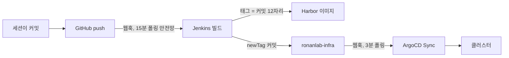

<!--
다루는 곳: bridge/pipeline.py, bridge/api/webhooks.py, config/pipeline.toml, deploy/cicd/argocd-notifications-foreman.yaml, migrations/0012_pipeline.sql, bridge/static/js/shipstate.js
읽은 커밋: 5e0f7c5
-->

# 12 CI/CD 인과 체인

FOREMAN이 지켜보는 프로젝트 가운데 런슈즈와 펫퍼민트는 웹 서비스다. 세션이 코드를 고치고 커밋해 GitHub에 올리면, 그 뒤로 사람이 손대지 않아도 빌드가 돌고, 이미지가 저장소에 올라가고, 클러스터에 새 판이 깔린다. 이 자동 흐름을 흔히 CI/CD라고 부른다. 이 편은 FOREMAN이 그 흐름을 어떻게 한 줄로 이어 보고, 그 흐름이 막히거나 조용히 멈췄을 때 어떻게 알아채는지를 다룬다.

FOREMAN을 만든 까닭은 조용한 고장을 잡는 것이다(→ 00 FOREMAN이란). CI/CD는 조용한 고장이 가장 잘 숨는 곳이다. 빌드가 실패하면 실패 화면이 남지만, 빌드가 아예 시작되지 않으면 아무것도 남지 않는다. 배포가 끝났다는 알림이 한 번 빠지면 화면은 언제까지나 「배포 중」이다. 이 편의 절반은 체인을 잇는 법이고, 나머지 절반은 「알림이 오지 않았다」를 「아무 일도 없었다」로 착각하지 않게 하는 장치들이다.

텔레그램을 보내는 규칙 자체는 → 11 알림, 실패를 받아 관리자를 깨우는 길은 → 09 교장과 관리자, 화면의 그림과 테마는 → 14 화면, 표 전체 지도는 → 15 DB에서 다룬다.

## 1. CI/CD가 무엇인가

CI(지속적 통합)는 코드가 바뀔 때마다 기계가 알아서 빌드하고 시험하는 것이고, CD(지속적 배포)는 그 결과물을 기계가 알아서 운영 환경에 까는 것이다. 이 서버의 서비스는 세 도구로 그 일을 나눈다.

| 도구 | 하는 일 | 쉽게 말하면 |
|---|---|---|
| Jenkins | GitHub에 새 커밋이 올라오면 그 코드를 받아 컨테이너 이미지를 빌드한다 | 공장. 설계도(코드)를 받아 완제품(이미지)을 만든다 |
| Harbor | 빌드한 이미지를 보관한다. 이미지마다 이름표(태그)가 붙는다 | 창고. 완제품을 이름표 붙여 쌓아 둔다 |
| ArgoCD | 「클러스터에 어떤 이미지가 떠 있어야 하는가」를 적어 둔 저장소(ronanlab-infra)를 보고, 클러스터를 그 글과 같게 맞춘다. 이것을 동기화(Sync)라고 한다 | 배송. 주문서(매니페스트)가 바뀌면 창고에서 꺼내 현장에 놓는다 |

실제 흐름은 이렇다. 세션이 로컬에서 커밋하고 GitHub에 push한다. GitHub가 Jenkins에 웹훅(「새 커밋이 왔다」는 HTTP 알림)을 보내고, Jenkins는 혹시 웹훅이 빠질 때를 대비해 15분마다 저장소를 직접 확인하는 폴링도 함께 돌린다. Jenkins는 이미지를 빌드해 Harbor에 올리는데, 이때 태그는 커밋 SHA 앞 12자리다. 마지막 단계에서 Jenkins는 ronanlab-infra 저장소의 그 앱 설정 파일(`kustomization.yaml`의 `newTag`)을 새 태그로 바꿔 커밋한다. ArgoCD는 그 커밋을 보고(웹훅과 3분 폴링) 클러스터를 맞춘다. 런슈즈는 ArgoCD가 바로 동기화하고(자동 Sync), 펫퍼민트는 사람이 ArgoCD 화면에서 [Sync]를 눌러야 올라간다(수동 Sync) [code:config/pipeline.toml] [log:stage8_cicd_result.md].

세 도구는 각자 자기 구간만 안다. Jenkins는 어느 커밋을 빌드했는지는 알지만 그 커밋을 어느 CC 세션이 왜 만들었는지 모른다. ArgoCD는 어떤 이미지 태그를 깔았는지는 알지만 그 태그가 어느 빌드에서 왔는지 모른다. 「이 세션이 고친 것이 지금 클러스터에 올라갔나, 아니면 어디서 멈췄나」를 한 번에 답하는 곳이 없다. FOREMAN이 하는 일은 이 구간들을 이어 붙이는 것이다.

## 2. 축은 커밋 SHA다

이어 붙이는 열쇠는 커밋 SHA 하나다. 커밋마다 붙는 40자리 고유 번호이고, 이 흐름의 모든 단계가 어떤 식으로든 이 번호를 들고 다닌다.

| 단계 | 그 단계가 들고 오는 SHA | FOREMAN이 그것을 얻는 곳 |
|---|---|---|
| 세션 | 세션이 부른 `git commit` 도구 호출 | 트랜스크립트에서 모은 `event` 행과 로컬 저장소 커밋 목록을 맞댄다 |
| Jenkins | 빌드한 머리 커밋(`GIT_COMMIT`) | Jenkinsfile이 보내는 빌드 알림의 `commit` 칸 |
| Harbor | 이미지 태그 = SHA 앞 12자리 | 태그를 로컬 저장소에서 전체 SHA로 푼다 |
| ArgoCD | 동기화한 앱이 쓰는 이미지 태그(같은 12자리) | ArgoCD 알림 본문의 `images` 칸 |

Jenkinsfile이 태그를 커밋 앞 12자리로 붙이는 규칙 덕에 이 이음이 성립한다. 태그만 봐도 어느 커밋인지 안다. ArgoCD 쪽에는 SHA가 하나 더 있다. ArgoCD가 말하는 「리비전」은 앱 저장소의 커밋이 아니라 ronanlab-infra의 커밋(태그를 바꾼 커밋)이다. 그래서 FOREMAN은 ArgoCD 행을 찾을 때 리비전이 아니라 이미지 태그를 본다 [code:bridge/pipeline.py].

### 2-1. 표 세 개

체인은 표 세 개에 담긴다 [code:migrations/0012_pipeline.sql].

| 표 | 한 행이 뜻하는 것 | 중요한 칸 |
|---|---|---|
| `git_commit` | 프로젝트 저장소에서 본 커밋 하나 | `sha`(기본 키), `session_id`, `character_id`, `event_id`(그 커밋을 만든 도구 호출), `subject`, `files`, `committed_at`, `pushed_at`(origin에 들어간 것을 본 때) |
| `build` | 한 단계의 실행 하나 | `stage`(jenkins, harbor, argocd), `external_id`, `commit_sha`(그 단계가 다룬 머리 커밋), `tag`, `status`, `step`(깨진 곳), `message`(실패 사유, 가린 뒤), `payload` |
| `build_commit` | 빌드 하나에 묶인 커밋들 | `build_id`, `commit_sha` |

`build.external_id`는 단계마다 그 도구가 붙이는 이름이다. Jenkins는 `<job>#<번호>`, Harbor는 `<저장소>@<digest>`, ArgoCD는 `<앱>@<리비전>`이다. 같은 프로젝트, 같은 단계, 같은 외부 이름은 한 행이다(`uq_build_ext`). 같은 빌드의 시작 알림과 끝 알림이 와도 행이 둘로 갈라지지 않고 한 행의 상태가 바뀐다.

`build_commit`이 따로 있는 까닭은 빌드 하나가 커밋 여럿을 담기 때문이다. 세션이 커밋 세 개를 연달아 push하면 Jenkins는 마지막 커밋만 빌드한다. 빌드 알림에는 머리 커밋 하나만 실려 오므로, 머리가 아닌 두 커밋은 그대로 두면 「빌드된 적 없는 커밋」으로 남는다. 그래서 새 Jenkins 빌드가 오면 브리지는 그 프로젝트의 직전 Jenkins 빌드 머리와 이번 머리 사이를 `git rev-list`로 뽑아(최대 100개) 모두 이 빌드에 묶는다. 직전 빌드가 없으면 머리 하나만 묶는다 [code:bridge/pipeline.py]. 이렇게 하면 「내 커밋이 들어간 빌드」를 머리가 아닌 커밋으로도 찾을 수 있다.

### 2-2. 이어 붙이는 순서

화면에 한 줄을 그릴 때 브리지는 다음 순서로 잇는다 [code:bridge/pipeline.py].

1. 그 프로젝트 `build` 행에서 최근에 움직인 머리 커밋 6개를 고른다(`commit_sha`로 묶고 가장 늦은 시작 시각 순) [code:bridge/pipeline.py].
2. 머리 커밋마다 그 SHA를 가진 `build` 행을 단계별로 모은다. Jenkins, Harbor, ArgoCD 행이 모두 같은 `commit_sha`를 들고 있으니 한 번에 모인다.
3. `build_commit`에서 그 머리의 빌드에 묶인 커밋들을 꺼내 `git_commit`과 잇고, 다시 `character_session`과 이어 세션 이름을 붙인다.
4. 단계 가운데 처음으로 `failed`인 곳을 「여기서 깨짐」으로 표시한다.

결과는 이런 한 줄이다. 「세션 ○○가 만든 커밋 abc12345 외 2개 → Jenkins #52 성공 → Harbor 이미지 성공 → ArgoCD 배포 실패, health」. 이것이 이 편 제목의 인과 체인이다.

여기에 하나가 더 있다. 브리지가 아직 어떤 빌드에도 묶이지 않은 최근 이틀 안의 커밋을 따로 모은다 [code:bridge/pipeline.py]. 화면에서는 「빌드 전 커밋」 줄이 되고, push하지 않은 커밋은 「(push 전)」이 붙는다. 「커밋은 했는데 왜 배포가 안 됐지」의 가장 흔한 답이 「push를 안 했다」이기 때문이다.

## 3. 커밋을 세션에 귀속하기

체인의 첫 고리, 「이 커밋은 어느 세션이 만들었나」는 생각보다 까다로웠다. Git은 커밋을 만든 사람 이름만 남기고, 이 서버에서는 모든 세션이 같은 git 사용자로 커밋한다. 커밋만 보고는 세션을 알 수 없다.

### 3-1. 로컬 저장소 폴링

브리지는 20초마다 각 프로젝트의 로컬 저장소에서 최근 7일 커밋을 최대 300개 읽고, `origin/<브랜치>`에 들어간 커밋 목록(최대 400개)과 맞대 push 여부를 본다 [code:bridge/pipeline.py] [code:config/pipeline.toml]. 새 커밋이 보이면 `git_commit`에 넣고, 이미 있던 커밋이 origin에 새로 들어갔으면 `pushed_at`을 채운다.

처음 설계는 로컬 저장소를 따로 읽지 않고 Jenkins가 알려 주는 커밋 목록만 쓰려 했다. 그러면 「push 전 커밋」을 볼 수 없다. 나중에 Jenkins를 API로 읽지 않고 알림만 받는 쪽으로 바꾸면서(5절) 로컬 폴링이 다시 필요해졌다. 알림이 오지 않았을 때 「push는 있었다」를 확인할 기준이 있어야 해서다(7절) [log:stage8_cicd_result.md].

### 3-2. 커밋 제목이 명령에 있어야 한다

세션을 찾는 법은 이렇다. 커밋 시각 앞 5분, 뒤 1분 안에 Bash 도구로 `git commit`이 들어간 명령을 부른 도구 호출을 찾고, 커밋 시각에 가까운 순서로 20개를 본다 [code:bridge/pipeline.py] [code:config/pipeline.toml]. 각 후보에 점수를 매긴다.

| 점수 | 조건 |
|---|---|
| 2 | 명령 안에 그 커밋 제목(앞 24자, 따옴표와 역슬래시를 뺀 것)이 들어 있다 |
| 0 | 명령이 다른 제목을 줬다(`-m`, `-F`, `--message`, `--file`), 또는 `cd 다른곳 && git commit`, `git -C 다른곳 commit`처럼 이 저장소 밖으로 들어가 커밋했다 |
| 1 | 메시지를 알 수 없는 커밋 명령(`git revert --no-edit` 같은 것) |

가장 높은 점수의 후보를 고르고, 점수가 같으면 가까운 것이다. 다른 프로젝트 세션의 명령은 점수 2일 때만 인정한다. 고르면 `git_commit.session_id`, `character_id`, `event_id`를 채우고, 그 도구 호출 `event` 행의 `commit_sha`도 채운다. 그래서 세션 기록 화면에서 그 도구 호출을 눌러도 커밋으로 이어진다.

처음 규칙은 「커밋 시각 직전 가장 가까운 `git commit` 호출」이었다. 실제 데이터에 대 보니 두 번 틀렸다. 런슈즈 세션이 `cd ~/ronanlab-infra && git commit`으로 인프라 저장소에 한 커밋이 런슈즈 커밋으로 잡혔고, 5분 안에 커밋이 여럿이면 가장 가까운 명령이 다른 커밋의 것이었다. 그래서 「명령에 제목이 들어 있어야」로 바꿨다. 최근 7일 런슈즈 54개 중 52개, 펫퍼민트 29개 중 14개가 귀속됐고, 귀속된 66개는 모두 제목이 맞았다. 어림짐작으로 붙인 것이 0이다 [log:stage8_cicd_result.md]. 펫퍼민트 귀속률이 낮은 것은 그쪽 커밋 상당수를 사람이나 다른 경로가 만들었기 때문이다. 귀속하지 못한 커밋은 세션 칸이 비고, 실패 알림에는 「사람(세션 밖)」으로 적힌다. 틀린 세션을 대는 것보다 모른다고 하는 쪽을 골랐다.

## 4. 웹훅 전용 포트: 루프백에만 있는 브리지가 클러스터 웹훅을 받는 법

브리지는 원래 이 서버 안에서만(루프백 주소, 8000 포트) 듣는다 [code:bridge/api/webhooks.py]. 대시보드, API, 셸 패널이 모두 거기 있고, 바깥으로 열리지 않는 것이 보안의 바탕이다(→ 01 전체 구조). 그런데 Jenkins와 ArgoCD는 이 서버 위에 뜬 가상 머신(쿠버네티스 클러스터) 안에서 돈다. 가상 머신에서 보면 호스트의 루프백 주소는 자기 자신이라 닿지 않는다.

그래서 같은 브리지 프로세스가 포트를 하나 더 연다. 호스트가 가상 머신 망 쪽에 가진 주소의 8001 포트다 [code:bridge/main.py]. 이 포트에는 세 겹의 제한이 있다.

첫째, 이 포트로 들어온 요청은 `/webhooks/`로 시작하는 경로만 받고, 나머지는 모두 404다 [code:bridge/main.py]. 대시보드와 API는 이 포트에서 보이지 않는다.

둘째, 보낸 곳 IP가 허용 망(루프백과 가상 머신 망 둘)이 아니면 403이다 [code:bridge/api/webhooks.py]. 포트를 가상 머신 망 쪽 주소에만 묶었는데 IP를 또 보는 까닭이 있다. 리눅스는 기본으로 「weak host」 방식이라, 어느 네트워크 카드로 들어온 패킷이든 목적지가 호스트의 주소면 받아 준다. 같은 LAN의 다른 컴퓨터가 경로만 잡아 주면 가상 머신 망 쪽 주소로 패킷을 보낼 수 있다. 묶은 주소만으로는 막을 수 없어 IP로도 거른다.

셋째, 웹훅 토큰(`FOREMAN_WEBHOOK_TOKEN`)이 맞아야 한다. 토큰이 설정되지 않았으면 503, 틀리면 401이다. 토큰은 `Authorization: Bearer` 헤더로만 받는다. Harbor의 「Auth Header」 칸은 값을 그대로 보낼 수 있어 `Bearer ` 없이 온 값도 받는다. 비교는 시간 차로 값을 짐작할 수 없는 방식(`token_ok`)이다. 거절하면 이유를 로그에 남기되, 토큰 값은 남기지 않고 길이만 적는다 [code:bridge/api/webhooks.py]. 이 토큰은 hook 토큰, API 토큰과 다른 값이다. 하나가 새도 나머지 문이 열리지 않게 했다(→ 05 역할과 권한).

받은 본문은 JSON 객체여야 하고, 처리는 파이프라인 관리자(`PipelineManager`)의 `on_jenkins`, `on_harbor`, `on_argocd`가 맡는다. 성공하면 202, 처리 중 예외가 나면 500을 돌려준다 [code:bridge/api/webhooks.py]. 500을 돌려주는 까닭은 보낸 쪽이 다시 보내게 하기 위해서다. 모르는 job이나 앱(예: 체인 밖의 cloudflared 앱)은 「건너뜀」으로 202를 주고 로그에 이름을 남긴다.

포트를 여는 방식에도 사정이 있다. 웹 서버(uvicorn)는 포트를 묶다 실패하면 프로세스 전체를 끝낸다. 웹훅 포트 하나 때문에 대시보드까지 죽으면 안 되므로, 브리지가 소켓을 먼저 직접 묶어 보고, 성공했을 때만 그 소켓을 웹 서버에 넘긴다. 실패하면 로그 한 줄을 남기고 브리지는 그대로 산다 [code:bridge/main.py]. 토큰이 없으면 포트를 아예 열지 않는다.

가상 머신 안에서 보낸 패킷이 실제로 어느 IP로 보이는지는 적용할 때 직접 쟀다. Jenkins 파드에서 보낸 요청은 파드 주소가 아니라 노드의 가상 머신 망 주소로 바뀌어(SNAT) 도착했고, 설계 때 예상한 다른 대역이 아니었지만 둘 다 허용 범위 안이었다. ArgoCD 알림 컨트롤러 파드에는 curl이 없어서 `git ls-remote`로 GET을 보내 브리지 로그에 찍힌 출발 IP를 봤다 [log:stage8_cicd_result.md].

## 5. 단계마다 알림을 받는 법

### 5-1. Jenkins: API를 읽지 않고 알림을 받는다

Jenkins 쪽은 처음에 반대 방향으로 설계했다. FOREMAN이 Jenkins 읽기 API를 주기적으로 불러 빌드 결과, 묶인 커밋, 스테이지별 상태를 가져오는 방식이다. 「기존 파이프라인을 건드리지 않는다」는 장점이 컸다. 필요한 것은 읽기 토큰 하나였다.

토큰을 만들기 직전에 그 토큰이 무엇을 열 수 있는지 다시 따졌고, 선택이 뒤집혔다 [log:stage8_cicd_result.md].

- 이 Jenkins는 「로그인하면 전체 권한」 방식이고 권한을 쪼개는 플러그인이 없다. 읽기 전용 토큰을 만들 방법이 없다.
- 그 토큰으로 Jenkins의 스크립트 콘솔에 코드를 보내면 Jenkins 안에서 무엇이든 돌릴 수 있고, 저장된 자격 증명도 꺼낼 수 있다. 그 안에는 Harbor에 이미지를 올리는 계정과 ronanlab-infra에 쓸 수 있는 배포 키가 있다.
- ronanlab-infra에 쓸 수 있으면 배포할 수 있다. 런슈즈는 자동 Sync라 태그를 바꿔 push하면 그대로 깔리고, 루트 앱이 `apps/*/app.yaml`을 읽어 앱을 만드는 구조라 새 자동 Sync 앱을 하나 더하는 것만으로 클러스터에 무엇이든 깔 수 있다.

즉 「읽기용」으로 생각한 토큰이 실은 빌드, 레지스트리, 매니페스트, 클러스터 배포 경로 전체의 열쇠였다. FOREMAN 코드가 GET만 보내도록 막아도 그것은 FOREMAN 자신의 버그를 막는 장치이지 보안 경계가 아니다. 토큰이 새면 그 제한은 같이 새지 않는다.

반대 방향, 빌드가 FOREMAN에 알리는 방식에서는 비밀이 FOREMAN이 받을 때 쓰는 웹훅 토큰이다. 이 토큰이 새면 할 수 있는 일은 FOREMAN에 가짜 빌드 이벤트를 넣는 것뿐이고, 그것도 가상 머신 망 안에서만 된다. 배포, 레지스트리, 클러스터에는 닿지 않는다. 같은 유출이라도 피해 범위가 다르다. 이 기준을 「새도 되는 비밀의 무게」라고 부르고, 이것으로 알림 방식을 골랐다.

대신 처음에 API 조회를 고른 까닭(「기존 파이프라인을 건드리지 않는다」)은 조건으로 바꿔 지켰다. 알림이 빌드 결과에 영향을 주면 안 된다. 두 앱 저장소의 Jenkinsfile에 들어간 `foremanNotify`는 이렇게 짜였다 [log:stage8_cicd_result.md].

| 장치 | 막는 것 |
|---|---|
| 단계 전체를 `try/catch`로 감싼다 | 에이전트 연결 끊김처럼 단계 자체가 예외를 던지는 경우. `\|\| true`는 셸 종료 코드만 막는다 |
| curl 끝에 `\|\| true` | FOREMAN이 꺼져 있거나 거절해도 빌드는 성공 |
| 연결 3초, 전체 5초 제한 | FOREMAN이 느려도 빌드가 기다리지 않는다 |
| 끝 알림은 `post`의 맨 마지막(`cleanup`) | 다른 정리 단계보다 뒤에 돈다 |
| 토큰은 셸 환경변수로만, curl에는 표준 입력 설정(`-K -`)으로 | 프로세스 목록과 빌드 로그에 토큰이 남지 않는다 |

알림 본문은 `{job, number, phase, result, commit, stage, cause, url, timestamp, duration}`이다. `phase`는 `started`나 `completed`, `stage`는 마지막으로 들어간 스테이지 이름(실패했으면 깨진 곳), `cause`는 빌드가 왜 시작됐는지(`webhook`, `poll`, `manual`, `other`)다. 브리지는 시작 알림이면 `running`, 끝 알림의 결과가 `SUCCESS`면 `success`, 그 밖은 `failed`와 깨진 스테이지로 판정한다 [code:bridge/pipeline.py].

첫 적용 때 두 빌드로 확인했다. push부터 시작 알림까지 펫퍼민트 25초, 런슈즈 23초였고, 두 빌드 모두 원인이 웹훅이었고, 빌드 로그에 토큰이 찍힌 횟수는 0이었다 [log:stage8_cicd_result.md].

문서만 바뀐 빌드는 따로 다룬다. 런슈즈 Jenkinsfile은 바뀐 파일이 모두 문서면 이미지 빌드와 태그 커밋을 건너뛰고 성공으로 끝내며, 알림 본문에 `"skipped": true`를 더한다. 브리지는 그 빌드에 이미지 태그를 붙이지 않고(시작 알림 때 붙은 것도 지운다) 단계 글을 「건너뜀 — 문서만」으로 둔다 [code:bridge/pipeline.py]. 태그가 없으니 Harbor와 ArgoCD를 기다리지 않고, 「배포 안 된 빌드」로 고르지도 않는다. 화면은 빌드에서 끝나고 이미지, 배포 칸은 「–」로 정상이다.

### 5-2. Harbor: 받는 곳은 있고 보내는 쪽은 없다

`/webhooks/harbor`는 있다. Harbor 기본 웹훅 형식에서 이미지 올림(`PUSH_ARTIFACT`)은 성공, 검사 실패와 용량 초과는 실패로 읽고, 내려받기, 지우기 같은 것은 체인의 단계가 아니라 버린다 [code:bridge/pipeline.py]. 태그 12자리는 DB의 `git_commit`에서 앞자리가 하나만 맞으면 그 SHA로, 아니면 로컬 저장소에서 `git rev-parse`로 푼다.

그러나 Harbor 쪽에 FOREMAN으로 보내는 웹훅 정책을 건 기록은 없다. 처음 조사 때 Harbor의 알림 정책은 0행이었고, 이미지를 올리는 일은 Jenkins의 「빌드·push」 스테이지 안에서 일어나며 태그가 곧 커밋이라 따로 받을 필요가 적다고 봤다 [log:stage8_cicd_result.md]. 그래서 화면의 이미지 칸은 대개 Jenkins 행에서 미루어 그린다. 기준은 하나, 그 빌드의 이미지가 실제로 올라갔는가다. Jenkins가 진행 중이면 이미지도 진행 중, 이미지를 올리는(push) 단계에서 실패했으면 이미지 실패(✗)다. push 뒤 단계(매니페스트 태그, 배포)에서 실패했으면 이미지는 이미 올라갔으니 성공(✓)으로 본다. push 앞 단계(태그, 시험 등)에서 실패했거나, 어느 단계인지 모르거나 단계 이름이 없는 실패면 올라갔다고 말하지 않고 「기록 없음」으로 둔다. Harbor가 직접 알려 온 상태가 있으면 그것을 먼저 따른다 [code:bridge/static/js/shipstate.js]. 11-17 전에는 push 단계가 아닌 실패를 모두 ✓로 그려, push 앞에서 실패해 이미지가 없는데도 ✓가 떴다 [c:9ac4527] [log:foreman-6_designer_code_oddities_20261117.md].

### 5-3. ArgoCD: notifications로 알림만 더한다

ArgoCD에는 상태가 바뀌면 바깥으로 알림을 보내는 notifications 기능이 있다. 동기화 동작은 그대로 두고 알림 설정만 더하면 되므로 이것을 골랐다. FOREMAN이 ArgoCD 비밀을 가질 필요도 없다. 설정은 FOREMAN 저장소의 `deploy/cicd/argocd-notifications-foreman.yaml`에 있고, 사람이 클러스터에 넣었다 [code:deploy/cicd/argocd-notifications-foreman.yaml].

넣는 법에 고민이 있었다. 이 설정 객체(`argocd-notifications-cm`)는 ArgoCD를 처음 설치할 때 생긴 것이고 ArgoCD가 관리하지 않는다. 그래서 손으로 넣어도 되돌려지지 않는다. 다만 `kubectl apply`로 넣으면 나중에 ArgoCD를 설치 파일로 다시 apply(업그레이드)할 때 지워질 수 있어 `kubectl patch`로 넣었다. 설치 때의 기록에 이 키들이 없으니 다시 apply해도 「지울 것」으로 보지 않는다.

받는 앱은 기본 구독에 라벨 선택자 `app.kubernetes.io/instance=root`로 정했다. 이 클러스터는 루트 앱 하나가 자식 앱들(runshoes, petmint, cloudflared)을 만드는 구조(App of Apps)이고, ArgoCD는 자식에게만 이 라벨을 붙인다. 앞으로 더할 앱도 자동으로 들어오고 루트는 빠진다. 앱마다 주석을 다는 방식은 루트가 앱 정의를 관리해 인프라 저장소를 고쳐야 해서 버렸다. 주의할 것이 하나 있다. ArgoCD 추적 방식을 라벨에서 주석으로 바꾸면 이 라벨이 사라져 구독이 조용히 끊긴다. 설정 파일 머리말에 그렇게 적어 두었다.

트리거는 여섯이다.

| 트리거 | 조건 | FOREMAN이 읽는 뜻 |
|---|---|---|
| `foreman-out-of-sync` | 새 리비전이 와서 OutOfSync(리비전마다 한 번) | 수동 Sync 앱이면 「Sync 대기」, 자동이면 「곧 동기화」 |
| `foreman-sync-running` | 동기화 작업이 도는 중 | 진행 중 |
| `foreman-sync-succeeded` | 동기화 작업 성공 | 파드가 아직 뜨는 중이면 진행 중 |
| `foreman-sync-failed` | 동기화 작업 실패, 오류 | 실패(단계 `sync`) |
| `foreman-health-degraded` | 앱 상태 Degraded | 실패(단계 `health`) |
| `foreman-deployed` | 작업 성공 + Healthy + Synced(리비전마다 한 번) | 배포 끝 |

본문에는 앱 이름, 동기화 상태, 건강 상태, 리비전, 이미지 목록, 자동 Sync 여부, 마지막 작업의 단계와 메시지와 리비전(`op_revision`)이 들어간다. 자동 Sync 여부는 `hasKey`로 본다. 런슈즈의 설정은 `automated: {}`(빈 맵)이라 그냥 참거짓으로 보면 거짓이 되기 때문이다. 없는 칸을 읽으면 템플릿이 실패하므로 작업 상태와 동기화 정책은 `if`로 감쌌다 [code:deploy/cicd/argocd-notifications-foreman.yaml].

판정에서 조심한 것은 「마지막 작업」과 「지금 리비전」이 다를 수 있다는 점이다 [code:bridge/pipeline.py]. 새 리비전이 OutOfSync로 왔을 때 본문의 작업 단계는 지난 Sync의 것이다. 지난 작업이 실패였다고 이번 리비전을 실패로 보면 안 된다. 그래서 `op_revision`과 리비전이 같을 때만 작업 실패를 이번 실패로 본다. 수동 Sync 앱이 OutOfSync면 `waiting`(Sync 대기)이고, 이것은 실패가 아니다.

OutOfSync 알림에는 또 하나 함정이 있었다. 그때 본문의 이미지 목록은 아직 깔려 있는 옛 태그다. 그 태그로 체인을 찾으면 이미 배포 끝난 옛 체인에 붙는다. 그래서 OutOfSync이고 대기나 진행 중일 때는 「Jenkins는 성공했는데 아직 ArgoCD 성공이 없는 가장 최근 빌드」의 태그를 쓴다. 그 빌드가 인프라 저장소의 태그를 바꿨을 것이기 때문이다 [code:bridge/pipeline.py].

## 6. 행을 고치는 규칙

웹훅 세 갈래는 모두 같은 함수(`_upsert`)로 `build` 행을 만들거나 고친다 [code:bridge/pipeline.py]. 여기 몇 가지 규칙이 있다.

늦게 온 알림이 끝난 상태를 덮지 않는다. 상태에 순위를 매겨 진행 중(`running`, `waiting`)은 0, 끝난 상태(`success`, `failed`, `stale`)는 1이다 [code:bridge/pipeline.py]. 끝난 행에 진행 중 알림이 늦게 와도 상태를 되돌리지 않는다. 알림은 순서대로 온다는 보장이 없다.

실패 알림은 「실패로 바뀔 때 한 번」이다. 이미 실패인 행에 실패가 또 와도 텔레그램을 다시 보내지 않는다. 알림 글에는 단계, 깨진 곳, 커밋 앞 8자리와 제목, 그 커밋을 만든 세션 이름(없으면 「사람(세션 밖)」), 외부 이름, 실패 메시지, 링크가 들어간다. 같은 글이 자동 기상으로도 넘어가 관리자가 깨어난다(→ 09 교장과 관리자).

Sync 대기에서 진행으로 바뀔 때는 행의 시작 시각을 그때로 고친다. 수동 Sync 앱의 행은 「Sync 대기」로 먼저 생기고 그때 시작 시각과 끝 시각이 채워진다. 그대로 두면 막 누른 Sync가 몇 시간째 진행 중으로 셈해진다. 실제로 그렇게 틀린 알림이 한 번 나갔다(8-3절).

ArgoCD에서 결과(성공, 실패)가 오면, 같은 프로젝트에서 그보다 먼저 시작해 아직 진행 중이나 대기인 ArgoCD 행을 모두 `stale`로 닫고 메시지 끝에 「[나중 결과가 대신함]」을 붙인다. ArgoCD 앱 하나는 한 번에 한 동기화만 하므로, 나중 결과가 왔다면 앞의 진행 중 행은 끝 알림이 영영 오지 않을 행이다. Jenkins에는 이 규칙을 쓰지 않는다. 빌드는 겹쳐 돌 수 있어서다. 이 규칙이 생긴 사연은 8-2절이다.

## 7. 알림이 오지 않았다는 것을 아는 법

알림 방식의 약점은 분명하다. 「알림이 안 왔다」가 「빌드가 없었다」를 뜻하지 않는다. Jenkinsfile 문법 오류, 에이전트 파드가 안 뜸, 빌드 중 Jenkins 재시작, 웹훅 유실, 알림 자체의 실패, 그리고 Jenkins가 통째로 죽은 것까지, 모두 FOREMAN 쪽에서는 똑같이 「조용함」으로 보인다. 그래서 알림과 별개로 30초마다 도는 감시가 있다 [code:bridge/pipeline.py].

### 7-1. push 뒤 빌드 알림이 없으면 「Jenkins 확인」

기준은 로컬 저장소다. 20초마다 `origin/<브랜치>`가 움직였는지 보고, 움직였으면 「이 push 머리를 담은 빌드 시작 알림」을 기다린다. 머리가 같거나, 빌드에 묶인 커밋에 그 머리가 있거나, 빌드 머리가 그 머리의 자손이면 채워진 것으로 본다. 기다리는 시간은 다음과 같다 [code:config/pipeline.toml].

| 상황 | 기다리는 시간 | 하는 것 |
|---|---|---|
| push 뒤 시작 알림 없음 | 3분 | 화면에 노란 줄 「빌드 시작 알림 없음, Jenkins가 스스로 확인하길 기다리는 중」. 웹훅이면 몇 초 안에 시작한다 |
| 〃 | 17분(폴링 15분 + 2분) | 텔레그램 「빌드 알림 없음 — push abc12345 "제목" 뒤 17분째 Jenkins 시작 알림이 없다. Jenkins 확인」, 화면 빨간 줄 「빌드 알림 없음, Jenkins 확인」. 자동 기상으로도 넘긴다 |
| 시작은 왔는데 끝 알림 없음 | 35분(Jenkinsfile 제한 30분 + 5분) | 텔레그램 「빌드 끝 알림 없음 — #N 시작 뒤 M분째. Jenkins 확인」 |
| 늦게라도 왔다 | — | 이미 알렸으면 「빌드 알림 늦게 도착 — push 뒤 N분」 한 번 |

17분이라는 숫자는 Jenkins의 안전망 폴링이 15분이라서 나왔다 [code:config/pipeline.toml]. 웹훅이 빠져도 15분 안에는 폴링이 빌드를 시작해야 하니, 그것까지 넘겼으면 진짜 이상하다. 같은 job의 앞 빌드가 아직 돌거나 방금 끝났으면 그때부터 잰다. Jenkins는 같은 job을 겹쳐 돌리지 않아 줄 서 있는 것이기 때문이다.

### 7-2. 웹훅 끊김 의심

Jenkins의 폴링은 바뀐 것이 있을 때만 빌드를 시작하므로, 웹훅이 살아 있으면 폴링 원인의 빌드는 거의 생기지 않는다. 그래서 「웹훅으로 시작한 빌드가 있던 job에서 폴링 원인 빌드가 연달아 2번」이면 웹훅이 끊긴 것으로 보고 한 번 알린다 [code:bridge/pipeline.py] [code:config/pipeline.toml]. 손으로 누른 빌드는 세지 않는다. 다음 빌드가 다시 웹훅으로 시작하면 「웹훅 복구」를 한 번 보낸다. 빌드 알림에 `cause` 칸을 넣은 것이 이 판정 때문이다. 이 판정에도 Jenkins 토큰이 필요 없다.

### 7-3. 인프라 생존 폴링과 STALE

각 프로젝트의 Jenkins, Harbor, ArgoCD는 화면에 인프라 캐릭터로 있다. 그 프로젝트의 첫 웹훅이 오면 등장하고, 그 뒤로 60초마다 각 도구의 인증 없이 열리는 주소(Jenkins 로그인 화면, Harbor ping, ArgoCD 버전)를 클러스터 입구(ingress)로 직접 불러 살아 있는지 본다 [code:bridge/pipeline.py] [code:config/pipeline.toml]. 호스트에서 도구의 공개 이름으로 부르면 바깥 인증 관문으로 가 버리므로, 입구 주소에 Host 헤더를 붙여 부른다. 응답 코드가 500 미만이면 산 것이다.

| 연속 무응답 | 하는 것 |
|---|---|
| 3번 | 캐릭터를 STALE(응답 없음)로. 화면의 칩에 ⚠ |
| 5번 | 텔레그램 「⚠ Jenkins 응답 없음 — 연달아 5번(4분째, HTTP 503). 쓰는 프로젝트: … 이 동안 push해도 빌드 · 알림이 없다」. 도구 종류마다 한 번 |
| STALE로 24시간 | 퇴장. 퇴장할 때도 한 번 알린다 |
| 다시 응답 | STALE이 풀리고, 알렸던 것이면 「✅ Jenkins 다시 응답」 |

STALE은 「조용히 끝난 줄 알았는데 사실 응답이 없는 것」을 가리는 상태다. 화면에서 사라지지 않고 경고로 남는다. 5번 알림은 도구 종류마다 한 번이다. Jenkins 하나를 두 프로젝트가 쓰므로 프로젝트마다 보내면 같은 말이 두 번 간다. 그래서 프로젝트 이름이 아니라 FOREMAN 이름으로 보낸다. 5번이라는 숫자는 STALE(3번)보다 늦게, 그리고 Jenkins 설정을 바꿀 때의 재시작(실측 42초)에 알림이 가지 않게 고른 값이다 [log:infra_20261106_jenkins-harbor-after-outage.md]. 퇴장하면 폴링도 멈추므로, 「이제 폴링하지 않는다, 다음 알림은 push 뒤 빌드 알림 없음뿐이다」라고 한 번 알려 조용히 사라지지 않게 했다.

### 7-4. 감시 자체가 고장 나면

감시가 조용히 죽으면 위 장치들이 다 무용지물이다. 실제로 빌드 감시가 한동안 예외로 건너뛰어진 일이 있었다. 지난 1시간 Jenkins 행 가운데 가장 늦은 끝 시각을 구하는 쿼리가, MySQL에서 바인드 값이 섞인 `COALESCE`의 최댓값을 날짜가 아니라 문자열로 돌려줬고, 그 값을 날짜와 비교하다 `TypeError`가 났다. push 대기가 있고 최근 빌드가 있을 때만 걸려 가끔 났고, 그때마다 그 바퀴의 「빌드 알림 없음」 감시가 로그 한 줄만 남기고 건너뛰어졌다 [log:check_watch_fix_20261112.md].

쿼리를 나눠 값을 늘 날짜로 받게 고쳤고, 그와 함께 감시를 칸(배포 대기 확인, ArgoCD 진행 중 확인, 프로젝트마다 빌드 알림 감시)으로 나눠 한 칸의 실패가 다른 칸을 막지 않게 했다. 새로운 실패 사유(칸과 예외 종류)는 한 번 텔레그램으로 「⚠ 감시 실패 — 이 동안 이 칸의 알림이 나가지 않을 수 있다」를 보내고, 다시 돌면 「✅ 감시 다시 돎」을 보낸다 [code:bridge/pipeline.py] [c:d555e7f]. 같은 사유의 기준을 메시지가 아니라 예외 종류로 한 것은, 메시지에 시각과 숫자가 섞여 매번 달라지면 알림이 되풀이되기 때문이다.

## 8. 막혔던 것

### 8-1. 정전 뒤 Jenkins가 죽었는데 세 경로가 모두 조용했다

서버가 정전으로 꺼졌다 켜진 날, 클러스터는 대부분 스스로 돌아왔지만 Jenkins는 돌아오지 못했다. Jenkins 파드의 준비 컨테이너(init)가 계속 실패했다. 그 스크립트는 오류가 나면 바로 멈추는 설정(`set -e`)이고 마지막에 플러그인을 `cp -i`로 복사하는데, 플러그인 폴더에 정전 전 파일이 그대로 남아 있었다. 그 폴더는 같은 파드인 동안은 재부팅에도 남는 임시 볼륨이었고, 정전 뒤 같은 파드가 다시 떴다. `cp -i`는 덮어쓰기를 거절하면 종료 코드 1을 내므로 스크립트가 실패했다. 그전에는 설정을 바꿀 때마다 새 파드가 만들어져 폴더가 비어 있었기에 한 번도 걸리지 않았다 [log:infra_20261106_jenkins-harbor-after-outage.md]. 파드를 지워 새로 만들게 해서 되살렸다.

FOREMAN 쪽에서 보면 문제는 Jenkins가 죽어 있는 동안 알림이 하나도 없었다는 것이다. Jenkins가 죽은 것이 드러날 수 있는 길은 셋이었고, 셋 다 조용했다.

| 길 | 그날 실제 | 빈틈 |
|---|---|---|
| 인프라 생존 폴링 | 두 프로젝트의 Jenkins 캐릭터가 STALE이 됐다. 로그 한 줄과 화면 상태뿐 | 텔레그램이 없었다. 24시간이 지나면 퇴장해 화면에서도 사라질 참이었다 |
| push 뒤 빌드 알림 없음 | push가 없어 아무 일도 없었다 | push가 있어야만 돈다. 와도 17분 늦고, 「Jenkins 자체가 죽었다」는 말이 없다 |
| 웹훅 끊김 의심 | 해당 없음 | 빌드가 돌아야 판정한다. Jenkins가 죽으면 영원히 조용하다 |

그래서 7-3절의 「연달아 5번 응답 없음 → 텔레그램」, 퇴장 알림을 넣었고, push 뒤 「빌드 알림 없음」 글에 Jenkins가 죽어 있으면 「Jenkins 자체가 N분째 응답 없음(HTTP 503)」을 덧붙이게 했다 [c:683e49e]. 세 길이 각자 다른 조건에서만 울리게 짜여 있었고, 그 조건 셋이 모두 「Jenkins가 살아 있다」를 깔고 있었다는 것이 이 일의 교훈이다.

여전히 못 잡는 것도 적어 둔다. Jenkins는 살아 있는데 다른 파드가 죽은 경우다. 그날 Harbor의 작업 처리 파드도 기동 순서 때문에 몇 분 재시작을 되풀이하다 스스로 풀렸는데, FOREMAN은 이것을 볼 길이 없다. 「준비되지 않은 파드」를 보려면 호스트에 없는 kubectl이나 클러스터 안 조회 경로가 필요하다.

### 8-2. 「배포 진행 중」이 이틀 남았다

런슈즈가 배포 중이 아닌데 화면에서는 이틀째 「배포 진행 중」이었고, 출하 라인의 배송 담당이 배포 칸 앞에 계속 서 있었다. 원인은 ArgoCD의 진행 중 알림 하나가 리비전 없이 온 것이었다. 행 이름이 `<앱>@<리비전>`인데 리비전이 비어 `runshoes@?`라는 행이 따로 생겼고, 뒤이은 성공 알림은 진짜 리비전 이름의 행으로 갔다. `runshoes@?` 행에는 끝 알림이 영영 오지 않았다 [log:retro_20261105_foreman.md] [c:50f4577].

이 고장은 사람이 ArgoCD, 파드, Jenkins를 직접 보고 맞대고서야 드러났다. FOREMAN은 「진행 중」을 그대로 믿고 아무 말도 하지 않았다.

고친 것은 두 겹이다. 브리지는 ArgoCD 결과가 오면 그보다 먼저 시작해 아직 진행 중인 ArgoCD 행을 `stale`로 닫는다(6절). 화면은 시작한 지 2시간이 넘은 진행 중이나, 더 새 체인이 이미 끝낸 단계의 진행 중은 진행 중으로 보지 않는다 [code:bridge/static/js/office.js]. 화면 표시는 「– 나중 배포로 대체」다.

### 8-3. 끝 알림이 오지 않는 배포를 직접 읽어 닫다

같은 모양의 고장이 다른 원인으로 또 났다. 펫퍼민트 배포 하나가 「동기화됨, 파드는 뜨는 중」 알림을 끝으로 Healthy 알림이 오지 않았고, 클러스터는 이미 Healthy인데 FOREMAN에는 진행 중으로 남았다 [log:screen_argocd_read_20261109.md]. 다음 결과가 오면 `stale`로 닫히긴 하지만, 수동 Sync 앱은 다음 배포가 며칠 뒤일 수도 있다.

조사해 보니 원인은 `foreman-deployed` 트리거 조건이었다 [log:foreman-2_docs_sync_argocd_20261109.md]. 수동 Sync 앱에 새 커밋이 오면 ArgoCD의 「목표 리비전」은 곧바로 새 것으로 바뀌지만, 마지막 작업 상태는 지난 Sync의 성공 그대로이고 옛 파드는 Healthy다. 그래서 OutOfSync인 채로 「작업 성공 + Healthy」 조건이 참이 되어, Sync를 누르기도 전에 deployed 알림이 나가며 그 리비전의 「한 번」을 써 버렸다. 정작 Sync 뒤 Healthy가 됐을 때는 이미 보냈으니 보내지 않았다. 런슈즈가 괜찮았던 것은 자동 Sync가 몇 초 안에 돌아 조건이 잠깐 거짓이 되는 경합에서 이겼기 때문이다. 조건에 `Synced`를 더해 고쳤다 [c:32f4b60]. 이 설정 원본은 인프라 저장소가 아니라 FOREMAN 저장소에 있다.

트리거를 고친 것과 별도로, 끝 알림이 빠져도 스스로 닫는 장치를 넣었다 [code:bridge/pipeline.py] [c:32eab31]. ArgoCD 행이 10분 넘게 진행 중이면 브리지가 ArgoCD 앱 상태를 직접 읽는다. ArgoCD API 토큰은 두지 않았다. Jenkins API 토큰을 쓰지 않은 것과 같은 까닭으로, 이 서버에 새 열쇠를 늘리지 않으려 했다. 대신 호스트의 가상 머신 관리 도구로 클러스터 관리 노드에 들어가 읽기 전용 `kubectl get`을 한 번 부른다(약 2초, 60초 제한). 같은 앱은 5분에 한 번만 읽는다. 그 리비전의 작업이 성공이고 Healthy면 성공으로, 실패나 Degraded면 실패로 닫고, 메시지 끝에 「[끝 알림이 없어 ArgoCD를 읽어 확인]」을 붙인다. Sync 작업 시작 뒤 30분이 지나도 끝나지 않았거나 읽지 못하면 행마다 한 번 「⏳ 배포가 끝나지 않습니다」를 보내고, 지금 ArgoCD 상태나 못 읽은 이유를 함께 적는다.

이 알림의 첫 실제 발송은 틀렸다. 브리지를 다시 띄우자 곧바로 「106분째 끝나지 않습니다」가 나갔는데, 사용자는 30초 전에 Sync를 눌렀고 12초 만에 끝나 있었다 [log:screen_argocd_read_20261109.md]. 수동 Sync 앱의 행은 「Sync 대기」로 먼저 생겨 시작 시각이 대기를 시작한 때였고, 진행 중으로 바뀌어도 그대로였다. 기준을 ArgoCD에서 읽은 그 리비전 Sync 작업의 시작 시각으로 바꾸고, 대기에서 진행으로 바뀔 때 행의 시작 시각도 고치게 했다(6절).

### 8-4. Sync 대기가 일주일 밀렸다

수동 Sync 앱은 사람이 누르지 않으면 배포되지 않는다. 펫퍼민트는 빌드된 이미지가 일주일 동안 Sync를 기다렸는데 아무도 몰랐다. 화면에는 「Sync 대기」가 떠 있었지만 실패가 아니라 대기라 눈에 띄지 않았다 [code:bridge/pipeline.py]. 이제 배포 안 된 이미지가 Sync를 기다리면, 그 가운데 가장 오래된 빌드의 Jenkins 끝 시각부터 재서 1시간 뒤 한 번, 그 뒤 풀릴 때까지 24시간마다 「⏸ 배포 대기 N일 N시간째 — ArgoCD에서 Sync를 눌러야 올라갑니다」를 보낸다 [c:c0b39e9]. 배포는 보통 5분이고 수동 Sync는 대개 빌드 직후 누르니, 1시간이면 잊은 것이다. 한 번만 보내면 그 한 통을 놓쳤을 때 다시 일주일이 가므로 하루마다 다시 보낸다. 같은 회차는 알림 기록의 규칙 키로 한 번만 보내, 브리지를 다시 띄워도 되풀이되지 않는다. FOREMAN에는 Sync를 누르는 곳이 없다. 화면의 배포 칸을 누르면 ArgoCD 화면이 열린다.

### 8-5. 시험 중 웹훅 토큰이 출력에 섞였다

ArgoCD 알림을 시험할 때 클러스터 안에서 알림을 한 번 보내 보는 CLI를 돌렸는데, 이 CLI가 디버그 로그로 보내는 요청 전체를 찍어 `Authorization` 헤더의 토큰이 도구 출력에 들어왔다 [log:stage8_cicd_result.md]. 피해 범위를 따져 보니, 값이 남은 곳은 그 세션의 트랜스크립트(권한 600)와 대화뿐이었고 FOREMAN DB에는 도구 결과의 길이만 저장돼 값이 없었다. 그 토큰으로 할 수 있는 일은 가상 머신 망 안에서 가짜 빌드 이벤트를 넣는 것뿐이었다. 「새도 되는 비밀의 무게」로 고른 토큰이 바로 이런 때를 위한 것이었다. 같은 실수로 Jenkins API 토큰이 찍혔다면 Jenkins 관리 권한과 인프라 쓰기 키까지 열렸을 것이다.

그래도 바꿨다. 노출된 비밀은 바꾸는 것이 원칙이고, ArgoCD 구독을 켜기 전이라 그때가 가장 쌌다. 바꾸는 순서가 중요했다. 처음에 설명 없이 브리지 쪽 값부터 바꾸려다 사용자가 멈췄다. 받는 쪽이 먼저 바뀌면 같은 토큰을 쓰는 Jenkins와 ArgoCD가 그 순간부터 거절당한다. 순서는 이랬다. Jenkins에 빌드가 없는 것을 확인하고, 새 값을 화면에 내지 않고 브리지 환경 파일에 넣고(브리지는 아직 옛 값으로 받는다), ArgoCD 비밀과 Jenkins 비밀을 바꾸고 Jenkins를 다시 띄운 뒤, 맨 끝에 브리지를 다시 띄웠다. 받는 쪽을 맨 끝에 두어야 틈이 생기지 않는다. 확인은 값이 아니라 세 곳 해시의 앞자리가 같은지로 했고, 옛 토큰은 401이 나는 것까지 봤다 [c:fb6648e]. 그 뒤로 「시험 전송」 CLI는 출력을 버리고 받는 쪽 로그로만 확인한다.

## 9. 화면의 출하 라인

체인은 화면 두 곳에 나온다(그림과 테마는 → 14 화면).

옆 패널의 프로젝트 칸에는 「파이프라인」 덩어리가 있다 [code:bridge/static/js/render.js]. 머리 줄에 인프라 캐릭터 칩(Jenkins, Harbor, ArgoCD)이 있고 응답이 없으면 ⚠가 붙는다. 그 아래에 차례로 「빌드 알림 끊김 의심」, push 뒤 빌드를 기다리는 줄(평소 회색, 3분 넘으면 노랑, 17분 넘으면 빨강), 「빌드 전 커밋」 줄, 그리고 최근 체인 넷이 온다. 체인 한 줄은 머리 커밋 앞 8자리와 제목, 묶인 커밋 수(+N커밋), 커밋한 세션 이름, 그리고 「Jenkins → Harbor → ArgoCD」 세 칸이다. 칸의 표시는 ✓(성공), ✗(실패, 깨진 곳 이름이 굵게), …(진행 중), 「⏸ ArgoCD Sync 대기」, 「– 나중 배포로 대체」이고, 깨진 체인 아래에는 「여기서 깨짐: 단계 · 깨진 곳 (메시지)」가 빨갛게 붙는다. 칸에 마우스를 올리면 상태와 메시지가, 체인에 올리면 묶인 커밋 전부와 만든 세션이 보인다. 칸을 누르면 Jenkins 빌드나 ArgoCD 앱 화면이 열린다.

픽셀 사무실에서는 방마다 아래쪽에 출하 라인이 있다. 출하 접수대에서 ① 빌드, ② 이미지, ③ 배포 세 칸으로 이어지고, 테마마다 이름과 가구가 다르다 [code:bridge/static/js/office.js]. 처음 구상은 Jenkins, Harbor, ArgoCD 캐릭터가 각자 자기 칸에 서 있는 것이었는데, 사용자 요청으로 배송 담당 한 명이 돌아다니는 모양으로 바꿨다. 새 빌드가 보이면 그 커밋을 만든 세션 캐릭터가 걸어와 일감을 넘기고(6초), 배송 담당이 지금 단계 앞으로 걸어간다. 성공하면 배포 칸 앞에 25초 머문 뒤 제자리로, 실패하면 그 단계 앞에 30분 서 있다. 한 방에 빌드가 여럿 진행 중이면 가장 오래된 것을 맡고 나머지는 자리 옆 「대기 N」이 된다. 인프라 저장소(ronanlab-infra)는 빌드하는 앱이 아니라 파이프라인 설정에 없고, 그 방에는 출하 라인 대신 「<테마의 출하 이름> 없음」 이름표만 있다. 11-17부터 FOREMAN 방도 같다. FOREMAN은 이미지를 만들지 않고 작업 폴더에서 바로 돌아 세 칸이 늘 「기록 없음」이었기 때문이다. 이름표 호버의 까닭 글은 두 방이 다르다 [code:bridge/static/js/office.js] [c:9ac4527].

체인 묶음은 계획 세우기에도 들어간다. 교장이 계획을 세울 때 받는 상황 묶음에 파이프라인 상태가 같이 실린다(→ 09 교장과 관리자).

## 10. FOREMAN 자신은 CI에 태우지 않는다

FOREMAN 저장소에는 CI가 없다. GitHub에 push만 하고, 시험은 관리자가 합친 뒤 pytest와 node로 손수 돌리며, 배포는 사람이 systemd 유닛을 다시 띄우는 것이다(→ 16 시험과 배포) [code:README.md].

우리 Jenkins에 태우지 않는 까닭은 FOREMAN에 이미지가 없어서다. 그 Jenkins는 이미지를 만들어 Harbor에 올리는 서비스용 공장이다. FOREMAN의 브리지는 작업 폴더에서 바로 돌고, 화면은 번들러 없는 순수 자바스크립트라 빌드할 것이 없다. 그 공장에 태우면 Jenkinsfile, 시험 DB, 인프라 저장소 수정이 새로 생기고 얻는 것이 없다. 통일을 위한 통일이 된다. 그래서 시험 자동 실행만 GitHub Actions로 하기로 정했는데, 아직 만들지 않았다. 워크플로 파일이 없다 [code:README.md].

FOREMAN이 클러스터 안이 아니라 호스트에 있다는 것도 이 편의 설계와 맞물린다. 브리지는 세션 프로세스, tmux, 트랜스크립트 파일을 직접 봐야 해서 호스트에 있고(→ 01 전체 구조), 그 때문에 클러스터 웹훅을 받으려면 8001 포트라는 따로 난 문이 필요했다.

## 11. 지금 없는 것

README의 구조 그림에는 받는 웹훅이 「GitLab, Jenkins, Harbor, ArgoCD」로 적혀 있다 [code:README.md]. 실제와 다르다. GitLab은 돌고 있지 않고 원격 저장소는 GitHub 하나다. 커밋 단계는 GitLab 웹훅이 아니라 로컬 저장소 폴링(`git_commit`)이 맡는다 [code:migrations/0012_pipeline.sql]. GitHub에서 FOREMAN으로 오는 웹훅도 없다. 운영 도구가 바깥 인증 관문 뒤에 있어 GitHub가 직접 닿지 못하고, FOREMAN은 같은 서버의 로컬 저장소를 보면 되므로 필요하지 않다.

Harbor는 5-2절대로 받는 곳만 있고 보내는 쪽 설정이 없다. 이미지 칸은 대개 Jenkins 행에서 미루어 그린다. 이미지 검사 실패나 용량 초과는 지금 FOREMAN에 오지 않는다.

README 설계 글의 「캐릭터가 작업을 마치고 파이프라인 구역으로 걸어간다」는 배송 담당 한 명의 모양으로 바뀌었다(9절). 인프라 캐릭터 행은 DB에 프로젝트마다 있고 생존 폴링도 그 행을 기준으로 하지만, 사무실에 서 있지는 않고 옆 패널의 칩으로만 보인다.

알려진 한계도 적어 둔다.

- 빠진 알림 찾기의 상태(마지막으로 본 origin 머리, 기다리는 push)는 메모리에 있다. 브리지를 다시 띄우면 그때의 origin 머리부터 다시 재므로, 재시작 직전의 push는 놓친다. 인프라 연속 무응답 횟수도 같다 [code:bridge/pipeline.py].
- 이 서버에서 push나 fetch를 해서 `origin/<브랜치>`가 움직여야 push가 보인다. 다른 컴퓨터에서 GitHub에 바로 push하면 「빌드 알림 없음」 감시가 돌지 않는다. 지금은 모든 push를 이 서버의 세션이 한다.
- ArgoCD 웹훅(인프라 저장소 → ArgoCD)이 끊긴 것은 직접 보지 못한다. 반영이 3분 폴링 가까이로 늦어지는 것이 간접 신호일 뿐이다 [log:stage8_cicd_result.md].
- Jenkins 스테이지별 로그는 받지 않는다. 실패 알림에는 깨진 스테이지 이름과 빌드 링크만 있다. 상세가 필요해지면 Jenkins에 권한을 쪼개는 플러그인을 넣어 진짜 읽기 전용 토큰을 만들자는 것이 남은 길이고, 지금은 만들지 않았다 [log:stage8_cicd_result.md].
- 인프라 캐릭터는 첫 웹훅 때 생긴다. 웹훅을 한 번도 받지 않은 도구는 생존 폴링 대상이 아니다.

## 12. 설정 한눈에

모든 값은 `config/pipeline.toml`에 있고, 바꾸면 브리지를 다시 띄운다 [code:config/pipeline.toml]. 비밀값(웹훅 토큰)은 여기 두지 않고 브리지 환경 파일의 `FOREMAN_WEBHOOK_TOKEN`에 둔다. 웹훅 포트 번호와 허용 망은 `bridge/config.py`의 `webhook_bind_port`(8001), `webhook_allow_cidrs`이고, `pipeline_enabled`를 끄면 8001이 닫혀 Jenkinsfile의 curl은 바로 실패하고 `|| true`로 넘어간다. 빌드에는 영향이 없다 [code:bridge/config.py].

| 칸 | 값 | 뜻 |
|---|---|---|
| `[git] poll_s` | 20 | 로컬 저장소에서 새 커밋, push를 찾는 주기(초) |
| `[git] attribute_window_s` | 300 | 커밋 시각 앞 이만큼 안의 `git commit` 호출을 세션 후보로 |
| `[watch] started_warn_s` | 180 | push 뒤 시작 알림 없이 이만큼이면 화면 노랑 |
| `[watch] started_alert_s` | 1020 | 이만큼이면 텔레그램 「빌드 알림 없음」 |
| `[watch] completed_alert_s` | 2100 | 시작 뒤 끝 알림 없이 이만큼이면 텔레그램 |
| `[watch] webhook_break_after` | 2 | 폴링 원인 빌드가 연달아 이만큼이면 웹훅 끊김 의심 |
| `[infra] poll_s` | 60 | 인프라 생존 확인 주기 |
| `[infra] stale_after` | 3 | 연속 무응답 이만큼이면 STALE |
| `[infra] alert_after` | 5 | 연속 무응답 이만큼이면 텔레그램(종류마다 한 번) |
| `[infra] retire_after_h` | 24 | STALE로 이만큼 지나면 퇴장 |
| `[argocd_read]` | 관리 노드 이름, 네임스페이스 등 | ArgoCD 직접 읽기. 비우면 읽지 않고 알림만 |
| `[projects.<이름>]` | 브랜치, Jenkins job, Harbor 프로젝트, ArgoCD 앱 | 웹훅이 어느 프로젝트 것인지 가르는 이름표 |

코드 안에 박힌 값도 있다. ArgoCD 직접 읽기는 진행 중 10분 뒤 시작, 같은 앱 5분 간격, 30분이면 「배포가 끝나지 않습니다」. Sync 대기 알림은 1시간 뒤 첫 알림, 그 뒤 24시간마다다 [code:bridge/pipeline.py]. 이 값들은 실측(배포 약 5분, 수동 Sync는 대개 빌드 직후)에서 나왔고, 바꿀 일이 드물어 설정 파일로 빼지 않았다.
