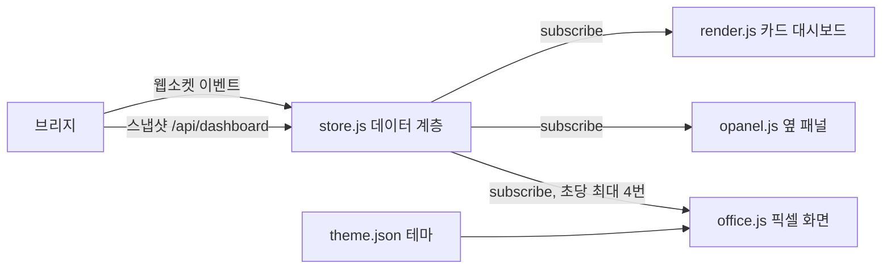

<!--
다루는 곳: bridge/static/office.html, bridge/static/dashboard.html, bridge/static/css/panel.css, bridge/static/js/uiscale.js, bridge/main.py, docs/10_office_design.md
읽은 커밋: 371411d
-->
# 14 화면

FOREMAN이 모으고 판단한 것은 결국 사람이 보는 화면 한 장에 모인다. 세션이 일하는지 쉬는지, 승인이 기다리는지, 합치기 카드가 쌓였는지, 적재가 막혔는지를 사람은 이 화면으로만 안다. 「조용한 고장을 잡는다」는 이 프로젝트의 목적에서 화면은 마지막 고리다. 브리지가 아무리 정확하게 알아도 화면에 뜨지 않으면 사람에게는 없는 일이다 [repo:CLAUDE.md].

이 편은 화면 전체의 그림을 그린다. 어떤 기술로 만들었고 왜 그랬는지, 데이터를 받는 쪽과 그리는 쪽을 어떻게 갈랐는지, 주소 네 개가 각각 무엇을 위해 있는지, 한 화면이 어떻게 짜여 있는지, 화면에 쓰는 글에 어떤 약속이 있는지를 다룬다. 픽셀 그림이 어떻게 그려지는지, 옆 패널 안이 어떻게 생겼는지 같은 속 이야기는 하위 다섯 편이 깊게 다룬다. 이 편은 그 다섯 편이 함께 기대는 바탕만 놓는다.

## 빌드 없는 순수 JS

FOREMAN의 화면은 **번들러 없는 순수 자바스크립트**다. React나 Vue 같은 틀도, TypeScript도, webpack이나 Vite 같은 묶는 도구도 없다. 저장소 `bridge/static/` 아래 파일이 그대로 브라우저로 나간다 [docs:00_design.md]. 저장소에는 `package.json`도 `node_modules`도 없다. 브리지(FastAPI)는 이 폴더를 `/static`으로 붙여 놓고, 페이지 주소 몇 개만 HTML 파일 하나씩으로 돌려준다 [code:bridge/main.py].

브라우저는 HTML 안의 `<script type="module">`로 첫 파일을 읽고, 그 파일이 `import`로 부르는 다른 파일을 하나씩 받아 온다. 이것이 ES 모듈이다. 브라우저가 스스로 파일 사이의 의존을 따라가므로 묶는 도구가 할 일이 없다. 픽셀 화면의 입구는 `office.html`의 스크립트 몇 줄이고, 여기서 데이터 계층(`store.js`), 픽셀 그리기(`office.js`), 셸(`terminal.js`), 글씨 배율(`uiscale.js`), 계획 창(`foremanchat.js`)을 부른다 [code:bridge/static/office.html]. 바깥 CDN에서 받는 라이브러리도 없다. 셸과 세션 화면처럼 터미널이 필요한 곳은 브리지가 띄운 ttyd를 iframe으로 붙여 쓴다(→ 「셸 패널과 세션 화면」).

### 고른 까닭

까닭은 FOREMAN이 어디서 어떻게 도는가에서 나온다. FOREMAN은 이미지로 구워 클러스터에 올리는 서비스가 아니라, 작업 폴더에서 바로 도는 프로그램이다. 브리지를 클러스터 밖 호스트에 systemd 유닛으로 띄우기로 하면서 「UI는 빌드할 것이 없다」는 것이 그 결정의 근거 가운데 하나였다 [docs:00_design.md]. 빌드 단계를 두면 빌드, 이미지, 저장소, 배포를 거치는 길이 생기는데 FOREMAN에서는 단계만 늘고 얻는 것이 없었다. 파일을 고치고 브라우저를 새로 고치면 끝나는 짧은 고리가 이 프로젝트에는 더 값졌다.

이 짧은 고리는 다른 곳에서도 이득을 준다. 작업방(코드 이름 worktree. 같은 저장소를 다른 폴더에 따로 꺼내 둔 사본)에서 일하는 세션이 화면을 고치면, 미리보기 브리지가 그 작업방의 화면 파일을 지금 브리지의 데이터와 함께 바로 내보인다. 빌드가 없으니 작업방 폴더의 파일이 곧 미리보기다(→ 「06 세션 띄우기와 따로 작업」). 또 그리기를 모르는 순수한 함수만 모은 파일(`theme.js`의 테마 판정, `walk.js`의 길찾기, `uiscale.js`의 배율 계단 등)은 node가 같은 파일을 그대로 불러 시험한다 [code:bridge/static/js/theme.js]. 시험을 위한 변환도 없다. `tests/js/` 아래 시험 파일 43개가 이 방식으로 돈다 [code:tests/].

### 포기한 것과 그 대가

얻은 만큼 잃은 것도 있다. 가장 먼저 **캐시**다. 빌드 도구는 보통 파일 이름에 내용 해시를 붙여 옛 파일과 새 파일이 섞이지 않게 해 준다. FOREMAN은 파일 이름이 늘 같으니 브라우저가 옛 파일을 캐시에서 꺼내 쓸 수 있다. 실제로 셸을 붙이던 때 브라우저가 옛 `store.js`를 캐시에서 쓰고 새 `terminal.js`만 받아 둘이 어긋났고, 그 오류로 대시보드 연결이 아예 시작되지 않았다 [code:bridge/main.py] [log:stage7_terminal_result.md]. 그래서 브리지는 `/static/` 아래 화면 파일과 페이지 주소 `/`, `/office`, `/classic`, `/debug`, `/usage`에 `Cache-Control: no-cache`를 붙여 브라우저가 매번 바뀌었는지 묻게 한다. 바뀌지 않았으면 304로 짧게 끝난다. `/usage`는 처음에 이 목록에서 빠져 있었다. 그 페이지가 부르는 js와 css는 `/static/` 아래라 함께 다시 묻지만 HTML 파일 자체는 브라우저 캐시 규칙을 따랐다. 빠진 까닭은 기록에 없고 빠뜨린 것으로 보아 목록에 넣었다 [code:bridge/main.py] [code:tests/test_app_db.py].

no-cache로도 막지 못하는 것이 하나 남았다. 브리지를 다시 띄워도 **이미 열려 있는 탭**은 처음 받은 코드를 그대로 쓴다. 질문 카드에 선택지 버튼을 새로 넣고 브리지를 다시 띄웠는데, 사람이 보던 탭은 옛 코드라 버튼이 나오지 않았고 아무도 몰랐다 [code:bridge/uiver.py]. 전형적인 조용한 고장이다. 그래서 브리지는 static 아래 js, css, html 파일의 이름, 크기, 수정 시각으로 짧은 지문을 만들어 화면에 보내고, 화면은 처음 받은 지문과 다르면 맨 위에 새로 고침 띠를 띄운다 [code:bridge/uiver.py]. 이 길은 → 「데이터 계층」에서 자세히 다룬다.

다음으로 **타입 검사와 틀이 주는 질서**를 포기했다. 컴포넌트 틀이 없으니 화면을 다시 그리는 규칙(무엇이 바뀌었을 때 어디를 다시 그리나)을 손으로 짠다. 그 결과 픽셀 화면을 그리는 `office.js` 한 파일이 4천 줄 가까이 된다 [code:bridge/static/js/office.js]. 처음 설계 때 화면 전체 HTML과 JS가 1,260줄쯤이던 것에 비하면 크게 자랐다 [docs:00_design.md]. 지금 화면 js 파일은 32개, 모두 합쳐 1만 줄을 조금 넘는다 [code:bridge/static/js/]. 대신 이 무게를 시험과 점검 도구로 받친다. 순수 함수는 node 시험이, 실제로 그려진 화면은 브라우저를 띄워 세는 점검 도구가 본다(→ 「화면 점검과 시연」).

## 데이터 계층과 그리는 쪽의 계약

화면 코드는 처음부터 두 층으로 갈렸다. **데이터 계층**(`store.js`)은 DOM을 모른다. 브리지에서 스냅샷(`/api/dashboard`)을 한 번 받고, 웹소켓으로 오는 이벤트, 턴, 승인, 세션 상태로 그 상태를 고쳐 나간다. **그리는 쪽**은 `store.subscribe(fn)`으로 상태를 받아 그리기만 한다 [code:bridge/static/js/store.js]. 두 층 사이의 약속은 `store.js` 머리의 state 주석이 계약이라고 적혀 있다. 이 계약 덕분에 그리는 쪽을 통째로 갈아 끼울 수 있다.

계약에는 숫자가 둘 박혀 있다. 그리기 알림은 250ms에 한 번까지라 이벤트가 초당 수십 개 와도 화면은 초당 네 번만 다시 그린다. 그리고 15초마다 스냅샷을 다시 받아 웹소켓으로 고친 상태가 어긋났으면 맞춘다 [code:bridge/static/js/store.js]. 처음 카드 대시보드를 만들 때 이벤트 500개와 턴, 서브에이전트, 승인을 한꺼번에 넣어도 그리기 알림이 한 번만 나가는 것을 node 시험으로 확인했다 [log:stage6_dashboard_result.md].

이 계약이 실제로 쓰인 것이 픽셀 화면이다. 처음 화면은 카드 대시보드였고, 픽셀 오피스는 그 뒤에 붙었다. 이때 `store.js`는 고치지 않고 그리는 쪽만 새로 썼다. `office.js` 머리 주석이 이것을 그대로 말한다. 「store.js(데이터)는 그대로, 이 파일은 그리기만」 [code:bridge/static/js/office.js]. 테마도 같은 생각으로 한 겹 더 나뉜다. 상태, 도구, 플래그를 보고 어떤 동작을 할지 고르는 판정(`theme.js`)은 DOM도 캔버스도 모르고, 테마마다 다른 것은 `themes/<이름>/theme.json`뿐이다. 테마를 바꾸면 판정 코드는 그대로이고 JSON만 바뀐다 [code:bridge/static/js/theme.js]. 오피스, 마법학교, 현장 세 테마와 도형 테마가 같은 state를 받아 다른 그림을 그리는 것은 이 덕분이다.

계약이 완전히 깨끗하지는 않다. 그리는 쪽이 store를 거치지 않고 브리지에 따로 묻는 것이 몇 있다. 서기 할 일, 코더 맡길 일, 스키마 잠금 판, 교장 노트, 사용 한도 요약은 `office.js`가 직접 받아 온다 [code:bridge/static/js/office.js]. 이것들은 화면 한 곳에서만 쓰는 곁가지라 store의 공통 상태에 넣지 않았다. 반대로 여러 곳이 함께 쓰는 세션, 승인, 연결 상태는 반드시 store를 거친다. 데이터 계층의 속(스냅샷과 웹소켓을 합치는 차례, 다시 잇기, 점검 페이지 표시)은 → 「데이터 계층」.

## 주소 넷

브리지가 내주는 화면 주소는 넷이다. 화면 HTML은 비밀값이 없으므로 인증 없이 주고, 데이터 API만 토큰을 받는다. 토큰은 사람이 페이지의 접속 키 창에 넣고 브라우저에 저장한다 [code:bridge/main.py].

| 주소 | 파일 | 무엇 |
|---|---|---|
| `/` | `office.html` | 픽셀 화면. 승인, 대화, 입력, 셸이 모두 여기서 된다. 옛 주소 `/office`도 같은 파일 |
| `/usage` | `usage.html` | 사용량과 한도. 어디서 토큰이 나가는지 |
| `/classic` | `dashboard.html` | 카드 대시보드. 모든 세션을 카드로 나란히 |
| `/debug` | `debug.html` | 브리지 확인 페이지. 이벤트와 턴이 흐르는 것을 날것으로 |

**`/` 픽셀 화면**이 주인이다. 사람은 하루 대부분 이 화면을 본다. 캐릭터가 도구에 따라 방 안을 걸어 다니고, 머리 위 말풍선으로 사람이 할 일을 알린다. 처음에는 `/office`에 따로 있다가 승인, 대화, 입력, 셸을 이 화면에서 다 할 수 있게 된 뒤 `/`로 옮겼다 [log:stage10_office_result.md]. 테마는 주소의 `?theme=`이 있으면 그것, 없으면 이 브라우저가 마지막에 본 것, 그것도 없으면 오피스다. 받는 이름은 `office`, `magic`, `site`, `plain` 넷뿐이다 [code:bridge/static/office.html].

**`/usage` 사용량**은 계정 사용 한도를 몇 % 썼는지와 그 몫이 어느 세션, 프로젝트, 모델에서 나갔는지를 시간대별 차트와 표로 본다 [code:bridge/static/usage.html]. 픽셀 화면 머리의 한도 칩을 누르면 여기로 온다. 왜 따로 화면을 두었는지와 숫자를 어떻게 읽는지는 → 「13 사용량과 모델」.

**`/classic` 카드 대시보드**는 가장 먼저 만든 화면이다. 픽셀 화면이 생긴 뒤에도 지우지 않았다. 픽셀 화면은 방에 들어가 한 세션을 골라 자세히 보는 화면이라, 모든 세션 카드를 한 화면에 나란히 놓고 카드마다 지금 도구, 턴 프롬프트, 응답 미리 보기를 한꺼번에 보는 일은 카드 대시보드만 한다 [log:stage10_office_result.md]. 두 화면이 어긋나지 않게 승인 카드, 대화, 활동, 세션 정보, 파이프라인 같은 조각은 `render.js`의 함수로 내보내 둘이 같이 쓰고, CSS도 `panel.css` 한 파일로 모았다 [code:bridge/static/css/panel.css] [log:stage10_office_result.md]. 한쪽만 고쳐져 어긋나는 일을 막으려는 것이다. 다만 머리말에서 클래식으로 가는 단추와 도형 테마 단추는 뺐다. 안 쓰기 때문이다. 주소로는 그대로 열린다 [code:bridge/static/js/office.js].

**`/debug` 확인 페이지**는 브리지를 처음 세울 때 기록 모으기를 눈으로 확인하던 페이지다. 트랜스크립트와 hook에서 온 실제 이벤트, 턴이 열리고 닫히는 것이 그대로 흐른다 [code:bridge/static/debug.html]. 사람이 매일 보는 화면은 아니고, 적재가 의심스러울 때 날것을 보는 창이다. 디버그 이벤트를 보내는 API는 설정 `debug_endpoints`를 켰을 때만 붙는다 [code:bridge/config.py]. 내용은 → 「적재와 내보내기」.

## 화면 한 장의 짜임

픽셀 화면은 위아래로 셋, 가운데가 다시 좌우 둘로 나뉜다. 맨 위가 머리말, 가운데 왼쪽이 지도(캔버스), 가운데 오른쪽이 옆 패널, 맨 아래가 셸이다 [code:bridge/static/office.html].

**바깥 스크롤은 없다.** 페이지 전체가 창 높이에 딱 맞고, 지도는 줌으로 맞추며 패널, 셸, 창은 각자 안에서 스크롤한다. 높이를 `vh`가 아니라 `dvh`(실제로 보이는 높이)로 잡은 것은 `vh`가 가로 스크롤바나 브라우저 막대 때문에 실제 창보다 커질 수 있어서다 [code:bridge/static/office.html].

**머리말**은 두 줄이다. 첫 줄은 어디로 갈지다. 감독실로 가는 [⌂], 모든 현장을 한 화면에 보는 [전체], 프로젝트마다 하나씩인 방 탭, 새 세션을 띄우는 [＋ 세션], 포스트잇이 이 줄에 있다. 포스트잇은 사람이 적거나 대화에서 미룬 일을 받아 두는 편지함이면서 저장소 할 일 목록(`docs/TODO.md`)의 번호와 제목을 보는 창이다 [code:bridge/static/js/postit.js]. 그 뒤에 승인 대기, 질문, 합치기 대기, 적재 막힘 같은 경고가 붙는다 [code:bridge/static/js/office.js]. 방 탭에는 그 방에서 일하는 세션 수와 승인 대기 수가 작은 칩으로 붙고, 승인이 기다리면 노랗게 깜빡인다. 둘째 줄은 상태와 설정이다. 작업 중인 세션 수와 오늘 출력 토큰, 한도 칩, 테마 고르기, 글씨 배율 [가−] [가+], 연결 표시, 접속 키가 있다. 화면 이름을 말할 때는 이 탭 글자를 그대로 쓴다. 감독실 카드를 고치라는 말을 [⌂] 화면으로 알아듣고 [전체] 화면을 고치지 않은 일이 있어서다 [docs:style_guide.md].

**지도와 패널은 겹치지 않는다.** 패널은 지도 위에 덮이지 않고 옆에 선다. 패널을 펴거나 접으면 지도 칸의 크기가 바뀌고, 카메라가 그 크기에 맞춰 다시 맞춘다 [code:bridge/static/office.html] [log:stage10_office_result.md]. 패널 폭은 손으로 끌어 정하지 않고 좁게와 넓게 두 값만 있다. 좁게는 창 폭의 40%, 넓게는 60%다. 다만 넓게에서도 지도 칸이 464px 밑으로 줄지 않게 한다. 464px은 방 모눈 28칸이 원래 그림 크기 그대로 들어가는 폭이라, 폭 1024 창에서는 넓게가 6 대 4가 아니라 지도 464, 패널 560으로 나뉜다. 어느 쪽이든 패널은 280px보다 좁아지지 않는다 [code:bridge/static/js/opanel.js]. 처음에는 손잡이를 끌어 폭을 정했는데, 끌기를 없애고 두 값으로 바꾸면서 방 배율이 패널 폭으로만 정해지게 됐다 [c:aee6c03]. 두 값의 비율은 그 뒤 한 번 더 바뀌었다. 좁게 둔 패널이 420px 남짓이라 너무 작아 쓰지 않게 되어 지금의 40%와 60%로 바꿨다 [code:bridge/static/js/opanel.js] [log:designer_polish_seven_20261111.md]. 패널 머리의 [⇤ 넓게] 단추나 패널 왼쪽 가장자리를 두 번 눌러 바꾸고, 고른 값은 이 브라우저에 기억한다. 접으면 34px 띠가 되어 승인 대기 수만 깜빡인다. 휴대폰처럼 폭이 760px 아래면 패널이 지도 아래 판(화면 높이의 40%)으로 내려간다 [code:bridge/static/office.html].

**셸은 아래에서 위로 펼쳐진다.** 펼치면 그 높이만큼 화면 전체가 줄어들 뿐 패널이나 지도를 덮지 않는다. 처음에는 셸이 펴지면 패널도 같이 줄어, 폭 1024 창에서 패널이 101px까지 줄고 입력 칸이 패널 밖으로 넘쳐 셸 글자를 덮었다 [code:bridge/static/office.html]. 지금은 셸이 패널 왼쪽까지만 펼쳐지고, 패널은 셸 높이만큼 아래로 늘어나 창 바닥까지 닿는다. 패널 입력 칸은 늘 패널 바닥에 붙어 보인다.

카드 대시보드(`/classic`)는 이 짜임과 다르다. 왼쪽은 프로젝트별 세션 카드 격자, 오른쪽은 고른 세션의 상세 패널이고 페이지가 아래로 스크롤된다. 색도 브라우저의 밝은 모드와 어두운 모드를 따른다. 픽셀 화면은 늘 어두운 바탕이다 [code:bridge/static/dashboard.html] [code:bridge/static/office.html]. 두 화면이 같이 쓰는 `panel.css`는 색을 직접 적지 않고 각 페이지가 `:root`에 둔 색 변수(`--bg`, `--fg`, `--warn` 등)만 쓴다 [code:bridge/static/css/panel.css]. 그래서 같은 승인 카드가 두 화면에서 각자의 색으로 그려진다.

## 글씨 배율

글씨가 작다는 말이 여러 번 나왔다. 처음에는 픽셀 크기를 하나씩 키웠지만 모니터와 브라우저 배율마다 맞는 크기가 달라, 사람이 그때그때 맞출 수 있는 배율 하나를 두었다 [code:bridge/static/js/uiscale.js]. 머리말의 [가−] [가+]가 그것이다.

배율은 80%에서 110%까지 5%씩 일곱 계단이고 처음 값은 90%다. 브라우저 100%에서 90%가 보기 좋다는 데서 정했다 [code:bridge/static/js/uiscale.js]. 이 값은 `uiscale.js`의 `STEPS`와 `DEF` 한 곳에만 있고, CSS는 `var(--ui-zoom)` 변수만 쓴다. JS가 뜨기 전 잠깐 쓰이는 처음 값만 `panel.css`와 `usage.html`의 `:root` 한 줄씩에 따로 있는데, 이 값이 `DEF`와 같은지는 node 시험(`tests/js/uiscale_range.test.mjs`)이 본다 [code:bridge/static/css/panel.css] [code:bridge/static/usage.html]. 배율은 이 브라우저에만 기억한다.

기준은 본문 16px이고 보조 글 14, 표 15, 제목 18이다 [docs:style_guide.md]. 머리말, 패널 안쪽, 툴팁, 새 세션 창, 사용량 화면, 셸 글씨가 모두 이 배율을 따른다. 머리말과 패널은 CSS `zoom`으로 통째로 키우고, 셸은 ttyd 안의 글씨 크기를 배율에 맞춰 바꾼다(배율 1에서 14px) [code:bridge/static/js/uiscale.js]. 예외가 하나 있다. 방 하나를 볼 때 방 안의 이름표, 캐릭터 이름, 말풍선은 이 배율이 아니라 방을 그리는 배율을 따른다. 방 모눈에 맞춰 그린 글씨가 배율에 따라 흔들리면 칸을 벗어나기 때문이다. 픽셀 화면에서 글씨 배율을 따르는 것은 경고 띠, [전체] 화면 카드, 감독실 글씨다 [code:bridge/static/js/uiscale.js]. 새 화면이나 창을 만들면 배율이 걸리는지 봐야 한다. 사용량 화면 내용과 새 세션 창이 처음에 배율을 받지 않아 나중에 고쳤다 [c:5c93b2b] [c:0cba431].

## 화면 글 약속

FOREMAN 화면의 글에는 지켜 온 약속이 여럿 있다. 하나하나는 작지만 모두 같은 생각에서 나왔다. **처음 보는 사람이 바로 알아야 하고, 사람이 할 일이 숨지 않아야 한다.** 이 절은 그 약속을 까닭과 함께 풀어 쓴다. 지켜야 할 목록 그대로는 `docs/style_guide.md` 「4-1.」에 있다 [docs:style_guide.md].

**말끝은 「~습니다」다.** 툴팁, 안내, 확인 창, 결과, 서버가 거부할 때 보내는 사유까지 화면에 뜨는 글은 모두 이 꼴이다 [repo:CLAUDE.md]. 문서와 기록은 평서체(한다)로 쓰지만, 화면은 사람에게 말을 거는 자리라 말투를 나눴다. 서버가 돌려주는 거부 사유와 텔레그램 글도 화면 글로 친다.

**툴팁은 「제목 — 설명」이다.** 첫 줄의 ` — ` 앞이 굵은 제목, 뒤가 설명이고, 그 아래 줄부터는 숫자 줄이다. 예를 들면 「사용량 — 구독 한도를 몇 % 썼는지입니다.」 아래에 5시간, 주간 한도가 한 줄씩 붙는다 [docs:style_guide.md]. 툴팁을 그리는 `tip.js`가 이 기호로 제목을 잘라 내므로 꼴이 어긋나면 모양이 깨진다. 설명은 문장마다 줄을 바꾸고, 한글은 낱말 단위로만 줄을 바꾼다(`word-break: keep-all`). 긴 한 문단이 뜻 가운데서 끊겨 읽기 어려웠기 때문이다 [log:tips_and_credit_signal_20261109.md]. 탭이나 칸 이름의 호버는 안에 든 것을 나열하지 않고 그곳에서 무엇을 하는지로 쓴다.

**화면 전체에 em dash(—)를 쓰지 않는다. 툴팁 첫 줄만 예외다.** 처음에는 확인 창 글에서만 em dash와 가운뎃점을 뺐다. 그 뒤 버튼, 칩, 띠, 안내, 결과, 경고, 서버 거부 사유, 호버 설명까지 화면에 보이는 모든 글로 넓혔다 [docs:style_guide.md] [c:945b3a7] [c:c2fbae6]. 툴팁 첫 줄의 나눔은 `tip.js`가 자르는 기호라 남는다. 같은 까닭으로 코드가 글을 자르거나 찾는 데 쓰는 기호(`split(' — ')`, 정규식 등)는 화면 글을 고칠 때도 건드리지 않는다. 보이는 글이 아니라 코드가 쓰는 표지이기 때문이다. 확인 창은 따로 약속이 하나 더 있다. 설명을 한 문단으로 이어 쓰고 마지막 묻는 말만 빈 줄 하나로 띄운다. 문장마다 줄을 바꾸니 글이 뚝뚝 끊겨 읽혔다 [log:designer_confirm_text_20261114.md] [c:7c5a14e].

**겉은 쉽게, 호버는 친절하게.** 버튼, 칩, 띠는 처음 보는 사람도 아는 말로 짧게 쓰고, 숫자나 내부 이름(세션 id, pid, tmux 창)은 호버로 미룬다 [log:cross_paste_20261109.md]. 예를 들어 지금 일하는 세션은 「▶ 작업 중 · 10분째」로만 보이고, 무엇으로 시작했는지는 마우스를 올려야 보인다. 속에서 어떻게 하는지(어떤 명령을 보낸다, 브리지가 대신 답한다)도 화면 글에 적지 않는다. 사람에게 필요한 것은 무엇이 바뀌고 무엇이 그대로인지뿐이다. 무엇인지 이미 분명한 화면에는 설명 줄을 붙이지 않는다 [docs:style_guide.md].

**지금 눌러야 하는 버튼 하나만 primary다.** 채운 색, 굵은 글씨, 테두리 빛으로 눈에 띄게 하고, 그것이 끝내기나 지우기면 빨갛게 한다 [code:bridge/static/css/panel.css]. 한 줄에 하나만 둔다. 옆의 멈추기, 취소, 나중에는 테두리만 있는 ghost다. 어디를 눌러야 하는지 바로 보이게 하려는 것이다. 다만 승인 카드의 승인 버튼은 일부러 primary로 하지 않는다. 판단을 묻는 자리에서 한쪽을 밀어 주면 사람이 읽지 않고 누른다 [docs:style_guide.md].

**세션 번호는 크게, 제목은 작게.** 번호와 제목이 함께 나오는 곳은 번호를 굵은 보통 글씨로, 제목을 작은 회색으로 쓴다. 사람과 관리자가 세션을 부르는 말은 「세션 230」 같은 번호이기 때문이다 [log:foreman-5_session_number_big_20261115.md]. 처음에는 반대로 제목이 크고 번호가 작았다. 패널 머리줄, 패널 세션 목록 줄, 캐릭터 호버가 이 꼴이고 [code:bridge/static/office.html] [docs:10_office_design.md], 새 화면을 만들 때도 같다.

이 밖에 대기나 멈춤 글에는 푸는 곳을 넣는다. FOREMAN 밖에서 푸는 것은 그 이름과 링크를, FOREMAN 안에서 푸는 것은 「멈춤:」으로 시작한다. 사람이 해야 풀리는 대기(권한 거부, 답 기다림, API 오류로 멈춤)는 쉬는 것처럼 보이지 않게 따로 표시한다 [docs:style_guide.md]. 이것이 화면에서 어떻게 보이는지는 → 「픽셀 오피스와 테마」.

### 화면 말과 코드 말

화면에서 부르는 이름과 코드, 문서에서 쓰는 이름이 다른 것이 여럿 있다. 화면은 처음 보는 사람이 알아들을 말로 바꿨고, 코드와 문서와 세션에 넣는 글은 원래 이름을 그대로 쓴다 [docs:style_guide.md].

| 화면 | 코드와 문서 | 왜 나눴나 |
|---|---|---|
| 작업방 | worktree(`.worktrees/<이름>`) | 영어 개발 용어라 처음 보는 사람이 모른다. 커밋, 합치기, 브랜치는 화면에도 그대로 쓴다 |
| 새 세션으로 옮기기 | 인계 | 인계는 무엇을 하는지 바로 안 읽힌다 |
| 팀장, 교장, 소장(테마 이름), 기능은 계획 세우기 | 디스패처, 디스패치 | 디스패처가 무엇인지 모르면 아무 도움이 안 된다 |
| 조사 | inspector | 앞 이름은 고치는 일도 하는 것처럼 들렸다 |
| 쌓인 대화 N% | 맥락 비율 `context.pct` | 계정 한도도 %라 둘이 헷갈렸다. 세션 대화 크기만 이 이름 |
| 한도 | 사용 한도 `usage` limits | 위와 짝. 계정 한도는 이 이름만 |
| 대화창 | 세션 tmux 화면, 패널 대화 칸 | 사람은 터미널이 아니라 대화창을 본다 |
| 세션 화면 | 그 세션의 Claude Code 창에 붙는 tmux 그룹 세션 `ccscreen.js` | 영어 약자가 혼자 섞여 있었다 |
| 셸 | `terminal.js` 패널 | 화면 아래 막대의 이름. 세션을 보는 곳은 대화창으로 따로 부른다 |

화면 말을 바꾸면 같은 브랜치에서 `tests/data/screen_words.toml`에 옛 이름과 새 이름을 한 줄 적는다. 그러면 시험이 코드 문자열과 문서 인용에 옛 이름이 남았는지 찾는다 [code:tests/data/screen_words.toml]. 하루에 같은 절이 여러 번 낡던 것을 사람 눈 대신 시험이 잡게 한 것이다. 이 시험은 → 「화면 점검과 시연」.

## 화면 js 파일 지도

`bridge/static/js/` 아래 파일이 어느 편에서 다뤄지는지 모았다. 화면 하위 다섯 편에 들지 않는 파일은 그 기능의 편이 다룬다.

| 파일 | 하는 일 | 편 |
|---|---|---|
| `store.js` | 스냅샷과 웹소켓을 합쳐 state를 만든다 | → 「데이터 계층」 |
| `office.js`, `theme.js`, `grid.js`, `sprites.js`, `walk.js`, `aura.js`, `overhead.js`, `wrap.js` | 지도와 방 그리기, 테마 판정, 방 모눈, 시트 자르기, 길찾기, 발밑 색 원, 머리 위 표시, 글 줄바꿈 | → 「픽셀 오피스와 테마」 |
| `opanel.js`, `render.js`, `md.js`, `tip.js`, `uiscale.js`, `grip.js` | 옆 패널, 두 화면이 같이 쓰는 조각, 마크다운, 툴팁, 글씨 배율, 끌기 손잡이 | → 「옆 패널」 |
| `terminal.js`, `ccscreen.js` | 아래 셸, 세션 화면 창 | → 「셸 패널과 세션 화면」 |
| `demo.js` | 시연 장면 재생 | → 「화면 점검과 시연」 |
| `shipstate.js` | 출하 라인 Harbor 칸의 상태를 Jenkins 행에서 미루어 정한다(그리기를 모르는 함수) | → 「12 CI/CD 인과 체인」 |
| `slash.js` | 입력 칸의 슬래시 명령 | → 「03 세션 지켜보기와 글 넣기」 |
| `roles.js` | 역할 이름, 색, 배지 | → 「05 역할과 권한」 |
| `newsession.js` | 새 세션 창 | → 「06 세션 띄우기와 따로 작업」 |
| `coder.js` | 코더 맡길 일과 합치기 카드 곁 | → 「합치기 카드」 |
| `losscheck.js`, `promote.js`, `handoff.js`, `moveflow.js` | 압축 손실, 문서로 옮기기, 새 세션으로 옮기기 | → 「08 인계와 압축 손실」 아래 편들 |
| `foremanchat.js`, `fmpanel.js` | 계획 창, 교장 노트 | → 「09 교장과 관리자」 아래 편들 |
| `scribe.js`, `postit.js` | 서기실, 포스트잇 | → 「10 서기와 문서」 아래 편들 |
| `modelpick.js` | 모델 고르기 | → 「13 사용량과 모델」 |

## 하위 다섯 편

**데이터 계층**은 `store.js`가 브리지에서 상태를 받아 모양을 맞추는 길을 다룬다. 스냅샷과 웹소켓을 어떻게 합치는지, 끊겼을 때 어떻게 다시 잇는지, 화면 코드 지문으로 옛 탭을 알아채는 길, 점검 도구가 연 페이지가 사람 흔적(읽음 같은)을 남기지 않게 한 표시가 여기 있다.

**픽셀 오피스와 테마**는 지도와 방이 어떻게 그려지는지다. 감독실과 [전체] 화면, 방 모눈과 길찾기, 테마 넷이 같은 자리를 나눠 쓰는 방식, 에셋 라이선스를 고른 과정, 머리 위 말풍선의 순서와 색, 역할마다 다른 자리가 여기 있다 [docs:10_office_design.md]. 이 편의 「데이터 계층과 그리는 쪽의 계약」이 실제로 어떻게 쓰이는지 가장 잘 보이는 곳이다.

**옆 패널**은 캐릭터를 누르면 열리는 오른쪽 판이다. 대화, 활동, 세션 정리 세 탭, 승인 카드가 자리를 다투는 방식, 입력 칸이 패널 밖으로 밀리지 않게 한 규칙, 툴팁이 그려지는 방식, 글씨 배율의 속이 여기 있다.

**셸 패널과 세션 화면**은 화면 아래 셸과 [세션 화면 ↗]으로 띄우는 창이다. 둘 다 브리지가 띄운 ttyd를 iframe으로 붙인 것이고, 친 명령을 어떻게 기록하는지, 세션의 Claude Code 창을 어떻게 그대로 보여 주는지가 여기 있다.

**화면 점검과 시연**은 그려진 화면을 사람 대신 세는 도구다. 겹침, 넘침, 툴팁 끊김, 걷는 길을 세는 점검 함수, 브라우저를 띄워 세 테마를 모두 도는 점검 스크립트, 실제 연결 없이 장면을 재생하는 시연, 옛 화면 이름을 찾는 화면 말 시험이 여기 있다. 빌드와 타입 검사를 포기한 대가를 이 편의 도구들이 받친다.
