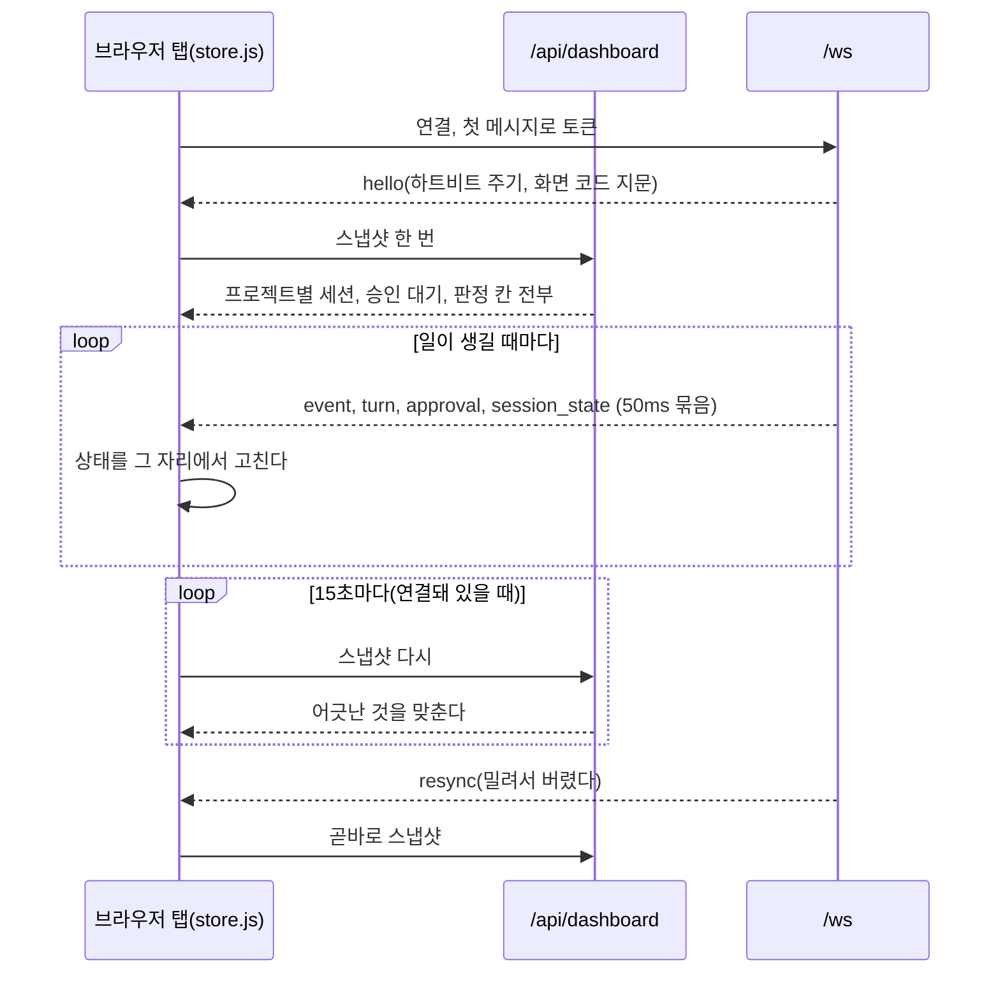

<!--
다루는 곳: bridge/static/js/store.js, bridge/api/dashboard.py, bridge/uiver.py, bridge/static/js/handoff.js, bridge/inject.py
읽은 커밋: 96a1d34
-->
# 데이터 계층

FOREMAN의 화면은 두 층으로 갈라 두었다. 아래층은 브리지에서 데이터를 받아 「지금 세션들이 어떤 상태인가」를 한 덩어리로 들고 있는 층이고, 위층은 그 덩어리를 받아 픽셀 사무실이나 카드 목록으로 그리는 층이다. 이 편은 아래층, 곧 데이터 계층을 다룬다. 코드로는 브라우저 쪽 `store.js` 하나와, 그 파일이 처음에 통째로 받아 가는 브리지 쪽 `/api/dashboard` 하나다 [code:bridge/static/js/store.js] [code:bridge/api/dashboard.py].

데이터 계층은 화면 요소(DOM)를 모른다. 버튼이 어디 있는지, 캐릭터가 어느 칸에 앉는지 알지 못한다. 그리는 쪽에 「상태가 바뀌었다」고 알리고 상태 덩어리를 넘겨줄 뿐이다. 이렇게 가른 까닭은 테마 때문이다. 픽셀 사무실에는 테마가 여럿 있고, 테마 없이 카드로 보는 화면도 있다. 이들이 모두 같은 상태를 받아 그리기만 하게 하면, 테마를 하나 더 만들 때 데이터를 받는 코드는 손대지 않아도 된다. 코드 머리 주석도 「테마 렌더러로 바꿀 때는 render.js만 갈아 끼운다. 상태 모양은 아래 state 주석이 계약이다」라고 적어 두었다 [code:bridge/static/js/store.js]. 그리는 쪽이 이 상태를 어떻게 화면으로 옮기는지는 → 「픽셀 오피스와 테마」와 → 「옆 패널」이 다룬다.

## 한눈에 보는 흐름

흐름은 세 갈래다. 처음에 스냅샷을 한 번 받고, 그 뒤로는 실시간 연결(WebSocket, 아래 WS)로 들어오는 작은 소식으로 상태를 고치고, 몇 초마다 스냅샷을 다시 받아 어긋난 것을 맞춘다. 이 셋이 왜 다 필요한지부터 본다.

## 1. 왜 세 갈래인가

스냅샷만 쓰는 길이 가장 단순하다. 몇 초마다 `/api/dashboard`를 불러 통째로 다시 그리면 된다. 그러나 이 길은 느리거나 비싸다. 세션이 도구를 하나 쓸 때마다 화면이 따라가려면 1초에 한 번은 불러야 하는데, 이 경로는 한 번 부를 때 DB 질의를 스무 개 가까이 돌린다(아래 2절). 탭을 여러 개 열면 그만큼 곱해진다. 반대로 주기를 늘리면 화면이 늦는다. 세션이 일을 시작했는데 15초 동안 쉬는 것으로 보인다 [code:bridge/api/dashboard.py].

WS만 쓰는 길은 빠르다. 그러나 두 가지를 못 한다. 첫째, 탭을 연 순간의 상태를 모른다. WS는 「지금부터 일어나는 일」만 밀어 주기 때문에, 이미 일하고 있던 세션이나 이미 기다리던 승인은 알 길이 없다. 둘째, 빠진 것을 모른다. 브리지는 탭마다 소식 대기열을 하나씩 두는데, 그 대기열이 256개를 넘으면 쌓인 것을 모두 버리고 「밀려서 버렸다」는 뜻의 `resync` 한 줄만 넣는다 [code:bridge/bus.py]. 탭이 백그라운드에서 느려지거나 이벤트가 한꺼번에 쏟아질 때 생긴다. 또 어떤 판정은 WS로 아예 오지 않는다. 사람 답을 기다리는지, 합치기 카드가 기다리는지, API 오류로 멈췄는지 같은 것은 DB를 여러 표에 걸쳐 읽어야 나오는 값이라 브리지가 따로 소식을 보내지 않고 스냅샷에만 싣는다.

그래서 셋을 함께 쓴다. 스냅샷은 출발점과 기준이고, WS는 그 사이를 빠르게 메우고, 주기적인 스냅샷은 WS가 놓친 것과 WS로 오지 않는 것을 바로잡는다. 이 설계는 대시보드를 처음 만들 때 정했다 [log:stage6_dashboard_result.md] [c:7d6118c].

| 갈래 | 언제 | 맡는 것 |
|---|---|---|
| 스냅샷 | 연결이 처음 맺어질 때(`hello`), 15초마다, `resync`를 받을 때, 처음 보는 세션이 나올 때 | 화면에 보일 모든 세션과 판정 칸, 승인 대기 목록 |
| WS 소식 | 일이 생길 때마다, 50ms 안에 생긴 것은 한 묶음으로 | 도구 호출, 턴 시작과 끝, 승인 생김과 끝, 프로세스 상태 |
| 맞추기 | 위 스냅샷이 올 때마다 | WS가 놓친 것, WS로 오지 않는 판정 |

## 2. 스냅샷: /api/dashboard가 모아 주는 것

`/api/dashboard`는 화면이 그릴 거의 모든 것을 한 번에 준다. 토큰이 있어야 부를 수 있다 [code:bridge/api/dashboard.py].

### 어떤 세션을 싣는가

DB에는 끝난 세션이 수백 개 쌓여 있다. 이걸 모두 실으면 화면이 옛 세션으로 덮인다. 그래서 세 가지 중 하나에 해당하는 세션만 싣는다(`visible_rows`). 지금 프로세스가 살아 있는 세션, 48시간 안에 활동이 있었던 세션, 그리고 아직 합치거나 버리지 않은 작업방(코드 이름 worktree)을 쓴 마지막 세션이다 [code:bridge/api/dashboard.py].

셋째 조건은 사고에서 나왔다. 처음에는 오래된 세션을 모두 뺐는데, 작업방을 남긴 채 이틀이 지나면 그 세션 패널의 [합치기]와 [버리기]에 닿을 길이 사라졌다. 그래서 작업방이 남은 세션은 오래돼도 싣게 했다. 그런데 이번에는 반대로, 같은 작업방 이름을 여러 세션이 돌려 쓰다 보니 이미 합친 옛 세션 40여 개가 목록에 남아 옛 보고가 새 것처럼 보였다. 그래서 「그 폴더를 쓴 마지막 세션이고, 합치기나 버리기를 하지 않은 것」으로 좁혔다 [code:bridge/api/dashboard.py]. 이 판정은 시험이 따로 있다 [code:tests/test_human_needs.py].

이 세 조건을 따지기 전에 두 가지는 아예 DB에서 읽지 않는다. 셸 패널의 셸은 세션 카드가 아니므로 빼고, 시험으로 띄웠다가 숨긴 세션(`hidden_at`이 있는 세션)도 뺀다 [code:bridge/api/dashboard.py]. 그렇게 읽은 세션 가운데 세 조건에 걸리지 않아 뺀 세션의 수는 `hidden_dormant`로 따로 싣는다. 셸과 숨긴 세션은 이 수에 들지 않는다. 패널은 이 수로 「48시간 넘게 활동이 없는 세션 N개는 숨겼습니다.」를 보인다 [code:bridge/static/js/opanel.js]. 오래돼서 뺀 것이 있다는 사실까지 숨기지는 않는다.

### 세션 한 칸의 모양

세션 하나에 실리는 칸은 많다. 화면이 쓰는 판정을 브리지가 미리 다 계산해 싣기 때문이다. 판정이 무슨 뜻인지, 어떤 기준으로 정했는지는 → 「03 세션 지켜보기와 글 넣기」가 다룬다. 여기서는 각 칸이 어디서 계산되는지만 적는다 [code:bridge/api/dashboard.py].

| 칸 | 담는 것 | 계산 자리 |
|---|---|---|
| `state` | ACTIVE, IDLE, SUSPENDED, DORMANT | `char_state` |
| `stuck_turn` | 열린 턴이 있는데 CC는 일하지 않음 | 같은 함수 안의 조건식 |
| `proc`, `pid`, `cc_status` | 프로세스 상태(T면 멈춰 둠), CC가 스스로 적는 busy, idle | `live_sessions`, CC 세션 파일 |
| `open_turn` | 지금 열린 턴의 출처와 입력 앞 300자 | `turn` 표 |
| `activity` | 마지막 도구 호출과 그 대상, Bash면 CC가 붙인 설명 | `latest_tool_acts` |
| `denied`, `asks`, `report`, `relayed`, `escalate` | 권한 거부, 사람 답 기다림, 보고 옴, 관리자에게 넘김, 관리자가 사람에게 올림(보고, 물음, 아직 안 본 물음 목록) | `human_needs`, 물음은 `esc_question_states` |
| `api_stop` | 마지막 턴이 API 오류로 닫혔고 새 턴이 없음 | `api_stops` |
| `merge_wait` | 사람 승인을 기다리는 합치기 카드 | `merge_waits` |
| `background` | 턴이 끝나도 도는 백그라운드 명령 | `background_running` |
| `compact`, `context`, `switch` | 압축 횟수, 쌓인 대화 크기와 응답당 값, 작업 전환 권유 | 압축 감시, 맥락 크기, `_switch_status` |
| `overlap` | 다른 세션과 같은 파일을 만지는지 | 겹침 감시 |
| `stall` | 작업 중 끊김, 응답 없음 같은 멈춤 | 멈춤 감시가 1분마다 잰 마지막 값 |
| `tokens`, `model` | 토큰 합계(오늘 것, 서브에이전트 것 따로), 지금 모델과 고른 모델 | `message`, `subagent_run` 표 |
| `ended` | 끝난 세션이면 어떻게 끝났나(합침, 버림, 쉬게 함, 끝냄, 사라짐) | `ended_info` |

몇 칸은 「일하는 중이면 싣지 않는다」는 조건이 붙는다. `asks`, `report`, `relayed`는 CC가 busy이거나 열린 턴이 있으면 비운다. 일하는 도중의 응답은 아직 끝난 말이 아니기 때문이다. `api_stop`은 여기에 더해 살아 있고 멈춰 두지 않은 세션에만 싣는다. 끝난 세션은 「끝남」이, 멈춰 둔 세션은 사람이 일부러 둔 것이 설명하기 때문이다 [code:bridge/api/dashboard.py]. 반면 `escalate`(관리자가 사람에게 올린 보고와 물음)는 관리자가 일하는 중이어도 남긴다. 사람이 읽거나 답할 때까지 남아 있어야 하는 표시라서다.

`escalate` 칸 안의 물음은 보고와 다르게 갈린다. 브리지는 물음마다 그 뒤에 사람이 그 관리자에게 입력한 턴을 찾아, 입력 글에 물음 번호(`#id`)가 있으면 끝난 것으로 보고 싣지 않는다. 사람 입력이 아직 없으면 `question`에 가장 최근 물음 하나를 싣고, 입력은 있었는데 번호가 없으면 `unseen` 목록에 싣는다 [code:bridge/api/dashboard.py] [code:tests/test_escalate_number.py]. 사람이 다른 얘기를 입력했다고 물음이 사라지지 않게 하려는 것이다. 이 판정도 브리지에서 하므로 데이터 계층은 받은 칸을 그대로 들고 있을 뿐이다. 사람이 「아직 안 본 물음」을 [봤다]로 지우면 데이터 계층은 서버에 기록을 보내고(`escalateSeen`), 다음 스냅샷을 기다리지 않고 자기 상태의 `unseen`에서도 그 물음을 뺀다 [code:bridge/static/js/store.js]. 물음 번호를 붙이고 사라지게 하는 규칙 전체는 → 「관리자에게 넘기기와 보고」가 다룬다.

이 조건들을 화면이 아니라 브리지에서 거는 것은 일부러다. 화면은 그리는 쪽이 여럿이다. 테마마다 같은 조건을 다시 쓰면 언젠가 하나가 어긋난다. 브리지가 「보일 것만」 싣고 화면은 있으면 그리는 쪽으로 정해 두면, 판정이 바뀌어도 고칠 곳은 한 곳이다. 같은 까닭으로 `human_needs`는 텔레그램 알림과 사람 화면이 같은 신호를 쓰게 만든 함수이고, 사람 화면에서 뺄 합치기 카드를 가르는 `manager_card`도 패널 쪽 같은 이름 함수와 기준을 맞춰 두었다. 관리자 세션이 승인하는 카드와 브리지가 스스로 합치는 카드(조사 세션의 기록 카드, 서기실 전체 줄이 띄운 편의 원고 카드)는 사람이 누를 것이 없어 빼고, 늘 사람이 승인해야 하는 까닭이 붙은 카드는 그대로 둔다 [code:bridge/api/dashboard.py] [code:bridge/static/js/handoff.js].

### 세션 밖의 칸

세션 목록 말고도 스냅샷에는 몇 칸이 더 있다.

| 칸 | 담는 것 |
|---|---|
| `approvals` | 기다리는 승인 전부. 질문(AskUserQuestion)이면 선택지까지. 브리지가 다시 뜨면 선택지는 사라진다 |
| `terminal` | 셸 패널이 켜졌는지, 도는지, CC가 부탁한 명령 목록 |
| `ingest` | 기록 모으기가 막혔는지(막히면 화면 머리에 띠) |
| `ui` | 화면 코드 지문(아래 8절) |
| `generated_at` | 이 스냅샷을 만든 시각 |

### 순서

프로젝트는 런슈즈, 펫퍼민트, FOREMAN, 인프라 차례로 고정하고, 그 밖의 프로젝트는 이름순, 프로젝트가 없는 세션은 맨 끝 「미분류」로 둔다 [code:bridge/api/dashboard.py]. 프로젝트 안에서는 상태(ACTIVE, SUSPENDED, IDLE, DORMANT 차례)로 먼저 줄 세우고, 같은 상태끼리는 최근에 움직인 것이 앞이다. 데이터 계층은 이 순서를 그대로 `projects[].sessionIds`에 담아 그리는 쪽에 넘긴다.

### 2초 캐시와 비우기

이 경로는 무겁다. 세션 목록, 끝난 까닭, 열린 턴, 마지막 도구, 도는 서브에이전트, 백그라운드 명령, 토큰 셋, 압축, 맥락, 전환 권유, 지금 모델, 사람 답 기다림, API 오류, 승인 대기까지 DB 질의가 스무 개 가까이 돈다. 대시보드를 처음 만들 때 실제 데이터로 106ms가 걸렸다 [log:stage6_dashboard_result.md]. 그 뒤로 칸이 많이 늘었는데, 지금 몇 ms인지는 다시 재지 않았다.

그래서 만든 값을 2초 동안 들고 있다가 그 안에 다시 오는 요청에는 같은 값을 돌려준다 [code:bridge/api/dashboard.py]. 탭을 여러 개 열거나 새로 고침을 잇달아 눌러도 DB는 2초에 한 번만 일한다. 대신 상태를 바꾸는 동작(합치기 카드 승인, 보고 읽음, 답 기다림 끄기, 관리자가 사람에게 올리기, 아직 안 본 물음 [봤다], 중계 결과 기록 등)은 응답하기 전에 이 캐시를 비운다(`invalidate`). 사람이 버튼을 누르고 곧바로 스냅샷을 받았는데 2초 전 값이 와서 다시 15초를 기다리는 일이 실제로 있었기 때문이다(아래 5절).

## 3. 상태 판정을 두 곳에서 하는 까닭

캐릭터 상태(`state`)를 정하는 규칙은 브리지의 `char_state`와 화면의 `charState`, 두 곳에 같은 내용으로 있다 [code:bridge/api/dashboard.py] [code:bridge/static/js/store.js]. 프로세스가 없으면 DORMANT, 멈춰 두었으면(T) SUSPENDED, 살아 있으면 CC가 스스로 적는 status가 busy일 때 ACTIVE이고 그 밖은 IDLE, status를 모를 때만 열린 턴이 있는지로 가른다. 정리하면 다음과 같다.

| 상태 | 뜻 | 판정 근거 | 화면 |
|---|---|---|---|
| `ACTIVE` | 살아 있고 일하는 중 | CC가 스스로 적는 상태가 `busy`, 그것을 모르면 열린 턴이 있음 | 돌아다닌다 |
| `IDLE` | 살아 있고 쉬는 중 | 프로세스는 있고 일하지 않음 | 책상에 앉아 있다 |
| `SUSPENDED` | 프로세스가 정지됨(터미널에서 Ctrl+Z) | `/proc/<pid>/stat`의 상태 글자가 `T` | 자리에서 얼어붙는다(회색) |
| `DORMANT` | 살아 있는 프로세스가 없다 | 프로세스를 찾지 못함 | 자리에 서 있다 |

`DORMANT`는 설계 문서가 그린 「몇 시간 일이 없거나 대화가 너무 쌓이면 내리는 상태」가 아니라 그냥 「프로세스가 없으면」이다. `SUSPENDED`를 운영체제의 상태 글자 하나로만 가르는 까닭은 기록만 봐서는 멈춘 CC가 「그냥 쉬는 중」과 같아 보이기 때문이다. 멈춘 CC에 글을 넣으면 글이 CC가 아니라 그 아래 셸로 들어가 명령으로 실행되므로, `SUSPENDED` 세션에는 글 넣기를 막는다 [code:bridge/inject.py]. `IDLE`은 토큰을 쓰지 않는다. CC는 요청이 있을 때만 모델을 부르기 때문이다.

한 곳에만 두지 않은 까닭은 WS 때문이다. 프로세스 상태는 2초마다 바뀐 것만 `session_state` 소식으로 오고, 턴이 열리고 닫히는 것은 `turn` 소식으로 온다. 이때 화면이 스스로 상태를 다시 계산하지 못하면 다음 스냅샷까지 최대 15초 동안 옛 상태로 보인다. 그래서 화면에도 같은 규칙을 두고, 소식을 받을 때마다 다시 계산한다 [code:bridge/session_state.py] [code:bridge/static/js/store.js].

이 규칙은 처음에 「CC가 busy이거나 열린 턴이 있으면 ACTIVE」였다. 그런데 사람이 붙여넣기를 잘못하고 곧바로 Esc로 끊은 펫퍼민트 턴 하나가 끝 신호 없이 10시간째 열려 있었고, 그동안 그 세션은 일하는 것으로 보였다. 그래서 살아 있는 프로세스는 CC의 status를 먼저 믿게 바꾸고, 열린 턴이 있는데 CC가 일하지 않는 것은 `stuck_turn`으로 따로 드러내게 했다 [log:stage6_dashboard_result.md] [c:3587985]. 이때 두 곳을 함께 고쳤다.

두 곳에 같은 규칙을 둔 값은 있다. 지금 브리지 쪽 규칙에는 시험이 있지만 [code:tests/test_app_db.py], 화면 쪽 `charState`가 브리지 쪽과 같은지 맞대어 보는 시험은 없다. 한쪽만 바꾸면 스냅샷 직후와 소식 직후의 상태가 달라지는 조용한 어긋남이 생길 수 있다. 두 함수의 주석이 서로를 가리키고 있을 뿐이다.

## 4. WS로 고치기

WS 연결이 맺어지고 토큰이 통과하면 브리지는 소식을 밀어 준다. 이벤트가 몰리면 50ms 안에 쌓인 것을 `batch` 한 덩어리로 묶어 보낸다 [code:bridge/api/ws.py]. 브리지 쪽에서 소식이 어떻게 모이고 나가는지는 → 「적재와 내보내기」가 다룬다. 여기서는 받은 쪽이 무엇을 하는지 본다.

| 소식 | 데이터 계층이 하는 일 |
|---|---|
| `hello` | 하트비트 주기를 받고, 화면 코드 지문을 맞대 보고, 연결됨으로 바꾼다. 그리고 스냅샷, 셸 패널 쿠키, 파이프라인, 보고 있던 세션의 대화를 새로 받는다 |
| `ping` | 아무것도 하지 않는다. 받았다는 사실만으로 「살아 있다」가 갱신된다 |
| `resync` | 곧바로 스냅샷을 받는다 |
| `session_state` | 그 세션의 프로세스와 CC status를 고치고 상태를 다시 계산한다 |
| `turn` | 턴이 열리면 열린 턴을 채우고 「API 오류로 멈춤」을 지운다. 닫히면 열린 턴을 비우고 「새 답」 시각을 적는다 |
| `approval` | 승인 카드를 넣거나 끝난 것으로 바꾼다 |
| `event` | 도구 호출, 입력, 응답, 서브에이전트 시작과 끝, 보낸 글의 결과(「주입:」, 뒤에서 다시 본 결과는 「늦게 확인:」) 같은 것을 최근 활동 줄에 더한다 |
| `pipeline` | 0.5초 안에 몰려온 것을 한 번으로 묶어 파이프라인을 다시 읽는다 |
| `foreman`, `usage` | 상태에 넣지 않고 브라우저 이벤트로 바꿔 던진다. 계획 세우기 창과 사용량 칩이 스스로 다시 읽는다 |
| `terminal_request`, `terminal_result` | 셸 패널에 CC가 부탁한 명령과 그 결과를 넣는다 |

몇 가지는 설명이 더 필요하다.

**처음 보는 세션.** 소식에 실린 세션이 상태에 없으면, 그 소식은 버리고 0.8초 뒤 스냅샷을 받는다(`scheduleSnapshot`). 새 세션이 막 뜨면 첫 이벤트가 여러 개 연달아 오는데, 이미 예약된 스냅샷이 있으면 새로 예약하지 않으므로 한 번만 받는다 [code:bridge/static/js/store.js]. 새 세션의 카드에 필요한 칸(프로젝트, 역할, 제목)은 소식에 없고 스냅샷에만 있기 때문이다.

**API 오류로 닫힌 턴.** 턴이 `stop_failure`로 닫히면 화면은 곧바로 스냅샷을 받는다. 오류의 종류와 까닭은 스냅샷의 `api_stop`에만 있어서, 15초 주기를 기다리면 그동안 그 세션은 그냥 쉬는 것으로 보였다 [log:screen_api_error_bar_20261113.md] [c:1a61703]. 반대로 새 턴이 열리면 서버와 같은 기준으로 그 자리에서 `api_stop`을 지운다.

**최근 활동 줄.** 세션마다 최근 40줄을 들고 있다 [code:bridge/static/js/store.js]. 처음에는 화면을 연 뒤에 생긴 것만 쌓였는데, 세션을 고르면 DB에서 최근 도구 호출을 먼저 받아 앞에 채우게 했다(`loadActivity`). 같은 도구 호출이 DB에서도 오고 WS로도 오므로, 이벤트 번호(`eid`)가 같은 줄은 한 번만 넣는다.

**승인 카드.** 답한 승인은 30초 뒤 사라지던 것을 바꿔, 그 세션 패널에 한 줄로 접혀 남게 했다. 세션마다 최근 3줄만 남기고 오래된 것부터 지운다(`FOLD_KEEP`) [code:bridge/static/js/store.js]. 더 지난 것은 승인 기록에서 다시 본다.

**보낸 글의 결과.** 사람이 패널에서 세션에 글을 보내면 데이터 계층은 그 결과 글을 `lastInput` 한 칸에 들고 있고, 패널은 그 칸을 그린다. 브리지가 「입력 칸은 비었지만 기록에서는 아직 글을 찾지 못했다」고 답하면(202와 확인 번호), 결과 글은 먼저 「보냈습니다. 기록을 확인하는 중입니다.」가 되고 데이터 계층이 확인 번호로 결과를 따로 묻는다(`followInput`). 묻는 간격은 2초에서 시작해 15초까지 늘고 모두 더하면 140초다. 서버가 뒤에서 기록을 다시 보는 2분보다 조금 길게 잡은 것이다(`INPUT_POLL_MS`) [code:bridge/static/js/store.js] [code:bridge/inject.py]. 이 결과는 스냅샷에 실리지 않으므로 15초 맞추기로는 바뀌지 않는다. 그래서 스냅샷과 따로 묻는다. 묻는 사이에 사람이 다른 글을 보내 `lastInput`이 바뀌었으면, 늦게 온 결과로 새 글의 결과를 덮지 않는다. 뒤에서 다시 본 결과는 WS의 입력 소식으로도 와서 최근 활동 줄에 「늦게 확인:」으로 붙고, 찾기까지 걸린 초가 끝에 붙는다 [code:bridge/static/js/store.js]. 보낸 글이 어떤 길로 들어가고 결과가 어떻게 갈리는지는 → 「03 세션 지켜보기와 글 넣기」가 다룬다.

## 5. 맞추기: 15초 주기와 resync

연결이 맺어져 있으면 15초마다 스냅샷을 다시 받는다(`RESNAP_MS`) [code:bridge/static/js/store.js]. 연결이 끊겼을 때는 받지 않는다. 브리지가 없으면 받아도 실패하고, 다시 이어지면 `hello`가 어차피 스냅샷을 부른다.

스냅샷이 오면 세션 표를 통째로 새로 만든다. 그러나 몇 가지는 옛 값을 이어받는다. 최근 활동 줄과 「새 답」 시각은 스냅샷에 없는 화면 쪽 기억이라 그대로 옮기고, 응답 미리보기는 같은 턴이 아직 열려 있을 때만 옮긴다 [code:bridge/static/js/store.js]. 승인은 스냅샷의 대기 목록이 기준이다. 상태에 「기다림」으로 있는데 스냅샷에 없는 것은 지우고, 이미 끝난 것(접힌 줄)은 남긴다. 보고 있던 세션이 스냅샷에서 빠졌으면 고른 세션을 비운다.

`resync`는 브리지가 「너에게 보낼 것이 너무 밀려서 버렸다」고 알리는 소식이다. 받으면 기다리지 않고 곧바로 스냅샷을 받는다. 버린 소식을 하나하나 되살리려 하지 않고, 지금 상태를 통째로 다시 받는 쪽을 골랐다. 버린 것이 무엇이었는지 브리지도 기억하지 않으므로 이쪽이 가장 단순하고 틀릴 일이 없다 [code:bridge/bus.py] [code:bridge/static/js/store.js].

### 주기를 기다리지 않게 한 곳

15초 주기는 「언젠가는 맞는다」를 보장할 뿐, 사람이 무언가를 누른 직후에는 너무 길다. 이것을 잰 일이 있다. 사람이 합치기 카드를 승인하면 머리의 「합치기 대기 N」 막대가 줄어야 하는데, 승인 뒤 막대가 줄기까지 2.0, 3.1, 13.2, 11.2초가 걸렸다. 0초에서 15초 사이에 고르게 퍼진 값이라 15초 주기를 기다린 것이 분명했다. 원인은 둘이었다. 패널은 자기 자료만 다시 받고 사무실 스냅샷은 받지 않았고, 브리지는 승인을 받고도 2초 캐시를 비우지 않아 곧바로 받아도 옛 값이 올 수 있었다. 패널 동작이 끝나면 곧바로 스냅샷을 받게 하고(`scheduleSnapshot(0)`), 브리지는 응답 전에 캐시를 비우게 하자 0.64, 0.78, 0.79, 0.67초가 되었다 [log:screen_api_error_bar_20261113.md] [c:1a61703].

이 일에서 얻은 규칙은 「사람이 누른 동작 뒤에는 화면 쪽은 스냅샷을 바로 부르고, 서버 쪽은 캐시를 비운다」다. 한쪽만 하면 효과가 없다 [log:screen_api_error_bar_20261113.md].

## 6. 그리기 알림은 초당 4번까지

세션이 바쁘게 일하면 이벤트가 초당 수십 개 온다. 그때마다 화면 전체를 다시 그리면 브라우저가 따라가지 못한다. 그래서 데이터는 그 자리에서 바로 고치되, 그리는 쪽에 알리는 것은 최소 250ms 간격으로 묶었다(`EMIT_MS`). 알림이 많아야 초당 4번이다 [code:bridge/static/js/store.js].

동작은 이렇다. 상태를 고친 코드는 `touch`를 부르며 어느 영역이 바뀌었는지 이름을 댄다. 영역은 여섯 개다. 연결(`conn`), 승인(`approvals`), 세션 목록과 캐릭터(`grid`), 고른 세션의 패널(`panel`), 셸 패널(`term`), 파이프라인(`pipe`). 영역마다 번호(`ver`)가 하나씩 있어서 바뀌면 1씩 늘어난다. 그리고 「알릴 것이 있다」 표시를 켠다. 아직 예약된 알림이 없으면 마지막 알림에서 250ms가 지난 시점에 알림을 하나 예약한다. 이미 예약돼 있으면 아무것도 하지 않는다. 예약된 때가 오면 구독자 모두에게 상태 덩어리를 한 번 넘긴다 [code:bridge/static/js/store.js].

그리는 쪽은 받은 상태의 영역 번호를 자기가 마지막으로 본 번호와 비교해, 바뀐 영역만 다시 그린다. 승인 번호만 바뀌었으면 승인 막대만, 패널 번호만 바뀌었으면 패널만 그린다. 고른 세션이 아닌 세션의 소식은 패널 번호를 올리지 않으므로, 다른 세션이 바쁘게 일해도 지금 보고 있는 패널은 다시 그려지지 않는다.

대시보드를 처음 만들 때 이것을 시험했다. 이벤트 500개와 턴, 서브에이전트, 승인 소식 3개를 한꺼번에 넣었더니 그리기 알림은 한 번 나갔다 [log:stage6_dashboard_result.md].

## 7. 연결: 끊김과 다시 잇기

### 연결 상태 다섯

데이터 계층은 연결 상태를 다섯 가지로 들고 있다.

| 상태 | 뜻 | 화면 |
|---|---|---|
| `idle` | 아직 시작하지 않음(토큰이 없음) | 토큰 창 |
| `connecting` | 한 번도 연결된 적 없이 잇는 중 | 덮지 않음 |
| `up` | 연결됨 | 평소 화면 |
| `down` | 한 번 연결됐다가 끊김 | 끊김 표시와 다음 시도까지 남은 초 |
| `auth` | 토큰이 틀림 | 토큰 창, 다시 시도하지 않음 |

`connecting`과 `down`을 가른 것은 처음 화면을 열 때 끊김 표시가 번쩍이지 않게 하려는 것이다. 한 번이라도 연결된 적이 있어야(`everUp`) 그 뒤의 끊김을 「끊겼다」로 보인다 [code:bridge/static/js/store.js].

### 인증

연결이 열리면 첫 메시지로 토큰을 보낸다. 브리지는 5초 안에 이 메시지가 오지 않으면 연결을 닫는다 [code:bridge/config.py]. 토큰을 연결 주소에 붙이지 않고 메시지로 보내므로, 주소를 남기는 로그에 토큰이 찍힐 일이 없다. 토큰이 틀리면 브리지는 1008번 코드로 연결을 닫는다. 데이터 계층은 이 코드를 받으면 다시 잇기를 멈추고 `auth`로 바꾼다 [code:bridge/static/js/store.js]. 틀린 토큰으로 몇 초마다 다시 붙는 것은 의미가 없고, 사람이 토큰을 다시 넣어야 풀린다. 토큰은 이 브라우저의 로컬 저장소에만 둔다. 사람이 `FOREMAN_API_TOKEN=` 머리나 따옴표까지 함께 붙여넣어도 떼어 내고 저장한다. 토큰과 열쇠 설계는 → 「열쇠와 비밀」이 다룬다.

### 서버가 죽은 것은 브라우저가 안다

브리지는 서버 PC에서 돈다. 서버가 죽으면 브리지도 같이 죽으므로, 「서버가 죽었다」를 브리지가 알려 줄 수는 없다. 그래서 처음 설계 때부터 서버가 죽은 것은 브라우저가 WS 끊김으로 판단하게 했다. 침묵으로 아는 것이다 [docs:00_design.md].

끊김에는 두 가지가 있다. 연결이 닫히는 끊김은 쉽다. 브라우저가 바로 알고, 1006(서버가 응답 없이 사라짐) 같은 코드를 준다. 어려운 것은 연결은 열려 있는데 서버가 멈춘 경우다. 이때는 아무 소식도 오지 않을 뿐, 브라우저는 연결이 살아 있다고 믿는다. 그래서 하트비트를 두었다. 브리지는 15초 동안 보낼 소식이 없으면 `ping`을 하나 보낸다 [code:bridge/config.py] [code:bridge/api/ws.py]. 데이터 계층은 어떤 소식이든 받을 때마다 마지막으로 들은 시각을 적고, 1초마다 그 시각을 본다. 하트비트 두 번에 2초를 더한 시간, 곧 32초 동안 아무것도 듣지 못하면 스스로 연결을 닫는다(코드 4000, 까닭 heartbeat) [code:bridge/static/js/store.js]. 그다음은 보통 끊김과 같다.

### 다시 잇기

끊기면 1초, 2초, 4초, 8초, 15초 간격으로 다시 시도하고, 그 뒤로는 15초마다 시도한다 [code:bridge/static/js/store.js]. 이 간격을 고른 까닭은 기록에 따로 남아 있지 않다. 코드로 보면 이렇게 읽힌다. 가장 흔한 끊김은 브리지를 다시 띄울 때로, 10초 남짓이면 돌아온다 [docs:operations.md]. 처음 몇 번을 짧게 두면 그 경우 곧바로 다시 붙고, 간격을 15초에서 멈추면 서버가 오래 꺼졌다 돌아와도 화면이 15초 넘게 늦지 않는다. 남은 초는 1초마다 줄여 화면에 보이고, 사람이 [지금 다시 연결]을 누르면 간격을 처음으로 돌리고 바로 잇는다.

다시 이어지면 `hello`가 오고, 데이터 계층은 시도 횟수를 0으로 돌리고 스냅샷을 다시 받는다. 끊긴 동안 놓친 소식은 이것으로 메운다. 셸 패널 쿠키도 이때 다시 받는다. 브리지를 다시 띄우면 쿠키가 사라지기 때문이다 [code:bridge/static/js/store.js].

### 끊김을 보이는 법

카드 화면은 끊기면 화면 전체를 덮는 창에 「서버 연결 끊김」, 언제부터인지, 몇 초 뒤 다시 잇는지를 보인다. 픽셀 사무실은 덮지 않는다. 무대 위에 얇은 띠로 같은 내용을 보이고, 사무실 그림을 흐리게 한다. 지금 보이는 캐릭터의 모습이 끊기기 전 것이라는 표시다 [log:stage10_office_result.md]. 덮지 않은 것은, 끊겨 있는 동안에도 사람이 마지막으로 보던 상태를 읽을 수 있게 하려는 것이다. 어느 쪽이든 끊김이 조용히 지나가지 않는다는 점은 같다.

## 8. 화면 코드 지문: 탭 쪽

### 무엇을 막는가

브리지는 화면 파일(js, css, html)을 매번 바뀌었는지 묻게 내보낸다. 그래서 새로 고침을 하면 언제나 새 파일을 받는다. 이 브리지 쪽 장치는 → 「브리지가 뜨는 차례」가 다룬다. 그러나 새로 고치지 않은 탭은 막지 못한다. 열어 둔 탭은 처음 받은 코드로 계속 돈다 [code:bridge/main.py].

실제로 이 일이 있었다. 질문 카드에 선택지 버튼을 만들어 내보냈는데, 사용자가 열어 둔 탭은 옛 코드라 버튼이 나오지 않았고 아무도 몰랐다 [log:pixel_bigger_question_card_20261109.md]. 고친 사람은 고쳤다고 믿고, 본 사람은 안 고쳐졌다고 믿는 조용한 고장이다.

### 지문을 만드는 법

브리지는 `static` 아래 js, css, html 파일마다 경로, 크기, 수정 시각을 한 줄씩 이어 SHA-1로 지문을 만들고 앞 12자만 쓴다. 만든 지문은 5초 동안 다시 쓴다 [code:bridge/uiver.py]. 파일 내용을 읽지 않으니 싸다. 이 지문은 WS의 `hello`와 스냅샷의 `ui` 칸, 두 곳에 실린다 [c:650f0a0].

### 탭이 하는 일

데이터 계층은 지문을 처음 받으면 기억만 한다(`checkUi`). 그다음부터 받은 지문이 기억한 것과 다르면, 화면 맨 위 가운데에 노란 띠를 하나 붙인다. 띠에는 「화면 코드가 바뀌었습니다. 새로 고쳐야 바뀐 기능이 보입니다.」라는 글과 [새로 고침] 버튼이 있다 [code:bridge/static/js/store.js]. 띠는 한 번만 붙인다. 이미 붙어 있으면 더 붙이지 않는다.

지문은 두 길로 오므로 탭은 두 길로 알아챈다. 브리지를 다시 띄우면 연결이 끊겼다 이어지면서 `hello`로 새 지문이 온다. 브리지를 다시 띄우지 않고 화면 파일만 고친 경우에도, 15초마다 받는 스냅샷에 새 지문이 실려 온다. 브리지 쪽 5초 캐시와 스냅샷 쪽 2초 캐시를 더해, 파일을 고친 뒤 대략 20초 안에 열린 탭이 모두 띠를 띄운다 [code:bridge/uiver.py] [code:bridge/api/dashboard.py] [code:bridge/static/js/store.js]. 이 20초는 코드의 주기를 더한 값이고, 따로 재 본 값은 아니다.

저절로 새로 고치지 않는 것은 일부러다. 사람이 입력 칸에 쓰던 글이 날아가기 때문이다(다음 절이 같은 문제를 다룬다). 그래서 띠의 버튼 호버에도 「입력 칸에 쓰던 글은 사라집니다」를 적어 두고, 언제 누를지는 사람에게 맡겼다 [code:bridge/static/js/store.js].

이 띠는 데이터 계층이 화면 요소를 직접 만드는 유일한 곳이다. 「DOM을 모른다」는 원칙의 예외인데, 띠는 픽셀 사무실이든 카드 화면이든 어떤 페이지에서도 똑같이 떠야 하므로 그리는 쪽 하나하나에 맡기지 않고 데이터 계층 안에 두었다. 모양도 테마 CSS에 기대지 않게 글 안에 직접 적었다 [code:bridge/static/js/store.js].

### 이 방식의 한계

기억한 지문은 탭의 메모리에만 있으므로, 새로 고치면 그때 받은 지문이 새 기준이 된다.

## 9. 다시 그리기가 사람이 고치던 글을 지운 일

### 무슨 일이 있었나

데이터 계층이 몇 초마다 새 상태를 넘기면 그리는 쪽은 바뀐 영역을 다시 그린다. 다시 그리는 가장 쉬운 방법은 그 영역의 HTML을 통째로 새로 쓰는 것이다. 문제는 그 영역 안에 사람이 글을 쓰는 칸이 있을 때다.

인계 요약을 사람이 고치는 칸([요약 고치기])이 그랬다. 이 칸이 든 영역은 15초마다 자기 자료를 다시 받아 다시 그렸는데, 다시 그릴 때마다 칸의 글이 서버에 있던 원본으로 돌아갔다. 사람이 몇 문장 고치는 동안 고친 것이 사라지고, 커서도 맨 앞으로 갔다 [log:handoff_v2_c_result.md]. 비슷한 일이 하나 더 있었다. 3초마다 다시 그리던 인계 창에서 긴 글 상자의 스크롤이 맨 위로 돌아가, 사람이 글을 끝까지 읽을 수 없었다 [log:foreman-2_screen_ctx_switch_overlap_20261109.md].

### 고친 법

고친 것은 네 겹이다. 모두 그리는 쪽(`handoff.js`)에 있다 [code:bridge/static/js/handoff.js] [c:d845a4f].

첫째, 사람이 고치던 값은 화면 칸에만 두지 않고 따로 들고 있다. 칸에 글자를 칠 때마다 그 값을 변수(`editDraft`, 옮기기 목록은 `promDraft`)에 적어 두고, 다시 그릴 때 서버 원본이 아니라 그 값을 칸에 넣는다. 화면 칸은 언제든 다시 만들어질 수 있는 것으로 보고, 진짜 값은 그 밖에 둔다는 생각이다.

둘째, 사람이 글을 쓰는 중이면 아예 다시 그리지 않는다. 다시 그리기 직전에 지금 커서가 있는 곳(`document.activeElement`)을 보고, 그것이 이 영역 안의 글 칸이면 새 자료는 받아 두기만 하고 다음 차례로 미룬다. 체크 칸은 예외다. 글자 위치가 없으니 다시 그려도 잃을 것이 없다.

셋째, 그릴 HTML이 지난번과 글자 하나까지 같으면 다시 그리지 않는다(`lastHtml`). 대부분의 주기에는 바뀐 것이 없으므로, 이것만으로 다시 그리기가 크게 준다.

넷째, 그래도 다시 그려야 하면 스크롤을 지킨다. 글 상자와 패널, 문서 후보 목록의 스크롤 위치를 적어 두었다가 다시 그린 뒤 되돌린다. 문서 후보 목록은 이 목록에 빠져 있다가, 체크 하나 할 때마다 목록이 맨 위로 돌아가는 일을 겪고 나서 더했다. 그때 체크처럼 작은 바꿈은 아예 통째로 다시 그리지 않고 바뀐 줄만 고치게 했다 [log:foreman-4_move_three_20261115.md].

다른 그리는 쪽도 같은 생각을 따른다. 서기 패널은 물어보기 칸에 커서가 있었으면 다시 그린 뒤 그 칸에 커서를 돌려놓는다 [code:bridge/static/js/opanel.js]. 세션에 글을 넣는 입력 칸은 처음부터 다시 그리는 영역 밖에 두어, 세션을 바꿀 때만 비운다.

### 이 일이 데이터 계층에 남긴 것

이 문제는 데이터 계층 안에서 풀 수 없다. 데이터 계층은 화면 칸을 모르므로, 사람이 지금 무엇을 쓰고 있는지 알 수 없다. 그래서 「다시 그려도 사람이 하던 일을 잃지 않는다」는 그리는 쪽 하나하나가 지켜야 하는 약속이 되었다. 데이터 계층이 할 수 있는 일은 덜 자주, 덜 넓게 알리는 것이다. 알림을 초당 4번으로 묶고(6절), 영역 번호로 바뀐 곳만 알리고, 고른 세션이 아닌 세션의 소식으로는 패널을 건드리지 않는 것이 모두 그 몫이다. 화면 코드 지문의 띠가 저절로 새로 고치지 않는 것도 같은 약속에서 나왔다 [code:bridge/static/js/store.js].

## 10. 사람 흔적을 남기지 않는 페이지

화면 점검 도구(`tools/screen.py`)는 실제 브리지에 붙은 화면을 자동 브라우저로 열어 캐릭터 겹침 같은 것을 센다. 그런데 이 도구가 라이브 화면을 돌리다 패널이 저절로 열리면서, 한 세션의 「보고 옴」을 사람이 읽은 것으로 남겨 버렸다. 사람이 아직 보지 않은 보고가 화면에서 사라진 것이다 [log:coder_report_mark2_20261111.md].

그래서 데이터 계층에 표시(`PROBE`)를 하나 두었다. 주소에 `?probe=1`이 붙었거나, 같은 탭에서 한 번이라도 붙었거나(테마를 바꿔도 유지), 자동 브라우저가 연 페이지면 켜진다. 켜지면 데이터 계층은 보고 읽음, 관리자 보고 읽음, 아직 안 본 물음 [봤다] 같은 「사람이 봤다」는 기록을 아예 보내지 않고, 모든 요청에 `X-Foreman-Probe` 머리말을 붙인다. 브리지도 이 머리말이 붙은 읽음 요청과 [봤다] 요청은 거절한다 [code:bridge/static/js/store.js] [code:bridge/api/dashboard.py]. 화면 쪽과 서버 쪽 두 겹으로 막았다. 점검 도구 자체는 → 「화면 점검과 시연」이 다룬다.

시연 재생도 같은 자리를 쓴다. 시연 중에는(`demo`) 실제 스냅샷과 파이프라인을 받지 않고, 대본에 든 스냅샷을 `applySnapshot`에 그대로 넣는다. 실제 데이터를 넣는 길과 같은 함수를 쓰므로, 시연에서 보이는 화면이 실제 화면과 같은 코드로 그려진다.
