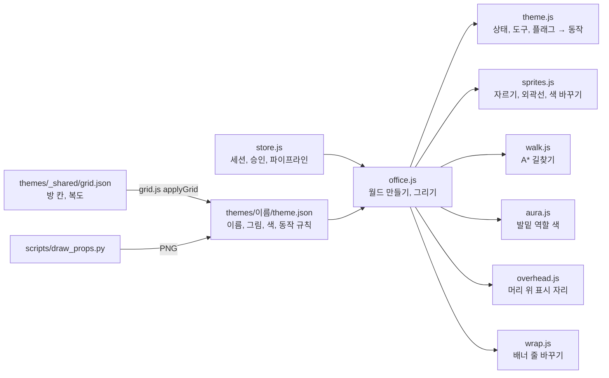

<!--
다루는 곳: bridge/static/js/office.js, bridge/static/js/theme.js, bridge/static/js/grid.js, bridge/static/js/sprites.js, bridge/static/js/walk.js, bridge/static/js/aura.js, bridge/static/js/overhead.js, bridge/static/js/wrap.js, bridge/static/themes/, scripts/draw_props.py, LICENSES.md, tests/js/grid.test.mjs, tests/js/theme.test.mjs, tests/js/walk.test.mjs, tests/js/banner_wrap.test.mjs, tests/js/name_ink.test.mjs, tests/js/role_aura.test.mjs, tests/js/overhead_stack.test.mjs, tests/js/stack_side.test.mjs, tests/js/seat_host.test.mjs
읽은 커밋: 482b98e
-->

# 픽셀 오피스와 테마

FOREMAN의 첫 화면(`/`)은 카드 목록이 아니라 픽셀 그림으로 된 작업장이다. Claude Code 세션 하나가 캐릭터 하나이고, 그 세션이 지금 무엇을 하는지에 따라 캐릭터가 방을 옮겨 다닌다. 파일을 읽으면 서고로, 코드를 고치면 작업 책상으로, 시험을 돌리면 시약대로 걸어간다. 사람이 손을 써야 하는 일이 생기면 그 캐릭터 머리 위에 글씨 카드가 뜬다. 숫자 표를 읽지 않아도 지금 어디가 바쁘고 어디가 막혔는지 한눈에 보이게 하려는 것이다.

이 편은 그 그림을 그리는 쪽을 다룬다. 테마가 무엇을 갈아 끼우는지, 방과 복도를 어떻게 정했는지, 세션 상태가 어떻게 캐릭터 동작이 되는지, 원본 그림 파일을 어떻게 잘라 쓰는지, 캐릭터가 어떻게 가구를 피해 걷는지, 발밑 색과 머리 위 표시를 어떤 규칙으로 놓는지, 그리고 그림이 서로 가리는 문제를 하나씩 땜질하다가 점검기와 자동 재배치로 옮겨 간 과정이다.

데이터를 받아 오는 쪽(스냅샷, 웹소켓, 몇 초마다 다시 맞추기)은 → 「데이터 계층」이, 캐릭터를 누르면 열리는 옆 패널은 → 「옆 패널」이, 헤드리스 브라우저로 화면을 찍고 세는 도구 자체는 → 「화면 점검과 시연」이 다룬다. 화면 전체의 약속(빌드 없는 순수 JS, 그리는 쪽과 데이터 쪽을 가른 계약)은 → 「14 화면」에 있다 [code:bridge/static/js/office.js].

## 한눈에 보기

`office.js`는 약 3,900줄이고, 거의 전부가 `createOffice` 함수 하나 안에 들어 있다 [code:bridge/static/js/office.js]. 판정과 계산 가운데 화면(DOM, 캔버스)을 몰라도 되는 것은 작은 파일로 떼어 냈다. `theme.js`, `grid.js`, `walk.js`, `overhead.js`, `aura.js`의 판정 부분, `wrap.js`가 그렇다. 이 파일들은 브라우저 없이 `node --test`로 시험한다 [code:bridge/static/js/theme.js] [code:bridge/static/js/grid.js] [code:bridge/static/js/walk.js]. 무엇이 어디에 그려지는지는 눈으로 봐야 하는 일이라 큰 파일에 남았고, 그 대신 화면이 스스로 겹침을 세는 점검 함수를 `window.office`로 내보낸다(이 편 맨 끝 절).

`office.js`는 데이터를 고치지 않는다. 같은 `store`를 받아 그리기만 한다. 이 약속 덕분에 테마를 바꿔도, 클래식 카드 화면(`/classic`)과 나란히 띄워도 숫자는 같다.

## 화면 넷: 감독실, 전체, 방, 라운지

머리말 첫 줄에서 어디를 볼지 고른다. [⌂]는 감독실(테마에 따라 팀장실, 교장실, 소장실), [전체]는 모든 현장을 한 화면에, 프로젝트 이름 단추는 그 현장 하나를 화면 가득 보여 준다 [code:bridge/static/js/office.js]. 현장(방)은 이미 아는 넷(런슈즈, 펫퍼민트, FOREMAN, 인프라)이 이 차례로 먼저 서고, 그 밖의 프로젝트가 뒤에 붙는다. 맨 오른쪽에는 프로젝트가 없는 세션이 모이는 라운지(떠돌이)가 있다.

감독실은 현장들 위쪽에 따로 선 방이다. 벽의 현황판에 현장마다 칸이 하나씩 있고, 칸의 모양은 테마가 정한다. 마법학교는 거대한 지도와 현장마다 촛불, 오피스는 대형 모니터 벽, 현장 테마는 공정표 화이트보드와 자석이다. 모양은 달라도 판단은 하나다. `siteState`가 파이프라인 실패, 빌드 알림 끊김, 빌드 알림 없음이면 실패, 승인 대기, 질문, 권한 거부, API 오류로 멈춤, 답 기다림, 사용자 답 기다림이 있으면 경고, 작업 중인 세션이 있으면 바쁨, 그 밖에는 쉼이나 빈 현장으로 가른다 [code:bridge/static/js/office.js]. 같은 판단이 [전체] 카드 테두리와 현황판 표시에 함께 쓰이므로 둘이 다른 말을 하지 않는다. 사용량이 한도의 90% 이상이거나 사용량을 읽지 못하면 현황판 오른쪽 위에 경고등이 켜지고, 호버에 까닭이 적힌다 [code:bridge/static/js/office.js].

테마를 바꾸면 페이지를 새로 읽는다. 그때 보던 화면과 고른 세션을 `sessionStorage`에 적어 두었다가 그대로 되살린다. 처음에는 첫 데이터가 온 뒤에야 되살려서, 그 사이 0.7초 남짓 감독실이 한 번 그려졌다가 돌아오는 깜빡임이 있었다. 지금은 되살릴 화면이 있으면 그것을 적용할 때까지(길어야 3초) 캔버스를 바탕색으로만 칠한다 [code:bridge/static/js/office.js] [log:designer_outside_20261111.md].

## 테마는 갈아 끼우는 껍데기다

테마는 넷이다. 시트 그림을 쓰는 오피스, 마법학교, 현장과 도형으로만 그리는 `plain`이다. 머리말의 테마 단추에는 앞의 셋만 있고, `plain`은 주소 `/?theme=plain`으로만 열린다. 고른 테마는 브라우저 `localStorage`의 `foremanTheme`에 남고, 처음 여는 사람은 오피스를 본다 [code:bridge/static/office.html].

테마가 바꾸는 것은 이름, 그림, 색, 그리고 어떤 일을 어느 방에서 하는 것으로 보일지다. 판정 코드(`theme.js`)와 그리기 코드(`office.js`)는 테마마다 따로 있지 않다. 테마 하나는 `bridge/static/themes/<이름>/theme.json` 한 파일과 그 옆 `sprites/` 폴더뿐이다 [code:bridge/static/themes/].

| theme.json 칸 | 무엇을 정하나 |
|---|---|
| `palette` | 경고(노랑), 실패(빨강), 진행(파랑), 성공(초록) 같은 색 이름 → 값 |
| `layout` | 한 칸 크기(`tile` 16), 모눈 파일 경로(`grid`), 구역마다 자리(`zones`) |
| `tags` | 방 이름(`zones`), 방 → 하는 일(`roles`), 이름표 꾸밈(`style`), 출하 단계 이름(`infra`) |
| `states` · `tools` · `flags` | 상태, 도구, 깃발 → 동작(다음 절) |
| `roles` | 역할 색을 어디에 칠할지(`mode`: 로브, 사원증 끈, 안전모), 테마만 다른 색, 역할별 쉼 자리 |
| `sprites` | 시트 파일, 그림 이름 → 시트 안 사각형, 가구 목록(`decor`), 동작마다 곁에 놓는 소품(`props`), 캐릭터 목록 |
| `hq`, `outside`, `aura`, `courier`, `foreman` | 감독실 모양, 방 바깥 풍경, 발밑 문양, 출하 담당 이름, 감독 이름(소장, 교장, 팀장) |
| `infra`, `spawn` | 출하 단계 상태(진행, 성공, 실패, 대기, 없음)마다 동작, 서브에이전트가 나타나는 구역(마법학교는 원탁방을 바로 쓰므로 없다) |

[code:bridge/static/themes/site/theme.json] [code:bridge/static/themes/magic/theme.json] [code:bridge/static/themes/office/theme.json]

### 한 모눈을 세 테마가 쓴다

방 자리는 테마마다 따로 있지 않다. `themes/_shared/grid.json` 한 벌을 세 시트 테마가 같이 쓴다 [code:bridge/static/themes/_shared/grid.json]. 한 방은 가로 28칸, 세로 18칸이고, 한 칸이 1타일(월드 16px)이자 캐릭터 한 명이다. 위 벽이 두 줄이라 걸을 수 있는 안쪽은 x 1~27, y 2~17이다 [code:bridge/static/js/grid.js].

| 역할(모눈 키) | 칸 [x, y, w, h] | 현장 | 마법학교 | 오피스 |
|---|---|---|---|---|
| hq 계획 | 1, 2, 7, 4 | 소장실 | 교장실 | 팀장실 |
| read 읽기 | 8, 2, 5, 4 | 자재창고 | 서고 | 아카이브 |
| bash 명령 | 13, 2, 5, 4 | 공구실 | 물약실 | 서버룸 |
| test 시험 | 18, 2, 4, 4 | 검사대 | 시약대 | QA 부스 |
| web 웹검색 | 22, 2, 5, 4 | 셔터 | 아치 창 | 창가 바 |
| idle 쉼 | 1, 7, 6, 5 | 함바 | 대강당 | 라운지 |
| edit 고치기 | 8, 7, 9, 5 | 작업대 | 작업 책상 | 워크스테이션 |
| scribe 서기 | 17, 7, 5, 5 | 서류실 | 필사실 | 문서팀 |
| sub 서브에이전트 | 22, 7, 5, 5 | 도면실 | 원탁방 | 회의실 |
| git 커밋 | 1, 13, 4, 4 | 출하 접수대 | 봉인대 | 커밋 데스크 |
| ship 출하장 | 5, 13, 22, 4 | 출하장 | 봉인실 | 배포 파이프 |

[code:bridge/static/themes/_shared/grid.json] [code:bridge/static/themes/site/theme.json]

테마는 자기 구역 키(`store`, `library`, `server` …)를 역할 키로 잇는 표(`tags.roles`)만 가지고 있다. 화면을 열 때 `applyGrid`가 이 표를 따라 모눈의 방 칸을 구역에 입히고, 테마 파일에 방 왼쪽 위 기준으로 적힌 자리와 가구(`"in": "<구역 키>"`)를 방 좌표로 옮긴다 [code:bridge/static/js/grid.js]. 관리자, 디자이너, 쉬는 코더처럼 자기 방이 따로 없는 자리 묶음은 `in`으로 남의 방을 고른다. 관리자는 감독실, 디자이너는 작업 책상 방 왼쪽 열, 쉬는 코더는 쉼 방이다. 그래서 모눈을 고치면 방 안 배치가 통째로 따라온다.

배치는 일의 흐름이 왼쪽 위에서 오른쪽 아래로 읽히게 놓았다. 위 줄에 계획 → 읽기 → 명령 → 시험이 차례로 있고, 고치기가 가운데 가장 넓은 방이고, 맨 아래 왼쪽 커밋 방에서 출하장 ① → ② → ③으로 바로 이어진다 [log:designer_grid_20261110.md]. 웹검색 방은 위 벽과 오른쪽 벽 둘 다에 붙은 모서리다. 밖으로 나간다는 뜻이 자리로 보이게 했다. 명령과 시험은 둘 다 Bash라 이웃에 두었고, 서기 방은 고친 것을 곧바로 문서로 옮기도록 작업 책상 옆에, 서브에이전트 방은 작은 캐릭터들이 모였다 흩어져도 작업 책상을 가로지르지 않도록 오른쪽 끝에 두었다. 위 줄 방이 4칸 높이인 것은 선반, 공구벽, 창을 위 벽에 걸 수 있어 바닥이 덜 필요하기 때문이고, 가운데 줄이 5칸인 것은 탁자 둘레에 앉아야 하기 때문이다 [log:designer_grid_20261110.md].

모눈을 쓰기 전에는 테마마다 구역 좌표가 따로였다. 처음 구상은 구역 아홉 개와 가운데 ㅗ자 복도였는데, 가구를 먼저 놓고 이름표가 빈 데를 찾아가는 식이라 테마마다, 화면 폭마다 결과가 달랐다. 사용자가 「재고 나서 짠다」고 정해 화면 크기와 배율을 먼저 잰 뒤 방 열한 개를 처음부터 다시 놓았다 [log:designer_grid_20261110.md] [c:68af649]. 이때 캐릭터 크기도 1.5배에서 원본 1배(`char_scale` 1)로 줄였다. 한 명이 한 칸에 들어가야 칸 계산이 맞고, 원본 1배는 픽셀이 뭉개지지 않는다 [code:bridge/static/themes/site/theme.json].

세 테마의 방 자리가 정말 같은지는 두 곳에서 본다. `node` 시험 `tests/js/grid.test.mjs`가 세 `theme.json`에 `applyGrid`를 해서 방, 복도, 출하 단계 자리를 견주고, 화면 점검 도구가 테마마다 `gridAudit().rooms`를 모아 끝에서 견준다 [log:designer_grid_20261110.md].

`plain`은 이 모눈 밖이다. `layout.grid`가 없고, 방 구역도 감독실, 책상, 서버랙, 창가, 전화 다섯뿐이다 [code:bridge/static/themes/plain/theme.json]. 같은 `layout.zones`에 키가 넷 더 있지만 방이 아니라 관리자 좌석, 디자이너 좌석, 쉼 좌석 묶음과 출하 줄(빌드, 이미지 창고, 배포 자리)이다. 시트 그림이 없으니 길찾기 격자도 만들지 않고, 머리 위 쌓기 틀과 자리 말풍선도 쓰지 않는다. 시트 테마가 생기기 전 뼈대를 그리던 렌더러를 기준점으로 남겨 둔 것이다.

### 복도

방이 아닌 칸이 복도다. 가로 두 줄(y 6, y 12)과 쉼 방 옆 세로 한 줄(x 7, y 7~11)이다 [code:bridge/static/themes/_shared/grid.json]. `gridProblems`는 grid.json만 보고 두 방이 같은 칸을 쓰는지, 방이나 복도가 안쪽 밖으로 나가는지, 칸이 정수인지, 방도 복도도 아닌 칸이 남는지, 복도 칸이 4방향으로 하나로 이어지는지, 모든 방이 복도에 한 변 이상 닿는지를 센다. 빈 목록이면 통과다 [code:bridge/static/js/grid.js].

## 상태, 도구, 플래그 → 동작

세션 하나가 화면에서 어디에 서서 무엇을 하는지는 `theme.js`의 `resolveAction`이 정한다. 이 함수는 DOM도 캔버스도 모른다. 테마를 바꾸면 이 파일은 그대로이고 `theme.json`만 바뀐다 [code:bridge/static/js/theme.js].

판정은 세 겹이다. 먼저 상태가 바탕을 깐다. 세션이 일하는 중(ACTIVE)일 때만 도구 규칙을 위에서부터 훑어 처음 맞는 하나를 덮는다. 마지막으로 켜진 플래그 가운데 우선순위가 가장 높은 하나가 위에 덮는다. 그래서 얼어붙은 세션도, 끝난 세션도 승인을 기다리면 손을 든다. 사람이 봐야 하는 것이 가장 위에 오게 한 것이다 [code:bridge/static/js/theme.js].

| 상태(서버 값) | 바탕 동작 | 현장 | 마법학교 | 오피스 |
|---|---|---|---|---|
| ACTIVE 일함 | 걷기, 책상으로 | 책상 | 책상 | 책상 |
| IDLE 쉼 | 쉼 방으로, 사람마다 쉬는 모습 | 함바: 눕기, 커피, 신문 | 대강당: 엎드려 자기, 먹기, 책 | 라운지: 폰, 커피, 책 |
| WAITING 기다림 | 책상에 서서 기다림 | 책상 | 책상 | 책상 |
| SUSPENDED 멈춰 둠 | 그 자리에 굳음, 회색 돌 | 책상 | 책상 | 책상 |
| DORMANT 끝남 | 반투명으로 섬 | 책상 | 책상 | 책상 |

[code:bridge/static/themes/site/theme.json] [code:bridge/static/themes/magic/theme.json] [code:bridge/static/themes/office/theme.json]

WAITING은 서버에 없는 상태다. 서버 상태 값은 늘리지 않기로 했으므로 화면이 따로 만든다. 서버가 IDLE이라고 해도 서브에이전트나 백그라운드 명령(Bash, Monitor)이 돌고 있으면 화면은 WAITING으로 그린다(`viewState`). 이것이 생긴 까닭은 뒤에서 판정이 도는데 캐릭터가 대강당에서 엎드려 자고 있었기 때문이다 [code:bridge/static/js/theme.js]. 테마에 WAITING이 없으면 자는 모습으로 떨어지지 않게 기본값(기다림, 책상)을 쓴다. 현장 카드의 숫자를 셀 때도 WAITING은 작업으로 센다. 현장이 쉼으로 보이면 돌고 있는 일을 놓친다 [code:bridge/static/js/office.js].

도구 규칙은 세 테마가 같은 차례로 적었다. 도구 이름은 `Read|Grep`, `mcp__*`처럼 `|`와 `*`를 쓰는 짧은 패턴이고, Bash는 명령 글에 정규식(`target`)을 한 번 더 대서 방을 가른다. 잘못된 정규식은 안 맞는 것으로 친다 [code:bridge/static/js/theme.js].

| 도구(차례대로) | 어느 방 | 현장 동작 | 마법학교 동작 | 오피스 동작 |
|---|---|---|---|---|
| Read, Grep, Glob, NotebookRead | 읽기 | 신문 읽기 | 책 읽기 | 읽기 |
| Edit, Write, MultiEdit, NotebookEdit | 고치기(책상) | 망치질 | 깃펜으로 쓰기 | 쓰기 |
| Bash 중 pytest, node --test, ruff, mypy 같은 시험 명령 | 시험 | 게이지 보기 | 시험관 흔들기 | 흔들기 |
| Bash 중 명령 자리의 git | 커밋 | 도장 | 밀랍 봉인 | 도장 |
| 그 밖의 Bash, BashOutput, KillShell | 명령 | 렌치 | 솥 젓기 | 젓기 |
| WebFetch, WebSearch | 웹검색 | 밖 보기 | 밖 보기 | 밖 보기 |
| Agent, Task | 서브에이전트 | 주문 | 주문 | 주문 |
| mcp__* | 웹검색 | 무전기 | 밖 보기 | 밖 보기 |
| TodoWrite, ExitPlanMode | 책상 | 생각 | 생각 | 생각 |
| 나머지 전부 | 책상 | 망치질 | 쓰기 | 쓰기 |

[code:bridge/static/themes/site/theme.json] [code:bridge/static/themes/magic/theme.json] [code:bridge/static/themes/office/theme.json]

플래그는 셋이다. 승인 대기(질문 포함)는 우선순위 30으로 손을 들고 머리 위에 깃발(현장, 마법학교 「!」, 오피스 「?」)을 띄운다. 끝 신호가 오지 않은 멈춘 턴은 20으로 빨간 「…」을, 오류는 10으로 연기를 낸다 [code:bridge/static/themes/site/theme.json] [code:bridge/static/themes/office/theme.json].

### 역할이 판정을 덮는 곳

상태와 도구만으로 정하면 모두가 같은 규칙으로 움직인다. 역할이 있는 세션은 몇 군데에서 그 위를 덮는다. 역할 값과 이름은 → 「역할 다섯」이 다룬다 [code:bridge/static/js/office.js].

서기는 서기 방 안에서만 움직인다. 일할 때는 도구에 따라 쓰기 자리(Edit, Write), 서가 자리(Read, Grep, Glob, WebFetch, WebSearch), 대조 자리(Bash, Monitor)로 가고, 쉬거나 기다릴 때는 쓰기 자리로 간다. 서기 세션이 둘이면 둘째는 다음 자리에 서서 몸이 겹치지 않는다 [code:bridge/static/js/office.js]. 그 방에 살아 있는 서기 세션이 없으면 세션 없는 서기 캐릭터가 늘 쓰기 자리에 앉아 있다.

관리자와 디자이너는 고정 자리 역할이다(`FIXED_SEAT_ROLES`). 일할 때도 도구를 따라 다른 방으로 가지 않고 자기 자리(`zones.manager.seats`, `zones.designer.seats`)에 그대로 선다. 손 들기 같은 플래그 모습은 그대로이고, 작업 책상 수나 「책상 없음 +N」에는 들지 않는다. 관리자 자리는 감독실 안 옆자리, 디자이너 자리는 작업 책상 방 왼쪽 열이다 [code:bridge/static/js/office.js] [docs:10_office_design.md]. 새 고정 자리 역할을 더하려면 이 목록에 넣고 테마마다 `zones.<역할>.seats`를 둔다.

코더는 방마다 늘 있다. 살아 있는 코더 세션이 없으면 코더 한 명이 쉼 방의 코더 자리(`coder_home`)에서 그 테마의 쉬는 동작을 한다. 코더 세션이 새로 뜨면 그 자리에서 나타나 책상으로 걸어가고, 끝나면 그 자리로 걸어 돌아간다. 한꺼번에 여럿이면 0.6초(`DEPART_GAP`, 걷는 속도로 두 칸쯤)씩 늦게 떠나 같은 길에서 몸이 겹치지 않는다. 방에 코더가 하나도 안 남으면 자리에 가장 가까운 사람이 쉬는 코더가 되고, 나머지는 자리에 닿으면 사라진다 [code:bridge/static/js/office.js]. 모든 코더 세션은 같은 그림, 같은 색이다. 처음에는 첫 코더만 상주, 둘째부터 반투명한 임시 일손으로 그렸는데, 사용자가 그 구분을 없앴다 [docs:10_office_design.md].

쉬는 모습은 사람마다 다르다. 쉼 상태에 `variants`가 있으면 세션 번호로 하나를 고른다(마법학교라면 엎드려 자기, 먹기, 책 가운데 하나). 플래그가 덮은 동작은 바꾸지 않는다 [code:bridge/static/js/office.js].

끝난 세션은 3분 동안만 흐리게 자리에 남았다가 사라진다. 패널 세션 목록의 끝난 세션 칸에는 그대로 있다 [code:bridge/static/js/office.js].

### 서브에이전트

서브에이전트는 부모 캐릭터의 축소판이다. 새로 생기면 서브에이전트 방(마법학교 원탁방의 마법진, 오피스 회의실, 현장 도면실) 가운데에서 하나씩 0.18초 간격으로 나타나 부모 둘레를 천천히 돈다. 끝나면 연기로 흩어진다. 10명까지 그리고 나머지는 「+N」으로 접는다 [code:bridge/static/js/office.js]. 묶음 이름은 서브에이전트 설명들의 공통 앞부분에서 만든다. "Wide yes/no search wn1"과 "… wn2"면 "Wide yes/no search"다 [code:bridge/static/js/theme.js].

## 그림: 원본 시트를 브라우저에서 자르고 칠한다

### 원본 그대로 넣고 가공은 렌더러가

에셋 PNG는 저장소에 원본 그대로 들어 있다. 자르기, 외곽선, 색 바꾸기는 모두 `sprites.js`가 브라우저에서 하고 결과를 캔버스로 캐시한다 [code:bridge/static/js/sprites.js] [code:LICENSES.md]. 이렇게 한 까닭은 둘이다. 라이선스가 가리키는 대상이 「원본 파일」로 분명해지고, 외곽선 색이나 두께를 바꿔도 파일을 다시 만들 필요가 없다 [log:stage10_office_result.md]. 원본 압축 파일은 저장소에 넣지 않는다(`.assets-raw/`는 `.gitignore`). 쓰는 것만 골라 복사했다. Ninja Adventure 압축만 해도 음악, 효과음, 캐릭터 95종이 들어 89MB였다 [log:stage10_office_result.md].

그림 하나는 `theme.json`의 `sprites.defs`에 `[시트, x, y, w, h, 외곽선, 프레임 수, 초당 프레임]` 한 줄로 적는다. 프레임은 오른쪽으로 `w`씩 이어진다 [code:bridge/static/js/sprites.js]. 캐릭터는 Ninja Adventure 꼴을 그대로 받는다. `Walk.png`는 64×64로 열이 아래, 위, 왼쪽, 오른쪽, 행이 걸음 프레임 넷이고, `Idle.png`는 64×16으로 열이 방향이다.

렌더러가 하는 가공은 넷이다.

- **바깥 1px 외곽선**(`outline`): 투명한 픽셀 가운데 불투명한 픽셀과 4방향으로 닿은 것을 진한 색으로 칠한다. Calciumtrice 가구는 외곽선이 얇고 부드러워 Ninja 캐릭터 옆에서 흐릿하게 떴는데, 1px 외곽선을 덧그리자 같은 그림처럼 붙었다 [code:bridge/static/js/sprites.js] [log:stage10_office_result.md].
- **역할 색**(`recolor`, 마법학교 로브): 옷 픽셀(채도 0.22 이상, 밝기 0.12~0.72)의 색상만 역할 색으로 바꾼다. 처음에는 얼굴까지 코더 파랑이 되어 굳은 사람처럼 보였다. 그래서 그림 위쪽 3/4의 살색 계열(색상 0°~50°, 350° 이상)은 바꾸지 않는다. 대가로 주황 옷 캐릭터는 윗부분이 주황으로 남는다 [code:bridge/static/js/sprites.js].
- **석화와 유령**(`tint`): 밝기만 남기고 회색 돌이나 푸른빛으로 칠한다. 유령은 위아래로 둥실 떠 있다 [code:bridge/static/js/sprites.js] [code:bridge/static/js/office.js].
- **줄인 그림**(`scaled`): 16px 소품을 8px로 줄일 때 가장 가까운 픽셀만 고르면 점이 빠져 깨진다. 부드럽게 줄인 뒤 투명도를 반으로 잘라(0 또는 255) 또렷한 가장자리로 되돌리고, 외곽선을 다시 그린다 [code:bridge/static/js/sprites.js].

역할 색을 칠하는 곳은 테마마다 다르다(`roles.mode`). 마법학교는 로브 색 자체를 바꾸고, 오피스는 그림 위에 사원증 끈을, 현장은 안전모를 원본 픽셀 단위로 덧그린다 [code:bridge/static/js/office.js]. 현장은 역할이 없으면 노란 안전모, 감독은 흰 안전모다. 옷 색 값은 한 표(`roles.js` `ROLE_CLOTH`)에 있고, 테마는 다른 값이 꼭 필요한 역할만 덮어 적는다. 지금은 현장 하나(감독 흰색, 코더 짙은 파랑)다 [code:bridge/static/themes/site/theme.json]. 주소에 `?roles=demo`를 붙이면 모든 세션에 역할을 돌려 가며 입혀 색을 미리 볼 수 있다.

오피스 캐릭터(2dPig)는 정면 한 장뿐이다. 걷는 모습은 엔진이 흉내 낸다. 걸을 때 위아래로 출렁이게 하고, 왼쪽으로 갈 때는 좌우를 뒤집는다 [code:bridge/static/js/sprites.js]. 그래서 오피스 사람은 뒤돌아 걷는 모습이 없다.

### 에셋에 없는 동작은 엔진이 흉내 낸다

허용하는 라이선스의 팩 어디에도 앉기, 눕기, 들고 있기 동작은 없었다(아래 「에셋과 라이선스」). 그래서 동작은 그리는 차례와 자르기로 흉내 낸다 [docs:10_office_design.md].

앉기는 따로 그림이 없다. 가구와 사람을 발밑(아래 끝) 차례로 함께 그리면 탁자 뒤 자리에 선 사람은 탁자보다 먼저 그려져 다리가 가려진다. 그것이 앉은 모습이다 [code:bridge/static/js/office.js]. 소파, 빈백, 간이침대, 벤치, 의자처럼 위에 앉는 가구는 반대로 사람을 그 가구 바로 다음에 그린다. 발밑 차례만 따르면 소파 등받이가 나중에 그려져 사람이 뒤로 숨었기 때문이다. 이 가구는 이름의 낱말로 가른다. `workbench`(작업대)가 `bench`에 걸리지 않게 낱말 단위로 맞춘다 [code:bridge/static/js/office.js].

눕기(현장 함바)는 그림을 왼쪽으로 90도 돌려 침대 가운데에 맞춘다. 처음에는 자리 점에 그대로 그려 몸이 침대 밖으로 반쯤 벗어났다 [code:bridge/static/js/office.js]. 엎드려 자기(마법학교 대강당)는 서 있는 그림을 조금 내려 머리를 탁자 위에 대고, 탁자를 그린 뒤 머리 쪽만 한 번 더 그려 탁자에 가리지 않게 한다. 머리 위에는 「z」가 떠오른다.

들고 있기는 처음에 손에 쥐어 줬다. 그러자 16px 캐릭터 얼굴 높이에 16px 책과 플라스크가 얹혀 사람이 안 보였다(마법학교 서고). 그래서 소품은 들지 않고 곁에 놓는다. 앞에 탁자가 있으면 탁자 윗면 손 쪽에, 없으면 발치 옆에 놓고, 크기는 캐릭터 폭의 절반, 키의 55%까지로 줄인다. 그래도 얼굴 칸(그림 위쪽 절반, 가운데 64% 폭)과 겹치면 손 쪽 바깥으로 민다 [code:bridge/static/js/office.js]. 동작마다 어떤 소품을 놓을지는 테마 `sprites.props`가 정한다.

탁자 위 소품(`z: top`)은 그리는 차례가 까다로웠다. 받침 탁자 바로 다음에 그려야 하는데, 처음에는 어림값으로 그려 받침 앞에 선 사람 머리 위로 책과 머그가 덮였다. 지금은 소품 밑동이 놓인 받침을 찾아 그 바로 뒤에 그리고, 그래도 소품이 사람 앞에 오는 칸은 다 그린 뒤 그 칸만 사람을 한 번 더 덧그린다(`overTopItems`) [code:bridge/static/js/office.js].

작업 중인 세션에는 테마마다 다른 효과를 머리 둘레에 띄운다. 마법학교는 마력 고리와 빛 알갱이, 현장은 엔진 아지랑이, 오피스는 노트북 김, 도형은 주황 고리다. 처음에는 토큰을 많이 쓰는 세 세션만 켰는데 「왜 얘만?」이라는 물음이 나와 작업 중인 세션 모두로 바꿨다 [code:bridge/static/js/office.js].

## 에셋과 라이선스

### 처음 기준은 CC0와 MIT만

에셋 조사는 「CC0와 MIT만」으로 시작했다 [docs:10_office_design.md]. 공개 GitHub 저장소에 그림 파일을 그대로 넣기 때문이다. 재배포를 막는 팩은 아무리 잘 맞아도 저장소에 넣을 수 없고, 출처 표시나 같은 조건 공유 같은 의무가 없는 라이선스가 가장 안전했다. 이 기준으로 보니 설계 전체를 덮는 팩 묶음이 없었다. 가장 큰 구멍은 동작(앉기, 눕기, 들고 있기)과 현대 사무실 가구였다. 사무실 가구가 가장 잘 맞는 팩(LimeZu Modern Interiors/Office 등)은 재배포 금지였다 [docs:10_office_design.md].

그래서 기준을 한 번 넓혔다. CC-BY(출처 표시 조건, 같은 조건 공유 SA는 아님)와 유료 팩을 더했다. 유료 팩은 「공개 GitHub 저장소에 에셋 파일을 넣어도 되고 상업적 사용이 허용될 것」을 조건으로 걸었고, 못 맞추면 뺐다 [docs:10_office_design.md]. LPC처럼 같은 조건 공유(SA)이거나 GPL만 되는 팩, 32px라 16px 화풍과 섞이지 않는 팩도 뺐다. 다시 따져 본 결과 마법학교가 무료만으로 약 80% 덮였고, 유료 팩은 사지 않기로 했다. 조건을 통과한 유료 팩은 마법학교를 조금 더 채울 뿐 오피스와 현장의 진짜 구멍(서버랙, 모니터 벽, 지게차, 셔터)을 깨끗하게 덮지 못했다 [docs:10_office_design.md].

지금 저장소에 든 것은 아래와 같다. CC-BY는 Calciumtrice 하나이고, 나머지는 모두 CC0다 [code:LICENSES.md].

| 테마 | 팩 | 라이선스 | 쓰는 것 |
|---|---|---|---|
| 마법학교 | Calciumtrice Medieval Tileset | CC-BY 3.0(출처 표시 의무) | 탁자, 의자, 책장, 사다리, 통, 궤짝 |
| 마법학교 | 0x72 DungeonTileset II | CC0 | 돌바닥, 벽, 깃발, 플라스크, 기둥, 문 |
| 마법학교, 현장 | Ninja Adventure | CC0 | 캐릭터(두 테마가 `_shared/ninja/chars/` 22명을 함께 씀), 소품, 이모트, 효과, 바깥 풍경 타일 |
| 오피스 | 2dPig Pixel Office | CC0 | 책상, 컴퓨터, 화분, 사람 5명 |
| 세 테마 | FOREMAN이 직접 그림 | CC0 | 아래 「없는 소품은 직접 그렸다」 |

[code:LICENSES.md] [code:bridge/static/themes/]

CC-BY의 출처 표시는 `LICENSES.md`에 작가 이름, 라이선스, 출처 주소와 함께 「렌더러가 표시할 때 1px 바깥 외곽선을 덧그린다(파일 자체는 원본)」는 변경 표시까지 적었다. CC0 팩은 표시 의무가 없지만 저작자와 링크를 남겼고, 원본 `LICENSE.txt`를 함께 넣었다 [code:LICENSES.md]. 0x72 팩은 압축 안에 라이선스 문장이 없어 배포 페이지의 라이선스 칸을 근거로 적었다.

한 테마 안에서는 한 화풍만 쓴다. 테마끼리는 화풍이 달라도 된다. 테마를 바꾸면 전부 바뀌기 때문이다 [docs:10_office_design.md]. 마법학교는 「0x72와 Ninja만」 안과 「Calciumtrice 가구까지」 안을 나란히 그려 본 뒤 뒤쪽을 골랐다. 0x72에는 탁자, 의자, 책장이 하나도 없어 앞쪽 안이면 가구를 거의 다 그려야 했다. 0x72 캐릭터(16×28)는 Ninja 캐릭터(16×16)와 키가 달라 쓰지 않았다 [log:stage10_office_result.md]. 현장은 새 팩을 받지 않았다. 맞는 무료 팩은 화풍이 Ninja와 달랐고, 지게차, 셔터, 안전모 같은 핵심은 어차피 없었다 [log:stage10_office_result.md].

받는 길에서도 막혔다. itch에 올라온 「원하는 만큼(0 가능)」 팩을 스크립트로 받으려 하자 itch가 막았다. 몇 번 고쳐 보다 사이트를 두드리지 않으려 멈췄고, 다른 공식 경로도 없어 사용자가 서버 브라우저로 직접 받았다 [log:stage10_office_result.md] [code:LICENSES.md].

### 없는 소품은 직접 그렸다

팩에 없는 것은 `scripts/draw_props.py`가 Pillow로 그려 PNG로 낸다. 결과는 CC0다 [code:scripts/draw_props.py]. 외곽선은 그리지 않는다. 렌더러가 1px 외곽선을 덧그려 다른 팩과 화풍을 맞춘다.

| 테마 | 직접 그린 것 |
|---|---|
| 마법학교 | 돌 원탁, 초상화, 밀랍 도장, 부엉이 횃대(눈 깜빡임 4프레임) |
| 오피스 | 서버랙(LED 깜빡임 2프레임), 화이트보드, 복합기, 빈백, 커피머신, 빌드 모니터, 폰 |
| 현장 | 지게차, 롤셔터(닫힘과 반쯤 열림), 컴프레서, 기름통 두 색, 공구벽, 철제 작업대와 바이스, 간이침대, 검사대(합격과 불합격 램프), 도면 탁자, 철제 선반, 선풍기, 고깔, 팔레트, 트럭, 게이지, 안전모 걸이, 무전기, 머그, 신문 |

[code:scripts/draw_props.py] [code:LICENSES.md]

다시 만들 때는 Pillow가 깔린 파이썬으로 `scripts/draw_props.py`를 돌린다 [code:scripts/draw_props.py]. 16px를 코드로 그려 음영이 한두 단계뿐이라 Calciumtrice나 2dPig 옆에서 평평하게 보인다(이 편 끝 「한계」) [log:stage10_office_result.md]. 바닥과 벽, 복도 융단, 마법진처럼 사각형과 빛으로 충분한 것은 PNG도 만들지 않고 엔진이 테마 색으로 직접 칠한다.

## 걷기: A* 길찾기와 복도

처음에는 캐릭터가 목표까지 직선으로 걸었다. 가구 정보가 그리기용뿐이라 막는 영역이 없었고, 캐릭터가 탁자를 뚫고 지나가며 탁자 아래로 숨는 것처럼 보였다. 설계 대조표에는 ㅗ자 복도가 됐다고 적혀 있었지만 실제로는 없었다 [log:stage10_office_result.md] [c:ef71a17].

지금은 `walk.js`가 방 하나를 칸당 2×2(`RES` 2) 격자로 나눠 막힌 칸을 적는다. 위 벽 두 줄, 옆 벽과 아래 벽 0.6칸, 그리고 가구의 바닥 자리가 막힌다 [code:bridge/static/js/walk.js]. 가구 그림은 위에서 비스듬히 내려다본 것이라 그림 전체가 바닥을 차지하지 않는다. 낮은 가구(1.5칸 이하)는 아래 80%, 중간(3칸 이하)은 아래 70%, 책장처럼 키 큰 것은 아래 1.5칸만 막는다. 테마에서 `foot`으로 직접 정하거나 `block: false`로 막지 않게 할 수 있다 [code:bridge/static/js/walk.js]. 가구 칸은 살짝 안쪽만 막는다. 반 칸 격자에 걸친 모서리까지 막으면 가구 사이 좁은 틈이 닫히기 때문이다. 오피스 유리벽은 옆과 아래 테두리만 벽이고 아래 가운데에 문이 열려 있다 [code:bridge/static/js/office.js].

길은 A*(가장 가능성 높은 칸부터 넓혀 가며 최단 길을 찾는 방법)로 찾는다. 8방향으로 걷되 모서리를 비스듬히 자르지 않는다. 복도 칸은 걷는 값이 1, 복도 밖 바닥은 3이라 멀리 갈 때는 복도를 탄다 [code:bridge/static/js/walk.js]. 찾은 칸 목록은 지금 점에서 보이는 가장 먼 점으로 건너뛰며 곧게 편다. 다만 그 직선이 원래 길보다 비싼 바닥을 지나면 건너뛰지 않는다. 그래야 복도를 탄 길이 복도 밖으로 비스듬히 새지 않는다. 자리는 대개 탁자에 붙어 막힌 칸이라, 길은 탁자 앞 빈칸까지 가고 마지막 한 걸음만 곧장 간다. 길을 못 찾으면 예전처럼 목표로 곧장 간다 [code:bridge/static/js/walk.js].

걷는 속도는 초당 3.2칸이다. 목표가 바뀔 때만 길을 새로 찾는다 [code:bridge/static/js/office.js]. 방마다 배치가 같으므로 격자는 현장 방 하나, 라운지 하나만 만들어 방 좌표로 쓴다. 서브에이전트는 부모 둘레를 날아다니므로 길을 찾지 않는다. 주소에 `?walk=1`을 붙이면 막힌 칸(빨강), 복도(파랑), 걷는 길(노랑 선)이 보인다.

코더 여럿이 한꺼번에 나가고 들어올 때를 보려고 `walkAudit`을 따로 두었다. 걷는 코더끼리 발 사이가 0.7칸 안이거나, 걷는 코더가 가구 위에 있으면 문제로 센다. 처음에는 반 칸 격자로 재서 곧게 편 길이 가구 모서리를 아주 조금 스친 것까지 잡혔다. 지금은 걷기 격자와 같은 기준(가구 사각형의 0.1칸 안쪽)으로 잰다 [code:bridge/static/js/office.js].

## 발밑 역할 색

모눈으로 캐릭터가 한 칸으로 작아지자 로브, 사원증 끈, 안전모 색만으로는 역할이 잘 보이지 않았다. 그래서 캐릭터 발밑에 역할 색을 깔아 이름표를 보지 않아도 역할이 보이게 했다 [docs:10_office_design.md] [log:role_aura_20261113.md]. 색은 역할 배지와 같은 값, 한 곳(`roles.js` `ROLE_COLOR`)에서 온다 [code:bridge/static/js/aura.js].

꼴은 가운데가 짙고 바깥으로 옅어지는 번짐에, 같은 색 바닥에서도 테두리가 보이게 하는 바깥 그늘, 그리고 테마 문양이다. 마법학교는 육망성, 오피스는 둥근 러그, 현장은 끊긴 작업 구역 고리가 기본이다. 문양은 일할 때만 천천히 돈다 [code:bridge/static/js/aura.js]. 다른 안(룬 고리, 조명 웅덩이, 바닥 테이프, 번짐만)은 `?aura=<꼴>`로, 끄기는 `?aura=off`로 볼 수 있다. 세 안을 사진으로 견준 뒤 각 테마에서 가장 또렷한 것을 골랐다. 번짐만은 세 테마 모두 가장 약하게 보여 기본에서 뺐다 [log:role_aura_20261113.md].

늘 켜 두되 쉴 때는 옅게 한다. 일하면 세기 1, 쉬면 0.6, 멈춰 두거나 끝나면 0.4다 [code:bridge/static/js/aura.js]. 역할이 있는 세션, 서브에이전트(부모 역할, 작게), 감독실 캐릭터, 세션 없는 서기, 쉬거나 돌아가는 코더에 붙는다. 배송 담당과 역할을 모르는 세션에는 붙이지 않는다. 역할을 모르는 세션의 배지는 경고색인데, 그 색으로 원을 깔면 경고로 읽히기 때문이다.

그리는 차례에서 한 번 바꿨다. 처음에는 바닥 장식처럼 가구보다 먼저 깔았는데, 책상 뒤에 앉은 코더와 디자이너(가장 흔한 자리)의 원을 앞 책상이 거의 다 가렸다 [log:role_aura_20261113.md]. 지금은 가구와 사람을 다 그린 뒤 따로 캔버스에 원을 그리고, 그 프레임에 그린 사람 그림 모양대로 원을 지워서 얹는다(`drawAurasOver`) [code:bridge/static/js/office.js]. 사람은 늘 원 앞에 서고, 원은 바닥과 앞 책상 위로 퍼진다. 앞 가구에 가린 다리 부분은 지우지 않는다. 지우면 책상 위 원이 다리 모양으로 뚫린다.

높이는 두 번 내렸다. 처음에는 원 위 끝이 몸 아래에서 2/3쯤(허리)에 걸려 사용자가 「훌라후프 같다」고 했다. 가운데를 발 점으로 내리자 「아직 중간쯤」이라고 해서, 지금은 가운데가 발 점보다 0.12칸 아래이고 납작함은 0.30이다 [code:bridge/static/js/aura.js] [log:aura_lower_20261114.md]. 그 뒤 마법학교 조사 캐릭터만 원이 허리에 떠 보였다. 원인은 역할이 아니라 자세였다. 엎드려 자는 자세는 머리를 탁자에 대려고 그림만 내려 그리는데 원은 발 점에 그대로 있었다. 지금은 그림을 내리는 값과 원을 내리는 값을 한 함수(`poseDrop`)에서 함께 꺼낸다. 새 자세가 그림을 내리거나 올리면 이 표에만 더한다 [code:bridge/static/js/aura.js] [log:foreman-6_aura_all_roles_20261115.md].

## 머리 위 표시 쌓기

### 무엇이 뜨고, 누구 머리 위에 뜨나

머리 위 글씨는 사람이 손을 써야 하는 일을 알린다. 무엇을 띄울지는 `render.js`의 `needMark`가 정하고, 겹치면 하나만 뜬다. 끝난 세션에는 띄우지 않는다. 차례는 아래와 같다 [code:bridge/static/js/render.js] [docs:10_office_design.md].

| 차례 | 글 | 누구 머리 위 | 색 |
|---|---|---|---|
| 1 | 권한 거부 | 그 세션 | 노랑 |
| 2 | API 오류로 멈춤 | 그 세션 | 빨강 |
| 3 | 답 기다림 | 그 세션(관리자에게 넘기지 못했을 때만) | 노랑 |
| 4 | 사용자 답 기다림 | 관리자 | 노랑 |
| 5 | 아직 안 본 물음 N | 관리자 | 노랑 |
| 6 | 합치기 기다림 | 작업 세션(관리자 머리 위로 못 올렸을 때만) | 보라 |
| 7 | 사용자에게 보고함 | 관리자 | 초록 |
| 8 | 보고 옴 | 그 세션(관리자에게 넘기지 못했을 때만) | 초록 |
| 9 | 관리자에게 보고함, 관리자 답 기다림 | 작업 세션 | 흐린 회색, 작은 글씨 |

[code:bridge/static/js/render.js] [docs:10_office_design.md]

「아직 안 본 물음 N」은 관리자가 올린 물음을 사람이 물음 번호 없이 다른 입력으로 넘긴 것이 N개 남았다는 뜻이다. 사용자 답 기다림 바로 다음, 합치기 기다림과 보고보다 위에 둔 것은 사람이 아직 읽지 않은 물음이기 때문이다. 호버에 물음마다 번호와 글이 붙고, 관리자 패널에서 [봤다]로 하나씩 지운다 [code:bridge/static/js/render.js]. 무엇이 안 본 물음이 되는지는 → 「관리자에게 넘기기와 보고」가 다룬다.

여기서 중요한 결정은 사람이 봐야 하는 것은 관리자 머리 위에만 띄운다는 것이다. 화면을 보는 사람의 말은 이랬다. 「나는 관리자하고만 이야기한다. 코더 머리 위는 볼 일이 없다. 내가 눌러야 하는 카드여도 관리자가 올리면 된다.」 [docs:10_office_design.md] [log:overhead_marks_20261113.md] 그래서 작업 세션(코더, 서기, 디자이너)의 보고와 물음은 관리자에게 넘어갔다는 표시만 작고 흐리게 남고, 사람 몫의 글씨는 관리자가 올린 「사용자 답 기다림」, 「사용자에게 보고함」으로 관리자 머리 위에 뜬다. 넘기지 못했을 때만(중계가 꺼졌거나 실패) 예전처럼 작업 세션 머리 위에 사람 몫으로 뜬다. 관리자에게 넘기고 올리는 길은 → 「관리자에게 넘기기와 보고」가, 합치기 카드는 → 「합치기 카드」가 다룬다.

색은 팔레트 안에서 겹치지 않게 골랐다. 합치기 기다림이 보라인 것은 초록(보고), 노랑(답, 거부, 승인 대기), 빨강(실패), 파랑(기다림 표시)이 이미 쓰여 어느 테마 팔레트에도 없는 색을 골랐기 때문이다. API 오류로 멈춤은 멈춘 턴의 빨간 「…」과 같은 빨강이다. 둘 다 「멈췄다」는 뜻이고 글자로 갈린다 [code:bridge/static/js/office.js].

### 글씨 카드는 아래, 동작 카드는 위

한 캐릭터 머리 위에 여러 표시가 겹칠 수 있다. 이것을 두 층으로 나눠 한 덩어리로 쌓는다. 머리 바로 위에는 글씨 카드(위 표의 글, 교장의 「시작할 일 N」, 출하 담당의 「대기 N」), 그 위에 동작 카드(멈춘 턴의 빨간 「…」, 뒤에서 도는 명령의 도는 막대 「| / - \」, 테마 깃발 「?」, 「!」)가 선다 [code:bridge/static/js/overhead.js] [code:bridge/static/js/office.js].

이 틀이 생기기 전에는 표시마다 따로 자리를 잡았다. 그래서 동작 카드가 글씨 카드와 같은 자리에 그려져 밑에 깔렸고, 글씨 카드는 머리 위가 막히면 몸 옆이나 발밑으로 비켜 가 몸을 덮었다 [log:overhead_stack_20261113.md]. 사용자가 「표시는 캐릭터 위에 쌓는다. 캐릭터를 덮지 않는다. 하나만 떠도 캐릭터 위로 올린다(옆, 발밑으로 비키지 않는다)」고 정했고, 자리 계산을 `overhead.js`로 떼어 냈다 [log:overhead_stack_20261113.md] [c:9f8d647].

기다림 막대는 세션이 쉬면서 뒤에서 도는 명령을 기다릴 때(WAITING)만 그린다. 서브에이전트는 둘레의 작은 캐릭터로 이미 보이므로 머리 위에 따로 그리지 않는다 [code:bridge/static/js/office.js].

### 자리를 고르는 법: 후보와 무게

`placeStack`은 덩어리를 놓을 후보를 만든 뒤 가장 덜 나쁜 것을 고른다. 후보는 모두 머리 위다. 차례는 원래 크기로 한 줄 쌓기(가운데 → 옆으로 조금씩 → 조금씩 들어 올림), 동작 카드를 글씨 카드 옆에 붙이기, 0.85배로 줄이기, 마지막으로 점이다 [code:bridge/static/js/overhead.js]. 옆으로 미는 폭은 덩어리가 자기 머리 위에 걸쳐 있는 만큼까지라 누구 표시인지 헷갈리지 않는다. 들어 올리는 높이는 몸 키의 3배까지다 [code:bridge/static/js/office.js]. 줄여도 글씨는 화면 9px, 도는 막대는 6px 밑으로 가지 않는다.

후보마다 덮는 넓이(px²)를 층별로 재고 무게를 곱해 더한다. 앞 층일수록 무겁다 [code:bridge/static/js/overhead.js].

| 층 | 무엇을 덮으면 | 무게(px²마다) |
|---|---|---|
| cover | 사람 몸(자기 몸 포함, 보이는 부분), 방 이름표, 먼저 놓인 다른 카드, 화면이나 방 밖(잘림) | 1,000,000 |
| room | 복도 너머 위 방 | 1,000 |
| leap | 덩어리와 자기 머리 사이에 다른 사람 몸이나 카드가 낌(건너뜀) | 100 |
| spot | 뒤에 놓일 이웃 덩어리의 제자리, 다른 캐릭터 이름표 | 10 |
| soft | 서 있는 칸 위 끝을 넘어 복도로 나감 | 1 |

| 한 번 더하는 값 | 무게 |
|---|---|
| 0.85배로 줄임 | 500 |
| 옆 붙이기 | 2,000 |
| 점 | 10,000 |
| 들어 올림 1px마다 | 30 |

[code:bridge/static/js/overhead.js]

이 무게에는 하나하나 까닭이 있다. 복도(soft)는 빈 바닥이라 피하되 피할 수 없으면 허용한다. 맨 윗줄 자리는 머리와 칸 위 끝 사이에 카드 하나 들어갈 높이도 없기 때문이다. 위 방(room)은 거의 금지다. 넘을 바에는 줄이고, 그래도 안 되면 점으로 바꾼다 [log:overhead_stack_20261113.md]. 건너뜀(leap)도 무겁다. 위 줄 코더 바로 아래 코더의 카드가 위 줄 코더의 카드 옆 위로 올라가자 누구 것인지 헷갈렸다. 100px² 넘게 건너뛰느니 점이 낫다 [code:bridge/static/js/overhead.js].

들어 올림에 값을 매긴 것도 겪은 일 때문이다. 들어 올림이 공짜였을 때, 아래 줄 코더의 「/」가 위 줄 코더의 이름표를 조금 덜 덮으려고 위 줄 코더 머리 위 복도까지 올라갔다 [code:bridge/static/js/overhead.js]. 옆 붙이기 값(2,000)은 사용자 지적으로 생겼다. 처음에는 0이라 한 줄 쌓기가 복도로 조금만 나가도 옆으로 붙였고, 시연 장면에서 18조합 가운데 24화면이 위 방도 덮음도 없이 복도 때문에 옆으로 갔다. 사용자는 「위에 자리가 있으면 위로 쌓는다. 옆으로 비키는 것은 정말 자리가 없을 때만」이라고 했다. 그래서 옆 붙이기는 복도, 이웃 제자리, 줄임, 조금 들어 올림보다 무겁고 위 방이나 덮음보다 가볍게 놓았다 [code:bridge/static/js/overhead.js] [docs:10_office_design.md].

점은 마지막 수단이다. 줄여도 들어갈 틈이 없으면 글씨 카드를 [전체] 지도와 같은 색 점으로 머리 바로 위에 찍는다. 글은 사라지지 않는다. 캐릭터 호버와 방 경고 배너에 남는다 [log:overhead_stack_20261113.md].

붐비는 자리에서는 후보가 수천 개가 된다. 각 후보는 층을 더하는 도중에 이미 지금 최선보다 나빠지면 나머지 층을 재지 않고, 덮을 수 있는 칸에 걸친 것만 미리 걸러 둔다(`nearBoxes`) [code:bridge/static/js/overhead.js]. 가장 붐비는 화면에서 헤드리스로 47fps이던 것이 이 둘로 60fps가 됐다 [log:overhead_stack_20261113.md].

먼저 놓는 덩어리는 이웃의 제자리를 비켜 준다. 붙어 앉은 코더 둘에서 앞사람 카드가 가운데를 먼저 차지해 뒷사람 카드가 갈 데가 없었기 때문이다. 그래서 놓기 전에 모든 덩어리의 제자리를 먼저 모아 둔다(`prepareStacks`) [code:bridge/static/js/office.js]. 몸을 잴 때는 보이는 부분만 본다. 사람보다 나중에 그리는 책상에 가린 다리는 빼되, 몸 아래 절반까지만 뺀다. 책상 위 모니터처럼 높은 그림이 몸 대부분을 가렸다고 보면 오히려 엉뚱한 곳을 피하게 된다 [code:bridge/static/js/office.js].

### 자리 말풍선

서기 자리의 「문서 할 일 N」, 「포스트잇 쌓임」과 코더 자리의 「맡길 일 N」은 사람 머리가 아니라 자리에 붙는다. 그 사람의 일이 아니라 방의 일이기 때문이다. 처음에는 서기 캐릭터나 쉬는 코더 머리 위에만 붙어, 서기 세션이 일하러 자리를 뜨면 문서 할 일이 사라졌다 [docs:10_office_design.md]. 지금은 자리 반 칸 안에 멈춰 선 사람이 있으면 그 사람 덩어리의 글씨 카드 맨 위에 보태고, 아무도 없으면 자리에 보이지 않는 몸(코더 그림 키)을 세워 그 머리 위에 놓는다. 사람이 앉든 떠나든 말풍선 높이가 거의 같다 [code:bridge/static/js/office.js] [code:bridge/static/js/overhead.js]. 포스트잇과 맡길 일의 내용은 → 「포스트잇」과 → 「합치기 카드」가 다룬다.

### 걷는 동안은 자리를 붙잡는다

이름표와 머리 위 덩어리는 처음에 매 프레임 자리를 다시 골랐다. 걷는 동안 이웃과의 겹침이 프레임마다 달라 이름표가 이리저리 뛰었다. 시연 장면에서 걷는 프레임의 7~20%가 자리를 바꿨다 [docs:10_office_design.md] [log:name_pin_20261114.md]. 지금은 걷기 시작한 프레임에 한 번 고른 꼴(모양, 크기, 캐릭터 기준 가로와 들어 올림)을 걷는 동안 그대로 따라가고, 멈춘 첫 프레임부터 다시 고른다 [code:bridge/static/js/office.js]. 지나가는 동안 이웃을 잠깐 덮는 것은 흔들리는 것보다 낫다고 보았다. 그래서 점검도 걷는 중인 것은 세지 않고, 걷는 중 덮음은 따로 센다.

## 이름표

방 이름표는 방 왼쪽 위 칸에 고정한다 [code:bridge/static/js/office.js]. 예전에는 가구와 사람 자리를 먼저 잡고 이름표가 빈 데를 찾아갔다. 겹치지는 않게 됐지만 이름표가 제각각 떠서 어수선했고, 화면 폭이 연속값이라 모든 중간 폭에서 자리를 다시 골라야 했다. 모눈으로 바꾸면서 자리 고르기 코드 약 180줄을 들어냈다 [log:designer_grid_20261110.md]. 그 칸은 테마 배치가 비워 두고, 비웠는지는 `gridAudit`이 본다.

이름표 글씨는 월드 크기(5.5 월드 px, 판 높이 0.65칸)라 방 배율을 따라 함께 커지고 작아진다 [code:bridge/static/themes/_shared/grid.json]. 머리말의 글씨 배율(가−, 가+)은 패널과 머리말 몫이고 방 안 이름표에는 들어가지 않는다. 사용자가 「브라우저 글씨 크기에 흔들리지 않게」 하라고 했다 [code:bridge/static/js/office.js]. 화면 8px 밑으로는 줄이지 않되, 키우는 배수는 1.45배에서 멈춘다. 9px로 했더니 가장 작은 화면에서 이름표가 1.64배가 되어 비워 둔 칸을 넘어 출하 단계 그림과 바로 밑 자리를 덮었기 때문이다 [log:designer_grid_20261110.md]. 이름은 짧게 쓰고 하는 일은 호버로 뺀다. 예를 들어 이름표는 「빌드 모니터」, 호버는 「① 빌드 모니터」와 「Jenkins 빌드」다.

글자색은 세 테마가 같다. 방 이름은 흰 글씨에 검은 판, 캐릭터 이름은 역할 배지 색 글씨에 검은 판이다. 테마별로 다른 것은 글씨체와 꾸밈(현장 안전 표지판 빗금, 오피스 사인판 띠, 마법학교 양피지 말림)뿐이다 [code:bridge/static/js/office.js] [docs:10_office_design.md]. 캐릭터 이름표는 역할만 적는다(「코더」, 「서기」). 제목이 들어가 잘리던 것을 사용자가 고치게 했고, 제목과 세션 번호는 호버와 패널 머리줄에 있다. 끝나거나 멈춰 둔 세션은 이름 뒤에 「· 끝남」, 「· 멈춤」을 붙인다. 그림만으로는 둘이 헷갈렸다 [code:bridge/static/js/office.js].

## 방 배너, [전체] 카드, 감독실, 방 바깥

한 방을 볼 때 경고(승인 대기, 질문, 권한 거부, API 오류로 멈춤, 답 기다림, 사용자 답 기다림, 스키마 잠금, 파이프라인 실패, 배포 대기, 빌드 알림 끊김 의심, 빌드 알림 없음이나 늦음)는 캔버스 맨 위 폭 전체의 배너로 뜬다 [code:bridge/static/js/office.js]. 처음에는 방 윗벽 위 빈칸에 그리려다 모자라면 방 위에 겹쳤다. 지금은 배너 높이만큼 방을 아래로 내린다. 글이 폭을 넘으면 자르지 않고 `wrap.js`가 낱말 단위로 줄을 바꾸고, 낱말 하나가 폭보다 길면 그때만 글자로 자른다. 줄 수만큼 배너가 높아지고 방이 내려간다 [code:bridge/static/js/wrap.js]. 배포 대기 줄을 누르면 ArgoCD 앱 화면이 새 탭으로 열리고, 스키마 잠금 줄을 누르면 확인 창을 거쳐 잠금을 푼다.

한 방의 배율은 0.25 계단이다. 연속값이면 창, 패널, 글씨 배율이 바뀔 때마다 방이 조금씩 다른 크기가 됐다. 지금은 폭으로 정하고 높이는 위 벽 한 칸까지 잘려도 된다고 본다 [code:bridge/static/js/office.js]. 잰 값은 아래와 같고, 글씨 배율 80~110%에서 모두 같다 [log:designer_grid_20261110.md].

| 창 | 패널 좁게 | 패널 넓게 | 한 칸(좁게, 넓게) |
|---|---|---|---|
| 1920×1080 | 3.25 | 2.0 | 52px, 32px |
| 1366×768 | 2.0 | 1.5 | 32px, 24px |
| 1024×700 | 1.25 | 1.0 | 20px, 16px |

[log:designer_grid_20261110.md]

방 안 글씨(캐릭터 이름, 말풍선)도 방 배율을 따른다. 배율 3에서 기준 크기와 같고, 화면 9px 밑으로는 줄이지 않는다 [code:bridge/static/js/office.js].

[전체] 화면에서는 현장마다 그 방 바로 아래에 두 줄 카드(이름, 지금 상태)가 선다. 처음에는 방 위에 다섯 줄로 겹쳐 그려 감독실 그림을 덮고 줄이 잘렸다. 토큰과 최근 사용량은 호버로 옮기고, 넘치면 줄을 바꾸고, 카드 높이는 가장 긴 카드에 맞춘다 [code:bridge/static/js/office.js]. 감독실 현황판의 현장 이름은 칸 폭에 들어갈 때까지 글씨를 줄이고(띄어쓰기 있는 이름은 12px, 없는 이름은 8px까지), 그래도 넘치면 줄을 바꾼다. 경고 표시가 붙으면 이름이 밀려 잘리던 것을 고친 결과다.

방 하나는 28×18칸이라 무대가 세로로 길면 아래가 남는다. 그 자리에는 원래 프로젝트 카드 줄이 있었는데, 맨 위 탭과 같은 것이 두 번 보여 뺐다. 지금은 방이 끝나는 자리에 검은 띠를 깔아 여기부터 방 밖이라는 것을 보이고, 그 아래를 테마의 바깥 풍경(현장 울타리, 마법학교 숲과 풀, 오피스 차도)과 지나가는 행인으로 채운다 [code:bridge/static/js/office.js] [log:designer_outside_20261111.md] [c:151e2e0]. 행인은 테마 캐릭터 그림이지만 세션이 아니다. 이름표, 호버, 누르기가 없다.

## 출하 라인

방 맨 아래 출하장은 커밋이 빌드 → 이미지 → 배포로 나가는 길을 그림으로 보인다. 현장은 검수대 → 팔레트 → 트럭, 마법학교는 봉인 문양 → 보물창고 → 전송 아치, 오피스는 빌드 모니터 → 저장소 → 배포 보드다 [code:bridge/static/themes/site/theme.json] [code:bridge/static/themes/magic/theme.json] [code:bridge/static/themes/office/theme.json]. 출하 접수대 → ①, ① → ②, ② → ③ 사이에 바닥 화살표가 있고 원 숫자는 화살표 쪽에 있다. 단계 이름표 앞에는 상태 색 점, 뒤에는 기호(진행 …, 성공 ✓, 실패 ✗, Sync 대기 ⏸)가 붙고, 말은 호버에 있다 [code:bridge/static/js/office.js].

처음에는 단계마다 Jenkins, Harbor, ArgoCD 캐릭터가 서 있었다. 지금은 배송 담당 한 명이 돌아다닌다. 평소에는 라인 맨 앞 자기 자리에 있다. 새 빌드가 보이면 그 커밋을 만든 세션 캐릭터가 걸어와 6초 동안 일감을 넘기고, 배송 담당은 지금 단계 앞으로 걸어간다 [code:bridge/static/js/office.js]. 성공하면 배포 앞에 25초 머물다 제자리로 돌아가고, 실패하면 그 단계에 30분 서 있다. 한 방에 빌드가 여럿이면 가장 오래된 진행 중인 것을 맡고, 나머지는 머리 위 「대기 N」으로 보인다(호버에 밀린 커밋 목록). 2시간 넘게 끝 알림이 오지 않은 옛 행은 진행 중으로 보지 않는다. 끝 알림이 영영 안 온 행이 배송 담당을 붙잡던 일이 있었다 [code:bridge/static/js/office.js]. 문서만 바뀐 빌드는 이미지와 배포가 없는 것이 정상이라 빌드에서 끝난 것으로 본다.

인프라 현장(`ronanlab-infra`)처럼 빌드해 내보내는 앱이 아닌 곳은 모눈 칸은 그대로 두고 단계 그림, 화살표, 배송 담당을 그리지 않는다. 이름표는 테마의 출하 이름 뒤에 「없음」을 붙인다. FOREMAN 현장도 그렇다. FOREMAN은 이미지를 만들지 않고 작업 폴더에서 바로 도는 앱이라 세 칸이 늘 「기록 없음」이었다. 왜 줄이 없는지는 현장마다 달라서, 이름표 호버에 현장별 까닭 글이 붙는다 [code:bridge/static/js/office.js] [c:9ac4527]. 빌드 알림이 어디서 어떻게 오고, 끊긴 것을 어떻게 알아채는지는 → 「12 CI/CD 인과 체인」이 다룬다.

## 막혔던 것: 하나씩 땜질하다 점검기와 자동 재배치로

이 화면에서 가장 오래 붙잡은 문제는 그림이 서로 가리는 것이었다. 가구가 사람 머리를 덮고, 탁자 위 소품이 사람 얼굴을 덮고, 이름표가 가구와 사람을 덮고, 말풍선이 이웃 몸을 덮었다. 처음에는 보일 때마다 그 자리 좌표를 조금씩 옮겼다. 그러다 다른 화면 폭이나 다른 테마에서 다시 가렸다.

**1단계, 자리 점검기와 자동 재배치.** 사용자가 「겹침을 하나씩 고치지 말고 근본적으로」 하라고 했다 [code:bridge/static/js/office.js]. 그래서 사람 자리를 먼저 보는 쪽으로 바꿨다. `layoutAudit`은 모든 자리(구역 좌석, 책상, 감독 자리, 출하 담당 자리, 일감 넘기는 자리)에 실제 캐릭터 크기를 세우고, 머리와 몸통을 무엇이 가리는지 센다. 앉은 자리에서 탁자가 다리를 가리는 것은 괜찮고, 위에 앉는 가구도 뺀다 [code:bridge/static/js/office.js] [c:e995b98]. `layoutPlan`은 가리는 것을 풀어 주는 계획을 낸다. 먼저 소품을 받침 탁자 안에서 옆으로 비키고, 그래도 가리면 사람 자리를 가장 가까운 깨끗한 곳으로 옮긴다. 그 페이지 안의 테마 값을 바꿔 가며 풀고 바뀐 값만 돌려주므로, 사람이 그 값을 `theme.json`에 옮겨 적는다. 이때 의자를 위에 앉는 가구로 바로잡자 여러 자리가 한꺼번에 풀렸고, 나머지를 재배치해 세 테마 모두 가려지는 자리가 0이 됐다 [c:e995b98].

**2단계, 그린 그대로 세는 점검기.** 그런데 점검이 0건인데도 실제 화면에서는 겹쳐 있었다 [docs:10_office_design.md]. 까닭은 점검이 재는 범위였다. `layoutAudit`은 자리 점에 사람이 앉았다고 치고 그 윗몸만 쟀다. 이름표가 가구를 덮는지, 실제로 그린 사람 몸을 덮는지, 이름표끼리 겹치는지는 재지 않았고, 화면을 연 직후 한 번만 불렀다 [log:foreman_term_office_three_20261110.md]. 그래서 지금 그린 그대로 화면 px로 재는 `labelAudit`을 더했다. 이름표(방, 출하 단계, 캐릭터, 말풍선)와 사람 몸, 이름표끼리, 이름표와 가구(그림의 불투명한 범위만)를 잰다. 처음 돌리자 세 테마, 세 크기, 다섯 화면에서 378건이 나왔다. 그때 `layoutAudit`과 `nameAudit`은 모두 0이었다 [log:foreman_term_office_three_20261110.md] [c:347d7d3]. 그림 칸에는 투명 여백이 있어서 칸으로만 재면 안 덮는 것을 덮었다고 센다. 그래서 그림마다 불투명 범위(`opaqueBox`)를 따로 재 둔다 [code:bridge/static/js/office.js].

**3단계, 자리를 고정하는 모눈.** 이름표 자리를 한꺼번에 고르게 바꾸자 378건이 3건으로 줄었지만, 이름표가 제각각 떠서 어수선했다 [code:bridge/static/js/office.js]. 모눈으로 바꾸면서 이름표 자리 고르기 자체를 없앴다. 이름표는 방 왼쪽 위에 고정이고, 가구와 사람이 그 칸을 비우는지만 본다. 이것을 `gridAudit`이 본다 [log:designer_grid_20261110.md]. `gridAudit`은 모눈 문제(`gridProblems`)에 더해, 실제 걷기 격자에서 복도부터 모든 자리까지 걸어서 닿는지, 가구 그림이 제 방 밖으로 나가는지, 이름표가 방 왼쪽 위에 있고 가구나 자리의 몸과 겹치지 않는지를 가장 큰 이름표 꼴(배율 1)과 지금 배율 둘 다로 잰다 [code:bridge/static/js/office.js]. 처음 돌렸을 때 마법학교 서고 2층 책장이 위 벽 위로 삐져나온 것 3건이 잡혔다 [log:designer_grid_20261110.md].

**4단계, 머리 위 덩어리.** 이름표와 가구가 정리되자 머리 위 표시가 남았다. 앞의 「머리 위 표시 쌓기」대로 쌓기 틀과 무게를 만들고 `stackAudit`을 더했다. 카드와 사람 몸(자기 몸 포함), 카드가 정말 머리 위인지, 위 방으로 넘치는지, 동작 카드가 글씨 카드 아래 깔렸는지, 자리 말풍선이 놓였고 자리에서 멀지 않은지, 위에 자리가 있는데 옆으로 갔는지를 센다 [code:bridge/static/js/office.js]. 「캐릭터 위로만」으로 좁히자 처음에는 작은 방에서 0건이 나오지 않았다. 전에는 옆이나 발밑으로 비켜서 0이던 자리였다. 그래서 「위」 안에서 고를 폭을 넓혔다(옆으로 조금, 들어 올림, 막는 칸 바로 위 높이, 옆 붙이기, 줄이기, 점) [log:overhead_stack_20261113.md].

지금 화면이 스스로 세는 점검은 아래와 같다. 모두 `window.office`로 부를 수 있고, 점검 도구가 화면마다 세어 「문제 N건」에 더한다 [code:bridge/static/js/office.js].

| 점검 | 보는 것 |
|---|---|
| `gridAudit` | 모눈, 걸어서 못 가는 자리, 방 밖 가구와 자리, 이름표 칸 |
| `layoutAudit` | 모든 자리에 사람을 세웠을 때 가구, 소품, 이름표가 윗몸을 가리나 |
| `audit` | 고정되지 않은 가림, 받침 없는 탁자 위 소품 |
| `propAudit` | 모든 캐릭터와 소품 조합에서 소품이 얼굴 칸과 겹치나, 너무 크나 |
| `labelAudit` | 지금 그린 이름표, 말풍선 ↔ 사람 몸, 이름표끼리, 이름표 ↔ 가구 |
| `nameAudit` | 캐릭터 이름 ↔ 방 이름표, 다른 이름 |
| `stackAudit`, `bubbleAudit` | 머리 위 덩어리(위 4단계) |
| `cardAudit` | [전체] 카드 겹침, 잘림, 줄 높이, 현황판 이름, 방 바깥 띠와 풍경 |
| `bannerAudit` | 배너 높이와 방 윗벽의 화면 자리 |
| `tipAudit` | 화면의 모든 호버 글이 잘리나 |
| `walkAudit` | 걷는 코더끼리 겹침, 가구 위를 걸음 |

[code:bridge/static/js/office.js] [code:tools/screen.py]

이 점검들이 0건이어야 한다는 것이 규칙이 됐다. 테마의 자리나 가구를 바꾼 세션은 직접 화면 점검 도구로 세 테마 모두 0건인지 본다 [code:CLAUDE.md]. 기본 실행은 `.venv/bin/python tools/screen.py`이고, 세 테마 × 세 크기(1920×1080, 1366×768, 1024×700) × 패널 좁게와 넓게를 찍고 센다. 문제가 하나라도 있으면 종료 코드가 1이다 [code:tools/screen.py]. 머리 위 표시를 바꿨다면 시연 장면으로 `--demo overhead_marks --views foreman,ronanlab-infra,map --no-term`을 붙여 18조합 × 세 화면을 본다 [docs:10_office_design.md]. 도구가 어떻게 헤드리스 브라우저를 몰고 시연 장면을 재생하는지는 → 「화면 점검과 시연」이 다룬다.

돌아보면 길은 한 방향이었다. 눈에 띈 겹침을 좌표로 고치는 것에서, 재는 것을 먼저 만들고 0건을 기준으로 삼는 것으로, 다시 자리를 고르는 일 자체를 줄이는 것으로 갔다. 이름표는 고정 칸이 됐고, 사람 자리는 재배치 계획이 찾고, 머리 위 표시는 무게를 단 후보 가운데 고른다 [log:designer_grid_20261110.md] [log:overhead_stack_20261113.md]. 점검이 0건인데 실제로 겹친 일을 겪은 뒤로는 「무엇을 재지 않는가」도 함께 본다. 이 프로젝트가 잡으려는 것이 조용한 고장이라면, 화면에서는 조용한 겹침이 그것이었다.

## 한계

- 오피스 사람은 뒤돌아 걷는 모습이 없다. 쓰는 팩(2dPig)에 정면 그림 한 장뿐이라 엔진이 출렁임과 좌우 뒤집기로만 걸음을 흉내 낸다 [code:bridge/static/js/sprites.js] [log:stage10_office_result.md].
- 직접 그린 소품은 음영이 한두 단계뿐이라 Calciumtrice나 2dPig 가구 옆에서 평평하게 보인다. 16px 그림을 손이 아니라 코드(`draw_props.py`)로 그렸기 때문이다 [log:stage10_office_result.md].
