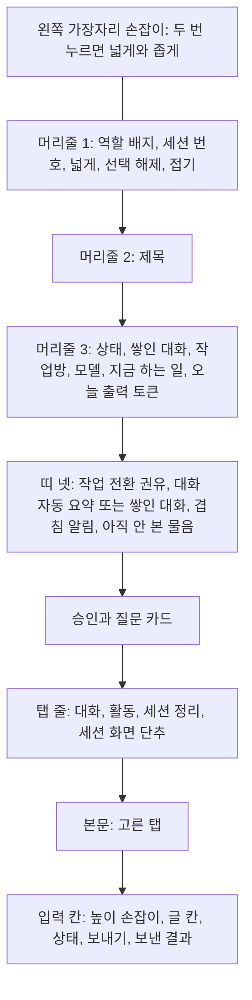

<!--
다루는 곳: bridge/static/js/opanel.js, bridge/static/js/render.js, bridge/static/js/md.js, bridge/static/js/tip.js, bridge/static/js/uiscale.js, bridge/static/js/grip.js, tests/js/grip.test.mjs, tests/js/md.test.mjs, tests/js/render.test.mjs, tests/js/convo_state.test.mjs, tests/js/uiscale_range.test.mjs, tests/js/term_cell.test.mjs, tests/js/api_stop.test.mjs, tests/js/appr_place.test.mjs, tests/js/bg_line.test.mjs, tests/js/escalate_unseen.test.mjs, tests/js/now_doing.test.mjs, tests/js/fold_keep.test.mjs
읽은 커밋: 9971b0f
-->

# 옆 패널

픽셀 화면에서 캐릭터를 누르면 오른쪽에 열리는 칸이 옆 패널이다. 사람이 세션과 실제로 말을 주고받는 곳은 거의 다 여기다. 세션이 무슨 답을 했는지 읽고, 다음 지시를 써 보내고, 세션이 묻는 승인에 답하고, 세션을 넘기거나 끝낸다. 픽셀 화면이 "지금 누가 무엇을 하나"를 한눈에 보여 주는 곳이라면, 옆 패널은 그 가운데 한 세션을 골라 깊이 들여다보는 곳이다 [code:bridge/static/js/opanel.js].

이 편은 패널의 뼈대만 다룬다. 칸이 어떻게 놓였고, 다시 그릴 때 무엇을 지키고, 글을 어떻게 그리고, 툴팁과 글씨 크기와 입력 칸 높이를 어떻게 다루는지다. 패널 안에 들어가는 각 창의 기능은 그 기능의 편이 맡는다 [code:bridge/static/js/opanel.js]. [세션 정리] 탭의 넘기기 흐름은 → 「08 인계와 압축 손실」, 교장(감독) 캐릭터를 눌렀을 때 뜨는 창은 → 「09 교장과 관리자」, 서기 자리를 눌렀을 때의 창은 → 「10 서기와 문서」, 합치기 카드와 코더 자리 창은 → 「07 합치기」, 머리줄의 모델 칩과 모델 고르기 창은 → 「13 사용량과 모델」에서 다룬다. 승인 카드를 띄울지와 어떤 명령을 물을지의 판단은 → 「04 승인」에 있고, 여기서는 그 카드를 패널 어디에 어떻게 그리는지만 짧게 쓴다.

## 무엇을 열고 무엇이 그리나

패널은 `createSidePanel` 하나가 만든다 [code:bridge/static/js/opanel.js]. 픽셀 화면(`office.js`)이 캐릭터를 고를 때마다 패널의 `show(대상)`을 부르고, 패널은 대상의 종류에 따라 다른 것을 그린다. 대상은 다섯 가지다. 세션 캐릭터를 누르면 그 세션의 대화와 입력 칸이 열리고, 출하 라인의 인프라 캐릭터를 누르면 그 프로젝트의 파이프라인 줄이 뜨고(→ 「12 CI/CD 인과 체인」), 서기 자리와 코더 자리와 감독 캐릭터를 누르면 각자의 창이 뜬다. 아무것도 고르지 않았으면 "캐릭터를 누르면 최근 대화와 입력 칸이 여기 열립니다"라는 안내 아래에 프로젝트별 세션 목록이 나온다. 끝난 세션은 프로젝트마다 「종료된 세션 N개」 접는 칸에 넣어 둔다. 자리가 모자라 캐릭터로 서지 못한 세션도 이 목록에서 고를 수 있게 하려는 것이다. 48시간 넘게 활동이 없는 세션은 서버가 목록에서 빼고, 목록 끝에 「48시간 넘게 활동이 없는 세션 N개는 숨겼습니다」라고 수만 적는다 [code:bridge/static/js/opanel.js].

실제로 HTML 조각을 만드는 함수는 대부분 `render.js`에 있다 [code:bridge/static/js/render.js]. 이 파일은 원래 카드 모양의 옛 대시보드(지금의 `/classic`)를 그리던 파일이고, 픽셀 화면이 생기면서 승인 카드, 대화, 활동 줄, 세션 정보, 파이프라인 줄을 함수로 내보내 두 화면이 같은 것을 쓰게 했다. 그래서 "세션 이름을 무엇으로 보이나", "지금 하는 일을 어떻게 말하나" 같은 규칙이 한 곳에만 있고, 패널과 옛 대시보드와 캐릭터 호버가 같은 말을 한다.

패널은 데이터를 직접 가져오지 않는다. 데이터 계층(`store.js`)이 브리지에서 받은 상태를 들고 있다가, 바뀐 영역(승인, 패널, 파이프라인, 격자)의 번호를 올리면 패널이 그 번호를 보고 필요한 곳만 다시 그린다. 이 계약은 → 「데이터 계층」에서 다룬다.

## 위에서 아래로: 칸의 차례

세션을 고른 패널은 위에서 아래로 이렇게 쌓인다.

이 차례에는 까닭이 있다. 승인과 질문 카드는 기다리는 사람이 있는 일이라 탭보다 위에 둔다. 탭을 무엇으로 골라 두었든 카드는 늘 보인다. 띠 넷은 "지금 무언가 하는 게 좋다"는 권유라 머리줄 바로 아래에 두되, 없을 때는 자리를 차지하지 않는다. 입력 칸은 맨 아래에 붙어 있고, 그 위와 탭 줄 아래 사이 전체를 고른 탭의 본문이 차지한다 [code:bridge/static/js/opanel.js].

## 대화가 주인공

패널의 처음 모습은 지금과 달랐다. 세션 정보 표, 인계, 최근 활동, 대화가 한 칸에 위아래로 쌓여 있었고, 대화는 그 가운데 높이가 정해진 작은 상자였다. 사람이 패널을 여는 까닭은 거의 언제나 "세션이 뭐라고 했나"인데, 그 글이 다른 정보 사이에서 몇 줄밖에 보이지 않았다. 그래서 패널을 다시 짜면서 대화를 주인공으로 올렸다 [log:stage11_handoff_result.md]. 지금은 [대화] 탭이 기본이고, 이 탭을 고르면 탭 줄 바로 아래부터 입력 칸 바로 위까지 대화가 다 차지한다. CSS로는 대화 상자가 남는 높이를 모두 받는 `flex:1 1 0`이고 자기 안에서 스크롤한다 [code:bridge/static/office.html].

대화 안에서 사람이 보낸 글은 오른쪽 말풍선, 세션(CC)의 답은 왼쪽 카드로 그린다. 서브에이전트 결과, 완료 알림, 다른 세션이 보낸 말처럼 사람이 쓰지 않은 입력은 점선의 작은 글로 그려 곁가지임을 드러낸다. 입력이 누구에게서 왔는지는 서버가 턴마다 붙이는 출처 값으로 가른다. 「나」, 「완료 알림」, 「서브에이전트 결과」, 「다른 세션」, 「관리자 부탁」, 「작업 세션 보고」, 「합치기 카드(FOREMAN)」 같은 이름표가 글 위에 붙는다 [code:bridge/static/js/render.js]. 세션이 일하는 동안 사람이 더 보낸 글은 그 턴 안에 「나 · 작업 중에 보냄」으로 끼워 넣는다. CC가 붙이는 내부 포장(`<agent-message>`, `<task-notification>`)은 벗기고 요약과 본문만 보인다.

대화를 받기 전과 받는 동안은 「불러오는 중…」, 받았는데 턴이 하나도 없으면 「아직 대화가 없습니다.」, 받지 못했으면 「대화를 불러오지 못했습니다(까닭).」를 보인다 [code:bridge/static/js/render.js]. 셋을 가르지 않으면 새로 띄워 아직 첫 글을 받지 않은 세션이 「불러오는 중…」에 머문다. 대화 요청은 턴 0개로 잘 돌아왔는데 빈 결과를 불러오는 중과 같은 빈 글로 그렸기 때문이다 [log:foreman-5_inject_unconfirmed_20261120.md].

답 카드 머리에는 턴이 어떻게 끝났는지가 붙는다. 「끝남」, 「중단」, 「API 오류」, 「프로세스 사라짐」 같은 말이다. API 오류로 끝난 턴은 오류의 종류(안전 분류기 거부, 사용량 한도, 과부하 등)를 글자로 쓰고, 할 일과 요청 번호는 호버로 뺀다 [code:bridge/static/js/render.js]. 오류를 가르는 판단은 → 「03 세션 지켜보기와 글 넣기」에서 다룬다. 한 턴 안에서 세션이 마지막 답 전에 쓴 글들은 「중간 글 N」 접는 칸에 모은다.

긴 글은 기본으로 펼쳐 둔다. 100줄이나 1만 2천 자를 넘는 아주 긴 글만 앞부분을 보이고 [전체 보기 (N자)] 단추를 단다 [code:bridge/static/js/render.js]. 처음에는 14줄이나 1,400자에서 접었는데, 그러면 보통 길이의 답도 접혀 매번 눌러야 했다. 기준을 올린 뒤 FOREMAN 대화 38개 가운데 접힌 것은 하나뿐이었다 [log:stage11_handoff_result.md]. 패널 안에 스크롤을 하나 더 만들지 않으려고 글 상자 자체에는 높이 제한을 두지 않는다. 대화 칸 안에 또 스크롤 상자가 있으면 휠이 어디로 가는지 헷갈리기 때문이다.

대화의 시각은 「3분 전」이 아니라 시계(「14:05」)로 쓴다. 「n분 전」은 시간이 흐르면 글자가 바뀌고, 글자가 바뀌면 대화 전체를 다시 그려야 한다. 그러면 아래 절에서 다루는 "읽던 자리 지키기"가 깨진다. 시계로 쓰면 새 글이 오기 전에는 대화의 HTML이 한 글자도 바뀌지 않는다 [code:bridge/static/js/render.js].

## 너비는 둘, 그리고 접기

패널 너비는 좁게와 넓게 두 값뿐이다 [code:bridge/static/js/opanel.js]. 좁게는 창 폭의 40%, 넓게는 60%다. 넓게라도 픽셀 화면이 464px 밑으로는 줄지 않게 했다. 464px은 방 모눈 28칸이 원본 그림 크기(한 칸 16px) 그대로 들어가는 폭이라서, 1024px 창에서는 넓게가 6 : 4가 아니라 화면 464 : 패널 560이 된다 [log:designer_polish_seven_20261111.md]. 패널은 280px보다 좁아지지 않는다. 머리줄의 [⇤ 넓게] 단추나 패널 왼쪽 가장자리를 두 번 누르면 둘 사이를 오가고, 고른 값은 브라우저에 기억한다.

처음에는 가장자리를 끌어 너비를 마음대로 정할 수 있었고, 좁게와 넓게 각각 끌어 둔 값을 따로 기억했다. 이것을 없앤 까닭은 픽셀 화면 쪽에 있다. 패널 너비가 바뀌면 픽셀 화면의 폭이 바뀌고, 그 폭마다 방의 배율과 캐릭터 이름표가 들어갈 자리가 달라진다. 너비가 끝없이 많으면 이름표 자리 고르기를 모든 폭에서 맞춰야 했다. 그래서 끌기를 막고 두 값만 남겼다 [code:bridge/static/js/opanel.js]. 끌어 두었던 옛 값은 읽지 않고 지운다.

머리줄 오른쪽 끝 [▶]은 패널을 접어 오른쪽 가장자리의 가는 막대로 만든다. 막대에는 승인 대기 수가 배지로 붙는다. 접어 둔 사이에 새 승인 요청이 오면 패널은 스스로 다시 펴진다. 승인은 기다리는 세션이 있는 일이라, 사람이 접어 둔 것보다 그 세션이 멈춰 있는 것이 더 나쁘다고 본 것이다. 다만 화면을 처음 열었을 때 이미 있던 승인으로는 펴지 않는다.

패널이 오른쪽에 붙어 있으면 아래 셸 칸은 패널 왼쪽까지만 펼쳐지고 패널은 창 바닥까지 내려간다. 패널 너비를 바꾸거나 접고 펴면 크기 감시기(ResizeObserver)가 따라간다. 셸 칸 자체는 → 「셸 패널과 세션 화면」에서 다룬다.

## 탭 셋

세션을 고르면 탭 줄이 뜬다. 탭은 [대화], [활동], [세션 정리] 셋이다 [code:bridge/static/js/opanel.js]. 고른 탭은 브라우저에 기억해 다음에 다른 세션을 열어도 같은 탭으로 열린다.

**[대화]**는 위에서 쓴 대로 사람과 세션이 주고받은 글이다. 세션이 무엇을 말했는지를 보는 곳이다.

**[활동]**은 세션이 무엇을 했는지를 보는 곳이다. 세션이 부른 도구(Bash, Read, Edit, Grep, Agent 등)가 한 줄씩 쌓이고, 탭 이름 옆에 그 수가 붙는다. 줄을 누르면 그 호출의 입력 전체와 결과 본문이 바로 아래 펼쳐진다. 이 본문은 DB에 없다. DB는 도구 이름과 대상 정도만 들고 있고, 본문은 누를 때 `GET /api/events/{id}/detail`이 그 세션의 트랜스크립트 파일에서 그때그때 읽어 온다 [code:bridge/api/dashboard.py]. 읽어 온 본문은 비밀값을 가린 뒤라 「비밀값은 가림」이 맨 아래 붙는다. 받은 것은 이 브라우저 탭에만 두고, 결과가 아직 없던 호출(도는 중이던 것)은 다시 누르면 다시 읽는다. 머리줄과 [세션 정리] 탭은 명령을 "하는 일"로 바꿔 보이지만(아래 머리줄 절), [활동] 탭은 도구 호출 기록 그 자체라 명령을 그대로 둔다.

**[세션 정리]**는 세션을 다루는 곳이다. 세션이 일하는 중이면 맨 위에 「▶ 작업 중 · 10분째」 한 줄이 뜬다. 끝났다는 신호가 오지 않은 턴이면 「⚠ 끝났는지 모름」으로 바뀐다. 그 아래에 새 세션으로 옮기기, 합치기 카드, 끝내기 단추 묶음이 오고(→ 「08 인계와 압축 손실」, → 「07 합치기」), 맨 아래에 「세션 정보 · 토큰」과 「승인 기록」 접는 칸이 있다. 승인 기록은 펼칠 때만 서버에서 읽는다. 이 탭의 이름은 원래 「세션」이었다. 탭 안에 든 것이 정보가 아니라 넘기기, 합치기, 끝내기 같은 정리 일이라 이름을 「세션 정리」로 바꿨다 [docs:10_office_design.md]. 「프로젝트 · 서버 경로」 줄도 있었는데, 사람이 서버 경로를 볼 일이 없어서 뺐다.

탭 줄 오른쪽 끝의 [세션 화면 ↗]은 탭이 아니라 단추다. 누르면 그 세션의 Claude Code 창을 띄우는 창으로 연다. 권한 창이나 계획 승인 창처럼 FOREMAN이 글로 받을 수 없는 결정 창을 사람이 직접 보고 키를 누르게 하는 것이다(→ 「셸 패널과 세션 화면」).

탭을 바꾸는 것은 대개 사람이지만, 화면이 이번만 다른 탭으로 여는 길이 있다. 사무실 머리말의 「🔀 합치기 대기 N」 막대를 누르면 가장 오래된 카드의 세션을 [세션 정리] 탭으로 연다. 캐릭터 머리 위의 합치기 말풍선(「합치기 기다림」, 합치기 카드를 가리키는 「사용자 답 기다림」)을 눌러도 그 세션을 같은 탭으로 연다 [code:bridge/static/js/office.js]. 카드가 그 탭에만 있기 때문이다. 이때는 기억해 둔 탭을 바꾸지 않아서, 다음에 캐릭터를 눌러 열면 사람이 마지막으로 고른 탭으로 돌아간다(`showTab`) [code:bridge/static/js/opanel.js].

## 머리줄

머리줄은 세 줄이다. 첫 줄에 역할 배지와 세션 번호와 단추들, 둘째 줄에 제목, 셋째 줄에 세션의 지금 상태가 한 줄로 온다.

### 번호는 크게, 제목은 작게

첫 줄은 「[코더] 세션 230」처럼 역할 배지와 번호다. 배지를 누르면 그 자리에서 역할 고르기 칸이 열린다(역할의 뜻은 → 「05 역할과 권한」). 둘째 줄이 제목이다. 처음에는 「[코더] 세션 242 — 제목」을 한 줄에 두었는데, 1920px 화면의 기본 폭 패널에서 제목이 "서" 한 글자로 줄어들어 두 줄로 나눴다 [docs:10_office_design.md].

번호와 제목 가운데 무엇을 크게 보일지도 바꿨다. 처음에는 제목이 굵고 번호가 작은 회색이었다. 그런데 사람과 관리자 세션이 실제로 세션을 부르는 말은 "세션 430"처럼 번호다. 관리자에게 일을 시킬 때도, 기록에도, 세션 사이 말에도 번호로 나온다. 그래서 둘의 모양을 맞바꿔 번호를 굵은 보통 글씨로, 제목을 작은 회색으로 했다. 두 글씨는 원래 같은 16px이라 새 크기를 만들지 않고, 굵기와 색만 서로 바꿨다 [log:foreman-5_session_number_big_20261115.md]. 같은 바꿈을 패널 세션 목록 줄과 캐릭터 호버에도 했다.

번호에 마우스를 올리면 세션의 짧은 해시와 tmux 창 이름이 나온다. 사람이 평소에 볼 일은 없지만 문제를 좇을 때 필요한 값이라 호버로 뺐다.

### 셋째 줄: 지금 이 세션은

셋째 줄은 아래 차례로 이어진다 [code:bridge/static/js/opanel.js].

| 차례 | 무엇 | 언제 |
|---|---|---|
| 1 | 「끝난 세션 · 합쳤습니다 · 3시간 전」 | 끝난 세션일 때(아래 「끝남」 절) |
| 2 | 상태 배지 | 늘. 사람이 풀어야 하는 대기(권한 거부, API 오류로 멈춤, 답 기다림, 사용자 답 기다림)가 있으면 그것이 「작업 중」 「대기」보다 앞선다 |
| 3 | [답 안 해도 됨] | 답 기다림으로 판정됐을 때. 묻지 않는 끝맺음을 판정이 잘못 잡았으면 사람이 끈다 |
| 4 | 멈춤 칩 「⏸ 응답 없음」 등 | 브리지가 1분마다 잰 멈춤이 있을 때(→ 「03 세션 지켜보기와 글 넣기」) |
| 5 | 「쌓인 대화 N%」 | 대화 토큰을 알 때 |
| 6 | 「작업방 foreman-2」 | 작업방(worktree, 세션마다 떼어 준 작업 폴더와 브랜치)에서 일하는 세션 |
| 7 | 모델 칩 「Opus 5.5 ▾」 | 늘. 누르면 모델 고르기 창(→ 「13 사용량과 모델」) |
| 8 | 지금 하는 일 | 일하는 중일 때 |
| 9 | 「서브 N」 | 서브에이전트가 돌 때 |
| 10 | 「오늘 출력 토큰 N」 | 늘 |
| 11 | 「⚠ 끝났는지 모름」 | 끝 신호가 오지 않은 턴이 남았을 때 |

이 줄은 한 줄이라, 좁은 패널에서는 뒤쪽이 말줄임으로 잘린다. 그래서 사람이 꼭 봐야 하는 것을 앞에 두었다. 「쌓인 대화 N%」를 상태 바로 뒤에 둔 것도 1366px 화면 사진에서 뒤쪽에 있던 이 칩이 잘려 보이지 않았기 때문이다 [code:bridge/static/js/opanel.js]. 각 칸의 호버는 사람이 알 일만 쓴다. 전에는 「작업방」 줄 전체에 세션 해시, tmux 창, 프로젝트, 서버 경로가 다 걸려 있었는데 "설명이 과하다"는 말을 듣고 어느 작업방, 어느 브랜치인지와 합치기를 기다리는지만 남겼다 [log:designer_panel_tips_20261114.md].

### 쌓인 대화 N%

「쌓인 대화 N%」는 이 세션의 대화가 모델이 한 번에 읽을 수 있는 양(맥락 창)을 얼마나 채웠는지다 [code:bridge/static/js/opanel.js]. 세션은 답할 때마다 쌓인 대화를 전부 다시 읽으니, 이 값이 크면 답이 비싸고 느리고 앞에서 정한 것을 놓치기 쉽다. 이름을 그냥 「N%」로 두지 않은 것은 머리말에 계정 사용 한도를 보이는 칩이 따로 있어 둘 다 %이기 때문이다. 한도와 헷갈리지 않게 "쌓인 대화"라는 말을 붙였다.

창 크기를 모르는 모델이면 %를 내지 않고 「쌓인 대화 180k」처럼 토큰으로 보인다. 토큰이 설정한 창보다 크면 %가 100을 넘는 대신 「⚠」를 붙이고 호버에 "창 크기 값이 틀렸습니다(config/models.toml [windows])"라고 쓴다. 숫자가 이상하면 설정이 틀렸다고 스스로 말하게 한 것이다 [code:bridge/static/js/opanel.js]. 색은 문턱에 따라 회색, 노랑, 빨강으로 바뀐다.

호버의 숫자 줄 끝에는 「대화 자동 요약 3번, 요약하고 남은 양입니다」가 붙는다. 캐릭터 호버는 「요약 3번, 넘어갈 때」라고 하는데 패널은 9%라 서로 어긋나 보였기 때문이다. 9%는 요약으로 줄이고 남은 양이라 낮게 보여도 이미 여러 번 줄인 대화다 [log:foreman-4_ctx_chip_compact_20261115.md]. 요약이 한 번도 없었으면 이 줄을 뺀다.

### 지금 하는 일: Bash는 명령이 아니라 하는 일로

세션이 일하는 중이면 셋째 줄에 지금 하는 일이 굵게 붙는다. 일하는 중인데 지금 부르는 도구가 없으면 「생각 중」이다 [code:bridge/static/js/opanel.js]. Read나 Edit 같은 도구는 「Read opanel.js」처럼 도구와 대상을 쓰면 읽힌다. 문제는 Bash였다. 처음에는 Bash도 명령을 그대로 썼더니 머리줄에 `Bash S=/tmp/claude-1000/-home-kopo17-AI-programming-foreman--wor…` 같은 글이 떠서 무엇을 하는지 알 수 없었다 [log:designer_panel_tips_20261114.md].

그래서 Bash는 "하는 일"로 바꿔 보인다 [code:bridge/static/js/render.js]. 먼저 CC가 Bash 도구를 부를 때 사람이 읽으라고 붙이는 한 줄 설명(`description`)이 있으면 그것을 CC가 쓴 그대로, 60자까지 쓴다. 영어여도 그대로 둔다. 설명이 없을 때만 명령의 머리를 보고 아래 같은 표에서 고른다.

| 명령 머리 | 보이는 말 |
|---|---|
| `pytest`, `node --test`, `npm test` | 시험 돌리는 중 |
| `git commit` / `git push` | 커밋하는 중 / push하는 중 |
| `git merge-tree` | 합칠 수 있는지 보는 중 |
| `git merge`, `rebase`, `cherry-pick` | 합치는 중 |
| `git fetch`, `pull` | 가져오는 중 |
| `git add`, `restore`, `reset`, `stash`, `checkout`, `switch`, `branch`, `worktree`, `rm`, `mv` | 변경 정리하는 중 |
| 그 밖의 `git` | 변경 기록 보는 중 |
| `tools/screen.py` | 화면 점검하는 중 |
| `grep`, `rg`, `egrep`, `find`, `fd` | 찾는 중 |
| `cat`, `head`, `tail`, `sed -n`, `ls`, `wc`, `less`, `tree`, `stat`, `du`, `diff` | 파일 보는 중 |
| `curl` | API 부르는 중 |
| `systemctl`, `journalctl` | 서비스 보는 중 |
| `tmux` | Claude Code 창 다루는 중 |
| `docker`, `kubectl`, `helm` | 컨테이너 다루는 중 |
| `npm`, `pip`, `uv`, `apt`의 설치(`install`, `add`, `sync`) | 설치하는 중 |
| `sleep`, `until`, `while` | 기다리는 중 |
| 그 밖의 `python`, `node` | 스크립트 돌리는 중 |
| 모름 | 명령 실행 중 |

표는 위에서부터 읽어 처음 맞는 줄을 쓴다. `git`은 하위 명령마다 줄이 따로 있고, 어느 것에도 맞지 않는 `git`만 「변경 기록 보는 중」이 된다.

명령 앞에는 `cd 폴더 &&`, `PYTHONPATH=.`, `timeout 60`, `mkdir -p`, `echo` 같은 준비가 붙는 일이 많다. 그대로 머리를 보면 거의 다 「명령 실행 중」이 된다. 그래서 `&&`, `||`, `;`, `|`로 명령을 나누고, 조각마다 앞의 `cd`, 변수 넣기, `timeout`, `env`, `nice`, `time` 같은 앞붙이를 벗긴다. 그다음 준비 명령(`mkdir`, `echo`, `printf`, `export`, `set`, `source`, `true`, `cd`)과 변수 넣기만 있는 조각을 건너뛰어 처음 걸리는 일을 쓴다 [code:bridge/static/js/render.js]. 첫 사진에서 `S=…; mkdir …; … screen.py`가 「명령 실행 중」으로 나와서 이렇게 고쳤다 [log:designer_panel_tips_20261114.md]. 따옴표 안에서도 나뉘는 어림 계산이지만, 보이는 것은 "대략 무엇을 하나"라서 그 정도면 된다고 봤다.

명령 글 자체는 버리지 않고 호버로 옮겼다. 「명령 — 지금 돌리는 명령입니다.」 아래에 명령 200자가 나온다. 같은 함수를 [세션 정리] 탭, 옛 대시보드 카드, 캐릭터 호버가 쓴다. 다만 캐릭터 호버에는 명령 글을 보이지 않는다. 디자이너 세션의 호버에 임시 폴더 경로가 그대로 떴기 때문이다 [docs:10_office_design.md].

### 머리줄 아래 띠 넷

머리줄과 승인 칸 사이에는 필요할 때만 뜨는 띠가 넷 있다 [code:bridge/static/js/opanel.js]. 첫째는 작업 전환 권유다. 사람이 새 일을 시작하는 말을 했고, 그 직전 30분 안에 이 세션이 커밋했거나 20분 넘게 쉬었다 왔고, 쌓인 대화가 맥락 창의 40% 이상이면 「🔀 다른 일로 넘어가시는 것 같습니다」가 뜬다 [code:bridge/switchwatch.py] [code:config/notify.toml]. 둘째는 쌓인 대화 띠다. 대화 자동 요약이 두 번째부터 「📦 대화 자동 요약 N번」(네 번째부터 빨강)이 뜨고, 요약 단계가 아직 없으면 쌓인 대화가 토큰 300k와 500k, 창 비율 50%와 75% 가운데 먼저 닿는 문턱을 넘을 때 「🧠 지금까지 쌓인 대화」가 뜬다 [code:bridge/compactwatch.py]. 셋째는 방금 넣은 요청이 다른 세션의 일과 겹칠 때의 「📝 같은 파일」, 「🔁 겹침」, 「🔁 겹칠 수도」다. 앞의 둘은 모두 [새 세션으로 옮기기]를 권하고(→ 「08 인계와 압축 손실」), 겹침은 → 「09 교장과 관리자」에서 다룬다.

패널 쪽에서 정한 것은 둘이다. 하나는 작업 전환 권유가 떠 있으면 쌓인 대화 띠를 숨기는 것이다. 같은 단추를 더 분명한 까닭과 함께 권하기 때문이다. 다른 하나는 [나중에]다. 세 띠 모두 [나중에]로 이 브라우저에서 숨길 수 있는데, 숨기는 길이가 띠마다 다르다. 작업 전환 권유는 그 사람 턴 동안만 숨기고 다음에 다른 일로 넘어가는 말이 나오면 다시 판정한다. 대화 자동 요약 띠는 다음 요약까지, 쌓인 대화 띠는 다음 단계(노랑에서 빨강)까지, 겹침 띠는 그 겹침 하나만 숨긴다. 띠가 알리는 까닭이 새로 생기면 다시 보이게 하려는 것이다.

넷째 띠는 관리자 패널에만 뜬다. 관리자가 올린 물음인데 사람이 물음 번호 없이 다른 입력으로 넘어간 것이 있으면 「❔ 아직 안 본 물음 N」과 물음마다 번호, 글 한 줄, [봤다]가 보인다 [code:bridge/static/js/opanel.js]. 이 띠에는 [나중에]가 없다. 숨기는 길을 두면 다시 쌓여도 안 보이게 되므로, 하나씩 읽고 [봤다]로 지우는 길 하나만 두었다. 물음 번호로 답했는지의 판정은 → 「관리자에게 넘기기와 보고」가 다룬다 [log:foreman-8_escalate_number_20261117.md].

## 읽던 자리를 지키는 다시 그리기

패널은 몇 초마다, 그리고 이벤트가 올 때마다 다시 그려진다. 세션이 도구를 하나 부를 때마다, 승인이 하나 생길 때마다, 15초 주기로 상태를 다시 받을 때마다다. 처음에는 그때마다 대화를 통째로 다시 그렸다. 그러면 사람이 위로 올려 읽던 자리가 맨 아래로 튀고, 마우스로 골라 둔 글자가 풀렸다. 10초마다 읽던 곳을 잃는 화면은 읽을 수가 없다 [log:stage11_handoff_result.md].

그래서 지금은 "내용이 바뀔 때만" 다시 그린다. 패널은 칸마다 마지막으로 넣은 HTML 글을 기억해 두고(`put`), 새로 만든 HTML이 한 글자라도 다를 때만 그 칸을 바꾼다 [code:bridge/static/js/opanel.js]. 대화의 시각을 시계로 쓴 것도 이 때문이다. 다른 세션을 고르면 기억을 비워 처음부터 그린다. 시간 표시(「3분 전」)를 쓰는 칸은 따로 10초마다 갱신하지만, 대화 칸은 거기에 들지 않는다.

새 답이 왔을 때 어디를 보여 줄지는 사람이 지금 어디를 보고 있는지로 정한다. 대화 칸의 맨 아래에서 60px 안쪽을 보고 있었으면 새 답을 따라 맨 아래로 내려간다. 위를 읽고 있었으면 그 자리를 그대로 두고, 대화 칸 아래쪽에 [새 답 ↓] 단추만 띄운다 [code:bridge/static/js/opanel.js]. 누르면 부드럽게 맨 아래로 간다. 사람이 글을 보내면 자기가 보낸 글이 보이도록 맨 아래로 내린다.

대화 칸의 높이가 바뀔 때도 자리를 지킨다. 입력 칸을 끌어 키우거나, 창 크기를 바꾸거나, 승인 카드가 생기면 대화 칸이 줄어든다. 브라우저는 이때 위쪽을 기준으로 두기 때문에, 맨 아래를 보고 있던 사람에게는 마지막 글이 입력 칸 밑으로 가려졌다. 그래서 크기 감시기가 대화 칸 높이 변화를 보고, 맨 아래를 보고 있었으면 맨 아래에 다시 붙이고, 위를 읽던 중이면 아래쪽에서 떨어진 거리를 그대로 지킨다 [code:bridge/static/js/opanel.js].

여기서 한 번 더 막혔다. 패널에는 글씨 배율이 CSS `zoom`으로 걸려 있어서 스크롤 위치가 소수가 된다. 아래쪽 거리를 그대로 지키면 한 번 맞출 때마다 0.2~0.4px씩 어긋났고, 그 어긋난 값이 다시 기억되어 쌓였다. 입력 칸을 위로 여덟 번 끌었더니 맨 아래에서 2.7px 떠 있었다 [log:designer_inputh_tip_bottom_20261111.md]. 그래서 "맨 아래를 보고 있었는가"를 거리와 따로 기억한다(`convoStick`, 4px 미만이면 맨 아래). 맨 아래였으면 거리 대신 언제나 맨 아래에 붙인다. 끌기를 마친 뒤에는 화면이 가라앉은 다음 두 프레임에 걸쳐 한 번씩 더 붙인다.

긴 글을 접을 때도 흐름을 지킨다. 펼쳐 읽다가 [접기]를 누르면 글이 짧아지면서 화면이 엉뚱한 곳으로 간다. 그 글의 머리가 화면 위로 사라졌으면 머리로 데려온다. 펼칠 때는 자리를 그대로 둔다.

같은 생각을 다른 칸에도 썼다. 사람이 펼치거나 접은 칸(`
`)은 다시 그려도 그 상태로 돌아온다. 패널을 다시 그리면 접는 칸이 처음값으로 돌아가는 일이 서기실 창과 요약 고치기에서 있었다 [log:portfolio_publish_20261106.md]. 그래서 칸마다 이름을 주고(`keep(이름, 처음값)`), 사람이 바꾼 상태를 이름별로 기억해 다시 그릴 때 그 상태로 넣는다 [code:bridge/static/js/render.js]. 기억은 새로고침 뒤에도 남는다. 브라우저 저장소에 적어 두고(최근 200칸까지, 막혀 있으면 그 탭에서만), 그릴 때 브라우저가 스스로 쏘는 열림 신호는 사람이 한 선택으로 적지 않는다. 적으면 처음값이 사람의 선택으로 굳어서, 나중에 처음값이 바뀌어도(새 글이면 펼침처럼) 따라가지 못한다. 서기실의 물어보기 칸과 할 일 칸, 패널 목록의 「종료된 세션」 칸도 이 길을 쓴다. 전에는 물어보기 칸이 그릴 때마다 펼쳐졌고, 정리할까요를 눌러 연 할 일 칸은 접어도 다시 그릴 때 도로 펼쳐졌다. 펼친 긴 글, 펼친 중간 글, 펼친 활동 줄도 다시 그릴 때 펼친 채로 돌아오지만, 이 셋은 브라우저 저장소에 적지 않고 그 탭 안에서만 기억한다. 새로고침하면 처음처럼 접힌다 [code:bridge/static/js/render.js]. 제목을 고치는 중이거나 역할 고르기 칸이 열려 있는 동안에는 그 자리를 다시 그리지 않는다. 승인 카드의 글 칸에 치던 글도 다시 그려도 남는다(아래 승인 카드 절).

## 작은 마크다운

세션의 답에는 제목, 표, 목록, 코드블록이 많다. 처음 패널은 굵게, 제목, 인라인 코드, 코드블록만 알아보는 가벼운 변환을 썼다 [log:stage11_handoff_result.md]. 그러자 표는 `|`와 `-`가 그대로 보였고, 목록 안에 들여 쓴 코드블록을 알아보지 못했고, 글 칸이 줄바꿈을 그대로 살리는 모양이라 블록 사이 빈 줄이 겹쳤다. 그래서 블록 단위로 읽는 작은 파서를 따로 만들었다 [code:bridge/static/js/md.js]. 130줄 남짓한 파일 하나이고, DOM을 전혀 모르는 순수 함수라 브라우저 없이 `node --test`로 시험한다. 바꾼 뒤 FOREMAN 대화에서 표 9개, 목록 87개, 코드블록 2개가 제대로 그려졌고 날것의 `|` 줄은 0이 되었다 [log:stage11_handoff_result.md].

알아보는 것은 CC 답에 실제로 나오는 것뿐이다.

| 블록 | 인라인 |
|---|---|
| 제목(`#`~`######`), 문단, 가로줄 | 굵게(`**`, `__`), 기울임(`*`), 지운 줄(`~~`) |
| 표(열 정렬 `:--`, `:-:`, `--:` 포함, 칸 안의 `\|`) | 인라인 코드 |
| 목록(글머리, 번호, 들여쓰기로 중첩, 이어지는 줄) | 링크(`http`, `https`만) |
| 코드블록(백틱 세 개와 물결 세 개, 목록 안에 들여 쓴 것도) | |
| 인용(`>`, 안쪽도 다시 마크다운) | |

목록에서는 두 번 고친 일이 있다. 「1. 제목」 다음 줄에 「- 항목」이 오면 글머리 항목이 번호 목록에 붙어 「2.」로 보였다. 같은 들여쓰기에서 종류가 바뀌면 새 목록을 열게 했다. 또 「2. 노트」로 시작하는 번호 목록이 「1.」로 보였다. 번호 목록은 첫 번호를 지키게 했다 [code:bridge/static/js/md.js]. `2 * 3 * 4` 같은 곱셈이 기울임으로 바뀌지 않게, 별표 앞뒤의 글자 꼴도 본다.

### 원문 HTML을 통과시키지 않는 까닭

이 파서의 가장 중요한 규칙은 "먼저 이스케이프하고, 그다음 태그를 붙인다"이다 [code:bridge/static/js/md.js]. 들어온 글의 `<`, `>`, `&`, `"`, `'`를 모두 글자로 바꾼 뒤에, 파서가 알아본 마크다운 꼴에만 파서가 직접 만든 태그(`<b>`, `<table>` 등)를 붙인다. 그래서 글 안에 `<b>x</b>`가 있으면 굵은 x가 아니라 `<b>x</b>`라는 글자 그대로 보인다. 시험이 이것을 확인한다 [code:tests/js/md.test.mjs].

이렇게 정한 까닭은 보안이다. 패널은 이 HTML을 `innerHTML`로 화면에 넣는다. 그런데 대화에 들어오는 글은 FOREMAN이 쓴 글이 아니다. 세션의 답에는 웹 페이지에서 읽어 온 글, 다른 저장소의 파일 내용, 사람이 붙여 넣은 글, 다른 세션이 보낸 말이 섞인다. 이 가운데 하나에 `` 같은 조각이 들어 있고 그것을 HTML로 통과시키면, 그 조각은 사람의 브라우저에서 스크립트로 돈다. 그리고 이 화면은 아무 화면이 아니다. 데이터 계층은 브리지 API 토큰을 들고 모든 요청에 붙이고 [code:bridge/static/js/store.js], 패널에는 승인 단추와 세션에 글을 넣는 단추가 있다. 대화 글 하나가 승인을 누르거나 세션에 명령을 넣을 수 있게 되는 셈이다. 그래서 원문 HTML은 한 글자도 통과시키지 않는다.

같은 까닭으로 링크는 `http`와 `https` 주소만 링크로 만든다. `[a](javascript:alert(1))`는 링크가 되지 않고 글자로 남는다. 시험이 이것도 본다 [code:tests/js/md.test.mjs]. 만든 링크는 새 탭으로 열고 `rel="noopener noreferrer"`를 붙여, 열린 페이지가 이 화면을 되짚어 건드리지 못하게 한다. 인라인 코드 안의 글은 먼저 자리표시로 빼 두었다가 마지막에 되돌려서, 코드 안의 `**`가 굵게로 바뀌지 않게 한다. 코드블록 안은 이스케이프만 하고 아무것도 바꾸지 않는다.

이 규칙 때문에 포기한 것도 있다. CC 답에 원문 HTML(`
`, ` `, `` 등)이 섞여 오면 태그가 글자 그대로 보인다. 이미지와 각주도 그리지 않는다. 화면이 조금 덜 예쁜 쪽을 골랐다.

## 툴팁 하나

FOREMAN 화면의 툴팁은 하나다 [code:bridge/static/js/tip.js]. 픽셀 화면의 구역 이름표, 캐릭터, 출하 라인처럼 캔버스에 그린 것과, 버튼과 패널 칸처럼 HTML로 된 것이 같은 모양, 같은 속도로 뜬다. 처음에는 브라우저 기본 툴팁(`title`)과 캔버스용 툴팁이 따로 있어 생김새도 뜨는 때도 달랐다. 지금은 마우스를 올리고 350ms 머물면 뜨고, 이미 하나가 떠 있는 상태에서 옆 대상으로 옮기면 60ms 만에 바뀐다 [code:bridge/static/js/tip.js]. 지나가는 마우스에 깜빡이지 않게 하면서, 버튼 줄을 훑어볼 때는 기다리지 않게 하려는 것이다. 색과 글꼴은 테마의 이름표(마법학교의 양피지, 오피스의 사인판, 현장의 안전 표지판)를 따르고, 크기와 여백과 위치는 테마와 상관없이 같다. 누르는 순간(mousedown) 툴팁은 사라진다.

### 「제목 — 설명」, 문장마다 줄바꿈

HTML 쪽 툴팁 글은 한 가지 꼴로 쓴다. 첫 줄은 「제목 — 설명」, 그 아래 줄들은 숫자다 [code:bridge/static/js/tip.js]. 예를 들어 「쌓인 대화 — 이 세션의 대화가 … 채웠는지입니다.」 아래에 「토큰 33만 6천」, 「창 100만」이 한 줄씩 온다. `textTip`이 이 글을 받아 제목은 굵게, 설명은 그 아래, 숫자 줄은 구분선 아래에 놓는다. 숫자 줄 꼴이 셋 더 있다. 「**머리**」는 굵은 머리 줄, 「¶ 글」은 설명 문단, 앞에 빈칸 둘로 시작하는 줄은 한 칸 들여 쓴 하위 줄이다. 사용량 한도 호버가 기간별로 묶어 보이려고 쓴다. 화면 글을 쓰는 사람은 이 꼴만 지키면 되고 HTML을 쓰지 않는다. 툴팁 글은 HTML이 아니라 글자로 받아 이스케이프하므로, 위 마크다운과 같은 까닭으로 안전하다.

설명은 문장마다 줄을 바꾼다. 처음에는 긴 한 문단이라 폭이 차는 곳에서 끊겼고, 「넘쳐 쓸 / 크레딧이」처럼 뜻 가운데서 줄이 갈렸다 [log:tips_and_credit_signal_20261109.md]. 지금은 「…다.」, 「…요.」, 「…죠.」, 「?」, 「!」 뒤의 빈칸에서 문장을 나눠(`splitSentences`) 한 문장을 한 줄로 시작한다. 문장 안은 낱말 단위로 줄을 바꾼다. 경로, 명령, 주소처럼 띄어쓰기 없이 16자를 넘는 글은 아무 글자에서나 끊기지 않게, `/ _ - . = , : ? &` 뒤에만 끊을 자리를 넣는다(`softEsc`). 툴팁은 화면보다 높아지면 자르지 않고 폭을 화면 폭까지 넓혀 높이를 줄인다. 보통 때 폭은 440px에 글씨 배율을 곱한 값까지다 [log:tips_and_credit_signal_20261109.md].

### title을 data-tip으로 옮기기

패널 코드 곳곳에는 `title="…"`이 그대로 쓰여 있다. 그대로 두면 브라우저 기본 툴팁이 이 툴팁과 함께 떠서 두 개가 겹친다. 그래서 `title`이 붙는 순간 그 글을 `data-tip`으로 옮기고 `title`은 지운다 [code:bridge/static/js/tip.js]. 처음에는 마우스를 올린 순간에만 옮겼는데, 머리말의 작업 수나 패널 칸처럼 다시 그리면서 `title`을 또 붙이는 곳에서 두 툴팁이 함께 떴다 [log:cross_paste_20261109.md]. 지금은 문서 전체를 감시기(MutationObserver)로 지켜보다가 새로 생기는 요소, 새로 붙는 `title`까지 그 자리에서 옮긴다. 꺼진 버튼은 예외다. 브라우저에 따라 꺼진 버튼에는 마우스 이벤트가 오지 않아 이 툴팁이 뜨지 못하므로, 꺼진 동안은 `title`을 남겨 기본 툴팁 하나만 뜨게 하고, 다시 켜지면 옮긴다.

셸 칸(iframe)에는 툴팁을 띄우지 않는다. iframe 안에서 움직이는 마우스는 바깥 문서에 "나갔다"와 "눌렀다"를 알리지 않아서, 툴팁이 셸 프롬프트 줄 위에 그대로 남았다 [code:bridge/static/js/tip.js].

### tipAudit: 호버가 잘리는지 기계로 센다

툴팁 글은 화면 곳곳에서 사람이 손으로 쓰고, 어떤 것은 세션 이름이나 명령처럼 그때그때 달라진다. 하나가 잘리거나 낱말 가운데서 끊겨도 아무도 모른다. 그래서 점검 함수 `tipAudit`을 두었다 [code:bridge/static/js/tip.js]. 지금 화면의 모든 호버 글을 실제 툴팁과 같은 상자에 보이지 않게 넣어 보고, 안쪽이 상자 밖으로 넘치는지, 폭을 넓혀도 화면보다 큰지, 끊을 자리 없이 줄 폭보다 긴 낱말이 있는지를 센다. 낱말 폭은 캔버스로 실제 글꼴을 재서 본다. 화면 점검 도구 `tools/screen.py`가 화면마다 이것을 기본으로 돌린다(→ 「화면 점검과 시연」). 처음 돌렸을 때 39건이 나왔고, 대부분 캐릭터 호버의 긴 명령과 패널의 작업 폴더 경로였다. 끊을 자리를 넣은 뒤 세 테마, 세 화면 폭, 125% 배율에서 호버 250개가 0건이 되었다 [log:tips_and_credit_signal_20261109.md]. 툴팁은 350ms 지연 뒤에 뜨므로 헤드리스 브라우저 점검은 바로 볼 수 없다. 그래서 뜨기를 기다리는 글을 `window.__tipPending`에 놓아 점검이 미리 읽게 했다.

## 글씨 배율

머리말의 [가−] 90% [가+]가 글씨 배율이다 [code:bridge/static/js/uiscale.js]. "화면이 전체적으로 너무 작다, 그때그때 맞출 수 있게"라는 요청에서 나왔다 [log:ui_scale_20261108.md]. 글씨 크기가 px로 곳곳에 박혀 있어서 하나하나 키우지 않고, 배율 하나를 CSS 변수 `--ui-zoom`에 넣어 옆 패널 안쪽 전체(`.oside-main`에 `zoom`)와 머리말과 툴팁과 새 세션 창과 사용량 화면을 함께 키운다. 셸의 글씨도 따라간다. 픽셀 화면의 방은 창 크기에 맞춰 스스로 배율을 정하므로 이 배율을 따르지 않는다. 방 하나를 볼 때 방 안의 이름표, 캐릭터 이름, 말풍선도 방 배율을 따른다. 그래야 모눈에 맞는다. 픽셀 화면에서 글씨 배율을 따르는 것은 경고 배너, [전체] 화면의 카드, 감독실 글씨다 [code:bridge/static/js/uiscale.js].

범위는 한 번 크게 바뀌었다. 처음에는 사용자가 브라우저를 70%로 줄여 보고 있어서 90%부터 160%까지 7단계, 처음 값 120%였다 [log:ui_scale_20261108.md]. 그 뒤 브라우저를 100%로 두고 보니 90%가 보기 좋았다. 그래서 80%에서 110%까지 5%씩 7단계, 처음 값 90%로 바꿨다 [log:terminal_cell_20261110.md] [c:c6b5e0f]. 작게 다룰수록 더 잘게 고를 수 있게 한 것이다.

범위를 바꾸면 이미 저장된 옛 값이 문제다. 옛 120%를 가진 브라우저가 있다. 그래서 저장된 값은 `snapScale`이 가장 가까운 계단으로 맞춘다. 120%는 110%가 된다. 여기서 함정이 하나 있었다. 저장된 값이 없으면 `localStorage`는 `null`을 돌려주는데, `Number(null)`은 0이라 가장 가까운 계단인 80%가 되어 버린다. 그래서 값이 없거나 숫자가 아니면 따로 처음 값 90%로 둔다 [log:terminal_cell_20261110.md].

CSS는 JS의 처음 값을 읽을 수 없어서, JS가 뜨기 전 첫 화면을 위해 `:root { --ui-zoom:0.9 }` 한 줄이 `panel.css`와 `usage.html`에 남는다. 전에는 `var(--ui-zoom, 1.2)`처럼 대체값이 일곱 곳에 박혀 있었다. 그것을 없애고 두 줄만 남긴 뒤, 그 두 줄이 JS의 처음 값과 같은지 시험(`tests/js/uiscale_range.test.mjs`)이 본다 [code:tests/js/uiscale_range.test.mjs].

배율은 이 브라우저에만 기억한다. 저장할 수 없으면 이 탭에서만 쓴다. 한 탭에서 바꾸면 같은 브라우저의 다른 탭(사용량 화면 등)도 저장소 변경 이벤트를 받고 따라간다.

셸 글씨는 배율 1일 때 14px을 기준으로 곱해 11~15px이 된다(90%면 13px) [code:bridge/static/js/uiscale.js]. 셸은 ttyd 안의 xterm이라 글씨를 바꾸면 칸 폭이 장치 픽셀로 내림되어 글자보다 좁아지는 일이 있었다. 그래서 모자란 1 장치 픽셀을 글자 사이 간격으로 채운다. 이 이야기는 → 「셸 패널과 세션 화면」에서 다룬다.

`zoom`은 편하지만 부작용이 있다. 위에서 쓴 대로 스크롤 위치가 소수가 되고, 마우스가 움직인 화면 px과 패널 안의 CSS px이 달라진다. 입력 칸 손잡이는 마우스 움직임을 배율로 나눠 쓴다. `body`에 직접 붙는 모델 고르기 창은 패널의 `zoom`을 받지 않아 글씨가 패널보다 컸기 때문에, 그 창은 글씨 크기에 `--ui-zoom`을 직접 곱한다 [docs:10_office_design.md].

## 입력 칸과 높이 손잡이

입력 칸에 글을 쓰고 [보내기]나 Ctrl+Enter를 누르면 그 세션에 글이 들어간다. 글이 `/`로 시작하면 CC 명령인지 글인지 가르고, 대화 맥락을 날릴 수 있는 명령은 확인 창을 띄운다 [code:bridge/static/js/opanel.js]. 글을 넣는 방법과 `/` 다루기는 → 「03 세션 지켜보기와 글 넣기」에서 다룬다. 입력 칸 안에서 Esc를 누르면 칸만 빠져나온다. 픽셀 화면에서 Esc는 감독실로 돌아가는 키라, 글을 쓰다 누른 Esc가 화면을 옮기지 않게 한 것이다.

입력 칸 아래 줄은 짧게 말한다. 가운데는 지금 보낼 수 있는지다. 세션이 일하는 중이면 「작업 중, 끝나면 전달」(하던 일이 끝난 뒤 이어서 들어간다), 보낼 수 없으면 「보낼 수 없음」과 까닭이다. 까닭은 셋이다. 프로세스가 없는 끝난 세션, Ctrl+Z로 멈춰 둔 세션, tmux 밖에서 도는 세션이다 [code:bridge/static/js/render.js]. 멈춰 둔 세션을 막는 데는 특별한 까닭이 있다. 멈춘 CC의 tmux 창에 글을 넣으면 그 글은 CC가 아니라 그 뒤의 셸이 받아 명령으로 실행한다. 그래서 입력 칸과 [보내기]를 아예 끈다. 그 아래 줄은 보낸 결과다. 잘 갔으면 한 마디(8초 뒤 사라짐), 잘못됐을 때만 까닭과 할 일을 1분 동안 보인다.

세션이 질문 카드(AskUserQuestion)로 답을 기다리는 동안에는 입력 칸을 한 줄 안내로 접는다. 질문 카드에 글 칸이 따로 있고, 좁은 패널에서는 입력 칸이 카드를 밑으로 밀어 가렸기 때문이다. 사람이 안내를 누르면 그 질문이 끝날 때까지 입력 칸을 펼친 채 둔다.

### 높이 손잡이

입력 칸 위쪽 가장자리에 가는 띠가 있다(`#pGrip`). 위로 끌면 입력 칸이 커지고 대화 칸이 줄어든다 [code:bridge/static/js/opanel.js]. 눌러서 고른 뒤 ↑, ↓ 키로 24px씩 바꿀 수도 있고, 두 번 누르면 처음 높이로 돌아간다. 바꾼 높이는 이 브라우저에 기억한다. 호버 글은 「높이 조절 — 끌어서 입력 칸 높이를 바꿉니다. 클릭한 뒤 ↑↓로도 바꿉니다. 더블클릭하면 원래 높이로 돌아갑니다.」이다.

높이에는 아래와 위 한도가 있다. 아래는 40px이다. 위는 둘 가운데 작은 쪽이다. 하나는 CSS가 입력 칸에 건 `max-height: 45dvh`, 다른 하나는 대화 칸이 80px 밑으로 줄지 않는 높이다 [code:bridge/static/js/opanel.js]. 대화가 주인공이라, 입력 칸을 아무리 키워도 대화가 사라지지는 않게 한 것이다. 원래 낮은 창이라 대화 칸이 이미 80px보다 작으면 더 키우지 못하고 줄이는 것만 된다. 눌렀다 떼기만 하고 높이가 바뀌지 않았으면 기억하지 않는다. 그래야 낮은 창에서 실수로 누른 클릭이 높이를 저장하지 않는다.

이 손잡이는 같은 날 세 번 고쳤다. 끄는 동안의 계산은 `grip.js`의 `gripDrag` 하나로 뺐다 [code:bridge/static/js/grip.js]. 처음 누른 지점과 지금 지점의 차이로 높이를 잡고, 배율로 나눠 CSS px으로 바꾼다.

첫째, 끝을 넘겨 끈 거리가 쌓였다. 처음 계산은 "처음 높이 + 움직인 거리"를 한도로 자르기만 했다. 그래서 위 끝에 닿은 뒤에도 마우스를 계속 올리면 넘긴 거리가 쌓였고, 되돌릴 때는 넘긴 거리만큼 마우스를 내려야 손잡이가 움직이기 시작했다. 지금은 끝에 닿으면 기준점을 그 자리로 옮긴다. 끝을 넘겨 더 끈 거리가 버려지므로, 되돌리는 순간 손잡이가 바로 마우스를 따라온다 [log:foreman-4_grip_drag_20261115.md] [c:bf8e72c].

둘째, 위 한도가 실제와 달랐다. 위 한도를 "창 높이 × 0.45 ÷ 배율"로 셈했는데, 배율 90%에서 이 값은 384px이고 CSS는 345px에서 먼저 잘랐다. 그래서 코드는 높이를 388px로 넣었지만 실제 칸은 346px이었고, 끝에서 되돌려도 42px을 지나도록 칸이 줄지 않았다. 지금은 CSS가 실제로 자르는 값(`max-height`의 계산값)을 읽어 한도로 쓴다. 고친 뒤 끝에서 10px, 30px 되돌렸을 때 손잡이와 마우스의 차이가 381.6, 381.5, 382.2px로 거의 그대로였다. 차이가 변하지 않는다는 것은 손잡이가 마우스를 한 번에 따라온다는 뜻이다 [log:foreman-4_grip_drag_20261115.md].

셋째, 눌러도 골라지지 않았다. 손잡이는 끄는 동안 글자가 골라지지 않게 `pointerdown`에서 기본 동작을 막는다. 그런데 이것이 브라우저의 기본 포커스까지 막아서, 눌렀다 떼도 손잡이가 골라지지 않았고 그 뒤 ↑를 눌러도 높이가 그대로였다. 호버 글이 "눌러서 고른 뒤 ↑↓로도"라고 하는데 사실이 아니었던 것이다. 지금은 눌렀을 때 직접 포커스를 준다 [log:foreman-4_grip_focus_20261115.md]. 그다음에는 골랐다는 표시가 보이지 않았다. 표시를 `:focus-visible`에 걸어 두었는데, 브라우저는 마우스로 누른 뒤 스크립트가 준 포커스에는 `:focus-visible`을 켜지 않는다. 그래서 표시를 `:focus`로 옮겨, 키보드로 짚었든 마우스로 눌렀든 같은 모양이 되게 했다 [log:foreman-8_grip_mark_20261115.md]. 처음 고친 쪽의 기록은 "마우스로 눌러도 `:focus-visible` 참"이라고 적었는데, 다시 재 보니 그것은 ↑를 누른 뒤의 값이었다. 같은 기록 안에서도 측정 시점이 하나 어긋나면 결론이 바뀐다.

끄는 동안에는 손잡이 툴팁을 끈다. 기본 동작을 막아 mousedown이 오지 않으니 툴팁이 스스로 사라지지 않고 손잡이 위에 계속 떠 있었다. 끌기를 시작할 때 툴팁을 숨기고 손잡이의 툴팁 글을 잠시 떼어 두었다가, 놓으면 되돌린다 [log:designer_inputh_tip_bottom_20261111.md].

## 「끝남」이 「멈춤」처럼 보였던 일

세션에는 비슷해 보이지만 뜻이 아주 다른 두 상태가 있다. 끝난 세션(DORMANT)은 프로세스가 사라져 더 할 일이 없는 세션이다. 멈춰 둔 세션(SUSPENDED)은 사람이 Ctrl+Z로 얼려 둔 세션으로, 살아 있고 언제든 다시 깨울 수 있다. 이 프로젝트에서 멈춰 둔 세션은 사용자가 프로젝트별로 일부러 남겨 둔 것이라 건드리면 안 된다.

한 번은 사람이 [세션 끝내기]를 눌렀는데 세션이 얼어붙은 것처럼 보였다 [log:stage11_handoff_result.md]. 실제로는 제대로 끝났다. `/exit`가 들어가 프로세스가 사라졌고 DB 상태도 DORMANT였다. 문제는 그림이었다. 마법학교 테마에서 끝난 세션은 푸른 유령으로, 멈춘 세션은 회색 돌로 그렸는데, 둘 다 "얼어붙은 것"으로 읽혔다. 끝내기가 실패했다고 믿으면 사람은 다시 끝내려 하거나, 멈춰 둔 세션까지 의심하게 된다. 조용한 고장의 반대, 곧 고장 나지 않았는데 고장처럼 보이는 것도 사람의 시간을 잡아먹는다.

그래서 둘을 글자로 갈랐다. 끝난 세션은 원래 색 그대로 흐리게 그리고 이름 뒤에 「· 끝남」을 붙인다. 멈춘 세션은 「· 멈춤」을 붙인다. 끝난 세션은 3분 동안만 흐리게 자리에 남았다가 픽셀 화면에서 사라지고, 패널 세션 목록의 「종료된 세션」 칸에는 그대로 남는다. 멈춘 세션은 계속 보인다. 패널의 상태 이름도 같은 생각으로 정해 두었다. 끝난 세션은 「종료」, 멈춰 둔 세션은 「정지」다 [code:bridge/static/js/render.js].

"멈춤"이라는 말 자체도 아껴 쓴다. 사무실의 감독실 카드에서 「멈춤」은 승인 대기, 질문, 파이프라인 실패처럼 사람이 풀어야 하는 것에만 쓰고, 사람이 Ctrl+Z로 멈춰 둔 세션은 「쉼」에 넣고 호버에 「멈춰 둠 N」으로 따로 센다 [log:notion_docsync_checks_20261109.md]. 사람이 일부러 해 둔 것을 경고처럼 띄우지 않기 위해서다. 같은 까닭으로 끝난 세션에는 사람 필요 배지(권한 거부, 답 기다림 등)를 붙이지 않는다 [code:bridge/static/js/render.js]. 마지막 턴이 API 오류로 끝난 세션을 「API 오류로 멈춤」으로 띄우는 것도 살아 있는 세션만이다. 끝난 세션은 「끝남」이 맡는다 [docs:10_office_design.md].

패널에서도 한 번 더 고쳤다. 전날 끝난 세션의 보고가 오늘의 새 일처럼 읽히는 일이 있었다. 작업방 이름(`foreman-3` 등)이 새 세션마다 다시 쓰이는데, 대시보드가 "합치지 않은 작업방이 남은 세션"을 폴더가 있는지만 보고 골라서, 이미 합친 끝난 세션 40여 개가 목록에 남아 있었다 [log:coder_screen_state_20261111.md]. 서버 쪽 고침과 함께, 패널 머리줄 맨 앞에 그 세션이 어떻게, 언제 끝났는지를 붙였다. 「끝난 세션 · 합쳤습니다 · 3시간 전」처럼 쓰고, 호버에 「아래 대화는 지난 일입니다.」를 쓴다 [c:c8d9dca]. 끝난 꼴은 서버가 정해 보낸다(`s.ended`에 합침, 버림, 쉼, 끝냄, 그냥 끝남 같은 종류와 그 시각이 든다). FOREMAN이 끝낸 기록이 없는 세션(터미널에서 `/exit`했거나 프로세스가 사라진 것)은 「끝났습니다」가 된다 [code:bridge/api/dashboard.py]. 패널 세션 목록의 끝난 세션 줄에도 같은 꼴이 붙는다.

## 사람이 붙인 이름이 이긴다

세션의 이름은 여러 곳에서 온다. 사람이 패널에서 붙인 이름(`custom_title`), CC가 대화를 보고 스스로 지은 제목(`title`), CC 세션 이름(`cc_name`), 그리고 아무것도 없을 때의 짧은 해시다. 화면은 이 차례 그대로, 사람이 붙인 이름을 가장 먼저 쓴다(`sessionName`) [code:bridge/static/js/render.js]. 패널 제목, 캐릭터 이름, 세션 목록, 호버가 모두 이 함수를 쓴다.

한때 "붙인 이름이 자동 제목으로 돌아간다"는 말이 나왔다. 조사해 보니 DB의 사람 이름 21개는 한 번도 지워진 적이 없었다 [log:ui_font_title_20261106.md]. CC는 대화 중에 제목을 계속 다시 짓는데(기록에 12,053줄), 이것은 `title` 칸만 고치고 사람 이름 칸은 건드리지 않았다. 돌아간 것처럼 보인 까닭은 둘이었다. 하나는 인계나 정전 뒤 새로 띄운 세션이 새 행이라 이름이 없던 것이다. 다른 하나는 자동 제목만 쓰던 화면이 다섯 곳(셸 목록 한 곳, 파이프라인의 커밋 알림과 출하 라인 커밋 목록 세 곳, 인계의 원 세션 표시 한 곳) 있던 것이다. 다섯 곳을 모두 "사람 이름, 없으면 자동 제목"으로 바꾸고, 인계로 새 세션을 띄울 때 이름을 따로 주지 않으면 원 세션의 사람 이름을 물려받게 했다. 이것은 패널이 아니라 서버의 일이지만, 원칙은 하나다. 사람이 손으로 정한 것은 기계가 다시 지은 것에 지지 않는다.

패널에서 제목을 누르면 그 자리에서 고치는 칸이 열린다 [code:bridge/static/js/opanel.js]. Enter는 저장, Esc는 취소, 칸 밖을 누르면 저장이다. 사람 이름이 있으면 [자동 제목] 단추가 함께 떠서, 누르면 사람 이름을 지우고 CC 제목으로 돌아간다. [저장]이나 [자동 제목]을 누르면 그 전에 칸이 포커스를 잃으면서 "칸 밖을 누름 = 저장"이 먼저 돌아 버리는 문제가 있어서, 단추를 누를 때는 포커스가 빠지지 않게 했다. 아무것도 고치지 않고 Enter를 누른 것은 저장하지 않는다. 그대로 저장하면 자동 제목이 바뀔 때 따라가지 못하는 사람 이름이 하나 생기기 때문이다. 제목을 고쳐도 역할은 바뀌지 않는다. 호버도 그렇게 말한다(「눌러서 고칩니다. 역할은 바뀌지 않습니다.」). 역할은 배지를 눌러서만 바꾼다.

## 승인 카드 그리기

승인과 질문 카드는 머리줄과 탭 줄 사이의 승인 칸에 그린다. 어떤 도구 호출을 사람에게 묻는지, 시간이 지나면 어떻게 되는지는 → 「04 승인」에서 다룬다. 여기서는 어디에 그리는지만 정리한다 [code:bridge/static/js/render.js].

카드는 "답하는 곳은 그 세션 패널 하나"라는 규칙으로 놓인다(`apprPlace`) [code:bridge/static/js/render.js]. 전에는 패널 맨 위에 모든 세션의 카드가 떠서, FOREMAN의 질문이 런슈즈 세션 패널에서 보이고 그 자리에서 답할 수도 있었다. 다른 세션의 일에 그 세션을 보지 않고 답하는 것은 위험하다. 지금은 지금 연 세션의 기다리는 카드만 답할 수 있게 크게 그린다. 이미 답한 그 세션의 카드는 한 줄로 접는다. 다른 세션이 기다리는 것은 「다른 세션 승인 대기 N」 접는 칸 안에 한 줄씩 보이기만 하고, [세션 열기]로 그 세션 패널에 가서 답한다. 어느 세션 것인지 모르는 카드만 어디서나 답할 수 있게 둔다. 갈 패널이 없기 때문이다. 머리줄의 「❗N」도 이 패널에서 답할 것만 센다. 접힌 막대의 배지는 모든 세션의 수다.

질문 카드는 승인과 따로 센다. 질문은 "해도 되나"가 아니라 "어느 것으로 할까"라서, 선택지를 단추로 그리고 누르면 그 답이 세션에 바로 들어간다. 답과 함께 보낼 글 칸도 있다. 이 칸에 치던 글과 골라 둔 선택지는 카드를 다시 그려도 남는다. 같은 내용이면 승인 칸을 아예 다시 그리지 않고, 다시 그려야 하면 그린 뒤에 글 칸 값을 되살린다(`restoreNotes`) [code:bridge/static/js/opanel.js].

## 다른 편과 이어지는 곳

| 패널 안의 것 | 다루는 편 |
|---|---|
| [세션 정리] 탭의 넘기기 흐름, 압축과 쌓인 대화 띠 | → 「08 인계와 압축 손실」 |
| 합치기 카드, 코더 자리 창 | → 「07 합치기」 |
| 감독 캐릭터 창, 겹침 띠 | → 「09 교장과 관리자」 |
| 서기 자리 창 | → 「10 서기와 문서」 |
| 모델 칩과 모델 고르기 창 | → 「13 사용량과 모델」 |
| 승인 판단, 승인 기록 | → 「04 승인」 |
| 글 넣기, `/` 다루기, 멈춤 칩의 판정 | → 「03 세션 지켜보기와 글 넣기」 |
| 역할 배지의 역할 | → 「05 역할과 권한」 |
| 세션 화면 단추, 셸 칸과 셸 글씨 칸 폭 | → 「셸 패널과 세션 화면」 |
| `tipAudit`을 돌리는 화면 점검 | → 「화면 점검과 시연」 |
| 패널이 받는 상태와 다시 그리는 신호 | → 「데이터 계층」 |
