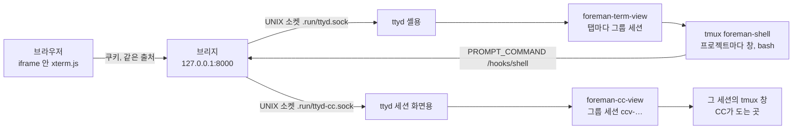
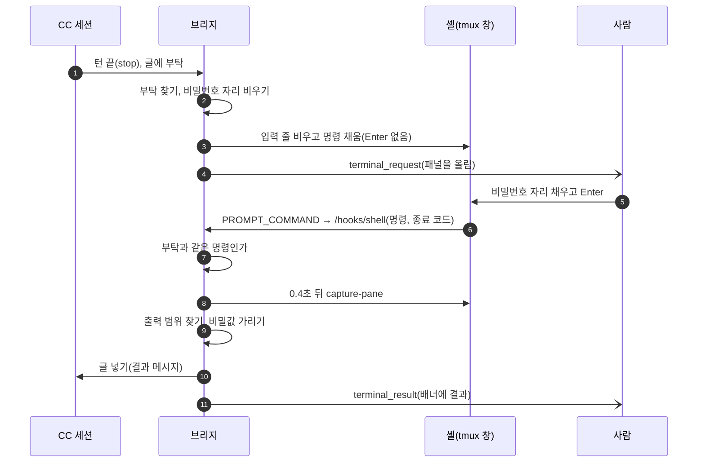

<!--
다루는 곳: bridge/terminal.py, bridge/api/terminal.py, bridge/static/js/terminal.js, bridge/static/js/ccscreen.js, deploy/shell/, scripts/foreman-shell-hook.sh
읽은 커밋: e5d584b
-->
# 셸 패널과 세션 화면

FOREMAN 화면에는 글자 화면이 두 개 있다. 하나는 화면 아래에 접혀 있는 **셸**이고, 다른 하나는 옆 패널 탭 줄 끝 [세션 화면 ↗] 단추로 여는 **세션 화면**이다. 셸은 사람이 직접 명령을 치는 bash다. 세션 화면은 어떤 세션의 Claude Code(아래 CC) 창을 그대로 보여 주고 거기에 키를 보낸다. 쓰임은 다르지만 뼈대는 같다. tmux 안에서 도는 프로그램을 ttyd가 브라우저로 내보내고, 브리지(FOREMAN의 서버 프로세스)는 그 사이에서 문만 지킨다 [code:bridge/terminal.py].

이 편은 두 기능이 왜 생겼는지, 어떻게 붙는지, 무엇을 지키려고 어떤 선을 그었는지를 다룬다. 패널 전체의 생김새는 → 옆 패널, 브리지가 세션에 글을 넣는 방법 자체는 → 03 세션 지켜보기와 글 넣기, 비밀값을 가리는 공통 규칙은 → 열쇠와 비밀에서 다룬다.

## 화면 말: 셸, 세션 화면, 대화창

세 낱말이 가까워서 먼저 갈라 둔다.

| 화면 말 | 가리키는 것 | 코드 이름 |
|---|---|---|
| 셸 | 화면 아래 접이식 막대 [▲ 셸]로 여는, 사람이 직접 치는 bash. 프로젝트마다 창이 하나씩 있다 | `terminal.js`, `bridge/terminal.py`, `/terminal` |
| 세션 화면 | 고른 세션의 CC 창을 그대로 보고 키를 보내는 띄우는 창 | `ccscreen.js`, `/ccscreen`, 그룹 세션 `ccv-…` |
| 대화창 | 사람이 세션 글을 보고 답을 넣는 곳 일반. 패널 입력 칸, 세션 화면, 서버의 CC 창을 모두 아우른다 | 하나의 코드가 아니다 |

셸은 원래 터미널이라는 이름이었다. 화면 아래 막대를 부르는 이름과 CC가 도는 창을 부르는 이름이 겹쳐 헷갈렸고, 화면 아래 것은 셸로 바뀌었다 [docs:style_guide.md]. 코드 이름(`terminal.py`, `/api/terminal`)은 그대로 두었다.

대화창과 세션 화면의 관계는 이렇다. 대화창은 「사람이 세션을 보고 답하는 곳」을 두루 가리키는 말이라 알림이나 안내 글에서 사람에게 세션을 보라고 할 때 쓴다. 세션 화면은 그중 한 가지 길의 기능 이름이다. 권한 창이나 계획 승인 창처럼 CC 창에만 뜨는 결정 창에 FOREMAN 안에서 직접 답하게 해 준다. 그래서 화면의 안내 글은 「패널 입력 칸이나 세션 화면에서 답합니다」처럼 두 길을 함께 적는다 [code:bridge/static/js/office.js]. 브리지가 글을 넣으려다 사람이 치던 글을 만나 물러설 때의 거부 사유도 「그 세션 대화창(세션 화면)을 확인해 주세요」로 두 말을 함께 쓴다 [code:bridge/inject.py].

세션 화면 머리줄의 크기 글은 「Claude Code 창 109×37」 꼴이다. 이 숫자는 띄우는 창의 크기가 아니라 그 세션 CC 창의 크기다. 처음에는 다른 말로 적었는데, 그 말이 띄우는 창 자체를 가리키는 것으로 읽혀 지금 말로 바꿨다 [code:bridge/static/js/ccscreen.js] [log:scribe_windowword_20261114.md].

## 왜 화면에 셸이 있어야 하나

CC에게 시킬 수 없는 일이 있다. `sudo` 암호, SSH 키 패스프레이즈, 컨테이너 레지스트리 로그인 같은 것이다. 이런 값을 CC에게 넘기면 대화 기록(트랜스크립트)에 남고, 그 기록은 모델의 맥락으로 계속 실려 다닌다. 그래서 CC는 이런 일을 만나면 「이 명령을 직접 실행해 주세요」라고 사람에게 부탁하고 멈춘다 [code:README.md].

FOREMAN이 생기기 전에는 사람이 이 부탁을 보고 서버에 따로 터미널을 열어 명령을 쳤고, 그 결과를 다시 CC에게 복사해 붙였다. 화면에서 세션을 지켜보다가 다른 창으로 옮겨 가야 했고, 결과를 옮기는 것도 손이었다. 셸 패널은 이 왕복을 화면 하나 안에서 끝낸다. CC가 부탁하면 브리지가 그 명령을 셸 입력 줄에 미리 채워 두고 패널을 올린다. 사람은 비밀번호 자리만 채우고 Enter를 친다. 명령이 끝나면 브리지가 출력을 읽어 비밀값을 가린 뒤 부탁한 세션에 돌려준다. 비밀번호는 사람 손가락에서 셸로만 가고, CC는 결과만 받는다 [code:bridge/terminal.py].

이 셸에는 승인 정책이 걸리지 않는다. 승인은 CC의 도구 호출(PreToolUse hook)에만 걸리는 장치이고, 이 셸은 CC가 아니라 사람이 직접 치는 곳이기 때문이다. 대신 친 명령은 모두 기록에 남긴다 [log:stage7_terminal_result.md].

## 뼈대: tmux, ttyd, xterm.js

세 부품이 무엇인지부터 쉽게 적는다.

- **tmux**는 터미널 안에서 도는 프로그램을 「세션」으로 붙들어 두는 도구다. 브라우저를 닫거나 브리지를 다시 띄워도 tmux 안의 셸은 그대로 살아 있다. FOREMAN의 CC 세션들도 모두 tmux 안에서 돈다.
- **ttyd**는 터미널 하나를 웹으로 내보내는 작은 서버 프로그램이다. 브라우저가 붙으면 정해진 명령(여기서는 tmux에 붙는 스크립트)을 띄우고, 그 프로그램의 입출력을 웹소켓으로 주고받는다.
- **xterm.js**는 브라우저 안에서 터미널 화면을 그리는 자바스크립트 라이브러리다. ttyd가 내주는 웹 페이지에 들어 있어서, FOREMAN은 그 페이지를 iframe(페이지 안의 작은 페이지)으로 띄우기만 한다.

### 화면 글을 해석하지 않는 까닭

브리지는 브라우저와 ttyd 사이의 웹소켓 메시지를 한 바이트도 해석하지 않고 그대로 잇는다. 한쪽에서 온 것을 다른 쪽으로 보내고, 어느 쪽이든 끝나면 둘 다 닫는 것이 전부다 [code:bridge/api/terminal.py].

다른 길도 있었다. 브리지가 터미널 출력을 읽어 글로 바꾼 뒤 자체 화면에 그리는 방식이다. 버린 까닭은 터미널 출력이 글이 아니라는 데 있다. 출력에는 커서를 옮기고 색을 바꾸고 화면 일부를 지우는 제어 문자가 섞여 있고, CC 자신의 화면이나 `sudo` 암호 입력, `less` 같은 전체 화면 프로그램은 화면을 통째로 다시 그린다. 이것을 브리지가 다시 짜 맞추면 터미널 에뮬레이터를 하나 새로 만드는 셈이 되고, 맞추지 못한 곳은 조용히 틀린 화면이 된다. xterm.js는 이미 그 일을 하는 검증된 부품이니 그대로 쓰는 편이 낫다. 덤으로 암호 입력 같은 키 하나하나가 브리지 코드 안에서 글로 다뤄질 일이 없다.

브리지가 화면 글을 읽는 곳은 딱 두 군데다. 부탁한 명령의 결과를 돌려줄 때와 셸에 친 글이 남았는지 볼 때인데, 둘 다 웹소켓이 아니라 tmux가 이미 그려 놓은 화면을 `capture-pane`으로 떠서 읽는다 [code:bridge/terminal.py].

### ttyd를 들인 방법

ttyd는 패키지 관리자로 깔지 않고 공식 릴리스의 정적 바이너리를 `.tools/ttyd`에 두었다. 버전이 같고(1.7.7) `sudo` 왕복이 없으며, 체크섬으로 확인했고, 지우기도 폴더 하나다 [log:stage7_terminal_result.md]. 따로 systemd 유닛을 두지 않고 브리지가 자식 프로세스로 띄운다. 죽으면 1초 뒤부터 다시 띄우고, 연달아 죽으면 기다림을 두 배씩 늘려 30초까지 간다. 60초 넘게 버틴 뒤 죽었으면 다시 1초부터 센다 [code:bridge/terminal.py]. 바이너리가 없으면 브리지는 경고를 남기고 두 화면만 끈다. 명령 기록과 부탁 감지는 그대로 돈다.

브리지를 다시 띄우면 ttyd만 내려갔다 다시 뜬다. tmux 셸은 브리지 밖에 있어서 친 명령, 지난 출력, 열린 프로그램이 모두 남는다 [code:bridge/main.py].

## 밖에 열지 않는 길: 소켓, 쿠키, 같은 출처

셸은 서버 계정의 bash다. 이것이 뚫리면 서버가 통째로 열린다. 그래서 두 화면에 닿는 길은 브리지 하나로 좁혔다.

### TCP 포트를 열지 않는다

처음 설계는 ttyd를 127.0.0.1 포트에 묶는 것이었다. 실제로는 UNIX 소켓(`.run/ttyd.sock`, `.run/ttyd-cc.sock`)에만 묶고, 소켓이 든 폴더를 권한 0700(주인만 읽고 쓰고 들어갈 수 있음)으로 만든다 [code:bridge/terminal.py]. 127.0.0.1 포트는 같은 PC의 다른 사용자나 다른 프로세스도 붙을 수 있고, ttyd에는 제대로 된 자체 인증이 없다(있는 것은 Basic 인증뿐이다). 소켓과 0700이면 이 계정만 닿는다. 「밖에 열지 않는다」는 처음 지시보다 한 단계 좁다 [log:stage7_terminal_result.md].

### 쿠키를 쓰는 까닭과 범위를 좁힌 까닭

FOREMAN의 API는 모두 토큰(`Authorization: Bearer …` 헤더)으로 지킨다. 그런데 iframe 안에서 ttyd 페이지가 여는 웹소켓에는 이 헤더를 붙일 길이 없다. 그래서 화면이 API 토큰으로 `POST /api/terminal/session`을 부르면 브리지가 무작위 쿠키를 하나 만들어 내준다 [code:bridge/api/terminal.py]. 화면은 대시보드가 연결될 때마다 이 쿠키를 자동으로 받고, 셸을 열 때와 세션 화면을 열 때 한 번 더 받는다. 사람은 토큰을 한 번만 넣으면 된다 [code:bridge/static/js/store.js].

이 쿠키는 일부러 좁게 만들었다.

| 설정 | 값 | 까닭 |
|---|---|---|
| 경로(Path) | `/terminal`과 `/ccscreen` 두 곳에 따로 | 브라우저가 이 두 길에만 쿠키를 보낸다. API나 다른 화면 요청에는 실리지 않는다 |
| HttpOnly | 켬 | 페이지의 자바스크립트가 쿠키 값을 읽지 못한다 |
| SameSite | Strict | 다른 사이트에서 시작된 요청에는 쿠키가 붙지 않는다 |
| Secure | https로 왔을 때만 | 평문 길로 새지 않게 |
| 수명 | 12시간 | 브라우저를 오래 열어 두어도 다시 받으면 된다 |
| 보관 | 브리지 메모리에 해시로만 | 디스크에 남지 않는다. 브리지를 다시 띄우면 모두 사라지고 화면이 새로 받는다 |

[code:bridge/api/terminal.py] [code:bridge/config.py]

경로를 좁힌 까닭은 이 쿠키가 할 수 있는 일을 「셸과 세션 화면의 화면 파일, 웹소켓을 여는 것」 하나로 묶기 위해서다. API 토큰은 승인을 내리고 세션을 띄우는 등 훨씬 많은 일을 한다. 쿠키가 API 길에도 실리면 쿠키 하나가 새는 것이 토큰이 새는 것과 비슷해진다. 쿠키를 두 경로에 따로 붙이는 것도 같은 생각이다. 경로가 다르면 브라우저는 쿠키를 따로 보관하고 따로 보내므로, 세션 화면을 더할 때 경로를 `/`로 넓히지 않고 같은 값을 두 번 붙였다 [code:bridge/api/terminal.py].

### 쿠키만으로 막지 못하는 것

쿠키는 브라우저가 자동으로 실어 보낸다. 그래서 사람이 다른 사이트를 열어 둔 사이 그 사이트가 몰래 `/terminal/ws`에 웹소켓을 열면, 브라우저가 쿠키를 붙여 줄 수 있다. 이를 교차 사이트 웹소켓 가로채기(cross-site WebSocket hijacking)라 부른다. 웹소켓은 일반 요청과 달리 다른 출처 차단 규칙이 기본으로 걸리지 않는다. 브리지는 웹소켓을 받을 때마다 요청의 `Origin`(어느 사이트에서 왔나)이 `Host`(어느 서버로 왔나)와 같은지 따로 보고, 다르면 바로 닫는다 [code:bridge/api/terminal.py].

화면 파일에는 세 헤더를 덧붙인다. `X-Frame-Options: SAMEORIGIN`과 `Content-Security-Policy: frame-ancestors 'self'`는 다른 사이트가 이 화면을 자기 페이지 틀 안에 넣어 클릭을 훔치지 못하게 하고, `Referrer-Policy: no-referrer`는 주소가 다른 곳으로 새지 않게 한다 [code:bridge/api/terminal.py].

화면 파일을 넘길 때 겪은 일도 하나 있다. ttyd는 첫 페이지를 gzip으로 압축해 준다. 처음에는 HTTP 라이브러리가 압축을 풀어 준 본문에 `Content-Encoding: gzip` 헤더를 그대로 붙여 넘겨서, 브라우저가 한 번 더 풀다 깨졌다. 지금은 받은 바이트를 압축된 채로 그대로 넘긴다 [log:stage7_terminal_result.md].

## 셸 패널

### 프로젝트마다 창, 탭마다 보이는 창

셸의 tmux 세션 이름은 `foreman-shell`이다. 그 안에 프로젝트마다 창을 하나씩 둔다(런슈즈, 펫퍼민트, FOREMAN, 인프라). 창이 없으면 그 저장소 폴더에서 새로 만들고, 처음부터 있던 이름 없는 창은 FOREMAN 창으로 이름만 바꾼다 [code:bridge/terminal.py].

처음에는 창이 하나였다. 사람이 런슈즈 방에서 셸을 열었는데 FOREMAN 셸이 떴고, 이 일로 프로젝트마다 창을 두었다. 창을 고를 때 `cd`를 쳐 넣는 방식은 쓰지 않았다. 셸에서 명령이 돌고 있으면 그 `cd`가 명령의 입력으로 들어가고, 프로젝트를 오갈 때마다 앞의 위치를 잃기 때문이다 [code:bridge/terminal.py].

창을 나누자 다음 문제가 나왔다. tmux에서 「지금 보이는 창」은 세션 하나에 하나뿐이다. 브라우저 탭 두 개가 같은 세션에 붙어 있으면, 한 탭에서 창을 바꾸거나 CC의 부탁이 창을 바꿀 때 다른 탭의 셸도 끌려갔다. 그래서 ttyd가 브라우저 연결마다 `deploy/shell/foreman-term-view`를 띄우고, 이 스크립트가 탭마다 **그룹 세션** `foreman-shell-v-<탭>`을 만들어 붙는다 [code:deploy/shell/foreman-term-view]. 그룹 세션은 tmux 기능으로, 창(그 안의 셸)은 원래 세션과 함께 쓰고 「보이는 창」만 따로 갖는다. 연결이 끝나 붙은 사람이 없어지면 그룹 세션만 사라지고 셸은 남는다(`destroy-unattached`). 탭 id는 화면이 열 때 무작위로 만들어 iframe 주소의 `?arg=<탭>&arg=<프로젝트>`로 ttyd에 넘긴다. 브리지는 그 모양(영문, 숫자, `_`, `-`로 6~40자)이 맞을 때만 넘긴다. ttyd는 이 값을 셸을 거치지 않고 명령 인자로 붙이므로 모양 검사가 곧 주입 방어다 [code:bridge/api/terminal.py].

붙기 전에 연결이 끊기면 그룹 세션이 남을 수 있다. 브리지가 셸을 열 때마다 붙은 사람 없이 30초 넘게 남은 것을 치운다 [code:bridge/terminal.py].

### 방을 따라가고, 보이는 창을 계속 확인한다

방(현장)을 옮기면 셸도 그 방 프로젝트의 창으로 바뀐다. 방이 아닌 곳(감독실, 전체, 라운지)에서는 고른 세션의 프로젝트를, 그것도 없으면 FOREMAN 창을 고른다 [code:bridge/static/js/terminal.js]. 셸이 접혀 있을 때는 막대의 이름표만 바꾸고 tmux 창은 건드리지 않는다. 접힌 셸이 창을 만들게 하지 않으려는 것이다. 펼치는 순간 그 창을 실제로 고른다 [log:d1_terminal_scroll_inputh_20261111.md].

열려 있는 동안 화면은 3초마다 「지금 실제로 보이는 창」을 브리지에 묻는다(`GET /api/terminal/window`) [code:bridge/static/js/terminal.js]. 이것은 이름표가 거짓말한 일에서 왔다. 이름표에는 런슈즈 셸이라 떠 있는데 프롬프트는 펫퍼민트 폴더였다. 이름표가 열 때 받은 값을 그대로 쥐고 다시 묻지 않았기 때문이다 [log:terminal_window_label_20261110.md]. 지금 막대는 세 가지를 경고한다. 고른 것과 다른 창이 보일 때, 창 이름은 맞는데 셸이 다른 프로젝트 폴더로 `cd`해 들어가 있을 때, 셸이 뜬 뒤 셸 설정 파일(`foreman-bashrc`나 `~/.bashrc`)이 바뀌어 이 창이 옛 설정일 때다. 마지막 것은 셸 프로세스가 뜬 시각(`/proc`에서 읽는다)과 설정 파일의 수정 시각을 견준다 [code:bridge/terminal.py]. 이 프로젝트가 잡으려는 조용한 고장의 작은 판이다. 이름표가 틀려도 셸은 잘 돌기 때문에, 알려 주지 않으면 사람이 엉뚱한 저장소에서 명령을 칠 수 있다.

### 스크롤과 글 고르기

xterm.js 화면에는 지난 출력(스크롤백)이 쌓이지 않는다. tmux가 화면을 통째로 다시 그려 보내기 때문이다. 그래서 지난 출력은 tmux 복사 모드로 올려 본다. 막대의 [▲ 위로], 복사 모드 중에만 나타나는 [▼ 아래로]와 [입력으로], 그리고 마우스 휠이 이 길을 쓴다 [code:bridge/static/js/terminal.js].

처음에는 그룹 세션에 tmux `mouse on`을 켜 휠을 tmux가 받게 했다. 그러자 마우스로 끌어 글을 고르는 동작까지 tmux가 가져가 놓는 순간 선택이 풀렸다 [log:d2_terminal_select_20261111.md]. 지금은 tmux 마우스를 끄고, 화면이 iframe 안의 휠을 직접 잡아 `/api/terminal/scroll`에 `wheel_up`, `wheel_down`으로 보낸다. 한 칸에 3줄이다. 요청은 한 번에 하나만 보내고 그 사이 쌓인 칸은 10칸까지 모아 이어 보낸다. Ctrl+휠(확대)과 Shift+휠은 건드리지 않는다. 끌어 고르기는 브라우저(xterm.js) 선택이 받는다 [code:bridge/terminal.py] [code:bridge/static/js/terminal.js].

복사 모드에 들어간 채 글을 치면 그 글은 셸이 아니라 복사 모드 키로 간다. 그래서 복사 모드 중에는 막대가 [입력으로]를 앞에 세우고, 맨 아래로 내려오면 복사 모드가 저절로 끝나게(`-e`) 했다.

### 셸 비우기

막대의 [셸 비우기]는 셸을 새로 띄우지 않고 그 창의 화면과 지난 출력만 지운다. 셸이 입력을 기다리면 readline 화면 지우기(Ctrl+L)를 보낸다. `clear`를 명령으로 치지 않는 것은 그러면 명령 기록에 `clear`가 남기 때문이다. 0.2초 뒤 tmux 스크롤백까지 지운다. 입력 줄에 친 글이 있거나 명령이 돌고 있으면 먼저 묻는다. 명령이 돌고 있을 때는 그 명령의 입력으로는 아무것도 보내지 않고 tmux 쪽 화면만 지워, 명령은 그대로 돈다 [code:bridge/terminal.py].

이 자리에는 원래 열린 창을 새 셸로 바꾸는 단추가 있었다. 사람이 「눌러도 셸이 쌓인다」고 느꼈고, 바라던 것은 깨끗한 화면이었다. 그래서 단추를 비우기로 바꿨다. 새 셸로 바꾸는 서버 길(`POST /api/terminal/respawn`)과 시험은 남겨 두었다. 바뀐 설정을 읽히려면 셸에서 `exit`를 치고 다시 열면 된다. 창이 닫혀 있으면 다음에 고를 때 새 창과 새 셸이 뜬다 [log:coder_ccscreen_20261114.md].

### 프롬프트를 짧게 한 까닭

셸의 프롬프트는 `[창 이름] (가상환경) 폴더$` 꼴이다. `~/.bashrc`의 프롬프트에서 `사용자@호스트:`만 뺐다. 프롬프트가 칸 폭보다 길면 패널이 좁아졌다 넓어질 때 bash와 tmux가 아는 커서 자리가 어긋났기 때문이다. 같은 시험 셸에서 134칸, 90칸, 다시 134칸으로 바꿔 보니 104칸짜리 프롬프트는 커서가 5칸 어긋났고, 70칸으로 줄인 뒤에는 어긋나지 않았다 [log:terminal_prompt_20261110.md]. `~/.bashrc`는 건드리지 않고 `foreman-bashrc` 안에서만 고친다. 앞머리 `[창 이름] `은 결과를 돌려줄 때 출력의 처음과 끝을 찾는 표지로도 쓰인다(아래) [code:deploy/shell/foreman-bashrc].

## CC의 부탁을 입력 줄에 미리 채우기

### 어떻게 알아채나

CC의 턴이 정상적으로 끝나면(끝난 까닭이 `stop`) 브리지가 그 턴의 assistant 글을 모아 부탁을 찾는다. 서브에이전트가 쓴 글은 빼고, 마지막 2만 자만 본다 [code:bridge/terminal.py]. 다음 세 조건이 모두 맞아야 부탁으로 본다.

첫째, 명령이 코드 안에 있어야 한다. 셸 언어(`bash`, `sh`, `console`, 언어 표시 없음 등)의 코드 블록, 인라인 코드, 또는 맨 앞이 `!`인 줄이다. `!` 꼴은 CC 입력 칸에서 사람이 그대로 치면 셸 명령으로 실행되는 모양이라 그 자체로 부탁으로 친다.

둘째, 사람이 쳐야 하는 명령이어야 한다. `sudo`, `su`, `ssh-add`, `ssh-keygen`, `ssh-copy-id`, `passwd`, `kinit`, `docker`, `podman`, `npm`, `vault`, `helm registry` 등의 `login`, `gh`, `glab`, `gcloud`의 `auth login`처럼 암호나 패스프레이즈, 로그인을 묻는 명령들이다. 500자를 넘거나 `#`로 시작하는 줄은 뺀다.

셋째, 명령 가까이에 부탁하는 말이 있어야 한다. 「실행해 주세요」, 「쳐 주세요」, 「직접 실행」, 「실행이 필요」, 영어의 please run, you need to run 같은 말이다. 「가까이」는 명령 앞 300자와 뒤 150자이고, 그 범위 안에서도 다른 코드 블록, 인라인 코드, 따옴표 안 글은 빼고 본다 [code:bridge/terminal.py].

세 조건을 모두 요구하는 까닭은 오탐이 비싸서다. 설명이나 기록에 나온 `sudo`(예를 들어 「어제 `sudo apt install …`로 깔았다」)까지 패널을 올리면 사람이 귀찮아서 패널을 안 쓰게 된다 [log:stage7_terminal_result.md].

### 실수가 만든 규칙: 인용은 부탁이 아니다

처음 써 본 날 실제로 오탐이 났다. 이 기능을 설명하는 보고 글이 부탁으로 잡혀, 셸 입력 줄에 `echo 값 | sudo -S`가 채워졌다. 그 글의 「실행해 주세요」는 기능을 설명하느라 따옴표로 인용한 말이었고 명령과도 멀었다. 이 일로 앞 300자, 뒤 150자 창과 「따옴표, 「」 안 글은 빼고 본다」는 규칙이 생겼고 같은 글로 회귀 시험을 남겼다 [log:stage7_terminal_result.md] [code:bridge/terminal.py]. 이 원고처럼 기능을 설명하며 부탁하는 말을 인용하는 글이 부탁으로 잡히지 않는 것도 이 규칙 덕분이다.

### 채우는 방법

한 턴에 부탁이 여럿이면 첫 번째를 채우고 나머지는 네 개까지 배너에 「같이 적힌 명령」으로 보인다. 부탁은 세션마다 가장 새것 하나만 둔다 [code:bridge/terminal.py].

채우기 전에 비밀번호 자리를 비운다. `<password>`처럼 꺾쇠 안에 pass, 비밀, 암호, token 같은 낱말이 든 자리표시, 이미 가려진 `«masked…»`, `YOUR_…` 꼴, `***`, 그리고 `--password 값`, `docker login -p 값`, `mysql -p값`, `sshpass -p 값`의 값 자리다. 비운 자리가 있으면 그 자리에서 끝까지의 글자 수를 세어 둔다 [code:bridge/terminal.py].

그다음 부탁한 세션 프로젝트의 셸 창을 고르고 그 창을 보이게 한다. 복사 모드 중이면 먼저 빠져나온다. 창의 앞 프로세스가 `bash`가 아니면(다른 명령이 돌고 있거나 암호를 묻는 중이면) 건드리지 않고 배너에 「미리 채우지 못했습니다」와 까닭을 띄운다. `bash`면 입력 줄을 비우고(Ctrl+E, Ctrl+U) 명령을 글자 그대로 넣는다(`send-keys -l`). Enter는 누르지 않는다. 비운 자리가 있으면 세어 둔 칸 수만큼 왼쪽 화살표를 보내 커서를 그 자리에 둔다 [code:bridge/terminal.py].

화면에서는 웹소켓으로 `terminal_request`가 오면 셸 패널을 올리고 그 프로젝트 창을 고른 뒤 셸에 초점을 둔다. 배너에는 「셸에 미리 채웠습니다. 커서가 비밀번호 자리에 있습니다. 채우고 Enter」 같은 안내와 [다시 채우기], [복사], [닫기]가 있다 [code:bridge/static/js/terminal.js]. 부탁은 30분 기다린다. 그 뒤에 친 명령은 결과를 돌려주지 않는다 [code:bridge/config.py].

미리 채운 명령에 비밀번호를 그 자리에서 치면 명령줄에 남는다(프로세스 목록이나 tmux 화면에 보인다). 기록은 가려지지만, `docker login`이라면 `-p`를 지우고 물을 때 치는 편이 더 안전하다. 둘 다 되게 두고 고르는 것은 사람에게 맡겼다 [log:stage7_terminal_result.md].

## 결과가 그 세션으로 돌아가는 길

사람이 친 명령이 부탁과 같은지는 너그럽게 본다. 비운 자리 앞까지가 같으면 같은 것으로 보고, 아니면 앞 단어 세 개가 같으면 같은 것으로 본다. 사람이 옵션을 조금 바꿔 쳐도 결과가 돌아가게 하려는 것이다 [code:bridge/terminal.py].

맞으면 0.4초 기다린다. 기록 hook은 새 프롬프트가 찍히기 전에 불리기 때문이다. 그다음 부탁을 채운 그 창의 화면을 3,000줄까지 뜬다. 출력 범위는 그 명령을 친 프롬프트 줄(앞머리 `[창 이름] ` 꼴) 다음부터 새 프롬프트 앞까지다. 그 줄을 찾지 못하면 마지막 줄들을 보내고 「범위를 못 찾아 마지막 줄들」이라고 적는다 [code:bridge/terminal.py]. 보내는 양은 마지막 60줄, 한 줄 400자, 전체 6,000자까지이고, 비밀값을 가린 뒤 보낸다 [code:bridge/config.py] [code:bridge/terminal.py].

세션에 넣는 글은 이런 모양이다. 머리에 `[터미널 패널]`이 붙고, 종료 코드, 가린 명령, 가린 출력이 코드 블록으로 들어간다. 머리말이 화면 이름(셸)과 다른 것은 이 글이 사람이 아니라 모델에게 가는 글이라 바꾸지 않고 두었기 때문이다 [log:coder_ccscreen_20261114.md].

넣는 방법은 브리지가 세션에 글을 넣는 공통 길을 그대로 쓴다(→ 03 세션 지켜보기와 글 넣기). 세션이 tmux 밖에서 돌거나 멈춰 있어 넣을 수 없으면, 결과는 배너에만 보이고(「세션에 전달 못 함: …」와 접힌 출력) 기록(`term_result` 이벤트)에 출력이 함께 남는다. 결과는 「부탁한 세션」에 돌려준다. 처음 설계는 「해당 캐릭터에게」였지만 부탁을 한 것은 세션이라 세션으로 정했다 [log:stage7_terminal_result.md].

## 친 명령 기록과 비밀 가리기

### 기록은 명령 단위로, 키 단위로 하지 않는다

셸은 `bash --rcfile deploy/shell/foreman-bashrc`로 뜬다. 이 파일은 `~/.bashrc`를 먼저 읽고 기록 hook만 더한다. bash의 `PROMPT_COMMAND`(프롬프트를 그리기 직전마다 부르는 명령)가 방금 끝난 명령, 종료 코드, 현재 폴더를 `scripts/foreman-shell-hook.sh`로 넘기고, 이 스크립트가 브리지의 `/hooks/shell`로 보낸다 [code:deploy/shell/foreman-bashrc] [code:scripts/foreman-shell-hook.sh].

웹소켓을 지나는 키 입력을 읽어 기록하는 길은 일부러 버렸다. 그 길에는 `sudo`의 암호 입력도 지나간다. 셸이 「실행한 명령」만 알려 주면 암호 프롬프트에 친 글자는 기록에 들어올 수 없다 [log:stage7_terminal_result.md].

기록 스크립트는 셸을 막지 않게 짰다. 2초 안에 끝나고 출력이 없으며 늘 성공으로 끝난다. 브리지가 꺼져 있어도 셸은 그대로 쓸 수 있다. 백그라운드로 띄울 때는 괄호 안에서 띄운다. 그냥 `&`로 띄우면 대화형 셸이 `[1] 1234`, `Done` 같은 작업 알림을 화면에 찍었다. hook 토큰은 `.env.bridge`에서 읽어 프로세스 치환으로 헤더에 넣으므로 프로세스 목록에 보이지 않는다 [code:scripts/foreman-shell-hook.sh].

`foreman-bashrc`는 두 가지를 더 바꾼다. `HISTFILE=`로 셸 기록 파일을 디스크에 남기지 않는다. 명령에 섞인 비밀이 평문으로 쌓이지 않게 하려는 것이다. `HISTCONTROL=`로 모든 명령을 기록한다. `~/.bashrc`의 흔한 설정(`ignoreboth`)이면 앞에 공백을 붙인 명령이 기록에서 빠지는데, 그것이 기록을 피하는 뒷문이 되기 때문이다 [code:deploy/shell/foreman-bashrc].

기록은 `source=shell`, `type=shell_cmd` 이벤트로 남는다. 셸은 캐릭터가 아니어서 `character_session.type='shell'`인 세션 행 하나를 떠돌이 캐릭터 「미분류」에 붙여 둔다. 대시보드와 세션 목록은 `type='agent'`만 보므로 셸이 캐릭터 카드로 뜨지 않는다 [code:bridge/terminal.py]. 막대 오른쪽의 「마지막: …」이 가장 최근 기록을 보여 준다.

### 무엇을 가리나

명령과 출력은 FOREMAN 공통 가리기(정확한 비밀값, 토큰 모양, `KEY=값`)를 먼저 거친다(→ 열쇠와 비밀). 셸 명령에는 명령줄에서 비밀이 흔히 오는 자리를 더 가린다 [code:bridge/terminal.py].

| 자리 | 예 | 가린 뒤 |
|---|---|---|
| 암호 옵션 | `--password 값`, `--token=값`, `--passphrase`, `--secret` | 값 자리가 `«masked»` |
| 레지스트리 로그인 | `docker login -p 값` (podman, nerdctl, buildah, skopeo, oras, helm registry도) | `-p «masked»` |
| MySQL 계열 | `mysql -p값`, `mysqldump -p값` | `-p«masked»` |
| sshpass | `sshpass -p 값` | `-p «masked»` |
| 파이프로 암호 넘기기 | `echo 값 \| sudo -S …`, `… --password-stdin`, `chpasswd` | echo 뒤 값이 `«masked»` |
| 주소 안 계정 | `https://user:암호@…` | `user:«masked»@` |
| curl 계정 | `curl -u user:암호` | `-u user:«masked»` |

출력에는 공통 가리기와 주소 안 계정만 건다. 출력은 형식이 자유로워 명령줄 규칙을 걸면 엉뚱한 글이 가려진다. 실제 서버에서 `echo live-check --password …`를 쳐 `echo live-check --password «masked»`로 남는 것을 확인했다 [log:stage7_terminal_result.md].

## 세션 화면

### 왜 만들었나

CC는 가끔 창을 띄우고 사람의 답을 기다린다. 도구 권한 창, 계획 승인 창, 몇 가지 중 하나를 고르는 창, 안내 창이다. 이런 창은 그 세션의 CC 창(서버의 tmux 창)에만 뜨고 FOREMAN 패널의 대화 글에는 나오지 않는다. 그래서 사람은 FOREMAN 화면에서 「세션이 기다리는 중」이라는 것은 알아도 무엇을 묻는지는 볼 수 없었고, VNC로 서버 데스크톱에 들어가 그 tmux 창을 찾아 Esc로 창을 닫아야 했다 [log:coder_ccscreen_20261114.md]. 세션 화면은 그 길을 FOREMAN 안으로 옮긴 것이다. 고른 세션의 CC 창을 그대로 보고, 화살표, Esc, 숫자, Enter 같은 키를 보낼 수 있다 [code:bridge/static/js/ccscreen.js].

### 브라우저는 세션 번호만 준다

셸은 정해진 tmux 세션 하나에 붙지만 세션 화면은 붙을 곳이 세션마다 다르다. 붙을 곳을 브라우저가 정하게 하면 쿠키를 가진 누군가가 아무 tmux 창에나 붙을 수 있다. 그래서 브라우저는 세션 번호와 탭 id만 보낸다(`/ccscreen/?arg=<세션 번호>&arg=<탭>`). 웹소켓을 받은 브리지가 쿠키와 같은 출처를 확인한 뒤, 그 번호를 실제 tmux 창으로 바꾸는 일을 스스로 한다 [code:bridge/api/terminal.py]. 차례는 이렇다 [code:bridge/terminal.py].

1. DB에서 그 번호가 CC 세션(`type='agent'`)인지 본다.
2. 그 CC 세션의 살아 있는 claude 프로세스를 찾는다. 없으면 「세션이 끝나」 열 수 없다고 답한다.
3. 프로세스가 멈춰 있으면(Ctrl+Z, 상태 `T`) 열지 않는다. 사용자가 일부러 멈춰 둔 세션이기 때문이다.
4. 그 프로세스의 환경에서 `TMUX`, `TMUX_PANE`을 읽는다. 없으면 tmux 밖에서 도는 세션이라 볼 수 없다.
5. 그 tmux가 FOREMAN이 쓰는 tmux 서버와 같은 소켓인지 본다.
6. 창 표시가 `%숫자` 꼴인지, 그 창이 실제로 있고 닫히지 않았는지 본다. 없는 창을 물으면 tmux가 오류 없이 빈 값을 돌려주므로 빈 세션 이름도 「찾지 못했다」로 본다.
7. 그 창의 프로세스가 claude 자신이거나 claude의 조상인지 본다. 다른 프로그램의 창에 붙지 않게 하려는 것이다 [code:bridge/terminal.py].

이렇게 확인한 `%숫자`만 ttyd 인자로 넘기고, 보기 스크립트 `foreman-cc-view`가 모양과 존재를 한 번 더 본다 [code:deploy/shell/foreman-cc-view]. 안 되는 까닭은 「~습니다」 글로 화면에 돌아가 창 안에 뜬다. 화면에는 tmux 창 표시를 돌려주지 않는다 [code:bridge/api/terminal.py].

### 그룹 세션 ccv-…

보기 스크립트는 그 CC 세션의 tmux 세션에 그룹 세션 `ccv-<탭>-<pid>`를 만들어 붙는다. 셸과 같은 방식이라 CC 창은 함께 쓰고 「보이는 창」만 따로 가지며, CC 세션 쪽의 보이는 창은 바뀌지 않는다. 이름 끝에 보기 스크립트의 프로세스 번호를 붙여 연결마다 이름이 다르다. 같은 탭이 곧바로 다시 붙을 때 앞 연결의 뒷정리가 새 연결의 세션을 지우는 경합을 막으려는 것이다. 같은 탭의 앞 연결은 이름 머리로 찾아 먼저 치운다 [code:deploy/shell/foreman-cc-view] [log:coder_ccscreen_20261114.md]. 그룹 세션은 상태줄과 tmux 마우스를 끈다. 상태줄을 꺼야 띄운 창 크기와 CC 창 크기가 한 줄도 어긋나지 않고, 마우스를 꺼야 끌어 고르기가 브라우저로 간다.

### 창 크기: 보는 동안만 맞추고, 끝나면 80×24로

tmux 창 크기는 붙은 사람의 화면 크기를 따른다. 브라우저가 붙으면 CC 창이 브라우저 크기로 바뀐다. 처음 판은 「크기를 바꾸지 않는다」를 목표로 붙을 때 크기를 무시하는 옵션(`attach -f ignore-size`)을 썼다. 시험이 이것이 통하지 않는다는 것을 잡았다. 100×30 창에 200×50 화면을 붙이니 창이 200×49가 됐다. tmux는 크기를 따르는 다른 손님이 서버 어딘가에 붙어 있을 때만 크기 무시 손님을 무시한다. CC 세션에는 보통 붙은 손님이 없다. 셸 패널이 열려 있으면 우연히 지켜지고 닫혀 있으면 바뀌는, 조용한 고장이 될 뻔했다 [log:coder_ccscreen_20261114.md].

지금 방식은 반대로 「보는 동안은 띄운 창에 맞추고, 끝나면 정해진 크기로 되돌린다」이다.

- 붙을 때 그 창에 `window-size manual`을 걸고 FOREMAN이 묶었다는 표시(`@foreman_ccview`)를 단다. 자기 그룹 세션에는 tmux `client-resized` 훅을 걸어 손님 크기가 바뀔 때마다 창을 그 크기로 맞춘다. 훅에 `resize-window -x '#{client_width}'`를 바로 쓰면 형식이 풀리지 않아서(실험으로 확인했다) `run-shell -C`로 감쌌다 [code:deploy/shell/foreman-cc-view] [log:coder_ccwindow_20261114.md].
- 둘이 같은 창을 보면 나중에 붙은 쪽 크기를 쓴다. 나중 것이 먼저 나가면 남은 보기의 손님 크기로 다시 맞춘다.
- 이 창을 보는 마지막 보기가 나가면 80×24로 되돌리고 묶음과 표시를 푼다. 원래 크기가 아니라 늘 80×24로 되돌리는 것은 사용자 지시다. 이 값은 브리지 상수 `CC_REST_SIZE` 한 곳에 있고 보기 스크립트에는 ttyd 고정 인자로 넘어간다 [code:bridge/terminal.py].
- 창에 이미 다른 `window-size`가 걸려 있고 FOREMAN 표시가 없으면 사람이 정한 것이므로 크기를 건드리지 않고 보기만 한다.
- 보기 스크립트가 죽어(kill -9 등) 묶음을 못 풀고 남긴 창은, 브리지가 시작할 때와 세션 화면 연결마다 찾아 같은 방법으로 80×24로 되돌리고 푼다(`release_cc_windows`) [code:bridge/terminal.py].

### 띄우는 창

세션 화면은 처음에 패널의 탭 하나였다. 탭이면 대화 글과 CC 창을 함께 볼 수 없어 같은 날 띄우는 창으로 바꿨다 [c:8af171e]. 창은 패널 위에 떠 있지만 모달이 아니라 패널을 그대로 쓸 수 있다 [log:coder_ccwindow_20261114.md].

- 머리줄을 끌어 옮기고 네 모서리 어디로든 크기를 바꾼다. 왼쪽, 위 모서리는 반대쪽 모서리를 붙든 채 크기와 자리가 함께 바뀐다. 가장 작게 360×220이고, 머리줄 일부는 늘 화면 안에 남아 다시 잡을 수 있다 [code:bridge/static/js/ccscreen.js].
- 크기는 모서리를 **놓을 때 한 번만** 적용한다. 끄는 동안은 점선 테두리만 움직인다. CC 창이 이 창 크기를 따르므로, 끄는 내내 바꾸면 CC 창이 계속 흔들리기 때문이다.
- 정한 크기와 자리는 이 브라우저에 기억해(`localStorage`) 다음에 같은 크기로 연다. 크기를 한 번 정해 두면 CC 창이 흔들리는 것이 열 때 한 번뿐이다.
- 띄운 채 패널에서 다른 세션을 골라도 띄운 세션 그대로다. 따라 바뀌면 헷갈린다는 것이 사용자 결정이다. 머리줄에 세션 번호와 제목이 있다. 고른 세션이 다르면 머리줄에 「세션 N로」 단추가 뜬다. 띄운 창이 패널 탭 줄의 [세션 화면 ↗] 단추를 덮어 다른 세션에서 단추를 눌러도 클릭이 창 안으로 간 일이 있어서 생긴 단추다 [log:coder_sessionscreen_20261114.md].
- 붙을 수 없으면 창 안에 까닭과 [다시 붙기]가 뜬다. 열려 있는 동안 5초마다 다시 물어, 세션이 끝나거나 세션 화면용 ttyd가 죽으면 빈 화면이 아니라 까닭이 뜬다 [code:bridge/static/js/ccscreen.js] [code:bridge/api/terminal.py].
- ✕로 닫으면 iframe을 끊고, 그러면 보기 스크립트가 CC 창을 80×24로 되돌린다 [code:deploy/shell/foreman-cc-view].

### 보낼 수 있는 키

세션 화면은 ttyd를 쓰기 가능(`-W`)으로 띄운 진짜 터미널이라 키를 골라 막지 않는다. 쓰임은 CC 창의 결정 창을 다루는 것이다. 화살표로 고르고, 숫자로 바로 고르고, Enter로 정하고, Esc로 닫는다. 툴팁도 이 넷을 적어 둔다 [code:bridge/static/js/opanel.js]. 실제 ttyd에 웹소켓으로 붙어 가짜 고르기 메뉴에 아래 화살표, Enter, Esc를 보내 고르고 닫히는 것을 시험으로 남겼다 [log:coder_ccwindow_20261114.md]. 입력 칸에 글을 쳐서 보낼 수도 있다. 그러나 평소에 글을 보내는 길은 패널 입력 칸이다.

이 둘이 섞이지 않게 막는 장치가 있다. 사람이 세션 화면에서 CC 입력 칸에 글을 반쯤 친 채 브리지가 같은 세션에 글을 넣으려 하면, 브리지는 화면을 떠서 입력 칸에 사람 글이 있는지 보고 있으면 Esc도 붙여넣기도 Enter도 보내지 않고 물러선다. 세션 화면이 생기며 함께 들어간 장치다. 자세한 판정은 → 03 세션 지켜보기와 글 넣기 [code:bridge/inject.py] [log:coder_ccscreen_20261114.md].

### 머리줄의 크기 글

머리줄의 「Claude Code 창 N×M」은 iframe 안 xterm의 열과 줄 수를 바로 읽어 그린다. 처음에는 5초마다 묻는 서버 값을 썼는데 크기를 바꾼 뒤 숫자가 5초 늦게 바뀌었다. 상태줄을 꺼 두어 xterm 크기와 CC 창 크기가 같으므로 바로 읽어도 된다. 모서리를 놓은 뒤 1.2초에 서버 값으로 한 번 더 맞춘다. 붙기 전에는 숫자를 비워 둔다. 붙기 전 CC 창은 아직 80×24라 그 숫자가 잠깐 보이면 틀린 크기로 읽히기 때문이다 [code:bridge/static/js/ccscreen.js] [c:3d34db3].

### 무엇을 남기나

세션 화면을 열고 닫은 것만 `session_action`에 `ccview-open`, `ccview-close`로 남긴다. tmux 세션, 창, 크기, 탭, 본 시간(초)이 함께 적힌다. 키 하나하나는 남기지 않는다. 사람이 CC 창에 직접 치는 길이기 때문이다. 이름이 12자 안인 것은 `session_action.action` 칸이 12자라서다. 기록은 화면이 보내는 것이 아니라 브리지 웹소켓 프록시가 연결 시작과 끝에 남긴다. 그래서 창을 닫든 브라우저가 죽든 닫힘이 남는다 [code:bridge/api/terminal.py] [log:coder_ccscreen_20261114.md].

## ttyd를 둘로 나눈 까닭

셸과 세션 화면은 같은 ttyd 바이너리를 따로 두 번 띄운다. 셸용은 `-b /terminal`에 동시 연결 4개(`-m 4`), 세션 화면용은 `-b /ccscreen`에 8개다 [code:bridge/terminal.py]. 하나로 합치면 두 화면이 연결 자리를 나눠 써서, 세션 화면을 여럿 열면 셸이 안 붙는 일이 생길 수 있다. 붙는 스크립트와 받는 인자의 뜻도 다르다. 셸의 인자는 브라우저가 준 탭과 프로젝트이고, 세션 화면의 인자는 브리지가 확인한 tmux 창이다. 띄우고 다시 띄우는 틀(`_supervise`)은 하나를 함께 쓴다. 각자 로그 파일(`.run/ttyd.log`, `.run/ttyd-cc.log`)이 따로 있어, 화면이 「서버(ttyd)가 떠 있지 않습니다」를 띄울 때 어느 로그를 볼지 함께 적는다 [code:bridge/api/terminal.py].

## 남은 빈틈

- **출력 범위를 못 찾는 경우.** 명령을 친 프롬프트 줄을 화면에서 찾는 방식이라 `clear`를 쳤거나 전체 화면 프로그램을 썼거나 출력이 3,000줄을 넘으면 범위를 못 찾는다. 그때는 마지막 줄들을 보내고 전달문에 그렇게 적는다 [log:stage7_terminal_result.md].
- **부탁과 쿠키는 브리지 메모리에만 있다.** 브리지를 다시 띄우면 기다리던 부탁이 사라진다. 그 뒤 사람이 명령을 쳐도 결과는 세션에 돌아가지 않고 기록에만 남는다. 쿠키는 화면이 다시 연결될 때 새로 받아 iframe을 다시 붙이므로 사람이 할 일은 없다 [code:bridge/terminal.py] [code:bridge/static/js/terminal.js].
- **명령줄에 친 비밀번호.** 기록과 결과는 가려지지만, 미리 채운 자리에 비밀번호를 그대로 치면 명령이 도는 동안 프로세스 목록과 tmux 화면에는 보인다. 물을 때 치는 꼴을 고르는 것은 사람 몫으로 남겼다.
- **좁은 패널의 커서.** 프롬프트(약 70칸)보다 좁아지는 폭에서는 여전히 커서가 몇 칸 어긋난다 [log:terminal_prompt_20261110.md].
- **끌어 고르기는 보이는 화면 안에서만.** 스크롤하면 tmux 복사 모드가 그린 한 쪽 안에서만 고를 수 있다 [log:d2_terminal_select_20261111.md].
- **세션 화면은 tmux 안의 세션만.** tmux 밖에서 돌거나 다른 tmux 서버에서 도는 세션은 볼 수 없고, 화면은 그 까닭을 띄운다 [code:bridge/terminal.py].
