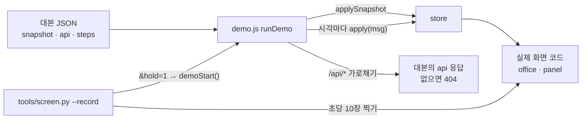

<!--
다루는 곳: tools/, bridge/static/js/demo.js, bridge/static/demo/, tests/screen_words.py, tests/test_screen_words.py, tests/data/screen_words.toml, tests/js/merge_wait.test.mjs, tests/js/merge_wait_manager.test.mjs, tests/js/overhead_marks.test.mjs, tests/test_merge_wait.py, tests/test_merge_wait_manager.py, tests/test_merge_wait_off_remind.py, tests/test_overhead_marks.py
읽은 커밋: fb7121b
-->
# 화면 점검과 시연

FOREMAN의 화면은 캔버스에 그리는 픽셀 오피스와 그 옆 패널로 되어 있다. 캐릭터가 걸어 다니고, 이름표와 말풍선이 머리 위에 쌓이고, 테마가 셋이고, 창 크기와 패널 너비와 글씨 배율이 저마다 다르다. 이런 화면은 한 곳을 고치면 다른 곳이 조용히 틀어진다. 이름표가 가구 뒤로 숨거나, 호버 글이 상자 밖으로 넘치거나, 버튼 이름은 바꿨는데 문서와 거부 사유에는 옛 이름이 남는다. 아무도 화면을 그 크기, 그 테마로 열어 보지 않으면 고장은 드러나지 않는다.

이 편은 그런 고장을 사람 눈이 아니라 기계로 잡는 장치 셋을 다룬다. 첫째는 헤드리스 크로미움으로 화면을 직접 띄워 겹침과 넘침을 세는 화면 점검 도구 `tools/screen.py`다. 둘째는 같은 화면 코드에 꾸민 장면이나 실제 기록을 흘려 사진과 움직이는 그림을 찍는 시연 재생이다. 셋째는 화면 말과 문서 인용과 호버 약속이 서로 어긋나는지 pytest 안에서 1초 남짓에 훑는 화면 말 시험이다 [code:tests/screen_words.py]. 화면 그리기 자체(테마, 모눈, 이름표 비키기, 머리 위 쌓기)는 → 픽셀 오피스와 테마, 패널과 툴팁은 → 옆 패널, 시험 전체와 돌리는 차례는 → 16 시험과 배포에서 다룬다.

## 1. 사람에게 콘솔을 부탁하지 않는다

`tools/screen.py`의 첫 줄 설명에는 이 도구를 만든 까닭이 그대로 적혀 있다. 화면을 고친 세션이 확인할 때마다 사용자에게 "브라우저 콘솔에서 이것 좀 돌려 달라"고 부탁했고, 사용자가 "콘솔에서 돌려 달라고 매번 나한테 하지 말고"라고 했다 [code:tools/screen.py]. 그래서 세션이 스스로 브라우저를 띄우고, 스스로 화면을 열고, 스스로 결과를 읽는 길을 만들었다 [c:3366bcc].

이렇게 바꾼 것은 편의만의 문제가 아니었다. 사람이 콘솔을 돌려 주는 방식은 사람이 보는 그 창 크기 한 가지, 그 테마 한 가지만 확인한다. 1024 폭의 좁은 창이나 패널을 넓힌 상태에서만 생기는 겹침은 사람이 그 크기로 열어 보지 않는 한 남는다. 기계에 맡기면 테마 셋과 크기 여럿을 한 번에 돌릴 수 있고, 사람이 하는 일은 결과 숫자를 보는 것으로 줄어든다. CLAUDE.md는 여기서 한 걸음 더 나가 "테마의 자리나 가구를 바꾸면 세션이 직접 `tools/screen.py`로 세 테마 모두 0건인지 본다"를 규칙으로 정했다 [code:CLAUDE.md].

### 1-1. 브라우저를 어떻게 띄우나

새로 설치하는 것은 없다. 서버에는 Playwright가 예전에 받아 둔 헤드리스 크로미움(`~/.cache/ms-playwright/chromium_headless_shell-*` 아래의 `chrome-headless-shell`)이 있어서 그것을 찾아 쓴다. 없으면 시스템의 chromium이나 google-chrome을 찾고, 그것도 없으면 "헤드리스 크로미움을 찾지 못했습니다"로 멈춘다 [code:tools/screen.py].

Playwright 라이브러리를 쓰지 않고 크로미움을 직접 몬다. 크로미움을 `--remote-debugging-port`로 띄우면 CDP(Chrome DevTools Protocol, 개발자 도구가 브라우저와 주고받는 명령 길)가 웹소켓으로 열린다. 도구는 빈 포트 하나를 골라 크로미움을 띄우고, 임시 프로필 폴더를 만들어 쓰고, 끝나면 크로미움을 끄고 그 폴더를 지운다. 명령은 `Page.navigate`(주소 열기), `Runtime.evaluate`(페이지 안에서 자바스크립트 식 돌리기), `Emulation.setDeviceMetricsOverride`(창 크기와 화면 배율 바꾸기), `Page.captureScreenshot`(사진 찍기) 몇 가지뿐이다. 그 사이 페이지에서 잡히지 않은 오류(`Runtime.exceptionThrown`)가 오면 따로 모아 둔다.

화면은 API 토큰이 있어야 데이터를 받는다. 도구는 `.env.bridge`에서 `FOREMAN_API_TOKEN`을 읽어 그 페이지의 localStorage에만 넣고, 출력이나 결과 파일에는 남기지 않는다 [code:tools/screen.py].

### 1-2. 무엇을 몇 번 도나

아무 옵션 없이 돌리면 테마 셋(magic 마법학교, office 오피스, site 현장) × 창 크기 셋(1920×1080, 1366×768, 1024×700) × 패널 너비 둘(좁게, 넓게)을 돈다. 패널 너비가 두 값뿐이어서 둘 다 보고, 넓게로 본 판은 크기 이름 끝에 `w`를 붙인다(`1366x768w`). 그래서 기본 한 번에 열여덟 판이고, 판마다 기본으로 FOREMAN 현장 화면 하나를 본다 [code:tools/screen.py].

```
.venv/bin/python tools/screen.py                                  # 세 테마 × 세 크기 × 두 너비, FOREMAN 현장
.venv/bin/python tools/screen.py --themes magic --sizes 1366x768 --views hq,foreman,map --session 189
.venv/bin/python tools/screen.py --base http://127.0.0.1:8201/    # worktree 미리보기 화면
.venv/bin/python tools/screen.py --no-term                        # 실제 셸 창을 건드리지 않고
```

`--views`로 감독실(`hq`), 전체 지도(`map`), 현장 이름(foreman, runshoes 등)을 쉼표로 여럿 줄 수 있고, `--session`을 주면 그 세션의 패널을 연 채로 찍는다. `--ui-scale`은 사용자가 쓰는 글씨 배율로 찍게 하고, `--clip x,y,w,h`는 그 부분만 2배로 한 장 더 찍는다. 문맥을 아끼며 작은 곳을 자세히 볼 때 쓴다. `--eval`에 자바스크립트 식을 주면 화면마다 돌려 결과를 report.json에 남긴다. 버튼을 누르거나 탭을 바꾼 뒤 찍을 때, 또는 아래 표에 없는 점검 함수를 따로 부를 때 쓴다 [code:tools/screen.py].

결과는 `~/.foreman/screens/<시각>/`에 쌓인다. 판마다 `<테마>_<크기>_<화면>.png` 사진과, 모든 점검 결과를 담은 `report.json`이 남는다. 문제가 한 건이라도 있으면 종료 코드가 1이다. 세션이 결과를 읽고 고치고 다시 돌리는 고리가 사람 없이 닫힌다 [code:tools/screen.py].

### 1-3. 무엇을 세나

점검 함수들은 화면 쪽(`window.office`)에 있고, `screen.py`는 그것을 부르고 결과를 세는 쪽이다. 함수마다 생긴 날이 다르다. 고장이 하나 드러날 때마다 그 고장을 다시 못 지나가게 함수가 하나씩 늘었다. 아래 표는 한 판에서 세는 것이다 [code:tools/screen.py].

| 점검 | 언제 | 보는 것 |
|---|---|---|
| layoutAudit | 판마다 | 좌석 자리에 앉은 사람이 가구, 소품에 가려지나 |
| propAudit | 판마다 | 소품 그림에 문제가 있나 |
| gridAudit | 판마다 | 방 겹침, 끊긴 복도, 못 가는 자리, 방 밖 가구, 이름표가 방 왼쪽 위 칸에 있나 |
| nameAudit | 화면마다 | 캐릭터 이름이 구역 이름표나 다른 이름과 겹치나(비켜 그린 뒤에도 남은 것) |
| labelAudit | 화면마다 | 지금 그린 그대로의 이름표(구역, 출하 라인, 캐릭터 이름, 말풍선)가 사람 몸, 다른 이름표, 가구와 겹치나 |
| stackAudit | 화면마다 | 머리 위 카드가 몸을 덮나, 머리 위에 있나, 복도나 다른 방으로 넘치나, 글씨 카드와 동작 카드 차례, 위에 자리가 있는데 옆으로 붙였나 |
| cardAudit | 화면마다 | 지도 카드끼리 겹침, 방 그림 덮음, 화면 밖, 줄 안 맞음, 잘림. 감독실 현황판 이름 겹침과 낱말 끊김. 방 아래 바깥 띠가 방 그림이나 이름표를 덮나, 행인이 띠 위로 올라오나 |
| tipAudit | 화면마다 | 그 화면의 모든 호버 글을 실제 툴팁 상자에 넣어 넘침, 낱말 끊김, 화면보다 큼 |
| termAudit | 판마다 | 패널 입력 칸이 패널, 창 밖으로 넘치나, 셸과 겹치나. 셸을 연 채로 한 번 더 |
| 페이지 오류 | 판마다 | 그 판을 도는 동안 페이지에서 잡히지 않은 오류 |
| 방 자리 같음 | 끝에 한 번 | 테마 셋의 방 자리(모눈 칸)가 모두 같은가 |

tipAudit은 호버 글을 눈으로 보는 대신 보이지 않는 툴팁 상자를 하나 만들어, 버튼과 패널(`data-tip`, `title`)과 캔버스 위 호버 칸과 캐릭터마다 실제로 그 상자에 넣어 본다 [code:bridge/static/js/tip.js]. 안쪽이 상자 밖으로 넘치는지, 상자가 화면보다 큰지, 낱말 하나가 줄 폭보다 길어 낱말 가운데서 끊기는지를 센다. 결과 줄에 `tipAudit 0/312`처럼 문제 수와 본 호버 수가 함께 찍혀, 0건이 "본 것이 없어서"인지 "다 괜찮아서"인지 가를 수 있다 [log:foreman-4_screen_words_test_20261115.md].

셸을 연 채 하는 점검(termAudit 열림)은 따로 길다. 셸 칸이 xterm(웹 터미널 그리기 라이브러리)의 글자 폭보다 좁아 "git push"가 "it push"로 보이고, 커서가 줄 끝이 아니라 엉뚱한 자리에 서고, 셸 이름표 줄이 프롬프트 줄을 가리던 일이 있었다 [log:terminal_cell_20261110.md]. 그래서 셸을 연 직후, 마우스를 셸 위에 올린 뒤(툴팁이 셸을 덮나), 글씨 배율 전 단계를 하나씩 바꿔 가며, 그리고 브라우저 확대 100%와 70%(화면 배율 1과 0.7)에서 칸 폭이 글자 폭 이상인지를 잰다. 70%는 사용자가 실제로 쓰던 배율(0.698)을 잰 값이다 [code:tools/screen.py]. 헤드리스에서는 화면 배율을 바꿔도 브라우저가 해상도 바뀜 신호를 내지 않아 xterm이 반응하지 않는다. 그래서 배율을 바꾼 "직후"는 재지 않고, 글씨 배율을 한 번 움직여 그 순간 배율로 다시 그리게 한 뒤 잰다.

세지 않고 기록만 하는 것도 있다. `audit()`(고정되지 않은 것)은 결과 줄과 report.json에 수만 남기고 문제 수에는 넣지 않는다. 방 바깥 풍경의 띠 높이와 소품, 행인 수(`outside`)도 기록만 한다. ArgoCD Sync 대기나 스키마 잠금처럼 화면 맨 위에 뜨는 배너의 높이와 방 윗벽 위치를 보는 `bannerAudit()`은 기본 돌기에 들어 있지 않고 `--eval`로 부를 때만 본다 [code:bridge/static/js/office.js].

한 판이 끝나면 이런 줄이 찍힌다.

```
office 1366x768w: gridAudit 0 · layoutAudit 0 · labelAudit 0 · stackAudit 0 · nameAudit 0 · cardAudit 0 · tipAudit 0/312 · propAudit 0 · termAudit 0 · audit(고정 안 됨) 0 · 페이지 오류 0 · 사진 2
```

"페이지 오류"는 브라우저 콘솔에 찍히는 모든 글이 아니라, 페이지에서 잡히지 않고 던져진 오류(`Runtime.exceptionThrown`)만이다. 코드가 일부러 `console.error`로 남기는 글은 세지 않는다. 화면이 멈추는 종류의 오류만 잡고, 이미 처리한 오류의 경고까지 문제로 세지는 않는다는 선이다 [code:tools/screen.py].

### 1-4. 점검이 남긴 사람 흔적: probe 표시

점검 도구는 실제 브리지(:8000)의 실제 데이터를 띄워 본다. 그래서 점검이 실제 상태를 바꿀 수 있다. 실제로 그런 일이 있었다. 점검 도구가 띄운 화면에서 패널이 저절로 열렸고, 패널은 열린 세션의 「보고 옴」 표시를 사람이 읽은 것으로 서버에 보냈다. 그 결과 한 세션이 사람에게 올린 보고가 아무도 읽지 않았는데 사라졌다 [code:bridge/static/js/store.js].

그 뒤로 `screen.py`는 여는 모든 주소에 `?probe=1`을 붙인다. 화면은 이 표시를 sessionStorage에 넣어 같은 탭 안에서 테마를 바꿔도 유지하고, 자동화 브라우저(`navigator.webdriver`)이면 표시가 없어도 점검 화면으로 본다. 점검 화면은 서버에 요청할 때마다 `X-Foreman-Probe` 머리말을 붙이고, 읽음 같은 사람 흔적을 보내지 않는다. 서버도 이 머리말이 붙은 읽음 요청은 받지 않는다 [code:bridge/api/dashboard.py]. 화면과 서버 두 겹으로 막은 것이다. 그리고 `screen.py`는 판마다 화면이 정말 점검 표시로 떴는지(`probeMode()`)를 확인하고, 아니면 "점검 표시(probe)가 없습니다"를 찍고 문제로 센다. 표시가 빠진 채 조용히 지나가지 않게 한 것이다 [code:tools/screen.py].

셸 점검에는 남은 위험이 하나 있다. 셸을 여는 점검은 `/api/terminal/open`을 불러 실제 tmux 창을 바꾼다. 그래서 실제 셸이 붙은 :8000에서는 `--no-term`으로 돌리거나, 시험용 ttyd를 따로 띄운 서버를 `--base`로 준다 [code:tools/screen.py]. 이 위험은 아직 도구가 스스로 막지 않고 사용법으로만 피한다.

### 1-5. worktree에서 화면을 고칠 때

worktree 세션(화면에서는 작업방)은 브리지를 다시 띄우지 않는다. 대신 미리보기 브리지(worktree의 화면 파일 + 지금 브리지의 데이터)를 8200번대 포트에 띄우고, `screen.py --base http://127.0.0.1:8201/`처럼 그쪽을 점검한다. 합치기 전에 세 테마 0건을 그 미리보기에서 확인하는 것이 화면 일을 맡은 세션의 끝 기준이다 [docs:11_worktree.md]. 미리보기가 어떻게 뜨는지는 → 06 세션 띄우기와 따로 작업에서 다룬다.

## 2. 시연 재생: 같은 화면 코드에 장면을 흘린다

포트폴리오를 쓸 때 사진이 있는 글이 열 편 중 두 편뿐이었다. 이 프로젝트의 핵심은 캐릭터가 움직여 상태를 말하는 것인데, 정지 사진으로는 그것이 보이지 않았다 [docs:13_demo_capture.md]. 그래서 움직이는 화면을 찍는 길을 만들었다 [c:4876338].

어려움은 두 가지였다. 하나는 실제 화면에는 실제 데이터가 있다는 것이다. 다른 프로젝트의 세션 이름, 프롬프트, 명령, 경로가 그대로 찍힌다. 다른 하나는 실제 화면이 원하는 순간에 원하는 장면을 보여 주지 않는다는 것이다. 승인 요청은 언제 뜰지 모르고, 서브에이전트는 몇 초 만에 사라진다.

### 2-1. 시연 모드의 생김새

주소에 `?demo=<이름>`을 붙이면 화면은 실제 연결을 하나도 열지 않는다. WS도, 스냅샷도, 몇 초마다 오는 맞추기 스냅샷도 없다. 대신 `bridge/static/demo/<이름>.json` 대본을 읽어 같은 화면 코드에 흘린다 [code:bridge/static/js/demo.js]. 새 그리기 코드는 없다. 대본의 스냅샷은 실제 스냅샷이 들어가는 함수(`store.applySnapshot`)로 들어가고, 대본의 단계는 실제 WS 메시지가 들어가는 함수(`store.apply`)로 들어간다. 그래서 시연 화면은 "실제 화면 코드가 이 데이터를 받으면 이렇게 그린다"를 그대로 보여 준다. 데이터 계층이 스냅샷과 WS를 어떻게 받는지는 → 데이터 계층에서 다룬다.



화면이 `/api/`로 보내는 요청은 `fetch`를 바꿔 끼워 가로챈다. 대본의 `api` 칸에 그 주소의 응답이 있으면 그것을 돌려주고, 없으면 빈 404를 돌려준다. 실제 데이터가 한 줄도 섞이지 않게 하려는 것이다. 다만 대화와 활동 주소는 404 대신 빈 목록을 돌려준다. 처음에는 이것도 404였는데, 패널이 "HTTP 404"를 그려 실제 화면에 없는 오류가 영상에 남을 뻔했다 [log:stage13_demo_capture_result.md]. 시연 중에는 `store.demo`가 켜져 맞추기 스냅샷이 꾸민 상태를 덮어쓰지 않고, 읽음 같은 사람 흔적도 보내지 않는다 [code:bridge/static/js/store.js]. 녹화는 실제 /api에 닿지 않게 토큰도 지우고 시작한다.

대본 안의 시각은 날짜가 아니라 `"@+1500"`, `"@-60000"`처럼 재생 시작 기준의 밀리초로 적는다. 재생할 때 `demo.js`가 그 순간의 ISO 시각으로 바꾼다. 화면이 지금 시각(`Date.now()`)과 견주는 곳이 많기 때문이다. 출하 라인의 진행 막대도, "끝난 세션은 3분 뒤 자리에서 나간다"도 지금 시각과 견준다. 녹화한 날의 시각을 그대로 넣으면 화면이 다르게 그린다 [code:bridge/static/js/demo.js].

`&hold=1`을 붙이면 스냅샷은 넣되 단계는 멈춰 둔다. 녹화기가 카메라와 캐릭터가 자리를 잡을 때까지 기다렸다가 `window.demoStart()`를 불러야 단계가 흐른다. 처음에는 이것이 없어서, 녹화기가 화면이 뜨기를 기다리는 동안 대본이 먼저 흘러 앞부분이 잘렸다 [code:bridge/static/js/demo.js]. 재생 상태는 `window.demoState`(시작했나, 몇 단계째인가, 끝났나, 오류가 났나)에 남아 녹화기가 끝을 안다.

대본 한 편의 꼴은 이렇다.

```json
{"title": "승인 요청 → 처리", "source": "record", "note": "…",
 "snapshot": {"projects": [...], "approvals": []},
 "api": {"/api/sessions/953/conversation": {...}},
 "steps": [{"at": 300, "js": "window.office.openSession(953)"},
           {"at": 1500, "msg": {"type": "approval", "op": "pending", "approval": {...}}},
           {"at": 9500, "end": true}]}
```

단계는 넷 가운데 하나다. `msg`는 WS 메시지 그대로, `pipeline`은 출하 라인 상태 바꾸기, `js`는 화면 조작(패널 열기, 탭 누르기, 버튼 누르기), `end`는 끝이다.

### 2-2. 실제 기록 재생과 대본을 가른다

대본마다 `source` 칸이 있다. `record`는 실제 기록 재생이다. 도구 순서, 서브에이전트 수, 승인 규칙, 빌드 단계 순서가 실제 DB 기록 그대로이고 간격만 줄였다. `script`는 대본이다. 실제 기록으로 만들 수 없는 장면을 꾸몄다 [code:bridge/static/js/demo.js].

이 칸을 둔 까닭은 연출을 밝히기 위해서다. 설계 때 먼저 물은 것은 "영상이 대본이라는 것을 밝혀야 하나"였다. 제품 시연은 대개 밝히지 않는다. 그래도 이 포트폴리오는 사정이 달랐다. 글 전체가 근거 표시와 기계 확인과 실제 숫자로 서 있는데, 그 옆에 대본 영상이 아무 말 없이 놓이면 읽는 사람은 영상 속 세션 이름, 시각, 숫자까지 실제 기록으로 읽는다. 그리고 이 프로젝트의 주제가 "조용히 틀어진 화면을 없애는 것"이다. 화면이 실제와 다른데 표시가 없으면 그 반대가 된다. 보는 사람이 "연출이었다"를 나중에 알게 되는 쪽이 가장 나쁘다 [docs:13_demo_capture.md].

그래서 영상 안 화면에는 아무것도 덧씌우지 않고(화면 자체가 보여야 할 것이므로), 영상 설명 끝에 한 줄로 밝힌다. 실제 기록을 빠르게 재생한 것은 〔실제 기록 재생 — …〕, 대본으로 꾸민 것은 〔시연 재생 — …〕, 정지 사진은 〔실제 화면〕이다. 포트폴리오 첫 편 맨 아래에는 "움직이는 화면은 실제 화면 코드에 시연용 이벤트를 흘려 녹화했다. 세션 이름과 숫자는 시연용이다"라는 한 줄을 두었다 [log:stage13_demo_capture_result.md]. 녹화기는 찍은 판마다 대본의 `source`를 결과에 함께 남겨, 설명에 어느 표시를 붙일지 사람이 짐작하지 않게 한다 [code:tools/screen.py].

설계의 기본 방향은 "되는 장면은 실제 기록 재생"이었다. DB의 이벤트 표에는 실제 세션의 도구 순서가 있고, 승인 표에는 실제 승인 행이 있다. 이름만 시연용으로 바꾸고 순서와 간격(빠르게)은 실제 그대로 흘리면 "이렇게 움직였다"가 사실이 된다. 대본은 실제 기록으로 안 되는 장면에만 쓴다 [docs:13_demo_capture.md].

### 2-3. 대본 만들기: tools/demo_from_db.py

`tools/demo_from_db.py all`을 돌리면 실제 DB와 도는 브리지의 출하 라인 API를 읽어 대본 여덟 편을 다시 쓴다 [code:tools/demo_from_db.py]. 실제 기록 재생 넷은 이렇게 만든다.

| 대본 | 장면 | 실제 기록에서 가져온 것 |
|---|---|---|
| wander | 캐릭터가 구역을 옮겨 다님 | 실제 턴 하나의 도구 순서에서 구역이 바뀌는 곳만. 작업 책상 → 물약실 → 시약대가 처음 이어지는 곳부터 다섯 걸음, 한 걸음 2.6초 |
| subagents | 서브에이전트 소환과 끝 | 실제 턴에서 띄운 서브에이전트 수(넷). 소환은 실제처럼 거의 동시에, 일한 시간은 줄였다 |
| approval | 승인 요청이 떴다가 처리됨 | 실제 승인 한 건(승인 시스템 시험 때의 것)의 도구, 규칙, 이유, 처리 결과 |
| pipeline | 출하 라인을 따라 배포 담당이 움직임 | 실제 런슈즈 빌드 한 번의 단계 순서(빌드 4분 26초, 배포 4초)를 몇 초로 |

여기서 지키는 선은 "실제 글은 대본에 남기지 않는다"이다. 세션 이름, 경로, 명령, 프롬프트는 시연용으로 바꾼다. 명령은 구역을 가르는 데 필요한 종류만 남긴다. 셸 명령(Bash)은 시험 명령이면 `pytest -q`, git 명령이면 `git status`, 그 밖은 `ls` 셋 가운데 하나로 바꿔 넣는다. 화면이 도구와 명령 낱말로 캐릭터가 갈 구역을 고르기 때문에, 이 셋이면 구역 이동은 실제와 같게 재현되고 실제 명령 글은 하나도 나가지 않는다 [code:tools/demo_from_db.py]. 세 프로젝트 방이 다 서도록 쉬는 세션 하나씩을 시연용 이름으로 깔고, 그 위에 장면 세션을 얹는다.

대본 넷(still, handoff, overlap, stills)은 같은 도구가 만들지만 꾸민 장면이다. 테마 전환 장면은 테마를 바꾸는 것 자체가 실제 조작이라 세션 넷만 정지 장면으로 둔다. 인계 장면은 인계 본문이 실제 대화라 시연 글로 쓰고, 「인계 뒤 바뀐 것」 네 줄만 실제로 겪은 일을 옮겼다. 겹침 알림 띠는 실제 사례의 낱말, 시각, 점수를 옮겼다. 정지 사진용 장면(stills)은 실제 디스패치 계획 한 건과 압축 손실 손 점검의 실제 판정 항목을 쓰고, 나머지 세션과 숫자는 시연용이다 [code:tools/demo_from_db.py].

### 2-4. 대본 열여덟 편

`bridge/static/demo/`에는 지금 대본이 열여덟 편 있다 [code:bridge/static/demo/]. 위 여덟 편 말고 열 편은 손으로 쓴 점검용 장면이다. 화면 설계를 바꿀 때 그 상태를 실제로 만들기 어려운 경우가 많다. 코더 셋이 한꺼번에 떠서 자리에서 나가는 순간, 합치기를 기다리는 세션 여럿의 말풍선 차례, 새 세션으로 옮기기에서 잊은 것 찾기가 실패한 경우 같은 것이다. 이런 상태를 대본으로 만들어 두면 `screen.py --demo <이름>`으로 그 장면을 세 테마로 찍고 같은 점검을 돌릴 수 있다.

| 갈래 | 대본 | source |
|---|---|---|
| 실제 기록 재생 | wander, subagents, approval, pipeline | record |
| 영상, 사진용 대본 | still, handoff, overlap, stills | script |
| 화면 점검용 장면 | coder_resident, crew_seats, crew_walk, merge_wait, report_marks, overhead_marks, roles, move_choose, move_fail, move_none | script |

점검용 장면에는 `note` 칸에 어떤 설계를 확인하려고 만든 장면인지를 적어 둔다. 실제 기록 재생 넷만 `record`이고, 나머지 열넷은 모두 `script`다. 영상으로 나가는 것은 앞의 여덟 편 가운데 일부이고, 점검용 장면은 사진으로만 쓰거나 점검에만 쓴다.

정지 사진도 시연 장면으로 찍을 수 있게 했다 [c:7366e68]. `screen.py --demo stills`처럼 주면 점검과 사진은 그대로 하되 화면을 그 대본으로 띄운다. 실제 데이터가 너무 드러나는 화면(인계 본문, 대화)은 이 길로 찍는다. 시연 장면을 띄울 때는 실제 셸을 여는 점검은 하지 않는다.

## 3. 녹화와 GIF, WebM

### 3-1. 녹화 한 번의 흐름

`screen.py --record <대본 이름>`이 녹화다. `--record -`이면 대본 없이 실제 화면을 찍는다(설명 표시는 〔실제 화면〕) [code:tools/screen.py].

```
.venv/bin/python tools/screen.py --record wander --themes office --sizes 1366x768 \
    --clip 60,135,890,570 --fps 10
```

녹화기는 대본 주소를 `&hold=1`로 열고, 대본을 읽었는지(`demoState.ready`) 기다리고, `--lead`초(기본 2.5초) 동안 카메라와 캐릭터가 자리를 잡게 둔 뒤 `demoStart()`를 부른다. 그다음 초당 `--fps`장(기본 10장) JPEG(품질 90)를 `--clip` 범위로 찍는다 [code:tools/screen.py]. 끝은 `--secs`초가 지났을 때, 또는 `--secs`가 0이면 대본이 끝났을 때(`demoState.done`)다. 대본이 끝나지 않아도 `--max-secs`(기본 60초)에서 멈춘다. 테마를 여럿 주면 차례로 이어 찍는다. 같은 순간을 테마만 바꿔 보이는 영상은 이렇게 찍었다.

찍은 프레임은 GIF로 바꾸고, `--webm`을 주면 WebM도 만든다. 끝에 파일 크기를 재서 `--max-mb`(기본 5MB)를 넘으면 실패로 끝내고, 폭이나 장수나 색 수를 줄이라고 알려 준다 [code:tools/screen.py]. 5MB는 노션 워크스페이스의 파일 한 개 한도다. API로 읽은 값이 5,242,880바이트였다 [docs:13_demo_capture.md]. 게시할 때 처음 알면 늦으니 찍는 자리에서 막는다. 노션에 올릴 때 다시 한 번 크기를 보는 것은 → 노션 게시에서 다룬다.

### 3-2. 왜 이렇게 두 갈래로 바꾸나

처음 조사에서 가진 도구가 정해 버린 것이 많다. 서버에는 Playwright가 받아 둔 ffmpeg가 있었는데, 이 ffmpeg는 VP9 WebM만 만들고, 입력은 JPEG를 파이프로 흘리는 꼴(`image2pipe -c:v mjpeg`)만 받았다. 파일 묶음 입력, PNG 입력, H.264, mp4, GIF는 안 됐다 [docs:13_demo_capture.md]. ffmpeg를 새로 까는 것은 하지 않기로 해서 mp4는 쓰지 않는다. GIF는 시스템 파이썬에 있는 PIL(이미지 라이브러리)로 만든다. 저장소의 가상 환경(`.venv`)에는 PIL이 없어서, 녹화기는 GIF 변환을 시스템 `python3 -I`로 따로 돌린다.

| | GIF | WebM |
|---|---|---|
| 노션에서 | 그림 블록. 글 안에서 저절로 반복해 돈다 | 동영상 블록. 눌러야 재생된다 |
| 크기 | 크다 | 작다 |
| 화질 | 128색. 픽셀 그림이라 거의 손실이 없다 | 좋다 |
| PowerPoint | 붙일 수 있다 | 붙일 수 없다 |
| 쓰는 곳 | 짧고 한 가지 동작인 장면 | 길고 패널까지 같이 보이는 장면 |

설계 때는 8초를 넘는 이야기는 WebM으로 하려 했다. 그런데 사용자가 영상을 PowerPoint로 옮겨 쓰는데 PowerPoint는 WebM을 붙이지 못했고, 노션의 WebM은 눌러야 재생되어 첫인상을 맡을 수 없었다. 그래서 "웬만하면 GIF"로 정했고, 처음 찍은 영상 일곱 편은 모두 GIF로 냈다. WebM은 5MB를 넘는 긴 장면을 위해 남겨 둔 갈래다 [log:stage13_demo_capture_result.md].

### 3-3. tools/frames_to_gif.py

프레임 폴더를 GIF 하나로 묶는다. 픽셀 그림이라는 성질에 맞춰 네 가지를 정했다 [code:tools/frames_to_gif.py].

첫째, 팔레트(쓸 색 목록)를 전체에서 한 번만 뽑는다. 프레임 가운데 최대 여덟 장을 고르게 골라 세로로 이어 붙인 그림에서 색을 뽑고, 모든 프레임을 같은 팔레트로 줄인다. 프레임마다 팔레트를 따로 뽑으면 같은 벽이 프레임마다 미세하게 다른 색이 되어 화면이 흔들린다. 둘째, 디더링(점무늬로 없는 색을 흉내 내기)을 하지 않는다. 점무늬는 크기를 키우고 픽셀 그림을 더럽힌다. 셋째, 폭을 줄일 때는 가장 가까운 픽셀을 고르는 방식(NEAREST)으로 줄여 픽셀이 뭉개지지 않게 한다. 넷째, 앞 장과 똑같은 프레임이 이어지면 하나로 묶고 머무는 시간만 늘린다. 캐릭터가 쉬는 장면은 거의 공짜가 된다.

색 수는 실제로 재 보고 정했다. 17초짜리 출하 라인 영상(890×570)을 색 수만 바꿔 만든 크기는 이랬다 [log:stage13_demo_capture_result.md].

| 색 수 | 256 | 128 | 64 | 32 | 16 |
|---|---|---|---|---|---|
| GIF 크기 | 2.72MB | 2.17MB | 1.76MB | 1.18MB | 0.78MB |

같은 영상의 WebM은 0.26MB였다. 64색 이하로 내리면 작은 소품 색이 빠졌다. 초록 상자가 회색이 되고 서버 랙의 불빛이 사라졌다. 폭을 640으로 줄이면 크기는 1.25MB로 줄지만 한글 이름표가 깨졌다. 그래서 기본값은 128색, 원래 크기다. 녹화기의 `--colors` 도움말에도 "64 이하는 작은 소품 색이 빠진다"를 적어 두었다 [code:tools/screen.py].

카메라가 자리를 잡은 뒤 찍으면 화면 전체가 바뀌는 프레임이 없어 GIF가 더 작아진다. 녹화기에 `--lead`가 있는 또 하나의 까닭이다. 마법학교 테마는 촛불과 불꽃이 매 프레임 바뀌어 무겁다. 같은 7초 방 전체가 4.38MB였다 [log:stage13_demo_capture_result.md].

### 3-4. 녹화가 드러낸 것

녹화를 하면서 화면 자체의 고장도 드러났다. 마법학교 테마에서 캐릭터가 회색 돌처럼 보인다는 보고가 있었는데, 상태 표시가 아니라 역할 색을 옷에 칠하는 방식이 얼굴까지 덮은 것이었다. 그 테마의 칠하기를 옷에만 하도록 고치고, 해당 영상은 오피스 테마로 다시 찍었다. 처리된 승인 카드에 DB 값(`allowed · browser`)이 영어 그대로 보이던 것도 영상에서 드러나 사람 말로 바꾸었다 [log:stage13_demo_capture_result.md]. 정지 화면을 볼 때는 지나치던 것이 움직이는 화면을 프레임마다 보면서 걸렸다. 노션에 GIF를 올리는 길에서 찾은 고장들은 → 노션 게시에서 다룬다.

대본이 아니라 실제 빌드를 녹화한 적도 한 번 있다. 사용자 승인을 받아 런슈즈에 빈 커밋 하나를 올리고, 런슈즈 방을 1초에 한 장씩 약 13분 동안 780장 찍었다. 그 가운데 빌드가 도는 구간 381장만 골라 10배 빠르게 GIF로 묶었더니 0.99MB였다. 이 영상은 대본이 아니므로 설명에 〔실제 기록 — 10배 빠르게〕로 밝혔다 [log:stage13_demo_capture_result.md].

시연 모드와 녹화기에는 자동 시험이 없다. 실제로 돌려서 확인했다. 시연 모드가 실제 화면 코드를 그대로 쓰므로 화면을 고치면 영상을 다시 찍어야 할 수 있는데, 대본과 명령이 남아 있으니 다시 찍기는 명령 한 줄이다.

## 4. 화면 말 시험

### 4-1. 왜 만들었나

`screen.py`는 화면이 어떻게 보이는지를 잰다. 그런데 화면의 글이 무엇이라고 말하는지는 재지 않는다. 버튼 이름을 바꿨는데 그 버튼을 설명하는 호버 글, 서버의 거부 사유, 문서 인용에 옛 이름이 남는 일은 픽셀을 아무리 재도 잡히지 않는다.

이런 일이 실제로 되풀이됐다. 버튼 [인계 요약 받기] → [새 세션으로 옮기기]로 이름을 바꾼 뒤 사용량 문서에는 옛 버튼 이름이 6일 동안 남아 있었다. 머리줄의 「세션 창」을 「Claude Code 창」으로 바꾼 날에도 머리줄의 하는 일 글 한 줄은 옛 말 그대로였다 [log:foreman-6_screen_text_sync_proposal_20261115.md]. 그보다 앞서 프로젝트 규칙에는 "자기가 바꾼 기능의 docs 절은 같은 브랜치에서 함께 고친다"가 들어가 있었다. 하루에 같은 문서 절이 세 번 낡았기 때문이다. 코드는 코더가 바꾸고 문서는 나중에 서기가 따라잡는 차례였다 [code:CLAUDE.md]. 규칙이 있어도 글로만 있으면 샌다. 그래서 그 규칙을 pytest가 지키게 했다 [c:7433f5f].

### 4-2. 맞대기의 범위를 좁힌 까닭

처음 조사에서는 문서의 모든 인용을 코드 문자열과 맞대 봤다. 문서 열세 편의 「…」 인용 중 지금 줄(이력이 아닌 줄) 321개를 맞대니 코드에 없는 것이 46개였는데, 하나씩 보니 진짜 낡은 화면 글은 한두 개뿐이었다. 나머지는 개념 이름, 사용자 말 인용, 예시 값이 든 글, 템플릿이 겹친 글이었다. 큰따옴표 인용은 더 나빴다. 「…」와 "…" 전체를 맞대면 헛걸림이 90%를 넘어 쓸 수 없다고 판단했다 [log:foreman-6_screen_text_sync_proposal_20261115.md].

대괄호로 쓴 버튼 인용은 달랐다. 지금 줄 145개 중 코드에 없는 것이 10개였고, 그 가운데 절반 가까이가 진짜 낡은 것이었다. 그래서 문서 쪽은 버튼 인용만 늘 맞대고, 그 밖의 인용은 "바꾼 이름 목록"에 적힌 옛 이름이 들어 있을 때만 걸도록 범위를 좁혔다. 목록에 없는 바꾸기는 버튼 맞대기가 메운다 [log:foreman-6_screen_text_sync_proposal_20261115.md].

### 4-3. 세 갈래와 목록 하나

판정은 `tests/screen_words.py`에, 목록은 `tests/data/screen_words.toml` 한 파일에 있다. `tests/test_screen_words.py`가 이 저장소에 판정을 돌리고, 작은 가짜 저장소를 만들어 판정 자체를 시험한다 [code:tests/test_screen_words.py].

| 갈래 | 보는 것 | 걸리면 |
|---|---|---|
| 바꾼 이름 `[[rename]]` | 옛 이름이 코드 문자열에 남음. 범위가 「화면과 문서 인용」이면 문서와 원고의 인용 안도 | 새 이름으로 고친다. 화면에 안 나가는 프롬프트면 `[[code_exception]]` |
| 문서 [버튼] | 문서가 대괄호로 인용한 버튼 글이 지금 코드에 없음 | 문서를 지금 이름으로. 버튼이 아닌 대괄호나 만들지 않은 계획이면 `[[button_exception]]` |
| 호버 약속 `[[promise]]` | 호버 설명이 끌기, 더블클릭, 두 번 누르기, ↑↓, Esc, Enter, Ctrl, 휠 같은 조작을 말함 | 약속 목록에 한 줄. CC에 보내는 키를 설명할 뿐이면 `[[promise_skip]]` |

지금 목록에는 바꾼 이름 41줄, 호버 약속 7줄과 건너뛰기 4줄, 코드 예외 7줄, 버튼 예외 5줄이 있고, 서기 몫은 0줄이다 [code:tests/data/screen_words.toml]. 이 편을 처음 쓸 때(e5d584b)는 바꾼 이름 34줄, 코드 예외 10줄, 서기 몫 7줄이었다. 서기 몫 일곱 줄은 모두 옛 포트폴리오 원고에 걸린 것이었는데, 그날 저녁 새 포트폴리오가 들어오며 옛 글이 사라지자 위 장치대로 시험이 「이 줄을 지웁니다」로 실패해 모두 지웠고 [c:6fcf7ad], 그 뒤 바꾼 이름이 모두 일곱 줄 늘고 코드 예외가 세 줄 줄었다 [c:9ac4527][c:408e4ed][c:3bda826][c:5a5031e][c:da5ceba][c:798ff7a].

**바꾼 이름.** 이름을 바꾸는 코더가 같은 브랜치에서 한 줄(`old`, `new`, `scope`, `commit`)을 적는다. 범위는 둘이다. `화면`은 코드만 본다. 디스패처나 일꾼처럼 화면에서는 쓰지 않지만 문서에서는 그대로 쓰는 말이 여기 든다. `화면과 문서 인용`은 문서(`docs/*.md`, `README.md`, 노션 원고 `notion/` 아래 모든 글, 포트폴리오 원고)의 인용 「…」 "…" […] 안까지 본다. 다만 README를 원고에서 자동으로 만드는 저장소에서는 README를 보지 않는다. 그 글은 원고 제목과 포트폴리오 첫 문단을 옮긴 것이라, 고칠 곳은 원고이기 때문이다 [code:tests/screen_words.py]. 옛 이름이 다른 뜻으로도 흔히 쓰이면 `whole = true`로 문자열 전체가 그 낱말일 때만 건다. 역할 이름이 바뀐 낱말이 화면 점검, 문서 점검처럼 다른 뜻으로도 쓰여서 생긴 장치다 [docs:11_worktree.md].

코드 문자열을 뽑는 방식이 이 갈래의 질을 정한다. 주석, 로그 글, docstring에는 옛 이름이 있어도 된다. 화면에 나가지 않기 때문이다. 처음 조사는 줄 단위 정규식으로 봤는데, 실제로 만들 때는 파이썬은 `ast`(파이썬 코드를 문법 나무로 읽는 표준 모듈)로 읽어 홀로 선 문자열 문장(docstring)과 이름에 log가 든 객체의 로그 호출 인자를 빼고, 자바스크립트는 작은 훑기 함수로 주석, 정규식 글자, 템플릿 `${…}` 안의 겹친 템플릿을 가려 문자열 조각만 뽑는다. HTML은 주석과 `<style>` 안 CSS 주석을 빼고, `<script>` 안은 자바스크립트로 훑는다 [code:tests/screen_words.py]. 이렇게 읽으니 줄 단위로는 못 보던 여러 줄 문자열이 보였고, 그 가운데 다섯은 세션이나 `claude -p`에 넣는 프롬프트였다. 프롬프트는 사람 화면이 아니라 세션이 읽는 글이라 문서 말을 쓰는 것이 맞다. 그래서 코드 예외 목록이 생겼다. 다만 파일과 옛 이름만으로 빼면 같은 파일의 진짜 화면 글(거부 사유)까지 빠지므로, 그 문자열 안 한 조각(`near`)까지 맞아야 뺀다 [log:foreman-4_screen_words_test_20261115.md].

**문서 [버튼].** 문서가 대괄호로 인용한 글이 지금 코드 어디엔가 있어야 한다. 인용 안의 낱자 대문자(N, M), 말줄임표, 꺾쇠 자리, 숫자, 시:분은 아무 글로 본다. 숫자가 들어가는 버튼을 문서는 N 같은 자리 글자로 쓰기 때문이다. 버튼 글자 ＋(전각)와 문서의 +는 같게 본다. 근거 표시, 링크, 체크칸, 인라인 코드 안의 대괄호는 뺀다 [code:tests/screen_words.py].

**호버 약속.** 호버 글이 "끌어 옮깁니다", "더블클릭하면 원래 높이로", "Esc로도 갑니다"처럼 조작을 약속하면 그 호버가 약속 목록에 있어야 한다. 글만 봐서는 그 조작이 정말 되는지 알 수 없기 때문에, 적어도 약속이 어디 있는지는 목록으로 붙잡아 둔다. 목록에 `test`(그 조작을 시험하는 파일)를 적게 하고, 시험이 없으면 빈 값으로 둔다. 지금 약속 7곳 중 시험 없음이 6, 일부만 시험이 1이다. 입력 칸 손잡이의 끌기만 시험이 있고 ↑↓와 더블클릭은 빈 곳으로 적혀 있다 [code:tests/data/screen_words.toml]. 「누르면 무엇이 됨」은 넣지 않았다. 누르기는 기능 시험이 이미 다루고, 다 넣으면 목록이 버겁다.

### 4-4. 이력 줄, 서기 몫, 낡은 목록

문서에는 "무엇이 바뀌었나"를 적는 줄이 있다. 그런 줄에는 옛 이름이 있어야 한다. 그래서 그 줄에 이력 표시가 있으면 옛 이름을 적어도 걸지 않는다. 이력 표시는 `전 이름`, `(전 `, `전 「`, `전 [`, `전에는`, `옛 `, `~~`, `→`, `바뀜`, `바꿨다`, `지웠다`, `뺐다`, `였다`, `되돌`, `11-NN 전` 같은 말이다. 「전」 한 글자는 넣지 않았다. 「전체」, 「전송」에도 걸려 거의 모든 줄이 빠지기 때문이다 [log:foreman-4_screen_words_test_20261115.md].

처음에는 `docs/operations.md`와 `docs/style_guide.md`(사람이 승인 카드로 고치는 문서)와 노션, 포트폴리오 원고(서기가 쓰는 글)에서 걸린 것을 코더가 고치지 않고 `[[scribe]]`(서기 몫)에 적었다. 지금은 이름을 바꾼 코더가 이 셋도 같은 브랜치에서 고친다. 코드를 고친 세션이 그 코드를 가리키는 문서도 함께 고친다는 규칙이 생겼기 때문이다(→ 07 합치기의 「걸리는 문서」) [log:foreman-8_docrefs_20261117.md]. 앞의 둘은 고치면 합치기 카드가 사람에게 간다. 서기 몫은 코더가 고칠 수 없는 까닭이 있을 때만 적고, 그 까닭을 보고한다. 적은 줄은 그대로 통과한다. 서기가 맞추면 그 줄은 이제 걸리지 않는데, 이때 시험이 "이 줄을 지웁니다"로 실패해 목록에서 지우게 한다. 바꾼 이름 말고 모든 예외 목록이 같다. 이제 걸리지 않는 예외 줄, 서기 몫 줄, 사라진 호버의 약속 줄은 모두 실패로 알린다. 목록이 조용히 쌓이지 않게 하려는 장치다 [code:tests/screen_words.py].

남은 서기 몫과 호버 약속 수는 pytest 끝 요약 줄에 늘 찍힌다. 아래는 그 줄의 꼴이다. 안의 수 13은 보기로 든 것이고, 언제 찍힌 값인지는 기록에 없다. 서기 몫 수는 서기 몫 목록과 맞아 통과한 걸림의 수라서, 목록이 빈 지금은 0줄로 나온다 [code:tests/screen_words.py].

```
화면 말 시험: 서기 몫 13줄 남음(docs/operations.md · style_guide.md · 원고 notion/ · portfolio/), 호버 약속 7곳 중 시험 없음 6 · 일부만 1, 1.00초
```

손으로 전체를 보려면 `.venv/bin/python tests/screen_words.py`를 돌린다. 실패 글이 갈래마다 무엇을 어느 목록에 적을지까지 알려 준다.

### 4-5. 처음 돌렸을 때 잡은 것

목록에 바꾼 이름 열세 줄만 넣고 처음 돌렸을 때 코드 13, 문서 인용 5, 문서 버튼 7, 호버 약속 11이 걸렸고, 0.73초가 걸렸다 [log:foreman-4_screen_words_test_20261115.md]. 코드 13 가운데 진짜는 네 줄이었다. 세션 화면을 열 수 없을 때의 거부 사유 두 줄, 머리줄 하는 일 한 줄, 그리고 [쉬게 하기] 거부 사유 한 줄이 옛 칸 이름을 가리키고 있었다. 이 넷은 사람이 화면에서 실제로 보는 글이었다. 나머지 다섯은 위에서 말한 프롬프트였다. 문서 인용 다섯은 모두 진짜였고, 버튼 일곱은 진짜 둘과 예외 다섯이었다. 호버 약속 열하나는 약속 일곱과 CC에 보내는 키 설명 넷으로 갈렸다.

### 4-6. 못 잡는 것

목록에 적지 않은 이름 바꾸기 가운데 버튼이 아닌 글(띠, 칩, 거부 사유)의 문서 인용은 못 잡는다. 그렇게 둔 까닭은 → 「17 알려진 한계」에 모았다.

### 4-7. 근거 표시를 버튼으로 읽던 일

문서 줄에서 버튼 인용을 뽑는 함수(`buttons_in`)는 근거 표시를 버튼이 아니라고 보고 뺀다. 처음에는 빼는 종류를 이 함수 안에 따로 적어 두었는데, 거기에는 `log:`, `c:`, `docs:`, `t:` 넷뿐이었다. 노션 원고를 쓰면서 `code:` 근거 표시가 새로 생기자 그것이 버튼 인용으로 읽혔고, 코드에 그런 버튼 글이 없으니 모두 걸렸다. 원고 쉰 편을 처음 썼을 때 문서 버튼 갈래가 1,539곳 걸렸고 거의 전부가 원고의 코드 근거 표시였다. 원고가 틀린 것이 아니라 판정이 새 종류를 몰랐던 것이다. 그 뒤 빼는 종류를 근거 확인기의 근거 표시 정규식(`MARK`)에서 가져오게 했고 [c:e5d584b], 지금은 그 정규식이 근거 확인기, 게시기, 거꾸로 찾기가 함께 쓰는 문서 문법 묶음에 있다. 묶음에 새 종류를 더하면 화면 말 시험도 같이 안다 [code:tests/screen_words.py] [code:bridge/doctext/marks.py].

## 5. 세 장치가 함께 막는 것

세 장치는 서로 다른 고장을 본다. `screen.py`는 "화면이 이 크기, 이 테마에서 겹치거나 넘치는가"를, 시연 재생은 "이 장면을 실제 데이터 없이 만들어 보이고 찍을 수 있는가"를, 화면 말 시험은 "화면이 하는 말과 문서가 하는 말이 같은가"를 본다. 공통점은 모두 사람이 화면을 열어 보지 않아도 숫자나 실패로 알린다는 것이다. 이 프로젝트가 만들어진 까닭이 조용한 고장을 잡는 것이고, 화면도 예외가 아니다. 화면 코드를 바꾼 세션은 `screen.py`로 세 테마 0건을 보고, 화면 말을 바꾼 세션은 목록에 한 줄을 적어 pytest가 남은 옛 이름을 찾게 한다. 사람이 하는 일은 결과 줄의 숫자를 확인하는 것으로 줄었다 [code:CLAUDE.md].

## 6. 알려진 한계

- 녹화는 mp4로 만들지 않는다. 서버에 있는 ffmpeg는 VP9 WebM만 만들고, ffmpeg를 새로 깔지 않기로 했다 [docs:13_demo_capture.md]
