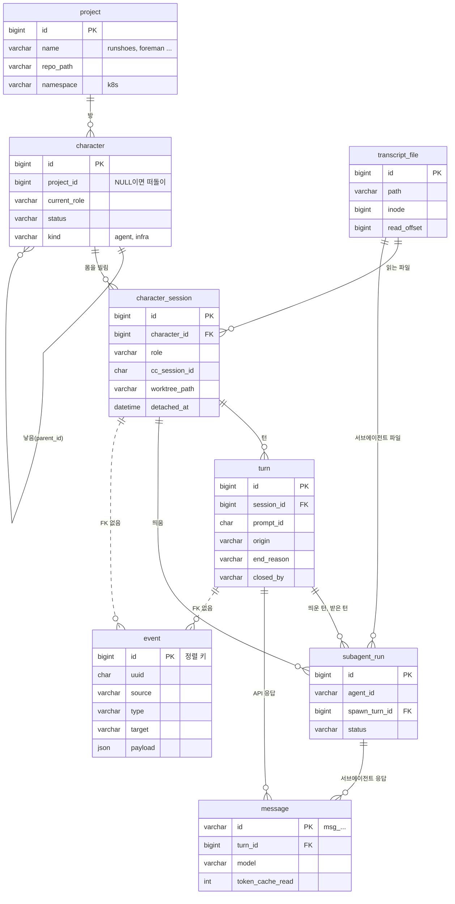
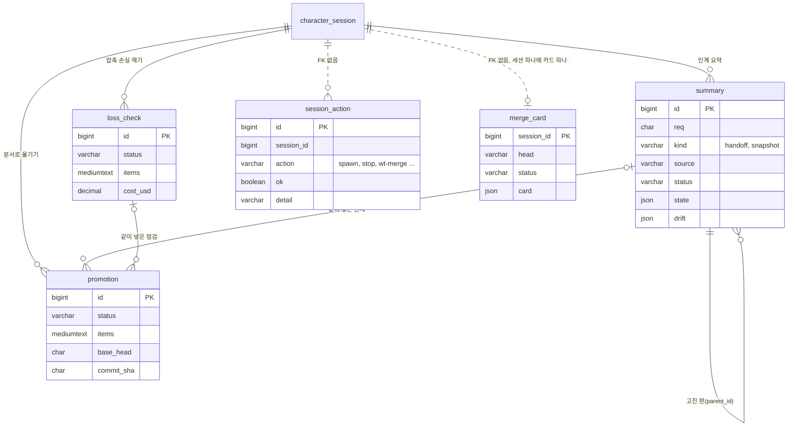
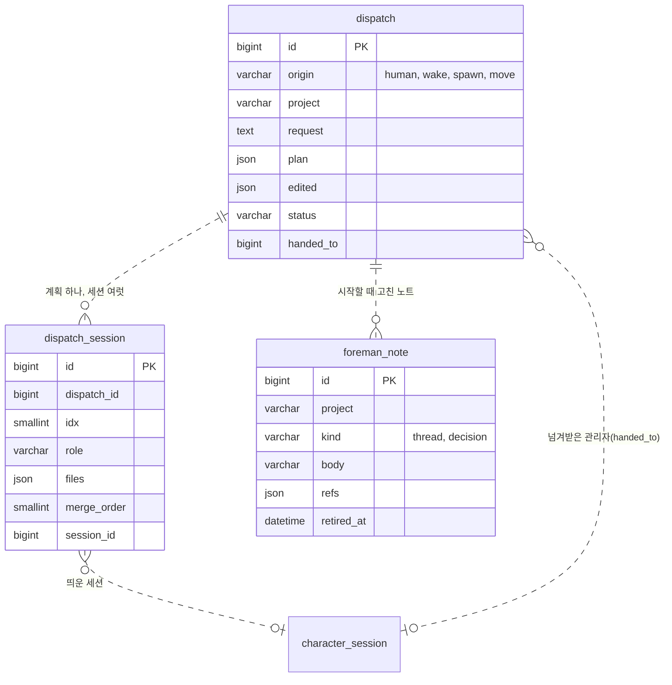
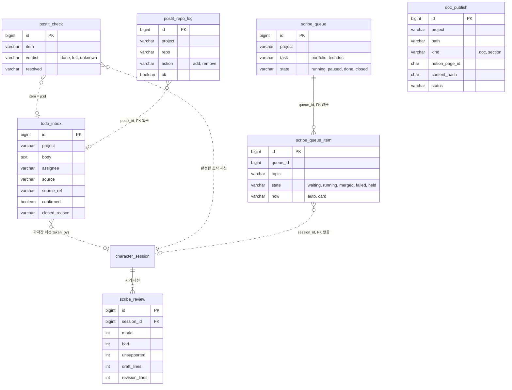
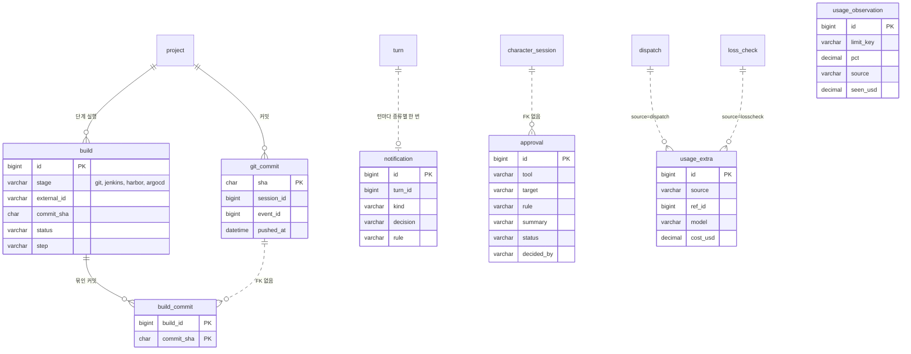

<!--
다루는 곳: migrations/
읽은 커밋: 5e0f7c5
-->
# 표 지도

FOREMAN의 DB(MySQL)에는 지금 표가 서른 개 있다. 마이그레이션 파일(DB 구조를 바꾸는 SQL 파일)이 만든 표가 스물아홉 개이고, 적용 도구가 스스로 만드는 `schema_migrations`가 하나다. 처음 마이그레이션 `0001_init.sql`이 여덟 개를 만들었고, 그 뒤 서른세 개의 마이그레이션이 표를 더하거나 칸을 늘리거나 이미 든 행을 고쳤다. 표를 지우거나 이름을 바꾼 마이그레이션은 없다 [code:migrations/]. 이 편은 마이그레이션이 만든 스물아홉 개 가운데 기능이 쓰는 스물여덟 개를 하는 일에 따라 다섯 덩어리로 묶고(1~5절), 되돌리기용으로만 남긴 표 하나는 6절에 따로 둔다. 표마다 무엇을 담는지, 어느 칸이 뜻을 가지는지, 누가 쓰는지, 어느 편이 그 표를 쓰는 기능을 깊게 설명하는지를 적는다. 칸 하나하나를 다 옮기지는 않는다. 칸 전체는 마이그레이션 파일에 있고, 파일마다 머리에 왜 그 칸을 두었는지가 주석으로 적혀 있다.

DB를 왜 MySQL로 골랐는지, 왜 ENUM 대신 VARCHAR를 쓰는지, 보관과 백업은 어떻게 하는지는 「→ 15 DB」가 다룬다. 마이그레이션을 어떤 차례로 적용하고 누가 스키마를 바꿀 수 있는지는 「→ 마이그레이션」이 다룬다 [code:bridge/db/migrate.py]. 이 편은 지도다. 어디에 무엇이 있는지를 보여 준다.

## 먼저 알아 둘 것

**표 이름과 칸 이름은 영어, 값은 짧은 영어 낱말이다.** 상태나 종류를 담는 칸은 MySQL의 ENUM(정해진 값만 받는 칸)이 아니라 그냥 글자 칸(VARCHAR)이다. 받을 수 있는 값의 목록은 파이썬 코드 `bridge/models.py`가 쥐고 검사한다 [code:bridge/models.py]. 값이 단계마다 늘어나서, ENUM이었으면 값 하나 더할 때마다 표를 고쳐야 했기 때문이다 [code:migrations/0001_init.sql]. 그래서 이 편에서 「status 값은 running, done, failed」처럼 적는 것은 DB가 막아 주는 목록이 아니라 코드가 지키는 약속이다.

**시간은 모두 UTC이고 밀리초까지 담는다(DATETIME(3)).** 화면에 보일 때만 서울 시각으로 바꾼다 [code:migrations/0001_init.sql].

**`character`는 MySQL 예약어라 SQL에서는 늘 백틱 글자로 감싼다.** 코드에서 character가 백틱에 싸여 있으면 이 까닭이다.

**표끼리의 잇기에는 두 종류가 있다.** 하나는 외래 키(FK, 「이 칸의 값은 저 표에 실제로 있는 행이어야 한다」를 DB가 지키게 하는 약속)다. 다른 하나는 칸에 다른 표의 id를 담기만 하고 DB는 지키지 않는 잇기다. 이 편의 그림에서 실선은 외래 키, 점선은 외래 키 없는 잇기다. 처음 여덟 표는 `event`만 빼고 외래 키로 촘촘히 묶였다. 뒤에 더한 표들은 대부분 외래 키를 두지 않았고, 프로젝트도 `project.id`가 아니라 프로젝트 이름 글자(`project VARCHAR(64)`)로 담는다 [code:migrations/0022_doc_publish.sql] [code:migrations/0025_foreman_note.sql] [code:migrations/0027_todo_inbox.sql]. 이 표들을 쓰는 설정 파일과 API가 모두 프로젝트를 이름으로 부르기 때문에, 이름을 그대로 담으면 id로 바꾸는 한 번의 조회가 없어진다. 대신 프로젝트 이름을 바꾸면 이 표들은 따라오지 않는다. 지금까지 프로젝트 이름을 바꾼 적은 없다.

**뒤에 더한 마이그레이션은 거의 다 「더하기만」이다.** 0017 무렵부터 파일 머리에 되돌리는 SQL을 적고 [code:migrations/0020_promotion.sql], 0028부터는 「이전 코드는 이 칸을 모른다, 지워도 돈다」를 함께 적는다 [code:migrations/0028_todo_inbox_assignee.sql] [code:migrations/0032_merge_card.sql]. 칸을 지우거나 이름을 바꾸는 마이그레이션은 없다. 새 브리지 코드가 문제를 일으키면 코드만 되돌려도 옛 코드가 새 스키마 위에서 그대로 돌게 하려는 것이다.

서른 번째 표인 `schema_migrations`는 이 지도의 덩어리에 넣지 않았다. 어느 마이그레이션 파일을 적용했는지를 파일 내용의 해시와 함께 적는 표인데, 마이그레이션 파일이 아니라 적용 도구가 스스로 만든다 [code:bridge/db/migrate.py]. 「→ 마이그레이션」이 다룬다.

## 한눈에

| 덩어리 | 표 | 만든 마이그레이션 |
|---|---|---|
| 기록 | `project`, `character`, `transcript_file`, `character_session`, `turn`, `subagent_run`, `message`, `event` | 0001 |
| 세션 한살이 | `session_action`, `summary` | 0014 |
| | `promotion` | 0020 |
| | `loss_check` | 0021 |
| | `merge_card` | 0032 |
| 시키기 | `dispatch` | 0016 |
| | `foreman_note` | 0025 |
| | `dispatch_session` | 0030 |
| 문서 | `doc_publish` | 0022 |
| | `scribe_review` | 0023 |
| | `todo_inbox` | 0027 |
| | `postit_check` | 0033 |
| | `postit_repo_log` | 0034 |
| | `scribe_queue`, `scribe_queue_item` | 0035 |
| 바깥 | `notification` | 0005 |
| | `approval` | 0010 |
| | `git_commit`, `build`, `build_commit` | 0012 |
| | `usage_extra`, `usage_observation` | 0026 |
| 되돌리기용 | `character_session_move_0017` | 0017 |

덩어리는 이렇게 나눴다. **기록**은 CC 세션이 남긴 흔적을 그대로 옮겨 담는 바탕이고, 나머지 모든 표가 여기의 `character_session`이나 `turn`을 가리킨다. **세션 한살이**는 FOREMAN이 세션에 한 일(끝내기, 인계, 압축 손실 재기, 합치기)의 기록이다. **시키기**는 계획 세우기(코드 이름 디스패처)와 관리자가 세션을 띄운 기록이다. **문서**는 서기, 노션, 포스트잇의 기록이다. **바깥**은 FOREMAN 밖과 닿는 것(텔레그램, 승인, git과 CI/CD, 사용량)의 기록이다.

## 1. 기록: CC가 남긴 것을 옮겨 담는 여덟 표

이 덩어리의 세 생각은 FOREMAN 설계의 바탕과 같다 [docs:00_design.md]. **캐릭터와 세션은 다르다.** 캐릭터(`character`)는 화면에 오래 서 있는 인물이고, 세션(`character_session`)은 그 인물이 잠깐 빌려 쓰는 CC 프로세스 한 번이다. **세션 안의 일은 턴으로 자른다.** 사람이 프롬프트 하나를 넣고 CC가 답을 마칠 때까지가 턴(`turn`) 하나다. **세세한 흔적은 모두 사건(`event`) 한 줄씩이다.** 도구 호출, 결과, 승인 요청, 압축, 셸 명령, 빌드 단계까지 한 표에 시간 순서대로 쌓인다. 이 흐름이 어떻게 만들어지는지는 「→ 02 기록 모으기」와 그 아래 편들이 깊게 다룬다.

### project — 프로젝트(방)

FOREMAN이 다루는 저장소 하나가 한 행이다. 화면에서는 방 하나다. 뜻 있는 칸은 `name`(설정 파일과 API가 프로젝트를 부르는 이름), `repo_path`(서버 안의 저장소 경로), `repo_url`(git 원격), `namespace`(그 앱이 도는 k8s 네임스페이스, 없으면 NULL)다. 행은 사람이 마이그레이션(시드)으로만 넣는다. 브리지는 뜰 때 이 표를 한 번 읽어 「어느 작업 폴더가 어느 방인가」를 정하므로, 프로젝트를 더한 뒤에는 브리지를 다시 띄워야 새 세션이 그 방으로 간다 [code:migrations/0029_seed_ronanlab_infra.sql]. 지금 행은 넷이다(아래 「시드」).

### character — 캐릭터

화면에 서 있는 인물 하나가 한 행이다. 세션이 끝나도 캐릭터는 남는다. `project_id`가 NULL이면 어느 방에도 속하지 않는 떠돌이다. `parent_id`는 이 캐릭터를 낳은 캐릭터(코더의 부모는 그 방의 포먼)다. `current_role`은 지금 역할(foreman, coder, designer, manager, scribe, inspector, helper, infra)이고 [code:bridge/models.py], `status`는 ACTIVE, IDLE, DORMANT, SUSPENDED, STALE 가운데 하나다. `kind`는 agent(CC 세션을 가질 수 있는 인물)와 infra(Jenkins, Harbor, ArgoCD처럼 바깥의 실제 시스템을 비추는 인물)를 가른다. infra 캐릭터는 `infra_type`, `infra_source`, `infra_endpoint`로 무엇을 비추는지 적고, `last_seen_at`에 마지막으로 응답한 때를 남긴다(0012에서 더함) [code:migrations/0012_pipeline.sql]. `spawned_by`는 누가 만들었나(user, foreman, auto)다. 세션을 띄울 때 그 역할의 캐릭터가 없으면 브리지가 만든다 [code:bridge/handoff.py]. 역할의 뜻은 「→ 역할 다섯」에 있다.

### transcript_file — 읽고 있는 트랜스크립트 파일

CC가 대화를 적는 JSONL 파일 하나가 한 행이다. 처음 설계에서는 읽은 위치를 세션 행에 두려 했는데, 표를 따로 뺐다. `claude --resume`으로 세션을 이으면 같은 파일에 계속 이어 쓰기 때문에 파일 하나가 세션 행 여럿에 걸치고, 와처(파일을 지켜보는 쪽)는 어느 캐릭터의 것인지 알기 전에 파일부터 발견하기 때문이다 [code:migrations/0001_init.sql]. 뜻 있는 칸은 `path`, `cc_session_id`, `agent_id`(서브에이전트 파일이면 채운다), `inode`(파일이 바뀌어 다른 파일이 같은 이름을 쓰는지 알아보는 번호), `read_offset`(어디까지 읽었나, 바이트), `last_uuid`(마지막으로 읽은 줄)다. 브리지가 다시 떠도 `read_offset`부터 이어 읽는다. 쓰는 쪽은 조립기다 [code:bridge/assembler.py]. 「→ 트랜스크립트 읽기」.

### character_session — 세션 한 번

CC 프로세스 하나(또는 셸 패널 하나)가 캐릭터에 붙어 있던 한 번이 한 행이다. FOREMAN에서 「세션 번호」라고 하면 이 표의 `id`다. 대부분의 다른 표가 `session_id`로 이 표를 가리킨다 [code:migrations/0001_init.sql].

이 표는 처음 만든 뒤 칸이 가장 많이 늘었다. 칸이 늘어난 차례가 곧 기능이 붙은 차례라 표로 남긴다.

| 칸 | 더한 마이그레이션 | 뜻 |
|---|---|---|
| `type`, `role`, `tmux_pane`, `pid`, `cc_session_id`, `transcript_file_id`, `worktree_path`, `branch`, `wake_reason`, `attached_at`, `detached_at` | 0001 | 바탕. `role`은 이 세션에서의 역할로, 캐릭터의 역할이 바뀌어도 이력으로 남는다. `detached_at`이 NULL이면 아직 붙어 있다 |
| `cwd` | 0003 | 작업 폴더. 어느 방의 세션인지 정하는 근거다 |
| `title` | 0011 | CC가 스스로 붙이는 제목(대화가 흘러가며 바뀐다) |
| `custom_title` | 0015 | 사람이 패널에서 붙인 이름. 있으면 이것이 먼저다 |
| `hidden_at`, `hidden_reason` | 0018 | 지우지 않고 화면과 집계에서 뺀다. 시험 세션은 `hidden_reason='test'` |
| `model` | 0019 | 띄울 때 고른 모델(`claude --model` 값) |

`cc_session_id`는 한 세션 행에만 있지 않을 수 있다. `--resume`은 같은 CC 세션 id를 이어 쓰므로 여러 행에 걸친다 [code:migrations/0001_init.sql]. `title`을 따로 둔 까닭은 처음에 모든 세션이 그 방의 포먼 캐릭터에 붙어 있어 화면에서 한 방의 세션이 모두 같은 이름으로 보였기 때문이다 [code:migrations/0011_session_title.sql]. `model` 칸은 띄울 때 고른 값일 뿐이고, 실제로 쓴 모델은 응답마다 `message.model`이 기준이다. 세션 안에서 `/model`로 바꿀 수 있어서 둘이 다를 수 있다 [code:migrations/0019_session_model.sql]. 행을 만드는 곳은 셋이다. 이미 도는 세션을 처음 본 조립기 [code:bridge/assembler.py], 세션을 새로 띄우는 쪽 [code:bridge/handoff.py], 셸 패널 [code:bridge/terminal.py]. 「→ 03 세션 지켜보기와 글 넣기」, 「→ 06 세션 띄우기와 따로 작업」.

### turn — 턴

프롬프트 하나부터 그 턴이 닫힐 때까지가 한 행이다. 턴의 경계는 CC가 사람 입력 줄마다 붙이는 `promptId`로 잡는다. 같은 턴의 프롬프트, 도구 결과, 중단 표시, 압축 요약이 모두 같은 `promptId`를 가진다는 것을 실측으로 확인하고 0003에서 `prompt_id` 칸을 더했다 [code:migrations/0003_turn_prompt_id.sql] [log:stage2_transcript_result.md].

뜻 있는 칸은 넷이다. `origin`은 이 턴을 연 것이 무엇인가다. 사람(human), 서브에이전트 완료 알림(task_notification), 자기 서브에이전트가 돌려준 결과(subagent_message), 다른 세션이 보낸 메시지(agent_message), FOREMAN이 넣은 인계 요청과 인계 글(handoff, handoff_in), 관리자에게 묻는 글(manager_ask), 넘겨 준 보고(relay), 합치기 카드(merge_card), 그 밖의 메타 입력(meta)이 있다 [code:bridge/assembler.py]. 알림 규칙과 포스트잇 그물이 「사람이 한 말인가」를 이 칸으로 가르므로, 잘못 가르면 알림이 엉뚱하게 나간다. 실제로 그런 일이 세 번 있었고, 그때마다 마이그레이션으로 이미 든 행을 고쳤다(아래 「행을 고친 마이그레이션」). `end_reason`은 어떻게 닫혔나(stop, stop_failure, interrupted, session_end, process_lost, merged, no_signal, abandoned)이고, `closed_by`는 그 판정을 낸 신호가 어디서 왔나(transcript, hook, sweep)다. 신호마다 잡히는 경우가 달라서, 먼저 온 신호가 닫는다 [code:migrations/0003_turn_prompt_id.sql]. `compacted`는 턴 도중에 CC가 대화를 압축했는지다. `prompt_text`는 사람이 붙여 넣는 긴 지시서도 담도록 MEDIUMTEXT로 두었다(실측 최대 18,395자) [code:migrations/0001_init.sql]. 쓰는 쪽은 조립기 하나다. 「→ 턴 조립」.

### message — API 응답 하나

모델의 응답 하나(`msg_…` id)가 한 행이다. 트랜스크립트에서는 응답 하나가 내용 덩어리마다 여러 줄로 쪼개져 나오지만 토큰 사용량은 줄마다 같아서, 응답 id로 한 번만 센다 [code:migrations/0001_init.sql]. 뜻 있는 칸은 `model`과 토큰 넷(`token_input`, `token_output`, `token_cache_read`, `token_cache_creation`)이다. 세션의 토큰 합계 칸을 따로 두지 않고 이 표에서 더해 낸다. 서브에이전트의 응답이면 `subagent_id`를 채우고, `turn_id`는 그 서브에이전트를 띄운 턴을 가리킨다. 사용량 화면이 이 표를 읽는다. 「→ 13 사용량과 모델」.

### subagent_run — 서브에이전트 하나

세션 안에서 `Agent` 도구로 띄운 서브에이전트 하나가 한 행이다. 서브에이전트는 캐릭터가 아니다. `agent_id`는 CC가 붙인 서브에이전트 id로 겹치지 않는다. `spawn_turn_id`는 띄운 턴, `result_turn_id`는 결과를 받은 턴이다. 백그라운드로 띄우면 둘이 다를 수 있다. `mode`는 foreground, background, fork, `status`는 running, done, failed, stopped다. 토큰 칸이 이 표에도 있는데, 서브에이전트 줄의 output 토큰은 응답이 시작될 때의 값이라 믿을 수 없어서 `output_tokens_reliable`로 표시한다 [code:migrations/0001_init.sql]. `reported_*` 칸은 완료 알림에 실려 오는 숫자로, 일부에만 있어 보조 확인용이다. `notified_at`(0005에서 더함)은 이 서브에이전트가 이미 알림에 실렸는지다. 부모 턴의 알림과 서브에이전트 묶음 알림이 같은 서브에이전트를 두 번 세지 않게 한다 [code:migrations/0005_notification.sql].

### event — 사건 한 줄

FOREMAN에서 가장 자주 쓰고 가장 큰 표다. 도구 호출 하나, 도구 결과 하나, 승인 요청 하나, 셸 패널에서 친 명령 하나, CI/CD 단계 하나가 각각 한 행이다. `type`은 start, tool_use, tool_result, assistant_msg, stop, error, approval_req, approval_res, interrupted, compact, queued, session_end, subagent_start, subagent_stop, restart_loop, input, shell_cmd, term_request, term_result, build, infra, debug 가운데 하나이고, `source`는 그 사건을 어디서 알았나(hook, transcript, poll, bridge, shell, webhook, debug)다 [code:bridge/models.py].

이 표만 외래 키를 두지 않았다. 까닭은 셋이다 [code:migrations/0001_init.sql]. hook 사건이 그 사건을 만든 트랜스크립트 줄보다 먼저 와서, 외래 키가 있으면 순서를 억지로 맞추거나 나중에 채워야 한다. 가장 자주 쓰는 표라 행마다 부모 표 다섯 개를 확인하는 비용을 없앤다. 호스트 감시 사건(restart_loop)처럼 세션이 아예 없는 사건도 있다. 대신 쓰는 길을 적재 쪽 하나로 모아 코드가 잇기를 보장하고 [code:bridge/store.py] [code:bridge/assembler.py], 짝이 없는 행은 점검 쿼리로 찾는다.

순서는 `ts`(사건 시각)가 아니라 `id`(적재 순서)로 잡는다. 적재 순서가 곧 파일에 적힌 순서이고, 트랜스크립트의 시각은 거꾸로 적힌 줄이 꽤 있기 때문이다. `ts`는 화면에 보이는 용도다. `target`은 도구가 다룬 대상(명령, 파일 경로)을 비밀값을 가린 뒤 1,024자까지 담고, 넘치면 `target_truncated`를 켜고 원문은 `payload`에 둔다. 실측에서 Bash 명령의 25%가 1,024자를 넘었다 [code:migrations/0001_init.sql]. `uuid`는 트랜스크립트 줄의 id로, 같은 줄을 다시 읽어도 행이 늘지 않게 막는다. `commit_sha`는 그 도구 호출이 만든 커밋으로, CI/CD 체인이 나중에 채운다 [code:bridge/pipeline.py]. 「→ 적재와 내보내기」.

## 2. 세션 한살이: FOREMAN이 세션에 한 일

### session_action — 세션에 한 일의 장부

FOREMAN이 세션에 손을 댄 일이 한 줄씩 쌓이는 장부다. 처음에는 끝내기, 멈춤, 되살리기, 작업 중단, 새로 띄우기를 적으려고 만들었다 [code:migrations/0014_handoff.sql]. 지금은 쓰는 곳이 많다. 세션 띄우기(spawn)와 되살리기(resume), 작업방 합치기와 버리기(wt-merge, wt-discard), 쉬게 하기(rest), 역할 바꾸기(role), 서기 일 종류(scribe-task), 합치기 카드를 나중으로 미룸(mprep-skip), 조사 세션 끝내기 실패(insp-close), 관리자에게 넘긴 보고(relay-out), 셸 패널의 세션 화면을 열고 닫음(ccview-open, ccview-close), 포스트잇 확인 세션(postit-run, postit-done)이 모두 이 표에 남는다 [code:bridge/handoff.py] [code:bridge/mergeprep.py] [code:bridge/notify.py] [code:bridge/terminal.py] [code:bridge/postit.py]. 칸은 `action`(12자까지), `ok`(성공했나), `detail`(짧은 사연), `pid`뿐이다.

이 표가 중요한 것은 읽는 쪽 때문이다. FOREMAN은 「이 세션은 이미 합쳐졌나」, 「이 정지된 CC는 FOREMAN이 멈춘 것인가」를 따로 칸을 두지 않고 이 장부에서 찾는다. 예를 들어 되살리기는 이 장부에 FOREMAN이 멈춘 기록(stop)이 있는 프로세스만 한다. 사용자가 일부러 Ctrl+Z로 세워 둔 CC를 건드리지 않기 위해서다 [code:bridge/handoff.py]. 포스트잇이 「가져간 세션이 합쳐졌으니 끝남」을 판정하는 것도, 끝난 세션을 맞출 때 「이미 합치거나 버렸나」를 보는 것도 이 장부의 wt-merge, wt-discard 줄이다 [code:bridge/postit.py] [code:bridge/reconcile.py]. 장부 하나에 모은 대가로 `action` 값의 목록은 코드 여러 곳에 흩어져 있다. 칸이 12자라 새 값은 그 안에 들어가게 짓는다 [code:bridge/postit.py].

### summary — 인계 요약

세션이 스스로 쓴 인계 요약 하나가 한 행이다. `kind`는 handoff(끝내기 전에 쓴 것)와 snapshot(지금 요약만)이고, `source`는 어떻게 얻었나다. 살아 있는 세션에 물어서(self), 죽은 세션을 `claude -p --resume`으로 깨워서(self_headless), 마지막 자동 압축 요약에서(compact), 사람이 고쳐서(edited) 얻는다 [code:migrations/0014_handoff.sql]. 사람이 고치면 원본을 덮지 않고 `parent_id`로 원본을 가리키는 새 행을 만든다. `req`는 요청마다 붙이는 여섯 자 꼬리표로, 세션이 돌려준 글이 어느 요청의 답인지 맞춘다. 요약을 새 세션에 넣으면 `injected_cc_session`과 `injected_at`을 채운다.

0024에서 칸 둘이 붙었다. `state`는 인계를 만들 때의 git과 잠금 상태(저장소, 작업방, 브랜치, HEAD, 기준 브랜치 HEAD, 스키마 잠금)이고, `drift`는 넣을 때 그 상태와 지금을 견주어 「인계 뒤 바뀐 것」으로 인계 앞에 붙인 줄들이다 [code:migrations/0024_summary_state.sql]. 인계가 낡으면 받은 세션이 지난 상태를 사실로 믿고 일한다. 이것도 조용한 고장과 같은 모양이라, 기계로 비교하게 했다. 「→ 인계 요약과 읽을 곳」.

### promotion — 문서로 옮기기

세션이 「대화에서 정했지만 문서에 없는 것」을 목록으로 내고, 사람이 고르고, 세션이 그것만 문서에 쓰고 커밋하는 일 한 번이 한 행이다 [code:migrations/0020_promotion.sql]. `items`는 항목 목록(JSON)으로, 항목마다 무엇을, 어느 문서의 어느 절에, 왜 넣을지와 사람이 고른 상태(pending, approved, dropped)를 담는다. `status`는 requested, listed, writing, written, write_failed, failed, timeout으로 흐른다. `base_head`는 쓰기를 시킬 때의 HEAD로, 브리지는 그 뒤의 커밋만 보고 「승인한 파일만 바뀌었나」를 확인한다. 조용히 빠지거나 다른 파일을 고치면 write_failed가 된다. `summary_id`와 `loss_check_id`(0021에서 더함)는 목록을 뽑을 때 같이 넣은 인계와 압축 손실 재기를 가리킨다 [code:migrations/0021_loss_check.sql]. 「→ 문서로 옮기기」.

### loss_check — 압축 손실 재기

세션 하나의 트랜스크립트에서 압축 구간마다 사람 프롬프트를 뽑아, 그때 한 지시와 결정이 지금 맥락에 남아 있는지를 다른 모델로 판정한 한 번이 한 행이다 [code:migrations/0021_loss_check.sql]. `items`는 판정 항목(살아 있음, 약해짐, 사라짐, 뒤집힘, 끝남)이고, `runs`는 묶음마다 걸린 시간과 비용이다. `cost_usd`는 전체 비용, `workdir`은 판정 재료를 둔 저장소 밖 폴더다. `status`가 running인 채로 브리지가 다시 뜨면 failed로 바꾼다. 조용히 멈춘 채 남지 않게 하려는 것이다. 「→ 압축 손실 재기」.

### merge_card — 합치기 카드

작업방 세션 하나의 합치기 카드가 한 행이다. 처음에는 카드가 브리지 메모리에만 있었다. 관리자가 카드를 승인해 합친 뒤 브리지를 다시 띄우자 카드와 정리 후보 여섯 개가 사라진 일이 있어서 DB에 남기게 했다 [code:migrations/0032_merge_card.sql] [log:mergeprep_db_20261113.md]. 카드 전부(커밋, 바뀐 파일, 충돌, 정리 후보, 승인자, 결과)는 `card` JSON 한 칸에 넣고, 고를 때 쓰는 것만 칸으로 뺐다. `head`는 브랜치 끝 커밋으로, 바뀌면 카드를 다시 만든다. `status`는 ready, merging, merged, conflict_sent, conflict_manager, failed다. `made_at`은 카드를 처음 만든 때로, 브리지를 다시 띄워도 그대로라 「오래됨」을 셀 수 있다. 브리지는 메모리의 카드와 이 표를 맞추고, 뜰 때 이 표에서 되살린다 [code:bridge/mergeprep.py]. 기본 키가 `session_id`라 세션 하나에 카드는 하나다. 「→ 합치기 카드」.

## 3. 시키기: 계획과 띄우기

이 덩어리의 표는 셋 다 외래 키가 없다. 다만 잇기의 뜻은 분명하다.

### dispatch — 계획 한 번

사람이 하려는 일을 말하면 교장(계획 세우기)이 `claude -p` 한 번으로 계획을 낸다. 그 한 번이 한 행이다. 요청 글(`request`), 교장이 낸 계획(`plan`), 사람이 고친 계획(`edited`), 결과를 모두 남긴다 [code:migrations/0016_foreman_dispatch.sql]. 계획과 고친 계획을 둘 다 두는 것은 교장이 자주 틀리는 유형을 찾아 지시문을 고치려는 것이다. `status`는 planned, started, failed, discarded다.

0025에서 자동 기상이 붙으면서 `origin`(누가 시작했나), `project`, `wake_key`, `wake_text`가 더해졌다 [code:migrations/0025_foreman_note.sql]. `origin`은 처음에 human(사람이 말함)과 wake(실패 사건이 깨움)였고, 0030부터는 spawn(새 세션 창이나 관리자가 계획 없이 바로 띄움)과 move(새 세션으로 옮기기)도 이 표에 남는다 [code:migrations/0030_dispatch_session.sql]. 그래서 이 표는 이제 「모든 띄우기의 기록」이기도 하다. `wake_key`는 같은 실패로 계획을 두 번 세우지 않게 하는 열쇠다(예: 어느 프로젝트의 어느 Jenkins 빌드 번호). 0031에서 `handed_to`, `handed_at`, `handed_alert_at`이 붙었다. 교장의 계획을 관리자 세션에 넘기면 넘겨받은 세션과 시각을 적고, 오래 시작하지 않으면 사람에게 한 번 알린 시각을 적는다 [code:migrations/0031_handover_todo_edit.sql]. 쓰는 쪽은 `bridge/foreman.py`와 `bridge/handover.py`다. 「→ 계획 한 번」, 「→ 관리자에게 넘기기와 보고」.

### dispatch_session — 계획 안의 세션 한 줄

계획 하나에 담긴 세션 하나가 한 행이다. 처음에는 계획 하나가 세션 하나만 띄웠는데, 사람이 「둘 띄워줘」라고 했을 때 하나만 뜬 일이 있어 계획 하나에 세션 여럿을 담게 했다 [code:migrations/0030_dispatch_session.sql] [log:plan_structure_20261111.md]. 같은 내용이 계획 JSON에도 있지만, 시작할 때 이 표에 옮겨 둔다. 살아 있는 세션들이 맡은 파일을 찾을 때마다 JSON을 풀지 않으려는 것이다. 뜻 있는 칸은 `idx`(계획 안 순번), `role`, `model`, `files`(맡을 파일, 폴더는 끝에 `/`, 글롭 `*`), `merge_order`(합칠 순서, 작은 것 먼저), `status`(started, failed, off), `session_id`(실제로 뜬 세션)다. 겹침 알림이 `files`를 읽는다. 「→ 겹침 알림」.

### foreman_note — 진행 중인 일 노트

교장은 부를 때만 한 번 도는 `claude -p`다. 상주시키면 압축 손실이 생기기 때문이다. 대신 프로젝트마다 크기를 정한 노트를 계획 재료에 넣는다. 그 노트의 한 줄이 한 행이다 [code:migrations/0025_foreman_note.sql]. `kind`는 thread(진행 중인 일 줄기)와 decision(사람이 정한 판단)이다. 구조나 명령은 쌓지 않는다. 그것은 CC 메모리와 docs에 있고, 사본은 낡기 때문이다. `source`는 출처(세션 번호, log 파일, 계획 번호), `refs`는 확인할 때의 세션과 HEAD로, 그 뒤에 바뀐 것을 기계로 붙이는 데 쓴다. 줄을 고칠 때는 덮지 않는다. 옛 줄에 `retired_at`과 `replaced_by`를 적고 새 줄을 넣어 이력을 남긴다. 「→ 진행 중인 일과 자동 기상」.

## 4. 문서: 서기, 노션, 포스트잇

### doc_publish — 노션에 올린 기록

원고 하나를 노션 페이지 하나에 올린 기록이 한 행이다. 원본은 git의 마크다운이고 노션은 게시판이다. 같은 원본은 같은 노션 페이지에 내용만 갈아 끼워 주소가 그대로다 [code:migrations/0022_doc_publish.sql]. `(project, path)`가 겹치지 않는 열쇠다. `path`는 저장소 기준 원본 경로이고, 여러 원고를 묶는 페이지는 `@section/<이름>` 꼴로 적는다(`kind`가 section). `notion_page_id`는 FOREMAN이 만든 페이지로, 고치기와 내리기는 이 페이지에만 한다. `content_hash`는 마지막으로 올린 원본의 해시로, 같으면 다시 올리지 않고 다르면 「원본이 바뀜」으로 보인다. 아직 노션에 없는 편을 편 사이 참조로 가리킨 채 올라간 원고는 이 칸을 비워 두어, 그 편이 올라간 뒤 다시 올려 링크를 건다(`commit_sha`는 남아 있어 짝 등록으로 들어와 둘 다 빈 행과 갈린다) [code:bridge/notion.py]. `status`는 published, archived(노션 휴지통, 30일 동안 되살릴 수 있다), failed다. 쓰는 쪽은 `bridge/notion.py`다. 「→ 노션 게시」.

### scribe_review — 서기 검토 기록

서기 브랜치를 합칠 때 근거 확인기가 본 결과 한 번이 한 행이다 [code:migrations/0023_scribe_review.sql]. `marks`는 근거 표시 수, `bad`는 틀린 근거(없는 경로, 없는 커밋), `unsupported`는 근거 없이 숫자를 쓴 줄 같은 의심 줄이다. `draft_lines`와 `revision_lines`는 서기의 첫 초안 줄 수와 사람이 의견을 준 뒤 고친 줄 수다. 고친 양이 시간이 지나며 줄어드는지가 서기를 더 믿고 맡길지를 정하는 숫자라서 남긴다. `detail`에는 파일별 틀린 근거가 JSON으로 든다. 「→ 근거 확인과 물어보기」.

### todo_inbox — 포스트잇

화면에서 포스트잇이라고 부르는 것이 이 표다. 이름이 받는 함(inbox)인 것은 처음에 만든 뜻이 그랬기 때문이다. 사람이 「할 일에 넣어라」라고 한 것이 메인 세션에 몰려 맥락이 쌓이자, 세션 없이 글만 받아 두는 함을 만들었다 [code:migrations/0027_todo_inbox.sql] [log:dispatch_flow_decision_20261109.md]. 그 뒤 칸이 세 번 붙으며 지금의 포스트잇이 되었다.

| 칸 | 더한 마이그레이션 | 뜻 |
|---|---|---|
| `project`, `body`, `taken_by`, `taken_at`, `dropped_at` | 0027 | 바탕. `taken_by`는 이 글을 재료로 가져간 세션 |
| `assignee` | 0028 | 누구 몫인가: scribe(서기, 기본), coder(그 방 코더의 맡길 일) |
| `edited_at` | 0031 | 사람이 목록에서 글을 고친 마지막 시각 |
| `source`, `source_ref`, `confirmed`, `closed_reason`, `closed_at`, `closed_note` | 0033 | 어디서 왔나, 근거, 확인 전인가, 닫힌 까닭 |

0033의 칸이 지금 포스트잇의 뼈대다 [code:migrations/0033_postit.sql]. `source`는 들어온 길이다. 포스트잇 창에 바로 적음(note), 옛 머리줄 단추(todo, 단추는 없앴고 옛 길과 이미 든 줄에만 남았다), 사람이 대화에서 말해 관리자가 올림(said), 브리지 그물이 대화에서 찾음(chat), 문서로 옮기기에서 다 못 넣은 것(promote), TODO 항목을 [한계로] 보내며 새로 만든 닫힌 줄(todomd) [code:bridge/postit.py]. `source_ref`는 그 근거(턴 번호나 옮기기 항목)이고, 그물과 옮기기에서 온 것은 근거 하나에 한 장만 만든다. `confirmed`가 0이면 그물이 찾은 것이라 화면에 흐리게 보이고 사람이 저장하거나 버린다. `closed_reason`은 drop(안 하기로 함), todo(`docs/TODO.md`로 보냄), limit(고른 편의 「알려진 한계」로 보냄), done(끝남)이다.

상태 칸이 따로 없다는 점이 이 표의 특징이다. 「새로」, 「가져가는 중」, 「합쳐짐」 같은 상태는 `closed_reason`과 `taken_by` 세션의 `session_action` 줄을 함께 보고 계산한다 [code:bridge/postit.py]. 세션이 합쳐졌는지는 이미 장부에 있으니, 같은 사실을 두 곳에 두어 어긋나게 하지 않으려는 것이다. 「→ 포스트잇」.

### postit_check — 포스트잇 확인 판정

포스트잇 창에서 [갱신]을 누르면 조사 세션이 코드를 읽고 열린 포스트잇마다 끝났는지 판정한다. 그 판정 한 줄이 한 행이다 [code:migrations/0033_postit.sql]. `item`은 `p:<포스트잇 id>`다. 예전에 README 「알려진 한계」 줄을 판정하던 때의 `L:<줄 앞부분>` 행이 남아 있을 수 있어도 지금은 읽지 않고 새로 만들지도 않는다 [code:bridge/postit.py]. `verdict`는 done, left, unknown이고, done은 근거가 코드 자리일 때만 낸다. `coder`는 남은 일이면 코더에게 맡길 만한가다. 판정은 제안일 뿐이라, 사람이 줄마다 닫거나 남긴 결과를 `resolved`(closed, kept)에 적는다. 커밋만 보고 자동으로 지우지 않는다 [code:bridge/postit.py].

### postit_repo_log: 저장소에 넣으려고 누른 기록

포스트잇 창에서 [TODO로]나 TODO 항목의 [지우기]를 누르면 브리지가 그 프로젝트 저장소에 직접 커밋한다. 누른 것마다 성공도 거부도 한 행으로 남긴다 [code:migrations/0034_postit_repo_log.sql]. `repo`는 저장소 폴더 이름, `action`은 add(항목을 더함)와 remove(지움), `ok`는 커밋했는지다. `commit`은 짧은 해시이고 성공일 때만 있다. `note`는 사람이 읽는 한 줄로, 어느 저장소에 무엇을 넣었는지 또는 왜 못 했는지가 적힌다. `postit_id`는 누른 포스트잇이고, TODO 항목의 [지우기]에는 포스트잇이 없어 비어 있다. 이 표를 둔 까닭은 열린 포스트잇에 메모 칸이 없어, 거부된 까닭을 `todo_inbox`에 적을 곳이 없었기 때문이다. 화면은 이 행을 열린 줄 밑의 거부 까닭과 창 아래 「저장소에 넣은 기록」으로 보인다 [code:bridge/postit.py]. 「→ 포스트잇」.

### scribe_queue, scribe_queue_item: 서기실 전체 줄

서기실 「포트폴리오 쓰기」와 「기술문서 쓰기」의 [전체]가 세운 줄이다. 줄 하나가 `scribe_queue`의 한 행이고, 줄에 선 편 하나가 `scribe_queue_item`의 한 행이다 [code:migrations/0035_scribe_queue.sql]. 줄은 편을 한 번에 하나씩 띄우고, 한 편이 main에 합쳐져야 다음 편을 띄운다. 브리지를 다시 띄워도 줄이 이어지도록 메모리가 아니라 이 표에 둔다. `scribe_queue.state`는 running(도는 중), paused(멈춤. 지금 편이 끝나면 다음 편을 띄우지 않는다), done(남은 편 없음), closed(사람이 닫음)다. 한 프로젝트에 running이나 paused인 줄은 하나뿐이고, 이것은 코드가 지킨다. `stall_told`는 「오래 안 끝남」을 이미 알린 편이다. `scribe_queue_item.state`는 waiting, running, merged, failed, held(사람 승인 카드라 미룸)이고, `how`는 합친 길(auto는 카드 없이, card는 카드로), `reason`은 실패나 미룸의 까닭 또는 지금 기다리는 것, `decisions`는 그 편 서기가 마지막 응답에 남긴 「사람이 정할 것」이다 [code:bridge/scribe_queue.py]. 「→ 서기실과 일감」.

## 5. 바깥: 알림, 승인, git과 CI/CD, 사용량

### notification — 알림 기록

텔레그램 알림 하나가 한 행이다. 보낸 것만이 아니라 **보내지 않기로 한 것과 그 규칙**도 남긴다 [code:migrations/0005_notification.sql]. 모델이 알림 스크립트를 직접 부르던 때는 한 프로젝트에서 75번, 다른 프로젝트에서 14번 보냈는데, 그 차이가 빠뜨린 것인지 규칙대로 안 보낸 것인지 가릴 수 없었다. 그래서 `decision`(sent, skipped, failed, held 등)과 `rule`(어느 규칙 때문인가)을 함께 적는다. `kind`는 처음에 turn(턴 끝), batch(백그라운드 서브에이전트 묶음), direct(브리지 밖 알림) 셋이었고, 지금은 하루 묶음(digest), 사용량 문턱(usage), 끝난 세션 맞추기(recon)도 이 표에 쓴다 [code:bridge/notify.py] [code:bridge/usage.py] [code:bridge/reconcile.py]. `(turn_id, kind)`가 겹치지 않아서 브리지를 다시 띄우거나 신호가 두 번 와도 한 턴에 같은 종류 알림은 한 번만 나간다. `rule` 칸은 「같은 일로 한 번만」의 열쇠로도 쓰인다. 사용량 문턱 알림은 같은 창, 같은 문턱을 rule 키로 찾아 다시 보내지 않는다 [code:bridge/usage.py]. 「→ 11 알림」.

### approval — 승인 대기

CC가 승인 창을 띄운 일 하나가 한 행이다. FOREMAN 규칙이 물은 것이든 CC 자체 판단이든 같다 [code:migrations/0010_approval.sql]. 사람이 답해야 했던 것만 여기 남고, 자동 통과를 포함한 모든 판정은 `event`(type approval_req)에 남는다. `status`는 pending, allowed, denied, terminal, timeout, abandoned다. terminal은 사람이 브라우저가 아니라 터미널에서 직접 답한 경우이고, 그때 CC가 기록한 결정은 `terminal_decision`에 둔다. abandoned는 브리지가 다시 떠서 기다리던 연결이 끊긴 경우다. 승인 창은 터미널에 그대로 남는다. `decided_by`는 browser, terminal, timeout, bridge, `message`는 거부 사유로 모델에게 간다. 0013에서 `summary`가 붙었다. 명령이 통째로 나와 읽기 힘들어서 「무엇을 대상으로 하는가」를 한 줄로 만든 것이다(예: `kubectl delete → pod/jenkins-0 (jenkins 네임스페이스)`) [code:migrations/0013_approval_summary.sql]. 이 한 줄을 텔레그램, 화면의 승인 카드, CC 승인 창, 승인 이력이 함께 쓴다. 「→ 04 승인」, 「→ 승인 요약」.

### git_commit, build, build_commit — CI/CD 인과 체인

세 표는 한 묶음이다. 축은 커밋 SHA다. 「이 캐릭터가 파일을 고쳤다 → 이 커밋 → 이 빌드 → 이 이미지 태그 → 이 배포 동기화 → 여기서 실패」를 한 줄로 꿰려는 것이다 [code:migrations/0012_pipeline.sql].

`git_commit`은 프로젝트 저장소에서 본 커밋 하나가 한 행이다. 원격이 GitHub이고 웹훅을 받을 수 없어서, 서버의 로컬 저장소를 폴링해 채운다. `session_id`와 `event_id`는 그 커밋을 만든 CC 세션과 `git commit` 도구 호출 사건이다. 사람이 직접 쳤으면 NULL이다. `pushed_at`은 원격 브랜치에 들어간 것을 본 때다.

`build`는 파이프라인 단계 실행 하나가 한 행이다. `stage`는 jenkins, harbor, argocd(커밋 단계는 git_commit이 맡는다)이고, `external_id`는 단계마다 꼴이 다르다(Jenkins는 `<job>#<번호>`, Harbor는 `<repo>@<digest>`, ArgoCD는 `<app>@<리비전>`). `commit_sha`는 그 단계가 다룬 머리 커밋, `step`은 깨진 곳(Jenkins 스테이지 이름 등), `message`는 실패 사유(비밀값을 가림)다. `infra_character_id`는 이 단계를 맡은 인프라 캐릭터다.

`build_commit`은 빌드 하나에 묶인 커밋들이다. Jenkins가 2분마다 폴링해서 그 사이에 push된 커밋 여럿이 빌드 하나가 된다. 머리 커밋이 아닌 내 커밋도 이 표로 자기 빌드를 찾는다 [code:migrations/0012_pipeline.sql]. 세 표를 쓰는 쪽은 `bridge/pipeline.py` 하나다. 「→ 12 CI/CD 인과 체인」.

### usage_extra, usage_observation — 사용량

`usage_extra`는 트랜스크립트에 남지 않는 `claude -p` 호출의 사용량이다 [code:migrations/0026_usage.sql]. 계획 세우기와 압축 손실 재기는 세션 기록을 남기지 않는 옵션으로 돌아 `message` 표에 들어오지 않는다. 그래서 CC가 결과로 돌려주는 모델별 사용량을 모델마다 한 행으로 남긴다. `source`는 dispatch, losscheck, scribe_ask이고 `ref_id`는 그 계획이나 재기 번호다 [code:bridge/usage.py] [code:bridge/foreman.py] [code:bridge/losscheck.py] [code:bridge/scribe_ask.py]. `cost_usd`는 CC가 정가로 계산한 값이다. 기록이 실패해도 부른 쪽은 막지 않는다.

`usage_observation`은 사용 한도 %를 한 번 본 것이 한 행이다. `limit_key`는 5시간 창, 주간 전체, 주간 모델별 같은 한도 종류이고, `pct`는 그때의 %다. `seen_usd`는 그 시각 그 창에서 FOREMAN이 본 환산액이다. 이것을 %로 나누면 한도의 크기를 거꾸로 셈할 수 있다 [code:bridge/usage.py]. 마이그레이션 주석은 출처를 사람이 넣음(human)과 화면에서 읽음(screen)으로 적었지만, 지금 코드는 `claude -p "/usage"`로 읽어 cli로 남긴다. 값이 바뀔 때만 넣고, `(limit_key, source, raw)`가 겹치지 않아 같은 읽기가 두 번 들어가지 않는다. 「→ 13 사용량과 모델」.

## 6. 되돌리기용 표: character_session_move_0017

이 표는 기능이 쓰는 표가 아니다. 마이그레이션 하나를 되돌릴 수 있게 남긴 장부다. 처음에는 이미 돌던 세션을 입양할 때 모두 그 방의 포먼 캐릭터에 붙였다. 포먼은 프로젝트마다 상주하는 감독이고 자기 세션이 없어야 하는데, 임시로 그렇게 했다. 0017이 이것을 바로잡아 세션을 역할별 캐릭터(코더, 조사, CI/CD)로 옮겼고, 셸 패널 행은 떠돌이 미분류로 보냈다 [code:migrations/0017_character_reassign.sql].

옮기기 전에 이 표에 세션마다 옛 캐릭터와 새 캐릭터를 먼저 적었다. 칸은 `session_id`, `old_character_id`, `new_character_id`, `moved_at`뿐이다. 되돌리려면 이 표를 이어 `character_session.character_id`를 옛 값으로 되쓰면 된다. 되돌리는 SQL 한 줄이 마이그레이션 머리에 적혀 있다. 0018도 킥오프 대화 세션 하나를 미분류에서 FOREMAN의 코더로 옮기면서 같은 표에 적었다 [code:migrations/0018_session_hidden.sql]. 표 이름에 마이그레이션 번호를 붙인 것은 「이 표는 0017과 함께 생기고 함께 사라진다」를 이름으로 알리려는 것이다. 코드 어디서도 이 표를 읽거나 쓰지 않는다.

그 뒤의 마이그레이션은 장부 표를 만들지 않고 파일 머리에 되돌리는 SQL을 적는 쪽으로 바뀌었다. 칸이나 표를 더하기만 하면 되돌리기가 `DROP` 한두 줄이라 장부가 필요 없기 때문이다 [code:migrations/0032_merge_card.sql]. 이미 든 행의 값을 바꾸는 경우가 옛 값을 잃기 쉬운 자리인데, 포스트잇 마이그레이션은 장부 대신 되돌리는 SQL을 값의 꼴로 거꾸로 적었다. 합치기 카드로 바꾼 턴 출처를 사람으로 되돌리는 한 줄이 그것이다 [code:migrations/0033_postit.sql]. 받는 함 줄을 닫은 것은 칸을 지우면 함께 사라지므로 따로 되돌릴 것이 없다.

## 7. 시드: 처음부터 넣어 둔 행

표를 만드는 것 말고 행을 넣는 마이그레이션이 넷 있다. 이 행들이 없으면 브리지가 세션을 어느 방, 어느 캐릭터에 붙일지 정하지 못한다.

**0002 — 프로젝트 셋과 포먼 셋.** runshoes(k8s 네임스페이스 runshoes), petmint-rag-chatbot(네임스페이스 petmint), foreman(네임스페이스 없음) 세 프로젝트를 넣고, 프로젝트마다 포먼 캐릭터 하나를 넣는다 [code:migrations/0002_seed.sql]. 포먼은 평소 세션 없이 서 있으므로 DORMANT로 시작한다. 외형과 자리는 화면 단계에서 정하기로 하고 NULL로 두었다. 임의값을 넣지 않은 것은 「NULL = 아직 안 정함」을 지키려는 것이다 [code:migrations/0001_init.sql].

**0004 — 떠돌이 미분류.** 어느 프로젝트 저장소에도 속하지 않는 폴더(홈, `/tmp` 등)에서 돈 CC 세션을 붙여 둘 캐릭터 하나다 [code:migrations/0004_seed_unassigned.sql]. 프로젝트가 없고(`project_id` NULL), 역할은 helper, 화면에서는 방 밖 복도에 선다. 그 무렵 브리지는 이미 도는 세션을 입양만 하고 캐릭터를 새로 만들지 않았기 때문에, 갈 곳 없는 세션의 자리가 미리 있어야 했다.

**0017 — 역할별 캐릭터.** 시드 파일은 아니지만 캐릭터 행을 넣는다. 프로젝트마다 코더를 늘 하나 두고(새로 입양하는 세션의 기본 자리), 조사와 CI/CD는 그 역할의 세션이 있던 프로젝트에만 만들었다. 부모는 그 방의 포먼, `spawned_by`는 foreman이다 [code:migrations/0017_character_reassign.sql]. 이때 붙인 조사 캐릭터의 이름은 역할의 옛 화면 이름이었고, 지금은 브리지가 그 역할의 캐릭터를 찾을 때 옛 이름도 함께 보고 새 이름으로 맞춘다 [code:bridge/roles.py].

**0029 — 넷째 프로젝트, 인프라.** ronanlab-infra를 넣고 0002와 같은 포먼, 0017과 같은 코더를 하나씩 붙인다 [code:migrations/0029_seed_ronanlab_infra.sql]. 표는 바꾸지 않는다. 빌드하는 앱이 아니라서 k8s 네임스페이스도 CI/CD 체인 설정도 없다. 이 파일 머리에는 두 가지 주의가 적혀 있다. 브리지가 뜰 때 `project` 표를 읽으므로 적용한 뒤 브리지를 다시 띄워야 새 세션이 이 방으로 간다. 그리고 이미 미분류에 붙은 세션은 저절로 옮겨지지 않는다 [log:coder_infra_project_20261110.md].

## 8. 행을 고친 마이그레이션

FOREMAN은 트랜스크립트를 다시 처음부터 읽어 DB를 새로 채우지 않는다. 한 번 적재한 것은 행을 고친다. 그래서 표를 바꾸지 않고 이미 든 행만 고치는 마이그레이션이 여럿 있다. 어느 칸의 값이 왜 그 모양인지 찾을 때 이 파일들을 본다.

| 마이그레이션 | 고친 것 | 까닭 |
|---|---|---|
| 0006, 0007, 0008 | `turn.origin`을 subagent_message로 | 서브에이전트가 결과를 돌려주며 연 턴이 meta나 human으로 분류되어 알림이 서브에이전트마다 따로 나갔다. 메타 입력으로, 사람 입력처럼, hook으로만 오는 세 경우가 차례로 드러났다 [code:migrations/0006_subagent_message_origin.sql] [code:migrations/0008_subagent_message_hook_opened.sql] |
| 0009 | `turn.origin`을 보낸 쪽으로 다시 가름, 가짜 `subagent_run` 행 지움 | 다른 세션이 보낸 메시지로 보던 143턴이 실측해 보니 전부 자기 서브에이전트가 보낸 것이었다. 종류가 빈 hook으로만 생긴 서브에이전트 행도 지웠다 [code:migrations/0009_agent_message_sender.sql] |
| 0018 | 시험 세션에 `hidden_reason='test'` | `/tmp`에서 hook, 권한, 인계를 시험하느라 띄운 미분류 세션을 지우지 않고 숨겼다 [code:migrations/0018_session_hidden.sql] |
| 0025 | `dispatch.project` 채움 | 새 칸을 지난 계획의 JSON에서 채웠다 [code:migrations/0025_foreman_note.sql] |
| 0033 | 받는 함의 지난 줄을 닫음, `turn.origin`을 merge_card로 | 버린 것은 drop, 이미 옮기거나 합쳐진 것은 done으로 닫았다. 브리지가 관리자 입력 칸에 넣은 합치기 카드 글은 사람 말이 아니라서 출처를 바꿨다 [code:migrations/0033_postit.sql] |

0006부터 0009까지 네 번에 걸친 것은 같은 문제를 한 번에 다 보지 못했기 때문이다. 서브에이전트의 결과 전달은 어떤 때는 메타 입력으로, 어떤 때는 사람 입력과 똑같이, 어떤 때는 트랜스크립트 줄 없이 hook으로만 왔다. 코드는 그때마다 내용으로 가르게 고쳤고 [code:bridge/assembler.py], 마이그레이션은 그 전에 이미 잘못 들어간 행을 따라 고쳤다. `origin` 칸 하나가 알림과 포스트잇 그물 양쪽의 판단 근거라서, 틀린 값을 그대로 두면 지난 턴을 다시 볼 때마다 엉뚱한 결론이 나온다.

## 이 지도를 쓸 때

새 기능이 DB에 무언가를 남겨야 하면 먼저 이 지도에서 기존 표로 되는지 본다. 세션에 한 일을 한 줄 남기는 것이면 `session_action`에 새 `action` 값을 더하는 것으로 충분한 경우가 많다 [code:bridge/handoff.py]. 상태를 새 칸으로 두기 전에 이미 다른 표에 있는 사실로 계산할 수 있는지 본다. 포스트잇이 상태 칸 없이 합쳐짐을 장부에서 읽는 것이 그 예다. 그래도 새 표나 칸이 필요하면 「더하기만」으로 만들고 파일 머리에 되돌리는 SQL을 적는다. 이 마이그레이션은 한 번에 한 세션만 만들 수 있다. 「→ 마이그레이션」.
