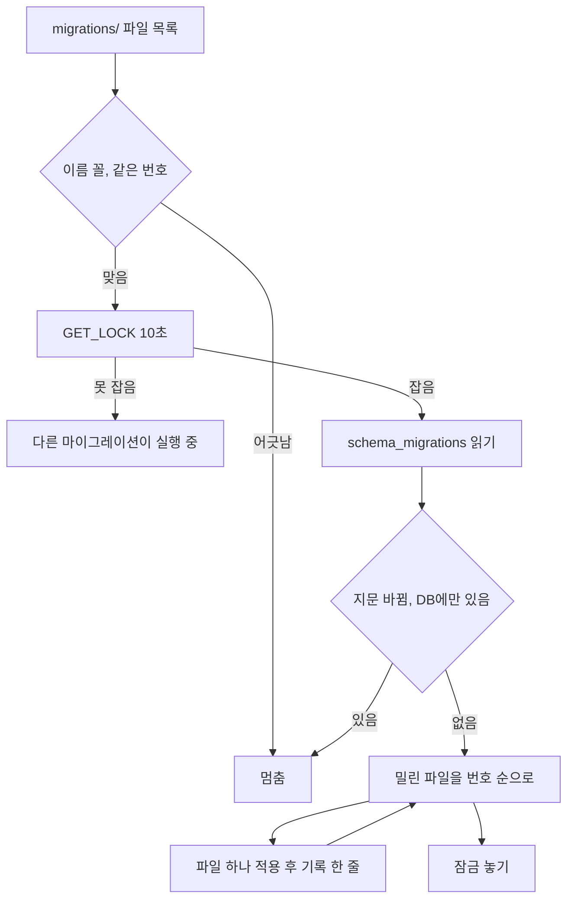

<!--
다루는 곳: bridge/db/migrate.py, bridge/schemalock.py
읽은 커밋: e5d584b
-->

# 마이그레이션

FOREMAN의 DB 표 구조(스키마)는 한 번에 정해진 것이 아니다. 처음에는 표 여덟 개로 시작했고, 기능이 붙을 때마다 표와 칸이 늘었다 [log:stage1_bridge_db_result.md]. 이 구조를 바꾸는 SQL 파일 하나하나를 마이그레이션이라고 부른다. 마이그레이션은 "DB를 어제 모양에서 오늘 모양으로 옮기는 한 걸음"이다. 이 편은 그 걸음을 어떤 차례로 밟는지, 발이 미끄러지면 어떻게 되는지, 두 세션이 동시에 걸음을 만들면 어떻게 막는지, 시험은 어느 DB에서 걷는지를 다룬다. 표 하나하나가 무엇을 담는지는 → 「표 지도」 편에서 다룬다.

## 1. 번호 순으로 한 번씩

마이그레이션 파일은 `migrations/` 폴더에 `NNNN_소문자이름.sql` 꼴로 둔다. 앞 네 자리가 번호이고, 번호가 곧 차례다. 지금은 `0001_init.sql`부터 `0035_scribe_queue.sql`까지 35개가 있다 [code:migrations/]. 이름이 이 꼴에 맞지 않거나 같은 번호가 둘 이상이면 실행기는 아무것도 하지 않고 멈춘다 [code:bridge/db/migrate.py].

같은 번호 검사는 사소해 보이지만 작업방(worktree. 세션마다 갈라 준 작업용 폴더와 브랜치) 때문에 필요하다. 두 작업방이 각자 "다음 번호는 0034"라고 생각하고 `0034_a.sql`, `0034_b.sql`을 만들면 이름이 달라 git은 둘 다 받아 준다. 합친 뒤에 실행기가 같은 번호를 보고 멈추므로, 어느 쪽이 먼저인지 모르는 채 DB에 올라가는 일은 없다 [code:bridge/db/migrate.py]. 다만 이것은 마지막 그물이고, 처음부터 이런 일이 생기지 않게 하는 것은 아래 4절의 잠금이다.

실행기는 DB 안의 `schema_migrations` 표에 적용한 파일을 남긴다. 이것이 적용 기록 표다.

| 칸 | 담는 것 |
|---|---|
| `version` | 파일 이름에서 `.sql`을 뗀 것(예: `0031_handover_todo_edit`) |
| `sha256` | 적용할 때 파일 내용의 지문(64자 해시) |
| `applied_at` | 적용한 시각(UTC, 밀리초까지) |

[code:bridge/db/migrate.py]

실행기는 돌 때마다 폴더의 파일 목록과 이 표를 맞대어 본다. 표에 없는 파일만 번호 순으로 적용하고, 하나를 끝낼 때마다 표에 한 줄을 넣는다. 이미 다 적용됐으면 "적용할 것 없음"을 찍고 끝난다. 그래서 몇 번을 다시 돌려도 결과가 같다(멱등). 첫 단계에서 두 번 연달아 돌려 두 번째가 "적용할 것 없음"인 것을 확인했다 [log:stage1_bridge_db_result.md].

맞대어 볼 때 멈추는 경우가 둘 더 있다. 첫째, 이미 적용한 파일의 지문이 지금 파일과 다르면 "적용된 뒤 내용이 바뀌었다"로 멈춘다. 적용한 파일을 고쳐도 DB에는 다시 반영되지 않으니, 고친 내용은 영영 어느 DB에도 없게 된다. 그래서 고치려면 새 번호 파일을 더한다는 약속을 실행기가 지키게 했다 [code:bridge/db/migrate.py]. 둘째, DB 표에는 있는데 폴더에 파일이 없으면 "DB에는 있는데 파일이 없다"로 멈춘다. 다른 브랜치의 코드가 이 DB를 먼저 앞으로 옮겨 놓은 경우다. 이 코드가 그 DB를 쓰면 모르는 표와 칸을 만나게 되니 멈추는 쪽이 맞다. 이 둘째 멈춤은 실제로 시험에서 났다(6절).



## 2. 돌리는 명령

명령은 둘이다. 운영에서도 시험에서도 같은 실행기를 쓴다 [code:bridge/db/migrate.py].

```
.venv/bin/python -m bridge.db.migrate            # 밀린 것 적용
.venv/bin/python -m bridge.db.migrate --status   # 적용 상태만(파일마다 "적용" 또는 "대기")
```

브리지는 뜰 때 마이그레이션을 스스로 돌리지 않는다. 브리지 코드 어디에도 실행기를 부르는 곳이 없다 [code:bridge/main.py]. 그래서 새 표나 칸을 쓰는 코드를 합쳤으면 관리자가 브리지를 다시 띄우기 전에 마이그레이션을 먼저 적용한다. 차례를 바꾸면 새 코드가 아직 없는 칸을 읽다가 오류를 낸다. 실제 합치기 기록에도 "0031은 브리지 다시 띄우기보다 먼저"라고 적고 그 차례대로 했다 [log:merge_c_wave2_20261111.md].

실행기는 브리지가 쓰는 비동기 DB 엔진이 아니라 pymysql로 DB에 직접 붙는다. 파일 하나를 통째로 서버에 넘기고(여러 문장을 한 번에 보내는 `MULTI_STATEMENTS` 연결), 주석과 세미콜론을 어떻게 나눌지는 MySQL 서버가 정하게 했다. 파이썬 쪽에서 SQL을 세미콜론으로 자르면 주석 안의 세미콜론이나 문자열 안의 세미콜론에서 틀리기 쉽다. 서버가 이미 잘 하는 일을 다시 만들지 않은 것이다. 뒤쪽 문장에서 난 오류는 서버가 다음 결과를 넘겨줄 때 올라오므로, 실행기는 결과를 끝까지 넘겨 보며 오류를 놓치지 않는다 [code:bridge/db/migrate.py].

동시에 두 실행기가 같은 DB에 적용하는 것은 MySQL의 `GET_LOCK`(서버가 이름 하나에 한 연결만 쥐게 해 주는 잠금)으로 막는다. 10초 안에 잡지 못하면 "다른 마이그레이션이 실행 중이다"를 찍고 실패한다. 이 잠금 이름은 서버 전체에서 하나라서, DB마다 이름을 따로 붙인다. 운영 DB `foreman`은 옛 이름 `foreman_migrate` 그대로 두고(이미 돌던 브리지와 같은 잠금을 쓰게), 그 밖의 DB는 `foreman_migrate:<DB 이름>`을 쓴다. 이름은 MySQL 한도인 64자로 자른다 [code:bridge/db/migrate.py] [code:tests/test_testdb.py]. DB마다 가른 까닭은 6절의 시험 DB 때문이다. 이름이 하나였다면 서로 다른 시험 DB에 동시에 올리는 두 pytest가 서로 10초를 기다리다 한쪽이 실패할 수 있었다 [log:test_db_per_session_20261111.md].

## 3. 중간에 실패하면

MySQL에서는 표를 만들거나 칸을 더하는 문장(DDL)이 문장마다 저절로 확정된다. 트랜잭션으로 묶어 두었다가 실패하면 통째로 되돌리는 일이 안 된다. 그래서 파일 하나가 원자적이지 않다. 다섯 문장짜리 파일의 셋째 문장에서 실패하면, 앞 두 문장은 이미 DB에 들어가 있고 뒤 두 문장은 들어가지 않은 채로 멈춘다 [code:bridge/db/migrate.py].

실패한 파일은 `schema_migrations`에 기록하지 않는다. 기록 한 줄은 파일 전체가 끝난 뒤에 넣기 때문이다. 잠금은 실패해도 `finally`에서 놓는다 [code:bridge/db/migrate.py]. 그러면 다시 돌렸을 때 실행기는 그 파일을 처음부터 다시 적용하려 하고, 이미 들어간 앞 두 문장에서 "표가 이미 있다" 같은 오류로 또 멈춘다. 그래서 실패하면 어디까지 들어갔는지 사람이 DB를 보고 확인한 뒤, 들어간 부분을 손으로 정리하고 다시 돌린다. 이것을 자동으로 하지 않은 것은 "어디까지 됐는가"를 문장마다 판정하려면 문장을 나눠 읽어야 하고, 그것이 바로 2절에서 서버에 맡긴 일이기 때문이다. 실패가 드물고, 실패했을 때 사람이 한 번 보는 값이 그 복잡함보다 싸다고 보았다.

이 때문에 마이그레이션은 되도록 작게, 표나 칸을 더하기만 하도록 쓴다. 더하기만 하는 파일은 중간에 실패해도 남는 것이 "새로 생긴 빈 표나 칸"뿐이라 옛 코드가 그대로 돈다. 최근 파일들(0030~0033)은 머리 주석에 "더하기만"이라고 밝혀 둔다 [code:migrations/0030_dispatch_session.sql] [code:migrations/0033_postit.sql].

## 4. 되돌리기

실행기에는 되돌리는 명령이 없다. 앞으로만 간다. 그 대신 파일마다 머리 주석에 되돌리는 SQL을 적어 둔다. 예를 들어 표 하나를 더한 파일은 `DROP TABLE` 한 줄이고, 칸을 더한 파일은 `ALTER TABLE … DROP COLUMN`이다. 이때 "앞 번호의 코드는 이 표를 모른다. 지워도 돈다"처럼, 되돌린 뒤 옛 코드가 도는지도 함께 적는다 [code:migrations/0032_merge_card.sql]. 거꾸로 말하면, 코드만 `git revert`로 되돌리고 DB는 그대로 두어도 옛 코드가 돌게 하는 것이 "더하기만"의 목적이다. DB는 나중에 천천히 정리해도 된다.

더하기만으로 안 되는 경우가 있다. 이미 있는 행의 값을 바꾸는 데이터 마이그레이션이다. 이때는 바꾸기 전 값을 따로 표에 남긴다. 이것이 되돌리기용 표다. 0017은 세션들을 임시 캐릭터에서 역할별 캐릭터로 옮겼는데, 옮기기 전에 세션마다 옛 캐릭터를 `character_session_move_0017` 표에 적었다. 되돌릴 때는 이 표를 이어 붙여 옛 캐릭터로 다시 돌려놓는다 [code:migrations/0017_character_reassign.sql]. 0018도 같은 표를 되돌리기에 쓴다 [code:migrations/0018_session_hidden.sql]. 이름 끝에 번호를 붙인 것은 어느 마이그레이션의 짐인지 표 이름만 보고 알게 하려는 것이다.

그래도 남는 마지막 그물은 매일 새벽의 DB 백업이다 [code:deploy/mysql/backup.sh]. 백업과 복원은 → 「15 DB」 편에서 다룬다.

## 5. 한 세션만 스키마를 바꾼다

작업방 덕분에 세션마다 파일은 갈라졌지만 운영 DB는 하나다. 두 세션이 각자 마이그레이션을 만들면 두 가지가 깨진다. 하나는 1절의 번호 겹침이다. 더 나쁜 것은 다른 하나다. 작업방 A가 자기 `0034`를 운영 DB에 먼저 적용하면, 원본 폴더의 브리지와 작업방 B의 코드는 그 파일을 모른다. 실행기는 B에서 "DB에는 있는데 파일이 없다"로 멈추고, B는 A가 합쳐질 때까지 스키마 일을 할 수 없다. A가 합쳐지기 전에 버려지면 DB에는 주인 없는 표가 남는다 [code:bridge/schemalock.py].

그래서 한 프로젝트의 스키마는 한 세션만 바꾸게 했다. 설정 `config/worktree.toml`의 `[schema_lock.<프로젝트>]`가 "스키마를 바꾸는 시도"를 정한다. FOREMAN에서는 `migrations/` 아래 파일을 Edit, Write로 쓰는 것과, 마이그레이션을 실제로 적용하는 명령(`-m bridge.db.migrate` 또는 `bridge/db/migrate.py`, 둘 다 `--status`는 뺀다)이다. 런슈즈는 flyway 마이그레이션 폴더와 flyway 실행 작업이다 [code:config/worktree.toml]. 이런 시도를 처음 한 세션이 그 프로젝트의 잠금을 갖고, 다른 세션의 같은 시도는 도구를 부르기 직전(PreToolUse)에 거부된다. 프로젝트의 승인 모드가 지켜보기만 하는 observe여도 거부한다.

잠금이 풀리는 때는 세 가지다. 작업방 세션이 쥐었으면 그 작업방을 합치거나 버릴 때 풀린다. 세션이 끝나도 합치기 전에는 그 스키마가 원본에 없기 때문이다. 원본 폴더 세션이 쥐었으면 그 세션이 끝날 때 풀리고, FOREMAN에서는 그 전이라도 `migrations/`의 파일이 모두 DB에 적용되고 커밋 안 한 변경이 없으면 브리지가 1분마다 보고 저절로 푼다. 마지막으로 사람이 화면 배너나 `DELETE /api/schema-lock/<프로젝트>`로 푼다 [code:bridge/schemalock.py] [code:bridge/main.py]. 잠금 상태는 `~/.foreman/schema_lock.json` 파일에 두어 브리지를 다시 띄워도 남는다.

이 잠금이 거부만 하고 화면이 없어 막힌 세션을 아무도 몰랐던 일, 명령 패턴이 읽기만 하는 코드까지 잡아 헛잠금이 생겼던 일, 그래서 막힘 배너와 텔레그램, 일찍 풀기를 더한 까닭은 → 「글이 아니라 권한으로」 편에서 깊게 다룬다.

## 6. 시험 DB는 pytest마다 따로

시험도 마이그레이션을 쓴다. DB를 쓰는 시험은 시작할 때 실행기를 불러 시험용 DB에 자기 저장소의 `migrations/`를 올린다. 처음에는 모든 세션이 시험 DB 하나(`foreman_test`)를 같이 썼다. 작업방이 여럿 돌면서 이것이 깨졌다. 한 작업방이 자기 브랜치에만 있는 `0031`을 공용 시험 DB에 올리자, 그 파일이 없는 다른 작업방의 시험이 "DB에는 있는데 파일이 없다: 0031_handover_todo_edit"로 실패했다. 그 코더의 변경과는 아무 상관이 없는 실패였다 [log:coder_merge_wait_20261111.md]. 같은 때 두 pytest가 같은 시험 DB에서 서로의 행을 지워 시험이 깨지기도 했다. 그래서 그전까지는 지시문에 "다른 pytest가 돌고 있으면 끝날 때까지 기다려라"를 적어야 했다 [log:test_db_per_session_20261111.md].

지금은 pytest가 뜰 때마다 자기 시험 DB를 새로 만든다. 이름은 `foreman_test_<자리>_<pid>`다. `<자리>`는 작업방 이름(원본 폴더면 `main`)이고, `<pid>`는 그 pytest 프로세스 번호다. 이름만 보고 어느 세션 것인지 알 수 있고, 같은 작업방에서 둘을 동시에 돌려도 이름이 다르다 [code:tests/testdb.py]. pytest가 끝나면 지운다. Ctrl+C로 끊어도 지운다. 프로세스가 강제로 죽어 남은 것은 다음 pytest가 뜰 때, 이름 끝의 pid가 이 서버에서 살아 있지 않은 것만 골라 지운다. 자리 이름은 보지 않는다. 다른 작업방에서 지금 도는 시험의 DB를 지우지 않으려는 것이다 [code:tests/conftest.py].

여기서 고른 방식이 하나 있다. 시험 파일 10곳은 이미 `Settings(mysql_database="foreman_test")`라고 쓰고 있었다 [log:test_db_per_session_20261111.md]. 이것을 하나하나 고치는 대신, 설정 읽기(`bridge/config.py`)가 값이 정확히 `"foreman_test"`이고 pytest가 환경변수 `FOREMAN_TEST_DB`를 넣었을 때만 그 세션 DB로 바꿔 읽게 했다. 시험 파일을 고치지 않아도 되고, 앞으로 누가 같은 식으로 시험을 써도 저절로 갈린다. 대신 운영 코드에 시험을 위한 갈래가 하나 생긴다. 이 갈래가 운영 DB에 닿지 않는다는 것을 `tests/test_testdb.py`가 지킨다.

| 시험 | 지키는 것 |
|---|---|
| 정확히 `foreman_test`만 바꾼다 | `foreman`, `foreman_testing`, 대소문자 다른 이름 등은 그대로 둔다 |
| 나쁜 환경변수는 거부한다 | `foreman_test_`로 시작하지 않거나 64자를 넘으면 오류. 그때도 `foreman`은 그대로 |
| 이름 규칙 | 만든 이름에서 pid를 다시 읽는다. 규칙 밖 이름은 우리 것이 아니다 |
| 남은 것 치우기 | pid가 죽은 것만 고른다. 자리 이름이 같아도 살아 있으면 남긴다 |
| 만들기, 지우기 거부 | `foreman`, `foreman_test`, `mysql` 같은 이름에는 SQL을 한 줄도 보내지 않는다 |
| 잠금 이름 | 운영 DB는 옛 이름, 시험 DB는 DB 이름을 붙이고, 64자를 넘지 않는다 |

[code:tests/test_testdb.py]

운영 DB 보호는 두 겹이다. 코드에서는 만들기와 지우기가 `^foreman_test_[a-z0-9_]{1,24}_(\d{1,10})$`에 맞는 이름만 받는다 [code:tests/testdb.py]. DB 쪽에서는 시험 계정에 `foreman\_test\_%` 이름의 DB를 만들고 지우는 권한만 열었다. 이 권한은 사람이 직접 주었다 [log:test_db_per_session_20261111.md].

시험 DB를 만들지 못하면(MySQL이 꺼졌거나 권한이 없을 때) 옛 공용 `foreman_test`로 돌되, pytest 시작 머리글과 끝 요약에 경고를 낸다. 조용히 공용으로 넘어가면 동시 실행에서 다시 깨질 때 까닭을 모르기 때문이다 [code:tests/conftest.py]. 머리글의 `시험 DB:` 줄로 이번 실행이 어느 DB를 썼는지 본다. 남은 것은 손으로도 본다.

```
.venv/bin/python tests/testdb.py            # 목록(살아 있음 / 남음)
.venv/bin/python tests/testdb.py --clean    # 남은 것(pid가 죽은 것)만 지움
```

DB를 가르면 마이그레이션도 저절로 갈린다. 실행기가 읽는 `migrations/` 폴더는 저장소 위치를 기준으로 잡으므로, 작업방의 pytest는 자기 작업방의 파일을 자기 시험 DB에 올린다 [log:test_db_per_session_20261111.md]. 한쪽 복사본에만 시험용 `0099` 파일을 넣고 두 pytest를 동시에 돌려, 한쪽 DB에만 그 표가 생기고 다른 쪽은 멈추지 않는 것을 확인했다.

마지막으로 남았던 구멍은 "스스로 마이그레이션을 올리지 않는 시험"이었다. 몇 시험이 앞서 돈 다른 시험이 올려 둔 표에 기대고 있어서, 그 파일만 혼자 돌리면 표가 없다는 오류로 깨졌다. 전체를 돌릴 때는 통과하니 드러나지 않았다. 지금은 공용 고정물 `migrated_db`가 pytest 한 번에 한 번 시험 DB에 마이그레이션을 올리고, 표를 쓰는 시험이 이것을 받는다 [log:test_isolation_20261114.md] [code:tests/conftest.py]. 시험 전체의 흐름은 → 「16 시험과 배포」 편에서 다룬다.
