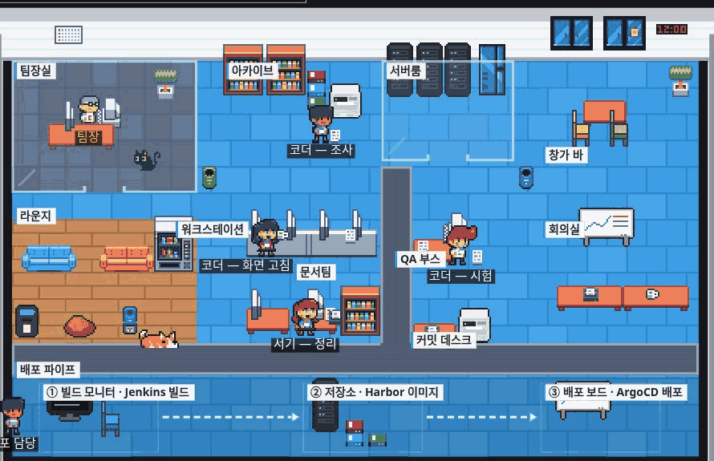
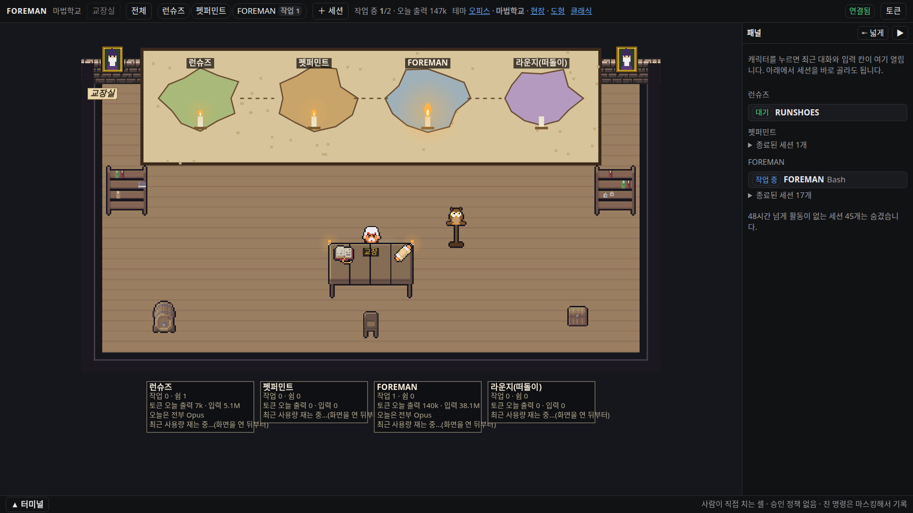
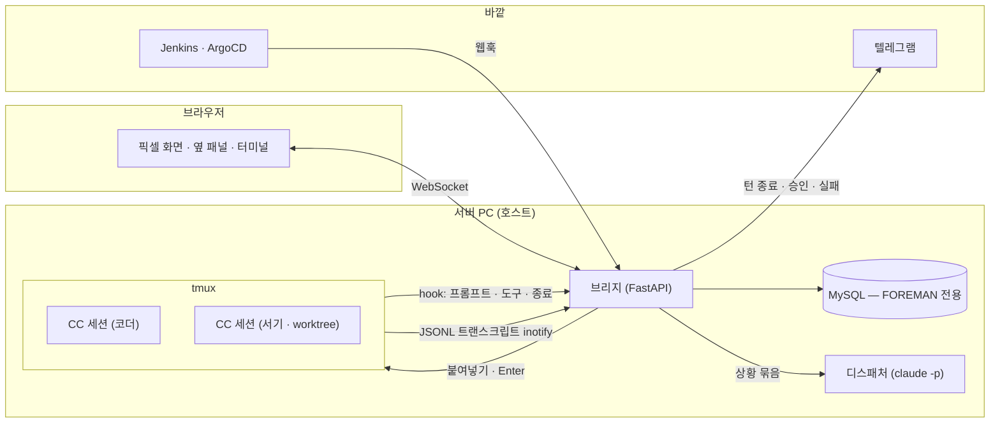
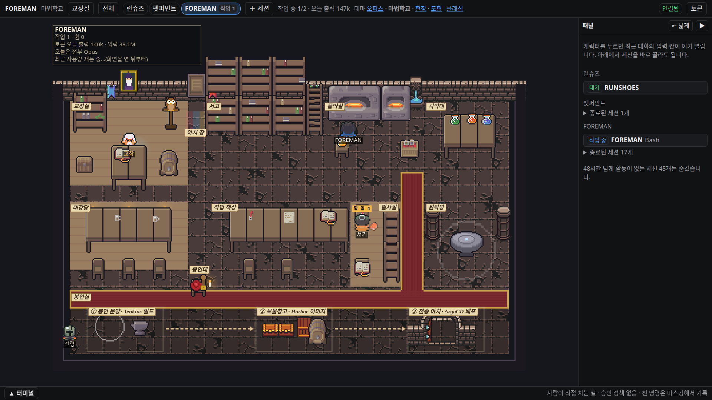
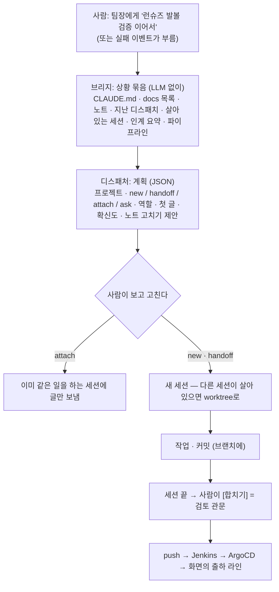

# 한눈에 — FOREMAN이 무엇인가

> 이 글은 FOREMAN이 무엇이고, 어떤 구조로 도는지를 다룬다.

**FOREMAN은 한 서버에서 동시에 도는 여러 Claude Code 세션을 브라우저 한 화면에서 보고 지시하는 관제실이다.** 세션의 상태 · 승인 요청 · 대화 · 배포 파이프라인을 픽셀 오피스 화면에 캐릭터로 띄우고, 입력 · 승인 · 새 세션 띄우기를 그 화면에서 한다. 2026-11-02에 시작해 11-06까지 커밋 126개다 [c:1f8c538] [c:63b5897].

## 1. 문제 — 왜 필요했나

한 서버 PC에서 Claude Code(이하 CC) 세션이 세 프로젝트(런슈즈 · 펫퍼민트 · FOREMAN 자신)에 걸쳐 동시에 돌았다. 터미널 창을 오가며 쓰다가 생긴 불편은 네 가지였다 [c:1f8c538].

| 불편 | FOREMAN이 하는 것 |
|---|---|
| 언제 끝날지 모른다 | 턴 종료를 hook으로 기계 판정하고 브리지가 텔레그램으로 보낸다 [log:stage4_notify_result.md] |
| 뭘 하고 있는지 안 보인다 | 세션 상태를 캐릭터의 움직임으로 보인다 [log:stage10_office_result.md] |
| 서버가 죽어도 모른다 | 브라우저 연결이 끊기면 화면 전체에 띄운다 [log:stage4_notify_result.md] |
| 승인 요청이 끝없이 뜬다 | 정책으로 대부분 통과시키고, 남은 것만 화면 · 텔레그램 · 터미널에서 답한다 [log:stage5_approval_result.md] |

더 큰 이유는 **조용한 고장**이다. 알림도 표시도 없이 망가진 채 도는 것들이 있었다.
- 호스트의 `milvus-port-forward` 서비스는 실행 파일이 없어 10-01부터 567,740번 다시 시작했다. 한 달 넘게 아무도 몰랐다 [log:infra_20261102_milvus-port-forward.md]
- 배포가 끝났는데 화면에 "배포 진행 중"이 이틀 남았다. 사람이 ArgoCD · 파드 · Jenkins를 직접 맞대 보고서야 드러났다 [log:retro_20261105_foreman.md]
- 두 세션이 같은 파일을 동시에 고쳐 작업이 꼬였다 [log:stage11_foreman_dispatch_result.md]

그래서 무엇을 만들든 먼저 "이것이 막히거나 틀어지면 스스로 알리는가"를 묻는 것이 이 프로젝트의 기준이 됐다 [c:63b5897].

## 2. 판단 — 무엇을 고르고 무엇을 버렸나

| 고른 것 | 버린 것 | 이유 | 근거 |
|---|---|---|---|
| 입력은 CC가 도는 tmux 창에 붙여넣기, 출력은 CC가 남기는 JSONL 트랜스크립트에서 읽기 | 터미널 화면 긁기, 따로 띄운 headless 세션 | TUI 화면은 제어 문자가 섞여 깨끗한 글이 안 나온다. "내가 보는 것과 실제가 같아야 한다" — 사람이 쓰는 그 세션에 꽂는다 | [log:stage3_inject_result.md] |
| 승인은 사람이 실제로 거부할 만한 것만 묻는다 | 위험해 보이는 것은 모두 묻기 | 승인 이력 65건 중 실제 작업에서 거부는 0건이었다. 21일치로 다시 돌리면 FOREMAN 프로젝트의 하루 승인 창이 26.3 → 1.3 | [log:stage5_approval_result.md] [c:87ed97b] |
| 브리지 · DB는 클러스터 밖 호스트에 | k8s 안에 올리기 | 감시하는 쪽과 감시받는 쪽의 장애 범위를 나눈다. 클러스터가 흔들리는 바로 그때 기록이 멈추면 안 된다 | [c:8b52522] [c:eefa1ad] |
| 밖으로 열지 않는다(밖에서는 텔레그램) | Cloudflare 터널 + Access | 화면에 호스트 셸 · 입력 주입 · 승인 버튼이 있다. 인증 하나가 깨지면 서버를 내준다 | [c:1fe16c2] [docs:02_cloudflare_tunnel.md] |
| Jenkins는 Jenkinsfile이 FOREMAN에 알린다 | FOREMAN이 Jenkins API를 조회 | 조회용 토큰이 사실상 관리자 권한이었다. "새도 되는 비밀의 무게"로 골랐다 | [log:stage8_cicd_result.md] |
| 디스패처는 부를 때만 `claude -p` 한 번, 이어지는 맥락은 프로젝트별 노트로 | 늘 떠 있는 디스패처 세션 | 늘 떠 있으면 맥락이 쌓여 결국 압축되고 결정을 잃는다. 한 번씩 부르면 매번 새 맥락이고 판단이 기록으로 남는다. 노트(2k 토큰 상한)는 무엇이 남을지 사람이 고르는 압축 요약이다 | [docs:11_foreman_dispatch.md] [docs:14_dispatcher_note_wake.md] |
| 병렬 세션은 git worktree로 나눈다 | 한 세션만 쓰기 | 사용자: "여러 개 띄워서 병렬로 하는 게 이 프로젝트 목적 중 하나" | [log:retro_20261105_foreman.md] [c:2489692] |

## 3. 구조 · 흐름

### 3-1. 구성

- **브리지** — 모든 것이 지나는 한 프로세스다. hook 수신, 트랜스크립트 와처, 프로세스 상태 폴링, 승인 판정, 텔레그램, 웹훅 수신을 맡는다 [log:stage1_bridge_db_result.md] [log:stage2_transcript_result.md]
  - CC는 설정한 기간(`cleanupPeriodDays`)이 지나면 트랜스크립트를 지운다. 그래서 DB가 원본 보존 수단이다 [log:01_kickoff_result.md]. 20일치 1.4GB가 DB에서 약 90MB가 됐다 [log:stage2_transcript_result.md]
- **턴 경계는 신호 하나로 정하지 않는다** — hook(Stop · StopFailure · SessionEnd), 트랜스크립트의 기록, 프로세스 소멸을 함께 본다. 어느 하나만으로는 사용자 중단 · API 오류 · 창 닫힘을 다 잡지 못했다 [log:stage2_transcript_result.md]
- **입력** — 보낸 글이 트랜스크립트에 프롬프트나 대기열로 실제 기록됐는지 확인한다. CC가 멈춰 있으면(Ctrl+Z) 보낸 글이 셸 명령으로 실행되므로 주입을 막는다 [log:stage3_inject_result.md]
- **승인** — CC의 PreToolUse hook마다 브리지가 `ask` · `allow` · `pass`를 정한다. 규칙은 설정 파일 하나다 [log:stage5_approval_result.md]
- **CI/CD 인과 체인** — 로컬 커밋 → push → Jenkins 빌드 → 이미지 → ArgoCD 배포를 한 줄로 잇는다. 알림이 빠지거나 웹훅이 끊기면 그것도 알린다 [log:stage8_cicd_result.md]

### 3-2. 캐릭터와 세션

- **캐릭터는 오래 남고, 세션은 붙었다 떨어진다.** 캐릭터는 "누가 있는가", 세션은 "지금 깨어 있는가"다 [c:1f8c538]
- 상태: 작업 중(돌아다님) · 대기(앉아 있음) · 멈춤(Ctrl+Z — 회색으로 얼어붙음) · 잠듦(세션 끝, 요약만 남음) [log:stage10_office_result.md]
- 역할: 디스패처(감독 — 화면에선 오피스 팀장 · 마법학교 교장 · 현장 소장) · 코더 · 점검(읽기 전용) · CI/CD · 서기(문서). 역할마다 옷 색이 다르다 [log:stage11_roles_result.md] [docs:12_scribe.md] [docs:14_dispatcher_note_wake.md]
- 도구 호출이 구역을 정한다 — 파일 읽기는 서고, 시험 명령은 시약대, git은 봉인대로 걸어간다. 서브에이전트는 부모 둘레에 소환된다 [log:stage10_office_result.md]
- 테마는 넷이다(오피스 · 마법학교 · 현장 · 도형). 같은 데이터를 그리기만 바꾼다 [log:stage10_office_result.md]

### 3-3. 일 하나가 흐르는 길

- 디스패처의 계획은 브리지가 사실과 다시 맞댄다. 없는 프로젝트면 질문으로 바꾸고, 끝난 세션에 붙이려 하면 새로 띄우기로 바꾼다 [log:stage11_foreman_dispatch_result.md]
- worktree 세션이 둘이면 DB 스키마는 한 세션만 바꿀 수 있다. 다른 세션이 시도하면 hook에서 거부한다 [log:stage11_worktree_result.md]
- 서기의 글은 문장 끝에 근거 표시(이 글의 대괄호 꼬리표 — 커밋 해시 · log 파일 · docs 파일)를 달고, 브리지가 그 커밋 · 파일 · 줄 범위가 실제로 있는지 LLM 없이 확인한다 [log:stage12_scribe_result.md] [c:ff0fbb7]

## 4. 겪은 문제와 풀이

- **"됐다"고 한 것이 화면에 없었다 — 3건** [log:retro_20261105_foreman.md]
  - 설계 대조표에 ✅인 복도를 캐릭터가 뚫고 지나갔고, 고쳤다고 보고한 소품이 사람 위에 그려졌고, 있다던 배지가 없었다
  - 같은 종류의 겹침을 하나씩 고치다가 사람이 "근본적으로 잡자"고 했다 → 사람 자리를 먼저 정하고 가구가 비켜 가게 바꾸고, 겹침을 세는 점검기를 넣었다. 세 테마 모두 0건 [c:435db47]
  - 세션이 화면을 직접 찍어 확인하는 도구를 만들었다(이 글의 사진도 그것으로 찍었다) [log:stage12_scribe_result.md]
- **디스패처가 같은 일을 하는 세션을 몰랐다** [log:stage11_foreman_dispatch_result.md]
  - 1차: 상황 6.2k자로 판단해 새 세션을 골랐다. 세션 156이 이미 그 일을 하고 있었다 [log:stage11_foreman_dispatch_result.md]
  - 세션마다 최근 사람 요청과 답 첫머리를 넣은 뒤(11.4k자): "156에 붙이기"를 골랐다, 확신도 0.85 [log:stage11_foreman_dispatch_result.md]
- **압축으로 결정이 사라졌다**
  - 긴 세션은 맥락이 차면 CC가 앞부분을 요약(압축)한다. FOREMAN 세션의 결정 142개를 맞대 보니 65개가 요약에서 사라졌다 [log:foreman_compaction_loss_20261105.md]
  - 잃은 것을 찾는 판정은 Sonnet으로 정했다 — 재현율 0.71 · 정밀도 0.91, 1.99달러 · 7.2분 [log:handoff_v2_d_result.md]
- **잘못 열린 배포 행이 이틀 닫히지 않았다** [log:retro_20261105_foreman.md] [c:aa3cf1f]
  - revision 없이 온 ArgoCD 알림이 행을 따로 만들고, 성공 알림은 다른 행으로 갔다 → 나중 결과가 오면 앞의 진행 중 행을 닫는다
- **시험 중 웹훅 토큰이 도구 출력에 섞여 들어왔다** [log:stage8_cicd_result.md]
  - 그 토큰으로 할 수 있는 일(가짜 빌드 이벤트를 넣는 정도)을 따진 뒤 교체했다. 관리자급 API 토큰을 쓰지 않기로 한 판단이 피해 범위를 줄였다

## 5. 결과 · 숫자

| 무엇 | 값 | 근거 |
|---|---|---|
| 기간 · 커밋 | 2026-11-02 ~ 11-06, 126개(11-04는 0) | [c:1f8c538] [c:63b5897] |
| 관리하는 프로젝트 | 3(런슈즈 · 펫퍼민트 · FOREMAN) | [log:stage4_notify_result.md] |
| 하루 승인 창(21일 다시 돌리기, 도구 호출 18,076개) | 런슈즈 10.7 → 0.1, 펫퍼민트 6.8 → 0.2, FOREMAN 26.3 → 1.3 | [log:stage5_approval_result.md] |
| 턴 종료 → 텔레그램 | 평균 3.3초, 최대 4.4초 | [log:stage4_notify_result.md] |
| 트랜스크립트 보존 | 20일치 1.4GB → DB 약 90MB | [log:stage2_transcript_result.md] |
| 압축 손실(FOREMAN 세션, 결정 142개) | 사라짐 65 · 약해짐 25 · 살아 있음 33 | [log:foreman_compaction_loss_20261105.md] |
| 시험 | 파이썬 432개 수집 · JS 43개 통과(11-06) | [c:63b5897] |
| DB 마이그레이션 | 23개 | [c:63b5897] |

- 로드맵 13단계(0~12) 중 1~8 · 11단계는 끝났다. 10단계(화면)는 대부분, 12단계(서기)는 일부다. 9단계(LLM 지표)는 보류다 [log:stage12_scribe_result.md] [log:stage10_office_result.md]
- 파이썬 시험은 이번에 수를 세기만 했고 돌리지 않았다

## 6. 한계 · 다음

- **사용자 한 명, 서버 한 대를 위한 것이다.** 여러 사람 · 여러 서버는 생각하지 않았다 [c:8b52522]
- **밖에서는 볼 수 없다.** 터널을 닫았고 밖에서는 텔레그램만 받는다. 다시 열면 읽기 전용 화면 + 패스키 · mTLS로 연다 [c:1fe16c2]
- **펫퍼민트 세션은 아직 tmux로 옮기지 않았다.** 그 세션에는 화면에서 입력을 넣을 수 없다 [log:stage0_tmux_result.md]
- **런슈즈 · 펫퍼민트의 승인은 관찰만 한다.** 판정은 기록하지만 막지 않는다 [log:stage5_approval_result.md]
- **9단계 LLM 지표는 보류다.** 프로메테우스를 펫퍼민트 설계와 맞춘 뒤 설치한다 [c:2853a28]
- **디스패처는 묻지 않고 세션을 띄우지 않는다.** 실패가 오면 계획만 세워 사람에게 [시작]?을 묻는다(2단계). 묻지 않고 띄우는 3단계는 2단계를 써 본 뒤 정한다. 2단계는 아직 실제 실패로 돈 적이 없다(시험 한 번) [docs:11_foreman_dispatch.md] [docs:14_dispatcher_note_wake.md]
- **"됐다"를 화면과 맞대는 장치는 자리 겹침뿐이다.** 설계 대조표의 ✅는 지금도 사람이 화면에서 본다 [log:retro_20261105_foreman.md]
- **서버 재부팅 뒤 모두 다시 뜨는지는 아직 확인하지 않았다** [log:infra_20261102_host-changes.md]

> 움직이는 화면(GIF)은 실제 화면 코드에 시연용 이벤트를 흘려 녹화했다. 세션 이름 · 숫자는 시연용이다. 실제 기록(도구 순서 · 승인 · 빌드 단계)을 빠르게 재생한 것은 〔실제 기록 재생〕, 대본으로 꾸민 것은 〔시연 재생〕, 정지 사진은 〔실제 화면〕으로 캡션 끝에 적었다 [docs:13_demo_capture.md]
