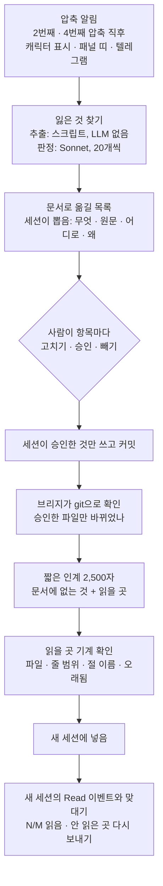

# 압축 손실을 재고 메우기

> 이 글은 자동 압축(auto-compact) 때문에 코딩 에이전트가 잊는 지시 · 결정을 어떻게 재고(손 점검 → 기계 판정), 인계 · 문서화로 어떻게 메웠는지를 다룬다.

**긴 Claude Code 세션은 압축을 거치며 사람이 정한 지시 · 결정의 약 63%를 잃었고, 그 대부분이 압축 두 번 안에 사라졌다. 그래서 "요약을 더 잘 쓰기" 대신 "넘기기 전에 문서로 옮기고, 새 세션에는 읽을 곳을 넘긴 뒤 실제로 읽었는지 기계로 확인하기"로 바꿨다. 잃은 것을 찾는 점검도 손 점검(Opus)에서 버튼 하나(Sonnet, 재현율 0.71 · 정밀도 0.91)로 옮겼다.** [log:foreman_compaction_loss_20261105.md] [docs:11_handoff_v2.md] [log:handoff_v2_d_result.md]

## 1. 문제 — 압축은 조용히 깎는다

- 이 프로젝트(FOREMAN)는 한 서버에서 여러 Claude Code 세션을 감독하는 도구다. 존재 이유는 "조용한 고장을 잡는다"이다 [c:b2aa8f0]
- 컨텍스트가 차면 Claude Code가 대화를 요약(auto-compact)하고, 그 요약만 들고 일을 이어 간다
  - 트랜스크립트 파일에는 압축 전 원문이 그대로 남는다. 잃는 것은 **모델의 맥락**이지 기록이 아니다 [docs:11_handoff.md]
  - 그래서 무엇을 잃었는지는 원문과 요약을 맞대 보면 잴 수 있다
- 다른 프로젝트(런슈즈)의 세션 하나가 17일째 이어지며 auto-compact를 17번 거친 상태였다 [docs:11_handoff.md] [log:runshoes_compaction_loss_20261105.md]
  - 압축을 거친 세션은 앞서 사람이 정한 금지 · 기준을 어겨도 스스로 알리지 않는다. 사람이 같은 말을 다시 해야 했던 흔적이 있었다(토큰 · 하드코딩 금지를 다른 구간에서 두 번 더 말함) [log:runshoes_compaction_loss_20261105.md]
- 가장 상징적인 예: **이 프로젝트의 존재 이유 문장 자체가 어느 압축 요약에도 실린 적이 없었다** [log:foreman_compaction_loss_20261105.md]
  - 점검 뒤 그 문장을 규칙 파일(CLAUDE.md) 맨 위에 원문과 함께 옮겼다 [c:b2aa8f0]

## 2. 먼저 잰다 — 손 점검 두 번

### 방법

- 추출은 스크립트(LLM 없음): 트랜스크립트를 파일 순서로 읽어 압축 구간별 사람 프롬프트와 각 구간을 대신한 요약을 뽑는다 [log:runshoes_compaction_loss_20261105.md]
- 판정은 에이전트: 프롬프트에서 **오래 지켜야 하는 것**(지시 · 결정 · 금지 · 기준 · 선호 · 미완)을 골라, 각각이 "지금 세션이 들고 있는 것"에 남았는지 본다 [log:foreman_compaction_loss_20261105.md]
  - 들고 있는 것 = 마지막 압축 요약 + 그 뒤 프롬프트 + CLAUDE.md + 지속 메모리
  - 상태 다섯: 살아 있음 · 약해짐(뜻은 남고 조건 · 예외 · 숫자가 빠짐) · 사라짐 · 뒤집힘(나중 결정이 바꿈 — 살리면 안 됨) · 끝남
- 판정은 모델 판단이라 틀릴 수 있다. 되살릴 것을 정할 때는 원문을 다시 봤다 [log:foreman_compaction_loss_20261105.md]

### 결과

| | 런슈즈 세션 | 포먼 세션 |
|---|---|---|
| 압축 횟수 | 17 | 7 |
| 사람 프롬프트 | 344 | 73 |
| 골라낸 항목 | 282 | 142 |
| 사라짐 · 약해짐 | 143 · 37 | 65 · 25 |
| **잃은 비율** | **64%** | **63%** |
| 뒤집힘 | 26 | 6 |
| **잃은 것 중 저장소 문서에 이미 있던 것** | **약 5** | **56** |

근거: [log:runshoes_compaction_loss_20261105.md] [log:foreman_compaction_loss_20261105.md]

- **잃는 비율은 같았다.** 압축은 문서가 있든 없든 세션 기억을 같은 비율로 깎는다
- **다른 것은 되살릴 곳이 있느냐였다.** 포먼은 단계마다 결과 · 판단 근거를 문서로 남겨 와서 잃은 90개 중 56개가 "읽기만 하면 돌아오는" 상태였다. 런슈즈는 대화에서만 정한 것이 대부분이었다 [log:foreman_compaction_loss_20261105.md]
- **언제 빠지나**(런슈즈): 말한 구간의 첫 압축에서 41, **그다음 압축에서 96**, 그 뒤 43 — 76%가 압축 두 번 안에 사라졌다 [docs:11_handoff_v2.md]
  - 포먼도 같은 모양이었다(22 · **48** · 20) [log:foreman_compaction_loss_20261105.md]
  - 런슈즈는 작업 주제가 바뀌는 압축에서 원칙이 통째로 빠졌다(스펙 수집 → 관리 화면 전환 구간에서 41개) [log:runshoes_compaction_loss_20261105.md]
- **살아 있던 것의 자리**(런슈즈 63개): 요약 38 · 메모리 16 · 압축 뒤 대화 7 · CLAUDE.md 2 — 요약에 기대는 것은 다음 압축에서 또 깎인다 [docs:11_handoff_v2.md]
- 잃은 종류는 기준이 가장 많았다(런슈즈 기준 93 · 결정 35 · 금지 26 · 미완 17 · 선호 8) [log:runshoes_compaction_loss_20261105.md]
- 손 점검 비용(포먼): Opus 에이전트 2개, 35.4만 토큰 · 13.5분 [log:foreman_compaction_loss_20261105.md]

## 3. 판단 — 무엇을 고르고 무엇을 버렸나

### 버린 것: 요약 통째로 넘기기(인계 1판)

- 1판은 세션이 **자기 기억으로** 대화 전체를 요약(4,000자)하고, 새 세션에 그 요약을 넣었다 [docs:11_handoff.md]
  - 요약은 그 세션 자신이 쓴다(맥락을 들고 있는 당사자). 별도 LLM을 부르지 않는다 — 이 원칙은 2판에도 남겼다 [docs:11_handoff.md]
- 한계: **이미 잃은 것은 스스로 되살리지 못한다** [docs:11_handoff.md]. 점검이 보여 준 대로 압축 두 번이면 앞 구간 결정의 대부분이 이미 없다
- 2판이 생긴 뒤 1판으로 받은 요약은 0개였다. 화면의 고르기를 뺐다 [log:stage11_session_tab_result.md]

### 고른 것: 문서로 옮기고, 읽을 곳을 넘긴다(인계 2판)

점검의 두 숫자에서 바로 나왔다.
1. 런슈즈에서 잃은 것은 거의 다 **대화에서만 정한 것**이었다 → 읽을 곳만 넘기면 가리킬 문서가 없다. **넘기기 전에 먼저 문서로 옮긴다** [docs:11_handoff_v2.md]
2. 손실은 **두 번째 압축**에 몰린다 → 알림은 그 직후에 낸다 [docs:11_handoff_v2.md]

### 알림 기준: 압축 횟수를 쓰고, 파일 크기는 버렸다

| 후보 | 기록 | 판단 |
|---|---|---|
| 압축 횟수 | 손실 76%가 압축 두 번 안 | **쓴다** — 2번째 직후 "넘어갈 때", 4번째부터 "늦었음" |
| 트랜스크립트 크기 | 735MB/19번 · 393MB/12번 · 98MB/7번 | 버림 — 크기는 대부분 도구 출력이라 횟수 이상을 말해 주지 않는다 |
| 압축 간격 | 압축 사이 사람 턴 2~36, 추세 없음 | 보조로만 — 짧은 간격이 두 번 이어지면 덧붙인다 |
| 압축 직후 | 맥락이 1~2만 토큰으로 가볍다 | 알리는 시점으로 쓴다 — 인계 요청 비용이 작다 |

근거: [docs:11_handoff_v2.md]

### 문서가 틀리면 틀린 맥락이 들어간다 — 세 겹으로 막는다

1. 인계에 「문서와 다른 지금」 칸 — 기억에서 나오는 것은 이 칸뿐이다 [docs:11_handoff_v2.md]
2. 브리지가 읽을 곳을 기계로 확인하고, 오래된 문서를 표시한다 [docs:11_handoff_v2.md]
3. 문서를 코드 · 커밋에 맞춰 두는 일은 문서 담당 에이전트(서기)에게 맡긴다 [docs:11_handoff_v2.md]

## 4. 구조 · 흐름

| 단계 | 하는 일 | 커밋 |
|---|---|---|
| a. 압축 알림 | 세션별 압축 횟수(수동 `/compact`도 셈). 정한 횟수 직후에만 텔레그램 | [c:f005221] |
| b. 짧은 인계 + 읽을 곳 | 2,500자 안, 문서에 없는 것만. 읽을 곳이 하나라도 틀리면 **넣지 않는다** | [c:0aabfc5] |
| c. 문서로 옮기기 | 세션이 목록 → 사람 승인 → 세션이 쓰고 커밋 → 브리지가 git으로 확인 | [c:edcd41a] |
| d. 잃은 것 찾기 | 손 점검을 버튼으로. 결과는 c의 입력이 된다 | [c:5cb7866] [c:606ab25] |

근거: [log:handoff_v2_result.md] [log:handoff_v2_c_result.md] [log:handoff_v2_d_result.md]

- 각 단계에서 "막히거나 틀어지면 스스로 알리는가"를 본다(프로젝트 규칙 맨 위) [c:b2aa8f0]
  - 읽을 곳이 틀리면 넣기를 거부한다(409) [log:handoff_v2_result.md]
  - 문서 쓰기가 승인과 다르면 `write_failed` + 텔레그램 [log:handoff_v2_c_result.md]
  - 판정 묶음이 일부 실패하거나 프롬프트를 건너뛰면 결과와 알림에 그 수를 싣는다. 브리지가 다시 뜨면 돌던 점검은 "다시 눌러 주세요"로 닫는다 [log:handoff_v2_d_result.md]
- 쓰기 결과는 세션 말보다 git을 믿는다. 세션이 결과 블록을 안 내거나 깨뜨려도 git 커밋으로 확인한다 [log:handoff_v2_c_result.md]

## 5. 겪은 문제와 풀이

### 기계 판정이 얇게 훑었다 — 묶음을 줄이고 빠짐을 셌다

손 점검(Opus)을 정답으로 두고 같은 세션 · 같은 맥락으로 Sonnet 판정을 맞댔다. 추출은 정답과 글자 그대로 같았다 [log:handoff_v2_d_result.md].

| | 1차 | 2차 | 3차 |
|---|---|---|---|
| 방식 | 68개 한 번에 | 20개씩 5번 + 건너뜀 세기 | 2차 + "끝남" 범위 못 박기 |
| 잃은 프롬프트 재현율 | 0.29 | 0.64 | **0.71** |
| 정밀도 | 1.0 | 1.0 | **0.91** |
| 잃은 것 중 저장소 위치를 찾음(정답 56) | 11 | 32 | 50 |
| 비용 · 시간 | 0.59달러 · 1.7분 | 1.64달러 · 7.2분 | 1.99달러 · 7.2분 |

- 1차: 68개를 한 번에 주니 구간마다 몇 개만 훑었다. 묶음을 설계의 약 80개에서 **20개**로 줄이고, 묶음의 모든 프롬프트가 결과에 나왔는지 기계로 센다(조용히 얇아지지 않게) [log:handoff_v2_d_result.md]
- 2차: 구현됐거나 문서에 적힌 결정을 "끝남"으로 넘겼다(끝남 74 중 결정 28). 3차 지시에 "결정 · 금지 · 기준 · 선호는 끝남이 될 수 없다, 문서에만 있으면 사라짐 + 위치"를 넣었다 [log:handoff_v2_d_result.md]
- 모델은 사용자가 Sonnet으로 정했다(11-06 사용자 결정) — "재현율 0.71이면 충분해. 정밀도 0.91이라 없는 걸 만들어내지 않으니까, 놓친 건 내가 보다가 추가하면 되고" [log:handoff_v2_d_result.md]

### 첫 실제 사례에서 드러난 조용한 고장 셋

c단계를 실제 세션으로 처음 돌렸다. 목록 5개를 사용자가 고치지 않고 모두 승인했고, 세션이 4개 문서에 쓰고 커밋했고, 브리지 확인은 `written`이었다 [c:500f30e] [log:handoff_v2_c_result.md]. 그 과정에서 셋을 고쳤다 [c:7ed5659].

1. **같이 넣을 인계의 기본값이 말없이 들어갔다** [c:7ed5659]
   - 사용자는 인계 #6을 쓰려 했는데, 고르지 않으면 첫째(#7)가 들어갔고 화면에 나오지 않았다. 이번에는 두 인계 내용이 겹쳐 결과가 같았을 뿐이다 [log:handoff_v2_c_result.md]
   - 기본값을 바꾸는 대신 **후보가 둘 이상이면 고르게** 했다(화면 · 서버 모두 거부). 여럿 중 하나를 말없이 고르면 틀려도 결과가 그럴듯해 아무도 모른다 [log:handoff_v2_c_result.md]
2. **Read 확인이 worktree 경로로 읽은 것을 세지 않았다** — 절대 경로 대신 저장소 기준 경로로 맞대게 했다 [log:handoff_v2_c_result.md]
3. **CLAUDE.md는 늘 "안 읽음"이었다** — Claude Code가 세션 시작 · 압축 뒤 스스로 넣어 Read 이벤트가 생기지 않는다. 읽음으로 세고 "자동"으로 따로 보인다 [log:handoff_v2_c_result.md]

### 기계 판정은 뒤집힌 결정을 되살릴 수 있다 — 사람을 마지막 관문으로

- 정답이 "뒤집힘"으로 본 프롬프트 6개 중 4개에 Sonnet이 사라짐 · 약해짐 항목을 냈다 [log:handoff_v2_d_result.md]
- 그래서 잃은 것 찾기 결과는 바로 문서에 들어가지 않는다. 문서로 옮길 목록의 입력이 될 뿐이고, 사람이 항목마다 승인한 것만 쓴다. 화면에도 "기계 판정입니다 — 놓친 것이 있을 수 있고, 뒤집힌 결정이 섞일 수 있습니다"를 적었다 [log:handoff_v2_d_result.md]
- 같은 이유로 브리지가 점검 결과를 저장소 파일로 쓰지 않게 바꿨다(설계와 다름). 브리지가 파일을 만들면 그 저장소에서 일하는 세션에 "내가 만들지 않은 변경"이 생긴다. 문서로 들어가는 길은 하나(세션이 쓰고 사람이 승인)만 둔다 [log:handoff_v2_d_result.md]

## 6. 결과 · 숫자

- 손 점검 두 번: 항목 424개(282 + 142)를 판정, 잃은 비율 64% · 63% [log:runshoes_compaction_loss_20261105.md] [log:foreman_compaction_loss_20261105.md]
- 점검으로 바로 고친 것: 지금 규칙 · 기록과 부딪히는 5건을 원문으로 다시 확인해 사용자가 정했다. 존재 이유 문장을 CLAUDE.md 맨 위로, 결정과 어긋난 문장 둘을 고침, 낡은 메모리 하나를 고침 [c:b2aa8f0] [log:foreman_compaction_loss_20261105.md]
- 인계 2판 b 시험(버리는 저장소, 작은 모델 세션): 대화에서만 한 결정이 「문서와 다른 지금」에 잡혔고, 787자 인계를 받은 새 세션이 읽을 곳 **2/2를 실제로 읽었다**. 없는 파일을 넣으면 띄우기 전에 거부됐다 [log:handoff_v2_result.md]
- 문서로 옮기기 첫 실제 사례: 5개 승인 → 4개 문서에 커밋 → 확인 `written`, 받은 세션의 읽을 곳 6/6 [c:500f30e] [log:handoff_v2_c_result.md]
- 잃은 것 찾기: 손 점검(Opus 35.4만 토큰 · 13.5분) 대비 Sonnet 1.99달러 · 7.2분으로 재현율 0.71 · 정밀도 0.91 [log:handoff_v2_d_result.md]
- 시험: Python 402 · JS 42(d단계 끝) [log:handoff_v2_d_result.md]

## 7. 한계 · 다음

- **압축이 있는 실제 세션에서 잃은 것 찾기 버튼을 누른 기록은 아직 없다.** 정답 맞대기는 같은 세션을 손으로 돌린 것이고, 버튼은 압축 없는 세션으로만 돌려 봤다(약 2달러 이상이라 사용자가 누른다) [log:handoff_v2_d_result.md]
- 재현율 0.71 — 잃은 프롬프트 열에 셋은 놓친다. 정답 자체도 모델(Opus) 판정이라 참값이 아니다 [log:handoff_v2_d_result.md]
- 뒤집힘을 가리는 힘이 약하다. 사람 승인에 기댄다 [log:handoff_v2_d_result.md]
- 압축 알림 텔레그램은 가짜 알림기로만 확인했다. 압축을 일부러 일으킬 수 없어 실제 발송은 다음 2번째 · 4번째 압축 때 본다 [log:handoff_v2_result.md]
- 받을 세션이 worktree면 인계에 그 사실(push 안 함 · 브리지 재시작 안 함)을 브리지가 덧붙여야 한다 — 기록만 하고 아직 만들지 않았다 [log:handoff_v2_c_result.md]
- 붙여넣기로 받은 인계는 Read 확인 밖이다 [log:handoff_v2_c_result.md]
- 다른 프로젝트(런슈즈)에서 잃은 180개는 목록만 만들었다. 점검은 읽기만 했고 그 세션 · 저장소는 건드리지 않았다 [log:runshoes_compaction_loss_20261105.md]
