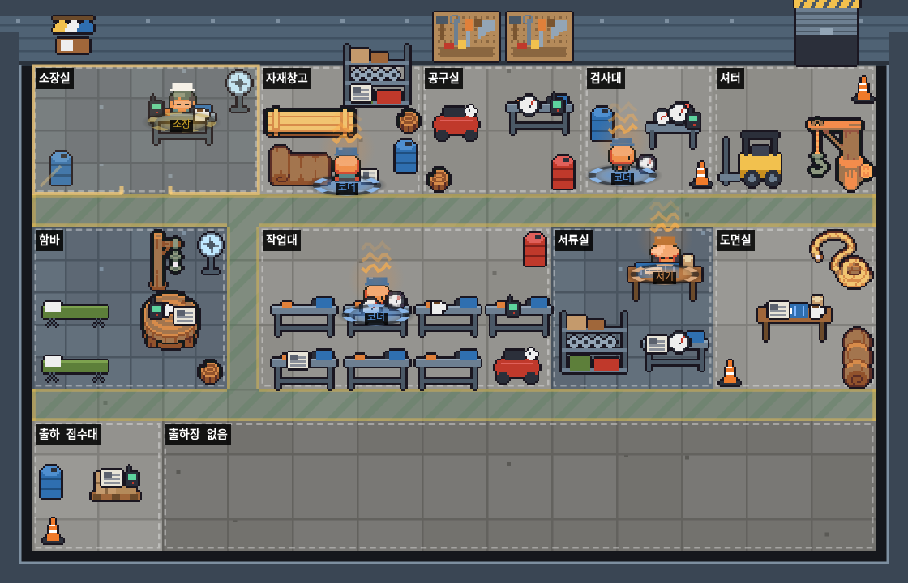
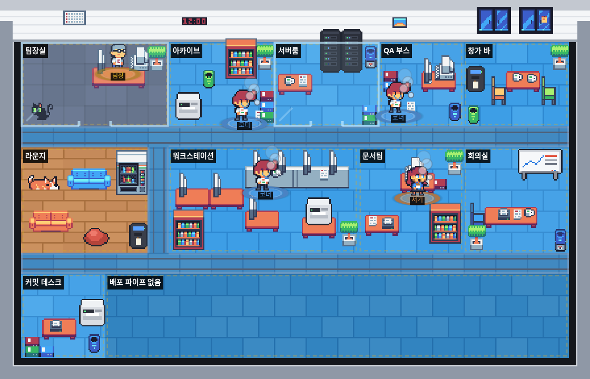
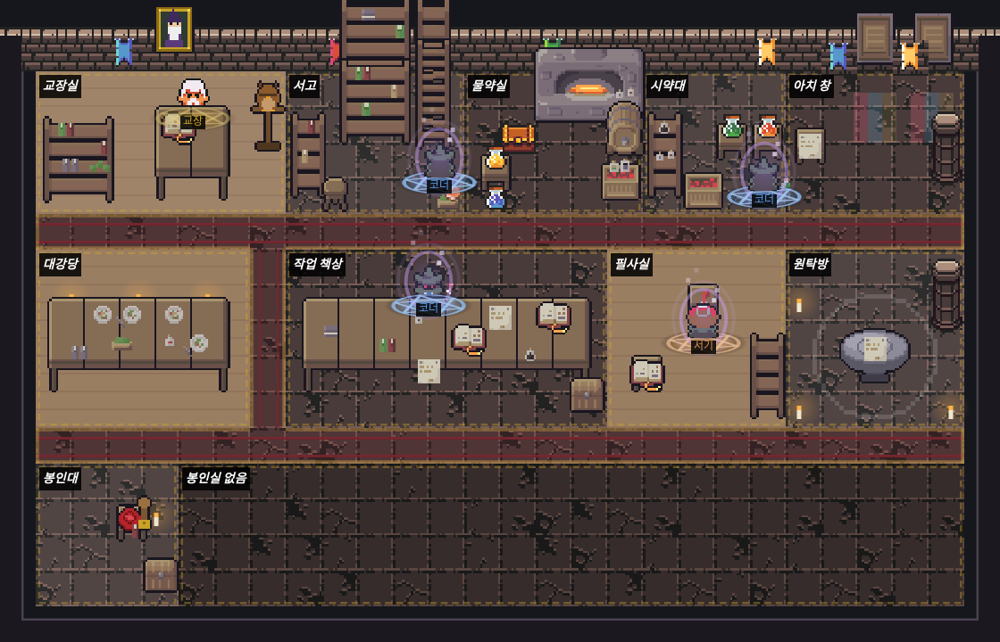
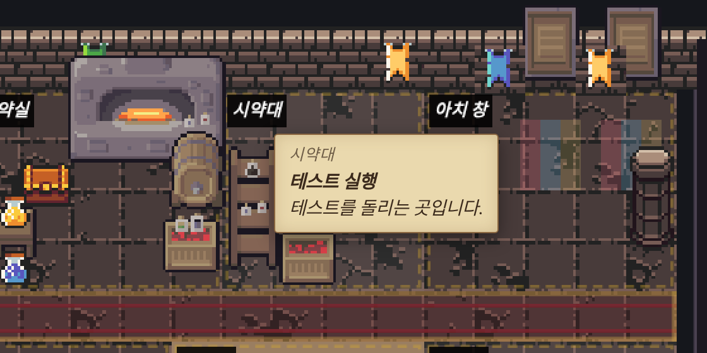
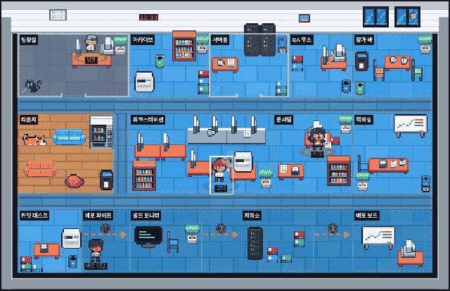
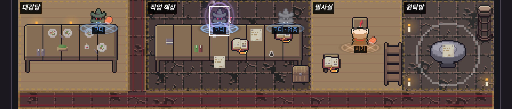
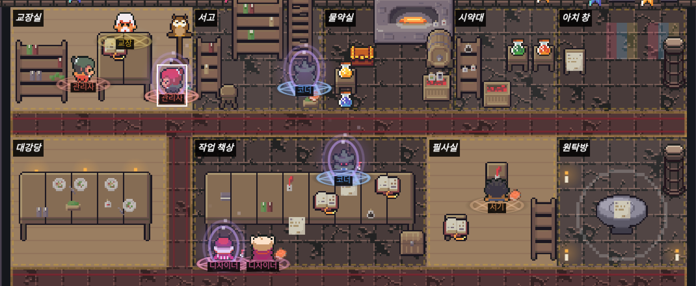
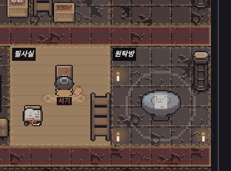

<!--
다루는 곳: bridge/static/js/office.js, bridge/static/js/theme.js, bridge/static/js/grid.js, bridge/static/js/walk.js, bridge/static/js/sprites.js, bridge/static/js/aura.js, bridge/static/js/roles.js, bridge/static/js/tip.js, bridge/static/themes/
읽은 커밋: fb7121b
-->
# 픽셀 지도와 방

> 이 글은 FOREMAN 화면 왼쪽의 픽셀 지도, 곧 세션마다 서는 캐릭터와 그 캐릭터가 오가는 방을 다룹니다.

**세션 하나가 캐릭터 하나로 서고, 지금 하는 일에 따라 그 일을 하는 구역으로 걸어갑니다. 글자를 읽지 않아도 누가 일하고 누가 쉬고 누가 멈췄는지가 보입니다.**

세션 목록을 표로 늘어놓으면 세션마다 상태 글자와 도구 이름을 하나씩 읽어야 합니다. 이 지도는 그것을 공간으로 바꿉니다. 마법학교 테마라면 파일을 읽는 세션은 서고에, 시험을 돌리는 세션은 시약대에, 쉬는 세션은 대강당에 있습니다. 프로젝트마다 방이 하나라서, 방을 보면 그 프로젝트에서 몇 명이 어떤 종류의 일을 하는지 한눈에 들어옵니다. 캐릭터를 누르면 오른쪽 패널에 그 세션의 대화가 열립니다(→ 「세션 패널: 대화와 활동」). 세션 없이 늘 서 있는 캐릭터도 몇 있습니다. 마법학교 테마라면 감독 자리의 교장, 출하 라인의 전령(오피스에서는 팀장과 배포 담당), 서기 자리의 서기, 그리고 코더 세션이 없을 때 자리에서 쉬는 코더입니다. 이 캐릭터들을 누르면 대화 대신 그 캐릭터가 맡은 창이 열립니다.

## 테마 셋 — 같은 데이터, 다른 그림

머리줄의 [오피스] [마법학교] [현장]을 누르면 같은 세션들을 다른 그림으로 다시 그립니다. 세 테마는 그리는 엔진을 함께 쓰고, 테마마다 다른 것은 구역 이름과 좌표, 가구와 캐릭터 그림을 적은 설정 파일(JSON) 하나와 그림 파일뿐입니다 [code:bridge/static/themes/] [code:bridge/static/js/theme.js]. 그래서 어떤 도구가 어느 구역으로 가는지 같은 규칙이 세 테마에 똑같이 적용되고, 구역 이름만 비유에 맞게 바뀝니다. 그림은 공개 저장소에 넣어도 되는 무료 라이선스(CC0, CC-BY)만 썼고, 그림에 없는 가구는 코드로 직접 그렸습니다 [docs:10_office_design.md].

| 하는 일 | 마법학교 | 오피스 | 현장 |
|---|---|---|---|
| 파일 읽기 | 서고 | 아카이브 | 자재창고 |
| 파일 고치기 | 작업 책상 | 워크스테이션 | 작업대 |
| 명령 실행 | 물약실 | 서버룸 | 공구실 |
| 시험 실행 | 시약대 | QA 부스 | 검사대 |
| git | 봉인대 | 커밋 데스크 | 출하 접수대 |
| 웹 찾기, 외부 연결 도구(MCP) | 아치 창 | 창가 바 | 셔터 |
| 서브에이전트 | 원탁방 | 회의실 | 도면실 |
| 쉬기 | 대강당 | 라운지 | 함바 |
| 감독 자리 | 교장실 | 팀장실 | 소장실 |

구역 이름표에 마우스를 올리면 그 구역이 무슨 일을 하는 곳인지 뜹니다. 이름은 테마마다 달라도 설명은 세 테마가 같은 글을 씁니다. 캐릭터에 마우스를 올리면 역할과 세션 번호, 제목, 지금 상태와 머물러 있는 구역, 지금 하는 일이 뜹니다. 사람은 세션을 번호로 부르기 때문에 번호 줄을 굵게 씁니다 [code:bridge/static/js/office.js] [code:bridge/static/js/tip.js].

## 방과 복도, 그리고 지도 셋

방의 배치는 세 테마가 같습니다. 위에는 감독 자리와 일하는 구역들이, 가운데에는 복도가, 아래에는 커밋에서 빌드, 이미지, 배포로 이어지는 출하 라인이 있습니다. 빌드해 내보낼 것이 없는 인프라 방과 FOREMAN 방은 그 자리에 「없음」 이름표만 둡니다(출하 라인은 → 「출하 라인」). 캐릭터는 목표 구역까지 곧장 날아가지 않고 가구를 피해 복도를 타고 걷습니다. 방을 작은 칸으로 나눠 벽과 가구가 차지한 칸을 막고, 막히지 않은 칸으로 길을 찾되 복도 칸을 더 싸게 쳐서 멀리 갈 때는 복도로 돌아가게 했습니다 [code:bridge/static/js/walk.js] [code:bridge/static/js/grid.js] [c:a12f1bf].

방은 세 가지 거리에서 봅니다. 프로젝트 탭을 누르면 그 방 하나를 크게 보고, [전체]를 누르면 모든 방을 작게 나란히 놓고 방마다 작업 중인 세션 수와 경고를 카드로 붙입니다. [⌂]은 감독실로, 벽에 걸린 현황판(마법학교는 큰 지도와 촛불, 오피스는 모니터 벽, 현장은 공정표)이 방마다 이상이 있는지를 보여 줍니다. 실패가 있으면 촛불이 꺼지거나 화면이 깜빡이는 식입니다 [c:c5d8637]. 어느 프로젝트에도 속하지 않는 폴더에서 띄운 세션은 라운지(떠돌이) 방에 모입니다.

## 상태별 모습

세션의 상태는 브리지가 프로세스와 기록을 보고 정하고, 화면은 그 상태를 동작으로 그립니다 [code:bridge/static/js/office.js].

**작업 중**인 세션은 지금 쓰는 도구에 맞는 구역으로 걸어가 그 자리에서 일하는 동작을 합니다. **쉬는** 세션(사람의 다음 지시를 기다림)은 쉬는 구역으로 가서 앉거나 엎드려 잡니다. 현장 테마에서는 함바 간이침대에 눕습니다. 세션 자신은 쉬는데 서브에이전트나 뒤에서 도는 명령이 남아 있으면 **기다림**으로 그려, 쉬러 가지 않고 책상에 서서 기다립니다. 사람이 Ctrl+Z로 **멈춰 둔** 세션은 그 자리에서 회색 돌처럼 굳고 이름표 끝에 「· 멈춤」이 붙습니다. 이런 세션에 글을 보내면 셸 명령으로 실행되어 버리므로 화면이 입력을 막습니다. **끝난** 세션은 흐리게 3분 남았다가 지도에서 사라집니다 [log:stage10_office_result.md] [log:stage10_background_waiting_result.md] [log:stage3_inject_result.md].

## 역할 색과 이름표

세션마다 역할이 있습니다. 코드를 고치는 코더, 화면을 고치는 디자이너, 문서를 쓰는 서기, 읽고 알아보기만 하는 조사, 합치고 시험하고 올리는 관리자입니다(→ 「새 세션 창」). 역할은 세 군데에 색으로 보입니다. 캐릭터 이름표 글자와 발밑에 깔리는 둥근 빛은 같은 색이고, 테마에 맞는 옷(마법학교 로브, 오피스 사원증 끈, 현장 안전모)은 그림에 어울리도록 같은 계열의 조금 더 어두운 색입니다. 발밑 빛은 마법학교에서는 육망성 마법진, 오피스에서는 둥근 러그, 현장에서는 끊긴 작업 구역 고리 꼴로 퍼지고, 일할 때 짙고 쉴 때 옅어지며 걸을 때도 따라옵니다. 이름표를 읽지 않아도 누가 어떤 역할인지 보이게 하려는 것입니다 [code:bridge/static/js/aura.js] [code:bridge/static/js/roles.js] [log:role_aura_20261113.md].

캐릭터 이름표는 역할 이름만 짧게 씁니다(「코더」, 「서기」). 같은 역할이 여럿이면 마우스를 올려 번호와 제목을 봅니다. 이름표와 구역 이름표, 머리 위 표시가 사람 몸이나 서로를 덮지 않도록 그릴 때마다 비켜 그리고, 걷는 동안에는 이름표 자리를 붙잡아 흔들리지 않게 합니다 [log:name_pin_20261114.md]. 겹침이 남았는지는 세 테마, 세 창 크기마다 도구로 세어 0건인지 확인합니다 [c:435db47] [c:ef35632].

## 서브에이전트

세션이 일을 나눠 맡기려고 서브에이전트(세션 안에서 따로 도는 작은 AI 작업자)를 띄우면, 부모 캐릭터가 서브에이전트 구역(원탁방, 회의실, 도면실)으로 가고 그 둘레에 작게 줄인 캐릭터가 하나씩 나타납니다. 서브에이전트가 끝나면 사라지고, 부모는 다시 자기 일로 돌아갑니다. 부모 이름표 아래에는 「서브에이전트 N」이 붙고, 너무 많으면 다 그리지 않고 「+N」으로 접습니다 [c:b4bc1e2].

[기술문서: 화면](../notion/14_screen.md)
