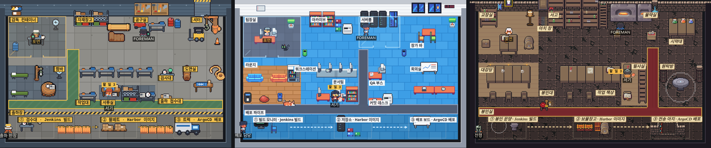
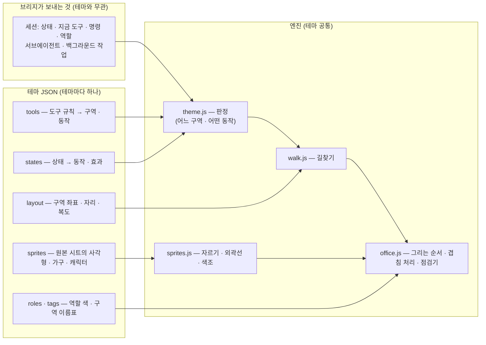
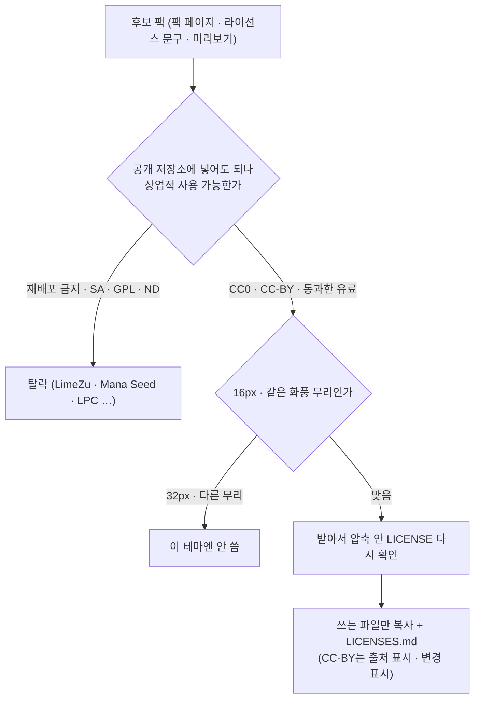
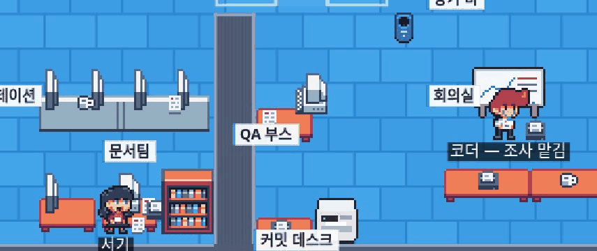
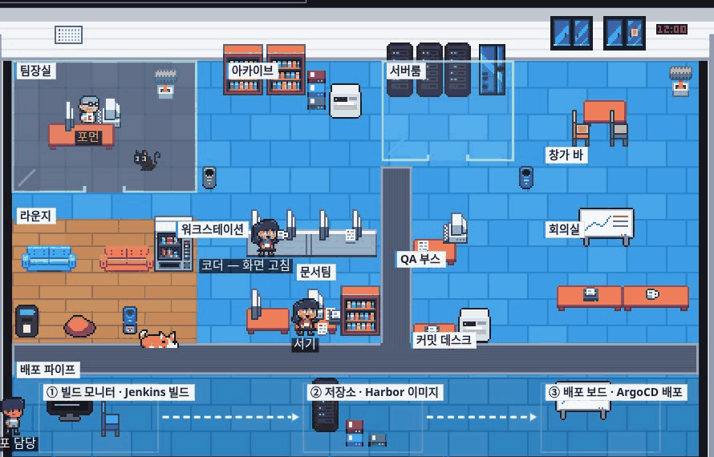
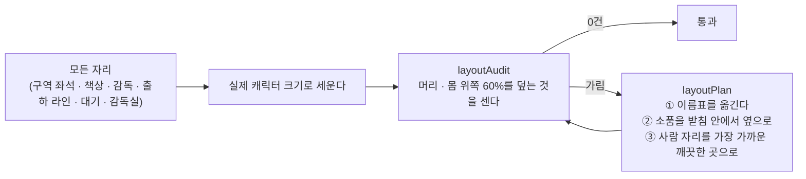

# 픽셀 오피스 — 그 화면을 어떻게 만들었나

> 이 글은 FOREMAN의 픽셀 화면을 어떻게 설계하고 그렸는지, 그리고 그 화면이 틀어지지 않게 어떻게 점검하는지를 다룬다.

**세션 상태를 표 대신 방 안의 캐릭터로 그린다. 테마 셋(현장 · 오피스 · 마법학교)은 같은 데이터를 같은 엔진으로 그리고, 테마마다 다른 것은 JSON 파일 하나와 그림 파일뿐이다.** 에셋은 공개 저장소에 넣을 수 있는 라이선스(CC0 · CC-BY)만 썼다. 에셋에 없는 동작(앉기 · 눕기 · 들기)은 엔진이 흉내 낸다. 사람이 가구 · 소품 · 이름표에 가려지는 문제는 겹침을 세는 점검기로 잡아 세 테마 모두 0건으로 맞췄다 [c:435db47] [c:ef35632].

화면이 무엇을 보여 주는지는 → 「한눈에 — FOREMAN이 무엇인가」. 캐릭터를 눌러 승인 · 입력하는 흐름은 → 「에이전트 관제 — 상태 · 승인 · 입력」.

## 1. 문제 — 왜 픽셀 오피스인가

- 처음 화면은 세션마다 카드 한 장인 대시보드였다(지금도 `/classic`으로 남아 있다) [log:stage10_office_result.md]
- 카드 목록으로는 **관계와 동시성이 안 보였다**
  - 누가 누구의 서브에이전트인지 — 트리를 그리면 깊어지고, 세션이 늘면 화면 밖으로 밀린다
  - 지금 몇 명이 무슨 종류의 일을 하는지 — 카드마다 도구 이름을 읽어야 안다
  - 어느 프로젝트에서 사고가 났는지 — 탭으로 나누면 다른 탭의 사고가 안 보인다
- 그래서 설계 단계에서 정했다: **부모-자식 관계를 트리로 그리지 않고 공간으로 그린다.** 서브에이전트는 부모 옆에서 돌고, 프로젝트마다 방이 하나다 [c:1f8c538]
- 공간으로 그리면 읽는 데 글자가 필요 없다
  - 파일을 읽는 세션은 서고에, 시험을 돌리는 세션은 시약대에 서 있다
  - 쉬는 세션은 대강당에서 엎드려 잔다. 멈춘(Ctrl+Z) 세션은 회색 돌이 된다
  - 방이 여럿일 때는 줌으로 정했다 — 전체 지도에서 방마다 경고가 보이고, 들어가면 한 방을 크게 본다(나란히는 방이 늘면 작아지고, 탭은 다른 방 사고를 가린다) [c:ed218c9] [c:590b0c0]

## 2. 판단 — 무엇을 고르고 무엇을 버렸나

| 고른 것 | 버린 것 | 이유 | 근거 |
|---|---|---|---|
| 2D 픽셀(16×16 타일) | 3D | 에셋 · 카메라 · 조명 비용이 몇 배인데 전달되는 정보는 같다. "2D 테마 셋이 3D 하나보다 낫다" | [c:1f8c538] |
| 배치 · 매핑을 테마 JSON으로 분리 | 테마마다 그리는 코드 | 렌더러는 상태와 도구 이름만 본다 → 테마를 바꾸는 일이 JSON 교체로 끝난다 | [c:1f8c538] [c:590b0c0] |
| 공개 저장소에 넣을 수 있는 에셋만(CC0 · CC-BY, SA 아님) | 가장 잘 맞는 유료 팩(LimeZu 등) | 재배포 금지 팩은 저장소에 못 넣는다. 사무실 가구가 가장 좋은 팩들이 전부 여기서 빠졌다 | [docs:10_office_design.md] |
| 마법학교부터 | 오피스부터 | 무료 에셋으로 덮이는 정도가 마법학교 약 80%, 오피스 약 62%, 현장 약 45%로 추정됐다. 마법학교로 구조를 검증한 뒤 나머지 | [docs:10_office_design.md] [c:ee937c0] |
| 원본 PNG를 그대로 넣고 가공은 렌더러에서 | 잘라 붙인 새 시트를 만들기 | 라이선스 대상이 "원본 파일"로 분명하다. 외곽선 · 색조를 바꿔도 파일을 다시 만들 필요가 없다 | [log:stage10_office_result.md] [c:51b0ad1] |
| 한 테마 안에서는 한 화풍 | 팩을 가리지 않고 섞기 | 16px 옆에 32px가 서면 픽셀 크기가 달라 바로 티가 난다. 테마를 바꾸면 전부 바뀌므로 테마끼리는 화풍이 달라도 된다 | [docs:10_office_design.md] |
| 빠진 가구는 직접 그림(코드로 PNG 생성) | 유료 팩 구입 | 조건을 통과한 유료 팩도 오피스 · 현장의 진짜 구멍(서버랙 · 모니터 벽 · 지게차 · 셔터)은 못 덮었다. 아무것도 사지 않았다 | [docs:10_office_design.md] |

## 3. 구조 · 흐름

### 3-1. 같은 데이터, 다른 그림

- **판정은 테마 공통 함수 하나**(`resolveAction`)가 한다. 마법학교 JSON의 규칙은 이런 모양이다 [c:51b0ad1]
  - `Read|Grep|Glob` → 서고, 책 읽기
  - `Bash` + 명령이 `pytest|node --test|ruff|…` → 시약대, 시험관 흔들기
  - `Bash` + 명령 자리에 `git` → 봉인대, 밀랍 도장
  - 나머지 `Bash` → 물약실, 솥 젓기
  - `Agent` → 원탁방, 서브에이전트 소환
- 같은 규칙이 오피스에서는 아카이브 · QA 부스 · 커밋 데스크 · 서버룸 · 회의실, 현장에서는 자재창고 · 검사대 · 출하 접수대 · 공구실 · 도면실이 된다. 구역의 "하는 일"(read · edit · bash · test · git · web · sub · idle)은 세 테마가 같고, 이름표에 마우스를 올리면 나오는 설명도 하나를 같이 쓴다 [log:stage11_handoff_result.md]
- 상태도 같다. `SUSPENDED`(Ctrl+Z로 멈춤)는 마법학교에서 석화(회색), `DORMANT`(세션 끝)는 유령(푸른빛 · 반투명)이다 [c:51b0ad1]
- 서버 상태 값을 화면 때문에 늘리지 않는다. 서브에이전트나 백그라운드 작업이 도는데 부모가 IDLE이면, 서버는 IDLE 그대로 두고 화면만 "기다림"(책상에 서서 "…")으로 그린다 [log:stage10_background_waiting_result.md] [c:b7cb0d0]
- 도형으로만 그리는 넷째 테마(`plain`, 그림 파일 0개)를 남겨 두었다. 같은 엔진이 시트 테마와 도형 테마를 둘 다 그리는지 보는 기준점이다 [c:21450d2]

| 테마 | JSON | 테마 폴더의 그림 파일 | 직접 그린 것 |
|---|---|---|---|
| 마법학교 | 약 20KB | 17개 | 4개(돌 원탁 · 초상화 · 밀랍 도장 · 부엉이 횃대) |
| 오피스 | 약 17KB | 8개 | 7개(서버랙 · 화이트보드 · 복합기 · 빈백 · 커피머신 · 빌드 모니터 · 폰) |
| 현장 | 약 17KB | 26개 | 19개(지게차 · 롤셔터 · 공구벽 · 간이침대 · 트럭 등) |
| 도형 | 약 4KB | 0개 | — |

- 캐릭터 그림(Ninja Adventure 22명)은 마법학교와 현장이 공용 폴더에서 같이 쓴다 [docs:10_office_design.md]
- 숫자는 이 글을 쓰며 저장소에서 셌다(11-06)

### 3-2. 비유 정하기 — 현장 · 오피스 · 마법학교

- 처음 설계에는 "오피스 · 도서관" 두 예시만 있었다 [c:1f8c538]. 테마 셋과 각 테마의 구역 · 소품 · 상태 표현은 사용자가 그린 구상이다 [c:0dd3e88]
- 비유가 지켜야 하는 것은 하나다: **도구 아홉 갈래가 각각 그럴듯한 장소가 되고, 장소만 보고 하는 일을 짐작할 수 있을 것**
  - 현장: 자재창고(읽기) · 작업대(고치기) · 공구실(명령) · 검사대(시험) · 출하 접수대(git)
  - 오피스: 아카이브 · 워크스테이션 · 서버룸 · QA 부스 · 커밋 데스크
  - 마법학교: 서고 · 작업 책상 · 물약실 · 시약대 · 봉인대
- 구역 배치는 세 테마가 같다 — 위에 구역들, 가운데 ㅗ자 복도, 아래에 커밋 → 빌드 → 이미지 → 배포 출하 라인 [docs:10_office_design.md]
- 감독실(프로젝트 전체를 한눈에)의 현황판도 비유를 따른다 — 현장은 공정표 화이트보드 + 자석, 오피스는 모니터 월, 마법학교는 거대한 지도 + 현장마다 촛불. 이상 표시도 상태 판단 하나(`siteState`)에서 나온다: 실패면 자석이 빨개지거나 화면이 깜빡이거나 촛불이 꺼진다 [c:c5d8637]
- 역할도 비유에 맞춰 옷으로 가른다 — 현장 안전모 색, 오피스 사원증 끈 색, 마법학교 로브 색 [c:b4bc1e2]

### 3-3. 에셋 찾기와 라이선스 가리기

- 조사는 두 번 했다
  - 1차(11-03, CC0 · MIT만): **설계 전체를 덮는 묶음은 없다.** 가장 큰 구멍은 동작(앉기 · 눕기 · 들기)과 현대 사무실 가구였다 [c:0dd3e88]
  - 2차(11-05, CC-BY · 조건 맞는 유료까지): 덮임이 마법학교 약 60 → 80%로 올랐다. **앉기 · 눕기 · 들기 동작은 허용 라이선스 어디에도 없었다** — 그 동작이 있는 팩은 전부 재배포 금지거나 SA였다 [c:ee937c0]
- 유료 후보는 "공개 저장소에 파일을 넣어도 되고 상업적 사용이 되는가"로 걸렀다. 통과한 팩 중 두 계정은 생긴 지 한 달이 안 됐고 평점 · 댓글이 0이었다 — "라이선스는 통과지만 독립적으로 확인할 길이 없다"고 적고 사지 않았다 [docs:10_office_design.md]
- 고른 것 — 마법학교: 바닥 · 벽은 0x72(CC0), 가구는 Calciumtrice(CC-BY 3.0), 캐릭터 · 소품 · 효과는 Ninja Adventure(CC0). 오피스: 2dPig Pixel Office(CC0). 현장: Ninja Adventure + 직접 그린 19개 [log:stage10_office_result.md]
- 화풍 맞추기: Calciumtrice 가구는 Ninja 캐릭터 옆에서 흐릿하게 떴다(외곽선이 얇다). **렌더러가 1px 바깥 외곽선을 덧그리자** 같은 그림처럼 붙었다. 파일은 원본 그대로이고, CC-BY의 변경 표시는 `LICENSES.md`에 적었다 [log:stage10_office_result.md]
- 받는 길: itch의 무료 팩은 스크립트 다운로드를 사이트가 막았다(`invalid key`). 몇 번 고쳐 보고 멈췄고, 사용자가 브라우저로 받았다. 받은 뒤 압축 안의 라이선스 파일로 다시 확인했다 [log:stage10_office_result.md]
- Ninja Adventure 압축은 89MB(음악 · 효과음 · 캐릭터 95종)다. 저장소에는 쓰는 것만 넣었다(마법학교 첫 판 원본 48개 · 약 400KB) [log:stage10_office_result.md]

### 3-4. 에셋에 없는 동작을 엔진이 흉내 낸다

| 동작 | 흉내 낸 방법 | 근거 |
|---|---|---|
| 앉기 | 탁자 뒤 자리에 세우고 **발밑 순서로** 가구와 사람을 함께 그린다 → 탁자가 다리를 가린다 | [c:51b0ad1] |
| 엎드려 자기 | 정면 그림을 4px 내려 머리를 탁자 위로 + `z`가 떠오른다 | [c:51b0ad1] |
| 눕기 | 그림을 90° 돌려 간이침대 매트리스 가운데, 머리를 베개 쪽에 | [c:15fe648] [log:stage11_handoff_result.md] |
| 들기 · 작업 동작 | 처음엔 손 자리에 소품(책 · 깃펜 · 플라스크)을 겹쳤다. 소품이 얼굴을 덮어 **들지 않고 놓기**로 바꿨다 — 앞에 탁자가 있으면 윗면 위, 없으면 발치. 흔들기 · 깜빡이기로 2프레임 흉내 | [c:8b24a75] |
| 걷기(정면 한 장뿐인 오피스 사람) | 출렁 + 좌우 뒤집기 | [c:21450d2] |
| 석화 · 유령 | 색조(회색 · 푸른빛) + 투명도, 유령은 둥실 | [c:51b0ad1] |
| 서브에이전트 | 부모 그림을 0.6배로 줄여 마법진에서 하나씩 소환, 끝나면 연기. 10명 넘으면 `+N` | [c:b4bc1e2] |
| 역할 색 | 옷 픽셀의 색상만 바꾼다(로브) · 사원증 끈 · 안전모를 엔진이 그린다 | [c:b4bc1e2] |

### 3-5. 길찾기와 복도

- 처음 캐릭터는 목표까지 **직선**으로 걸었다. 가구 정보가 그리기용뿐이라 탁자를 뚫고 지나갔다 [log:stage10_office_result.md]
- 설계 대조표에는 "ㅗ자 복도 ✅"라고 적혀 있었지만 실제로는 없었다. 사용자가 화면에서 보고 짚었다 [log:retro_20261105_foreman.md]
- 고친 것 [c:a12f1bf]
  - 방을 0.5칸 격자로 나누고, 벽과 가구 바닥 자리를 막고, A*(8방향, 모서리 자르기 없음)로 찾은 뒤 보이는 데까지 곧게 편다 [log:stage10_office_result.md]
  - 가구가 막는 자리는 그림 크기에서 어림한다 — 낮은 것은 아래 80%, 중간 70%, 책장처럼 키 큰 것은 아래 1.5칸. 테마에서 덮어쓸 수 있다 [log:stage10_office_result.md]
  - **복도 칸은 걷는 값 1, 밖은 3** — 멀리 갈 때는 복도를 타고, 가까운 곳은 바로 간다. 곧게 펼 때도 원래 길보다 비싼 바닥으로 새지 않는다 [log:stage10_office_result.md]
  - 복도 그림도 테마마다 — 마법학교 붉은 융단, 오피스 회색 카펫, 현장 초록 보행로 + 노란 선
  - `?walk=1`로 막힌 칸 · 복도 · 걷는 길을 화면에 겹쳐 본다 [log:stage10_office_result.md]
- 확인: 세 테마에서 물약실 · 서버룸 · 공구실 → 대강당 · 라운지 · 함바로 보냈다. 세로 복도로 내려와 가로 복도를 타고 자리로 들어갔다 [log:stage10_office_result.md]

## 4. 겪은 문제와 풀이 — 가려짐을 점검기로

같은 종류의 문제가 가장 많이 나온 곳이 **겹침**이었다. 16px 캐릭터가 탁자 · 소품 · 이름표 뒤에 숨으면, 화면이 상태를 말해 주지 못한다 — 이 프로젝트가 피하려는 "조용히 틀어진 화면"이다.

### 4-1. 하나씩 땜질하던 단계

- 탁자 위 소품이 앞에 앉은 사람 머리 위로 그려졌다. 소품의 받침을 찾는 함수가 감독실 가구를 빠뜨렸고, 키 큰 소품(모니터 · PC)은 가운데가 탁자 윗면보다 위라 받침을 못 찾았다 → 밑동(아래 15%)으로 찾는다. 받침 없음 13 → 3 [c:0fae6ba]
- 발밑 순서 한 줄 정렬의 한계: 탁자 뒤 사람은 탁자보다 먼저 그려야 다리가 가려지는데, 그러면 탁자 위 소품이 몸 위로 온다 → **소품 칸 ∩ 사람 몸 ∩ 받침 윗면 선 위쪽**만 사람을 한 번 더 그린다 [c:0fae6ba]
- 누운 사람을 간이침대가 덮었고, 라운지 소파 뒤에 앉은 사람이 소파에 가렸다 → "위에 앉거나 눕는 가구"는 그 가구 바로 다음에 사람을 그린다 [log:stage11_handoff_result.md]
- 이 셋이 따로 보고되자 사용자가 말했다: "하나씩 고치는 게 비효율이야. 근본적으로 잡자." [log:retro_20261105_foreman.md]

### 4-2. 사람 자리를 먼저 — 점검기와 자동 재배치

- **점검기 `layoutAudit()`**: 모든 자리에 테마 캐릭터 그림에서 잰 실제 크기로 사람을 세우고, 머리와 몸 위쪽 60%를 가리는 것을 센다 — 나중에 그려지는 가구, 받침 윗면 위로 솟은 소품, 구역 이름표. 앉은 자리에서 탁자가 다리를 가리는 것은 괜찮은 것으로 친다 [c:435db47]
- 처음 점검: 마법학교 15 · 오피스 15 · 현장 5. 의자를 "위에 앉는 가구"로 바로잡자 7곳이 풀렸고, 나머지는 재배치로 **0 · 0 · 0** [log:stage11_handoff_result.md]
- 그 전 단계의 자리 점검(`audit()`)은 세 테마 73건을 냈지만 대부분 앉은 자리라 괜찮은 것이었다. 실제로 가리는 것만 골라내는 기준을 세운 것이 `layoutAudit`이다 — 예: 출하 라인 마법학교 ② 상자 76%, 현장 셔터 자리 지게차 100% [log:stage11_handoff_result.md]
- **배율 문제**: 이름표는 화면에 같은 크기로 그려서 창이 작으면 방 안에서 커진다. 한 배율에서 맞춘 자리가 작은 창에서 다시 사람을 25%까지 가렸다 → 그릴 때마다 지금 배율로 자리를 고른다(`tagPlace` — 테마 자리 → 구역 네 모서리 → 둘레를 0.1칸 간격으로 훑기). 점검기도 같은 함수를 써서 **그리는 자리와 점검하는 자리가 같다**. 마지막 안전망으로 이름표 칸 안의 사람은 덧그린다 [c:8b24a75] [log:stage11_handoff_result.md]
- **소품 `propAudit()`**: 모든 캐릭터 × 소품을 바닥 · 가장 높은 탁자 · 실제 자리의 앞 탁자에 놓아 보고 얼굴 가림 · 크기 초과를 센다. 처음 돌렸을 때 흔들기를 얼굴 밀어내기 뒤에 더해 1px 되돌아오는 것을 잡았다 → 세 테마 0건 [log:stage11_handoff_result.md]
- **이름 `nameAudit()`**: 캐릭터 이름이 구역 이름표나 다른 이름과 겹치면 비켜 그리고(발밑 → 아래 · 옆 · 머리 위), 비켜도 남은 겹침을 센다 [c:f4c3d1a]

### 4-3. 사람에게 콘솔을 부탁하지 않는다 — `tools/screen.py`

- 점검기는 브라우저 안의 함수라, 처음에는 사람이 개발자 콘솔에서 돌려 결과를 붙여 줘야 했다. 사용자: "콘솔에서 돌려 달라고 매번 나한테 하지 말고" [c:ef35632]
- 그래서 세션이 직접 돌리는 도구를 만들었다 [c:ef35632]
  - 헤드리스 크로미움을 CDP로 몰아 테마 × 창 크기 × 화면마다 `layoutAudit` · `propAudit` · `nameAudit` · 페이지 오류를 세고 스크린샷을 찍는다
  - 하나라도 있으면 종료 코드 1
  - API 토큰은 그 페이지의 브라우저 저장소에만 넣고 출력 · 파일에 남기지 않는다
- 규칙으로 묶었다: **테마의 자리 · 가구를 바꾸면 세션이 직접 세 테마 모두 0건인지 본다**(프로젝트 규칙 파일) [c:ef35632]
- 바로 쓸모가 있었다 — 서기실 자리를 새로 낼 때 현장 도면 탁자가 서기를 28% 가리는 것을 도구가 잡았다 [c:b87bac8]
- 이 글의 사진도 이 도구로 찍었다

## 5. 결과 · 숫자

| 무엇 | 값 | 근거 |
|---|---|---|
| 기간 | 11-03 뼈대 → 11-05 세 테마 · 감독실 · 길찾기 → 11-06 점검 도구 | [c:590b0c0] [c:a12f1bf] [c:ef35632] |
| 테마 | 넷(현장 · 오피스 · 마법학교 + 도형). 엔진 공통, 테마마다 JSON 하나 | [c:21450d2] [c:15fe648] |
| 직접 그린 소품 | 30개(마법학교 4 · 오피스 7 · 현장 19), 코드로 PNG 생성 | [c:873f174] [c:21450d2] [c:15fe648] |
| 산 에셋 | 0개 | [docs:10_office_design.md] |
| 가려짐(`layoutAudit`) 처음 → 지금 | 마법학교 15 · 오피스 15 · 현장 5 → 0 · 0 · 0 | [log:stage11_handoff_result.md] |
| 점검 범위(11-06) | 세 테마 × 1920 · 1366 · 1024 — layoutAudit 0 · propAudit 0 · 페이지 오류 0 | [log:ui_font_title_20261106.md] |
| 이름 겹침(`nameAudit`) | 남은 1건 — 오피스 1024 폭에서 서기 둘이 나란히 있을 때 이름의 5% | [log:portfolio_publish_20261106.md] |

- 이 글을 쓰며 1366×768로 세 테마를 다시 돌렸다: layoutAudit · propAudit · nameAudit · 페이지 오류 모두 0이었다(11-06)

## 6. 한계 · 다음

- **직접 그린 소품은 평평하다.** 16px를 코드로 그려 음영이 한두 단계뿐이라 Calciumtrice · 2dPig 옆에서 티가 난다. 손으로 다듬으면 나아진다 [log:stage10_office_result.md]
- **오피스 사람은 정면 한 장뿐**이라 뒤돌아 걷는 모습이 없다 [log:stage10_office_result.md]
- **"망치질" 같은 작업 동작은 진짜가 아니다** — 소품을 흔드는 흉내다 [log:stage10_office_result.md]
- **서브에이전트는 길을 찾지 않는다.** 부모 둘레를 날아다녀 가구 위를 지날 수 있다 [log:stage10_office_result.md]
- **점검기가 보는 것은 겹침뿐이다.** 설계 대조표의 다른 ✅(동작이 맞는지, 배지가 있는지)는 여전히 사람이 화면에서 본다. 그래서 설계에 있던 "IDLE + 백그라운드 n개" 배지가 만든 적 없이 남아 있었고, 사용자가 화면에서 찾아냈다 [log:retro_20261105_foreman.md] [log:stage10_background_waiting_result.md]
- **옛 자리 점검 `audit()`의 "고정 안 됨" 10 · 15 · 13건은 그대로다.** 위에 앉는 가구 · 앉은 자리를 몰라 세는 것이라 판단은 `layoutAudit`으로 한다 [log:ui_font_title_20261106.md]
- 픽셀 화면이 클래식 대시보드를 다 대신하지는 않는다 — 모든 세션을 한 화면에 나란히 보는 것은 클래식에만 있다 [log:stage10_office_result.md]
